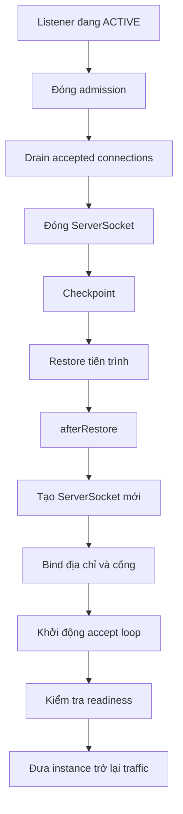

# Đóng và mở lại socket lắng nghe của máy chủ

Trong một ứng dụng Java dùng CRaC, socket lắng nghe TCP là tài nguyên gắn với hệ điều hành. Object `ServerSocket` có thể nằm trong heap khi checkpoint, nhưng cổng mà nó đã bind, trạng thái của socket và thread đang chờ `accept()` còn phụ thuộc vào kernel và môi trường mạng tại thời điểm restore.

Trong nhiều triển khai, cách vận hành dễ kiểm soát là đóng listener trước checkpoint rồi bind một listener mới sau restore. Việc này giải phóng cổng trong thời gian tiến trình tạm dừng, tránh phụ thuộc vào socket cũ và cho phép ứng dụng kiểm tra lại địa chỉ bind. Tuy nhiên, cần phối hợp với các kết nối đã được accept, thread nhận kết nối, load balancer và server framework.

Luồng cơ bản:

1. Ngừng nhận kết nối mới và đưa instance ra khỏi luồng traffic.
2. Drain hoặc đóng các kết nối đã accept theo chính sách của ứng dụng.
3. Đóng `ServerSocket`, làm cho thread đang chờ `accept()` thoát.
4. Tạo checkpoint sau khi listener và các tài nguyên liên quan ở trạng thái an toàn.
5. Sau restore, tạo `ServerSocket` mới, bind lại địa chỉ/cổng và khởi động accept loop mới.
6. Chỉ mở readiness khi listener và các dependency bắt buộc đã sẵn sàng.

## 1. ServerSocket và socket lắng nghe

Một TCP server thường có một socket lắng nghe trên địa chỉ IP và cổng cục bộ. Trong Java, API cơ bản là `java.net.ServerSocket`.

```java
ServerSocket server = new ServerSocket(8080);
Socket client = server.accept();
```

Lệnh `new ServerSocket(8080)` tạo listener và bind cổng 8080 trên địa chỉ wildcard. `accept()` chờ một kết nối TCP đến. Khi có kết nối, phương thức trả về một `Socket` riêng đại diện cho kết nối đã được chấp nhận. Listener tiếp tục tồn tại để nhận những kết nối tiếp theo.

Phân biệt hai loại socket:

- **Listening socket**: nhận yêu cầu kết nối mới trên một địa chỉ/cổng.
- **Accepted socket**: kết nối riêng đã được accept và dùng để trao đổi dữ liệu với một client.

Đóng `ServerSocket` chỉ đóng listener. Nó không tự động đóng mọi `Socket` đã được accept trước đó. Vì vậy, trước checkpoint cần có chính sách riêng cho kết nối đang hoạt động: chờ request hoàn tất, đóng kết nối keep-alive, kết thúc TLS session hoặc để client kết nối lại sau restore.

### Vì sao cần đóng listener?

Trong lúc tiến trình bị checkpoint, cổng có thể được một tiến trình khác hoặc instance mới sử dụng. Nếu listener cũ vẫn giữ cổng hoặc trạng thái socket không tương thích với môi trường restore, việc khôi phục có thể thất bại khi bind lại.

Đóng listener trước checkpoint đem lại một số lợi ích:

- Giải phóng cổng để tiến trình hoặc instance khác có thể sử dụng theo kế hoạch triển khai.
- Làm cho thread đang chờ `accept()` thoát theo một đường điều khiển có thể dự đoán.
- Tạo một điểm rõ ràng để ngừng admission và drain kết nối.
- Cho phép restore tạo socket mới từ cấu hình hiện hành, bao gồm địa chỉ bind và port.
- Tránh sử dụng một listener object có trạng thái đã đóng hoặc phụ thuộc vào môi trường trước checkpoint.

Một số nền tảng có thể hỗ trợ checkpoint/restore một số loại socket thông qua CRIU. Không nên dựa vào khả năng đó nếu chưa xác nhận cụ thể với JDK, CRIU, kernel và cách triển khai. Mô hình đóng rồi mở lại listener thường dễ kiểm soát hơn đối với server cần bind cổng ổn định sau restore.

## 2. Vòng đời listener trong CRaC

CRaC cung cấp `Resource` với hai callback thường dùng:

- `beforeCheckpoint(...)`: dừng nhận kết nối, xử lý accepted socket và đóng listener.
- `afterRestore(...)`: tạo listener mới, bind lại và khởi động thread nhận kết nối.



Không nên bind listener mới trước khi listener cũ đã được đóng và accept thread cũ đã dừng. Nếu hai listener cùng cố bind một địa chỉ/cổng, thao tác có thể thất bại với `BindException` hoặc hành vi phụ thuộc hệ điều hành và tùy chọn socket.

### Thứ tự đóng

Một trình tự thực tế:

1. Đóng admission tại HTTP server hoặc lớp điều phối để không có request mới.
2. Đưa instance ra khỏi load balancer hoặc service discovery.
3. Dừng nhận kết nối mới tại listener.
4. Chờ accept loop thoát.
5. Drain các kết nối đã accept và request đang xử lý.
6. Đóng các accepted socket còn lại theo timeout và chính sách ứng dụng.
7. Đánh dấu listener đã PAUSED để checkpoint.

Nếu đóng listener trước khi drain request, các kết nối đã được accept vẫn có thể đang thực hiện công việc. Listener không quản lý thay vòng đời của các accepted socket.

### Thứ tự mở

Sau restore:

1. Xác minh cấu hình bind, credential và các phụ thuộc mạng cần thiết.
2. Tạo `ServerSocket` mới.
3. Thiết lập socket option trước khi bind.
4. Bind địa chỉ và cổng.
5. Khởi động accept loop mới.
6. Kiểm tra listener đang bound và accept thread đang chạy.
7. Mở readiness và đưa instance trở lại traffic.

Nếu bind hoặc khởi động accept loop thất bại, giữ instance ở trạng thái chưa sẵn sàng và báo lỗi. Không trả readiness thành công chỉ vì JVM đã restore xong.

## 3. Bind địa chỉ và cổng ổn định

Listener phải bind vào địa chỉ mà client hoặc load balancer có thể truy cập. Cần quyết định rõ:

- Bind vào một địa chỉ IP cụ thể hay wildcard.
- Dùng cổng cố định hay cổng động.
- Giao thức IPv4, IPv6 hoặc dual-stack.
- Backlog cho các kết nối đang chờ được accept.
- Socket option cần thiết theo môi trường.

### Địa chỉ wildcard và địa chỉ cụ thể

`new ServerSocket(port)` thường bind vào địa chỉ wildcard, nghĩa là listener có thể nhận kết nối qua các interface phù hợp trên máy. Nếu chỉ muốn nhận kết nối trên một interface, hãy bind vào địa chỉ cụ thể.

```java
import java.net.InetAddress;
import java.net.InetSocketAddress;
import java.net.ServerSocket;

ServerSocket server = new ServerSocket();
server.bind(new InetSocketAddress(
        InetAddress.getByName("127.0.0.1"),
        8080
));
```

Bind vào `127.0.0.1` chỉ cho phép truy cập loopback IPv4; một container hoặc máy khác không thể truy cập qua địa chỉ mạng bên ngoài. Trong triển khai thực tế, hãy chọn địa chỉ phù hợp với topology. Wildcard tiện cho container nhưng có thể mở listener trên nhiều interface hơn dự kiến.

Nếu interface hoặc địa chỉ IP thay đổi giữa checkpoint và restore, bind vào địa chỉ cũ có thể thất bại. Cân nhắc bind wildcard hoặc đọc lại địa chỉ từ cấu hình hiện hành nếu kiến trúc cho phép. Không tự ý đổi sang wildcard nếu điều đó làm listener lộ ra mạng không mong muốn.

### Cổng cố định và cổng động

**Cổng cố định** phù hợp khi client, load balancer hoặc service discovery đã biết cổng của server:

```java
int port = 8080;
server.bind(new InetSocketAddress(port), 128);
```

Sau restore, ứng dụng phải bind lại đúng cổng đó. Nếu một tiến trình khác đã chiếm cổng, restore phải báo lỗi và giữ instance chưa sẵn sàng.

**Cổng động** được chọn bằng cách bind port 0:

```java
server.bind(new InetSocketAddress(0), 128);
int actualPort = server.getLocalPort();
System.out.println("Listening on port " + actualPort);
```

Hệ điều hành chọn một cổng còn trống. Khi restore và bind port 0 lần nữa, cổng mới có thể khác cổng cũ. Nếu client cần biết cổng, ứng dụng phải cập nhật service discovery hoặc công bố địa chỉ mới sau khi listener đã sẵn sàng. Không giả định cổng động được giữ nguyên qua checkpoint.

### Backlog

Tham số backlog trong `bind(..., backlog)` gợi ý số kết nối đang chờ được accept. Nó không phải số lượng client tối đa mà ứng dụng có thể phục vụ; giới hạn thực tế còn phụ thuộc kernel, cấu hình hệ điều hành và năng lực xử lý.

Chọn backlog theo tốc độ accept, lưu lượng kết nối và thời gian ứng dụng có thể bị quá tải. Sau restore, dùng cấu hình nhất quán với lần chạy mới hoặc cấu hình triển khai hiện tại.

### SO_REUSEADDR

`ServerSocket.setReuseAddress(true)` yêu cầu bật tùy chọn `SO_REUSEADDR` trước khi bind:

```java
ServerSocket server = new ServerSocket();
server.setReuseAddress(true);
server.bind(new InetSocketAddress(8080), 128);
```

Tùy chọn này hữu ích trong một số tình huống tái sử dụng địa chỉ sau khi socket cũ đóng. Ngữ nghĩa cụ thể phụ thuộc hệ điều hành. Nó không bảo đảm hai tiến trình có thể cùng bind một địa chỉ/cổng, không thay thế việc đóng listener cũ và không giải quyết mọi trường hợp `BindException`.

Không nhầm `SO_REUSEADDR` với `SO_REUSEPORT`. `SO_REUSEPORT` có ngữ nghĩa riêng, hỗ trợ và API phụ thuộc nền tảng; Java `ServerSocket` không cung cấp một API portable tương đương trên mọi hệ điều hành.

## 4. Quản lý accept loop

Thông thường, server có một thread hoặc nhóm event loop chờ kết nối mới. Khi `ServerSocket.close()` được gọi, một thread đang bị chặn trong `accept()` sẽ được đánh thức và thường nhận `SocketException`.

Đây là hành vi cần xử lý có chủ đích:

- Nếu listener đang được đóng để checkpoint, lỗi socket đóng là kết quả dự kiến; accept loop cần thoát bình thường.
- Nếu socket bị đóng hoặc gặp lỗi khi server vẫn ACTIVE, đó có thể là lỗi vận hành; cần ghi log và chuyển trạng thái listener sang FAILED.
- Sau restore, phải tạo một thread mới hoặc khởi động lại event loop mới. Một Java `Thread` đã kết thúc không thể gọi `start()` lần thứ hai.

Ví dụ accept loop:

```java
private void acceptLoop(ServerSocket listener) {
    while (accepting) {
        try {
            Socket client = listener.accept();

            if (!accepting) {
                client.close();
                break;
            }

            try {
                connectionManager.accept(client);
            } catch (RuntimeException failure) {
                try {
                    client.close();
                } catch (IOException closeFailure) {
                    failure.addSuppressed(closeFailure);
                }
                reportClientDispatchFailure(failure);
            }
        } catch (SocketException closed) {
            if (accepting) {
                reportUnexpectedListenerFailure(closed);
            }
            break;
        } catch (IOException failure) {
            if (accepting) {
                reportUnexpectedListenerFailure(failure);
            }
            break;
        }
    }
}
```

`connectionManager` là thành phần của ứng dụng tiếp nhận và quản lý accepted socket. Nó nên chuyển socket cho worker hoặc event loop một cách nhanh chóng; không nên xử lý toàn bộ request dài ngay trong accept thread vì khi đó server không thể accept kết nối tiếp theo.

### Đóng listener và chờ accept thread

Một phương thức dừng listener thường thực hiện:

```java
private void stopListener() throws IOException, InterruptedException {
    accepting = false;

    ServerSocket oldServer = serverSocket;
    serverSocket = null;
    if (oldServer != null) {
        oldServer.close();
    }

    Thread oldThread = acceptThread;
    acceptThread = null;
    if (oldThread != null && oldThread != Thread.currentThread()) {
        oldThread.join(5_000);
        if (oldThread.isAlive()) {
            throw new IllegalStateException(
                    "Accept thread did not stop after listener close");
        }
    }
}
```

Đây là ví dụ rút gọn. Code production cần xử lý interruption bằng cách khôi phục interrupt flag, giữ lại exception nếu cả close và join cùng thất bại, và không đặt trạng thái PAUSED khi accept thread chưa dừng. Timeout phải phù hợp với cách server và hệ điều hành xử lý socket.

## 5. Đăng ký listener với CRaC Resource

Có thể đóng và mở listener trong một resource. Ví dụ dưới đây minh họa cấu trúc lifecycle. `ConnectionManager` là abstraction của ứng dụng, chịu trách nhiệm drain các accepted socket, phục hồi worker và chuyển socket mới đến nơi xử lý.

```java
import org.crac.Context;
import org.crac.Core;
import org.crac.Resource;

import java.io.IOException;
import java.net.InetAddress;
import java.net.InetSocketAddress;
import java.net.ServerSocket;
import java.net.Socket;

public final class TcpListenerResource implements Resource {

    public interface ConnectionManager {
        void startNormally() throws Exception;
        void accept(Socket socket);
        void stopAndDrain() throws Exception;
        void resumeAfterAbortedCheckpoint() throws Exception;
        void prepareAfterRestore() throws Exception;
    }

    private enum State {
        NEW, ACTIVE, QUIESCING, PAUSED, RESTORING, FAILED
    }

    private final InetAddress bindAddress; // null means wildcard
    private final int port;
    private final int backlog;
    private final ConnectionManager connections;

    private volatile ServerSocket serverSocket;
    private volatile Thread acceptThread;
    private volatile boolean accepting;
    private volatile State state = State.NEW;

    public TcpListenerResource(
            InetAddress bindAddress,
            int port,
            int backlog,
            ConnectionManager connections) {
        this.bindAddress = bindAddress;
        this.port = port;
        this.backlog = backlog;
        this.connections = connections;
        Core.getGlobalContext().register(this);
    }

    public synchronized void startNormally() throws Exception {
        if (state != State.NEW) {
            throw new IllegalStateException("Unexpected state: " + state);
        }
        try {
            connections.startNormally();
            bindAndStartAcceptLoop();
            state = State.ACTIVE;
        } catch (Exception failure) {
            state = State.FAILED;
            closeListenerQuietly();
            throw failure;
        }
    }

    @Override
    public synchronized void beforeCheckpoint(
            Context<? extends Resource> context) throws Exception {
        if (state != State.ACTIVE) {
            throw new IllegalStateException("Cannot checkpoint from " + state);
        }

        state = State.QUIESCING;
        try {
            stopListener();
            connections.stopAndDrain();
            state = State.PAUSED;
        } catch (Exception failure) {
            try {
                connections.resumeAfterAbortedCheckpoint();
                bindAndStartAcceptLoop();
                state = State.ACTIVE;
            } catch (Exception resumeFailure) {
                failure.addSuppressed(resumeFailure);
                state = State.FAILED;
                closeListenerQuietly();
            }
            throw failure;
        }
    }

    @Override
    public synchronized void afterRestore(
            Context<? extends Resource> context) throws Exception {
        if (state != State.PAUSED) {
            throw new IllegalStateException("Unexpected restore state: " + state);
        }

        state = State.RESTORING;
        try {
            connections.prepareAfterRestore();
            bindAndStartAcceptLoop();
            state = State.ACTIVE;
        } catch (Exception failure) {
            state = State.FAILED;
            closeListenerQuietly();
            throw failure;
        }
    }

    private void bindAndStartAcceptLoop() throws IOException {
        ServerSocket candidate = new ServerSocket();
        try {
            candidate.setReuseAddress(true);
            InetSocketAddress endpoint = bindAddress == null
                    ? new InetSocketAddress(port)
                    : new InetSocketAddress(bindAddress, port);
            candidate.bind(endpoint, backlog);
        } catch (IOException failure) {
            try {
                candidate.close();
            } catch (IOException closeFailure) {
                failure.addSuppressed(closeFailure);
            }
            throw failure;
        }

        serverSocket = candidate;
        accepting = true;
        Thread thread = new Thread(
                () -> acceptLoop(candidate),
                "crac-tcp-acceptor"
        );
        acceptThread = thread;
        thread.start();
    }

    private void acceptLoop(ServerSocket listener) {
        // The listener identity prevents an old accept thread from resuming
        // if the application rolls back and opens a replacement listener.
        while (accepting && serverSocket == listener) {
            try {
                Socket client = listener.accept();
                if (!accepting || serverSocket != listener) {
                    client.close();
                    break;
                }
                try {
                    connections.accept(client);
                } catch (RuntimeException failure) {
                    try {
                        client.close();
                    } catch (IOException closeFailure) {
                        failure.addSuppressed(closeFailure);
                    }
                    reportClientDispatchFailure(failure);
                }
            } catch (IOException failure) {
                if (accepting && serverSocket == listener) {
                    state = State.FAILED;
                    reportUnexpectedListenerFailure(failure);
                }
                break;
            }
        }
    }

    private void stopListener() throws IOException, InterruptedException {
        accepting = false;
        ServerSocket oldServer = serverSocket;
        serverSocket = null;
        IOException closeFailure = null;
        if (oldServer != null) {
            try {
                oldServer.close();
            } catch (IOException failure) {
                closeFailure = failure;
            }
        }

        Thread oldThread = acceptThread;
        acceptThread = null;
        if (oldThread != null && oldThread != Thread.currentThread()) {
            try {
                oldThread.join(5_000);
            } catch (InterruptedException interrupted) {
                Thread.currentThread().interrupt();
                if (closeFailure != null) {
                    interrupted.addSuppressed(closeFailure);
                }
                throw interrupted;
            }
            if (oldThread.isAlive()) {
                IllegalStateException threadFailure = new IllegalStateException(
                        "Accept thread did not stop");
                if (closeFailure != null) {
                    threadFailure.addSuppressed(closeFailure);
                }
                throw threadFailure;
            }
        }
        if (closeFailure != null) {
            throw closeFailure;
        }
    }

    public int localPort() {
        ServerSocket current = serverSocket;
        return current == null ? -1 : current.getLocalPort();
    }

    private void closeListenerQuietly() {
        accepting = false;
        ServerSocket current = serverSocket;
        serverSocket = null;
        if (current != null) {
            try {
                current.close();
            } catch (IOException ignored) {
                // The original lifecycle failure is reported by the caller.
            }
        }
    }

    private void reportClientDispatchFailure(RuntimeException failure) {
        System.err.println("Cannot dispatch accepted socket: " + failure);
    }

    private void reportUnexpectedListenerFailure(IOException failure) {
        System.err.println("Listener failed unexpectedly: " + failure);
    }
}
```

Đây là ví dụ minh họa các điểm phối hợp chính, không phải một server framework hoàn chỉnh. Trong production, cần bổ sung logger, trạng thái readiness, quản lý accepted socket, xử lý interruption và giám sát accept thread. `ConnectionManager.stopAndDrain()` phải dừng admission cho kết nối đã accept, chờ request đang xử lý và đóng các kết nối còn lại theo timeout. `prepareAfterRestore()` phải tạo lại worker hoặc dependency cần thiết trước khi listener mở cổng.

Ví dụ dùng `port` cố định nếu giá trị lớn hơn 0. Nếu truyền 0, hệ điều hành cấp cổng động ở mỗi lần bind; `localPort()` trả cổng hiện tại và có thể thay đổi sau restore. Trong ứng dụng thật, cần cập nhật service discovery trước khi instance nhận traffic.

Một điểm quan trọng: `ServerSocket.isBound()` có thể tiếp tục trả true sau khi socket đã đóng vì nó phản ánh socket từng được bind. Hãy dùng trạng thái lifecycle và `isClosed()`/tham chiếu listener hiện tại để quản lý vòng đời; không dùng riêng `isBound()` làm tín hiệu rằng listener vẫn đang phục vụ.

## 6. Accepted socket và kết nối đang hoạt động

Đóng listener không đóng những socket đã được accept. Ví dụ:

```java
ServerSocket listener = new ServerSocket(8080);
Socket client = listener.accept();
listener.close();
// client vẫn là một socket riêng; cần quản lý vòng đời của nó.
```

Một server có thể đang có nhiều accepted socket, bao gồm:

- Kết nối HTTP keep-alive chưa đóng.
- Request đang xử lý.
- TLS connection đã handshake.
- WebSocket hoặc kết nối TCP dài hạn.
- Kết nối đang truyền dữ liệu hoặc chờ response.

Trước checkpoint, cần quyết định với từng loại:

| Loại kết nối | Chính sách thường dùng |
|---|---|
| Request ngắn đang chạy | Ngừng nhận request mới và chờ response hoàn tất |
| HTTP keep-alive idle | Gửi thông báo đóng hoặc đóng socket |
| TLS connection | Kết thúc session có kiểm soát nếu giao thức cho phép |
| WebSocket | Thông báo reconnect/retry theo giao thức ứng dụng |
| TCP session dài hạn | Lưu trạng thái nghiệp vụ bền vững và yêu cầu client kết nối lại |
| Connection đang truyền dữ liệu | Hoàn tất hoặc hủy có kiểm soát; không giả định byte đang truyền sẽ được phát lại |

Kết nối trong backlog chưa được accept cũng không phải dữ liệu ứng dụng đã xử lý. Khi listener đóng, kernel có thể từ chối hoặc xử lý các kết nối đang chờ theo hành vi hệ điều hành. Client cần có retry/backoff phù hợp. Không coi backlog là một queue bền vững.

## 7. Dùng ServerSocketChannel và Selector

Ứng dụng dùng Java NIO có thể quản lý listener bằng `ServerSocketChannel` thay cho `ServerSocket`. Channel có thể được đăng ký với `Selector` để nhận sự kiện `OP_ACCEPT`.

Ví dụ tạo channel:

```java
import java.net.InetSocketAddress;
import java.nio.channels.ServerSocketChannel;

ServerSocketChannel channel = ServerSocketChannel.open();
channel.configureBlocking(false);
channel.bind(new InetSocketAddress(8080), 128);
```

Khi checkpoint, cần:

1. Ngừng đăng ký hoặc xử lý sự kiện accept mới.
2. Đánh thức selector nếu event loop đang block trong `select()`.
3. Hủy/cancel key và đóng `ServerSocketChannel`.
4. Dừng event loop cũ và xử lý accepted channel đang tồn tại.

Sau restore, mở channel mới, cấu hình blocking mode, bind lại địa chỉ/cổng và đăng ký channel mới với selector/event loop. Không giữ một `SelectionKey` cũ rồi kỳ vọng nó đại diện cho channel mới.

Đóng channel đã đăng ký thường khiến key bị cancel và selector nhận biết thay đổi; tuy vậy, event loop cần được thiết kế để xử lý wakeup, key invalid và đóng selector có trật tự. Nếu selector chỉ phục vụ listener này, tạo selector mới sau restore thường dễ quản lý hơn. Nếu selector quản lý nhiều channel, phải phối hợp vòng đời của tất cả channel trong cùng một coordinator.

## 8. Tích hợp với HTTP server và Spring Boot

Khi dùng embedded server như Tomcat, Jetty hoặc Netty, framework thường sở hữu listening socket, accept thread và connection pool. Ứng dụng không nên tự tạo một `ServerSocket` thứ hai để bind cùng cổng trong callback CRaC.

Thay vào đó:

- Dùng lifecycle hoặc CRaC integration được hỗ trợ bởi phiên bản framework/runtime.
- Đảm bảo connector/server được dừng trước checkpoint theo đúng thứ tự.
- Drain request và xử lý keep-alive/WebSocket theo chính sách.
- Khởi động lại connector hoặc tái lập server listener sau restore.
- Chỉ báo readiness sau khi server đã bind và dependency ứng dụng đã sẵn sàng.

Nếu framework đã cung cấp resource quản lý listener, không đăng ký thêm một resource khác cùng đóng/mở socket mà không hiểu rõ thứ tự. Hai thành phần cùng sở hữu một listener có thể đóng hai lần, mở trùng hoặc xung đột cổng.

### HTTP readiness và load balancer

Đưa instance ra khỏi load balancer trước khi đóng listener giúp giảm request mới trong giai đoạn quiesce. Sau restore, trình tự ngược lại:

1. Bind listener thành công.
2. Hoàn tất phục hồi database, broker và các dependency bắt buộc.
3. Health/readiness endpoint báo sẵn sàng.
4. Service discovery/load balancer đưa instance trở lại.

Không nên đăng ký instance vào service discovery trước khi listener bind thành công. Nếu cổng bind thất bại, load balancer sẽ gửi traffic đến một địa chỉ không thể nhận kết nối.

## 9. Các lỗi bind và cách xử lý

| Lỗi hoặc hiện tượng | Nguyên nhân có thể | Hướng xử lý |
|---|---|---|
| `BindException: Address already in use` | Tiến trình khác giữ cổng hoặc listener cũ chưa đóng | Kiểm tra PID đang listen, xác nhận close và chờ accept loop dừng |
| `Cannot assign requested address` | Địa chỉ bind không còn gắn với interface | Kiểm tra IP/interface sau restore, cân nhắc cấu hình wildcard nếu phù hợp |
| Accept thread không thoát | Socket chưa được đóng đúng hoặc thread mắc trong xử lý khác | Đóng listener, kiểm tra stack thread và không đánh dấu PAUSED khi thread còn sống |
| Listener bind thành công nhưng client không kết nối được | Bind sai interface, firewall, route hoặc service discovery | Kiểm tra địa chỉ, port, network policy và route |
| Port thay đổi sau restore | Ứng dụng dùng port 0 | Công bố cổng mới hoặc cấu hình cổng cố định |
| Kết nối cũ lỗi sau restore | Accepted socket hoặc connection pool cũ không còn hợp lệ | Drain/close trước checkpoint và tái lập sau restore |
| Listener mở hai lần | Nhiều thành phần cùng quản lý socket | Chỉ định một owner cho listener và lifecycle |
| Readiness bật quá sớm | Health check chỉ kiểm tra process hoặc object tồn tại | Kiểm tra listener bound và dependency thực sự hoạt động |

### Kiểm tra cổng trên Linux

Có thể dùng các công cụ hệ điều hành để xem tiến trình nào đang listen:

```bash
ss -ltnp
```

Hoặc lọc theo cổng:

```bash
ss -ltnp 'sport = :8080'
```

Trên Windows, có thể dùng:

```powershell
Get-NetTCPConnection -LocalPort 8080 -State Listen
```

Các lệnh này hỗ trợ chẩn đoán cổng bị chiếm; quyền hiển thị PID/process có thể phụ thuộc user và hệ điều hành. Không tự động kill tiến trình khác chỉ vì nó đang giữ cổng. Trước tiên xác định owner và lý do cổng chưa được giải phóng.

## 10. Bảo mật khi mở lại listener

Restore là một thời điểm cần kiểm tra lại cấu hình mạng:

- Bind vào đúng interface, tránh vô tình mở listener trên tất cả interface.
- Giữ nguyên chính sách firewall, network policy và security group.
- Nếu server dùng TLS, kiểm tra certificate, private key, trust store và cấu hình TLS còn hợp lệ.
- Không ghi secret hoặc dữ liệu handshake nhạy cảm vào log.
- Xác minh xác thực và authorization vẫn hoạt động trước khi nhận traffic.
- Giới hạn backlog và số kết nối theo năng lực phục vụ.
- Không mở listener trước khi các dependency bắt buộc sẵn sàng.

Nếu địa chỉ IP, certificate hoặc credential thay đổi trong thời gian checkpoint, nên đọc cấu hình/secret mới theo cơ chế được phép và xác minh trước khi mở listener.

## 11. Kiểm thử checkpoint và restore cho listener

Một bài kiểm thử cần xác nhận cả socket lẫn hành vi client:

1. Khởi động server và xác nhận listener đang listen trên đúng địa chỉ/cổng.
2. Tạo một số kết nối TCP/HTTP và xác nhận server phục vụ bình thường.
3. Đưa instance ra khỏi load balancer hoặc ngừng gửi client mới.
4. Xác nhận request đang chạy được drain và accepted socket được xử lý theo chính sách.
5. Gửi checkpoint và xác nhận listener được đóng, accept thread cũ thoát.
6. Restore ảnh và xác nhận listener mới bind thành công.
7. Xác nhận accept loop mới nhận được kết nối.
8. Kiểm tra readiness chỉ bật sau khi listener và dependency sẵn sàng.
9. Kiểm tra client cũ nhận được hành vi đóng/retry có thể dự đoán.
10. Kiểm tra không có hai accept thread hoặc hai listener cùng chạy ngoài ý muốn.

Nên thử thêm các trường hợp lỗi:

- Cổng bị một tiến trình khác chiếm trước khi restore.
- Địa chỉ IP bind không còn tồn tại.
- Port 0 được dùng và cổng mới được công bố.
- Accept thread không dừng trong timeout.
- Một accepted connection không drain được.
- Checkpoint bị hủy sau khi listener đã đóng và ứng dụng phải rollback.
- Framework HTTP server đã tự quản lý listener.

Kết quả cần ghi lại gồm địa chỉ/cổng thực tế trước và sau restore, thời gian đóng/mở listener, số accepted connection được drain, số lỗi bind, thời gian readiness và trạng thái accept loop.

## 12. Checklist triển khai

### Trước checkpoint

- [ ] Xác định rõ thành phần sở hữu listening socket.
- [ ] Đóng admission và ngừng đưa instance vào traffic mới.
- [ ] Drain request, accepted socket và kết nối dài hạn theo chính sách.
- [ ] Đóng `ServerSocket` hoặc `ServerSocketChannel`.
- [ ] Xác nhận accept thread/event loop cũ đã dừng.
- [ ] Không đánh dấu PAUSED nếu còn kết nối hoặc worker chưa được xử lý.

### Sau restore

- [ ] Xác minh địa chỉ bind, port và cấu hình mạng.
- [ ] Tạo listener mới và thiết lập socket option trước bind.
- [ ] Bind thành công trước khi khởi động accept loop.
- [ ] Tạo thread/event loop mới; không restart một Thread đã kết thúc.
- [ ] Phục hồi worker và dependency trước khi mở admission.
- [ ] Cập nhật service discovery nếu dùng cổng động.
- [ ] Chỉ bật readiness khi listener thực sự hoạt động.

### Lỗi và quan sát

- [ ] Xử lý `SocketException` do close như một đường thoát dự kiến khi đang pause.
- [ ] Báo lỗi nếu accept loop dừng bất ngờ trong trạng thái ACTIVE.
- [ ] Có timeout cho drain và dừng accept thread.
- [ ] Có rollback nếu checkpoint bị hủy và việc mở lại listener an toàn.
- [ ] Không dùng `SO_REUSEADDR` như cách thay thế việc đóng socket cũ.
- [ ] Đã thử restore trên đúng JDK, CRIU, kernel và môi trường mạng mục tiêu.

Đóng và mở lại listening socket là một phần của lifecycle checkpoint–restore, không chỉ là thao tác gọi `close()` rồi `bind()`. Ứng dụng cần dừng nhận kết nối mới, xử lý accepted socket, kết thúc accept loop cũ và chỉ mở listener mới sau khi restore cùng các dependency đã sẵn sàng. Khi một thành phần duy nhất sở hữu lifecycle listener và trạng thái readiness được điều khiển rõ ràng, server có thể trở lại phục vụ trên đúng địa chỉ/cổng mà không dựa vào socket hoặc thread đã cũ.
