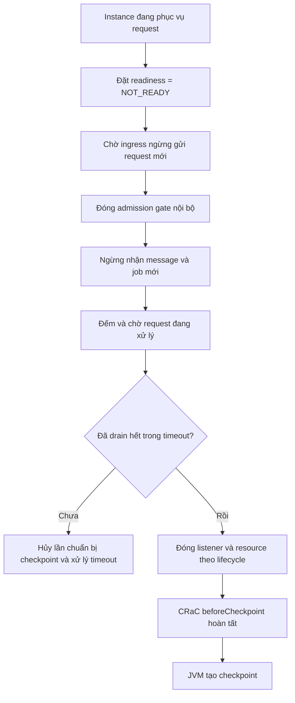

# Ngừng nhận yêu cầu và xử lý các yêu cầu đang phục vụ

Khi chuẩn bị tạo checkpoint bằng CRaC (Coordinated Restore at Checkpoint), một ứng dụng máy chủ cần đưa luồng xử lý mạng về trạng thái ổn định. Nếu vẫn nhận request mới trong lúc JVM hoặc ứng dụng đang đóng kết nối, dừng consumer hay chuẩn bị tài nguyên cho checkpoint, request có thể đi vào một instance sắp ngừng hoạt động. Ngược lại, nếu đóng server hoặc connection pool ngay lập tức, các request đã được nhận có thể bị ngắt giữa chừng.

Vì vậy, ứng dụng cần thực hiện hai việc theo đúng thứ tự: **ngừng nhận công việc mới và cho phép công việc đã nhận hoàn tất trong một khoảng thời gian có giới hạn**. Quy trình này thường được gọi là *graceful drain* hoặc *graceful shutdown*. Trong CRaC, drain là một phần của quá trình chuẩn bị checkpoint; sau restore, server chỉ được nhận request khi listener, tài nguyên và trạng thái ứng dụng đã sẵn sàng.

Việc drain cần phối hợp ở nhiều lớp:

- **Load balancer hoặc ingress:** ngừng chuyển request mới tới instance sắp checkpoint.
- **HTTP server và ứng dụng:** ngừng nhận hoặc từ chối request mới, theo dõi request đang xử lý và chờ chúng hoàn tất.
- **Tài nguyên nghiệp vụ:** giữ database, broker và các client cần thiết hoạt động cho tới khi request cuối cùng hoàn tất; sau đó mới đóng hoặc chuyển chúng sang trạng thái checkpoint-safe.
- **JVM và CRaC:** chỉ tiếp tục checkpoint khi các resource đã hoàn tất callback chuẩn bị.

Không có một callback CRaC đơn lẻ nào tự động điều phối toàn bộ load balancer, HTTP server và nghiệp vụ. Ứng dụng cần kết hợp API CRaC với cơ chế lifecycle của framework và nền tảng triển khai.

## 1. Vì sao phải drain request trước checkpoint?

Một request đang phục vụ có thể sử dụng nhiều tài nguyên trong suốt thời gian xử lý:

- đọc body từ socket và ghi response về client;
- lấy connection từ database pool, mở transaction và commit hoặc rollback;
- gọi dịch vụ HTTP bên ngoài;
- gửi message hoặc cập nhật offset của consumer;
- đọc hoặc ghi cache;
- khởi chạy tác vụ bất đồng bộ để hoàn tất nghiệp vụ.

Nếu checkpoint bắt đầu khi những thao tác này chưa kết thúc, ứng dụng có thể lưu một trạng thái không phù hợp để tiếp tục. Ví dụ, thread đã được khôi phục nhưng socket phía client đã đóng; transaction đang mở không còn kết nối hợp lệ; hoặc message đã được nhận nhưng chưa được xác nhận theo đúng semantics của broker.

Ngừng nhận request mới giúp giới hạn số công việc cần hoàn tất. Chờ request đang chạy giúp ứng dụng kết thúc các thao tác nghiệp vụ tại một ranh giới có kiểm soát. Sau khi drain thành công, những resource như connection pool hoặc client mạng mới có thể được đóng an toàn.

### 1.1. Phân biệt readiness, liveness và admission

Ba khái niệm này có mục đích khác nhau:

| Cơ chế | Câu hỏi được trả lời | Khi chuẩn bị checkpoint |
| --- | --- | --- |
| Readiness | Instance có nên nhận traffic mới không? | Chuyển sang not ready để load balancer loại instance khỏi nhóm phục vụ |
| Liveness | Tiến trình có còn sống và cần tiếp tục chạy không? | Thường vẫn healthy trong lúc drain; không dùng liveness để báo instance đã sẵn sàng nhận traffic |
| Admission control | Ứng dụng có cấp quyền bắt đầu request mới không? | Đóng cổng nội bộ để chặn request lọt vào trong lúc readiness đang lan truyền |

Readiness có thể cần thời gian để được load balancer hoặc ingress controller cập nhật. Trong khoảng trễ đó, một request vẫn có thể được gửi tới instance. Admission control là lớp bảo vệ cuối cùng: request mới đến sau khi cổng đã đóng sẽ bị từ chối bằng phản hồi có thể retry, thường là HTTP 503.

Liveness không nên tự động chuyển sang unhealthy chỉ vì instance đang drain. Nếu liveness thất bại, nền tảng có thể khởi động lại tiến trình đúng lúc nó đang chuẩn bị checkpoint. Health endpoint cũng cần được xử lý riêng để hệ thống điều phối vẫn đọc được readiness và liveness khi admission của request nghiệp vụ đã đóng.

## 2. Quy trình graceful drain tổng thể

Một quy trình chuẩn bị checkpoint thường có các bước sau:

1. Đánh dấu instance không còn nhận traffic mới bằng readiness hoặc cơ chế điều phối tương đương.
2. Chờ load balancer/ingress ngừng gửi request mới tới instance trong giới hạn thời gian được cấu hình.
3. Đóng admission gate nội bộ để chặn request mới còn lọt vào.
4. Ngừng nhận công việc mới từ các nguồn khác như message broker, scheduler và background worker.
5. Chờ request, stream và tác vụ đang phục vụ hoàn tất hoặc kết thúc theo chính sách timeout.
6. Xác nhận không còn thao tác nghiệp vụ đang dùng tài nguyên cần đóng.
7. Đóng listener hoặc các tài nguyên mạng theo cơ chế hỗ trợ của server và runtime; đóng connection pool, client hoặc consumer theo thứ tự phụ thuộc.
8. Để các CRaC resource hoàn tất `beforeCheckpoint`; sau đó JVM mới tiếp tục tạo ảnh tiến trình.

Luồng tổng quát:



Sau restore, quy trình đảo ngược ở mức tài nguyên: JVM gọi `afterRestore`, ứng dụng tạo lại listener và kết nối cần thiết, xác minh sức khỏe, mở admission gate rồi mới chuyển readiness về ready. Cổng admission chỉ được mở sau khi các thành phần bắt buộc đã sẵn sàng.

### 2.1. Điều phối readiness cần bắt đầu đủ sớm

Nếu chỉ đặt readiness thành not ready bên trong `beforeCheckpoint`, nền tảng có thể chưa kịp loại instance khỏi load balancer trước khi JVM bắt đầu checkpoint. Vì vậy, với hệ thống cần thời gian lan truyền trạng thái, nên có một bước điều phối drain trước khi gửi lệnh checkpoint. Bước này có thể được thực hiện bởi deployment controller, lifecycle manager hoặc một endpoint quản trị nội bộ.

Callback CRaC vẫn cần đóng admission gate và kiểm tra số request đang chạy để bảo vệ instance tại thời điểm cuối. Nhưng callback không nên giả định rằng việc thay đổi readiness đã có hiệu lực ngay lập tức ở mọi proxy.

## 3. Admission gate cho request mới

Admission gate là một thành phần đồng bộ hóa ở cấp ứng dụng. Khi ở trạng thái `ACCEPTING`, request mới được phép vào và được tính vào số request đang xử lý. Khi chuyển sang `DRAINING`, request mới bị từ chối; những request đã được chấp nhận tiếp tục chạy và được đếm cho tới khi hoàn tất.

Mô hình trạng thái đơn giản:

| Trạng thái | Request mới | Request đã được chấp nhận |
| --- | --- | --- |
| `ACCEPTING` | Được nhận | Tiếp tục xử lý |
| `DRAINING` | Bị từ chối hoặc chuyển sang instance khác | Được phép hoàn tất |
| `DRAINED` | Bị từ chối | Không còn request đang hoạt động |
| `RESTORING` | Bị từ chối | Không có request nghiệp vụ được phép chạy |
| `FAILED` | Bị từ chối | Giữ instance ở trạng thái chưa sẵn sàng |

Một gate cần cung cấp ít nhất ba thao tác:

- `tryEnter()`: cấp một lease cho request mới nếu instance đang nhận request.
- `stopAccepting()`: chuyển sang `DRAINING`, ngăn lease mới.
- `awaitDrained(timeout)`: chờ các lease hiện có được giải phóng hoặc báo timeout.
- `cancelDrain()`: mở lại admission nếu lần drain bị hủy trước khi các resource được đóng.

Lease được đóng trong `finally` hoặc `try-with-resources`. Việc kiểm tra trạng thái và tăng bộ đếm phải diễn ra nguyên tử trong cùng một vùng đồng bộ để không có request chen vào giữa lúc gate đóng.

## 4. Cài đặt RequestDrainGate bằng Java

Ví dụ dưới đây sử dụng `ReentrantLock`, `Condition` và bộ đếm request đang hoạt động. `RequestLease` đại diện cho quyền xử lý một request đã được chấp nhận.

```java
import java.time.Duration;
import java.util.concurrent.TimeoutException;
import java.util.concurrent.atomic.AtomicBoolean;
import java.util.concurrent.locks.Condition;
import java.util.concurrent.locks.ReentrantLock;

public final class RequestDrainGate {

    public enum State {
        ACCEPTING,
        DRAINING,
        DRAINED,
        RESTORING,
        FAILED
    }

    private final ReentrantLock lock = new ReentrantLock();
    private final Condition noRequests = lock.newCondition();

    private State state = State.ACCEPTING;
    private int inFlight;

    public RequestLease tryEnter() {
        lock.lock();
        try {
            if (state != State.ACCEPTING) {
                return null;
            }

            inFlight++;
            return new RequestLease(this);
        } finally {
            lock.unlock();
        }
    }

    private void leave() {
        lock.lock();
        try {
            if (inFlight <= 0) {
                throw new IllegalStateException("Unbalanced request lease");
            }

            inFlight--;
            if (inFlight == 0) {
                if (state == State.DRAINING) {
                    state = State.DRAINED;
                }
                noRequests.signalAll();
            }
        } finally {
            lock.unlock();
        }
    }

    public void stopAccepting() {
        lock.lock();
        try {
            if (state != State.ACCEPTING) {
                throw new IllegalStateException(
                        "Cannot drain from state " + state);
            }

            state = inFlight == 0 ? State.DRAINED : State.DRAINING;
            noRequests.signalAll();
        } finally {
            lock.unlock();
        }
    }

    public void cancelDrain() {
        lock.lock();
        try {
            if (state != State.DRAINING && state != State.DRAINED) {
                throw new IllegalStateException(
                        "Cannot cancel drain from state " + state);
            }

            state = State.ACCEPTING;
            noRequests.signalAll();
        } finally {
            lock.unlock();
        }
    }

    public void awaitDrained(Duration timeout)
            throws InterruptedException, TimeoutException {
        long remaining = timeout.toNanos();

        lock.lock();
        try {
            if (state != State.DRAINING && state != State.DRAINED) {
                throw new IllegalStateException(
                        "Cannot wait for drain from state " + state);
            }

            while (inFlight > 0) {
                if (remaining <= 0) {
                    throw new TimeoutException(
                            "Timed out waiting for in-flight requests");
                }
                remaining = noRequests.awaitNanos(remaining);
            }

            state = State.DRAINED;
        } catch (InterruptedException ex) {
            Thread.currentThread().interrupt();
            throw ex;
        } finally {
            lock.unlock();
        }
    }

    public void beginRestore() {
        lock.lock();
        try {
            if (state != State.DRAINED) {
                throw new IllegalStateException(
                        "Cannot restore from state " + state);
            }
            state = State.RESTORING;
        } finally {
            lock.unlock();
        }
    }

    public void resumeAccepting() {
        lock.lock();
        try {
            if (state != State.RESTORING) {
                throw new IllegalStateException(
                        "Cannot accept requests from state " + state);
            }
            state = State.ACCEPTING;
            noRequests.signalAll();
        } finally {
            lock.unlock();
        }
    }

    public void fail() {
        lock.lock();
        try {
            state = State.FAILED;
            noRequests.signalAll();
        } finally {
            lock.unlock();
        }
    }

    public int inFlightCount() {
        lock.lock();
        try {
            return inFlight;
        } finally {
            lock.unlock();
        }
    }

    public State state() {
        lock.lock();
        try {
            return state;
        } finally {
            lock.unlock();
        }
    }

    public static final class RequestLease implements AutoCloseable {
        private final RequestDrainGate owner;
        private final AtomicBoolean closed = new AtomicBoolean();

        private RequestLease(RequestDrainGate owner) {
            this.owner = owner;
        }

        @Override
        public void close() {
            if (closed.compareAndSet(false, true)) {
                owner.leave();
            }
        }
    }
}
```

Gate minh họa các đặc điểm sau:

- `tryEnter()` kiểm tra trạng thái và tăng `inFlight` trong cùng một lock.
- Khi `stopAccepting()` chạy, mọi request mới nhận `null` và không được tính là request đang phục vụ.
- Request đã có lease vẫn có thể hoàn tất; `leave()` giảm bộ đếm và đánh thức thread đang chờ khi số lượng về 0.
- `awaitDrained()` dùng timeout để không chờ vô hạn.
- Sau restore, gate chuyển qua `RESTORING`; chỉ `resumeAccepting()` mới cho phép request mới.
- `RequestLease.close()` idempotent để tránh giảm bộ đếm nhiều lần nếu nhiều nhánh cleanup cùng gọi.

Đây là lớp đồng bộ minh họa. Trong ứng dụng thực tế cần xác định rõ cách xử lý khi drain timeout: nếu callback thất bại trước khi đóng resource, hệ thống có thể dùng một thao tác `cancelDrain()` riêng để mở gate trở lại. Không nên tự động mở gate sau khi một số tài nguyên đã đóng một phần; khi đó phải đưa instance vào trạng thái lỗi hoặc thực hiện rollback có kiểm soát.

## 5. Tích hợp admission gate với HTTP server

Một cách tích hợp phổ biến là đặt một filter hoặc interceptor ở ranh giới request. Mỗi request nghiệp vụ phải lấy lease trước khi đi vào controller. Nếu gate đã đóng, ứng dụng trả phản hồi từ chối có thể retry.

Ví dụ với Servlet Filter cho request đồng bộ:

```java
import java.io.IOException;

import jakarta.servlet.Filter;
import jakarta.servlet.FilterChain;
import jakarta.servlet.ServletException;
import jakarta.servlet.ServletRequest;
import jakarta.servlet.ServletResponse;
import jakarta.servlet.http.HttpServletResponse;

public final class RequestAdmissionFilter implements Filter {

    private final RequestDrainGate gate;

    public RequestAdmissionFilter(RequestDrainGate gate) {
        this.gate = gate;
    }

    @Override
    public void doFilter(
            ServletRequest request,
            ServletResponse response,
            FilterChain chain) throws IOException, ServletException {

        RequestDrainGate.RequestLease lease = gate.tryEnter();
        if (lease == null) {
            ((HttpServletResponse) response).sendError(
                    HttpServletResponse.SC_SERVICE_UNAVAILABLE,
                    "Instance is draining");
            return;
        }

        try (lease) {
            chain.doFilter(request, response);
        }
    }
}
```

Ví dụ này dành cho request đồng bộ. Với Servlet asynchronous processing, `doFilter()` có thể kết thúc trước khi response thực sự hoàn tất. Khi đó không được đóng lease ngay ở `finally`; cần gắn `AsyncListener` và chỉ giải phóng lease khi async request hoàn tất, lỗi hoặc timeout. Với Spring WebFlux, lease cần tồn tại tới khi publisher kết thúc, thường được quản lý bằng `doFinally` hoặc một wrapper tương đương.

### 5.1. Health endpoint và endpoint quản trị

Không nên để admission filter chặn chính endpoint mà load balancer dùng để kiểm tra readiness. Nếu readiness endpoint cũng bị trả 503 chỉ vì gate đã đóng, nền tảng có thể không phân biệt được trạng thái drain có chủ ý với lỗi ứng dụng.

Hãy xác định rõ các nhóm endpoint:

- **Readiness:** được phép truy cập khi ứng dụng đang drain và phải phản ánh trạng thái not ready.
- **Liveness:** phản ánh tiến trình còn hoạt động; thường không bị ảnh hưởng bởi admission gate nghiệp vụ.
- **Endpoint quản trị drain:** được bảo vệ bằng xác thực và quyền truy cập phù hợp, dùng để yêu cầu bắt đầu drain.
- **Request nghiệp vụ:** phải lấy lease và bị từ chối khi gate đóng.

Các endpoint quản trị không nên được mở công khai. Cách cấu hình filter mapping hoặc security matcher phụ thuộc framework; cần bảo đảm không có đường vòng để request nghiệp vụ bỏ qua admission gate.

### 5.2. Không chỉ dựa vào filter để ngừng nhận TCP connection

Filter nằm trong pipeline xử lý request. Nó có thể từ chối request sau khi TCP connection đã được chấp nhận. Nếu mục tiêu là ngừng nhận kết nối mới ở cấp socket, cần sử dụng lifecycle API của HTTP server hoặc reverse proxy tương ứng.

Việc dừng listener và xử lý keep-alive phụ thuộc server implementation. Một số server có cơ chế pause accept, graceful shutdown hoặc đóng listener trong khi vẫn cho các request hiện tại hoàn tất. Cần xác định chính xác hành vi của server được dùng và tích hợp nó với CRaC. Không nên giả định `server.stop()` trên mọi framework đều giữ lại các request đang chạy hoặc có thể tự khởi động lại sau restore.

## 6. Theo dõi request đang phục vụ

Bộ đếm in-flight phải phản ánh toàn bộ thời gian request còn sử dụng tài nguyên hoặc còn có thể tạo tác động nghiệp vụ. Với request đồng bộ, filter có thể tăng bộ đếm khi vào và giảm khi filter kết thúc. Với request bất đồng bộ, streaming hoặc WebSocket, vòng đời phức tạp hơn.

### 6.1. Request Servlet đồng bộ

Với request đồng bộ, `try-with-resources` trong filter là cách đơn giản để bảo đảm lease được giải phóng cả khi controller ném exception:

```java
RequestDrainGate.RequestLease lease = gate.tryEnter();
if (lease == null) {
    rejectWith503(response);
    return;
}

try (lease) {
    chain.doFilter(request, response);
}
```

Request được tính là đang phục vụ từ lúc được admission chấp nhận tới khi filter chain kết thúc. Nếu response đã được ghi xong trước khi filter trả về, đây là ranh giới phù hợp.

### 6.2. Servlet asynchronous request

Với Servlet Async, filter có thể trả về trong khi tác vụ xử lý vẫn đang chạy. Nếu giải phóng lease trong `finally` của `doFilter`, drain có thể kết luận đã hết request trong khi async task vẫn sử dụng database hoặc socket.

Một triển khai thực tế cần:

1. Lấy lease trước khi gọi filter chain.
2. Sau khi chain trả về, kiểm tra request có bắt đầu async hay không.
3. Nếu không async, đóng lease ngay.
4. Nếu async, đăng ký `AsyncListener` và giữ lease cho tới `onComplete`, `onError` hoặc `onTimeout` theo chính sách của ứng dụng.
5. Khi `onStartAsync` tạo một async cycle mới, đăng ký listener lại cho cycle đó.
6. Dùng lease idempotent để callback hoàn tất và timeout không giải phóng bộ đếm hai lần.

Pseudocode:

```java
RequestLease lease = gate.tryEnter();
if (lease == null) {
    rejectWith503(response);
    return;
}

boolean transferredToAsync = false;
try {
    chain.doFilter(request, response);
    if (request.isAsyncStarted()) {
        request.getAsyncContext().addListener(new DrainAsyncListener(lease));
        transferredToAsync = true;
    }
} finally {
    if (!transferredToAsync) {
        lease.close();
    }
}
```

`DrainAsyncListener` cần đóng lease khi async request kết thúc, và cần đăng ký lại listener trong `onStartAsync`. Đoạn pseudocode chỉ mô tả việc chuyển quyền sở hữu lease; code thực tế còn phải xử lý exception khi đăng ký listener, async dispatch lặp và các race giữa timeout với completion.

### 6.3. Spring MVC và WebFlux

Spring MVC có thể dùng Servlet async, `Callable`, `DeferredResult` hoặc `WebAsyncTask`. Bộ đếm cần theo dõi tới khi response thực sự hoàn tất, không chỉ tới lúc controller trả về đối tượng đại diện cho công việc bất đồng bộ.

Spring WebFlux dùng pipeline reactive. Việc đếm request nên gắn với vòng đời của publisher, ví dụ dùng `Mono.usingWhen` hoặc operator `doFinally` để giải phóng lease khi publisher complete, error hoặc cancel. Cần tính cả trường hợp client hủy subscription; nếu không, drain có thể chờ một request đã bị hủy hoặc kết luận sớm khi tác vụ nền vẫn chạy.

Không nên dùng một filter đồng bộ chung rồi giả định nó đo đúng vòng đời của cả Servlet async và reactive stream. Hãy tích hợp ở abstraction phù hợp với server stack đang chạy.

## 7. Request dài hạn và giao thức streaming

Không phải request nào cũng có thời gian kết thúc ngắn. Các kết nối WebSocket, Server-Sent Events (SSE), long polling, HTTP streaming và HTTP/2 stream có thể tồn tại lâu hơn thời gian drain dự kiến.

Ứng dụng cần xác định chính sách cho từng loại:

| Loại kết nối | Chính sách drain có thể áp dụng |
| --- | --- |
| Request/response HTTP thông thường | Chờ hoàn tất trong request timeout đã cấu hình |
| Long polling | Ngừng tạo poll mới; cho poll hiện tại kết thúc hoặc trả response đóng có thể retry |
| SSE | Ngừng gửi event mới, gửi tín hiệu kết thúc nếu giao thức cho phép và đóng stream có kiểm soát |
| WebSocket | Từ chối kết nối mới, gửi close frame với lý do phù hợp và chờ client đóng trong giới hạn thời gian |
| HTTP/2 | Ngừng nhận stream mới theo khả năng của server, có thể dùng GOAWAY; cho stream hiện tại kết thúc trong giới hạn |
| Upload/download lớn | Cho phép hoàn tất nếu còn trong deadline; nếu không, hủy theo chính sách và bảo đảm client có thể tiếp tục hoặc gửi lại |

Không nên chờ vô hạn chỉ vì một WebSocket vẫn mở. Ngược lại, đóng socket ngay lập tức có thể khiến client không biết thao tác nghiệp vụ đã được commit hay chưa. Với các thao tác có thể gửi lại, cần idempotency key hoặc cơ chế truy vấn trạng thái để client xác định kết quả.

## 8. Kết thúc request đúng ranh giới nghiệp vụ

Một request được coi là hoàn tất khi toàn bộ tác động nghiệp vụ của nó đã đạt một trạng thái xác định, không chỉ khi controller trả về.

Ví dụ một request thanh toán có thể:

1. nhận request và kiểm tra idempotency key;
2. mở transaction;
3. ghi dữ liệu thanh toán;
4. commit transaction;
5. gửi sự kiện qua transactional outbox hoặc xác nhận message;
6. tạo response và hoàn tất việc ghi response.

Nếu drain kết thúc sau bước 2 nhưng trước bước 4, checkpoint có thể lưu trạng thái request chưa hoàn tất. Nếu transaction được rollback khi kết nối bị đóng, client có thể đã timeout và gửi lại. Nếu transaction đã commit nhưng response chưa đến client, client cũng có thể gửi lại. Do đó, cần có semantics retry và idempotency rõ ràng.

Các nguyên tắc quan trọng:

- Chỉ giải phóng lease sau khi transaction đã commit hoặc rollback.
- Chờ thao tác ghi dữ liệu và flush response hoàn tất theo hợp đồng của framework.
- Không xác nhận message trước khi nghiệp vụ đã đạt trạng thái bền vững cần thiết.
- Dùng idempotency key cho request có thể được client gửi lại.
- Đặt timeout cho từng bước bên ngoài để tổng thời gian drain có thể dự đoán.
- Với tác vụ đã chuyển sang executor, lease phải được giữ tới khi phần việc thực sự hoàn tất.

## 9. Tích hợp với CRaC Resource

Có thể tạo một `Resource` điều phối quá trình drain. Resource này không nhất thiết sở hữu database pool hoặc broker client; nó điều phối admission, request tracker và server lifecycle. Các resource chuyên biệt khác vẫn có thể quản lý connection pool và client riêng.

Ví dụ về cấu trúc:

```java
import java.time.Duration;
import java.util.concurrent.TimeoutException;
import org.crac.Context;
import org.crac.Core;
import org.crac.Resource;

public final class NetworkDrainResource implements Resource {

    private final RequestDrainGate requestGate;
    private final HttpServerLifecycle serverLifecycle;

    public NetworkDrainResource(
            RequestDrainGate requestGate,
            HttpServerLifecycle serverLifecycle) {
        this.requestGate = requestGate;
        this.serverLifecycle = serverLifecycle;
        Core.getGlobalContext().register(this);
    }

    @Override
    public void beforeCheckpoint(Context<? extends Resource> context)
            throws Exception {
        requestGate.stopAccepting();
        try {
            requestGate.awaitDrained(Duration.ofSeconds(30));
        } catch (InterruptedException | TimeoutException ex) {
            requestGate.cancelDrain();
            throw ex;
        }

        try {
            serverLifecycle.stopAcceptingConnections();
        } catch (Exception ex) {
            requestGate.fail();
            throw ex;
        }
    }

    @Override
    public void afterRestore(Context<? extends Resource> context)
            throws Exception {
        serverLifecycle.restoreListener();
        serverLifecycle.verifyReady();
        requestGate.beginRestore();
        requestGate.resumeAccepting();
    }
}
```

`HttpServerLifecycle` ở đây là interface minh họa do ứng dụng định nghĩa, không phải API chuẩn của Java hoặc CRaC. Thứ tự thực tế của server listener phụ thuộc HTTP server và tích hợp CRaC được sử dụng. Nếu server framework tự đăng ký resource để đóng/mở listener, không nên để `NetworkDrainResource` đóng cùng listener lần nữa.

Trong ví dụ, `beginRestore()` chỉ hợp lệ khi gate đã ở `DRAINED`. Ở môi trường thực tế, gate cần được đưa vào trạng thái phù hợp ngay trong quá trình restore, và thứ tự callback giữa network resource với các resource phụ thuộc phải được xác định. Nếu `awaitDrained()` timeout, callback phải báo lỗi để checkpoint thất bại. Một lifecycle coordinator cấp cao hơn cần quyết định cách khôi phục admission nếu lần chuẩn bị bị hủy trước khi bất kỳ resource nào bị đóng.

### 9.1. Thứ tự giữa drain và resource khác

Giả sử request đang dùng database pool và broker client. Thứ tự an toàn thường là:

1. Ngừng ingress và đóng admission.
2. Chờ request đang chạy hoàn tất, bao gồm transaction và message publish.
3. Dừng scheduler và consumer để chúng không tạo công việc mới.
4. Drain các operation còn lại của database và broker.
5. Đóng pool và client.
6. Hoàn tất checkpoint.

Sau restore:

1. Tạo lại database pool và broker client.
2. Xác minh kết nối và cấu hình hiện hành.
3. Khởi động scheduler và consumer khi dependency đã sẵn sàng.
4. Khởi động hoặc mở listener.
5. Mở admission gate và chuyển readiness thành ready.

Nếu một framework có thứ tự callback resource được xác định theo thứ tự đăng ký, hãy tổ chức đăng ký theo quan hệ dependency. Với các bước cần phối hợp như drain HTTP request trước khi đóng pool, một coordinator có thể quản lý thứ tự rõ ràng hơn.

## 10. Timeout và chính sách khi không drain hết

Không phải lúc nào request cũng hoàn tất đúng thời gian dự kiến. Một request có thể gọi dịch vụ ngoài bị treo, chờ lock, truyền file lớn hoặc giữ một stream lâu dài. Vì vậy, drain cần deadline tổng thể và chính sách xử lý khi deadline hết hạn.

| Tình huống | Hành động |
| --- | --- |
| Request hoàn tất trong deadline | Giảm bộ đếm; tiếp tục drain |
| Request vẫn chạy gần hết deadline | Ghi nhận request id, route và thời gian chạy; không đóng resource mà request còn sử dụng |
| Drain hết timeout | Báo checkpoint thất bại hoặc hủy yêu cầu checkpoint; không giả vờ đã drain thành công |
| Client hủy request | Hủy tác vụ nếu an toàn; giải phóng lease khi toàn bộ công việc thực sự kết thúc |
| Request không thể hủy an toàn | Đợi tới deadline và xử lý theo chính sách nghiệp vụ; không cắt ngang transaction tùy tiện |
| Server/resource đóng một phần rồi thất bại | Giữ instance chưa sẵn sàng và xử lý phục hồi có kiểm soát |

Thời gian drain phải nhỏ hơn thời gian tối đa mà nền tảng cho phép tiến trình chuẩn bị checkpoint. Cần dành thời gian cho việc đóng resource, JVM/CRIU ghi ảnh và các bước vận hành khác. Không đặt timeout drain dài hơn deadline tổng thể của deployment hoặc job checkpoint.

Một chiến lược timeout có thể gồm:

- request timeout riêng cho từng endpoint;
- timeout kết nối và đọc dịch vụ bên ngoài;
- timeout transaction và truy vấn database;
- timeout cho WebSocket/SSE/stream;
- drain timeout tổng thể;
- checkpoint timeout của nền tảng.

Các timeout cần có thứ tự hợp lý để request có cơ hội kết thúc trước drain deadline. Nếu một request không thể hoàn tất, cần có chính sách retry/idempotency để client hoặc producer có thể tiếp tục sau khi instance khác sẵn sàng.

## 11. Các lỗi triển khai thường gặp

| Lỗi | Hậu quả | Cách xử lý |
| --- | --- | --- |
| Chỉ đổi readiness mà không có admission gate | Request vẫn có thể tới instance trong thời gian propagation | Dùng readiness kết hợp gate nội bộ |
| Đóng listener trước khi drain | Request đang chạy có thể bị ngắt | Ngừng nhận request mới, chờ in-flight, rồi mới dừng listener |
| Chỉ đếm request đồng bộ | Async task vẫn chạy sau khi bộ đếm về 0 | Theo dõi tới khi async/stream thực sự kết thúc |
| Không xử lý WebSocket hoặc SSE | Drain có thể không bao giờ hoàn tất | Đặt chính sách đóng kết nối dài hạn và deadline |
| Health endpoint bị admission chặn | Load balancer không đọc được trạng thái not ready | Tách readiness/liveness khỏi request nghiệp vụ |
| Mở admission ngay sau khi server bind port | Resource nghiệp vụ có thể chưa sẵn sàng | Chỉ mở sau khi mọi dependency và readiness đã đạt |
| Nuốt timeout | Checkpoint có thể bắt đầu khi request vẫn dùng tài nguyên | Báo lỗi và hủy lần checkpoint |
| Đóng pool trong khi request còn transaction | Transaction thất bại hoặc trạng thái nghiệp vụ không rõ | Chờ request hoàn tất rồi mới đóng pool |
| Không tính tác vụ nền | Scheduler/consumer tiếp tục truy cập resource | Tạm dừng nguồn tạo việc mới và drain cả worker |
| Giữ lease quá lâu hoặc quên đóng | Drain bị treo | Dùng `try-with-resources`, timeout và metric in-flight |
| Khởi động lại listener hai lần | Lỗi bind port hoặc nhận request trùng | Chỉ có một chủ sở hữu lifecycle cho server listener |

## 12. Quan sát và kiểm tra quá trình drain

Để xác nhận drain hoạt động, cần quan sát được trạng thái admission, số request đang xử lý và thời gian chờ. Những metric hữu ích gồm:

- trạng thái readiness hiện tại;
- trạng thái admission gate (`ACCEPTING`, `DRAINING`, `DRAINED`...);
- số request in-flight;
- số request mới bị từ chối trong lúc drain;
- thời gian drain tổng thể và thời gian drain theo route;
- số request vượt deadline;
- số kết nối dài hạn còn mở;
- số background job và message đang xử lý;
- thời gian đóng/mở listener;
- thời gian từ restore đến readiness.

Log nên có correlation id hoặc request id, route, thời gian bắt đầu và lý do chưa hoàn tất. Không ghi body, token, cookie hoặc dữ liệu nhạy cảm vào log chỉ để theo dõi drain.

### 12.1. Các kịch bản cần thử

| Kịch bản | Kết quả mong đợi |
| --- | --- |
| Request ngắn đang chạy khi gate đóng | Request được hoàn tất; drain đợi lease được giải phóng |
| Request mới tới sau khi gate đóng | Bị từ chối nhanh với phản hồi retry phù hợp |
| Request tới trong lúc readiness đang propagation | Admission gate vẫn chặn request mới |
| Request ném exception | Lease vẫn được giải phóng trong cleanup |
| Async request hoàn tất muộn | Bộ đếm chỉ giảm khi async lifecycle kết thúc |
| Client hủy streaming response | Tác vụ và lease được dọn dẹp theo chính sách cancel |
| Drain timeout | Checkpoint bị hủy hoặc báo lỗi; resource chưa bị đóng tùy tiện |
| Restore thành công | Server và dependency sẵn sàng trước khi admission mở |
| Restore thất bại | Readiness vẫn not ready và request nghiệp vụ không được nhận |

Một smoke test tích hợp nên chạy nhiều request đồng thời, kích hoạt drain trong khi request vẫn còn hoạt động, rồi xác nhận request cũ hoàn tất và request mới bị từ chối. Sau đó thực hiện checkpoint/restore trong môi trường CRaC tương thích và xác nhận instance chỉ nhận request sau khi readiness trở lại ready.

## 13. Kết luận

Ngừng nhận request và xử lý các request đang phục vụ là bước quan trọng để đưa ứng dụng mạng về trạng thái an toàn trước checkpoint. Quy trình cần phối hợp readiness và ingress control ở bên ngoài, admission gate ở bên trong ứng dụng, bộ đếm in-flight request và lifecycle của HTTP server cùng các resource nghiệp vụ.

Ứng dụng nên chặn request mới trước, cho phép request đã nhận hoàn tất trong giới hạn thời gian, rồi mới đóng listener và tài nguyên phụ thuộc. Sau restore, listener và các dependency phải được khôi phục, xác minh và đạt readiness trước khi mở admission. Cần theo dõi cả request đồng bộ, bất đồng bộ, stream và background work để không bỏ sót hoạt động vẫn đang sử dụng tài nguyên.
