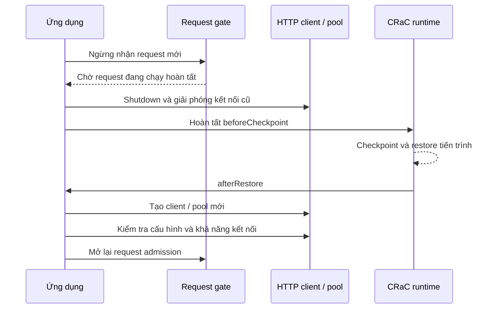

# Khôi phục HTTP client và nhóm kết nối dùng lại

HTTP client thường được tạo một lần rồi dùng lại cho nhiều request. Việc dùng lại client giúp tái sử dụng TCP connection, TLS session và connection pool, giảm chi phí DNS lookup, TCP handshake và TLS handshake. Nhưng sau khi ứng dụng được restore từ checkpoint, những kết nối đã mở trước checkpoint có thể đã bị server đóng, hết hạn hoặc không còn phù hợp với mạng hiện tại.

Vì vậy, khi tích hợp CRaC, cần quản lý vòng đời của HTTP client và connection pool như một nhóm tài nguyên. Trước checkpoint, ứng dụng ngừng nhận request mới, chờ request đang chạy hoàn tất trong thời hạn cho phép rồi đóng hoặc giải phóng client/pool theo API của thư viện. Sau restore, ứng dụng tạo client/pool mới, nạp lại cấu hình và credential cần thiết, kiểm tra khả năng kết nối rồi mới mở lại chức năng gửi request.

Không nên mặc định một object HTTP client còn nằm trong heap thì các socket bên trong nó cũng có thể tiếp tục dùng an toàn. Trạng thái Java của client và trạng thái kết nối ở hệ điều hành hoặc server từ xa là hai vấn đề khác nhau.

## 1. Vì sao cần xử lý HTTP client quanh checkpoint?

Một HTTP client dùng lại thường quản lý nhiều thành phần:

- Connection pool chứa các kết nối TCP đã được tạo để phục vụ request tiếp theo.
- Kết nối keep-alive HTTP/1.1 hoặc kết nối HTTP/2 có thể multiplex nhiều stream.
- TLS state, chứng chỉ, session và cấu hình xác thực.
- Executor hoặc thread nội bộ để thực thi request bất đồng bộ.
- Timer, scheduler hoặc tác vụ dọn dẹp connection idle.
- Request đang gửi, response đang đọc và stream body chưa đóng.

Khi tiến trình được checkpoint, các thread và trạng thái bộ nhớ có thể được lưu. Trong thời gian tiến trình không hoạt động, server hoặc proxy không biết rằng client sẽ quay lại từ checkpoint. Chúng vẫn có thể đóng connection vì idle timeout, restart, failover hoặc thay đổi cấu hình. Một kết nối đang tồn tại trong trạng thái tiến trình sau restore vì vậy có thể là kết nối stale.

Các tình huống thường gặp:

| Thành phần | Thay đổi có thể xảy ra khi tiến trình đã checkpoint | Cách xử lý sau restore |
|---|---|---|
| TCP connection | Server, proxy hoặc NAT đã đóng kết nối. | Loại bỏ kết nối cũ và thiết lập kết nối mới. |
| HTTP keep-alive | Idle timeout đã hết hoặc peer không còn giữ socket. | Tạo lại connection pool hoặc để client mở kết nối mới. |
| HTTP/2 | Kết nối multiplexed đã bị peer đóng; các stream đang hoạt động bị gián đoạn. | Tạo kết nối HTTP/2 mới và gửi lại request theo chính sách an toàn. |
| TLS | Session hoặc chứng chỉ có thể hết hạn/thay đổi. | Thực hiện handshake mới và nạp lại trust/key material nếu cần. |
| DNS | Địa chỉ dịch vụ có thể thay đổi. | Để client phân giải lại tên theo chính sách cache DNS của thư viện. |
| Executor và scheduler | Thread nội bộ bị dừng, treo hoặc không còn phù hợp với vòng đời mới. | Shutdown đúng cách trước checkpoint và tạo lại thành phần do ứng dụng quản lý. |
| HTTP response stream | Body có thể chưa đọc hết hoặc chưa đóng. | Hoàn tất hoặc hủy request trước checkpoint; không giữ stream dở dang để tiếp tục mù quáng. |

## 2. Nguyên tắc quản lý client và connection pool

Một quy trình dễ kiểm soát có bốn nguyên tắc.

**Ngừng nhận request mới trước khi đóng client.** Nếu request mới vẫn được gửi trong lúc pool đang shutdown, một số request có thể thất bại ngẫu nhiên hoặc bị từ chối giữa chừng. Hãy dùng admission gate ở tầng ứng dụng và bảo đảm mọi đường gửi request đều đi qua gate đó.

**Drain request đang chạy.** Chờ các request đồng bộ hoàn tất, hoặc theo dõi các future của request bất đồng bộ. Với request không thể hoàn tất trong thời hạn, áp dụng chính sách timeout/cancel rõ ràng. Không checkpoint khi còn request hoặc response body đang ở trạng thái không xác định.

**Đóng tài nguyên cũ theo đúng API của thư viện.** Client có thể sở hữu connection pool, executor và scheduler. Đóng client thường kéo theo đóng pool hoặc ngừng executor; nếu pool được chia sẻ giữa nhiều client, phải quản lý theo owner thực tế để tránh đóng hai lần.

**Tạo client/pool mới sau restore.** Dùng lại cấu hình đã được quản lý, nhưng tạo lại đối tượng có vòng đời gắn với socket, thread hoặc connection. Chỉ bật lại request admission sau khi client mới đã được tạo và các dependency bắt buộc đã sẵn sàng.



Thứ tự trong sơ đồ là quy trình do ứng dụng thiết kế. Nếu một thư viện đã tích hợp CRaC và tự quản lý client/pool, hãy tuân theo tích hợp đó; tránh đăng ký thêm Resource thứ hai cùng đóng hoặc tạo lại một tài nguyên đã được thư viện quản lý.

## 3. Xử lý request đang chạy trước checkpoint

Đây là phần thường bị bỏ sót. Đóng pool trong khi vẫn còn request đang thực thi có thể làm hỏng request, bỏ dở response body hoặc khiến ứng dụng không biết server đã nhận thao tác ghi hay chưa.

Trước khi checkpoint, nên:

1. Ngăn request mới đi vào các client sắp đóng.
2. Đợi các request đồng bộ đang chạy kết thúc.
3. Với request bất đồng bộ, theo dõi `CompletableFuture` hoặc handle tương đương đến khi hoàn tất/hủy.
4. Đọc hết hoặc đóng response body và stream.
5. Hủy request vượt quá deadline theo chính sách đã chọn.
6. Chỉ shutdown client/pool sau khi số request đang hoạt động đã về trạng thái an toàn.

Với `sendAsync(...)`, không thể chỉ kiểm tra số thread đang chạy. Cần quản lý vòng đời của từng future và callback. Nếu callback đang sử dụng một client hoặc executor do ứng dụng sở hữu, phải bảo đảm callback đã hoàn tất hoặc được hủy theo cách có thể kiểm soát.

### 3.1. Request GET và request ghi dữ liệu

Request GET thường có thể gửi lại sau khi kết nối bị gián đoạn, nhưng vẫn cần cân nhắc side effect của endpoint và tính nhất quán của dữ liệu trả về.

Với POST, PUT hoặc thao tác nghiệp vụ có ghi dữ liệu, không được tự động retry chỉ vì client không nhận được response. Server có thể đã xử lý request nhưng response bị mất. Nếu gửi lại, thao tác có thể bị thực hiện hai lần.

Các biện pháp thường dùng:

- Dùng idempotency key cho thao tác ghi có hỗ trợ.
- Lưu mã định danh nghiệp vụ để truy vấn trạng thái trước khi gửi lại.
- Thiết kế endpoint có tính idempotent khi phù hợp.
- Ghi nhận request chưa rõ kết quả và xử lý bằng quy trình đối soát.

Checkpoint/restore không cung cấp bảo đảm exactly-once cho request HTTP. Tính đúng đắn của retry phải đến từ giao thức và thiết kế nghiệp vụ.

## 4. Đóng client và connection pool trước checkpoint

Phương thức đóng phụ thuộc thư viện HTTP đang sử dụng. Có thể phân loại như sau:

| Client hoặc stack | Thành phần cần quản lý | Hướng xử lý |
|---|---|---|
| `java.net.http.HttpClient` trên JDK 21+ | Client và executor nội bộ do client quản lý. | Dùng lifecycle API của JDK 21 như `shutdown()`, `awaitTermination(...)`, `shutdownNow()`; sau restore tạo `HttpClient` mới. |
| Apache HttpClient 5 | `CloseableHttpClient` và connection manager/pool. | Drain request, đóng client và pool theo ownership; tạo client/manager mới sau restore. |
| OkHttp | Dispatcher executor và `ConnectionPool`. | Dừng nhận request, xử lý request đang chạy, giải phóng connection idle và tạo client/dispatcher phù hợp sau restore. |
| Reactor Netty | `ConnectionProvider`, event loop resources và client cấu hình trên chúng. | Dispose resource do ứng dụng sở hữu và tạo provider/client mới sau restore. |

Đừng áp dụng một lệnh `close()` chung cho mọi thư viện. Có client chỉ là cấu hình immutable, trong khi connection pool hoặc event loop được quản lý bởi một object riêng. Cần xác định rõ ai sở hữu từng tài nguyên và phương thức shutdown có ảnh hưởng đến các client khác dùng chung nó hay không.

### 4.1. Lưu ý với `java.net.http.HttpClient` trên JDK 21+

Từ JDK 21, `java.net.http.HttpClient` có các phương thức lifecycle như `shutdown()`, `shutdownNow()`, `awaitTermination(Duration)`, `isShutdown()`, `isTerminated()` và `close()`. Chúng cho phép ứng dụng quản lý việc dừng client có kiểm soát.

`HttpClient` không cung cấp API công khai để duyệt và đóng từng socket trong connection pool nội bộ. Nếu muốn loại bỏ trạng thái kết nối cũ một cách rõ ràng, cách đơn giản là shutdown client cũ trước checkpoint và tạo instance `HttpClient` mới sau restore.

Trên JDK cũ hơn không có lifecycle API tương ứng cho `java.net.http.HttpClient`. Khi đó không nên gọi một phương thức giả định như `close()`; cần dùng chiến lược phù hợp với phiên bản JDK, hoặc chọn HTTP client có API quản lý vòng đời rõ ràng. Luôn kiểm tra Javadoc của đúng JDK đang build và chạy.

## 5. Ví dụ Resource quản lý JDK `HttpClient` trên Java 21

Ví dụ dưới đây minh họa một client dùng lại cho request đồng bộ. `ReentrantReadWriteLock` đảm bảo callback checkpoint đợi các request đang đi qua wrapper kết thúc và ngăn request mới bắt đầu trong lúc shutdown.

```java
import org.crac.Context;
import org.crac.Core;
import org.crac.Resource;

import java.io.IOException;
import java.net.URI;
import java.net.http.HttpClient;
import java.net.http.HttpRequest;
import java.net.http.HttpResponse;
import java.time.Duration;
import java.util.concurrent.TimeUnit;
import java.util.concurrent.locks.Lock;
import java.util.concurrent.locks.ReentrantReadWriteLock;

public final class CracHttpClient implements Resource {

    private final ReentrantReadWriteLock admission =
            new ReentrantReadWriteLock();

    private volatile HttpClient client = newClient();
    private volatile boolean acceptingRequests = true;

    public CracHttpClient() {
        Core.getGlobalContext().register(this);
    }

    public HttpResponse<String> get(URI uri)
            throws IOException, InterruptedException {
        Lock readLock = admission.readLock();
        readLock.lockInterruptibly();
        try {
            if (!acceptingRequests) {
                throw new IllegalStateException(
                        "HTTP client is preparing for checkpoint");
            }

            HttpRequest request = HttpRequest.newBuilder(uri)
                    .timeout(Duration.ofSeconds(10))
                    .GET()
                    .build();

            return client.send(
                    request,
                    HttpResponse.BodyHandlers.ofString());
        } finally {
            readLock.unlock();
        }
    }

    // Chỉ coordinator gọi sau khi các dependency bắt buộc đã được kiểm tra.
    public void markReadyAfterDependencyChecks() {
        Lock writeLock = admission.writeLock();
        writeLock.lock();
        try {
            acceptingRequests = true;
        } finally {
            writeLock.unlock();
        }
    }

    @Override
    public void beforeCheckpoint(Context<? extends Resource> context)
            throws Exception {
        Lock writeLock = admission.writeLock();

        // Chờ request đồng bộ hiện tại kết thúc; timeout tránh chờ vô hạn.
        if (!writeLock.tryLock(10, TimeUnit.SECONDS)) {
            throw new IllegalStateException(
                    "Timed out waiting for in-flight HTTP requests");
        }

        try {
            acceptingRequests = false;

            HttpClient oldClient = client;
            oldClient.shutdown();

            if (!oldClient.awaitTermination(Duration.ofSeconds(10))) {
                oldClient.shutdownNow();
                if (!oldClient.awaitTermination(Duration.ofSeconds(5))) {
                    throw new IllegalStateException(
                            "HTTP client did not terminate before checkpoint");
                }
            }
        } finally {
            writeLock.unlock();
        }
    }

    @Override
    public void afterRestore(Context<? extends Resource> context) {
        Lock writeLock = admission.writeLock();
        writeLock.lock();
        try {
            HttpClient restoredClient = newClient();
            client = restoredClient;
            // Giữ gate đóng cho tới khi coordinator xác nhận dependency sẵn sàng.
            acceptingRequests = false;
        } finally {
            writeLock.unlock();
        }
    }

    private static HttpClient newClient() {
        return HttpClient.newBuilder()
                .connectTimeout(Duration.ofSeconds(5))
                .version(HttpClient.Version.HTTP_2)
                .build();
    }
}
```

Đây là ví dụ minh họa cho Java 21+, không phải một wrapper production hoàn chỉnh. Trong ứng dụng thật, cần tích hợp gate với server/request admission để mọi request đều đi qua wrapper. Nếu có request bất đồng bộ, phải theo dõi future và response body riêng; read/write lock trong ví dụ chỉ bao phủ request đồng bộ gọi qua `get(...)`.

Nếu không lấy được write lock hoặc client không dừng trong thời hạn, callback báo lỗi và checkpoint không nên tiếp tục. Khi đó client có thể đã ở trạng thái shutdown và gate vẫn đóng; ứng dụng cần giữ readiness false và áp dụng chính sách fail-stop hoặc phục hồi có kiểm soát. Không được tiếp tục phục vụ như thể client cũ vẫn dùng được.

Sau restore, ví dụ tạo client mới từ cấu hình nhưng vẫn giữ request gate đóng. Coordinator của ứng dụng cần kiểm tra các dependency bắt buộc, sau đó mới gọi `markReadyAfterDependencyChecks()` để mở admission. Trong thực tế, cấu hình có thể cần được đọc lại từ nguồn cấu hình hoặc secret provider nếu endpoint, credential, trust store hay proxy có thể thay đổi trong thời gian checkpoint.

## 6. Quản lý connection pool của thư viện bên thứ ba

Với thư viện có connection manager riêng, hãy quản lý đúng ownership giữa client và pool.

Ví dụ về cấu trúc khái niệm:

```text
HttpClientResource
    ├── request admission gate
    ├── CloseableHttpClient
    └── ConnectionManager / Pool
```

Trước checkpoint:

1. Ngừng nhận request mới qua resource.
2. Chờ request đang chạy và response body hoàn tất hoặc bị hủy.
3. Dừng eviction thread hoặc scheduler do ứng dụng sở hữu.
4. Đóng client và connection manager theo đúng thứ tự ownership của thư viện.
5. Xác nhận tài nguyên đã được giải phóng trước khi callback kết thúc.

Sau restore:

1. Tạo connection manager/pool mới với giới hạn và timeout đã cấu hình.
2. Tạo HTTP client mới gắn với pool đó.
3. Tạo lại executor hoặc scheduler nếu ứng dụng tự quản lý.
4. Kiểm tra credential, proxy, TLS và DNS policy cần thiết.
5. Mở lại request admission sau khi các dependency bắt buộc sẵn sàng.

Nếu một pool được nhiều client chia sẻ, chỉ owner chịu trách nhiệm đóng pool. Các client phụ thuộc phải được dừng trước khi pool bị đóng. Tránh đăng ký mỗi client và pool thành những Resource độc lập nếu callback của chúng có thể đóng cùng một đối tượng hai lần hoặc chạy sai thứ tự.

## 7. Xử lý HTTP/2, WebSocket, SSE và streaming

Không phải mọi kết nối HTTP đều là request ngắn có thể drain đơn giản.

### 7.1. HTTP/2 multiplexing

HTTP/2 cho phép nhiều stream chạy trên cùng một TCP connection. Nếu connection bị đóng, nhiều request có thể bị ảnh hưởng đồng thời. Client mới có thể tạo connection HTTP/2 mới, nhưng không có nghĩa các stream cũ tự tiếp tục.

Hãy xác định request nào có thể gửi lại, request nào cần kiểm tra trạng thái nghiệp vụ và request nào phải báo thất bại. Đặc biệt với request ghi dữ liệu, cần idempotency key hoặc cơ chế đối soát.

### 7.2. WebSocket

WebSocket là kết nối hai chiều có trạng thái phiên. Sau restore, không nên giả định phiên cũ vẫn hoạt động. Ứng dụng cần:

- Đóng hoặc ngừng nhận message mới trước checkpoint.
- Xử lý message đang gửi và message chưa xác nhận.
- Thiết lập kết nối WebSocket mới sau restore.
- Xác thực lại và đăng ký lại subscription.
- Dùng sequence number, offset hoặc resume token nếu giao thức hỗ trợ để tránh mất hoặc xử lý lặp message.

### 7.3. Server-Sent Events và HTTP streaming

Với SSE hoặc response body dạng stream, việc giữ stream đang đọc qua checkpoint có thể làm client và server mất đồng bộ. Nên kết thúc hoặc hủy stream trước checkpoint, sau restore tạo request mới. Nếu nguồn dữ liệu hỗ trợ `Last-Event-ID`, offset hoặc cursor, hãy dùng nó để tiếp tục từ vị trí đã xác nhận.

### 7.4. Long polling và request dài

Request dài cần deadline rõ ràng. Trước checkpoint, có thể đợi trong giới hạn hoặc hủy và cho phép client bên ngoài gửi lại sau restore. Không giữ callback chờ vô hạn cho một request mà server có thể đã tự timeout.

## 8. Credential, TLS, proxy và cấu hình kết nối

Client mới cần sử dụng cấu hình đúng với môi trường sau restore. Không phải mọi cấu hình đều nên được giữ nguyên trong checkpoint.

- **Credential:** access token có thể hết hạn; dùng token provider để lấy token mới khi cần thay vì giữ token ngắn hạn lâu dài trong client.
- **TLS:** chứng chỉ hoặc trust store có thể được cập nhật; nếu chính sách cho phép thay đổi, nạp lại cấu hình trước khi tạo client mới.
- **Proxy:** địa chỉ hoặc thông tin xác thực proxy có thể thay đổi; tạo lại client với cấu hình hiện hành.
- **DNS:** kết nối mới có thể cần phân giải lại tên dịch vụ. Hành vi cache DNS phụ thuộc JDK và thư viện, nên kiểm tra TTL và cấu hình thực tế.
- **Timeout:** áp dụng connect timeout, request timeout và timeout đọc phù hợp; tránh request treo làm cản trở drain trước checkpoint.
- **Secret trong checkpoint:** heap có thể chứa token hoặc thông tin nhạy cảm. Bảo vệ checkpoint image bằng quyền truy cập và chính sách lưu trữ phù hợp.

Không ghi header `Authorization`, cookie, token hoặc nội dung nhạy cảm của request vào log khi chẩn đoán lỗi restore.

## 9. Retry và tính đúng đắn của request sau restore

Khi client mới gửi request đầu tiên, lỗi kết nối có thể xảy ra do dịch vụ chưa sẵn sàng hoặc DNS/proxy vừa thay đổi. Retry nên có giới hạn và phân loại lỗi.

| Trường hợp | Chính sách gợi ý |
|---|---|
| Connect timeout trước khi gửi request | Có thể retry theo backoff nếu request an toàn và còn deadline. |
| Server trả 429 hoặc 503 | Tôn trọng `Retry-After` nếu có và giới hạn số lần thử. |
| GET thất bại do kết nối stale | Tạo kết nối mới và retry có giới hạn nếu semantics của endpoint cho phép. |
| POST không nhận được response | Không tự động gửi lại nếu chưa biết server đã xử lý hay chưa; dùng idempotency key hoặc đối soát. |
| 401 do token hết hạn | Làm mới credential theo đúng cơ chế xác thực, sau đó thử lại có giới hạn. |
| TLS handshake hoặc certificate validation thất bại | Không bỏ qua xác minh TLS; xử lý nguyên nhân chứng chỉ/cấu hình. |

Retry ở tầng client cần phối hợp với retry của service mesh, load balancer và ứng dụng gọi. Nhiều lớp retry cùng hoạt động có thể nhân số request lên nhanh chóng. Hãy đặt deadline tổng và giới hạn retry ở một tầng có trách nhiệm rõ ràng.

## 10. Quan sát và kiểm thử sau restore

Không nên chỉ kiểm tra rằng callback `afterRestore(...)` đã chạy. Cần xác minh client mới thực sự gửi được request và xử lý response đúng.

### 10.1. Thông tin nên ghi nhận

- Thời điểm bắt đầu drain, shutdown client cũ và tạo client mới.
- Số request đang chạy khi bắt đầu checkpoint và thời gian drain.
- Số request bị timeout hoặc cancel trước checkpoint.
- Thời gian tạo pool/client sau restore.
- Kết quả DNS, TCP connect, TLS handshake và health request nếu có thể quan sát an toàn.
- Số connection mới, connection reuse, lỗi stale connection và retry.
- Trạng thái readiness của chức năng sử dụng HTTP client.

Ghi log theo tên logic của client hoặc dependency, không ghi credential hay payload nhạy cảm.

### 10.2. Ma trận tình huống kiểm thử

| Tình huống | Kết quả mong đợi |
|---|---|
| Không có request đang chạy khi checkpoint | Client/pool cũ được shutdown; client mới được tạo sau restore. |
| Request đồng bộ đang chạy | Callback đợi request hoàn tất trong deadline. |
| Request không hoàn tất trước deadline | Checkpoint bị chặn hoặc thất bại; ứng dụng không giả định client vẫn sẵn sàng. |
| Async request còn pending | Future được drain/cancel theo chính sách; không để callback dùng executor đã shutdown. |
| Server đóng keep-alive connection trong lúc checkpoint | Client mới tạo kết nối mới và request kiểm tra hoạt động. |
| DNS hoặc endpoint thay đổi | Client mới dùng cấu hình phân giải/kết nối theo chính sách đã chọn. |
| Credential hết hạn | Token được làm mới hoặc chức năng bị giữ chưa sẵn sàng theo chính sách. |
| HTTP/2 peer đóng connection | Request được xử lý theo semantics và retry policy, không giả định stream tự tiếp tục. |
| WebSocket/SSE đang mở | Session/stream cũ được kết thúc; kết nối mới resume theo cursor nếu hỗ trợ. |
| POST đã được server xử lý nhưng response bị mất | Không gửi lặp một cách mù quáng; dùng idempotency hoặc đối soát. |

Nên thực hiện kiểm thử với server HTTP thật hoặc test server có thể chủ động đóng connection, delay response, thay đổi DNS/endpoint và trả lỗi xác thực. Một unit test chỉ mock `HttpClient` không chứng minh connection pool và socket thật hoạt động sau restore.

## 11. Những lỗi thiết kế thường gặp

**Giữ nguyên client cũ vì object vẫn tồn tại sau restore.** Object còn trong heap không chứng minh TCP connection hoặc executor nội bộ còn hợp lệ. Hãy xác định vòng đời của client và tạo lại khi cần.

**Đóng pool trước khi ngừng request mới.** Request có thể bắt đầu đúng lúc pool đang shutdown. Luôn chặn admission trước và drain request hiện tại.

**Không đợi request bất đồng bộ.** Future hoặc callback có thể còn sử dụng client sau khi pool/executor đã đóng. Cần theo dõi toàn bộ công việc đang chạy.

**Tạo client mới nhưng giữ connection manager cũ.** Nếu pool cũ chứa socket stale hoặc executor đã shutdown, client mới vẫn có thể gặp lỗi. Tạo lại toàn bộ nhóm tài nguyên theo ownership.

**Đóng một pool dùng chung từ nhiều Resource.** Có thể xảy ra double-close hoặc thứ tự đóng sai. Một owner cần điều phối vòng đời của pool chia sẻ.

**Retry mọi request.** POST hoặc thao tác nghiệp vụ có thể đã được server xử lý. Retry không có idempotency có thể tạo giao dịch trùng.

**Bỏ qua lỗi TLS để kết nối lại nhanh.** Không tắt kiểm tra chứng chỉ hoặc hostname verification để vượt qua lỗi sau restore. Hãy sửa trust store, certificate hoặc cấu hình.

**Dùng thời gian chờ vô hạn trong callback.** Một request bị treo có thể làm checkpoint không hoàn tất. Đặt timeout và chính sách hủy/dừng rõ ràng.

## 12. Checklist khôi phục HTTP client và connection pool

- [ ] Xác định thư viện HTTP, phiên bản JDK và API lifecycle thực tế.
- [ ] Xác định client, pool, executor và scheduler nào do ứng dụng sở hữu.
- [ ] Đăng ký một Resource hoặc tích hợp CRaC có trách nhiệm rõ ràng cho nhóm tài nguyên.
- [ ] Chặn request mới trước khi bắt đầu shutdown.
- [ ] Drain request đồng bộ và theo dõi request bất đồng bộ.
- [ ] Đóng response body, stream và request đang dở theo chính sách.
- [ ] Shutdown client/pool/executor theo đúng thứ tự ownership.
- [ ] Dùng deadline để tránh callback chờ vô hạn.
- [ ] Tạo client/pool mới sau restore thay vì mặc định socket cũ còn dùng được.
- [ ] Nạp lại credential, TLS, proxy và cấu hình endpoint nếu cần.
- [ ] Chỉ mở request admission sau khi dependency bắt buộc sẵn sàng.
- [ ] Xử lý HTTP/2, WebSocket, SSE và streaming như các phiên hoặc stream cần khôi phục riêng.
- [ ] Không retry request ghi dữ liệu khi chưa bảo đảm idempotency hoặc đối soát.
- [ ] Kiểm thử với server thật hoặc test server mô phỏng đóng kết nối và lỗi mạng.

## 13. Thuật ngữ cần nhớ

- **HTTP client:** thành phần gửi HTTP request và nhận response.
- **Connection pool:** nhóm kết nối được quản lý để tái sử dụng giữa nhiều request.
- **Keep-alive:** cơ chế giữ kết nối HTTP/TCP mở để dùng cho request tiếp theo.
- **Stale connection:** kết nối mà client nghĩ vẫn dùng được nhưng peer hoặc mạng đã đóng/thay đổi trạng thái.
- **Drain:** ngừng nhận công việc mới và chờ công việc đang chạy hoàn tất.
- **Admission gate:** cơ chế ngăn request mới đi vào client trong lúc chuẩn bị checkpoint hoặc restore.
- **HTTP/2 multiplexing:** nhiều stream HTTP cùng dùng một kết nối HTTP/2.
- **Idempotency key:** mã định danh giúp server nhận biết các lần gửi lại cùng một thao tác nghiệp vụ.
- **Connection manager:** thành phần quản lý tạo, cấp phát và đóng kết nối trong một số HTTP client library.
- **Resource:** đối tượng `org.crac.Resource` phối hợp chuẩn bị trước checkpoint và khôi phục sau restore.

Khôi phục HTTP client trong CRaC là quản lý cả vòng đời của request, connection pool, executor và cấu hình kết nối. Hãy dừng nhận request mới, drain công việc đang chạy, giải phóng client/pool cũ trước checkpoint, rồi tạo tài nguyên mới sau restore. Chỉ mở lại traffic khi các dependency cần thiết hoạt động và retry được kiểm soát theo tính an toàn của từng request.
