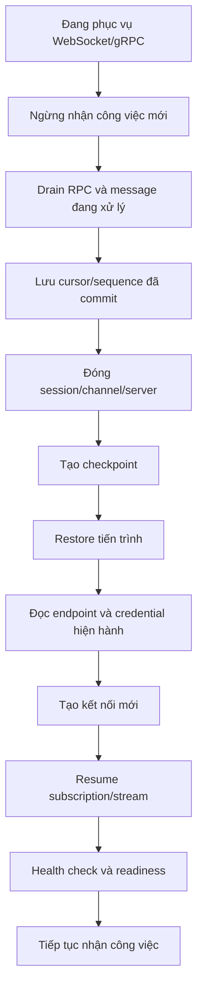

# WebSocket, gRPC và kết nối kéo dài qua ranh giới checkpoint

WebSocket và gRPC thường giữ kết nối trong thời gian dài để trao đổi dữ liệu liên tục. WebSocket duy trì một phiên hai chiều trên một kết nối TCP; gRPC thường dùng HTTP/2, có thể multiplex nhiều RPC và stream trên cùng một channel. Khi ứng dụng Java đi qua checkpoint/restore của CRaC, các kết nối này cần được xem như tài nguyên có vòng đời riêng.

Checkpoint lưu trạng thái tiến trình theo khả năng của runtime và môi trường, nhưng không bảo đảm peer, load balancer, proxy hoặc broker vẫn giữ phiên mạng trong khoảng thời gian tiến trình tạm dừng. Đầu bên kia có thể timeout, đóng socket, chuyển kết nối sang backend khác hoặc giải phóng trạng thái phiên. Một object `WebSocket`, `ManagedChannel` hay stream vẫn còn trong heap không chứng minh phiên giao tiếp bên ngoài còn hợp lệ.

Với ứng dụng cần hoạt động ổn định qua CRaC, cách tiếp cận phổ biến là dừng nhận công việc mới, hoàn tất hoặc lưu tiến độ của các trao đổi đang diễn ra, đóng các phiên cần đóng trước checkpoint, rồi kết nối lại sau restore. Nếu môi trường và thư viện có hỗ trợ giữ kết nối qua checkpoint, chỉ sử dụng sau khi đã xác minh đúng phiên bản JDK, hệ điều hành, runtime, proxy và peer thực tế.

## 1. Vì sao kết nối kéo dài cần xử lý riêng?

Một kết nối ngắn thường được tạo, dùng cho một thao tác và đóng. Kết nối kéo dài có thể mang trạng thái trong nhiều lớp:

- **Transport:** TCP socket, TLS session, HTTP/2 connection và trạng thái flow control.
- **Protocol:** WebSocket handshake, HTTP/2 stream, gRPC metadata và trạng thái RPC.
- **Application:** đăng ký subscription, cursor, sequence number, session ID, heartbeat và quyền truy cập.
- **Runtime:** thread đọc/ghi, executor, timer, callback và buffer đang chờ xử lý.

Checkpoint có thể lưu một phần trạng thái trong tiến trình, nhưng trạng thái của peer và các thiết bị mạng nằm ngoài tiến trình. Trong lúc ứng dụng tạm dừng, server có thể đóng kết nối do idle timeout, load balancer có thể xóa mapping, TLS credential có thể hết hạn hoặc dịch vụ có thể triển khai phiên bản mới.

Ngay cả khi socket được khôi phục thành công trong một môi trường cụ thể, phiên ứng dụng vẫn có thể không còn hợp lệ. Ví dụ, WebSocket server có thể đã xóa subscription; gRPC server có thể đã kết thúc stream hoặc giải phóng tài nguyên gắn với RPC. Vì vậy cần kiểm tra cả transport lẫn trạng thái nghiệp vụ.

### Các lớp trạng thái cần phân biệt

| Thành phần | Có thể được giữ trong heap? | Điều cần xác minh sau restore |
|---|---|---|
| Object client hoặc channel | Có | Thư viện có hỗ trợ checkpoint và object còn ở trạng thái dùng được không? |
| TCP/TLS connection | Không nên mặc định | Socket và phiên TLS có còn được peer chấp nhận không? |
| WebSocket session | Không nên mặc định | Handshake, session ở server và subscription còn tồn tại không? |
| gRPC stream | Không nên mặc định | RPC còn mở ở cả hai đầu và flow-control state còn đồng bộ không? |
| Heartbeat/reconnect timer | Có thể có state trong heap | Deadline và lịch chạy có cần tính lại theo thời gian hiện tại không? |
| Resume cursor/sequence | Có thể giữ nếu được lưu đúng | Cursor có được xác nhận bởi server và có tránh bỏ sót/trùng message không? |

## 2. Vòng đời khuyến nghị qua checkpoint

Một quy trình thường dùng cho kết nối kéo dài gồm các giai đoạn sau:

1. **Quiesce:** ngừng nhận subscription mới, RPC mới hoặc công việc gửi mới.
2. **Drain:** chờ message đang xử lý hoàn tất trong giới hạn thời gian; ghi nhận cursor hoặc sequence đã commit.
3. **Close:** đóng WebSocket/gRPC channel hoặc server theo giao thức và API của thư viện.
4. **Checkpoint:** tạo snapshot sau khi các tài nguyên đã ở trạng thái an toàn.
5. **Restore:** khôi phục tiến trình và trạng thái nội bộ.
6. **Reconnect:** phân giải endpoint, xác thực lại và tạo transport/session mới.
7. **Resume:** gửi thông tin tiếp tục để đăng ký lại subscription hoặc tiếp tục stream từ cursor đã xác nhận.
8. **Readiness:** chỉ nhận traffic hoặc công việc mới khi kết nối và trạng thái ứng dụng đã sẵn sàng.



Sơ đồ là một quy trình ứng dụng điển hình. Thứ tự và API cụ thể cần theo integration CRaC của thư viện đang dùng. Một số thư viện tự quản lý tài nguyên; không nên tự đóng/mở lần thứ hai nếu integration đã thực hiện việc đó.

## 3. WebSocket: đóng phiên cũ và thiết lập phiên mới

WebSocket bắt đầu bằng HTTP Upgrade handshake, sau đó giữ một kết nối hai chiều. Hai phía có thể gửi frame bất cứ lúc nào, vì vậy việc checkpoint cần phối hợp với listener, hàng đợi gửi và các callback xử lý message.

Trước checkpoint, ứng dụng nên:

- Ngừng nhận yêu cầu đăng ký session hoặc gửi message mới.
- Ngừng đưa message mới vào hàng đợi của WebSocket.
- Chờ message đang xử lý và các thao tác ghi quan trọng hoàn tất.
- Lưu trạng thái subscription và vị trí message đã xử lý bền vững.
- Gửi Close frame theo giao thức, chờ quá trình đóng hoàn tất trong timeout.
- Giải phóng listener, timer hoặc executor riêng nếu thành phần sở hữu chúng.

Sau restore, ứng dụng cần tạo WebSocket mới. Không nên gọi tiếp `sendText()` trên object session cũ chỉ vì object đó vẫn còn trong heap. Phiên mới phải thực hiện handshake lại, xác thực lại và đăng ký lại các subscription cần thiết.

### Ví dụ dùng Java `HttpClient` WebSocket

Đoạn mã sau minh họa việc tạo một kết nối mới. `WebSocket.Listener` và các phương thức quản lý hàng đợi trong ứng dụng thực tế cần được triển khai để xử lý message, lỗi, close và backpressure.

```java
import java.net.URI;
import java.net.http.HttpClient;
import java.net.http.WebSocket;
import java.util.concurrent.CompletableFuture;

public final class WebSocketConnector {

    private final URI endpoint;
    private final WebSocket.Listener listener;
    private HttpClient httpClient;
    private WebSocket webSocket;

    public WebSocketConnector(URI endpoint,
                              WebSocket.Listener listener) {
        this.endpoint = endpoint;
        this.listener = listener;
    }

    public void connect() throws Exception {
        httpClient = HttpClient.newHttpClient();
        webSocket = httpClient.newWebSocketBuilder()
                .buildAsync(endpoint, listener)
                .join();
    }

    public void closeForCheckpoint() throws Exception {
        WebSocket current = webSocket;
        webSocket = null;
        if (current != null) {
            current.sendClose(WebSocket.NORMAL_CLOSURE,
                    "checkpoint")
                    .orTimeout(5, java.util.concurrent.TimeUnit.SECONDS)
                    .join();
        }
    }
}
```

Trong ví dụ, `NORMAL_CLOSURE` gửi Close frame với mã đóng bình thường. Một hệ thống có thể chọn mã phù hợp hơn với chính sách giao thức, chẳng hạn thông báo server đang rời đi. Không nên gửi close trước khi đã dừng producer và drain các message cần gửi; nếu không, thao tác có thể thất bại hoặc message chưa được chuyển giao.

`sendClose()` thực hiện bắt đầu quá trình đóng WebSocket và trả về một `CompletableFuture`. Timeout trong ví dụ giúp tránh chờ vô hạn; ứng dụng cần xử lý trường hợp peer không hoàn tất handshake đóng trong thời gian cho phép. Cần phối hợp listener và hàng đợi để không có luồng khác tiếp tục gửi dữ liệu trên session đang đóng.

### Đăng ký lại subscription sau restore

Kết nối WebSocket mới chỉ hoàn thành transport. Ứng dụng còn phải khôi phục trạng thái ở tầng giao thức:

1. Kết nối tới endpoint hiện hành.
2. Xác thực lại bằng token hoặc credential mới nếu cần.
3. Gửi yêu cầu subscribe với session/user/topic phù hợp.
4. Gửi cursor hoặc sequence cuối cùng đã xử lý thành công.
5. Xử lý dữ liệu được gửi lại và loại bỏ bản trùng bằng sequence hoặc message ID.
6. Chỉ đánh dấu subscription sẵn sàng sau khi server xác nhận.

Không nên chỉ lưu message cuối cùng đã nhận. Cần lưu **message cuối cùng đã xử lý và commit thành công**. Nếu lưu cursor sau khi nhận nhưng trước khi xử lý xong, restore có thể bỏ qua message chưa được xử lý. Nếu lưu cursor trước khi commit nghiệp vụ, message có thể bị bỏ sót. Thiết kế thường dùng sequence number, acknowledgement và idempotency key để cân bằng giữa at-least-once delivery và tránh side effect trùng.

### WebSocket phía server

Nếu ứng dụng Java là WebSocket server, mỗi client đang kết nối có một session ở phía server. Trước checkpoint, server nên ngừng nhận handshake mới, thông báo cho client rằng kết nối sẽ đóng, drain message đang xử lý và đóng các session hiện hành. Sau restore, server mở listener/socket mới và client kết nối lại.

Không nên giả định các client sẽ tự kết nối lại hoặc load balancer sẽ đưa họ về đúng instance cũ. Cần thiết kế giao thức reconnect có xác thực, backoff, jitter và cơ chế resume. Trạng thái subscription hoặc tiến độ nghiệp vụ cần được lưu ở nơi phù hợp nếu phải sống qua việc thay thế instance.

## 4. gRPC: channel, RPC và stream có vòng đời khác nhau

gRPC Java thường dùng `ManagedChannel` làm abstraction cho kết nối tới server. Một channel có thể quản lý kết nối HTTP/2 và multiplex nhiều RPC hoặc stream. Cần phân biệt:

- **Channel:** tài nguyên client kết nối tới endpoint; có thể quản lý DNS, TLS, load balancing, reconnect và nhiều HTTP/2 connection.
- **Unary RPC:** một request và một response; thường có thể retry theo chính sách nếu method và server hỗ trợ.
- **Server streaming:** client gửi một request, server trả nhiều message.
- **Client streaming:** client gửi nhiều message, server trả một response.
- **Bidirectional streaming:** hai phía gửi/nhận message độc lập trong cùng một RPC.
- **gRPC Server:** listener và các RPC đang xử lý ở phía server.

Đóng channel thường làm các RPC/stream đang hoạt động bị kết thúc hoặc thất bại. Vì vậy, trước checkpoint cần ngừng tạo RPC mới, drain các RPC có thể hoàn tất, xử lý stream còn lại theo chính sách và đóng channel. Sau restore, tạo channel mới và tạo stub mới từ channel đó.

### Tạo lại `ManagedChannel`

Ví dụ đơn giản với gRPC Java:

```java
import io.grpc.ManagedChannel;
import io.grpc.ManagedChannelBuilder;

import java.util.concurrent.TimeUnit;

public final class GrpcConnection {

    private final String host;
    private final int port;
    private ManagedChannel channel;

    public GrpcConnection(String host, int port) {
        this.host = host;
        this.port = port;
    }

    public void connect() {
        channel = ManagedChannelBuilder
                .forAddress(host, port)
                .useTransportSecurity()
                .build();
    }

    public void closeForCheckpoint() throws InterruptedException {
        ManagedChannel current = channel;
        channel = null;
        if (current != null) {
            current.shutdown();
            if (!current.awaitTermination(5, TimeUnit.SECONDS)) {
                current.shutdownNow();
                current.awaitTermination(2, TimeUnit.SECONDS);
            }
        }
    }
}
```

`useTransportSecurity()` giả định endpoint được cấu hình TLS và chứng thư phù hợp. Với môi trường khác, cấu hình transport phải tuân theo chính sách bảo mật của dịch vụ. Trong ứng dụng thật, trước `shutdown()` cần ngừng tạo RPC mới và chờ các RPC đang hoạt động theo deadline của ứng dụng. `shutdownNow()` là đường thoát khi graceful shutdown vượt timeout; các RPC bị hủy phải có chính sách retry hoặc resume phù hợp.

Sau restore, tạo `ManagedChannel` mới và tạo lại các stub từ channel đó. Không tái sử dụng stub gắn với channel đã shutdown. Channel mới cần được kiểm tra bằng health-check RPC hoặc thao tác xác minh tương đương trước khi readiness chuyển sang sẵn sàng.

### gRPC server

Nếu ứng dụng là gRPC server, trước checkpoint cần ngừng nhận RPC mới và cho các RPC hiện tại hoàn tất trong khoảng thời gian có giới hạn. gRPC Java `Server.shutdown()` khởi tạo graceful shutdown; nếu không kết thúc trong timeout, có thể dùng `shutdownNow()` theo chính sách. Sau restore, cần tạo và start một `Server` mới, đăng ký các service implementation và health service, rồi mới bật readiness.

Không nên lưu một `Server` đã shutdown trong field rồi kỳ vọng gọi `start()` lại. Server đã shutdown là một tài nguyên đã kết thúc; hãy tạo instance mới bằng builder sau restore. Nếu framework hoặc thư viện cung cấp integration CRaC, ưu tiên cơ chế đó.

## 5. Streaming RPC: không đồng nhất restore với tiếp tục stream cũ

Streaming RPC phức tạp hơn unary RPC vì hai phía có thể đã trao đổi một phần dữ liệu trước checkpoint. Khi channel đóng hoặc mạng gián đoạn, client không thể luôn biết server đã xử lý đến đâu. Một message có thể đã được server nhận nhưng response/ack chưa về đến client.

Đối với client streaming hoặc bidirectional streaming, cần xác định:

- Message nào đã được gửi đi?
- Message nào server đã nhận?
- Message nào server đã xử lý và commit?
- Message nào client đã nhận và xử lý?
- Sequence/cursor cuối cùng đã được xác nhận là bền vững là gì?

Không nên giả định gRPC tự phát lại mọi message trong một stream sau khi channel mới được tạo. Cơ chế retry của gRPC có giới hạn và phụ thuộc trạng thái RPC, cấu hình retry, method semantics và thời điểm lỗi. Với stream nghiệp vụ dài hạn, thường cần một giao thức resume ở tầng ứng dụng.

### Mẫu resume bằng sequence number

Giả sử client nhận các sự kiện có sequence tăng dần. Sau khi xử lý một sự kiện thành công, client lưu `lastCommittedSequence` vào nơi bền vững. Khi restore và tạo stream mới, client gửi cursor đó để server tiếp tục từ sự kiện kế tiếp.

```text
Client                              Server
  |                                   |
  |---- Subscribe(lastSequence=41) -->|
  |<----------- Event 42 -------------|
  |---- commit event 42 --------------|
  |---- persist cursor = 42 ----------|
  |<----------- Event 43 -------------|
  |                                   |
  |       checkpoint boundary        |
  |       close old stream            |
  |                                   |
  |---- Subscribe(lastSequence=42) -->|  after restore
  |<----------- Event 43 -------------|
```

Nếu event 43 đã được xử lý nhưng cursor chưa được ghi bền vững trước checkpoint, server có thể gửi lại event 43. Consumer cần idempotent hoặc lưu trạng thái xử lý và cursor trong cùng một transaction nếu có thể. Nếu cursor được lưu trước khi nghiệp vụ commit, event có thể bị bỏ qua. Cần xác định rõ semantics: at-least-once thường dễ đạt hơn exactly-once; exactly-once đòi hỏi phối hợp transaction và identity ở hệ thống nghiệp vụ.

### Pseudocode phía client

```java
long lastCommittedSequence = cursorStore.load();

void onEvent(Event event) {
    if (event.sequence() <= lastCommittedSequence) {
        acknowledgeDuplicate(event);
        return;
    }

    processIdempotently(event);
    cursorStore.commit(event.sequence());
    lastCommittedSequence = event.sequence();
}

void reconnectAfterRestore() {
    createNewChannel();
    openNewStream(lastCommittedSequence);
}
```

Đây là pseudocode mô tả giao thức, không phải implementation hoàn chỉnh. Trong code thực tế, cập nhật cursor và kết quả nghiệp vụ nên được commit nguyên tử hoặc có cơ chế chống trùng. Nếu dữ liệu đến từ broker hoặc hệ thống có offset riêng, hãy dùng semantics offset/ack của hệ thống đó thay vì tự tạo một sequence không được server công nhận.

## 6. Tích hợp kết nối kéo dài với CRaC Resource

Một resource quản lý WebSocket hoặc gRPC client có thể đăng ký với global CRaC context. `beforeCheckpoint()` dừng công việc mới, drain và đóng tài nguyên. `afterRestore()` tạo kết nối mới, khôi phục subscription hoặc stream và chỉ mở cổng nhận việc khi đã sẵn sàng.

Ví dụ dưới đây dùng các phương thức helper để làm rõ thứ tự điều phối:

```java
import org.crac.Context;
import org.crac.Core;
import org.crac.Resource;

public final class LongLivedConnectionResource implements Resource {

    private final WebSocketConnector webSocket;
    private final GrpcConnection grpc;
    private volatile boolean acceptingWork;

    public LongLivedConnectionResource(WebSocketConnector webSocket,
                                       GrpcConnection grpc) {
        this.webSocket = webSocket;
        this.grpc = grpc;
        Core.getGlobalContext().register(this);
    }

    @Override
    public void beforeCheckpoint(Context<? extends Resource> context)
            throws Exception {
        acceptingWork = false;
        stopCreatingNewCalls();
        drainInFlightMessagesAndRpcs();
        persistCommittedCursors();
        webSocket.closeForCheckpoint();
        grpc.closeForCheckpoint();
    }

    @Override
    public void afterRestore(Context<? extends Resource> context)
            throws Exception {
        webSocket.connect();
        grpc.connect();
        resumeSubscriptionsAndStreams();
        verifyRemoteServices();
        acceptingWork = true;
    }

    private void stopCreatingNewCalls() { /* ứng dụng tự triển khai */ }
    private void drainInFlightMessagesAndRpcs() throws Exception { /* ... */ }
    private void persistCommittedCursors() throws Exception { /* ... */ }
    private void resumeSubscriptionsAndStreams() throws Exception { /* ... */ }
    private void verifyRemoteServices() throws Exception { /* ... */ }
}
```

`WebSocketConnector` và `GrpcConnection` là các lớp quản lý được minh họa ở phần trước. Trong ứng dụng thực tế, các phương thức cần xử lý concurrency, timeout, lỗi từng dịch vụ và trạng thái kết nối một cách đầy đủ. Ví dụ cũng giả định việc drain và lưu cursor đã hoàn tất trước khi đóng transport.

Nếu một kết nối không thể mở lại trong `afterRestore()`, callback cần báo lỗi thay vì đánh dấu thành phần sẵn sàng. Tùy chính sách ứng dụng, có thể để tiến trình chưa readiness và cho phép cơ chế orchestration retry, hoặc khởi tạo lại kết nối bất đồng bộ nhưng giữ `acceptingWork = false` cho đến khi health check thành công.

Không nên để một callback block vô hạn chờ dịch vụ bên ngoài. Dùng deadline cho connect, handshake, health check và resume. Nếu hệ thống cần retry, hãy dùng backoff có jitter để tránh mọi bản restore cùng kết nối lại trong một đợt gây tải đột biến.

## 7. Xử lý message đang gửi và đang nhận

Một trong những lỗi khó debug nhất xảy ra khi checkpoint ở giữa một message. Ví dụ, ứng dụng gọi `send()` nhưng chưa biết peer đã nhận hay chưa. Sau restore, gửi lại có thể tạo bản trùng; không gửi lại có thể làm mất message.

Để xử lý, hãy phân biệt các mốc:

| Mốc | Ý nghĩa |
|---|---|
| Queued | Ứng dụng đã đưa message vào hàng đợi nội bộ |
| Sent | Client API đã chấp nhận hoặc transport đã gửi dữ liệu; chưa chắc peer đã xử lý |
| Received | Peer đã nhận message; chưa chắc nghiệp vụ đã commit |
| Processed | Peer đã thực hiện logic nghiệp vụ |
| Committed/Acknowledged | Kết quả và tiến độ đã được xác nhận theo giao thức |

Không nên dùng trạng thái `Sent` làm bằng chứng message đã được xử lý. Với message quan trọng, dùng message ID ổn định, acknowledgement từ peer và idempotency ở phía nhận. Trước checkpoint, drain hàng đợi gửi và chờ acknowledgement trong giới hạn. Message chưa được xác nhận cần được lưu trong outbox hoặc nguồn bền vững để gửi lại sau restore.

Với message nhận, chỉ lưu cursor sau khi nghiệp vụ đã commit. Nếu ứng dụng cần xử lý message theo thứ tự, hãy giữ sequence và kiểm tra gap sau khi resume. Nếu nhận lại message đã commit, xử lý idempotently thay vì tạo side effect lần nữa.

## 8. Heartbeat, keepalive và timeout

Kết nối kéo dài thường dựa vào heartbeat hoặc keepalive để phát hiện peer mất kết nối. Checkpoint tạo ra một khoảng thời gian tiến trình không xử lý heartbeat. Khi restore, timer trong heap có thể chứa deadline đã cũ và peer có thể đã timeout phiên.

Các điểm cần lưu ý:

- Không giả định heartbeat sẽ tiếp tục đúng lịch trong lúc tiến trình bị checkpoint.
- Tính lại deadline theo thời gian hiện tại sau restore.
- Nếu peer đã đóng kết nối, tạo session mới thay vì tiếp tục gửi heartbeat trên session cũ.
- Dùng timeout hợp lý cho handshake và health check.
- Dùng backoff và jitter cho reconnect để tránh bão kết nối.
- Không để reconnect loop tạo nhiều channel, WebSocket hoặc thread mà không giải phóng phiên cũ.

gRPC keepalive hoạt động ở tầng HTTP/2 transport và có chính sách riêng giữa client/server. Nó không thay thế health check nghiệp vụ. WebSocket Ping/Pong cũng chỉ cho biết trạng thái kết nối ở mức giao thức; nó không chứng minh subscription hoặc quyền truy cập còn hợp lệ. Sau restore, hãy xác minh lại trạng thái ứng dụng.

## 9. Bảo mật và định tuyến sau reconnect

Reconnect có thể đi đến một backend khác. Điều này thường xảy ra khi load balancer phân phối kết nối mới hoặc instance cũ được thay thế. Vì vậy:

- Xác thực lại và kiểm tra quyền truy cập theo chính sách hiện tại.
- Không dựa vào session affinity như nguồn duy nhất của trạng thái nghiệp vụ.
- Lưu trạng thái subscription/cursor ở nơi bền vững nếu cần khôi phục qua instance khác.
- Xác minh TLS certificate, hostname và trust configuration khi thiết lập kết nối mới.
- Không lưu access token hoặc secret trong log; checkpoint cũng cần được bảo vệ vì có thể chứa dữ liệu heap nhạy cảm.
- Xử lý token hết hạn bằng refresh hoặc lấy credential mới.

Nếu server yêu cầu session token hoặc resume token, cần bảo đảm token có thời hạn và phạm vi phù hợp. Không dùng một token được checkpoint rồi chia sẻ cho nhiều bản restore nếu token đó đại diện cho một session độc quyền.

## 10. Nhiều tiến trình restore và trạng thái kết nối

Một checkpoint có thể được dùng để khởi chạy nhiều tiến trình. Nếu snapshot chứa một WebSocket session, gRPC channel hoặc stream object, các tiến trình có thể bắt đầu với cùng trạng thái object trong heap. Không thể coi việc nhân bản heap là nhân bản một phiên mạng hợp lệ ở phía peer.

Mỗi bản restore cần tạo transport/session riêng và đăng ký lại danh tính của mình. Với các subscription hoặc stream có quyền sở hữu độc quyền, server cần cấp assignment mới hoặc xác nhận resume theo chính sách. Nếu nhiều tiến trình cùng resume một cursor, server có thể gửi dữ liệu trùng cho nhiều instance; hãy thiết kế consumer group, lease hoặc partition assignment phù hợp.

Các side effect như gửi message, cập nhật trạng thái, phát lệnh hoặc chạy tác vụ phải được bảo vệ bằng idempotency key hoặc cơ chế phối hợp. Một biến boolean trong heap như `alreadySent = true` không đủ để đảm bảo thao tác chỉ xảy ra một lần trên toàn cụm khi snapshot được nhân bản.

## 11. Những sai lầm thường gặp

### Dùng lại WebSocket object sau restore

Object còn trong heap không chứng minh peer vẫn giữ session. Hãy đóng session trước checkpoint và tạo WebSocket mới sau restore, trừ khi toàn bộ môi trường đã được xác minh hỗ trợ giữ phiên.

### Tái sử dụng gRPC channel đã shutdown

`ManagedChannel` đã shutdown không phải channel để khởi động lại. Tạo channel mới và tạo lại stub sau restore.

### Chỉ kết nối lại transport mà quên resume subscription

Handshake thành công không khôi phục trạng thái ứng dụng. Cần xác thực, subscribe, gửi cursor và chờ server xác nhận.

### Giả định streaming RPC được replay tự động

Retry của gRPC không bảo đảm phát lại mọi message của stream nghiệp vụ. Dùng giao thức resume, sequence, acknowledgement và idempotency.

### Đóng kết nối khi vẫn có message đang xử lý

Message có thể mất hoặc bị xử lý lặp. Drain, commit cursor và lưu message chưa được xác nhận vào nguồn bền vững trước khi đóng.

### Dùng heartbeat thay cho health check

Ping/Pong hoặc HTTP/2 keepalive chỉ kiểm tra một phần transport. Sau reconnect, cần xác minh dependency và quyền nghiệp vụ trước khi readiness thành công.

### Reconnect đồng loạt không có backoff

Nhiều replica restore cùng lúc có thể tạo tải đột biến lên auth service, load balancer và backend. Dùng backoff có jitter và giới hạn số lần kết nối lại.

## 12. Kiểm chứng trong môi trường CRaC

Hãy kiểm thử cả client và server, cả unary RPC lẫn streaming, cả checkpoint được yêu cầu từ trong ứng dụng lẫn từ công cụ bên ngoài. Môi trường thử nghiệm nên giống môi trường triển khai về JDK CRaC, hệ điều hành, TLS, proxy, load balancer và phiên bản thư viện.

Các kịch bản nên quan sát:

1. Checkpoint khi WebSocket đang idle.
2. Checkpoint khi WebSocket có message đang gửi hoặc đang xử lý.
3. Checkpoint khi gRPC unary RPC đang hoạt động.
4. Checkpoint khi gRPC streaming đang trao đổi message.
5. Restore sau khi peer đã đóng session hoặc load balancer đã hết timeout.
6. Restore khi token đã hết hạn hoặc DNS/backend đã thay đổi.
7. Nhiều tiến trình restore từ cùng một checkpoint.
8. Kết nối lại thất bại tạm thời và thành công sau retry.

Ghi nhận các mốc `quiesce-start`, `drain-complete`, `connection-close`, `afterRestore-start`, `reconnect-complete`, `resume-acknowledged` và `readiness-ready`. Gắn định danh instance, loại transport và session/RPC ID đã được làm sạch thông tin nhạy cảm. Không ghi token, payload riêng tư hoặc dữ liệu xác thực vào log.

Các chỉ số hữu ích gồm thời gian drain, số RPC bị hủy, số message cần gửi lại, số message trùng được loại bỏ, thời gian reconnect, thời gian resume và thời gian đạt readiness. Những số đo này giúp xác định checkpoint đang làm gián đoạn tầng transport, tầng protocol hay tầng nghiệp vụ.

## 13. Kết luận

WebSocket và gRPC là các kết nối kéo dài có trạng thái ở cả client, server và tầng nghiệp vụ. Qua ranh giới checkpoint, một object còn trong heap không bảo đảm transport hoặc stream vẫn được peer chấp nhận. Ứng dụng cần điều phối việc ngừng nhận công việc, drain message/RPC, lưu tiến độ đã commit và đóng tài nguyên phù hợp trước checkpoint.

Sau restore, hãy tạo kết nối mới, xác thực lại, đăng ký lại subscription hoặc stream và tiếp tục từ cursor đã được xác nhận. Với dữ liệu quan trọng, dùng acknowledgement, sequence number, idempotency và nguồn lưu trữ bền vững để xử lý trường hợp message bị gửi lại hoặc nhiều tiến trình restore cùng hoạt động. Chỉ bật readiness khi transport, protocol và trạng thái nghiệp vụ đều sẵn sàng.
