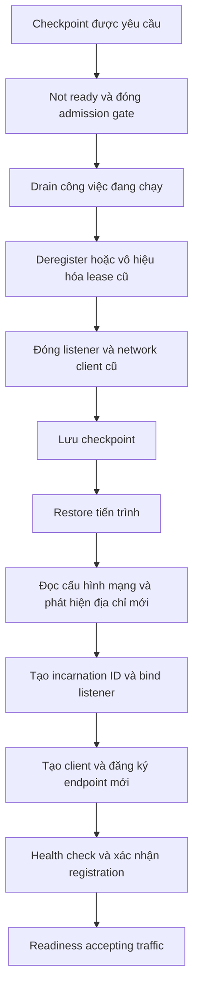

# Đăng ký lại dịch vụ và phát hiện địa chỉ của tiến trình mới

Một ứng dụng Java có thể được khôi phục từ checkpoint CRaC trong một môi trường mạng khác với môi trường đã tạo checkpoint. Tiến trình sau restore có thể có PID, hostname, địa chỉ IP, cổng động hoặc trạng thái kết nối khác. Ngay cả khi địa chỉ không đổi, socket và session được tạo trước checkpoint cũng có thể đã hết hiệu lực hoặc không còn thuộc về endpoint phù hợp.

Vì vậy, sau restore, ứng dụng cần **xác định lại địa chỉ mà instance hiện tại có thể được truy cập**, tạo lại listener và client mạng khi cần, rồi **đăng ký lại endpoint với hệ thống service discovery**. Trước checkpoint, instance nên ngừng nhận traffic và gỡ hoặc vô hiệu hóa đăng ký cũ để hệ thống không tiếp tục gửi request tới endpoint đã ngừng phục vụ.

Quá trình này thuộc vòng đời tài nguyên mạng CRaC. Callback `Resource.beforeCheckpoint(...)` chuẩn bị và ngừng sử dụng network resource cũ; callback `Resource.afterRestore(...)` làm mới thông tin mạng, mở lại listener, đăng ký instance mới và chỉ cho phép nhận traffic khi mọi thành phần cần thiết đã sẵn sàng.

## 1. Vì sao địa chỉ mạng có thể thay đổi sau restore?

Checkpoint chứa trạng thái tiến trình tại một thời điểm. Nhưng địa chỉ mạng và khả năng kết nối còn phụ thuộc vào hệ điều hành, network namespace, container runtime, orchestrator, DNS, DHCP và các dịch vụ bên ngoài JVM.

Một số thay đổi có thể xảy ra:

- Tiến trình được khôi phục trong container hoặc network namespace khác và nhận địa chỉ IP khác.
- PID hoặc hostname của incarnation mới khác với tiến trình đã tạo checkpoint.
- Pod hoặc container được tạo lại, dẫn tới Pod IP/container IP mới.
- Cổng được cấp động (`port 0`) thay đổi khi listener được bind lại.
- DNS của dịch vụ phụ thuộc hoặc hostname của instance đã thay đổi.
- Socket TCP cũ không còn kết nối được tới peer, hoặc peer đã hết thời gian chờ.
- Credential, TLS session, service registry lease hoặc connection pool đã hết hạn trong thời gian checkpoint được lưu.
- Máy có nhiều network interface; interface được chọn trước checkpoint không còn là interface cần quảng bá sau restore.

Không phải lần restore nào cũng làm địa chỉ thay đổi. Một số nền tảng khôi phục tiến trình trong cùng host và namespace. Tuy nhiên, ứng dụng không nên xem PID, hostname, IP, cổng động hoặc socket cũ là danh tính ổn định nếu hợp đồng triển khai không bảo đảm điều đó.

## 2. Phân biệt địa chỉ bind và địa chỉ advertise

Một lỗi phổ biến là dùng cùng một giá trị cho địa chỉ listener và địa chỉ đăng ký service. Hai địa chỉ này có mục đích khác nhau:

| Loại địa chỉ | Mục đích | Ví dụ |
|---|---|---|
| Bind address | Địa chỉ local mà server socket lắng nghe | `0.0.0.0:8080`, `[::]:8080`, hoặc một IP cụ thể trên interface |
| Advertise address | Host/IP và port mà client hoặc service khác dùng để kết nối tới instance | `10.20.4.18:8080`, `orders-7.internal.example:8080` |
| Public endpoint | Địa chỉ được công bố qua load balancer, ingress, gateway hoặc DNS | `orders.example.com:443` |

`0.0.0.0` và `::` là địa chỉ wildcard để bind trên các interface phù hợp; chúng không phải địa chỉ đích hợp lệ để đăng ký cho client kết nối. Khi listener bind wildcard, ứng dụng vẫn phải xác định hostname hoặc IP có thể truy cập để quảng bá.

Trong môi trường container, một server thường bind `0.0.0.0` bên trong container, còn địa chỉ advertise có thể là Pod IP, địa chỉ service nội bộ hoặc hostname do nền tảng cấp. Nếu dịch vụ nằm sau ingress/load balancer, endpoint public có thể là hostname ổn định của gateway thay vì IP của tiến trình.

Hãy xác định rõ ai là chủ sở hữu của từng endpoint. Nếu Kubernetes Service/EndpointSlice đã quản lý địa chỉ instance dựa trên readiness, ứng dụng thường chỉ cần cập nhật readiness và listener; không nên tạo thêm một cơ chế đăng ký riêng có thể mâu thuẫn với endpoint của Kubernetes. Với Consul, Eureka hoặc registry tùy chỉnh, ứng dụng có thể cần đăng ký và gia hạn lease trực tiếp.

## 3. Nguồn xác định địa chỉ hiện tại

Không có một API Java duy nhất có thể chọn đúng địa chỉ advertise cho mọi môi trường. Việc lựa chọn cần dựa trên topology và chính sách mạng của hệ thống.

### Cấu hình do nền tảng cung cấp

Đây thường là lựa chọn rõ ràng nhất khi nền tảng đã biết địa chỉ instance:

- Kubernetes có thể đưa Pod IP vào biến môi trường thông qua Downward API, ví dụ `POD_IP`.
- Container runtime hoặc nền tảng triển khai có thể cung cấp hostname và network metadata.
- Cloud environment có thể cung cấp private IP hoặc metadata endpoint của instance.
- Hệ thống triển khai có thể truyền `SERVICE_ADVERTISE_HOST` và `SERVICE_PORT` theo từng incarnation.

Ưu điểm là ứng dụng không phải tự suy đoán interface nào phù hợp. Tuy nhiên, cấu hình phải được làm mới theo từng tiến trình/instance. Nếu giá trị được ghi vào checkpoint từ lần chạy trước, sau restore nó có thể là địa chỉ cũ. Hãy đọc lại từ nguồn cấu hình động sau restore hoặc dùng một provider có thể truy vấn nền tảng tại thời điểm cần thiết.

### Liệt kê network interface bằng Java

Java cung cấp `NetworkInterface` để xem các interface và địa chỉ IP hiện có. Cách này hữu ích khi ứng dụng chạy trên VM hoặc host có nhiều interface, nhưng không nên chọn tùy tiện phần tử đầu tiên.

```java
import java.net.InetAddress;
import java.net.NetworkInterface;
import java.net.SocketException;
import java.util.ArrayList;
import java.util.Enumeration;
import java.util.List;

final class NetworkAddressInspector {
    static List<InetAddress> candidateAddresses() throws SocketException {
        List<InetAddress> result = new ArrayList<>();
        Enumeration<NetworkInterface> interfaces =
                NetworkInterface.getNetworkInterfaces();

        while (interfaces != null && interfaces.hasMoreElements()) {
            NetworkInterface networkInterface = interfaces.nextElement();
            if (!networkInterface.isUp() || networkInterface.isLoopback()) {
                continue;
            }

            Enumeration<InetAddress> addresses =
                    networkInterface.getInetAddresses();
            while (addresses.hasMoreElements()) {
                InetAddress address = addresses.nextElement();
                if (address.isAnyLocalAddress()
                        || address.isLoopbackAddress()
                        || address.isLinkLocalAddress()
                        || address.isMulticastAddress()) {
                    continue;
                }

                result.add(address);
            }
        }

        return List.copyOf(result);
    }
}
```

Danh sách trên chỉ là các địa chỉ ứng viên. Ứng dụng vẫn phải chọn theo cấu hình, subnet, interface name, loại địa chỉ IPv4/IPv6 và khả năng route từ các client. Một máy có thể đồng thời có private network, public network, VPN, bridge và interface quản trị. Chọn sai địa chỉ có thể khiến registry quảng bá endpoint mà client không thể truy cập.

Không nên dựa vào `InetAddress.getLocalHost()` như một cơ chế discovery tổng quát. Kết quả có thể phụ thuộc hostname mapping, DNS và cấu hình hosts file; nó không nhất thiết là địa chỉ của interface phục vụ traffic.

### Dùng hostname ổn định khi phù hợp

Nếu hạ tầng cung cấp DNS name ổn định cho instance hoặc load balancer, quảng bá hostname có thể phù hợp hơn IP. Khi đó cần xác nhận DNS đã trỏ tới endpoint mới trước khi đăng ký hoặc chuyển readiness. Cũng cần quản lý TTL và cache DNS trong các client.

Hostname ổn định của service không nhất thiết là hostname riêng của process. Ví dụ `orders.internal.example` có thể trỏ tới load balancer, trong khi mỗi replica có một Pod IP khác nhau. Hãy đăng ký đúng loại endpoint mà registry và client mong đợi.

## 4. Đừng giữ danh tính instance trong checkpoint

Checkpoint có thể được dùng để khởi tạo nhiều replica từ cùng một ảnh. Nếu instance ID được tạo trước checkpoint rồi lưu trong heap, tất cả replica restore từ ảnh đó có thể bắt đầu với cùng một ID. Registry có thể ghi đè registration, lease renewal có thể xung đột hoặc hệ thống theo dõi chỉ nhìn thấy một instance.

Sau restore, hãy tạo một **incarnation ID** mới cho mỗi tiến trình được khôi phục. ID này có thể là UUID ngẫu nhiên, hoặc ID do nền tảng cấp cho instance mới. Không dùng PID làm khóa duy nhất; PID chỉ có ý nghĩa trong phạm vi process namespace và có thể được tái sử dụng.

Một instance record thường cần chứa:

- Service name và phiên bản ứng dụng.
- Incarnation/instance ID duy nhất.
- Advertise host hoặc IP.
- Port thực tế sau khi listener bind thành công.
- Protocol và metadata như zone, region, weight hoặc capability nếu registry cần.
- Trạng thái health/readiness và thông tin lease.

Không đưa secret, token đăng ký hoặc dữ liệu cá nhân vào metadata công khai. Credential cần được đọc hoặc cấp mới từ nguồn quản lý secret sau restore.

## 5. Vòng đời đăng ký dịch vụ quanh checkpoint

Với service registry do ứng dụng quản lý, một trình tự thường dùng là:

### Trước checkpoint

1. Chuyển instance sang trạng thái refusing traffic hoặc not ready.
2. Đóng admission gate để request mới không được nhận.
3. Chờ request, message và job đang chạy hoàn tất.
4. Dừng gia hạn lease hoặc deregister instance cũ theo hợp đồng của registry.
5. Đóng listener và các network client cần được tạo lại.
6. Chỉ cho phép checkpoint tiếp tục khi các bước chuẩn bị đã thành công.

### Sau restore

1. Đọc lại cấu hình mạng động và xác định địa chỉ advertise.
2. Tạo incarnation ID mới.
3. Tạo lại outbound client, DNS resolver/cache và các kết nối cần thiết.
4. Bind listener và lấy port thực tế.
5. Kiểm tra listener và các dependency bắt buộc.
6. Đăng ký endpoint mới hoặc tạo lease mới trong registry.
7. Chờ registration được xác nhận và các health check cần thiết thành công.
8. Chuyển readiness sang accepting traffic và mở admission gate.



Nếu registry hỗ trợ TTL lease, hãy đặt TTL đủ ngắn để endpoint cũ tự hết hạn khi deregistration không thành công, nhưng đủ dài để tránh flapping do gián đoạn mạng ngắn. TTL chỉ là lớp bảo vệ; khi có thể, hãy deregister rõ ràng trước checkpoint.

## 6. Ví dụ điều phối bằng `org.crac.Resource`

Ví dụ sau minh họa cách kết nối address provider, listener và service registry vào vòng đời CRaC. Các interface như `AddressProvider`, `ListenerController` và `ServiceRegistry` là abstraction của ứng dụng, không phải API có sẵn của CRaC.

```java
import java.net.InetSocketAddress;
import java.util.UUID;

import org.crac.Context;
import org.crac.Resource;

final class NetworkRegistrationResource implements Resource {
    private final AddressProvider addressProvider;
    private final ListenerController listener;
    private final ServiceRegistry registry;
    private final NetworkClientManager clients;
    private final ReadinessController readiness;

    private String instanceId;
    private String registeredInstanceId;

    NetworkRegistrationResource(
            AddressProvider addressProvider,
            ListenerController listener,
            ServiceRegistry registry,
            NetworkClientManager clients,
            ReadinessController readiness) {
        this.addressProvider = addressProvider;
        this.listener = listener;
        this.registry = registry;
        this.clients = clients;
        this.readiness = readiness;
    }

    @Override
    public void beforeCheckpoint(Context<? extends Resource> context)
            throws Exception {
        readiness.refuseTraffic();
        listener.stopAccepting();

        // Drain request/message work before deregistering and closing resources.
        listener.awaitInFlightRequests();

        if (registeredInstanceId != null) {
            registry.deregister(registeredInstanceId);
            registeredInstanceId = null;
        }

        clients.closeConnections();
        listener.close();
    }

    @Override
    public void afterRestore(Context<? extends Resource> context)
            throws Exception {
        instanceId = UUID.randomUUID().toString();

        clients.recreateConnections();
        String advertiseHost = addressProvider.resolveAdvertiseHost();
        InetSocketAddress bindAddress = addressProvider.resolveBindAddress();

        listener.bind(bindAddress);
        int actualPort = listener.localPort();

        ServiceInstance instance = new ServiceInstance(
                instanceId,
                advertiseHost,
                actualPort
        );

        registry.register(instance);
        registeredInstanceId = instanceId;

        listener.verifyReady();
        listener.startAccepting();
        readiness.acceptTraffic();
    }
}
```

Đoạn mã là khung điều phối, không phải implementation production hoàn chỉnh. Một hệ thống thật cần xử lý timeout khi drain, rollback nếu deregister hoặc close thất bại, cleanup listener nếu registration thất bại, và bảo đảm readiness chỉ mở sau khi endpoint có thể phục vụ request. Thứ tự `acceptTraffic()` và `startAccepting()` cần được thiết kế theo semantics của server và readiness controller để không có khoảng thời gian báo ready khi listener chưa nhận request.

Nếu callback trước checkpoint thất bại sau khi đã chuyển not ready hoặc đóng một phần tài nguyên, phải có nhánh phục hồi phù hợp. Nếu checkpoint engine thất bại sau khi callback đã hoàn tất, không giả định runtime sẽ tự gọi một callback `afterRestore` trên tiến trình cũ để khôi phục đăng ký; controller quản lý checkpoint cần xử lý trạng thái attempt thất bại và đưa instance về phục vụ hoặc thay thế nó.

## 7. Phát hiện địa chỉ và cổng thực tế sau khi bind

Khi listener dùng cổng động, không đăng ký port cấu hình ban đầu nếu cấu hình là `0`. Hãy đọc port thực tế sau khi bind:

```java
import java.net.InetSocketAddress;
import java.net.ServerSocket;

ServerSocket serverSocket = new ServerSocket();
serverSocket.bind(new InetSocketAddress("0.0.0.0", 0));

int actualPort = serverSocket.getLocalPort();
```

Trong ví dụ, `0.0.0.0` là bind address; nó không phải host để đưa vào registry. Ứng dụng cần lấy `advertiseHost` từ cấu hình hoặc address provider riêng. Nếu dùng framework server, hãy dùng API của server để lấy local port sau khi khởi động thay vì tự mở một socket khác.

Nếu dùng port cố định, vẫn cần xác nhận bind thành công trước khi đăng ký. Có thể port chưa được giải phóng, policy mạng thay đổi hoặc process khác đã chiếm cổng. Không đăng ký endpoint trước khi listener thật sự lắng nghe.

Với IPv6, cần lưu ý địa chỉ có scope ID đối với link-local và cách biểu diễn host/port. Client và registry phải hỗ trợ đúng định dạng. Không loại bỏ hoặc tự chuyển đổi scope nếu ứng dụng cần kết nối trong cùng link-local network.

## 8. Làm mới outbound connection, DNS và TLS

Đăng ký endpoint mới chỉ xử lý một chiều traffic vào. Các kết nối đi ra từ tiến trình cũng có thể cần phục hồi:

- HTTP client connection pool có thể chứa socket đã stale.
- DNS resolver cache có thể lưu địa chỉ cũ của dependency.
- TCP keep-alive và TLS session có thể đã timeout.
- Database, broker và RPC client có thể giữ channel hoặc heartbeat cũ.
- Proxy hoặc service mesh sidecar có thể đã cập nhật endpoint và certificate.

Hãy xác định network client nào có thể tiếp tục an toàn và network client nào phải đóng/tạo lại. Với client có connection pool, ưu tiên lifecycle API chính thức của thư viện. Sau restore, resolve hostname lại theo TTL/chính sách của resolver, tạo connection mới và kiểm tra health trước khi nhận traffic.

Không nên cache kết quả DNS vô thời hạn hoặc lưu địa chỉ IP của dependency vào checkpoint như một giá trị bất biến. Nếu dùng DNS hostname, cần bảo đảm resolver có thể refresh; nếu dùng service registry, cần tạo lại subscription/watch và cập nhật local cache.

## 9. Service registry, lease và tránh đăng ký trùng

Các registry thường có mô hình đăng ký khác nhau:

| Cơ chế | Cách ứng dụng xử lý sau restore |
|---|---|
| Consul service registration | Tạo registration mới với instance ID mới, địa chỉ/port hiện tại và health check phù hợp; deregister registration cũ nếu còn tồn tại |
| Eureka client | Khởi tạo/refresh client theo cấu hình hiện tại, đăng ký instance mới và chờ heartbeat/renewal hoạt động |
| Registry dùng TTL lease | Tạo lease mới, giữ token lease trong runtime state mới và renew theo TTL |
| Kubernetes Service/EndpointSlice | Đưa Pod về readiness phù hợp; để control plane quản lý endpoint theo Pod IP và selector, tránh tự đăng ký trùng nếu không cần |
| DNS record động | Cập nhật record theo hostname/IP hiện tại, quản lý TTL và xác nhận record đã được công bố |

Tên hệ thống ở bảng là ví dụ về mô hình tích hợp. API, thứ tự đăng ký và thời gian hội tụ phụ thuộc sản phẩm, phiên bản và cấu hình cụ thể.

Để tránh duplicate hoặc stale registration:

- Tạo instance ID mới cho mỗi incarnation sau restore, nhất là khi một checkpoint được nhân bản thành nhiều replica.
- Dùng thao tác register/deregister idempotent nếu registry hỗ trợ.
- Không dùng một ID chung được lưu trong checkpoint cho mọi replica.
- Dừng lease renewal cũ trước checkpoint và tạo lease mới sau restore.
- Đặt TTL hợp lý để registration cũ tự hết hạn nếu tiến trình cũ không thể deregister.
- Kiểm tra registry đã chấp nhận endpoint mới trước khi mở readiness.
- Có cơ chế dọn registration mồ côi theo health check/TTL thay vì xóa tùy tiện registration của instance khác.

Nếu hệ thống có nhiều replica được restore song song, mỗi replica phải đăng ký endpoint riêng hoặc đăng ký qua một load balancer/service abstraction có danh tính ổn định. Không để các replica ghi đè cùng một registry key.

## 10. Xử lý lỗi và thứ tự readiness

Phục hồi mạng có thể thất bại vì interface chưa xuất hiện, metadata service chưa sẵn sàng, DNS chưa cập nhật, registry tạm thời không truy cập được hoặc port bind thất bại.

Nên áp dụng retry có giới hạn và backoff cho những bước có thể thử lại, ví dụ:

1. Chờ network interface hoặc metadata endpoint sẵn sàng trong một deadline.
2. Resolve lại advertise address và kiểm tra địa chỉ phù hợp với policy.
3. Bind listener và lấy port thực tế.
4. Kết nối registry và đăng ký endpoint.
5. Chạy health check tới dependency bắt buộc.
6. Mở readiness khi tất cả điều kiện tối thiểu đã đạt.

Nếu hết deadline, để phục hồi thất bại rõ ràng và giữ instance ở trạng thái not ready. Không quảng bá một endpoint chưa lắng nghe hoặc không thể route tới. Có thể để orchestrator tạo instance mới hoặc retry restore theo chính sách triển khai.

Không dùng vòng lặp retry vô hạn trong `afterRestore`, vì callback bị treo có thể khiến tiến trình không bao giờ chuyển sang trạng thái vận hành được. Hãy đặt deadline tổng thể, log lý do và để bộ điều phối bên ngoài quyết định retry hoặc thay thế instance.

## 11. Quan sát và kiểm thử

Nên ghi nhận thông tin mạng theo từng lần restore:

| Metric/log | Mục đích |
|---|---|
| Incarnation ID và process ID | Phân biệt lần chạy mới với tiến trình trước checkpoint |
| Bind address và actual port | Xác nhận listener mở đúng địa chỉ và cổng |
| Advertise host/IP | Xác nhận registry nhận đúng endpoint |
| Network interface được chọn | Điều tra trường hợp chọn nhầm interface hoặc subnet |
| Registration/lease status | Phát hiện đăng ký thất bại, trùng hoặc hết hạn |
| DNS resolve duration và kết quả | Phát hiện cache cũ hoặc DNS chưa hội tụ |
| Listener readiness | Xác nhận instance chỉ nhận traffic sau khi phục hồi hoàn tất |

Không ghi token registry, credential, private key hoặc dữ liệu nhạy cảm vào log. Địa chỉ IP nội bộ có thể là thông tin hạ tầng nhạy cảm; chỉ xuất ở nơi có quyền truy cập phù hợp.

Kịch bản kiểm thử nên gồm:

1. Tạo checkpoint trong môi trường có một network interface và một endpoint ổn định.
2. Restore trong môi trường có IP hoặc hostname khác nếu nền tảng hỗ trợ kịch bản này.
3. Kiểm tra trường hợp listener dùng port động và port sau restore khác port cũ.
4. Xác nhận registry loại bỏ hoặc hết hạn registration cũ và nhận registration mới.
5. Khôi phục nhiều replica từ cùng checkpoint và xác nhận mỗi replica có instance ID duy nhất.
6. Thử DNS đổi địa chỉ và xác nhận outbound client resolve lại.
7. Làm registry tạm thời không truy cập được, xác nhận instance chưa chuyển readiness.
8. Thử bind port thất bại hoặc interface chưa sẵn sàng, xác nhận callback báo lỗi và không quảng bá endpoint sai.
9. Xác nhận health check và traffic thật tới đúng instance sau khi registration hoàn tất.

## 12. Checklist triển khai

- [ ] Đã xác định nguồn cung cấp bind address và advertise address cho từng môi trường.
- [ ] Không dùng `0.0.0.0` hoặc `::` làm địa chỉ advertise.
- [ ] Không dựa vào `InetAddress.getLocalHost()` hoặc interface đầu tiên như lựa chọn mặc định.
- [ ] Cấu hình mạng động được đọc lại sau restore, không dùng giá trị cũ trong checkpoint.
- [ ] Instance ID được tạo mới cho mỗi incarnation, đặc biệt khi clone checkpoint thành nhiều replica.
- [ ] Listener được bind lại và actual port được đọc sau khi bind.
- [ ] Outbound socket, DNS cache, TLS session và client pool được refresh theo lifecycle của thư viện.
- [ ] Registration/lease cũ được deregister hoặc có TTL/health check để hết hạn.
- [ ] Endpoint mới chỉ được đăng ký sau khi listener có thể nhận kết nối.
- [ ] Readiness chỉ chuyển sang accepting sau khi registration và health check thành công.
- [ ] Lỗi discovery, DNS, bind hoặc registration có deadline và đường phục hồi.
- [ ] Đã kiểm thử restore khi địa chỉ thay đổi và khi có nhiều replica cùng restore.

## 13. Kết luận

Sau restore CRaC, ứng dụng cần coi thông tin mạng và service registration là trạng thái có thể thay đổi. Hãy tách bind address khỏi advertise address, lấy endpoint từ nguồn cấu hình hoặc metadata đáng tin cậy, tạo incarnation ID mới, bind listener để lấy port thực tế và đăng ký endpoint mới với service registry.

Trước checkpoint, instance cần ngừng nhận traffic, drain công việc, dừng lease cũ và đóng các network resource cần tạo lại. Sau restore, chỉ mở readiness khi listener, outbound client, DNS và service registration đã sẵn sàng. Nếu nền tảng đã quản lý endpoint như Kubernetes Service, hãy dùng readiness và cơ chế discovery sẵn có để tránh hai nguồn đăng ký cạnh tranh.
