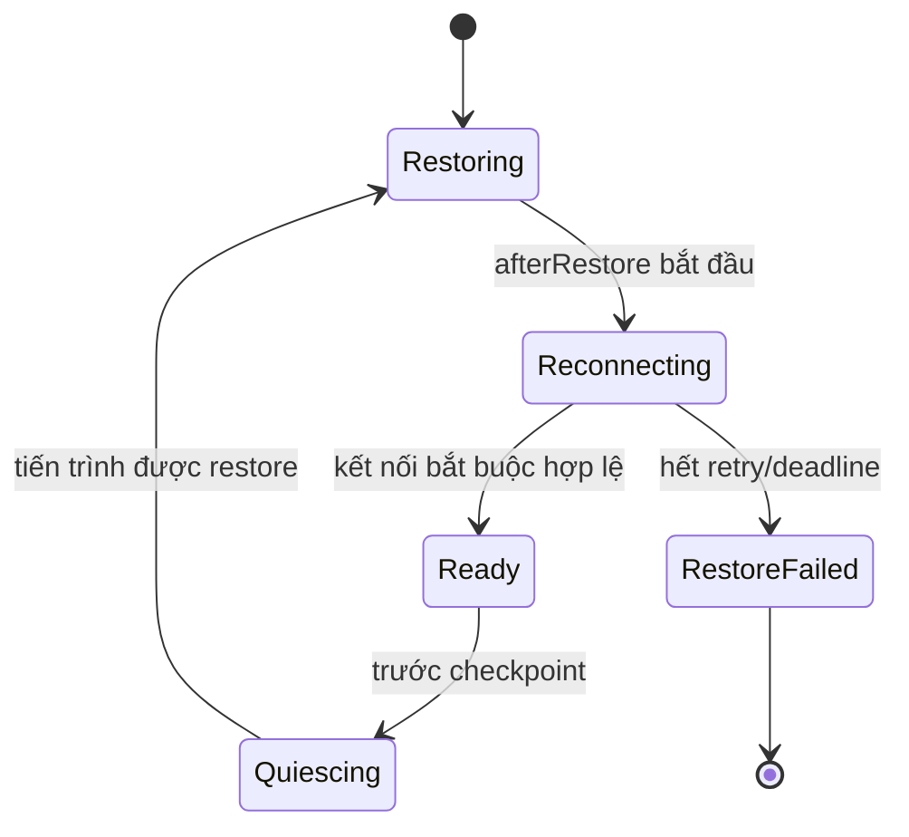

# Kết nối lại với thời gian chờ, số lần thử và độ trễ ngẫu nhiên phù hợp

Sau khi một tiến trình Java được khôi phục từ checkpoint CRaC, các kết nối mạng đã tồn tại trước checkpoint có thể không còn dùng được. Socket, TLS session, connection pool hoặc trạng thái DNS có thể đã thay đổi trong thời gian tiến trình tạm dừng. Ứng dụng cần chủ động kiểm tra và thiết lập lại những kết nối bắt buộc trước khi tiếp tục xử lý request.

Mạng có thể chưa sẵn sàng ngay tại thời điểm callback `afterRestore` chạy. Dịch vụ phụ thuộc có thể đang khởi động, DNS chưa cập nhật, load balancer chưa nhận backend hoặc database đang phục hồi. Nếu chỉ thử kết nối đúng một lần, ứng dụng có thể thất bại vì một lỗi tạm thời. Nếu retry liên tục không giới hạn, nhiều instance được restore cùng lúc có thể tạo ra một đợt kết nối dồn dập và làm dịch vụ phụ thuộc quá tải.

Một chiến lược reconnect phù hợp cần kết hợp **timeout**, **giới hạn số lần thử**, **ngân sách thời gian tổng thể** và **độ trễ có jitter**. Mỗi lần thử phải có giới hạn riêng; toàn bộ quá trình phải có deadline; chỉ lỗi có thể hồi phục mới được retry; và ứng dụng chỉ nhận traffic khi các kết nối bắt buộc đã sẵn sàng.

## 1. Vì sao cần reconnect sau restore?

Checkpoint giữ lại trạng thái tiến trình tại một thời điểm. Trạng thái Java của một client có thể vẫn còn trong heap, nhưng điều đó không chứng minh kết nối mạng bên dưới vẫn hoạt động. Trong lúc tiến trình không chạy, phía server có thể đóng socket, firewall có thể hết hạn NAT mapping, chứng thư có thể được thay đổi hoặc địa chỉ dịch vụ có thể được cập nhật.

Những tài nguyên thường cần kiểm tra hoặc tạo lại gồm:

- TCP socket và kết nối tới dịch vụ bên ngoài.
- TLS session, certificate state hoặc token có thời hạn.
- HTTP client connection pool và các kết nối keep-alive.
- Kết nối database, message broker, cache hoặc service discovery.
- Client giữ DNS result hoặc địa chỉ IP đã phân giải trước checkpoint.
- Luồng nhận dữ liệu, consumer hoặc subscription gắn với một kết nối mạng.

Không phải mọi đối tượng client đều phải được tạo mới. Một số thư viện có hỗ trợ CRaC hoặc có callback riêng để đóng và làm mới kết nối. Hãy dùng integration được thư viện khuyến nghị nếu có. Với client tự quản lý, cần xác định rõ trạng thái nào có thể giữ lại và trạng thái nào phải làm mới trong lifecycle CRaC.

## 2. Đặt logic reconnect trong lifecycle CRaC

Một `Resource` có thể đóng kết nối trước checkpoint và kết nối lại sau restore:

- `beforeCheckpoint`: ngừng nhận công việc mới, chờ các request đang dùng kết nối kết thúc, đóng hoặc đưa client/pool về trạng thái an toàn.
- `afterRestore`: tạo kết nối mới hoặc kiểm tra client đã được thư viện phục hồi, áp dụng retry policy có giới hạn và chỉ đánh dấu sẵn sàng khi kết nối đạt yêu cầu.

Ví dụ cấu trúc:

```java
import org.crac.Context;
import org.crac.Core;
import org.crac.Resource;

public final class NetworkResource implements Resource {
    private final ConnectionFactory factory;
    private Connection connection;

    public NetworkResource(ConnectionFactory factory) {
        this.factory = factory;
        Core.getGlobalContext().register(this);
    }

    @Override
    public synchronized void beforeCheckpoint(
            Context<? extends Resource> context) throws Exception {
        if (connection != null) {
            connection.close();
            connection = null;
        }
    }

    @Override
    public synchronized void afterRestore(
            Context<? extends Resource> context) throws Exception {
        connection = factory.connect();
    }
}
```

Đoạn mã chỉ minh họa vị trí của hai callback. `factory.connect()` trong ví dụ chưa có timeout hoặc retry; phần tiếp theo sẽ bổ sung các giới hạn cần thiết. Trong ứng dụng thực tế, `beforeCheckpoint` cũng cần phối hợp với worker đang sử dụng kết nối để tránh đóng socket khi request vẫn đang chạy.

Không nên đặt reconnect duy nhất trong `main()`. Restore tiếp tục từ trạng thái đã checkpoint, không chạy lại toàn bộ startup path như một lần khởi động mới. Logic phục hồi tài nguyên phải nằm trong callback `afterRestore` hoặc lifecycle CRaC được thư viện sử dụng hỗ trợ.

## 3. Phân biệt các loại timeout

Một lần kết nối có thể bao gồm nhiều giai đoạn. Chỉ cấu hình một timeout chung mà không biết nó giới hạn giai đoạn nào có thể khiến ứng dụng chờ lâu hơn dự kiến.

| Timeout | Giới hạn | Ví dụ vấn đề nếu không giới hạn |
|---|---|---|
| DNS timeout | Thời gian phân giải tên dịch vụ | Lookup bị chậm hoặc resolver không phản hồi |
| Connect timeout | Thời gian thiết lập TCP connection | SYN không nhận phản hồi hoặc endpoint không thể truy cập |
| TLS handshake timeout | Thời gian thương lượng TLS | Server chậm hoặc handshake bị treo |
| Read/response timeout | Thời gian chờ dữ liệu phản hồi | Kết nối tồn tại nhưng server không trả dữ liệu |
| Request deadline | Tổng thời gian cho một request | Nhiều giai đoạn riêng lẻ cộng lại vượt SLA |
| Reconnect deadline | Tổng thời gian dành cho tất cả lần reconnect | Retry kéo dài vô hạn và giữ ứng dụng ở trạng thái chưa sẵn sàng |

Timeout của `Socket.connect()` trong Java chỉ giới hạn giai đoạn kết nối TCP. Nó không tự giới hạn DNS, TLS handshake hoặc thời gian đọc dữ liệu. HTTP client, JDBC driver và message broker client có cấu hình riêng; hãy kiểm tra API của thư viện để đặt timeout ở đúng tầng.

### 3.1. Timeout mỗi lần thử

Mỗi lần kết nối cần timeout hữu hạn. Ví dụ, nếu connect timeout là 2 giây, một lần thử không nên chờ vô hạn chỉ vì dịch vụ chưa phản hồi.

Timeout mỗi lần thử giúp giải phóng tài nguyên khi endpoint không phản hồi. Tuy nhiên, nó không giới hạn tổng thời gian reconnect nếu ứng dụng thực hiện nhiều lần thử.

### 3.2. Deadline tổng thể

Deadline tổng thể xác định thời điểm muộn nhất mà quá trình reconnect được phép kết thúc. Ví dụ, một callback có tối đa 8 lần thử, mỗi lần connect tối đa 2 giây, nhưng tổng ngân sách chỉ là 20 giây. Khi deadline hết hạn, ứng dụng phải dừng retry và báo lỗi.

Nên đo deadline bằng đồng hồ monotonic như `System.nanoTime()`, không dùng `System.currentTimeMillis()` để tính thời lượng. Đồng hồ hệ thống có thể được điều chỉnh; `nanoTime()` phù hợp để đo khoảng thời gian trôi qua.

Khi còn ít thời gian hơn timeout của một lần thử, hãy truyền phần thời gian còn lại cho client. Không bắt đầu một lần thử mới nếu deadline đã hết.

## 4. Giới hạn số lần thử

Số lần thử cần được xác định rõ. `maxAttempts` nên bao gồm lần thử đầu tiên:

| `maxAttempts` | Ý nghĩa |
|---:|---|
| 1 | Chỉ thử một lần, không retry |
| 3 | Một lần ban đầu và tối đa hai lần retry |
| 8 | Một lần ban đầu và tối đa bảy lần retry |

Không nên dùng một vòng lặp vô hạn trong `afterRestore`. Callback có thể giữ tiến trình ở trạng thái phục hồi quá lâu, làm service không đạt readiness hoặc khiến hệ thống orchestration liên tục đánh giá instance chưa sẵn sàng.

Số lần thử cần đi cùng deadline tổng thể. Một cấu hình có 10 lần thử nhưng tổng deadline 5 giây sẽ không thể sử dụng hết 10 lần nếu mỗi lần connect mất gần một giây. Ngược lại, deadline 5 phút với chỉ 2 lần thử có thể không tận dụng được ngân sách phục hồi. Hãy chọn hai giá trị dựa trên SLA, timeout của client và thời gian dịch vụ phụ thuộc thường cần để sẵn sàng.

## 5. Exponential backoff và jitter

Nếu kết nối thất bại, không nên retry ngay lập tức trong một vòng lặp sát nhau. Mỗi lần retry cần chờ một khoảng thời gian. Một chiến lược phổ biến là exponential backoff: tăng dần thời gian chờ sau mỗi lần thất bại, đồng thời đặt giới hạn tối đa.

Với base delay (b), max delay (m), lần thất bại thứ (n), giới hạn chờ có thể tính như sau:

\[
c_n = \min(m, b \cdot 2^{n-1})
\]

Nếu tất cả instance dùng đúng một lịch cố định, chúng có thể retry cùng thời điểm. Hiện tượng này tạo ra *thundering herd*: nhiều client cùng dồn request vào dịch vụ vừa phục hồi.

Jitter thêm một thành phần ngẫu nhiên vào thời gian chờ để phân tán các lần retry. Với *full jitter*, delay được chọn ngẫu nhiên trong khoảng từ 0 tới giới hạn backoff hiện tại:

\[
d_n \sim U(0, c_n)
\]

Ví dụ với base delay 200 ms và max delay 5 giây:

| Lần retry | Giới hạn backoff | Full jitter có thể chọn |
|---:|---:|---:|
| 1 | 200 ms | 0–200 ms |
| 2 | 400 ms | 0–400 ms |
| 3 | 800 ms | 0–800 ms |
| 4 | 1.600 ms | 0–1.600 ms |
| 5 | 3.200 ms | 0–3.200 ms |
| 6 trở đi | 5.000 ms | 0–5.000 ms |

Full jitter giảm khả năng các instance đồng bộ retry. Một lựa chọn khác là equal jitter, giữ một nửa thời gian chờ cố định và ngẫu nhiên hóa nửa còn lại. Dù chọn thuật toán nào, cần giới hạn delay tối đa và không ngủ lâu hơn phần thời gian còn lại của deadline.

### 5.1. Tránh tràn số khi tăng backoff

Không nên tính `baseDelay * (1L << attempt)` một cách tùy tiện vì phép dịch bit hoặc phép nhân có thể tràn số khi số lần thử lớn. Có thể nhân đôi có kiểm soát và dừng tại max delay:

```java
static long cappedBackoffNanos(
        long baseNanos, long maxNanos, int failedAttempt) {
    long cap = baseNanos;
    for (int i = 1; i < failedAttempt && cap < maxNanos; i++) {
        cap = cap > maxNanos / 2
                ? maxNanos
                : Math.min(maxNanos, cap * 2);
    }
    return cap;
}
```

Giả sử `baseNanos` và `maxNanos` là số dương hợp lệ, đồng thời `baseNanos` không lớn hơn `maxNanos`. Cách tính này tránh nhân vượt giới hạn đã chọn.

## 6. Chỉ retry lỗi có khả năng hồi phục

Không phải mọi lỗi kết nối đều nên retry. Retry lỗi cấu hình hoặc lỗi xác thực không giúp kết nối thành công và chỉ kéo dài thời gian phục hồi.

| Nhóm lỗi | Ví dụ | Hướng xử lý |
|---|---|---|
| Lỗi tạm thời | Connection refused trong lúc service khởi động, reset, timeout, DNS tạm thời không phân giải được | Có thể retry trong deadline |
| Quá tải có thể hồi phục | HTTP 503, một số HTTP 429, broker báo tạm thời unavailable | Retry có backoff; tôn trọng `Retry-After` nếu thư viện cung cấp |
| Lỗi cấu hình | Host sai, port sai, thiếu route hoặc cấu hình TLS sai | Không retry vô hạn; báo lỗi cấu hình |
| Lỗi xác thực/phân quyền | Credential sai, token bị thu hồi, certificate không hợp lệ | Làm mới credential nếu có cơ chế; nếu không thì dừng và báo lỗi |
| Lỗi lập trình | Null state, lỗi invariant hoặc kiểu dữ liệu không hợp lệ | Không retry như lỗi mạng |

Nên phân loại exception theo API của client. Đừng bắt `Exception` hoặc `Throwable` rồi retry tất cả. Ví dụ, `SocketTimeoutException` có thể là lỗi tạm thời; `SSLHandshakeException` thường cần kiểm tra nguyên nhân cụ thể thay vì retry mặc định; `UnknownHostException` có thể tạm thời trong một số môi trường nhưng cũng có thể do hostname sai.

Đối với HTTP, retry status code cần theo chính sách của ứng dụng và semantics của request. Một request GET thường dễ retry hơn một request POST tạo giao dịch. Nếu server đã xử lý request nhưng response bị mất, gửi lại POST có thể tạo giao dịch trùng. Dùng idempotency key hoặc giao thức bảo đảm idempotency trước khi retry thao tác ghi.

## 7. Ví dụ Java: reconnect có deadline, retry và full jitter

Ví dụ sau dùng abstraction `ConnectionFactory` để tập trung vào chính sách retry. Factory phải đảm bảo `connectAndValidate(timeout)` giới hạn cả thao tác kết nối và kiểm tra sức khỏe trong timeout được truyền vào, đồng thời tự đóng tài nguyên dang dở nếu lần kết nối thất bại.

```java
import java.io.IOException;
import java.time.Duration;
import java.util.concurrent.ThreadLocalRandom;
import java.util.concurrent.TimeUnit;

import org.crac.Context;
import org.crac.Core;
import org.crac.Resource;

public final class ReconnectingResource implements Resource {
    private final ConnectionFactory factory;
    private final int maxAttempts;
    private final Duration perAttemptTimeout;
    private final Duration totalTimeout;
    private final Duration baseDelay;
    private final Duration maxDelay;

    private volatile Connection connection;

    public ReconnectingResource(
            ConnectionFactory factory,
            int maxAttempts,
            Duration perAttemptTimeout,
            Duration totalTimeout,
            Duration baseDelay,
            Duration maxDelay) {

        if (maxAttempts < 1) {
            throw new IllegalArgumentException("maxAttempts must be >= 1");
        }
        if (perAttemptTimeout.isZero() || perAttemptTimeout.isNegative()
                || totalTimeout.isZero() || totalTimeout.isNegative()
                || baseDelay.isNegative() || maxDelay.isNegative()
                || baseDelay.compareTo(maxDelay) > 0) {
            throw new IllegalArgumentException("Invalid retry durations");
        }

        this.factory = factory;
        this.maxAttempts = maxAttempts;
        this.perAttemptTimeout = perAttemptTimeout;
        this.totalTimeout = totalTimeout;
        this.baseDelay = baseDelay;
        this.maxDelay = maxDelay;

        Core.getGlobalContext().register(this);
    }

    @Override
    public synchronized void beforeCheckpoint(
            Context<? extends Resource> context) throws Exception {
        Connection current = connection;
        connection = null;
        if (current != null) {
            current.close();
        }
    }

    @Override
    public synchronized void afterRestore(
            Context<? extends Resource> context) throws Exception {
        reconnectWithRetry();
    }

    private void reconnectWithRetry() throws Exception {
        long totalNanos = totalTimeout.toNanos();
        long deadline = System.nanoTime() + totalNanos;
        IOException lastFailure = null;

        for (int attempt = 1; attempt <= maxAttempts; attempt++) {
            long remaining = deadline - System.nanoTime();
            if (remaining <= 0) {
                break;
            }

            long attemptNanos = Math.min(
                    perAttemptTimeout.toNanos(), remaining);
            Connection candidate = null;
            try {
                candidate = factory.connectAndValidate(
                        Duration.ofNanos(attemptNanos));

                if (deadline - System.nanoTime() <= 0) {
                    Connection expired = candidate;
                    candidate = null;
                    expired.close();
                    lastFailure = new IOException(
                            "Reconnect deadline expired during connection setup");
                    break;
                }

                connection = candidate;
                return;
            } catch (IOException e) {
                lastFailure = e;
                if (candidate != null) {
                    try {
                        candidate.close();
                    } catch (IOException closeFailure) {
                        e.addSuppressed(closeFailure);
                    }
                }
                if (!isRetryable(e)) {
                    throw e;
                }
            }

            if (attempt == maxAttempts) {
                break;
            }

            remaining = deadline - System.nanoTime();
            if (remaining <= 0) {
                break;
            }

            long cap = cappedBackoffNanos(
                    baseDelay.toNanos(), maxDelay.toNanos(), attempt);
            long delay = cap == 0
                    ? 0
                    : ThreadLocalRandom.current().nextLong(cap + 1);
            long sleepNanos = Math.min(delay, remaining);

            try {
                TimeUnit.NANOSECONDS.sleep(sleepNanos);
            } catch (InterruptedException e) {
                Thread.currentThread().interrupt();
                throw e;
            }
        }

        throw new IOException(
                "Could not reconnect within the configured retry budget",
                lastFailure);
    }

    private static long cappedBackoffNanos(
            long baseNanos, long maxNanos, int failedAttempt) {
        long cap = baseNanos;
        for (int i = 1; i < failedAttempt && cap < maxNanos; i++) {
            cap = cap > maxNanos / 2
                    ? maxNanos
                    : Math.min(maxNanos, cap * 2);
        }
        return cap;
    }

    private static boolean isRetryable(IOException failure) {
        return failure instanceof java.net.ConnectException
                || failure instanceof java.net.SocketTimeoutException
                || failure instanceof java.net.NoRouteToHostException;
    }

    public Connection requireConnection() {
        Connection current = connection;
        if (current == null) {
            throw new IllegalStateException("Connection is not ready");
        }
        return current;
    }

    public interface ConnectionFactory {
        Connection connectAndValidate(Duration timeout) throws IOException;
    }

    public interface Connection extends AutoCloseable {
        @Override
        void close() throws IOException;
    }
}
```

Ví dụ minh họa những điểm quan trọng:

1. `maxAttempts` bao gồm lần thử ban đầu.
2. Mỗi lần gọi factory nhận timeout không lớn hơn timeout cấu hình hoặc thời gian còn lại.
3. Deadline tổng thể được tính bằng `System.nanoTime()`.
4. Chỉ các lỗi mạng tạm thời được `isRetryable` nhận diện mới được retry; lỗi cấu hình hoặc lỗi không nằm trong danh sách sẽ được ném ra ngay. Ứng dụng thật cần điều chỉnh bộ phân loại theo client và môi trường DNS/TLS.
5. Backoff tăng theo cấp số nhân và được giới hạn bởi `maxDelay`.
6. Full jitter phân tán thời điểm retry giữa các instance.
7. Nếu thread bị interrupt, callback giữ trạng thái interrupt và dừng retry.
8. Nếu hết attempts hoặc deadline, callback ném lỗi để quá trình phục hồi không âm thầm thành công.

Để dùng ví dụ, hãy cung cấp implementation `ConnectionFactory` cho HTTP client, database hoặc giao thức riêng. Factory phải thực thi timeout thực sự ở tầng thư viện, không chỉ nhận một tham số `Duration` rồi bỏ qua. Nếu `connectAndValidate` thất bại sau khi đã mở socket hoặc tạo session, factory chịu trách nhiệm đóng những tài nguyên một phần đó trước khi ném exception.

Trong cấu hình trên, `baseDelay` có thể là 100–250 ms, `maxDelay` có thể là vài giây, `maxAttempts` có thể là 5–8 và `totalTimeout` có thể là 15–30 giây. Đây chỉ là điểm bắt đầu để thử nghiệm; hãy đo thời gian phục hồi thật và điều chỉnh theo SLA cùng khả năng chịu tải của dịch vụ phụ thuộc.

## 8. Kết hợp retry với connection pool và HTTP client

Ứng dụng thường không tự quản lý từng socket mà dùng HTTP client, JDBC pool hoặc message broker client. Cần xác định lifecycle chính thức của thư viện:

- Đóng hoặc suspend pool trong `beforeCheckpoint` theo hướng dẫn tích hợp CRaC của thư viện.
- Trong `afterRestore`, tạo lại pool hoặc gọi API resume/refresh được thư viện hỗ trợ.
- Cấu hình connect timeout, TLS timeout, validation timeout và request timeout ở đúng client.
- Kiểm tra một kết nối thực tế bằng health check nhẹ trước khi đánh dấu pool sẵn sàng.
- Không tự tạo thêm pool mới nếu thư viện đã tự phục hồi pool trong callback riêng.

Với JDBC, `DataSource.getConnection()` không có tham số timeout chuẩn áp dụng đồng nhất cho mọi driver. Thời gian chờ kết nối thường được cấu hình qua thuộc tính của pool hoặc driver. Hãy kiểm tra cấu hình của HikariCP, Agroal, DBCP hoặc driver đang dùng thay vì giả định một timeout Java chung sẽ giới hạn được mọi bước.

Với HTTP client, cần phân biệt timeout thiết lập kết nối với timeout cho toàn request. Một kết nối TCP thành công không có nghĩa server đã xử lý được request. Có thể cần gọi health endpoint hoặc thực hiện một thao tác kiểm tra an toàn trước khi cho client nhận traffic.

## 9. Retry request và tính idempotent

Reconnect chỉ khôi phục kênh giao tiếp. Retry một request nghiệp vụ là quyết định khác. Nếu kết nối bị đứt sau khi server đã thực hiện thao tác nhưng trước khi client nhận response, client không biết thao tác đã thành công hay chưa.

Ví dụ, client gửi yêu cầu tạo đơn hàng. Server ghi đơn thành công nhưng response bị mất. Nếu client gửi lại yêu cầu mà không có idempotency key, server có thể tạo đơn hàng thứ hai.

Trước khi retry request, cần trả lời:

- Request có an toàn để gửi lại không?
- Server có hỗ trợ idempotency key hoặc request identifier không?
- Có thể kiểm tra kết quả lần gọi trước bằng transaction ID không?
- Lỗi xảy ra trước khi gửi dữ liệu, trong lúc gửi hay sau khi server có thể đã xử lý?
- Có deadline nghiệp vụ bao trùm tất cả lần retry không?

Các thao tác đọc thường dễ retry hơn thao tác ghi, nhưng vẫn cần cân nhắc chi phí và tải hệ thống. Với thao tác ghi, dùng idempotency key ổn định xuyên suốt các lần thử và không tạo key mới cho mỗi retry.

## 10. Circuit breaker, rate limit và nhiều instance restore cùng lúc

Backoff và jitter giảm tần suất retry, nhưng không thay thế hoàn toàn circuit breaker hoặc rate limiting. Nếu dịch vụ phụ thuộc đang hỏng kéo dài, circuit breaker có thể tạm ngừng gọi để tránh tiêu tốn tài nguyên. Khi dịch vụ phục hồi, một số probe có kiểm soát được dùng để xác định lúc đóng circuit.

Khi nhiều instance cùng restore:

- Dùng full jitter để phân tán lần thử đầu và các lần retry.
- Giới hạn số kết nối đồng thời bằng pool hoặc semaphore.
- Dùng circuit breaker để tránh tiếp tục gọi một endpoint đang lỗi kéo dài.
- Tôn trọng quota, rate limit và `Retry-After` nếu dịch vụ trả về hướng dẫn chờ.
- Tránh để mọi instance dùng cùng lịch retry cố định sau một lần deploy.
- Có thể thêm startup staggering ở tầng orchestration nếu số lượng instance lớn.

Jitter nên được tạo độc lập cho từng instance và từng lần retry. Không dùng một giá trị delay cố định được cấu hình giống nhau cho toàn bộ cụm nếu mục tiêu là tránh đồng bộ.

## 11. Readiness sau restore

Sau khi callback `afterRestore` hoàn tất, ứng dụng vẫn cần xác nhận các thành phần phục vụ đã sẵn sàng. Có thể tách trạng thái thành:



Readiness nên phản ánh khả năng xử lý công việc thực tế, không chỉ việc JVM đã chạy. Nếu một dependency là tùy chọn, ứng dụng có thể cho phép hoạt động ở chế độ suy giảm và retry nền sau đó. Nếu dependency là bắt buộc, không nhận traffic cho tới khi kết nối được phục hồi.

Không nên giữ callback `afterRestore` chạy retry vô hạn để chờ dịch vụ. Dùng deadline hữu hạn, báo lỗi rõ ràng và để orchestration quyết định restart, backoff ở cấp instance hoặc chuyển sang trạng thái không sẵn sàng. Nếu ứng dụng hỗ trợ reconnect nền sau restore, hãy tách rõ readiness của các chức năng độc lập để một dependency tùy chọn không chặn toàn bộ hệ thống.

## 12. Logging, metrics và quan sát

Mỗi lần reconnect nên có log hoặc metric đủ để trả lời vì sao quá trình phục hồi chậm:

- Tên dependency và endpoint logic (không ghi secret hoặc token).
- Số lần thử hiện tại và tổng số lần thử tối đa.
- Loại exception hoặc mã lỗi được phân loại.
- Timeout của lần thử và thời gian đã tiêu thụ trong deadline tổng.
- Backoff cap và delay jitter thực tế.
- Kết quả cuối cùng: kết nối thành công, hết attempts, hết deadline hay bị interrupt.
- Thời gian từ khi bắt đầu `afterRestore` đến khi dependency sẵn sàng.

Metric hữu ích gồm `reconnect_attempts_total`, `reconnect_failures_total`, `reconnect_duration_seconds`, `reconnect_delay_seconds` và số instance đang chờ dependency. Dùng tag có cardinality thấp như tên dịch vụ và kết quả; tránh gắn URL đầy đủ, user ID hoặc request ID làm nhãn metric.

Khi nhiều instance restore cùng lúc, so sánh biểu đồ thời điểm retry và số kết nối đến dependency. Nếu các lần retry vẫn tập trung thành đợt, kiểm tra jitter có thực sự được áp dụng và có tầng orchestration nào đang đồng bộ lịch restart hay không.

## 13. Kiểm thử chiến lược reconnect

Không nên chỉ kiểm thử trường hợp server luôn hoạt động. Cần mô phỏng các tình huống thường gặp sau restore:

1. **Dịch vụ sẵn sàng ngay:** lần thử đầu thành công; không phát sinh delay không cần thiết.
2. **Dịch vụ khởi động chậm:** vài lần đầu thất bại tạm thời rồi thành công; xác nhận retry dừng ngay khi kết nối thành công.
3. **Dịch vụ không bao giờ sẵn sàng:** xác nhận tổng thời gian không vượt deadline đáng kể và callback báo lỗi sau giới hạn.
4. **Connect bị treo:** xác nhận timeout mỗi lần thử được áp dụng ở client thật.
5. **Lỗi không thể hồi phục:** credential sai hoặc cấu hình sai không bị retry vô hạn.
6. **Thread bị interrupt:** retry dừng và trạng thái interrupt được giữ lại.
7. **Nhiều instance restore đồng thời:** xác nhận jitter phân tán các lần retry và dependency không bị dồn tải.
8. **Request ghi bị mất response:** xác nhận idempotency key ngăn thao tác nghiệp vụ bị thực hiện hai lần.
9. **Nhiều chu kỳ checkpoint/restore:** xác nhận kết nối cũ được đóng, kết nối mới được tạo và không tích lũy socket hoặc thread.

Nên dùng mock clock hoặc injectable sleeper/random source trong unit test để kiểm tra thuật toán backoff mà không phải chờ thật. Sau đó chạy integration test với client và CRaC-enabled runtime mục tiêu để xác nhận timeout được thực thi ở tầng mạng thật.

## 14. Checklist cấu hình

- [ ] Kết nối mạng cũ được đóng hoặc refresh đúng theo lifecycle của thư viện trước checkpoint.
- [ ] `afterRestore` tạo lại hoặc xác thực các kết nối bắt buộc.
- [ ] Timeout riêng của connect, TLS, read và request được cấu hình phù hợp.
- [ ] Mỗi lần thử có timeout hữu hạn và tôn trọng thời gian còn lại.
- [ ] Có deadline tổng thể cho toàn bộ reconnect.
- [ ] `maxAttempts` hữu hạn và bao gồm lần thử ban đầu.
- [ ] Chỉ lỗi tạm thời được retry; lỗi cấu hình và xác thực được xử lý riêng.
- [ ] Backoff tăng dần, có giới hạn tối đa và dùng jitter.
- [ ] Retry không vượt deadline và dừng khi thread bị interrupt.
- [ ] Request ghi chỉ retry khi có idempotency phù hợp.
- [ ] Connection pool và client dùng đúng CRaC integration của thư viện.
- [ ] Readiness chỉ bật khi dependency bắt buộc đã sẵn sàng.
- [ ] Có log và metric về attempts, delay, lỗi và thời gian reconnect.
- [ ] Đã kiểm thử dependency phục hồi chậm, lỗi kéo dài và nhiều instance restore cùng lúc.

## 15. Tài liệu tham khảo

- [CRaC API — `Resource`](https://javadoc.io/doc/org.crac/crac/latest/org/crac/Resource.html): callback `beforeCheckpoint` và `afterRestore` cho tài nguyên cần quản lý vòng đời.
- [Java `Socket`](https://docs.oracle.com/en/java/javase/21/docs/api/java.base/java/net/Socket.html): timeout khi kết nối TCP và các thao tác socket.
- [Java `System.nanoTime()`](https://docs.oracle.com/en/java/javase/21/docs/api/java.base/java/lang/System.html#nanoTime()): đồng hồ monotonic để đo thời gian trôi qua.
- [AWS Builders' Library — Timeouts, retries, and backoff with jitter](https://aws.amazon.com/builders-library/timeouts-retries-and-backoff-with-jitter/): cách chọn timeout, giới hạn retry và dùng jitter để tránh đồng bộ tải.

Kết nối lại sau restore cần được xem là một phần của lifecycle tài nguyên mạng. Hãy đặt timeout cho từng lần thử, giới hạn tổng thời gian và số lần thử, chỉ retry lỗi tạm thời, rồi dùng exponential backoff có jitter để phân tán tải. Khi kết nối bắt buộc chưa sẵn sàng, ứng dụng cần giữ trạng thái chưa ready và báo lỗi rõ ràng thay vì tiếp tục xử lý request với một kết nối cũ hoặc không hợp lệ.
