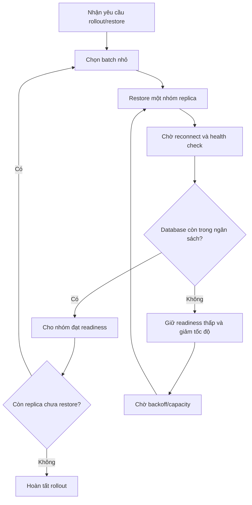

# Khôi phục nhiều bản sao mà không gây bùng nổ số kết nối

CRaC cho phép tạo checkpoint từ một tiến trình Java đã khởi tạo, sau đó khôi phục trạng thái đó để rút ngắn thời gian đưa ứng dụng vào hoạt động. Trong môi trường triển khai có nhiều replica, một checkpoint có thể được dùng để khởi chạy nhiều bản sao gần như cùng lúc. Nếu mỗi bản sao lập tức tạo đầy đủ connection pool và kết nối đến database, tổng số kết nối mới có thể tăng đột biến.

Hiện tượng này thường được gọi là *connection storm* hoặc *thundering herd*. Nó có thể làm database chạm giới hạn connection, tăng CPU và bộ nhớ, làm chậm quá trình xác thực, khiến pool liên tục retry và kéo dài thời gian readiness. Các replica có thể cùng thất bại rồi retry đồng loạt, khiến tình hình nặng hơn.

Để tránh vấn đề, cần tính ngân sách kết nối ở cấp toàn hệ thống, giới hạn tốc độ tạo kết nối khi restore, tạo pool theo nhu cầu, phục hồi theo từng đợt và chỉ đưa replica vào phục vụ khi dependency thực sự sẵn sàng. Một pool được tạo trong heap trước checkpoint không đại diện cho một ngân sách kết nối riêng được bảo đảm cho từng bản restore.

## 1. Vì sao nhiều bản restore có thể tạo connection storm?

Giả sử một dịch vụ có một checkpoint đã warm-up. Khi triển khai, nền tảng tạo 30 replica từ checkpoint đó. Mỗi replica chứa cấu hình connection pool với `maximumPoolSize = 20`. Nếu mỗi pool cố gắng tạo 20 kết nối ngay khi khởi động, database có thể nhận tới 600 yêu cầu kết nối trong một khoảng thời gian ngắn.

Ngay cả khi pool không mở tất cả kết nối ngay lập tức, lượng request đồng thời đầu tiên có thể làm các pool tăng kích thước cùng lúc. Một số yếu tố làm burst lớn hơn:

- Nhiều replica được restore trong cùng một đợt rollout hoặc scale-out.
- Pool được cấu hình `minimumIdle` cao hoặc khởi tạo eager.
- Warm-up của từng replica chạy truy vấn song song và mượn nhiều connection cùng lúc.
- Startup check, health check, scheduler và consumer cùng truy cập database ngay sau restore.
- Retry không có backoff hoặc tất cả replica dùng cùng một chu kỳ retry.
- Rollout có surge, khiến replica cũ và mới cùng tồn tại trong thời gian chuyển tiếp.
- Một lần restore thất bại khiến orchestration khởi động lại nhiều replica cùng lúc.

Vấn đề có hai chiều riêng biệt:

1. **Tổng số connection:** số kết nối đồng thời vượt khả năng database hoặc proxy.
2. **Tốc độ tạo connection:** nhiều lần TCP/TLS handshake, xác thực và khởi tạo session diễn ra cùng lúc, làm backend quá tải dù tổng số kết nối cuối cùng có thể nằm dưới giới hạn.

Do đó, chỉ giảm `maximumPoolSize` chưa chắc giải quyết được burst. Cần kiểm soát cả số kết nối tối đa và tốc độ mở kết nối mới.

## 2. Tính ngân sách kết nối ở cấp toàn hệ thống

Không nên chọn kích thước pool độc lập cho từng replica. Hãy bắt đầu từ giới hạn thực tế của database, trừ phần dành cho quản trị, migration, monitoring, tác vụ nền và một khoảng dự phòng.

Một cách tính đơn giản:

```text
app_connection_budget =
    database_connection_limit
    - reserved_admin_connections
    - other_application_connections
    - safety_headroom

peak_replica_count =
    steady_state_replicas
    + rollout_surge_replicas
    + scale_out_or_restore_overlap

per_replica_pool_max <=
    floor(app_connection_budget / peak_replica_count)
```

Đây là giới hạn khởi đầu cho tổng pool của một replica. Nếu một replica có nhiều pool hoặc có consumer/job dùng connection riêng, phải cộng chúng vào ngân sách. Cũng cần tính các kết nối từ phiên bản ứng dụng cũ còn chạy trong lúc rollout.

### Ví dụ tính toán

Giả sử database cho phép tối đa 300 connection. Ta dành 40 connection cho quản trị và hoạt động nội bộ, 30 cho các ứng dụng khác, và giữ 30 connection làm headroom để ứng phó tải bất thường. Ngân sách còn lại cho dịch vụ đang thiết kế là:

```text
300 - 40 - 30 - 30 = 200 connections
```

Nếu rollout hoặc restore có thể tạo tối đa 24 replica cùng tồn tại, giới hạn trung bình cho mỗi replica là:

```text
floor(200 / 24) = 8 connections per replica
```

Pool tối đa 8 connection là điểm bắt đầu để thử tải. Nếu mỗi replica còn một pool riêng cho job hoặc một datasource thứ hai, phải chia tiếp ngân sách. Không nên đặt mỗi pool thành 8 rồi quên rằng một replica có thể sở hữu nhiều pool.

| Thành phần | Số connection dự kiến |
|---|---:|
| Database connection limit | 300 |
| Quản trị và hoạt động nội bộ | 40 |
| Ứng dụng khác | 30 |
| Headroom dự phòng | 30 |
| Ngân sách cho dịch vụ | 200 |
| Peak replicas | 24 |
| Pool max khởi điểm mỗi replica | 8 |
| Tổng pool max của dịch vụ | 192 |

Hãy tính theo số replica đỉnh điểm, không chỉ theo số replica bình thường. Nếu rollout cho phép tạo 8 replica mới trước khi 8 replica cũ bị loại bỏ, phần surge phải nằm trong phép tính. Với autoscaling hoặc nhiều nhóm worker, cần tính tổng số instance có thể cùng mở kết nối.

### Không sử dụng hết giới hạn database

Giới hạn connection của database không phải mục tiêu để lấp đầy. Database cần tài nguyên cho các truy vấn đang chạy, lock, bộ nhớ, replication, tác vụ nội bộ và các client quản trị. Nhiều connection nhàn rỗi vẫn tiêu tốn tài nguyên và có thể làm tăng chi phí context switching. Một pool nhỏ có hàng đợi được kiểm soát đôi khi hoạt động ổn định hơn nhiều pool lớn.

## 3. Phân biệt pool tối đa, pool tối thiểu và tốc độ tạo connection

Connection pool thường có nhiều tham số với ý nghĩa khác nhau:

- **Maximum pool size:** số connection tối đa pool có thể quản lý.
- **Minimum idle:** số connection nhàn rỗi mà pool cố duy trì.
- **Initial/eager connections:** số connection được tạo khi pool khởi tạo, tùy implementation.
- **Connection timeout:** thời gian tối đa caller chờ lấy được connection.
- **Idle timeout/max lifetime:** chính sách loại bỏ connection nhàn rỗi hoặc đã sống quá lâu.
- **Validation/keepalive:** cách pool kiểm tra hoặc duy trì connection.

Nếu `minimumIdle` gần bằng `maximumPoolSize`, nhiều pool có thể cố gắng duy trì số connection lớn ngay sau restore. Với workload có thể tăng dần, cấu hình minimum idle thấp hoặc bằng 0 có thể giúp pool mở kết nối theo nhu cầu thay vì lập tức lấp đầy pool. Cần kiểm tra hành vi mặc định và tài liệu của pool đang dùng; các thư viện có thể khác nhau.

Ví dụ cấu hình minh họa cho HikariCP trong Spring Boot:

```yaml
spring:
  datasource:
    hikari:
      maximum-pool-size: 8
      minimum-idle: 0
      connection-timeout: 30000
      pool-name: orders-db-pool
```

Các giá trị trên chỉ là ví dụ cho phép tính ngân sách ở phần trước, không phải cấu hình tối ưu chung. Cần điều chỉnh theo số replica đỉnh điểm, thời gian truy vấn, số thread đồng thời, số datasource và giới hạn database thực tế.

Pool tối thiểu thấp giúp giảm kết nối nhàn rỗi nhưng không tự giới hạn tốc độ tăng pool khi tải đột ngột. Nếu nhiều request đồng thời cùng đến, pool vẫn có thể tạo nhiều connection nhanh chóng cho đến `maximumPoolSize`. Vì vậy, cần thêm giới hạn concurrency hoặc giới hạn tốc độ tạo connection ở cấp triển khai.

## 4. Khôi phục theo từng đợt thay vì đồng loạt

Nếu nền tảng có thể điều khiển rollout, hãy giới hạn số replica được restore hoặc đưa vào readiness trong cùng một thời điểm. Ví dụ, thay vì khởi động 24 replica cùng lúc, có thể khởi động từng nhóm 3 hoặc 4 replica, chờ nhóm đó kết nối ổn định rồi mới chuyển sang nhóm tiếp theo.



Các cách triển khai có thể gồm:

- Giới hạn `maxSurge` hoặc concurrency của rolling update.
- Chia restore thành batch và chờ batch trước ổn định.
- Dùng deployment controller hoặc restore coordinator để cấp quyền reconnect.
- Thêm thời gian chờ ngẫu nhiên giữa các replica.
- Không scale lên hàng loạt chỉ vì database tạm thời chậm; tránh vòng lặp autoscaling khuếch đại tải.

Readiness nên được dùng để ngăn traffic đi vào replica chưa có database connection hợp lệ. Tuy nhiên, readiness không tự giới hạn số kết nối mà replica tạo ra. Việc điều phối batch và cấp quyền reconnect cần được thực hiện riêng.

## 5. Dùng jitter và backoff để phân tán các lần reconnect

Nếu mọi replica restore cùng thời điểm và đều đợi đúng 5 giây trước khi kết nối, chúng vẫn tạo burst sau 5 giây. Một khoảng trễ cố định không đủ phá đồng bộ. Hãy thêm jitter để thời điểm reconnect khác nhau giữa các replica.

Một công thức full jitter phổ biến:

```text
cap(attempt) = min(max_delay, base_delay * 2^attempt)
delay = random(0, cap(attempt))
```

Ví dụ, với `base_delay = 500 ms` và `max_delay = 30 s`, mỗi lần retry chọn ngẫu nhiên một độ trễ từ 0 đến giới hạn tăng dần. Cần giới hạn số lần retry hoặc tổng thời gian retry, đồng thời tránh nhiều tầng retry lồng nhau.

Pseudocode:

```java
Duration retryDelay(int attempt,
                    Duration baseDelay,
                    Duration maxDelay) {
    long exponential = Math.min(
            maxDelay.toMillis(),
            baseDelay.toMillis() * (1L << Math.min(attempt, 20)));

    long jitter = ThreadLocalRandom.current()
            .nextLong(exponential + 1);

    return Duration.ofMillis(jitter);
}
```

Đoạn mã minh họa cần được bổ sung xử lý overflow, deadline tổng và chính sách retry theo ứng dụng. Không nên retry vô hạn khi database từ chối kết nối do cấu hình sai, credential không hợp lệ hoặc database đã hết dung lượng. Phân loại lỗi transient và lỗi cấu hình giúp tránh lặp vô ích.

Khi database trả về tín hiệu quá tải hoặc giới hạn kết nối, hãy tăng thời gian chờ, giảm concurrency và giữ replica ở trạng thái chưa sẵn sàng. Nếu có nhiều replica, jitter cần được tạo từ nguồn ngẫu nhiên riêng cho từng lần chạy, không dùng cùng một lịch cố định được đóng gói trong checkpoint.

## 6. Giới hạn số kết nối mới bằng admission control

Jitter phân tán thời gian nhưng không bảo đảm số lần kết nối đồng thời nằm trong giới hạn. Với hệ thống lớn, cần một cơ chế admission control để chỉ cho một số lượng replica hoặc pool nhất định thực hiện reconnect cùng lúc.

Các lựa chọn thường gặp:

- **Restore coordinator:** cấp permit cho từng replica; mỗi permit cho phép tạo hoặc làm nóng pool.
- **Distributed semaphore:** giới hạn số tác vụ reconnect đồng thời trên toàn cụm.
- **Token bucket:** giới hạn tốc độ tạo connection mới theo số lần mỗi giây.
- **Connection proxy/pooler:** tập trung quản lý và multiplex client connection nếu mô hình database và proxy hỗ trợ.
- **Deployment concurrency limit:** điều khiển số replica được restore cùng lúc từ nền tảng triển khai.

Một `Semaphore` trong JVM chỉ giới hạn số thread bên trong một replica. Nếu có 50 replica, mỗi replica có semaphore 2, tổng cộng vẫn có thể có 100 tác vụ reconnect. Muốn giới hạn ở cấp cụm, permit phải được quản lý bởi một dịch vụ dùng chung, proxy, coordinator hoặc chính sách rollout có hiểu biết về tổng số replica.

### Pseudocode cho restore coordinator

```java
public void reconnectAfterRestore() throws Exception {
    try (ReconnectPermit permit = restoreCoordinator.acquirePermit(
            Duration.ofMinutes(2))) {

        HikariDataSource newPool = poolFactory.create();
        try {
            verifyDatabase(newPool);
            currentPool.set(newPool);
            readiness.markDatabaseReady();
        } catch (Exception failure) {
            newPool.close();
            throw failure;
        }
    }
}
```

`ReconnectPermit`, `restoreCoordinator`, `poolFactory` và `readiness` là abstraction minh họa. Permit cần có lease/timeout để tự giải phóng nếu replica chết giữa chừng. Việc cấp permit nên tính cả thời gian tạo pool và xác minh connection, tránh thả permit ngay sau khi bắt đầu thao tác.

Nếu không có coordinator dùng chung, có thể giới hạn batch ở deployment layer. Đây thường là cách đơn giản hơn nếu nền tảng triển khai đã kiểm soát được số replica được restore cùng lúc.

## 7. Tạo lại pool đúng cách sau restore

Checkpoint có thể giữ object quản lý pool trong heap, nhưng các connection vật lý và session database không nên được coi là hợp lệ chỉ vì object pool còn tồn tại. Hãy dùng CRaC integration chính thức của connection pool hoặc driver nếu có. Nếu ứng dụng tự quản lý vòng đời, cần đóng pool trước checkpoint và tạo một pool mới sau restore.

Điểm quan trọng: nhiều pool sau khi gọi `close()` trở thành đối tượng đã đóng vĩnh viễn. Không nên giả định có thể gọi `start()` hoặc mở lại cùng object. Hãy tạo một instance pool mới từ factory, trừ khi thư viện cụ thể có API tái khởi tạo được hỗ trợ.

Ví dụ factory tạo Hikari pool mới:

```java
public final class DataSourceFactory {

    private final DatabaseSettings settings;

    public DataSourceFactory(DatabaseSettings settings) {
        this.settings = settings;
    }

    public HikariDataSource create(String poolName) {
        HikariConfig config = new HikariConfig();
        config.setJdbcUrl(settings.jdbcUrl());
        config.setUsername(settings.username());
        config.setPassword(settings.password());
        config.setMaximumPoolSize(settings.maximumPoolSize());
        config.setMinimumIdle(0);
        config.setConnectionTimeout(settings.connectionTimeoutMillis());
        config.setPoolName(poolName);
        return new HikariDataSource(config);
    }
}
```

Đây là ví dụ cấu hình; thông tin xác thực nên được lấy từ secret manager hoặc cấu hình bảo mật phù hợp, không hard-code trong mã. Tên pool có thể gắn với định danh instance mới để phân biệt các bản restore trong metrics. Các giá trị pool phải tuân theo ngân sách tổng đã tính.

### Quản lý vòng đời bằng CRaC Resource

Một thành phần quản lý datasource có thể phối hợp quiesce, drain và tạo pool mới. Mã sau là pseudocode minh họa vì các abstraction drain/readiness và wiring của Spring phụ thuộc ứng dụng:

```java
public final class DatabasePoolResource implements Resource {

    private final DataSourceFactory factory;
    private final RestoreCoordinator coordinator;
    private final DatabaseWorkGate workGate;
    private final AtomicReference<HikariDataSource> pool =
            new AtomicReference<>();

    @Override
    public void beforeCheckpoint(Context<? extends Resource> context)
            throws Exception {
        workGate.stopNewDatabaseWork();
        workGate.drainTransactionsAndQueries();

        HikariDataSource oldPool = pool.getAndSet(null);
        if (oldPool != null) {
            oldPool.close();
        }
    }

    @Override
    public void afterRestore(Context<? extends Resource> context)
            throws Exception {
        try (ReconnectPermit ignored = coordinator.acquirePermit()) {
            HikariDataSource newPool = factory.create(newPoolName());
            try {
                verifyDatabase(newPool);
                pool.set(newPool);
                workGate.markDatabaseReady();
            } catch (Exception failure) {
                newPool.close();
                throw failure;
            }
        }
    }
}
```

Trong triển khai thật, cần khởi tạo `pool` ban đầu trước khi phục vụ traffic và đăng ký resource đúng một lần. Cũng cần bảo đảm không có request nào lấy pool trong lúc `beforeCheckpoint()` đang drain hoặc `afterRestore()` chưa gắn pool mới. `verifyDatabase()` nên dùng một truy vấn nhẹ, có timeout và không tạo side effect nghiệp vụ.

Nếu connection pool hoặc Spring integration đã tự đăng ký CRaC resource, không tạo callback thứ hai đóng cùng pool. Chỉ có một chủ sở hữu vòng đời cho mỗi pool. Với Spring `DataSource` bean, cần đảm bảo bean hoặc lớp facade truy cập pool trỏ tới instance mới sau restore; đóng một `HikariDataSource` rồi giữ nguyên reference trong bean sẽ khiến các request sau đó dùng pool đã đóng.

## 8. Warm-up database có giới hạn

Warm-up trước checkpoint giúp phát hiện lỗi cấu hình và chuẩn bị đường chạy, nhưng không nên tạo toàn bộ pool hoặc chạy truy vấn nặng trên mọi replica cùng lúc sau restore.

Hãy phân biệt:

- **Warm-up trước checkpoint:** chuẩn bị class, query plan phía client, cấu trúc nội bộ và dữ liệu cache có thể giữ lại.
- **Reconnect sau restore:** tạo các connection cần thiết theo ngân sách và admission control.
- **Readiness check:** xác minh một kết nối thực sự có thể thực hiện truy vấn bắt buộc.
- **Traffic ramp-up:** tăng lưu lượng dần để pool mở rộng theo nhu cầu.

Không cần giữ `minimumIdle` bằng `maximumPoolSize` chỉ để mọi replica có sẵn đầy đủ connection trước khi nhận traffic. Có thể bắt đầu với số kết nối tối thiểu, để pool mở rộng theo tải trong giới hạn. Nếu workload cần nhiều connection ngay lập tức, hãy tăng theo từng batch và tính nó trong ngân sách database.

Các truy vấn warm-up nên đọc dữ liệu an toàn, giới hạn số lượng và tránh side effect. Không chạy migration, tạo dữ liệu nghiệp vụ hoặc khóa bảng chỉ để làm nóng connection pool. Migration nên là một bước triển khai được điều phối riêng, không được chạy đồng thời từ mọi replica restore.

## 9. Connection proxy và pooler ở giữa ứng dụng với database

Một proxy hoặc pooler có thể giúp tập trung quản lý kết nối và giảm số session backend mà database phải duy trì, tùy mô hình pooling và giao thức database. Ví dụ, proxy có thể tái sử dụng backend connection cho nhiều client session ngắn hoặc áp dụng giới hạn tổng connection từ nhiều replica.

Tuy nhiên, proxy không làm biến mất ngân sách kết nối. Cần phân biệt:

- Số connection từ ứng dụng đến proxy.
- Số backend connection từ proxy đến database.
- Số transaction/session đồng thời mà database thực sự xử lý.
- Giới hạn pool theo user, database, tenant hoặc workload.

Nếu proxy giữ một backend connection cho mỗi client session, nó có thể chỉ chuyển điểm nghẽn từ database sang proxy. Nếu dùng transaction pooling, ứng dụng phải tương thích với việc backend session có thể thay đổi giữa các transaction; không nên dựa vào session state lâu dài như temporary table, session variable hoặc advisory lock nếu mô hình pooling không hỗ trợ.

Proxy/pooler cần được kiểm thử với JDBC driver, transaction semantics, prepared statement, session state và cơ chế reconnect của ứng dụng. Nó là một lớp kiểm soát bổ sung, không thay thế việc giới hạn pool ở từng replica và tính ngân sách tổng.

## 10. Retry an toàn khi database quá tải

Khi database từ chối kết nối hoặc phản hồi chậm, retry quá nhanh có thể tạo thêm tải và kéo dài sự cố. Hãy dùng retry có điều kiện:

- Retry lỗi mạng tạm thời, lỗi quá tải hoặc lỗi service unavailable theo chính sách.
- Không retry vô hạn lỗi xác thực, sai URL, thiếu quyền hoặc cấu hình không hợp lệ.
- Dùng exponential backoff có jitter và deadline tổng.
- Giới hạn số lần reconnect đồng thời.
- Tránh retry ở nhiều tầng cùng lúc, ví dụ JDBC driver, pool, service wrapper và application đều retry độc lập.
- Dùng circuit breaker hoặc trạng thái degraded nếu database chưa thể phục vụ.
- Giữ request ở hàng đợi có giới hạn hoặc trả lỗi có thể retry; không tích lũy vô hạn trong heap.

Khi pool không lấy được connection trong timeout, cần quan sát số thread đang chờ. Tăng `connectionTimeout` quá lớn có thể chỉ làm nhiều request bị treo lâu hơn. Hãy đặt timeout phù hợp với deadline request và giới hạn hàng đợi.

## 11. Readiness, liveness và điều phối traffic

Sau restore, một replica có thể đã khởi động JVM nhưng chưa kết nối được database. Readiness phải phản ánh trạng thái đó để load balancer không gửi traffic vào replica chưa sẵn sàng.

Nên phân biệt:

- **Liveness:** tiến trình còn hoạt động và không bị deadlock hoặc hỏng không thể phục hồi.
- **Readiness:** replica có đủ dependency bắt buộc để xử lý traffic hiện tại.
- **Startup state:** quá trình phục hồi sau restore vẫn đang chạy và chưa hoàn tất.

Nếu database tạm thời quá tải, readiness có thể tiếp tục false trong khi liveness vẫn true. Nếu liveness cũng thất bại và orchestration liên tục restart replica, hệ thống có thể tạo một vòng lặp restore/reconnect mới làm connection storm nặng hơn. Hãy dùng timeout và ngưỡng probe phù hợp, tránh dùng một lần truy vấn DB chậm làm bằng chứng tiến trình đã chết.

Chỉ bật readiness sau khi:

1. Pool mới đã được tạo trong ngân sách cho phép.
2. Một connection đã được lấy thành công và truy vấn kiểm tra hoàn tất.
3. Cấu hình và credential hiện hành đã được nạp.
4. Các dependency cần thiết khác đã sẵn sàng.
5. Work gate cho phép nhận công việc mới.

Nếu dịch vụ có một số chức năng vẫn hoạt động được khi database tạm unavailable, có thể thiết kế readiness theo capability hoặc tách endpoint. Tuy nhiên, không nên đánh dấu toàn bộ ứng dụng sẵn sàng khi chức năng chính bắt buộc database nhưng database chưa dùng được.

## 12. Tránh các hoạt động khởi động đồng loạt khác

Connection storm đôi khi bị nhầm là vấn đề riêng của pool, trong khi nhiều hoạt động startup khác cùng tạo tải lên database:

- Mọi replica chạy migration hoặc kiểm tra schema nặng.
- Mọi replica nạp toàn bộ cache bằng các truy vấn giống nhau.
- Mọi replica khởi chạy scheduler và thực hiện job ngay lập tức.
- Consumer group cùng reconnect và lấy lại assignment.
- Health check chạy truy vấn quá thường xuyên.
- Mọi replica cùng refresh token hoặc lấy cấu hình từ một dịch vụ chung.

Hãy tách các tác vụ này khỏi quá trình tạo pool và điều phối chúng theo chính sách. Migration thường nên chạy trong một job được điều phối duy nhất. Cache có thể nạp lười theo nhu cầu hoặc chia batch. Scheduler cần lease nếu chỉ một instance được phép chạy. Consumer cần pause/resume theo giao thức của broker.

## 13. Quan sát và cảnh báo connection storm

Không nên chỉ theo dõi số connection hiện tại. Cần đo cả tốc độ tạo connection và thời gian chờ lấy connection.

| Chỉ số | Điều cần quan sát |
|---|---|
| Active connections | Số connection đang được ứng dụng sử dụng |
| Idle connections | Số connection đang nằm trong pool nhưng chưa được mượn |
| Pending borrowers | Số request/thread đang chờ connection |
| Pool total/max | Kích thước pool hiện tại so với giới hạn |
| Connection creation rate | Số connection mới được mở mỗi giây |
| Connection acquisition latency | Thời gian caller chờ lấy connection |
| Connection timeout count | Số lần không lấy được connection trong thời hạn |
| Database session count | Số session database theo ứng dụng/user |
| Authentication/connect errors | Lỗi handshake, TLS, xác thực hoặc từ chối kết nối |
| Restore-to-readiness time | Thời gian từ restore đến khi replica sẵn sàng |

Nên gắn pool name và instance ID vào metric để phân biệt replica. Không đưa user ID, token hoặc dữ liệu nhạy cảm vào label có cardinality cao. Log các mốc `afterRestore-start`, `reconnect-permit-acquired`, `pool-created`, `database-validated` và `readiness-ready` để biết thời gian bị tiêu tốn ở đâu.

Một dấu hiệu điển hình của connection storm là nhiều replica có cùng thời điểm `afterRestore`, connection creation rate tăng vọt, pending borrowers tăng, database session chạm giới hạn và acquisition latency tăng. Nếu chỉ nhìn tổng connection sau khi burst đã qua, có thể bỏ lỡ nguyên nhân.

## 14. Kiểm thử kịch bản nhiều bản restore

Hãy kiểm thử bằng số replica đỉnh điểm dự kiến, kể cả rollout surge và autoscaling. Không chỉ restore một tiến trình đơn lẻ rồi kết luận pool hoạt động tốt.

Các kịch bản nên bao gồm:

1. Restore một replica khi database bình thường.
2. Restore toàn bộ batch trong điều kiện database gần giới hạn connection.
3. Restore đồng thời với rollout có replica cũ vẫn đang phục vụ.
4. Database từ chối một phần kết nối rồi phục hồi sau vài giây.
5. Credential hết hạn hoặc database failover trong lúc reconnect.
6. Một replica chết sau khi lấy reconnect permit nhưng trước khi tạo pool xong.
7. Nhiều replica cùng retry sau timeout.
8. Warm-up và readiness check cùng chạy trên nhiều replica.

Kiểm tra rằng tổng connection không vượt ngân sách, connection creation rate có giới hạn, retry được phân tán, permit được giải phóng khi lỗi và readiness chỉ thành công sau khi pool hoạt động. Cũng cần kiểm tra trường hợp nhiều tiến trình restore từ cùng checkpoint không sử dụng lại pool object đã đóng hoặc cùng một identity.

## 15. Quy trình tham khảo khi triển khai

```text
Trước checkpoint
  1. Ngừng nhận request/job mới.
  2. Drain transaction và truy vấn đang chạy.
  3. Dừng scheduler/consumer phụ thuộc database.
  4. Đóng pool theo CRaC integration hoặc tạo kế hoạch thay pool.

Sau restore
  1. Tạo identity và nạp credential hiện hành.
  2. Chờ reconnect permit hoặc đến lượt batch.
  3. Tạo pool mới với maximum/minimum idle đã tính theo ngân sách.
  4. Xác minh kết nối bằng truy vấn nhẹ.
  5. Khởi động lại consumer/scheduler theo cơ chế điều phối.
  6. Bật readiness và nhận traffic.
```

Quy trình cụ thể phụ thuộc connection pool, JDBC driver, framework và môi trường triển khai. Nếu thư viện đã có CRaC-aware resource, dùng cơ chế được hỗ trợ thay vì tự đăng ký callback trùng. Nếu tự quản lý, bảo đảm chỉ có một thành phần sở hữu việc đóng pool cũ và tạo pool mới.

## 16. Kết luận

Khôi phục nhiều bản sao từ cùng checkpoint có thể làm hàng loạt connection pool cùng tạo kết nối đến database. Muốn tránh connection storm, phải tính ngân sách theo số replica đỉnh điểm, dành headroom cho hoạt động khác, giới hạn pool mỗi replica và kiểm soát tốc độ reconnect. Pool nên mở kết nối theo nhu cầu trong giới hạn, còn restore nên được chia batch hoặc cấp permit để các replica không cùng tạo tải đột biến.

Ở ranh giới CRaC, hãy drain công việc database trước checkpoint và dùng integration được hỗ trợ để xử lý pool. Nếu pool cần đóng, tạo một pool instance mới sau restore thay vì dùng lại object đã đóng. Kết hợp backoff có jitter, admission control cấp cụm, retry có giới hạn, readiness gating và metrics về connection creation/acquisition. Khi các giới hạn này được thiết kế cùng nhau, nhiều replica có thể phục hồi có kiểm soát mà không đẩy database vào trạng thái quá tải.
