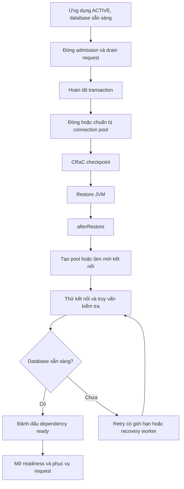

# Xử lý trường hợp cơ sở dữ liệu chưa sẵn sàng khi restore

CRaC khôi phục trạng thái của một tiến trình JVM từ ảnh checkpoint. Việc khôi phục heap và các object Java không đồng nghĩa cơ sở dữ liệu cũng được khôi phục hoặc đã sẵn sàng nhận kết nối. Trong thời gian ứng dụng tạm dừng, database có thể restart, failover, thay đổi endpoint, rotate credential, đóng các socket cũ hoặc đang chạy migration.

Vì vậy, sau restore ứng dụng phải xem database là một dependency cần được kiểm tra lại. Connection pool cũ có thể vẫn tồn tại trong heap nhưng các connection bên trong đã hết hiệu lực. Ứng dụng cần tái lập hoặc xác minh pool, thử một thao tác database có ý nghĩa và chỉ nhận request phụ thuộc database khi kết nối đã sẵn sàng.

Có hai chính sách phục hồi thường dùng:

- **Chờ có giới hạn trong callback restore**: thử kết nối lại trong một khoảng thời gian đã định. Nếu database vẫn chưa sẵn sàng, báo lỗi restore để hệ thống điều phối xử lý instance.
- **Phục hồi bất đồng bộ**: callback khởi động một tiến trình retry có kiểm soát rồi trả về; readiness tiếp tục false cho đến khi database thực sự sẵn sàng. Cách này phù hợp khi ứng dụng có thể sống mà chưa phục vụ nghiệp vụ phụ thuộc database.

Chọn chính sách dựa trên vai trò của database và cách nền tảng triển khai quản lý instance. Không mở traffic chỉ vì JVM đã restore thành công.

## 1. Vì sao database có thể chưa sẵn sàng?

Checkpoint lưu trạng thái tiến trình, không tạo snapshot đồng bộ cho database. Database có lifecycle, tài nguyên và cơ chế phục hồi độc lập. Khi JVM được khôi phục, database có thể ở trạng thái khác với thời điểm checkpoint.

Các nguyên nhân thường gặp:

| Nguyên nhân | Biểu hiện sau restore |
|---|---|
| Database khởi động chậm hơn ứng dụng | Connection bị từ chối, timeout hoặc host chưa listen |
| Database đang restart/failover | Connection cũ bị reset, endpoint tạm thời không truy cập được |
| DNS hoặc service discovery thay đổi | Ứng dụng tiếp tục dùng địa chỉ cũ hoặc chưa phân giải được địa chỉ mới |
| Network policy/firewall chưa sẵn sàng | TCP connect timeout hoặc bị từ chối |
| Credential được rotate | Authentication failed dù host và port truy cập được |
| TLS certificate/trust store thay đổi | Handshake thất bại |
| Connection pool chứa socket cũ | Lấy connection thành công từ pool nhưng truy vấn thất bại |
| Giới hạn connection bị chạm | Database từ chối kết nối mới khi nhiều instance cùng restore |
| Schema migration đang chạy | Database nhận kết nối nhưng một số bảng hoặc cột chưa ở trạng thái mong đợi |
| Database quá tải sau khi mở lại | Connection chậm, truy vấn timeout hoặc bị throttling |

Do đó, kiểm tra một cổng TCP mở chưa đủ để kết luận database sẵn sàng. Ứng dụng cần kiểm tra bằng chính driver và thông tin xác thực mà nó sẽ dùng khi phục vụ request.

### Restore JVM không restore database

Giả sử trước checkpoint ứng dụng đang có:

- Một `DataSource` và connection pool.
- Các service đang giữ tham chiếu đến `DataSource`.
- Cache chứa dữ liệu đọc từ database.
- Một số transaction đã hoàn tất.

Sau restore, các object trên có thể xuất hiện lại trong heap. Nhưng database có thể đã chuyển sang primary mới, connection cũ bị đóng, user bị rotate password hoặc dữ liệu đã được cập nhật bởi instance khác. Ảnh checkpoint không đảm bảo database giữ nguyên trạng thái.

Đặc biệt, không giữ transaction JDBC đang mở qua checkpoint. Trước checkpoint, hoàn tất, commit hoặc rollback transaction theo quy tắc nghiệp vụ. Một transaction chưa kết thúc có thể bị database rollback hoặc connection bị đóng; trạng thái Java được restore không thể làm transaction bên ngoài tự tiếp tục an toàn.

## 2. Xác định database là dependency bắt buộc hay tùy chọn

Chính sách phục hồi phụ thuộc vào việc ứng dụng có thể hoạt động an toàn khi database chưa sẵn sàng hay không.

**Database bắt buộc** khi request chính cần đọc/ghi database, hoặc trạng thái ứng dụng không thể bảo đảm đúng nếu thiếu database. Trong trường hợp này:

- Giữ readiness false.
- Không nhận request nghiệp vụ cần database.
- Thử kết nối lại theo timeout và backoff.
- Nếu hết thời hạn phục hồi, báo lỗi rõ ràng để nền tảng thay instance hoặc điều phối restore lại.

**Database tùy chọn** khi một phần ứng dụng có thể hoạt động độc lập, ví dụ endpoint health, trang tĩnh hoặc chức năng chỉ đọc dữ liệu đã được cache hợp lệ. Khi đó có thể cho phép một phần dịch vụ hoạt động, nhưng phải phân biệt readiness theo capability hoặc route. Không trả về trạng thái khỏe toàn cục nếu các chức năng cốt lõi vẫn không dùng được.

Không nên dùng cache cũ để giả vờ database đã sẵn sàng. Cache có thể chứa dữ liệu đã lỗi thời hoặc không nhất quán. Nếu cho phép chế độ degraded, cần xác định rõ dữ liệu nào được phép dùng, thời hạn stale, cách thông báo và thời điểm đồng bộ lại.

## 3. Vòng đời database quanh checkpoint và restore

Một resource CRaC có thể quản lý connection pool theo hai callback:

- `beforeCheckpoint(...)`: dừng nhận công việc, hoàn tất transaction, đóng pool hoặc làm sạch connection theo hướng dẫn của pool.
- `afterRestore(...)`: tạo pool mới, xác thực kết nối và báo trạng thái phục hồi cho ứng dụng.



Nếu database chưa sẵn sàng, nhánh retry phải có giới hạn, có quan sát và giữ readiness false. Không để connection pool hoặc request thread tự retry vô hạn mà không có trạng thái phục hồi tập trung.

### Đóng pool trước checkpoint

Pool thường chứa socket và trạng thái quản lý connection. Sau khi tiến trình được khôi phục, những socket đó có thể không còn dùng được. Nếu thư viện pool có tích hợp CRaC được hỗ trợ, hãy dùng hướng dẫn của thư viện và runtime tương ứng.

Nếu tự quản lý lifecycle:

1. Ngừng cấp connection mới cho request.
2. Chờ transaction và thao tác database đang chạy hoàn tất.
3. Đóng pool theo API của thư viện.
4. Giữ một provider ổn định để các service lấy được pool mới sau restore.

Không giả định một pool đã `close()` có thể `start()` lại. Ví dụ, một số pool triển khai trạng thái closed là kết thúc vòng đời object; khi đó cần tạo instance pool mới và thay delegate bên trong provider/proxy ổn định.

### Tạo pool mới sau restore

Sau restore, pool mới cần lấy cấu hình và credential hiện hành. Tránh tái sử dụng connection object cũ hoặc giữ password đã hết hạn trong ảnh. Nếu có secret manager, lấy credential mới theo cơ chế được phép và không ghi secret vào log.

Pool nên được công bố cho ứng dụng sau khi đã tạo và kiểm tra thành công. Nếu công bố pool trước rồi mới kiểm tra, request có thể lấy connection từ một pool chưa sẵn sàng.

## 4. Kiểm tra database bằng kết nối thật

Một phép kiểm tra hữu ích nên dùng cùng:

- JDBC driver mà ứng dụng sẽ sử dụng.
- Host, port, database name và TLS config thực tế.
- Credential hiện hành.
- Connection pool hoặc factory mà request sẽ dùng.

Có thể kiểm tra bằng `Connection.isValid(timeoutSeconds)` nếu JDBC driver hỗ trợ đúng. Một lựa chọn khác là thực hiện truy vấn nhẹ như `SELECT 1` với query timeout. Với một số hệ quản trị, cú pháp truy vấn kiểm tra có thể khác; chọn câu lệnh phù hợp với database mục tiêu.

Ví dụ kiểm tra JDBC trực tiếp:

```java
import javax.sql.DataSource;
import java.sql.Connection;
import java.sql.SQLException;

public final class DatabaseProbe {

    private DatabaseProbe() {
    }

    public static void verify(DataSource dataSource) throws SQLException {
        try (Connection connection = dataSource.getConnection()) {
            if (!connection.isValid(3)) {
                throw new SQLException("Database connection is not valid");
            }
        }
    }
}
```

Đoạn mã kiểm tra khả năng lấy connection và xác minh kết nối trong thời gian timeout của driver. Nó không kiểm tra toàn bộ nghiệp vụ hoặc quyền trên mọi bảng. Nếu ứng dụng cần xác nhận quyền truy cập schema, có thể thực hiện một truy vấn read-only nhỏ vào bảng hoặc metadata phù hợp.

Không nên dùng một truy vấn kiểm tra nặng, scan bảng lớn hoặc gọi migration trong health check. Health check cần nhanh, có giới hạn và không tạo tải đáng kể lên database.

## 5. Retry với exponential backoff và jitter

Database có thể chỉ cần thêm vài giây để khởi động, nhưng nhiều instance restore cùng lúc có thể tạo ra một đợt kết nối dồn dập. Retry ngay lập tức trong vòng lặp có thể làm tình hình nặng hơn.

Một chính sách retry nên có:

- **Deadline tổng**: giới hạn tổng thời gian chờ database.
- **Connection timeout**: giới hạn thời gian lấy connection.
- **Validation/query timeout**: giới hạn thời gian kiểm tra.
- **Exponential backoff**: tăng dần thời gian giữa các lần thử.
- **Jitter**: thêm ngẫu nhiên để các instance không retry cùng một thời điểm.
- **Số lần thử hoặc thời gian thử tối đa**: bảo đảm callback không treo vô hạn.
- **Phân loại lỗi**: phân biệt lỗi tạm thời với cấu hình sai hoặc credential không hợp lệ.

Ví dụ một lịch backoff:

| Lần thử | Khoảng chờ cơ sở |
|---:|---:|
| 1 | 250 ms |
| 2 | 500 ms |
| 3 | 1 s |
| 4 | 2 s |
| 5 trở đi | Tối đa 5 s |

Jitter có thể làm thời gian chờ mỗi lần lệch ngẫu nhiên quanh giá trị cơ sở. Ví dụ, với mức 2 giây, mỗi instance có thể chờ khoảng 1 đến 3 giây. Mục tiêu là phân tán tải, không phải làm tổng thời gian chờ không giới hạn.

### Ví dụ helper retry JDBC

Đoạn mã sau thử tạo một pool candidate mới, lấy connection và kiểm tra nó. Pool candidate bị lỗi được đóng trước khi thử lại. `PoolHandle` và `PoolFactory` là abstraction của ứng dụng; chúng cho phép tạo pool mới thay vì cố tái sử dụng một pool đã đóng.

```java
import javax.sql.DataSource;
import java.sql.Connection;
import java.sql.SQLException;
import java.time.Duration;
import java.util.concurrent.ThreadLocalRandom;
import java.util.concurrent.TimeUnit;

public final class DatabaseRecovery {

    public interface PoolHandle extends AutoCloseable {
        DataSource dataSource();

        @Override
        void close() throws Exception;
    }

    @FunctionalInterface
    public interface PoolFactory {
        PoolHandle create() throws Exception;
    }

    private DatabaseRecovery() {
    }

    public static PoolHandle openUntilReady(
            PoolFactory factory,
            Duration totalTimeout) throws Exception {

        if (totalTimeout.isZero() || totalTimeout.isNegative()) {
            throw new IllegalArgumentException("totalTimeout must be positive");
        }

        long deadline = System.nanoTime() + totalTimeout.toNanos();
        long baseDelayMillis = 250;
        Exception lastFailure = null;

        while (true) {
            PoolHandle candidate = null;
            try {
                candidate = factory.create();
                verify(candidate.dataSource());
                return candidate;
            } catch (InterruptedException interrupted) {
                if (candidate != null) {
                    try {
                        candidate.close();
                    } catch (Exception closeFailure) {
                        interrupted.addSuppressed(closeFailure);
                    }
                }
                Thread.currentThread().interrupt();
                throw interrupted;
            } catch (Exception failure) {
                lastFailure = failure;
                if (candidate != null) {
                    try {
                        candidate.close();
                    } catch (Exception closeFailure) {
                        failure.addSuppressed(closeFailure);
                    }
                }
            }

            long remainingNanos = deadline - System.nanoTime();
            if (remainingNanos <= 0) {
                throw new SQLException(
                        "Database did not become ready before the deadline",
                        lastFailure
                );
            }

            double jitterFactor = ThreadLocalRandom.current()
                    .nextDouble(0.5, 1.5);
            long delayMillis = Math.max(
                    1L,
                    (long) (baseDelayMillis * jitterFactor)
            );
            long remainingMillis = Math.max(
                    1L,
                    TimeUnit.NANOSECONDS.toMillis(remainingNanos)
            );
            try {
                Thread.sleep(Math.min(delayMillis, remainingMillis));
            } catch (InterruptedException interrupted) {
                Thread.currentThread().interrupt();
                throw interrupted;
            }
            baseDelayMillis = Math.min(baseDelayMillis * 2, 5_000);
        }
    }

    private static void verify(DataSource dataSource) throws SQLException {
        try (Connection connection = dataSource.getConnection()) {
            if (!connection.isValid(3)) {
                throw new SQLException("Database connection is not valid");
            }
        }
    }
}
```

Ví dụ là một mẫu minh họa. Khi triển khai, cấu hình timeout lấy connection của pool và timeout validation của JDBC driver phải phù hợp với deadline tổng. Nếu `factory.create()` hoặc `getConnection()` có thể block lâu hơn deadline, chỉ kiểm tra deadline giữa các lần thử là chưa đủ; cần đặt timeout cho chính thao tác đó.

Đối với lỗi cấu hình rõ ràng như sai URL, thiếu driver hoặc credential không hợp lệ, retry liên tục thường không giúp ích. Có thể phân loại exception theo driver/database để fail sớm với lỗi không thể tự hồi phục. Không phân loại chỉ dựa vào chuỗi message nếu driver cung cấp SQLState hoặc mã lỗi ổn định.

### Không dùng retry vô hạn

Retry vô hạn có thể khiến:

- Callback restore không bao giờ kết thúc.
- Instance chiếm tài nguyên nhưng không phục vụ.
- Nền tảng không nhận được kết quả thành công/thất bại rõ ràng.
- Log và metric tăng không kiểm soát.
- Database bị quá tải bởi các lần kết nối lặp lại.

Nếu cần chờ lâu hơn giới hạn callback, dùng recovery coordinator bất đồng bộ và giữ readiness false, thay vì chặn callback vô hạn.

## 6. Tích hợp retry vào Resource của CRaC

Một resource có thể quản lý provider chứa pool hiện tại. Các service trong ứng dụng dùng provider ổn định thay vì giữ trực tiếp một pool instance có thể bị đóng.

Ví dụ khung:

```java
import org.crac.Context;
import org.crac.Core;
import org.crac.Resource;

public final class DatabaseCracResource implements Resource {

    public interface PoolProvider {
        DatabaseRecovery.PoolHandle detach();
        void install(DatabaseRecovery.PoolHandle pool);
    }

    private final PoolProvider provider;
    private final DatabaseRecovery.PoolFactory poolFactory;
    private final java.time.Duration recoveryTimeout;

    public DatabaseCracResource(
            PoolProvider provider,
            DatabaseRecovery.PoolFactory poolFactory,
            java.time.Duration recoveryTimeout) {
        this.provider = provider;
        this.poolFactory = poolFactory;
        this.recoveryTimeout = recoveryTimeout;
        Core.getGlobalContext().register(this);
    }

    @Override
    public void beforeCheckpoint(Context<? extends Resource> context)
            throws Exception {
        // Admission và transaction phải được drain trước resource này.
        DatabaseRecovery.PoolHandle oldPool = provider.detach();
        if (oldPool != null) {
            oldPool.close();
        }
    }

    @Override
    public void afterRestore(Context<? extends Resource> context)
            throws Exception {
        DatabaseRecovery.PoolHandle newPool =
                DatabaseRecovery.openUntilReady(poolFactory, recoveryTimeout);
        provider.install(newPool);
    }
}
```

Đây là skeleton thể hiện trách nhiệm của resource; `PoolProvider` cần được triển khai thread-safe. Việc detach phải ngăn request lấy pool trong thời gian QUIESCING/RESTORING. Provider chỉ cài pool mới sau khi đã kiểm tra thành công.

Trong ứng dụng Spring, có thể cung cấp một `DataSource` proxy ổn định mà mỗi lần lấy connection sẽ chuyển tiếp đến pool hiện tại. Cách này giúp các service đã inject proxy không giữ tham chiếu đến pool cũ. Nếu thay trực tiếp một field `DataSource` trong resource mà repository hoặc service khác đang giữ pool cũ, các consumer đó vẫn có thể dùng object đã đóng.

Nếu thư viện connection pool hoặc framework đã có tích hợp CRaC, hãy ưu tiên cơ chế được hỗ trợ thay vì tự đóng/mở cùng một pool lần thứ hai. Tránh để hai resource cùng sở hữu một pool.

## 7. Chọn chính sách phục hồi đồng bộ hay bất đồng bộ

Không phải mọi ứng dụng đều cần chờ database trong callback. Có hai chiến lược chính.

### Chiến lược A — Chờ có giới hạn trong afterRestore

Callback gọi retry helper và chỉ trả về khi database sẵn sàng. Nếu hết deadline, callback báo lỗi.

Phù hợp khi:

- Database là dependency bắt buộc cho mọi chức năng phục vụ.
- Instance không có chế độ degraded an toàn.
- Nền tảng có thể xử lý restore thất bại và tạo instance mới hoặc retry theo chính sách.
- Thời gian phục hồi dự kiến có giới hạn rõ ràng.

Ưu điểm là instance chỉ đi tiếp khi dependency quan trọng đã sẵn sàng. Hạn chế là thời gian callback có thể kéo dài và nếu database mất lâu, restore sẽ thất bại. Hành vi chính xác khi callback ném exception phụ thuộc JDK CRaC và cách nền tảng khởi chạy; cần kiểm thử với runtime mục tiêu.

### Chiến lược B — Recovery worker và readiness false

Callback có thể chuyển trạng thái sang RESTORING, khởi động một recovery worker mới rồi trả về. Worker retry database trong nền; ứng dụng giữ readiness false cho đến khi pool được tạo và xác minh thành công.

Phù hợp khi:

- Process có thể tồn tại mà chưa phục vụ nghiệp vụ phụ thuộc database.
- Readiness và liveness được cấu hình tách biệt.
- Orchestrator không kill instance chỉ vì readiness false.
- Ứng dụng có thể giữ admission đóng hoặc giới hạn route không phụ thuộc database.

Không sử dụng executor hoặc thread đã dừng trước checkpoint mà không xác minh lifecycle của nó. Có thể tạo một recovery executor mới sau restore. Worker phải có deadline hoặc chính sách retry dài hạn, metric và cơ chế shutdown.

Ví dụ mô tả:

```text
afterRestore
    state = RESTORING
    start new recovery worker
    return

recovery worker
    retry database connection
    validate pool
    install pool
    state = READY
    open admission
```

Nếu database bắt buộc, các endpoint nghiệp vụ vẫn phải bị từ chối trong suốt RESTORING. Chỉ readiness endpoint và các chức năng được xác định là an toàn mới có thể hoạt động. Không để request vào rồi treo chờ connection pool.

### So sánh

| Tiêu chí | Retry trong callback | Recovery worker |
|---|---|---|
| Thời điểm callback kết thúc | Sau khi DB sẵn sàng hoặc hết deadline | Sau khi worker được khởi động |
| Trạng thái instance | Chưa tiếp tục nếu callback chưa hoàn tất | Có thể sống nhưng chưa ready |
| Phù hợp với | DB bắt buộc, thời gian phục hồi ngắn | Phục hồi kéo dài, có degraded mode |
| Xử lý khi DB mất lâu | Callback báo lỗi | Giữ readiness false và retry theo chính sách |
| Yêu cầu chính | Timeout rõ và điều phối restore failure | Readiness gate, worker lifecycle và giới hạn retry |

Không có một chiến lược tốt cho mọi hệ thống. Hãy chọn theo khả năng phục vụ khi thiếu database và cơ chế phục hồi của nền tảng.

## 8. Readiness, liveness và admission control

Process còn sống không có nghĩa database đã sẵn sàng. Trong thời gian RESTORING:

- **Liveness** có thể thành công nếu JVM và tiến trình vẫn hoạt động.
- **Readiness** phải false nếu database là dependency bắt buộc và chưa kết nối được.
- **Admission** phải đóng để request nghiệp vụ không đi vào service đang thiếu database.

Khi database sẵn sàng:

1. Tạo và xác minh pool.
2. Cài pool mới vào provider.
3. Khởi động các worker phụ thuộc database.
4. Chuyển state sang READY.
5. Mở admission.
6. Chuyển sang ACTIVE và báo readiness thành công.

Nếu ứng dụng có route không cần database, có thể định nghĩa readiness theo nhóm capability. Ví dụ, endpoint health có thể luôn phản hồi trong khi API nghiệp vụ vẫn chưa nhận traffic. Cần tránh một health indicator tổng thể báo UP khi chức năng chính không dùng được.

### Ví dụ state đơn giản

```java
public enum DatabaseState {
    ACTIVE,
    QUIESCING,
    PAUSED,
    RESTORING,
    READY,
    FAILED
}
```

Readiness chỉ bật khi database pool đã được cài và xác minh:

```java
public boolean isDatabaseReady() {
    return state == DatabaseState.READY
            || state == DatabaseState.ACTIVE;
}
```

Trong một state machine đầy đủ, cần bảo đảm state chỉ chuyển sang READY sau khi provider đã cài pool thành công và admission được điều khiển theo đúng thứ tự. Không chỉ dựa vào một boolean được bật ở đầu callback.

## 9. Connection pool và cấu hình timeout

Pool có nhiều timeout khác nhau. Cần cấu hình chúng theo một ngân sách phục hồi tổng thể.

| Cấu hình | Ý nghĩa | Lưu ý sau restore |
|---|---|---|
| Connection timeout | Thời gian tối đa chờ lấy connection từ pool | Không để request chờ vô hạn khi DB chưa sẵn sàng |
| Validation timeout | Thời gian tối đa kiểm tra connection | Nên ngắn hơn connection timeout |
| Max lifetime | Tuổi thọ tối đa của connection | Phù hợp timeout của database/proxy |
| Idle timeout | Thời gian giữ connection nhàn rỗi | Không thay thế việc làm mới connection sau restore |
| Initialization behavior | Pool có fail fast khi không tạo được connection ban đầu không | Phải phù hợp với chiến lược retry đã chọn |
| Maximum pool size | Số connection tối đa | Tính tổng trên tất cả instance restore đồng thời |

Ví dụ với HikariCP, các thuộc tính như `connectionTimeout`, `validationTimeout`, `maxLifetime` và `initializationFailTimeout` có ý nghĩa khác nhau. Đọc tài liệu đúng phiên bản HikariCP đang dùng. Không đặt mọi timeout thành giá trị rất lớn để tránh lỗi; điều đó chỉ làm request và restore bị treo lâu hơn.

### Tránh connection storm

Giả sử 30 instance cùng restore và mỗi instance mở pool tối đa 20 connection. Database có thể phải xử lý tới 600 connection mới trong thời gian ngắn, chưa kể workload bình thường.

Biện pháp giảm tải:

- Thêm jitter vào retry.
- Không mở tối đa pool size ngay lập tức nếu chưa cần.
- Cân nhắc giới hạn số instance restore đồng thời.
- Tính tổng connection budget trên toàn bộ deployment.
- Dùng pool size phù hợp với số worker và database capacity.
- Tránh mỗi health check tạo nhiều connection hoặc truy vấn nặng.

Retry cần giúp ứng dụng chờ database, không biến sự cố database thành một đợt tấn công kết nối.

## 10. Xử lý credential, DNS và migration

### Credential thay đổi

Ảnh checkpoint có thể giữ cấu hình hoặc object chứa credential cũ. Nếu password, token hoặc certificate được rotate trong thời gian ứng dụng tạm dừng, connection mới phải lấy credential hiện hành.

Không ghi credential vào log và không đưa secret vào source code. Dùng secret manager hoặc cơ chế cấu hình bảo mật của môi trường. Sau restore, làm mới credential trước khi tạo pool; nếu authentication thất bại, phân loại đây là lỗi cấu hình/credential và không retry dồn dập như lỗi database vừa khởi động.

### DNS và endpoint

Sau failover, hostname có thể phân giải đến địa chỉ mới. Một số connection pool hoặc HTTP/JDBC driver giữ connection đã mở và DNS cache trong thời gian dài. Tạo pool mới sau restore giúp driver thực hiện kết nối mới, nhưng vẫn cần kiểm tra DNS cache của JVM và thư viện.

Ưu tiên hostname/service discovery ổn định thay vì hard-code IP của một database node. Nếu kiến trúc dùng primary/replica, phải kết nối đúng endpoint cho thao tác đọc/ghi và xác minh vai trò node nếu driver hoặc hệ quản trị yêu cầu.

### Schema migration

Database có thể nhận kết nối nhưng schema chưa tương thích với phiên bản ứng dụng. Điều này khác với lỗi network connection.

Không nên chạy migration DDL tùy tiện từ mọi `afterRestore()`, vì nhiều instance có thể chạy đồng thời và tranh chấp schema lock. Hãy dùng quy trình migration có owner/leader, kiểm soát version và thứ tự phát hành rõ ràng. Sau restore, kiểm tra schema version hoặc một thao tác read-only cần thiết trước khi đánh dấu dependency ready.

## 11. Transaction, retry và tính idempotent

Không để transaction database đang mở qua checkpoint. Trước checkpoint:

- Ngừng nhận công việc mới.
- Chờ transaction đang chạy hoàn tất.
- Commit hoặc rollback theo kết quả nghiệp vụ.
- Đóng connection và pool theo chính sách.

Sau restore, không tự động phát lại một lệnh SQL chỉ vì kết nối cũ đã lỗi. Nếu client không biết transaction trước đó đã commit hay chưa, retry mù có thể tạo dữ liệu trùng.

Các biện pháp an toàn:

- Dùng unique key hoặc idempotency key cho thao tác tạo dữ liệu.
- Dùng transaction để ghi trạng thái nghiệp vụ và outbox trong cùng database.
- Thiết kế thao tác retry có thể nhận biết kết quả đã được commit.
- Không giả định rollback ở client chứng minh database chưa commit nếu connection đã mất trong lúc commit.
- Xác minh trạng thái nghiệp vụ bằng truy vấn theo transaction/business id khi kết quả commit không rõ.

CRaC khôi phục trạng thái JVM; tính nhất quán giao dịch vẫn do ứng dụng và database đảm nhiệm.

## 12. Quan sát quá trình phục hồi

Mỗi lần phục hồi nên ghi log theo resource và phase:

```text
INFO  crac-resource=database phase=afterRestore event=start
WARN  crac-resource=database event=connect_retry attempt=1 reason=connection_refused
WARN  crac-resource=database event=connect_retry attempt=2 reason=connection_timeout
INFO  crac-resource=database event=pool_validated duration_ms=1240
INFO  application event=readiness_ready
```

Không ghi URL có password, token, certificate private material hoặc dữ liệu nhạy cảm. Log nên chứa mã lỗi, SQLState, số lần thử, thời gian chờ và tên dependency.

Các metric hữu ích:

- Thời gian từ restore đến database ready.
- Số lần retry và tỷ lệ retry thành công.
- Số lỗi connection theo SQLState hoặc mã lỗi.
- Thời gian tạo pool và validation.
- Số connection đang active/idle.
- Số instance đang ở trạng thái RESTORING.
- Thời gian readiness false sau restore.
- Số lần callback thất bại hoặc restore không hoàn tất.

Theo dõi các chỉ số này để phân biệt database khởi động chậm, lỗi credential, lỗi DNS và connection storm. Nếu mọi instance retry cùng lúc, metric có thể cho thấy database quá tải ngay sau khi restore.

## 13. Những lỗi thường gặp

| Hiện tượng | Nguyên nhân có thể | Cách xử lý |
|---|---|---|
| Connection refused | Database chưa listen hoặc endpoint sai | Chờ theo deadline, kiểm tra host/port và trạng thái DB |
| Connection timeout | Network, firewall, overload hoặc route | Kiểm tra network và đặt timeout/backoff |
| Authentication failed | Credential hết hạn hoặc sai | Làm mới secret, không retry dồn dập |
| TLS handshake failed | Certificate/trust store hoặc hostname không khớp | Kiểm tra certificate chain và cấu hình TLS |
| Connection reset | Pool giữ socket cũ hoặc DB vừa failover | Loại bỏ connection cũ, tạo pool mới |
| Too many connections | Nhiều instance mở pool đồng thời | Giảm pool size, giới hạn concurrency và thêm jitter |
| Query timeout | DB quá tải hoặc truy vấn kiểm tra không phù hợp | Dùng probe nhẹ, giới hạn timeout |
| Table/column not found | Migration chưa hoàn tất hoặc schema không tương thích | Điều phối migration và kiểm tra schema version |
| Restore thành công nhưng request lỗi | Readiness bật trước khi pool được xác minh | Giữ admission đóng đến khi DB ready |
| Retry không dừng | Không có deadline hoặc timeout từng thao tác | Thêm deadline tổng và timeout cho pool/driver |

## 14. Quy trình kiểm thử

Kiểm thử phải bao gồm cả tình huống database sẵn sàng và chưa sẵn sàng.

1. Khởi động ứng dụng mới, xác nhận pool kết nối và request database hoạt động.
2. Đưa ứng dụng về trạng thái có thể checkpoint; drain transaction và đóng pool theo thiết kế.
3. Tạo checkpoint bằng JDK CRaC mục tiêu.
4. Trong môi trường thử nghiệm, dừng database hoặc chặn kết nối trước khi restore.
5. Restore ảnh và xác nhận ứng dụng chuyển sang RESTORING, readiness vẫn false.
6. Kiểm tra retry có backoff, deadline và log đúng.
7. Khởi động lại database hoặc khôi phục network.
8. Xác nhận ứng dụng tạo pool mới và chạy probe thành công.
9. Xác nhận readiness chỉ bật sau khi pool được cài và xác minh.
10. Gửi request nghiệp vụ và kiểm tra transaction, message, idempotency.

Thử thêm các tình huống:

- Credential bị rotate trước restore.
- Database endpoint đổi sau failover.
- Database trả lỗi authentication thay vì connection refused.
- Nhiều instance restore đồng thời.
- Database không bao giờ sẵn sàng trong thời hạn retry.
- Pool candidate được tạo nhưng validation thất bại.
- Ứng dụng chạy chế độ degraded trong khi database chưa sẵn sàng.
- Restore callback ném exception và nền tảng xử lý instance như thế nào.

Đối với mỗi lần thử, ghi thời gian restore, số lần retry, thời điểm database ready, thời điểm readiness bật và kết quả request sau đó. Kiểm thử trên đúng phiên bản JDK CRaC, JDBC driver, pool và database được triển khai.

## 15. Checklist triển khai

### Trước checkpoint

- [ ] Đóng admission và drain request/job đang dùng database.
- [ ] Không để transaction mở qua checkpoint.
- [ ] Commit hoặc rollback theo đúng quy tắc nghiệp vụ.
- [ ] Đóng hoặc chuẩn bị pool theo tích hợp CRaC của thư viện.
- [ ] Có provider/proxy ổn định để thay pool sau restore.

### Sau restore

- [ ] Xác định database là dependency bắt buộc hay tùy chọn.
- [ ] Làm mới credential và cấu hình endpoint khi cần.
- [ ] Tạo pool mới hoặc làm mới connection theo API được hỗ trợ.
- [ ] Kiểm tra bằng JDBC connection thật và probe nhẹ.
- [ ] Retry có deadline, backoff, jitter và timeout từng thao tác.
- [ ] Không retry vô hạn với lỗi cấu hình hoặc credential rõ ràng.
- [ ] Chỉ cài và công bố pool sau khi validation thành công.
- [ ] Giữ readiness false và admission đóng khi database chưa sẵn sàng.

### Vận hành

- [ ] Tách readiness khỏi liveness.
- [ ] Tính connection budget khi nhiều instance restore đồng thời.
- [ ] Không chạy migration đồng thời từ mọi callback restore.
- [ ] Xử lý transaction và thao tác retry theo nguyên tắc idempotent.
- [ ] Log/metric có đủ thông tin nhưng không chứa secret.
- [ ] Đã kiểm thử database khởi động chậm, failover, credential lỗi và timeout.

Khi database chưa sẵn sàng sau restore, ứng dụng cần giữ trạng thái chưa phục vụ, tái lập pool bằng cấu hình hiện hành, kiểm tra kết nối thật và retry theo ngân sách thời gian có giới hạn. Chỉ khi dependency bắt buộc đã sẵn sàng mới mở readiness và admission. Điều đó giúp CRaC khôi phục JVM mà không nhầm trạng thái bộ nhớ đã được phục hồi với trạng thái database bên ngoài.
