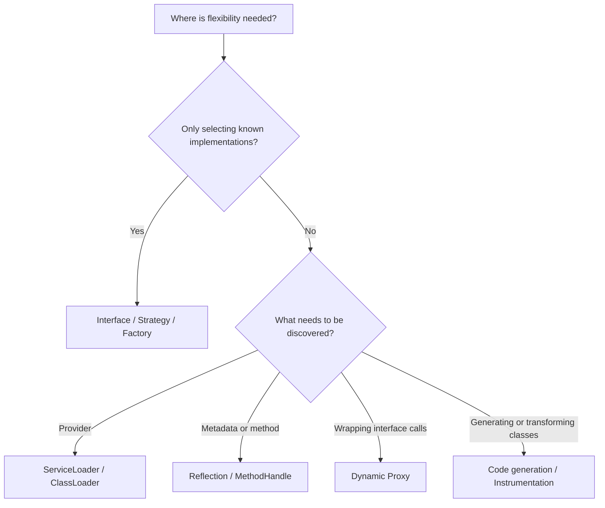

# 1.1 What is dynamic runtime and what problems does it solve?

## 1. Lesson objectives

After this lesson, you can:

- Explain "dynamic runtime" in Java, and distinguish it from compile-time decisions and from ordinary polymorphism.
- Identify the main mechanisms of the JVM/Java: class loading and linking, Reflection, Method Handles, `invokedynamic`, dynamic proxy, SPI, and code generation/modification tools.
- Choose the appropriate mechanism for plugins, frameworks, AOP, data mapping, monitoring, and extensible integration; understand the risks regarding safety, performance, and maintainability.

## 2. What does "dynamic runtime" mean?

Java is a **statically typed** language: the compiler checks the types of most expressions and calls based on source code, then generates bytecode. However, when the JVM executes, the program can still **discover classes and members, load code, choose how to bind or intercept calls, and even generate new classes** based on configuration and data known only at runtime.

For example, an application does not need to hardcode `new EmailNotifier()` everywhere. It can read a configuration selecting an implementation, look up a service provider, instantiate an object, and invoke it through a stable interface. A library can also inspect annotations, find getters/setters, or attach logging behavior around calls without business code having to perform each of those steps manually.

**Practical definition:** a dynamic runtime mechanism is a set of techniques that allow part of the **structure, binding, or behavior to be determined at runtime** instead of being hardcoded at every call site at compile time.

It is necessary to distinguish three concepts that are often conflated:

| Concept | Example | Key difference |
| --- | --- | --- |
| Ordinary polymorphism / virtual dispatch | `Animal a = new Dog(); a.speak();` | The code already knows the interface or superclass type; the JVM selects the overriding implementation based on the actual object. This is normal Java runtime behavior and does not necessarily require Reflection. |
| Specialized dynamic mechanisms | `Class.forName(name)`, `Method.invoke(...)`, `Proxy.newProxyInstance(...)` | The program can look up class/method names from data, create an interception layer, or bind calls flexibly. |
| Dynamically typed languages | Types change at runtime according to dynamic language rules | Java does not become a dynamically typed language just because it uses Reflection; errors may shift from compile time to runtime. |

The word "dynamic" also does not mean "arbitrary self-modifying code", "default hot reload", or "always faster". Each mechanism has its own scope and limitations.

## 3. What runtime decision points does the JVM have?

High-level flow:

1. **Compilation:** `javac` checks the Java source, producing `.class` files containing bytecode and symbolic references to types/members.
2. **Class loading:** the JVM uses a class loader to find or define a class when needed. The class does not necessarily have to be present as a direct reference in the calling code.
3. **Linking:** the JVM verifies bytecode, prepares class data, and resolves symbolic references according to JVM rules; resolution may happen lazily when needed. Class initialization is a separate step from loading/linking.
4. **Selection and invocation:** the JVM performs ordinary dispatch or dynamic invocation/lookup mechanisms such as Reflection, Method Handles, and `invokedynamic`.
5. **Execution/optimization:** the interpreter and JIT can optimize call paths based on runtime information. JIT is a JVM execution/optimization mechanism, not a general term for Reflection or plugins.

An important detail: **class identity depends on both the binary name and the class loader that defines the class**. Two classes with the same name but defined by two different loaders can be two incompatible types. Therefore, plugins need to clearly design shared APIs and class loader boundaries.

## 4. Core mechanisms

| Mechanism | Main capability | When commonly used | Limitations to remember |
| --- | --- | --- | --- |
| **Reflection** — `java.lang.Class`, `java.lang.reflect` | Reads metadata of classes, constructors, methods, fields, annotations; instantiates objects and invokes members using runtime data. | Data mapping frameworks, dependency injection, name-based configuration, testing tools. | Wrong types/signatures are only exposed at runtime; access rights are constrained by Java access rules and the module system. |
| **Method Handles** — `java.lang.invoke` | Creates a typed invocation "handle" with an explicit method type that can be combined/bound/adapted; `invokedynamic` uses a bootstrap method to establish a call site. | Language runtimes, libraries building dynamic call paths, certain lambda mechanisms and dynamic linking. | `invokeExact` requires an exact signature match; lower-level API than Reflection. |
| **JDK Dynamic Proxy** — `java.lang.reflect.Proxy` | Creates an object implementing interfaces at runtime and forwards calls to an `InvocationHandler`. | Logging, timing, transactions, access control, remote clients via interfaces. | Standard JDK proxy is **interface**-based; it does not turn arbitrary concrete classes into interceptable objects. |
| **Class loading and SPI** — `ClassLoader`, `ServiceLoader` | Loads implementations and discovers providers according to a service contract. | Plugins, drivers, providers, extension modules. | Providers must be available on the classpath/module path or via an appropriate loader mechanism; class loaders are not a security sandbox. |
| **Bytecode generation/modification and instrumentation** | Generates classes or transforms bytecode at permitted points; agents use `java.lang.instrument`. | Complex ORMs/proxies, mocking, profiling, observability, and diagnostic tools. | More complex, subject to access and JVM constraints; usually uses specialized libraries/tools such as ASM or Byte Buddy. |

**`invokedynamic` differs from `Method.invoke`:** `Method.invoke` is an API for invoking a method represented via Reflection; `invokedynamic` is a bytecode instruction whose call site is linked via a bootstrap method. They should not be viewed as two ways of writing the same operation.

**`ServiceLoader` differs from scanning the entire classpath yourself:** it uses a service contract along with provider declarations (for example `META-INF/services` or `provides ... with ...` in a module) to discover implementations without the application having to scan all classes manually.

## 5. Example 1 — finding a class and invoking a method with Reflection

Suppose the implementation name comes from configuration. For a self-contained demonstration, the class to be loaded is declared in the same file; in a real system it might reside in a JAR provided at runtime.

Create the file **`RuntimeDiscoveryDemo.java`**:

```java
import java.lang.reflect.Method;

public class RuntimeDiscoveryDemo {
    public static class Greeter {
        public Greeter() {}

        public String greet(String name) {
            return "Hello, " + name + "!";
        }
    }

    public static void main(String[] args)
            throws ReflectiveOperationException {
        // Binary name of the nested class, which can be obtained from configuration.
        String className = "RuntimeDiscoveryDemo$Greeter";

        Class<?> type = Class.forName(className);
        Object instance = type.getDeclaredConstructor().newInstance();
        Method method = type.getMethod("greet", String.class);
        Object result = method.invoke(instance, "Lan");

        System.out.println(result);
    }
}
```

Compile and run on JDK 17+:

```bash
javac -encoding UTF-8 --release 17 RuntimeDiscoveryDemo.java
java RuntimeDiscoveryDemo
```

Output (stdout):

```text
Hello, Lan!
```

**What is happening:**

- `Class.forName("RuntimeDiscoveryDemo$Greeter")` looks up the class by its **binary name**; this call also initializes the class if needed.
- `getDeclaredConstructor().newInstance()` finds the no-argument constructor and creates an instance; the sample class has a public constructor so the example works directly.
- `getMethod("greet", String.class)` looks up the public method matching the name and parameter types.
- `invoke(instance, "Lan")` performs the call. The return value has type `Object` on the Reflection side, so the compiler cannot prove in advance that the discovered method returns a `String`.

If the class name or signature changes, the program may encounter `ClassNotFoundException`, `NoSuchMethodException`, `IllegalAccessException`, or related errors at runtime. If the invoked method throws an exception, `Method.invoke` wraps the cause in `InvocationTargetException`; in real error handling, inspect `getCause()`.

**Design takeaway:** Reflection is useful when names/signatures are determined from metadata. However, if both the interface and implementation are already known when writing code, direct calls are usually easier to read, easier to refactor, and easier for the compiler to check.

## 6. Example 2 — adding behavior around calls with a dynamic proxy

Suppose multiple services must log every time they are called. Instead of adding logging statements to each implementation, we create a proxy object implementing the same interface.

Create the file **`RuntimeProxyDemo.java`**:

```java
import java.lang.reflect.Proxy;
import java.util.Locale;

public class RuntimeProxyDemo {
    public interface TextService {
        String normalize(String input);
    }

    public static class RealTextService implements TextService {
        @Override
        public String normalize(String input) {
            return input.strip().toUpperCase(Locale.ROOT);
        }
    }

    public static void main(String[] args) {
        TextService target = new RealTextService();

        TextService traced = (TextService) Proxy.newProxyInstance(
                TextService.class.getClassLoader(),
                new Class<?>[] {TextService.class},
                (proxy, method, arguments) -> {
                    System.out.println("Calling: " + method.getName());
                    return method.invoke(target, arguments);
                });

        System.out.println(traced.normalize("  java  "));
    }
}
```

```bash
javac -encoding UTF-8 --release 17 RuntimeProxyDemo.java
java RuntimeProxyDemo
```

Stdout:

```text
Calling: normalize
JAVA
```

Here `traced` is a proxy created at runtime. When `traced.normalize(...)` is called, the handler receives the `Method` and arguments, logs, and then **delegates** to `target`. The calling code only knows the `TextService` contract.

Important limitations:

- JDK dynamic proxy creates proxies for **interfaces**. If calls to a concrete class must be intercepted, a framework may need to use another subclass/bytecode generation mechanism and is subject to `final`/access constraints.
- Only calls **going through the proxy** are handled by the handler; direct internal calls from the target object to itself do not automatically go through the proxy.
- Handlers should consider how to handle `equals`, `hashCode`, `toString`, exceptions, and null arguments when developed into a shared library. The example intentionally illustrates only one method.
- Proxies add a layer of indirection; do not use them for every call just because you can.

## 7. Example 3 — invocation via Method Handle

`MethodHandle` represents an invocation whose signature is declared with `MethodType`. It is useful when a library needs to build and compose flexible call paths.

File **`MethodHandleDemo.java`**:

```java
import java.lang.invoke.MethodHandle;
import java.lang.invoke.MethodHandles;
import java.lang.invoke.MethodType;

public class MethodHandleDemo {
    public static void main(String[] args) throws Throwable {
        MethodHandle upper = MethodHandles.publicLookup().findVirtual(
                String.class,
                "toUpperCase",
                MethodType.methodType(String.class));

        String result = (String) upper.invokeExact("java");
        System.out.println(result);
    }
}
```

```bash
javac -encoding UTF-8 --release 17 MethodHandleDemo.java
java MethodHandleDemo
```

Stdout:

```text
JAVA
```

`findVirtual` looks up the public instance method `String.toUpperCase()`; the receiver type `String` is part of the handle's signature. `invokeExact` requires the parameter types and return type at the call site to match the handle's type **exactly**. When they do not match, `WrongMethodTypeException` may occur; `invoke` allows certain compatible conversions. Both still respect access checks.

You should not conclude that every Method Handle is faster than Reflection: results depend on how handles are created/cached, call characteristics, JVM optimization levels, and workload. Measure with controlled benchmarks when performance truly matters.

## 8. What problems do dynamic mechanisms solve?

| Problem | Why is a runtime decision needed? | Appropriate design direction |
| --- | --- | --- |
| **Plugin/SPI architecture** | Core does not know all providers in advance; implementations can be packaged and released independently. | Define a stable interface/API; register and discover providers with `ServiceLoader`, then use an appropriate class loading mechanism if plugin JARs need to be managed. |
| **Object ↔ data mapping** | DTOs/entities have different fields, getters, and annotations; a library cannot hardcode every application class. | Inspect metadata with Reflection or create/cache accessors, generating code when beneficial. Examples: serializers and ORMs. |
| **AOP / cross-cutting concerns** | Logging, transactions, metrics, and authorization must wrap many implementations based on configuration. | Proxy/interceptor; separate technical handling from business logic and clearly identify which call paths go through the proxy. |
| **Dependency injection / framework bootstrap** | The container needs to discover constructors, annotations, dependencies, and assemble the object graph from configuration. | Metadata/reflection, factories, providers, or pre-generated code depending on the framework; the application usually only declares contracts. |
| **Multi-vendor drivers/adapters** | The vendor is selected from the deployment environment, not fixed in business code. | SPI/strategy via interface; load the right adapter and verify API/version compatibility. |
| **Mocking, testing, tracing, profiling** | Need to replace or observe calls without modifying every call site. | Proxy, bytecode generation, or instrumentation agent depending on the level of intervention; avoid causing unintended behavior changes. |
| **Language/DSL runtime** | The operation type or call target is only known after evaluating expressions at runtime. | Method Handles and dynamic linking mechanisms like `invokedynamic`; requires managing call sites and clear type rules. |

Two illustrative scenarios:

**Scenario A — switching notification providers.** Core depends on `Notifier`; at runtime it can choose `EmailNotifier` or `SmsNotifier`. If the choices are known and statically declared, a standard factory/strategy is sufficient. If you want to add independent providers without modifying core's source, SPI and class loading provide true extensibility. "Without modifying core" does not mean providers appear by themselves: JARs, provider declarations, configuration, version compatibility, and deployment testing are still required.

**Scenario B — recording metrics for hundreds of services.** Adding counters to every method makes business code repetitive and hard to keep consistent. An interface proxy/interceptor allows applying the policy in one place. In return, you must identify exactly which calls go through the proxy, manage errors/transactions, and control overhead. If there is no requirement to cut across many calls, direct calls remain simpler.

## 9. Choosing the right level of "dynamism" for the need

An often effective order of choice is:

1. **Both contract and implementation are known when writing code:** start with interfaces, polymorphism, strategy, or explicit factories. No Reflection needed yet.
2. **Contract is known but providers are unknown when building core:** consider `ServiceLoader` or a plugin API; specify versioning and provider lifecycle.
3. **Must discover class structure from metadata:** use Reflection and cache the needed information; restrict which classes/fields/methods are allowed to be accessed.
4. **Must wrap calls through an interface:** use JDK dynamic proxy or an appropriate interceptor.
5. **Must build typed dynamic call paths or a runtime:** look at `MethodHandles`/`invokedynamic`.
6. **Must generate/modify classes or instrument the program:** only use code generation/agents when the benefit is large enough to justify the complexity.

The choice can be visualized with the following diagram:



Within a single system, techniques can work together: a framework discovers an implementation via SPI, reads annotations via Reflection, and then creates a proxy to handle transactions. They **do not completely replace one another**.

## 10. Trade-offs and common pitfalls

### 10.1. Loss of some compile-time checks

Class/method name strings, argument types, and constructors are only verified at runtime. Common errors include `ClassNotFoundException`, `NoSuchMethodException`, `ClassCastException`, `IllegalAccessException`, `LinkageError`, and Method Handle signature errors. Solutions: stable APIs, validating configuration at startup, testing plugin paths as well, and contextual error messages.

### 10.2. Access rights and the Java Platform Module System (JPMS)

Since Java 9, module encapsulation can prevent deep reflection on un-opened members. Calling `setAccessible(true)` is not guaranteed to bypass module boundaries; `InaccessibleObjectException` may occur. Prefer public APIs, declare `opens` intentionally when truly needed, and avoid depending on JDK internal APIs.

### 10.3. Attack surface and trust boundaries

Do not directly use class/method names sent by untrusted users to instantiate and execute arbitrarily. Apply provider allowlists, verify JAR sources, restrict configuration, enforce permissions, and test thoroughly. **Class loaders do not provide a security sandbox** for running untrusted code; a plugin with the corresponding JVM permissions can affect the process.

### 10.4. Performance and lifecycle

Metadata lookup, proxy creation, class loading, and code generation typically have initialization costs; call paths may incur overhead. Cache `Method`/`MethodHandle` or providers appropriately, initialize when needed, and **measure before optimizing**. Holding unnecessary references to loaders/classes/instances can prevent class unloading and increase Metaspace usage. Do not run `Class.forName` or scan the classpath repeatedly on every request if it can be prepared once.

### 10.5. Debugging and indirect behavior

Stack traces may contain proxies, reflection wrappers, or generated code. Exceptions thrown from the actual method may be wrapped; unwrap to get the root cause. Proxy rules can also cause some internal calls not to be intercepted. Clearly log lifecycle events, source metadata, and service → provider mappings for easier diagnosis.

### 10.6. Confusion with scripting and hot reload

Java 17 does not bundle the Nashorn JavaScript engine. Executing scripts/DSLs requires an appropriate engine or runtime; Reflection is not an interpreter for another language. Replacing already-loaded classes in a running JVM also does not happen automatically when `.class` files change: hot reload/redefinition requires specialized mechanisms and has limitations.

## 11. Check your understanding

**Question 1.** Is `Animal a = new Dog(); a.speak();` already a runtime mechanism, and does it require Reflection?

**Answer:** The JVM selects the overriding method based on the actual object at runtime; that is ordinary virtual dispatch, and does not require Reflection. "Dynamic mechanisms" in the sense of plugins/metadata/custom call paths address a broader need.

**Question 2.** An application selects providers from multiple JARs without wanting to hardcode class names. Where should it start?

**Answer:** Define the service interface, version contract, and how providers are registered; look at `ServiceLoader` first. Only build a custom loader if special plugin lifecycle or packaging is required.

**Question 3.** Why might wrapping a service with a JDK proxy not catch every method call?

**Answer:** The handler only receives calls made through the proxy reference and its interfaces; direct calls to the target or self-invocations within the target do not automatically go through the handler.

**Question 4.** Does Reflection make Java a dynamically typed language?

**Answer:** No. Java still performs static type checking for normal code; Reflection shifts part of name, signature, and access checks to runtime, while introducing additional runtime errors.

## 12. Key takeaways

- **Main purpose:** defer certain decisions about providers, metadata, or call paths to runtime to increase configurability, extensibility, and separation of technical concerns.
- **Mechanisms are tools:** Reflection is for discovery/invocation; Method Handles and `invokedynamic` serve dynamic linking/invocation; proxies intercept through interfaces; class loading/SPI discovers providers; instrumentation intervenes more deeply.
- **Use only when there is a clear problem:** trade flexibility for additional testing, security, lifecycle management, and observability. Prefer a simple, static design when it already meets the requirements.

Java 17 API documentation for further reference: [`Class`](https://docs.oracle.com/en/java/javase/17/docs/api/java.base/java/lang/Class.html), [`Proxy`](https://docs.oracle.com/en/java/javase/17/docs/api/java.base/java/lang/reflect/Proxy.html), [`MethodHandles`](https://docs.oracle.com/en/java/javase/17/docs/api/java.base/java/lang/invoke/MethodHandles.html), [`ServiceLoader`](https://docs.oracle.com/en/java/javase/17/docs/api/java.base/java/util/ServiceLoader.html), and [`ClassLoader`](https://docs.oracle.com/en/java/javase/17/docs/api/java.base/java/lang/ClassLoader.html).
