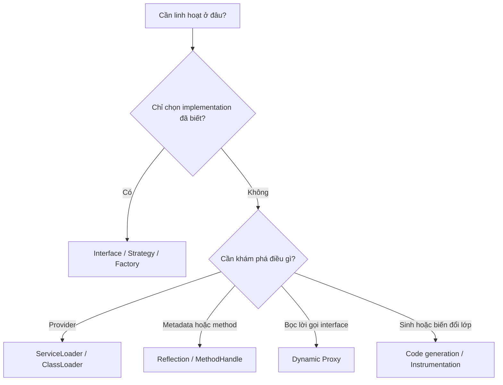

# 1.1 Cơ chế động lúc chạy là gì và giải quyết những bài toán nào?

## 1. Mục tiêu bài học

Sau bài này, bạn có thể:

- Giải thích “động lúc chạy” (dynamic runtime) trong Java, phân biệt với quyết định tại thời điểm biên dịch và với đa hình thông thường.
- Nhận diện các cơ chế chính của JVM/Java: nạp và liên kết lớp, Reflection, Method Handles, `invokedynamic`, dynamic proxy, SPI và công cụ sinh/chỉnh sửa mã.
- Chọn cơ chế phù hợp cho plugin, framework, AOP, ánh xạ dữ liệu, giám sát và tích hợp mở rộng; hiểu rủi ro về an toàn, hiệu năng và khả năng bảo trì.

## 2. “Động lúc chạy” nghĩa là gì?

Java là ngôn ngữ **kiểu tĩnh**: trình biên dịch kiểm tra kiểu của phần lớn biểu thức và lời gọi dựa trên mã nguồn, rồi tạo bytecode. Nhưng khi JVM thực thi, chương trình vẫn có thể **khám phá lớp và thành viên, nạp mã, chọn cách kết nối hoặc chặn lời gọi, thậm chí tạo lớp mới** dựa trên cấu hình và dữ liệu chỉ biết lúc chạy.

Ví dụ, ứng dụng không cần viết cố định `new EmailNotifier()` ở mọi nơi. Nó có thể đọc cấu hình lựa chọn triển khai, tìm nhà cung cấp dịch vụ, tạo đối tượng và gọi qua một giao diện ổn định. Một thư viện cũng có thể quan sát annotation, tìm getter/setter hoặc gắn hành vi ghi log quanh lời gọi mà mã nghiệp vụ không cần tự thực hiện từng bước đó.

**Định nghĩa thực dụng:** cơ chế động lúc chạy là tập hợp kỹ thuật cho phép một phần **cấu trúc, liên kết hoặc hành vi được xác định tại runtime** thay vì được mã hóa cố định vào mọi điểm gọi ở thời điểm biên dịch.

Cần phân biệt ba ý thường bị gộp nhầm:

| Khái niệm | Ví dụ | Điểm khác biệt |
| --- | --- | --- |
| Đa hình/virtual dispatch thông thường | `Animal a = new Dog(); a.speak();` | Mã đã biết kiểu giao diện hoặc lớp cha; JVM chọn implementation ghi đè theo đối tượng thực tế. Đây là hành vi runtime bình thường của Java, chưa nhất thiết cần Reflection. |
| Cơ chế động chuyên dụng | `Class.forName(name)`, `Method.invoke(...)`, `Proxy.newProxyInstance(...)` | Chương trình có thể tìm tên lớp/phương thức từ dữ liệu, tạo tầng chặn hoặc kết nối lời gọi một cách linh hoạt. |
| Ngôn ngữ có kiểu động | Biến đổi kiểu ở runtime theo quy tắc của ngôn ngữ động | Java không trở thành ngôn ngữ có kiểu động chỉ vì dùng Reflection; lỗi có thể chuyển từ lúc biên dịch sang lúc chạy. |

Từ “động” cũng không đồng nghĩa với “tự sửa mã tùy ý”, “hot reload mặc định” hoặc “luôn nhanh hơn”. Mỗi cơ chế có phạm vi và giới hạn riêng.

## 3. JVM có những điểm quyết định nào lúc chạy?

Luồng khái quát:

1. **Biên dịch:** `javac` kiểm tra nguồn Java, tạo các tệp `.class` chứa bytecode và tham chiếu biểu tượng đến kiểu/thành viên.
2. **Nạp lớp (loading):** JVM sử dụng class loader để tìm hoặc định nghĩa lớp khi cần. Lớp chưa nhất thiết phải có sẵn dưới dạng tham chiếu trực tiếp trong mã gọi.
3. **Liên kết (linking):** JVM xác minh bytecode, chuẩn bị dữ liệu lớp và phân giải các tham chiếu biểu tượng theo quy tắc JVM; việc phân giải có thể diễn ra khi cần. Khởi tạo lớp là bước riêng với loading/linking.
4. **Lựa chọn và gọi:** JVM thực hiện dispatch thông thường hoặc cơ chế gọi/tra cứu động như Reflection, Method Handles và `invokedynamic`.
5. **Thực thi/tối ưu:** interpreter và JIT có thể tối ưu đường gọi dựa trên thông tin runtime. JIT là cơ chế thực thi/tối ưu của JVM, không phải tên gọi chung cho Reflection hay plugin.

Một chi tiết quan trọng: **danh tính lớp phụ thuộc cả tên nhị phân và class loader định nghĩa lớp**. Hai lớp trùng tên nhưng do hai loader khác nhau định nghĩa có thể là hai kiểu không tương thích. Vì vậy plugin cần thiết kế rõ API dùng chung và ranh giới class loader.

## 4. Các cơ chế cốt lõi

| Cơ chế | Khả năng chính | Khi thường dùng | Giới hạn cần nhớ |
| --- | --- | --- | --- |
| **Reflection** — `java.lang.Class`, `java.lang.reflect` | Đọc metadata của class, constructor, method, field, annotation; tạo đối tượng và gọi thành viên bằng dữ liệu runtime. | Framework ánh xạ dữ liệu, dependency injection, cấu hình theo tên, công cụ kiểm thử. | Kiểu/chữ ký sai chỉ lộ ra khi chạy; quyền truy cập chịu ràng buộc Java access và module system. |
| **Method Handles** — `java.lang.invoke` | Tạo một “tay nắm” lời gọi có kiểu phương thức rõ ràng, có thể kết hợp/bind/adapt; `invokedynamic` dùng bootstrap để thiết lập call site. | Runtime của ngôn ngữ, thư viện xây đường gọi động, một số cơ chế lambda và liên kết động. | `invokeExact` cần khớp chữ ký chính xác; API thấp tầng hơn Reflection. |
| **Dynamic proxy của JDK** — `java.lang.reflect.Proxy` | Tạo đối tượng triển khai các interface tại runtime và chuyển lời gọi đến `InvocationHandler`. | Logging, đo thời gian, giao dịch, kiểm soát truy cập, remote client qua interface. | Proxy chuẩn của JDK dựa trên **interface**; không biến mọi lớp cụ thể thành đối tượng có thể chặn tùy ý. |
| **Class loading và SPI** — `ClassLoader`, `ServiceLoader` | Nạp implementation và khám phá provider theo hợp đồng dịch vụ. | Plugin, driver, provider, các module mở rộng. | Provider phải sẵn có theo classpath/module path hoặc cơ chế loader phù hợp; class loader không phải sandbox bảo mật. |
| **Sinh/chỉnh sửa bytecode và instrumentation** | Tạo lớp hoặc biến đổi bytecode trong những điểm cho phép; agent dùng `java.lang.instrument`. | ORM/proxy phức tạp, mocking, profiling, quan sát và công cụ chẩn đoán. | Phức tạp hơn, ràng buộc quyền truy cập và JVM; thường dùng thư viện/công cụ chuyên biệt như ASM hoặc Byte Buddy. |

**`invokedynamic` khác `Method.invoke`:** `Method.invoke` là API gọi một phương thức được biểu diễn bằng Reflection; `invokedynamic` là một lệnh bytecode có call site được liên kết qua bootstrap method. Không nên xem hai thứ là hai cách viết của cùng một thao tác.

**`ServiceLoader` khác việc tự quét toàn bộ classpath:** nó dùng hợp đồng dịch vụ cùng khai báo provider (ví dụ `META-INF/services` hoặc `provides ... with ...` trong module), để phát hiện implementation mà không cần ứng dụng tự dò tất cả lớp.

## 5. Ví dụ 1 — tìm lớp và gọi phương thức bằng Reflection

Giả sử tên implementation đến từ cấu hình. Để minh họa độc lập, lớp cần nạp được khai báo ngay trong cùng tệp; ở hệ thống thực nó có thể nằm trong một JAR được cung cấp khi chạy.

Tạo tệp **`RuntimeDiscoveryDemo.java`**:

```java
import java.lang.reflect.Method;

public class RuntimeDiscoveryDemo {
    public static class Greeter {
        public Greeter() {}

        public String greet(String name) {
            return "Xin chào, " + name + "!";
        }
    }

    public static void main(String[] args)
            throws ReflectiveOperationException {
        // Tên nhị phân của nested class, có thể lấy từ cấu hình.
        String className = "RuntimeDiscoveryDemo$Greeter";

        Class<?> type = Class.forName(className);
        Object instance = type.getDeclaredConstructor().newInstance();
        Method method = type.getMethod("greet", String.class);
        Object result = method.invoke(instance, "Lan");

        System.out.println(result);
    }
}
```

Biên dịch và chạy trên JDK 17+:

```bash
javac -encoding UTF-8 --release 17 RuntimeDiscoveryDemo.java
java RuntimeDiscoveryDemo
```

Kết quả (stdout):

```text
Xin chào, Lan!
```

**Cơ chế đang xảy ra:**

- `Class.forName("RuntimeDiscoveryDemo$Greeter")` tìm lớp theo **tên nhị phân**; cách gọi này cũng khởi tạo lớp nếu cần.
- `getDeclaredConstructor().newInstance()` tìm constructor không tham số và tạo đối tượng; lớp mẫu có constructor public để ví dụ hoạt động trực tiếp.
- `getMethod("greet", String.class)` tìm method public đúng tên và kiểu tham số.
- `invoke(instance, "Lan")` thực hiện lời gọi. Giá trị trả về có kiểu `Object` ở phía Reflection, nên compiler không chứng minh được từ trước rằng phương thức tìm thấy trả về `String`.

Nếu đổi tên lớp hoặc chữ ký, chương trình có thể gặp `ClassNotFoundException`, `NoSuchMethodException`, `IllegalAccessException` hoặc lỗi liên quan khi chạy. Nếu phương thức được gọi ném exception, `Method.invoke` bọc nguyên nhân trong `InvocationTargetException`; khi xử lý lỗi thực tế hãy xem `getCause()`.

**Bài học thiết kế:** Reflection hữu ích khi tên/chữ ký được xác định từ metadata. Nhưng nếu cả interface và implementation đều đã biết lúc viết code, gọi trực tiếp thường dễ đọc, dễ refactor và dễ được compiler kiểm tra hơn.

## 6. Ví dụ 2 — thêm hành vi quanh lời gọi bằng dynamic proxy

Giả sử nhiều service phải ghi log mỗi khi được gọi. Thay vì thêm lệnh log vào từng implementation, ta tạo một đối tượng đại diện triển khai cùng interface.

Tạo tệp **`RuntimeProxyDemo.java`**:

```java
import java.lang.reflect.Proxy;
import java.util.Locale;

public class RuntimeProxyDemo {
    public interface TextService {
        String normalize(String input);
    }

    public static class RealTextService implements TextService {
        @Override
        public String normalize(String input) {
            return input.strip().toUpperCase(Locale.ROOT);
        }
    }

    public static void main(String[] args) {
        TextService target = new RealTextService();

        TextService traced = (TextService) Proxy.newProxyInstance(
                TextService.class.getClassLoader(),
                new Class<?>[] {TextService.class},
                (proxy, method, arguments) -> {
                    System.out.println("Đang gọi: " + method.getName());
                    return method.invoke(target, arguments);
                });

        System.out.println(traced.normalize("  java  "));
    }
}
```

```bash
javac -encoding UTF-8 --release 17 RuntimeProxyDemo.java
java RuntimeProxyDemo
```

Stdout:

```text
Đang gọi: normalize
JAVA
```

Ở đây `traced` là proxy được tạo lúc chạy. Khi gọi `traced.normalize(...)`, handler nhận `Method` và các đối số, ghi log rồi **ủy quyền** cho `target`. Mã gọi chỉ biết contract `TextService`.

Các giới hạn quan trọng:

- JDK dynamic proxy tạo proxy cho **interface**. Nếu cần chặn lời gọi lên lớp cụ thể, framework có thể phải dùng cơ chế sinh subclass/bytecode khác và chịu các giới hạn riêng của `final`/quyền truy cập.
- Chỉ lời gọi **đi qua proxy** mới được handler xử lý; lời gọi nội bộ trực tiếp từ đối tượng đích đến chính nó không tự động đi qua proxy.
- Handler nên xét cách xử lý `equals`, `hashCode`, `toString`, exception và null arguments khi phát triển thành thư viện dùng chung. Ví dụ chỉ chủ ý minh họa một phương thức.
- Proxy thêm tầng gián tiếp; không dùng cho mọi lời gọi chỉ vì có thể làm được.

## 7. Ví dụ 3 — lời gọi qua Method Handle

`MethodHandle` biểu diễn một phép gọi có chữ ký được khai báo bằng `MethodType`. Nó hữu ích khi thư viện cần xây và kết hợp các đường gọi linh hoạt.

Tệp **`MethodHandleDemo.java`**:

```java
import java.lang.invoke.MethodHandle;
import java.lang.invoke.MethodHandles;
import java.lang.invoke.MethodType;

public class MethodHandleDemo {
    public static void main(String[] args) throws Throwable {
        MethodHandle upper = MethodHandles.publicLookup().findVirtual(
                String.class,
                "toUpperCase",
                MethodType.methodType(String.class));

        String result = (String) upper.invokeExact("java");
        System.out.println(result);
    }
}
```

```bash
javac -encoding UTF-8 --release 17 MethodHandleDemo.java
java MethodHandleDemo
```

Stdout:

```text
JAVA
```

`findVirtual` tìm phương thức instance công khai `String.toUpperCase()`; kiểu receiver `String` là một phần chữ ký của handle. `invokeExact` yêu cầu kiểu tham số và kiểu trả về tại điểm gọi khớp **chính xác** với kiểu của handle. Khi không khớp có thể gặp `WrongMethodTypeException`; `invoke` cho phép một số chuyển đổi thích hợp. Cả hai vẫn tôn trọng kiểm tra quyền truy cập.

Không nên kết luận mọi Method Handle đều nhanh hơn Reflection: kết quả phụ thuộc cách tạo/caching handle, đặc điểm lời gọi, mức tối ưu của JVM và workload. Hãy đo bằng benchmark có kiểm soát khi hiệu năng thực sự quan trọng.

## 8. Cơ chế động giải quyết những bài toán nào?

| Bài toán | Vì sao cần quyết định runtime? | Hướng thiết kế phù hợp |
| --- | --- | --- |
| **Kiến trúc plugin/SPI** | Core không biết trước toàn bộ provider; triển khai có thể được đóng gói và phát hành độc lập. | Định nghĩa interface/API ổn định; đăng ký và tìm provider bằng `ServiceLoader`, rồi dùng cơ chế nạp lớp phù hợp nếu cần quản lý plugin JAR. |
| **Ánh xạ object ↔ dữ liệu** | DTO/entity có field, getter, annotation khác nhau; thư viện không thể hardcode từng class của ứng dụng. | Dò metadata bằng Reflection hoặc tạo/caching accessor, sinh mã khi có lợi. Ví dụ: serializer và ORM. |
| **AOP/cross-cutting concern** | Logging, transaction, metric, authorization phải bọc nhiều implementation theo cấu hình. | Proxy/interceptor; tách xử lý kỹ thuật khỏi business logic và xác định rõ những đường gọi đi qua proxy. |
| **Dependency injection/framework bootstrap** | Container cần tìm constructor, annotation, dependency và lắp ráp graph theo cấu hình. | Metadata/reflection, factory, provider hoặc mã được sinh sẵn tùy framework; ứng dụng thường chỉ khai báo contract. |
| **Driver/adapter đa nhà cung cấp** | Nhà cung cấp được chọn từ môi trường triển khai, không cố định tại mã nghiệp vụ. | SPI/strategy qua interface; nạp đúng adapter và kiểm tra API/version tương thích. |
| **Mocking, testing, tracing, profiling** | Cần thay thế hoặc quan sát lời gọi mà không sửa tất cả call site. | Proxy, bytecode generation hoặc instrumentation agent tùy mức can thiệp; tránh gây thay đổi hành vi không chủ ý. |
| **Runtime của ngôn ngữ/DSL** | Loại thao tác hoặc mục tiêu gọi chỉ rõ sau khi phân tích biểu thức trong runtime. | Method Handles và cơ chế liên kết động như `invokedynamic`; cần quản lý call site và quy tắc kiểu rõ ràng. |

Hai tình huống minh họa:

**Tình huống A — đổi nhà cung cấp thông báo.** Core phụ thuộc `Notifier`; khi chạy có thể lựa chọn `EmailNotifier` hoặc `SmsNotifier`. Nếu các lựa chọn đã biết và được khai báo tĩnh, factory/strategy thông thường đủ dùng. Nếu muốn thêm provider độc lập mà core không sửa source, SPI và class loading đem lại khả năng mở rộng thật sự. “Không sửa core” không có nghĩa là provider tự xuất hiện: JAR, khai báo provider, cấu hình, tương thích phiên bản và kiểm thử triển khai vẫn cần đầy đủ.

**Tình huống B — ghi metric cho hàng trăm service.** Thêm bộ đếm vào từng method làm mã nghiệp vụ lặp và khó nhất quán. Interface proxy/interceptor cho phép áp dụng chính sách ở một điểm. Đổi lại, cần xác định chính xác lời gọi nào đi qua proxy, quản lý lỗi/transaction và kiểm soát overhead. Nếu không có yêu cầu cắt ngang nhiều lời gọi, lời gọi trực tiếp vẫn đơn giản hơn.

## 9. Chọn mức “động” đúng nhu cầu

Một thứ tự lựa chọn thường hiệu quả là:

1. **Biết contract và implementation từ lúc viết mã:** bắt đầu với interface, đa hình, strategy hoặc factory rõ ràng. Chưa cần Reflection.
2. **Biết contract nhưng không biết provider lúc build core:** cân nhắc `ServiceLoader` hoặc plugin API; quy định version và vòng đời provider.
3. **Phải khám phá cấu trúc lớp từ metadata:** dùng Reflection và cache thông tin cần dùng; giới hạn những class/field/method được phép thao tác.
4. **Phải bọc lời gọi qua interface:** dùng JDK dynamic proxy hoặc interceptor phù hợp.
5. **Phải tạo đường gọi động có kiểu hoặc xây runtime:** xem `MethodHandles`/`invokedynamic`.
6. **Phải tạo/sửa lớp hay instrument chương trình:** chỉ dùng code generation/agent khi lợi ích đủ lớn để bù độ phức tạp.

Có thể hình dung lựa chọn qua sơ đồ:



Trong một hệ thống, các kỹ thuật có thể phối hợp: framework tìm implementation bằng SPI, đọc annotation bằng Reflection, rồi tạo proxy để xử lý transaction. Chúng **không thay thế hoàn toàn cho nhau**.

## 10. Những đánh đổi và lỗi phổ biến

### 10.1. Mất một phần kiểm tra tại compile time

Chuỗi tên class/method, kiểu đối số và constructor chỉ được xác minh lúc chạy. Các lỗi hay gặp gồm `ClassNotFoundException`, `NoSuchMethodException`, `ClassCastException`, `IllegalAccessException`, `LinkageError` và lỗi chữ ký của Method Handle. Giải pháp: API ổn định, kiểm tra cấu hình khi khởi động, kiểm thử cả đường đi plugin, và thông báo lỗi có ngữ cảnh.

### 10.2. Quyền truy cập và Java Platform Module System (JPMS)

Từ Java 9, module encapsulation có thể ngăn deep reflection tới thành viên không được mở. Gọi `setAccessible(true)` không bảo đảm vượt qua giới hạn module; có thể gặp `InaccessibleObjectException`. Hãy ưu tiên API public, khai báo `opens` có chủ đích khi thực sự cần và tránh phụ thuộc JDK internal APIs.

### 10.3. Bề mặt tấn công và ranh giới tin cậy

Không dùng trực tiếp tên class/method do người dùng không tin cậy gửi đến để khởi tạo và thực thi tùy ý. Áp dụng allowlist provider, xác thực nguồn JAR, giới hạn cấu hình, phân quyền và kiểm thử. **Class loader không cung cấp sandbox an toàn** để chạy mã không tin cậy; plugin có quyền JVM tương ứng có thể tác động đến tiến trình.

### 10.4. Hiệu năng và vòng đời

Tra cứu metadata, tạo proxy, nạp lớp và phát sinh mã thường có chi phí khởi tạo; những đường gọi có thể phát sinh overhead. Cache `Method`/`MethodHandle` hoặc provider hợp lý, khởi tạo khi cần, rồi **đo trước khi tối ưu**. Việc giữ reference đến loader/class/instance không cần thiết có thể cản trở unload lớp và làm tăng sử dụng Metaspace. Không dùng `Class.forName` hay quét classpath lặp lại trong mỗi request nếu có thể chuẩn bị một lần.

### 10.5. Debugging và hành vi gián tiếp

Stack trace có thể chứa proxy, reflection wrapper hoặc code sinh tự động. Exception phát sinh từ method thực có thể bị bọc; cần lấy nguyên nhân gốc. Quy tắc proxy cũng có thể làm một số lời gọi nội bộ không được intercept. Ghi rõ lifecycle, metadata nguồn và ánh xạ service → provider để dễ chẩn đoán.

### 10.6. Nhầm lẫn với scripting và hot reload

Java 17 không kèm sẵn Nashorn JavaScript engine. Muốn thực thi script/DSL cần engine hoặc runtime phù hợp; Reflection không phải interpreter của ngôn ngữ khác. Thay class đã được tải trong JVM đang chạy cũng không tự động xảy ra khi thay tệp `.class`: hot reload/redefinition đòi hỏi cơ chế chuyên dụng và có giới hạn.

## 11. Kiểm tra hiểu bài

**Câu 1.** `Animal a = new Dog(); a.speak();` đã là cơ chế runtime chưa, và có cần Reflection không?

**Đáp:** JVM chọn phương thức ghi đè dựa vào đối tượng thực tế tại runtime; đó là virtual dispatch thông thường, không cần Reflection. “Cơ chế động” theo nghĩa plugin/metadata/đường gọi tự tạo là nhu cầu rộng hơn.

**Câu 2.** Ứng dụng chọn provider từ nhiều JAR mà không muốn hardcode class name. Nên bắt đầu từ đâu?

**Đáp:** Xác định interface dịch vụ, hợp đồng version và cách đăng ký provider; xem `ServiceLoader` trước. Chỉ xây loader riêng nếu cần vòng đời hoặc cách đóng gói plugin đặc biệt.

**Câu 3.** Vì sao bọc service bằng JDK proxy chưa chắc bắt được mọi method call?

**Đáp:** Handler chỉ nhận lời gọi qua tham chiếu proxy và interface của nó; lời gọi trực tiếp vào target hoặc tự gọi method trong target không tự động đi qua handler.

**Câu 4.** Reflection có khiến Java trở thành ngôn ngữ kiểu động không?

**Đáp:** Không. Java vẫn kiểm tra kiểu tĩnh đối với mã thông thường; Reflection chuyển một phần kiểm tra tên, chữ ký và quyền truy cập sang runtime, đồng thời làm xuất hiện thêm các lỗi lúc chạy.

## 12. Ghi nhớ

- **Mục đích chính:** trì hoãn một số quyết định về provider, metadata hoặc đường gọi đến runtime để tăng khả năng cấu hình, mở rộng và tách các mối quan tâm kỹ thuật.
- **Cơ chế là công cụ:** Reflection dùng để khám phá/gọi; Method Handles và `invokedynamic` phục vụ liên kết/gọi động; proxy chặn qua interface; class loading/SPI tìm provider; instrumentation can thiệp sâu hơn.
- **Chỉ dùng khi có bài toán rõ:** đánh đổi sự linh hoạt lấy thêm kiểm thử, bảo mật, quản lý vòng đời và khả năng quan sát. Ưu tiên thiết kế tĩnh, đơn giản khi đã đáp ứng yêu cầu.

Tài liệu API Java 17 để tra cứu tiếp: [`Class`](https://docs.oracle.com/en/java/javase/17/docs/api/java.base/java/lang/Class.html), [`Proxy`](https://docs.oracle.com/en/java/javase/17/docs/api/java.base/java/lang/reflect/Proxy.html), [`MethodHandles`](https://docs.oracle.com/en/java/javase/17/docs/api/java.base/java/lang/invoke/MethodHandles.html), [`ServiceLoader`](https://docs.oracle.com/en/java/javase/17/docs/api/java.base/java/util/ServiceLoader.html) và [`ClassLoader`](https://docs.oracle.com/en/java/javase/17/docs/api/java.base/java/lang/ClassLoader.html).
