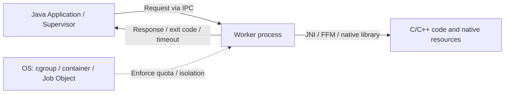

# Choose a Separate Process When Fault Boundaries or Resource Limits Are Needed

## 1. Problems in Java Interaction with Native Code

When Java calls native code via JNI, the Foreign Function & Memory API (FFM), or a library with underlying C/C++ code, that call can run **in the same operating system process as the JVM**. The Java/native boundary is not synonymous with a process boundary:

- Native code can access memory outside Java's type safety and bounds-checking mechanisms. Pointer errors, accessing freed memory, buffer overflows, or calling with the wrong ABI can lead to `SIGSEGV`, `SIGABRT`, memory access violations on Windows, or termination of the entire JVM.
- Native code can hang, deadlock, consume unbounded CPU, allocate off-heap memory, create threads, and open file descriptors/handles. Setting `-Xmx` only limits the **Java heap**; it does not cap the total process RAM or CPU used by native code.
- `try/catch` in Java handles Java exceptions. It does **not** safely recover a JVM that has hit `abort()`, a severe memory error, or native state that has corrupted process memory. `Thread.interrupt()` or `Future.cancel(true)` also does not guarantee stopping a stuck native call.
- If native code runs inside the main JVM, a fatal error can bring down the HTTP server, job scheduler, or orchestration component that is currently running.

**Rule:** When fault tolerance or resource control requirements outweigh the cost of cross-process calls, place the risky native part in a **separate child process** (worker/helper). The main JVM acts as a supervisor and communicates over an inter-process communication (IPC) protocol. When a worker crashes, hangs, or exceeds its quota, the supervisor can log the error, stop/replace the worker, and continue serving other tasks.

## 2. What Does the Boundary Actually Change?



**Same process:** The JVM and the native library share the address space, process resources, and fate when the process is terminated. Catching exceptions or creating a separate Java thread does not turn a native call into an independent fault domain.

**Different processes:** The main JVM and the worker have separate virtual address spaces, heaps, stacks, handle/file descriptor tables, and process exit statuses. A segmentation fault in the worker typically only terminates the worker; the supervisor receives EOF, an abnormal exit code, or a lost connection. The operating system can enforce quotas on the worker without applying them directly to the main JVM.

However, **process separation is not a complete security sandbox**. Two processes can still share the same user, kernel, network, filesystem, secret access permissions, and host resource limits. A worker that exhausts all machine RAM can still affect the supervisor; the OS may choose to kill another process. Stronger trust boundaries require least-privilege OS permissions, quotas, containers/VMs, appropriate sandboxing, and IPC controls.

## 3. Choosing a Deployment Model

| Option | What You Gain | Limitations and When It Fits |
|---|---|---|
| JNI/FFM running in the main JVM | Direct calls, minimal data copying, low latency | Native errors can kill the JVM; fits sufficiently trusted, well-verified libraries with high call frequency and no need for separate hard quotas |
| Separate thread or `ExecutorService` in the JVM | Thread management, coordination, and Java-level logic timeouts | Does **not** isolate crashes, address space, or native memory; interrupt does not guarantee canceling a native call |
| Worker as a separate OS process | Fault boundary, independent restart, exit status, timeout, and OS quotas for the worker | Startup overhead, serialization/IPC, lifecycle management; fits codecs, parsers, drivers, legacy libraries, or unstable native tasks |
| Worker in a container/sandbox or VM | Can add CPU/RAM/PID limits, permissions, filesystem, network, and stronger isolation | Requires runtime configuration, monitoring, and security policies; containers still share the host kernel |

Do not mechanically put every native call into a separate process. First evaluate the risk level, latency/throughput requirements, payload size, call count, and operational cost.

### Signs You Should Choose a Separate Process

1. The native library is untrusted, has a history of `SIGSEGV`/`abort`, handles untrusted input data, or depends on drivers/ABIs that are hard to guarantee.
2. A call can hang and has no reliable cancellation mechanism from the library.
3. The work has large CPU/RAM/native memory spikes that can use OS quotas without throttling the main JVM.
4. A clear request/response can be defined; the worker rarely needs direct access to the JVM's object graph and live state.
5. You need to update/restart the worker independently, reduce the blast radius, and collect crash dumps/logs for the native code separately.

If latency is only a few microseconds and millions of small objects must be exchanged, IPC and data-copying overhead may outweigh the benefits. Benchmark before deciding.

## 4. Supervisor–Worker Structure and IPC Contract

A minimal design:

- **Java Supervisor:** receives work, assigns a request ID, validates inputs, starts/selects a worker, enforces deadlines, monitors liveness, checks exit codes, and decides on retries.
- **Worker:** receives validated requests, calls the native library, returns structured responses; does not hold arbitrary permissions over the supervisor's resources.
- **IPC Channel:** stdin/stdout, loopback TCP socket, Unix domain socket, named pipe, gRPC, or message queue. Choose based on call frequency, throughput, streaming needs, and OS environment.
- **Operating System/Deployment Runtime:** sets quotas for CPU, RAM, PIDs, file descriptors, filesystem/network permissions; collects exit reasons, RSS, and logs.

Example of two JSON messages illustrating the contract, **not the Java code of the example in section 5**:

```json
{"requestId":"req-42","operation":"decode","inputRef":"job/42/input.bin","deadlineMs":5000}
{"requestId":"req-42","status":"ok","outputRef":"job/42/output.bin"}
```

Clearly specify the protocol version, encoding, size limits, message framing (for example, JSON Lines with one message per line or length-prefix), reply ordering, and retryable errors. For large data, consider passing paths/handles to **authorized** data areas instead of stuffing hundreds of MB through JSON; at the same time, prevent path traversal, invalid files, and unsynchronized shared memory.

Do not mix stdout reserved for the protocol with debug logs: if using JSON Lines over stdout, redirect logs to stderr or a separate file. For requests with side effects, define an idempotency key and an uncertain state when the worker dies before sending an ACK.

## 5. Runnable Example on Java 17+: Failing Worker, Hanging Worker, and Surviving Supervisor

The example uses a **second JVM to simulate a native worker** to demonstrate the process boundary without compiling a C library. In real deployments, replace the `NativeWorker` launch command with the packaged executable/native helper. Create two files in the same directory:

**`NativeWorker.java`**

```java
public final class NativeWorker {
    public static void main(String[] args) throws InterruptedException {
        String mode = args.length == 0 ? "ok" : args[0];

        switch (mode) {
            case "ok" -> System.out.println("worker: ok");
            case "fail" -> {
                System.out.println("worker: simulated failure");
                System.exit(7);
            }
            case "hang" -> Thread.sleep(30_000);
            default -> {
                System.out.println("worker: invalid mode");
                System.exit(2);
            }
        }
    }
}
```

**`Supervisor.java`**

```java
import java.nio.file.Path;
import java.time.Duration;
import java.util.List;
import java.util.Locale;
import java.util.concurrent.TimeUnit;

public final class Supervisor {
    private static String javaExecutable() {
        String exe = System.getProperty("os.name")
                .toLowerCase(Locale.ROOT).contains("win")
                ? "java.exe" : "java";
        return Path.of(System.getProperty("java.home"), "bin", exe).toString();
    }

    private static int runWorker(String mode, Duration timeout) throws Exception {
        ProcessBuilder builder = new ProcessBuilder(
                javaExecutable(), "-cp", System.getProperty("java.class.path"),
                "NativeWorker", mode
        );
        // Simple demo: inherit stdout/stderr so an unread pipe does not fill up.
        builder.inheritIO();
        Process child = builder.start();

        try {
            if (child.waitFor(timeout.toMillis(), TimeUnit.MILLISECONDS)) {
                return child.exitValue();
            }

            child.destroy(); // Request termination using the OS mechanism.
            if (!child.waitFor(1, TimeUnit.SECONDS)) {
                child.destroyForcibly();
                child.waitFor();
            }
            return 124; // Code agreed by the supervisor for timeout.
        } catch (InterruptedException e) {
            child.destroyForcibly();
            Thread.currentThread().interrupt();
            throw e;
        }
    }

    public static void main(String[] args) throws Exception {
        for (String mode : List.of("ok", "fail", "hang")) {
            int exit = runWorker(mode, Duration.ofSeconds(5));
            System.out.printf("mode=%s exit=%d%n", mode, exit);
        }
        System.out.println("supervisor: alive");
    }
}
```

Compile and run in the directory containing both files:

```bash
javac NativeWorker.java Supervisor.java
java Supervisor
```

On a normally running machine (worker starts within 5 seconds), the standard output is:

```text
worker: ok
mode=ok exit=0
worker: simulated failure
mode=fail exit=7
mode=hang exit=124
supervisor: alive
```

Explanation of each result:

- `ok`: the worker prints a message and exits with code `0`; the supervisor receives `exitValue() == 0`.
- `fail`: the worker exits itself with code `7`; the supervisor JVM is not shut down. In practice, a native crash usually produces an OS-specific exit status/signal, **not always 7**.
- `hang`: the worker sleeps for 30 seconds, exceeding the 5-second deadline; the supervisor requests termination, force-kills if necessary, and returns the agreed timeout code `124`. Code `124` here is a **supervisor convention**, not the child's natural exit code.
- Finally, the supervisor still reaches the `supervisor: alive` line. No separate Java thread can provide an equivalent fault boundary against a native crash.

`ProcessBuilder` takes an **argument list**, not a shell command string. When calling a real binary, use a trusted executable path and separate arguments: `new ProcessBuilder(nativeBinary, "--input", inputPath)`. Do not build a `sh -c`/`cmd /c` string containing user data due to injection risks.

The example illustrates a simple lifecycle; a real system also needs bounded IPC reading/writing, stopping new requests when a worker dies, managing multiple workers, and ensuring cleanup of the entire child process tree when a worker spawns subprocesses.

## 6. Timeouts, Crashes, and Streams: Details Easy to Get Wrong

**Timeouts have two different layers.** The supervisor's deadline (`waitFor(timeout, ...)`) detects long processing; upon expiration, it must terminate the worker and manage its resources. A deadline **does not limit CPU/RAM by itself**, and a Java timeout does not guarantee that native code running in the same JVM will stop. Use both end-to-end IPC timeouts and OS quotas when hard limits are needed.

**Do not let pipes fill up.** `ProcessBuilder` creates pipes for stdout/stderr by default. If the supervisor calls `waitFor()` without reading the two streams, the worker can block when the pipe fills up and never exit. Safe approaches depending on need:

- For simple demos/CLIs: `inheritIO()` as above.
- For background jobs: `redirectOutput(...)` and `redirectError(...)` to files with rotation/quotas, or use two asynchronous readers draining stdout and stderr.
- If stdout is the protocol: read continuously by frame, limiting size/bytes per request; stderr must be drained separately or redirected safely. `redirectErrorStream(true)` is only suitable when logs and payloads can be merged; **do not use** when stdout needs pure JSON.

**Handling exit statuses:** distinguish `exit=0`, business errors with specific codes, native crashes, process start failures (for example, missing binary), protocol errors, timeouts, and workers killed by the OS. Each category must have appropriate logs/metrics, retry policies, and alerts. Do not assume every non-zero exit code is retryable.

**Cleanup:** `destroy()` usually requests a graceful OS-level stop, while `destroyForcibly()` requests forced termination; exact behavior depends on the platform. You can use `ProcessHandle` to observe descendants, but you must not assume killing the child will terminate all grandchildren. In systems that need to manage the entire process tree, consider process groups, cgroups, or Windows Job Objects and cleanup at the process management layer.

## 7. Where Do CPU, RAM, and Permission Limits Belong?

Standard Java provides `ProcessBuilder` to launch/monitor processes; **it has no cross-platform API to automatically set hard RAM/CPU limits for any native child**. Choose a tool that actually has authority to enforce the constraints:

| Goal | Appropriate Mechanism | Do Not Confuse With |
|---|---|---|
| Stop a job running too long | Supervisor deadline + kill worker/process group | `Thread.interrupt()` for an uncooperative native call |
| Limit total worker RAM | Linux cgroup/container `memory.max` or equivalent quota; Windows Job Object | `-Xmx` only limits the Java heap, excluding all native allocations/RSS |
| Limit usable CPU | Linux cgroup CPU quota, container `--cpus`, Windows Job Object | Java thread priority or `Thread.sleep()` |
| Limit number of processes/threads | cgroup `pids.max`, container `--pids-limit`, OS policy | Counting threads only in Java |
| Restrict file descriptors/handles, files, network, privileges | `ulimit`/rlimit when applied properly, container policy, dedicated user, ACLs, seccomp/AppArmor/SELinux depending on OS | A Java wrapper layer does not replace OS policy |

Example **illustrating Linux operation via Docker** (requires a built, feature-compatible image):

```bash
docker run --rm --memory=512m --cpus=1 --pids-limit=64 \
  --network=none --read-only --tmpfs /tmp:rw,noexec,nosuid \
  --cap-drop=ALL my-native-worker:version
```

The Docker flags above set several quotas and permission restrictions for the worker container; you need to verify the actual runtime, cgroups, file-writing needs, and OS characteristics. `--memory` affects total memory accounted under cgroup policy and can lead to an OOM kill. Even with quotas, host-level exhaustion, disk I/O, kernel bugs, or misconfigured containers can still affect other systems.

If the worker is actually a child JVM, `-Xmx256m` can **add** a Java heap ceiling to leave room for metaspace, stacks, direct buffers, and native memory within a larger container limit. Do not set `-Xmx` equal to the entire memory quota and assume it is safe.

## 8. Fault-Tolerant Design in Production

### Protocol and State

- Attach a `requestId` to each request; store `PENDING/RUNNING/SUCCEEDED/FAILED/TIMED_OUT/UNKNOWN` state in the supervisor. Responses must match the request ID, schema version, and allowed size.
- Have a **total deadline** from queuing to returning the result; distinguish queue wait time, worker startup, native processing, and data transfer. Do not only time out `waitFor()` after a request has already hung.
- For writes/side effects, a worker dying after finishing work but before sending an ACK creates an **uncertain state as to whether it succeeded or not**. Use idempotency keys, transactions/outbox, or reconciliation before retrying; do not promise exactly-once solely through IPC.
- Workers should have a clear API version. Check handshake/capabilities at session start; do not send new requests to a worker that is shutting down, in a crash loop, or not ready.

### Recovery and Blast-Radius Containment

- The supervisor monitors PID/health heartbeats, exit codes, timeouts, restart counts, RSS, CPU, logs, and crash dumps (if any, avoiding writing secrets).
- Bounded retries with exponential backoff and jitter; input format errors or schema violations should fail decisively, not retry endlessly. For repeated crashes on the same input, move the job to a dead-letter/quarantine queue to avoid crash loops.
- The worker pool keeps a fixed or bounded number of processes; use a bounded queue and backpressure. Unboundedly increasing the number of workers can exhaust RAM/PIDs even when each worker has a quota.
- Startup/cleanup must be idempotent; handle supervisor shutdown, killed workers, timeouts, and orphan processes. Use process groups/cgroups/Job Objects when worker subprocesses need to be cleaned up.
- Separate liveness/readiness: an existing process does not mean the native subsystem is ready or still able to process requests.

### Security Principles

- Run the worker under a dedicated low-privilege user/permissions; do not pass all of the supervisor's environment/secrets to the worker by default. Only pass environment variables that are genuinely needed.
- Authenticate the IPC peer if there is an external connection path; restrict ports, socket/file permissions, message sizes, accessible paths, and request rates.
- Do not trust data sent by the worker just because it is a local process on the same machine; validate schemas, lengths, paths, and results before use.
- If processing untrusted data, use a sandbox/container/VM appropriate to the threat model. Process isolation helps **reduce the blast radius of faults**; it does not automatically protect against malicious native code.

## 9. Cost, Optimization, and Verification

IPC introduces startup, context-switch, serialization, and copying overhead. To avoid unnecessary throughput loss:

1. Keep long-lived workers in an appropriately sized pool instead of spawning a process per request; however, restart periodically when there is evidence of memory leaks/fragmentation or hard-to-recover state.
2. Batch small operations when deadlines allow; streaming or controlled shared memory can help for large payloads, though it increases complexity and synchronization responsibility.
3. Measure `p50/p95/p99` end-to-end latency, CPU, RSS/native memory, crash/restart counts, queue time, timeouts, retry rates, and memory peaks under load.
4. Benchmark with the same payloads, frequencies, and worker scale on real deployment hardware. Include cold startup time, JSON parsing, file copying, main JVM GC, and OOM behavior; do not measure only the native function duration.

Minimum verification suite to have:

| Scenario | Expected Result |
|---|---|
| Worker completes normally | Supervisor receives the correct response and `exit=0` (or success status from the protocol) |
| Worker returns a business error | Returns a classified error without shutting down the supervisor |
| Native worker crashes/aborts | Worker loss is detected; main JVM stays alive, request is marked `FAILED/UNKNOWN` appropriately |
| Worker deadlocks or stops responding | Deadline expires, worker is stopped, request is `TIMED_OUT`, no orphan leaks |
| Worker allocates beyond quota | OS throttles/kills the worker; supervisor keeps running if host and resource allocation policies remain sufficient |
| Worker writes stdout/stderr continuously | No pipe deadlock; logs/responses have size limits |
| Crash after side effect before ACK | No blind retry causing duplicate processing; idempotency/reconciliation applied |
| Many requests arrive when pool is full | Bounded queue/backpressure; main JVM does not spawn unbounded processes |

## 10. Common Mistakes and How to Self-Check Decisions

- **“Wrapped in `try/catch`, so a native crash won't kill the JVM.”** False: a native crash can terminate the process before Java can catch any exception.
- **“Putting native code in another thread is safe enough.”** False: threads share the address space and process lifetime.
- **“`Future.get(5, SECONDS)` limits CPU/RAM.”** False: it only limits how long the caller waits; the work can continue and consume resources.
- **“`-Xmx` is a hard RAM limit.”** False: the heap is only part of the JVM's footprint; a native process also has its own memory.
- **“`destroyForcibly()` kills the entire child tree.”** Not guaranteed. Manage process groups/cgroups/Job Objects if the worker spawns other processes.
- **“Separating the worker means native code can't do harm.”** False: specific sandboxes/permissions/quotas are needed; the worker can still affect the filesystem, network, and shared resources.
- **“Always retry on error.”** Dangerous for non-idempotent side effects and crashes caused by deterministic inputs.
- **“Only check the exit code.”** Insufficient for long-lived workers: protocol correlation, timeouts, health checks, logs, quotas, and abnormal EOF detection are needed.

**Decision checklist:** Can the native code corrupt the main JVM? Can it hang or exceed native memory? What is the consequence of a crash? Can request/response be separated? Are IPC latency and throughput acceptable? Which mechanism will the OS use to enforce quotas? Who restarts/cleans up, and who handles side effects with uncertain state? If a clear fault boundary or hard quota is needed, design an independent worker process with a supervisor and OS quotas; otherwise, choose in-JVM integration after evaluating reliability and performance.