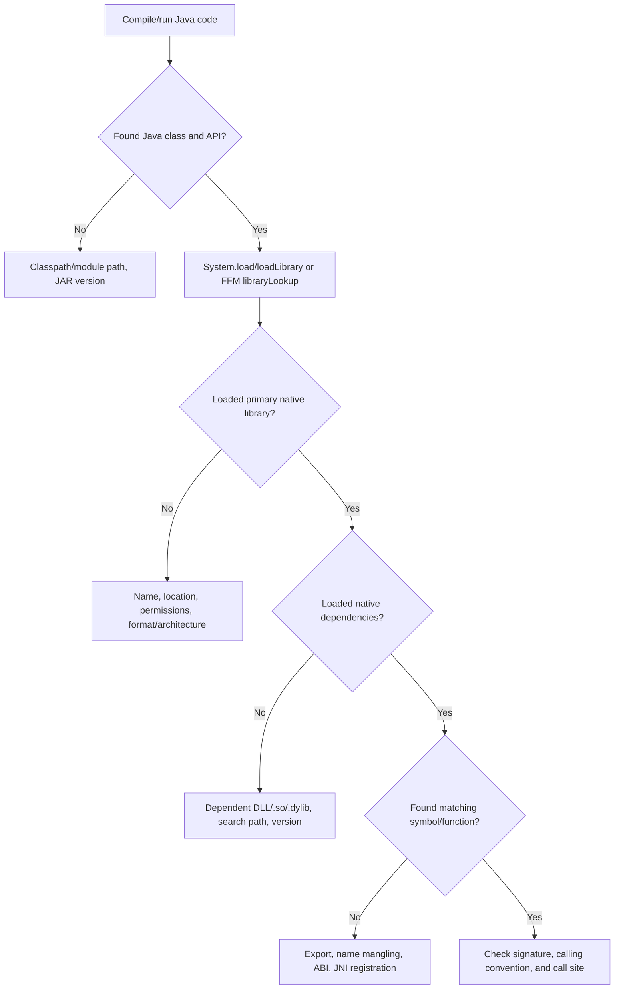

# Classifying Missing Library, Missing Dependency, and Missing Symbol Errors When Java Calls Native Code

## 1. Objectives and the Right Mental Model

In Java native interoperability (JNI, JNA, or the Foreign Function & Memory API), a “not found” error message can appear at **several different layers**. Even though the exception is `UnsatisfiedLinkError`, the root cause may be a missing primary library file, a missing library that it depends on, an architecture mismatch, or a missing native function being called. You must identify the **failing layer** before changing paths.

After this lesson, you will be able to:
- Distinguish errors when locating **Java classes/JARs** from errors when locating **native libraries** (`.so`, `.dylib`, `.dll`).
- Distinguish failing to find the **primary library**, failing to load **transitive dependencies**, and failing to resolve a **symbol/function**.
- Choose the right diagnostic commands on Linux, macOS, and Windows; recognize architecture, ABI, and version errors.
- Diagnose JNI using `javac -h` and exported symbols; understand the differences when using the FFM API.

**Scope:** “library” here primarily refers to a native library loaded or called by Java. Java dependencies are also mentioned to avoid confusing symptoms, but the focus is on the Java ↔ machine code boundary.

## 2. The Loading and Linking Chain: Which Link Failed?



Different layers use different lookup mechanisms:

| Layer | What is being looked up | Related mechanisms/paths |
| --- | --- | --- |
| Java compile/runtime | `.class`, `.jar`, module, Java method | `-classpath`/`-cp`, `--module-path`, dependency graph |
| JVM locating the primary native library with `loadLibrary` | E.g. `libcodec.so`, `libcodec.dylib`, `codec.dll` | Logical name in `System.loadLibrary("codec")`; JVM mechanism and `java.library.path` |
| OS dynamic loader | Dependent libraries (`DT_NEEDED`, load commands, DLL imports) | Linux: `RPATH/RUNPATH`, `LD_LIBRARY_PATH`, cache/default dirs; macOS: install name/`@rpath`; Windows: DLL search order |
| Dynamic linker / JNI / FFM | Exported function or variable | Symbol table, exact name, JNI naming/`RegisterNatives`, ABI, library version |

**Key takeaway:** finding the file `libcodec.so` **does not prove** that every library it needs exists, and successfully loading the `.so` file **does not prove** that the `decode` function was exported with the name/signature expected by the caller.

## 3. Symptom Identification Table

The error messages below are **typical examples** and depend on the JDK and operating system; do not treat them as fixed strings across every machine.

| Symptom / phase where it occurs | Preliminary classification | First things to verify |
| --- | --- | --- |
| `javac: cannot find symbol`, `package ... does not exist` | **Java compilation error** | Imports, class name, JARs, API version, `-cp`/module path |
| `ClassNotFoundException`, `NoClassDefFoundError` | **Failed to load Java class**; `NoClassDefFoundError` in particular is sometimes a consequence of an earlier class initialization failure | Initial stack trace, classpath/module path, `Caused by` |
| `java.lang.NoSuchMethodError` / `NoSuchFieldError` | **Binary incompatibility of Java API** | Compile-time vs. runtime JAR version, duplicate dependencies |
| `UnsatisfiedLinkError: no codec in java.library.path` | **Failed to locate primary native library** | Logical name, actual filename, path the JVM is using |
| `UnsatisfiedLinkError: Can't load library: /.../libcodec.so` | **Failed to load the explicitly specified native file** | File, permissions, format, architecture, dependencies; inspect OS error details |
| `libhelper.so: cannot open shared object file: No such file or directory` while loading `libcodec.so` | **Missing transitive native dependency** | `readelf -d`, `ldd` on a trusted file, dependency search paths |
| Windows: `The specified module could not be found` even though `codec.dll` exists | **Possibly a missing dependent DLL** (or wrong primary DLL found) | `dumpbin /DEPENDENTS`, DLL search order, architecture |
| Linux: `undefined symbol: helper_init`; macOS: `Symbol not found: ...`; Windows: `The specified procedure could not be found` | **Failed to resolve native symbol** | Actual loaded library version, export table, C/C++ name, ABI version |
| `UnsatisfiedLinkError: 'int ...NativeMath.add(int, int)'` when calling a `native` method | **JNI method not bound to a matching implementation** | `javac -h`, exported `Java_...` or `RegisterNatives` registration |
| `ld: undefined reference to ...` when running `gcc`/`g++` | **Error during C/C++ linking** before running Java | `-l` flags, link order, library providing the symbol, mangling |
| `wrong ELF class`, `bad CPU type`, Win32/bitness errors, `GLIBCXX_... not found` | **Native runtime architecture/ABI/version mismatch** | x86-64/arm64, 32/64-bit, libc/libstdc++, and toolchain |

**Do not infer from the exception name alone.** `UnsatisfiedLinkError` can occur both at `System.loadLibrary` and when calling a `native` method. The stack trace location determines the investigation branch.

## 4. Three Native Error Categories That Must Be Kept Distinct

### 4.1. Primary Library Not Found

For example, Java calls:

```java
System.loadLibrary("codec");
```

The JVM takes the **logical name** `codec`, not the string `libcodec.so` or a path. The filename is mapped according to the platform; typically `libcodec.so` (Linux), `libcodec.dylib` (macOS), `codec.dll` (Windows). You can inspect the mapping with `System.mapLibraryName("codec")`.

Signs: messages like `no codec in java.library.path`, or the requested library itself is absent from the locations the JVM searches. Check:
1. The file actually exists inside the container/machine **running the Java process**, with the exact name and case.
2. `java.library.path` of **that process** contains the required directory; if set via `-Djava.library.path=...`, place it before the class/JAR name when launching the JVM.
3. If you know the absolute path, `System.load("/absolute/path/libcodec.so")` helps test finding the **primary file**; this does not automatically resolve dependent libraries.
4. A file inside a JAR does not automatically become a library that the OS loader can open from the filesystem. Some frameworks extract libraries to actual files; inspect their extraction location, permissions, and cleanup mechanism.

Do not confuse `java.library.path` with `CLASSPATH`. Calling `System.setProperty("java.library.path", "...")` after the JVM has started is **not** a reliable way to change the library search path across JVM versions/implementations.

### 4.2. Primary Library Present, but Missing Its Dependencies

Suppose `libcodec.so` depends on `libhelper.so.2`:

```text
Java -> System.loadLibrary("codec")
     -> finds libcodec.so
     -> OS loader reads DT_NEEDED: libhelper.so.2
     -> cannot find libhelper.so.2
     -> fails to load libcodec.so
```

**Correct diagnosis:** inspect `NEEDED`/imports of `libcodec`, the location of `libhelper`, and the library lookup rules **of the OS loader**. On Linux, you may need to adjust `RUNPATH` (`$ORIGIN` is used for paths relative to the library), configure the linker cache, or adjust the process environment. On Windows, dependent DLLs are resolved according to the DLL search order; even if the primary DLL is loaded by absolute path, dependent DLLs still need to be found properly.

A common point of confusion: `codec.dll` is in the right directory and `java.library.path` is also right, yet it still reports “module not found”. You must check **which DLLs `codec.dll` imports**, not just whether `codec.dll` exists.

### 4.3. Library Loaded, but Missing Symbol

A **symbol** is the name the linker/loader uses to locate a native function or variable. Errors can come from:
- The function was not built or not exported (`hidden` visibility, object file omitted from the library).
- Wrong name due to C++ name mangling, missing `extern "C"`, casing, or version suffix.
- An older version of the library was loaded instead of the expected version; the symbol only exists in the newer version.
- A JNI method has a mismatched name/signature, or `RegisterNatives` has not registered it.
- FFM `SymbolLookup.find("name")` looks up the wrong name or uses the wrong lookup scope.

**Distinguish the timing:** an `undefined reference` error from the linker when building C/C++ code is different from an `undefined symbol` at runtime. The native loader may report a missing symbol immediately upon loading or later when resolving/calling, depending on the platform and linking mode.

You must inspect the **exported symbols of the exact binary file being loaded**, not just grep the C/C++ source code.

## 5. Evidence-Based Diagnostic Workflow

### Step 1 — Pin Down the Timing, Root Message, and Environment

Save the **very first failure** (full stack trace, `Caused by`, complete native loader lines), the Java launch command, JDK/JRE, machine/container architecture, and how the library is packaged. Determine whether the error occurs:
- when `javac` compiles;
- when the JVM loads a Java class;
- at `System.load`/`System.loadLibrary` or `SymbolLookup.libraryLookup`;
- when calling a `native` method or looking up a symbol;
- during C/C++ linking.

A root error during class initialization can cause subsequent attempts to show only `NoClassDefFoundError: Could not initialize class ...`. Therefore, the log from the initial initialization is more valuable than retry logs.

Check the Java environment:

```bash
java -version
javac -version
java -XshowSettings:properties -version
```

From the properties output, find `java.home`, `os.name`, `os.arch`, `java.library.path`. Run the commands in the **exact runtime** used to reproduce the issue (terminal, IDE, Docker image, container pod, service), because `JAVA_HOME`, `PATH`, and the filesystem of these environments can differ.

### Step 2 — Branch: Java or Native

If you get `cannot find symbol` right at `javac`, fix imports/APIs/compile classpath. If you get `NoClassDefFoundError`/`ClassNotFoundException`, check the runtime classpath and nested cause in the stack trace. If you get `NoSuchMethodError`, check for version conflicts between JARs. **Do not use `ldd` or modify `java.library.path` yet** for these pure Java errors.

If the error starts at `System.load*`/native lookup, continue.

### Step 3 — Check the Primary Library

- Record the name called in code (`"codec"` or an absolute path), the expected filename, and the actual file.
- Check the path, read/open permissions, format, and architecture. With `System.loadLibrary`, prefer configuring it properly at startup; if using `System.load`, an absolute path is required.
- If the primary library cannot be found: fix packaging/deployment or the JVM search path, then retry in a **new** process.

### Step 4 — Check All Native Dependencies

On Linux, read `NEEDED`, `RPATH`/`RUNPATH`; on macOS, inspect dylib install names and `@rpath`; on Windows, list DLL imports. Find missing dependencies, required versions, and the locations the OS loader actually searches. Do not manually create a symlink from an incompatible library version just to make “not found” go away.

### Step 5 — Check Symbols, JNI, and ABI

- Compare the **exact name** of the symbol requested by the caller against the export table.
- JNI: compare the `native` declaration with the header generated by `javac -h`, the `Java_<class>_<method>` name, `JNIEnv*`, `jobject`/`jclass`, and primitive type parameters; if using `RegisterNatives`, check the registered mapping.
- C++: check `extern "C"`, visibility, mangling, build flags, and exports.
- FFM: verify that lookup receives the right library, whether `find` returns an address, and that `FunctionDescriptor`/ABI matches before making a downcall.
- Also verify both architecture (32/64-bit, x86-64/aarch64) and native runtime/toolchain version.

### Step 6 — Verify the Fix

Start **a clean process** with the right binary and environment. Verify that the primary library loads successfully, dependencies are found, the symbol exists, and a small call produces the right result. Record the binary build, checksum/version, command line, and environment to avoid “works on my machine” while failing in production.

## 6. Inspection Commands by Operating System

### Linux (ELF, `.so`)

Assuming you have a valid `libcodec.so` built from a trusted source:

```bash
file libcodec.so
readelf -h libcodec.so
readelf -d libcodec.so
readelf -Ws libcodec.so
nm -D --defined-only libcodec.so
ldd libcodec.so
```

How to read the output:
- `file`/`readelf -h`: view ELF format, 32/64-bit, machine/architecture.
- `readelf -d`: view `NEEDED`, `RPATH`, `RUNPATH` entries.
- `readelf -Ws` and `nm -D --defined-only`: inspect symbols visible to the dynamic linker; compare exact names.
- `ldd`: shows where dependent libraries resolve to and which ones are `not found`. **Only use `ldd` on trusted binaries**; to inspect metadata of untrusted binaries, prefer `readelf`.

To observe the lookup path when reproducing on Linux:

```bash
LD_DEBUG=libs java -Djava.library.path=/opt/app/native -cp app.jar com.example.Main
```

`LD_DEBUG=libs` is a dynamic linker mechanism on Linux systems using glibc; it does not apply identically across all libcs/OSes. The output is verbose, so filter by the library name you are looking for. `LD_LIBRARY_PATH` also belongs to the native loader layer (with security constraints and differences across environments); `RPATH`/`RUNPATH` have their own precedence rules, so do not assume every process searches in a single fixed list.

### macOS (Mach-O, `.dylib`)

```bash
file libcodec.dylib
otool -L libcodec.dylib
otool -l libcodec.dylib
nm -gU libcodec.dylib
```

`otool -L` lists dependent dylibs and install names. Check `LC_RPATH` in `otool -l` if `@rpath/...` is present; `@loader_path` and `@executable_path` are also important path-resolution components. `nm -gU` helps inspect globally defined symbols; C symbols on Mach-O may be represented with a leading `_`. Do not assume `DYLD_LIBRARY_PATH` will always take effect: macOS has restrictions regarding protected processes.

### Windows (PE, `.dll`)

In a **Developer Command Prompt** with MSVC tools:

```bat
dumpbin /HEADERS codec.dll
dumpbin /DEPENDENTS codec.dll
dumpbin /EXPORTS codec.dll
where java
where codec.dll
```

`/HEADERS` shows machine/format; `/DEPENDENTS` inspects imported DLLs; `/EXPORTS` inspects public function names. `where codec.dll` only reflects some search paths through the shell environment and **is not a full simulation of the Windows DLL loader**. Check `PATH`, the application directory, DLL directories configured for the process, and the architecture of both the JVM and the DLL. You can use an appropriate PE dependency analysis tool for deep dependency issues.

> Do not run inspection commands for a binary belonging to another OS on the current machine and conclude “missing library”. You must use tools matching the format and the deployment environment.

## 7. Java 17+: Probe Program for Loading the Primary Library

Create **`NativeLibraryProbe.java`**:

```java
public final class NativeLibraryProbe {
    public static void main(String[] args) {
        String name = args.length > 0 ? args[0] : "codec";

        System.out.println("java.version=" + System.getProperty("java.version"));
        System.out.println("os.name=" + System.getProperty("os.name"));
        System.out.println("os.arch=" + System.getProperty("os.arch"));
        System.out.println("java.library.path=" + System.getProperty("java.library.path"));
        System.out.println("mapped.name=" + System.mapLibraryName(name));

        try {
            System.loadLibrary(name);
            System.out.println("loadLibrary=OK");
        } catch (UnsatisfiedLinkError error) {
            System.err.println("loadLibrary=FAILED");
            error.printStackTrace(System.err);
        }
    }
}
```

Compile/run:

```bash
javac NativeLibraryProbe.java
java -Djava.library.path=/opt/app/native NativeLibraryProbe codec
```

The program prints the environment the JVM actually uses, the mapped filename, and the load result. If the `codec` library is compatible and loads successfully, the last line on stdout is `loadLibrary=OK`; otherwise, stderr contains the original stack trace. Do not hardcode the entire output because filenames, paths, and causes depend on the OS. This program **only tests loading** and does not call any specific symbol; therefore `loadLibrary=OK` does not rule out errors when calling a `native` method.

You can try `System.load("/absolute/path/to/libcodec.so")` in a separate small program to test the primary library by absolute path; do not blindly change production logic if the library's dependencies have not been handled.

## 8. Runnable JNI Example on Linux: Identifying Symbol Errors

The following example uses **JDK 17+**, GCC, and a minimal JNI library to clearly show the symbol name Java expects.

Create **`NativeMath.java`**:

```java
public final class NativeMath {
    static {
        System.loadLibrary("native_math");
    }

    private static native int add(int a, int b);

    public static void main(String[] args) {
        System.out.println(add(2, 3));
    }
}
```

Generate the header using the JDK (avoid guessing JNI function names manually):

```bash
javac -h . NativeMath.java
```

The JDK generates **`NativeMath.h`**, which declares the function `Java_NativeMath_add`. Create **`native_math.c`**:

```c
#include "NativeMath.h"

JNIEXPORT jint JNICALL Java_NativeMath_add(
        JNIEnv *env, jclass clazz, jint a, jint b) {
    (void)env;
    (void)clazz;
    return a + b;
}
```

Compile the shared library and run, with `JAVA_HOME` pointing to the JDK directory:

```bash
gcc -fPIC -shared \
  -I"$JAVA_HOME/include" -I"$JAVA_HOME/include/linux" \
  -o libnative_math.so native_math.c
nm -D --defined-only libnative_math.so
java -Djava.library.path=. NativeMath
```

**Stdout of `java` when all steps succeed:**

```text
5
```

Here there are three easily distinguishable states:
1. **Deleting/misplacing** `libnative_math.so`: the JVM cannot find the primary library; the error occurs at the `System.loadLibrary` initializer.
2. **Library is present, but calling a native method without an implementation**: e.g., exporting the wrong name for `Java_NativeMath_add`; the library may load successfully, but `add(2, 3)` throws `UnsatisfiedLinkError`.
3. **The library is linked against another `.so` that is missing at runtime**: the error comes from the OS loader when loading dependencies, even though `libnative_math.so` is present.

In this JNI example, `add` is `static`, so the second argument in C is `jclass`; for an **instance** native method, it is `jobject`. JNI allows registering functions via `RegisterNatives`, so in the case of dynamic registration, the `Java_...` name does not necessarily appear in the export table. When calling C++ native code, you must check `extern "C"` linkage/name mangling and export visibility. A symbol with the right name but wrong actual signature/ABI can still cause a crash or data corruption, not just `UnsatisfiedLinkError`.

## 9. FFM API (JDK 22+): Symbol Lookup Errors Differ from Library Load Errors

The FFM API standardized in JDK 22 provides `SymbolLookup.libraryLookup(Path, Arena)` to load/query a library and `find("symbol")` to look up a function's address. If the library cannot be opened, `libraryLookup` may throw `IllegalArgumentException`; if it opens successfully but the function name is not found, `find` returns `Optional.empty()`.

Program **`FfmSymbolProbe.java`** (JDK 22+):

```java
import java.lang.foreign.Arena;
import java.lang.foreign.SymbolLookup;
import java.nio.file.Path;

public final class FfmSymbolProbe {
    public static void main(String[] args) {
        if (args.length != 2) {
            System.err.println("Usage: FfmSymbolProbe <library-path> <symbol>");
            return;
        }

        try (Arena arena = Arena.ofConfined()) {
            SymbolLookup lookup = SymbolLookup.libraryLookup(
                    Path.of(args[0]).toAbsolutePath(), arena);
            boolean found = lookup.find(args[1]).isPresent();
            System.out.println(found ? "FOUND" : "MISSING");
        }
    }
}
```

```bash
javac FfmSymbolProbe.java
java --enable-native-access=ALL-UNNAMED FfmSymbolProbe /abs/path/libcodec.so codec_init
```

Here stdout is `FOUND` when the symbol exists or `MISSING` when it does not; load failures or invalid libraries may throw an exception instead of printing those two values. The `--enable-native-access=ALL-UNNAMED` flag is an example for a program on the classpath using restricted native access in JDK 22; when running under a named module, permission must be granted to the corresponding module. An `IllegalCallerException` due to native access permissions is completely different from “symbol does not exist”. After finding the symbol, making a downcall via `Linker` also requires the **right native calling convention, `FunctionDescriptor`, layout, and lifetime**; merely finding the symbol does not prove the call is safe.

JDK 17 does not have the **standard** `java.lang.foreign` API like JDK 22; do not use this FFM snippet to draw conclusions about a JDK 17 runtime. With JNA, you must also check JNA's own library and symbol lookup mechanism, as well as the `jna` JAR included at runtime.

## 10. Typical Cases and Root-Cause Fixes

### Case A — `no codec in java.library.path`

**Observation:** there is no corresponding native file in the directories the JVM uses, while the Java JAR still loads. **Conclusion:** primary library directly missing. **Fix:** ship the right binary for the OS/CPU, name it according to the platform, and configure the load path at JVM startup; do not edit `-cp` instead of the native path.

### Case B — `libhelper.so.2: cannot open shared object file`

**Observation:** `libcodec.so` exists, `readelf -d` lists `NEEDED` as `libhelper.so.2`, and `ldd` on the trusted binary shows `libhelper.so.2 => not found`. **Conclusion:** missing native dependency. **Fix:** package a compatible `libhelper` and configure the OS loader path/`RUNPATH` properly; check `libhelper`'s dependencies as well.

### Case C — JNI Method Fails to Bind

**Observation:** `loadLibrary` succeeded, but calling `NativeMath.add` throws `UnsatisfiedLinkError`; `javac -h` generates `Java_NativeMath_add`, whereas the binary does not export that symbol and has no matching `RegisterNatives`. **Conclusion:** missing valid JNI implementation. **Fix:** build/link the object file containing the function, export it with the standard JNI name and signature; rebuild against the current header.

### Case D — Symbol Exists in Source but `undefined symbol` Error Occurs

**Observation:** the source has `helper_init`, but the loaded binary does not export it or a different version is being loaded. **Conclusion:** mismatch between source and artifact/ABI. **Fix:** check the actual binary path, export visibility, build flags, and version pinning; in C++, check mangling. Do not patch by arbitrarily renaming symbols.

### Case E — Mismatched Architecture/ABI

**Observation:** 64-bit x86-64 JVM, but the `.so`/`.dll` file is 32-bit or arm64; or `GLIBC_...`/`GLIBCXX_... not found` error. **Conclusion:** incompatible binary/runtime. **Fix:** distribute an artifact for the right OS/CPU and toolchain/runtime, or rebuild for the appropriate target system. Changing `java.library.path` does not turn a wrong-architecture binary into a valid one.

### Case F — `NoSuchMethodError` After Changing Maven/Gradle Dependencies

**Observation:** the stack trace indicates a Java method is missing from the loaded class; no `System.load*` operation failed. **Conclusion:** Java binary dependency version conflict. **Fix:** compare the compile/runtime dependency trees and eliminate duplicate/conflicting versions. Do not modify JNI exports or the OS loader path.

## 11. Common Investigation Pitfalls

- **Only checking `ls libcodec.so` / `dir codec.dll`:** does not check dependencies or symbols. Both the native dependency graph and the export table are needed.
- **Blaming `java.library.path` for every `UnsatisfiedLinkError`:** this exception also indicates a missing JNI implementation, format error, version mismatch, or missing dependency.
- **Assuming `-Djava.library.path` fixes all dependent DLLs/SOs:** the OS loader's search path is a different layer; you must rely on `NEEDED`/imports and OS-specific rules.
- **Using `System.loadLibrary("libcodec.so")`:** pass the logical name `codec` to that API. If you have an actual absolute path, use `System.load(...)`.
- **Changing the property after the JVM has started:** may not change the native search path that was already initialized; configure it before startup and rerun.
- **Reading only the last error:** after a class initialization failure, retries may only show `NoClassDefFoundError`, hiding the root cause.
- **Comparing function names by eye alone:** JNI has mangling rules for class names, methods, and overloads; generate the header with `javac -h` or check dynamic registration.
- **Seeing an export and assuming compatibility:** you must also check calling convention, C/C++ ABI, architecture, types/layouts, and library version.
- **Running `ldd` on untrusted files:** prefer static metadata tools like `readelf` when the binary source is unverified.
- **Ignoring classloaders:** the same JNI native library can be rejected if it was already loaded by another classloader (a message like “already loaded in another classloader”). This is an ownership/lifecycle conflict, not a missing file.

## 12. Conclusion Checklist and Incident Report Template

Only finalize the root cause when you can answer:
1. **Which layer failed?** Java compile/class loading, primary library loading, native dependency loading, symbol resolution, or JNI/FFM invocation?
2. **What is the actual name/path?** Logical name, file, full path, binary version/hash, and OS/CPU target.
3. **What is the concrete evidence?** Root error line + `NEEDED`/exports/lookup result, not just guessing from the exception.
4. **What is the fix?** Path configuration, dependency packaging, symbol rebuild/export, or ABI/version alignment?
5. **Was it cleanly reproduced?** Started a fresh JVM in the deployment environment, loaded the library, and called a minimal function successfully.

Example of a good incident description:

```text
Phase: OS loader loading dependencies of libcodec.so
Root error: libhelper.so.2: cannot open shared object file
Evidence: readelf -d lists NEEDED=libhelper.so.2;
          ldd (trusted binary) reports libhelper.so.2 => not found
Cause: runtime image is missing libhelper.so.2 with the right ABI
Fix: package a compatible libhelper.so.2 and adjust RUNPATH
Verification: fresh Java process loads codec and calls the test API successfully
```

This template makes clear *which library is missing at which layer*, avoiding vague reports like “Java can't find the library”.

## References

- Java 17 `Runtime.load` / `loadLibrary`: https://docs.oracle.com/en/java/javase/17/docs/api/java.base/java/lang/Runtime.html
- Java 17 `UnsatisfiedLinkError`: https://docs.oracle.com/en/java/javase/17/docs/api/java.base/java/lang/UnsatisfiedLinkError.html
- JNI Specification — Resolving Native Method Names: https://docs.oracle.com/en/java/javase/17/docs/specs/jni/design.html
- JDK `javac -h` (native headers): https://docs.oracle.com/en/java/javase/25/docs/specs/man/javac.html
- JDK 22 `SymbolLookup`: https://docs.oracle.com/en/java/javase/22/docs/api/java.base/java/lang/foreign/SymbolLookup.html
- Linux `dlopen(3)`: https://man7.org/linux/man-pages/man3/dlopen.3.html
- Windows DLL search order: https://learn.microsoft.com/en-us/windows/win32/dlls/dynamic-link-library-search-order