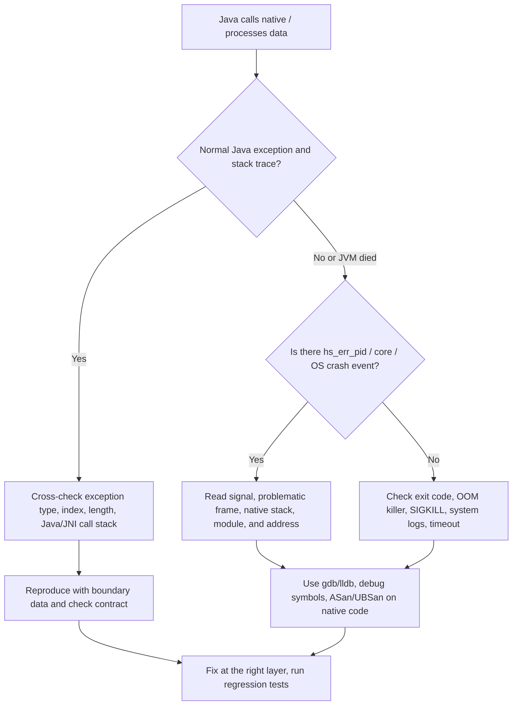

# Investigating Java Bounds Errors vs. Invalid C Pointer Access

## 1. Correctly Identifying the Two Incident Types

In a Java application communicating with C/C++ via JNI (Java Native Interface), JNA, or the Foreign Function & Memory API (FFM), an out-of-bounds index access can manifest in two very different ways:

- **Java performs bounds checking and throws an exception:** for example, `array[3]` on a Java array of length 3. The JVM guarantees that array accesses adhere to bounds-checking rules; the instruction does not access an element outside the array and normally throws `ArrayIndexOutOfBoundsException`. The program can catch the exception and continue as designed.
- **C uses an invalid pointer:** for example, `p[3]` when `p` only points to a 3-byte region, a pointer that has already been `free`d, is uninitialized, points to the wrong region, or is misaligned due to an ABI error. That access has **undefined behavior** according to C: it may result in `SIGSEGV`, `SIGBUS`, `EXCEPTION_ACCESS_VIOLATION`, reading/writing the wrong data, or only failing at a later step. A Java `try/catch` does not create a safety boundary around this pointer access.

This topic belongs to the **native interoperability troubleshooting** group: the goal is to determine whether the error occurs in a checked Java access, in JNI code validating data, or in unsafe C memory access; from there, choose the right evidence and investigation tools.

### Quick Comparison Table

| Perspective | Java Bounds Error | Invalid C Pointer Access |
|---|---|---|
| Example | `a[a.length]`, `list.get(-1)`, `buffer.get(badIndex)` | `p[index]` beyond allocated region; `NULL` dereference; use-after-free |
| Mechanism | Runtime/library checks the condition and throws an exception | C has no automatic memory region size checking on dereference |
| Common symptoms | `ArrayIndexOutOfBoundsException`, `IndexOutOfBoundsException`, Java stack trace | OS signal/error, JVM fatal error log, core/minidump, or silent data corruption |
| Is the JVM still alive? | Usually can continue if the exception is handled properly; may still cause the request to fail | If a fatal native crash occurs in the same process, the JVM usually terminates; with memory corruption, it may keep running in an untrusted state |
| Analysis | Index, length, Java stack trace, data flow | C stack, pointer/lifetime, ABI, symbol/debug info, sanitizer, `hs_err_pid`, and core dump |
| Fix | Validate index, align limits, fix loop/API call logic | Fix memory ownership, buffer length, lifetime, pointers, JNI contract, and boundary |

**Key takeaway:** `ArrayIndexOutOfBoundsException` is a Java exception that can be handled; a `SIGSEGV` from native code does not automatically turn into a Java exception. An invalid pointer is also **not guaranteed** to cause `SIGSEGV` immediately at the erroneous operation: C behavior is already undefined, so you must not rely on the program "not having crashed yet" to prove the code is correct.

## 2. Why One Bad Index Leads to Two Different Outcomes

### 2.1. Java Arrays and Bounds-Checked APIs

Suppose:

```java
byte[] bytes = {10, 20, 30};
int value = bytes[3]; // Length = 3; valid indices: 0, 1, 2.
```

When executing a Java array access, the JVM must preserve the semantics of the language. With an index less than 0 or greater than/equal to `bytes.length`, Java throws `ArrayIndexOutOfBoundsException`. The exception contains Java execution information (class, method, line number if debug info is present). It is **not synonymous** with native memory corruption.

APIs also have their own checks: `List.get(index)` and `ByteBuffer.get(index)` typically throw `IndexOutOfBoundsException` when the index is invalid; a relative read operation on `ByteBuffer` lacking bytes can throw `BufferUnderflowException`. You should not identify the root cause by the exception name alone; check the actual API, the buffer's `limit`/`position`, and the Java stack trace.

A normal Java exception can cause a request to fail without generating a JVM crash log. If the exception is uncaught in a thread, that thread may terminate; if it escapes `main`, the Java program may simply terminate according to its lifecycle. That is still the Java exception mechanism, distinct from a JVM crash caused by a native pointer.

### 2.2. C Pointers and Undefined Behavior

In C, the expression `p[index]` is equivalent to `*(p + index)`. The compiler **does not carry over** the constraint `index < length` just because a function has a `length` parameter. The following example is used to **illustrate the bug; do not test it inside a JVM serving users**:

```c
#include <stddef.h>

unsigned char unsafe_read(const unsigned char *p,
                          size_t length,
                          size_t index) {
    (void)length;           // Does not check length.
    return p[index];        // UB if p is invalid or index is outside the valid region.
}
```

An address that is still mapped by the operating system may allow invalid reads/writes without reporting an error yet; therefore, a crash may appear far away from the out-of-bounds write site. When accessing an unpermitted page, the OS usually reports an access violation, and the JVM runtime may generate a fatal error log if the incident occurs inside the Java process.

Types of native errors to distinguish:

- **Out-of-bounds read/write:** index is outside the C object/allocated region; even if the address happens to still be readable, the operation is still invalid.
- **Null/dangling pointer:** `NULL`, pointer after `free()`, pointer pointing to an exited stack frame, or an `munmap()`ed region.
- **Incorrect ownership and lifetime:** retaining a pointer after `ReleaseByteArrayElements`, `ReleasePrimitiveArrayCritical`, `free()`, closing a mapping, or closing the arena/segment owning the memory region.
- **Incorrect size and arithmetic:** confusing element count with byte count; addition/multiplication overflow; casting a negative `jint` to `size_t`, turning it into a very large unsigned number.
- **ABI/signature mismatch:** JNI declaration, parameter types, data width, alignment, or calling convention differing between Java and C; can lead to an invalid address.
- **Native data race:** multiple threads reading/writing a memory region without synchronization, corrupting a pointer or its contents; the error may not reproduce consistently.

It is **impossible** to use `try/catch (Exception e)` to catch a segmentation fault in C. Arbitrarily installing a signal handler to "ignore" `SIGSEGV` also does not make a corrupted memory state safe.

### 2.3. JNI Is a Function Call Boundary, Not a Process Boundary

When Java calls a `native` method, the CPU can transition into C/C++ code **within the same address space as the JVM**. `JNIEnv*` provides an API to interact with the JVM, but does not turn every C dereference into a safe Java access.

Some JNI APIs such as `GetByteArrayRegion` perform bounds checking and can produce a Java exception. Conversely, if C obtains the data address and accesses `pointer[index]` itself, the JVM does not guarantee bounds checking on behalf of the C code. Similarly, `ByteBuffer.get(index)` on the Java side is checked; a pointer obtained from `GetDirectBufferAddress` must have its length and lifetime managed separately by native code.

The FFM API in newer JDKs helps check the bounds/lifetime of a `MemorySegment` when accessed through the appropriate Java API; it does not make externally called C code memory-safe. The examples in this article use JNI so they can run on Java 17+.

## 3. Java 17+ and JNI Example: Java Error, Bounds Error Intercepted in C

This example demonstrates three things: an invalid index access in Java throws an exception; JNI code that **proactively** checks bounds can return an appropriate Java exception; and the JVM stays alive after both handled errors. The example **does not intentionally cause a native crash**, because a crash can stop the JVM and does not provide deterministic output.

Create two files in the same directory, keeping the class name in the default package so that the JNI symbol matches.

**`BoundsLab.java`**

```java
public final class BoundsLab {
    static {
        System.loadLibrary("boundslab");
    }

    private static native int nativeRead(byte[] data, int index);

    public static void main(String[] args) {
        byte[] data = {10, 20, 30};

        try {
            int value = data[3];
            System.out.println(value);
        } catch (ArrayIndexOutOfBoundsException ex) {
            System.out.println("JAVA=" + ex.getClass().getSimpleName());
        }

        System.out.println("JNI_OK=" + nativeRead(data, 1));

        try {
            nativeRead(data, 3);
        } catch (ArrayIndexOutOfBoundsException ex) {
            System.out.println("JNI=" + ex.getClass().getSimpleName());
        }

        System.out.println("JVM_ALIVE");
    }
}
```

**`boundslab.c`** (using the JNI header generated by `javac -h`):

```c
#include <jni.h>
#include "BoundsLab.h"

JNIEXPORT jint JNICALL Java_BoundsLab_nativeRead(
        JNIEnv *env, jclass cls, jbyteArray data, jint index) {
    (void)cls;

    if (data == NULL) {
        jclass exception = (*env)->FindClass(
                env, "java/lang/NullPointerException");
        if (exception != NULL) {
            (*env)->ThrowNew(env, exception, "data must not be null");
        }
        return 0;
    }

    jsize length = (*env)->GetArrayLength(env, data);
    if (index < 0 || index >= length) {
        jclass exception = (*env)->FindClass(
                env, "java/lang/ArrayIndexOutOfBoundsException");
        if (exception != NULL) {
            (*env)->ThrowNew(env, exception, "invalid nativeRead index");
        }
        return 0;
    }

    jbyte value = 0;
    (*env)->GetByteArrayRegion(env, data, index, 1, &value);
    if ((*env)->ExceptionCheck(env)) {
        return 0;
    }

    return (jint)(unsigned char)value;
}
```

Assuming Linux x86_64, JDK 17+, and a C compiler are installed; `JAVA_HOME` must point to the running JDK. In the directory containing the two files:

```bash
javac -h . BoundsLab.java
cc -std=c11 -O0 -g -Wall -Wextra -fPIC -shared \
  -I"$JAVA_HOME/include" -I"$JAVA_HOME/include/linux" \
  boundslab.c -o libboundslab.so
java -Xcheck:jni -Djava.library.path=. BoundsLab
```

Expected stdout (with the library compiled/loaded successfully):

```text
JAVA=ArrayIndexOutOfBoundsException
JNI_OK=20
JNI=ArrayIndexOutOfBoundsException
JVM_ALIVE
```

Step-by-step explanation:

1. `data[3]` causes Java to throw an exception before fetching the non-existent element; the `catch` branch prints `JAVA=...`.
2. `nativeRead(data, 1)` enters JNI; C gets `length=3`, verifies `1` is valid, and uses `GetByteArrayRegion` to copy one byte. The value is `20`.
3. `nativeRead(data, 3)` is blocked by the `index >= length` condition **before C accesses the memory region**. `ThrowNew` sets a pending Java exception; after the native method returns, Java catches `ArrayIndexOutOfBoundsException`. The `return 0` value in the error-throwing branch is not a business result: when JNI returns, the exception is pending.
4. `JVM_ALIVE` appears because the errors went through valid exception-handling paths; **there is no invalid C dereference** in the example.

The command `javac -h .` generates `BoundsLab.h`; the C function name `Java_BoundsLab_nativeRead` and signature `(JNIEnv *, jclass, jbyteArray, jint)` must match the header. If the Java class is in a package, the symbol/header will change according to JNI rules. On macOS, change the OS include to `include/darwin` and build a `.dylib` library; on Windows, include `include/win32` and create a DLL with an appropriate compiler. Do not assume the Linux command runs as-is on other OSes.

`-Xcheck:jni` helps detect certain incorrect JNI usages (such as an unhandled exception state or invalid reference). It is **not** a detector for every out-of-bounds C pointer access. For a program without JNI issues, enabling this option does not change the nature of the two results above.

### Why Shouldn't You Arbitrarily Change Safe Code to `pointer[index]`?

A JNI implementation might call `GetByteArrayElements`, obtain `jbyte*`, and then use `ptr[index]`. If `index` is invalid or the pointer is used after `ReleaseByteArrayElements`, this is a C bug. The result can be a crash or corruption, not necessarily throwing `ArrayIndexOutOfBoundsException`. **Intentionally** reproducing a crash should be done in a separate test process, with sanitizers, debug symbols, and resource limits; do not run tests on a production JVM.

In the safe example, `GetByteArrayRegion` avoids the requirement of managing the lifetime of a pointer pointing to a Java array. When a pointer to a Java array is truly needed, you must properly pair `GetByteArrayElements`/`ReleaseByteArrayElements` or the corresponding API, and not keep the pointer after release; note that JNI may pin **or** create a copy, so do not assume the address remains stable forever.

## 4. Evidence-Based Investigation Process

The investigation needs to answer three questions in order: **Is the JVM still alive? Where was the error thrown? What evidence points to the specific memory region and native operation?**



### Step 1: Record Symptoms Before Fixing

Collect the JDK/JVM version, OS/CPU architecture, path and version of `.so/.dll/.dylib`, compiler flags, timestamp, request ID (without copying secrets), minimized reproduction input, concurrent load info, and process termination type. Distinguish:

- **Java stack trace with `ArrayIndexOutOfBoundsException` / `IndexOutOfBoundsException`:** read the class/method and index, length/limit. Check whether the exception comes from `data[index]`, a Java collection/buffer, or was created by JNI `ThrowNew`.
- **JVM terminates abruptly with a fatal error report:** read `hs_err_pid*.log`, `Problematic frame`, signal, PC, dynamic library, and native stack. Do not blame C solely because `SIGSEGV` appears: it could involve the JVM, another library, the JIT, or earlier memory corruption.
- **No fatal log:** check the OS, container OOM kill, `SIGKILL`, process supervisor, log write permissions, full disk, or watchdog. `SIGKILL` gives the JVM no chance to create `hs_err_pid`.
- **No crash, but corrupted data:** suspect a stale pointer, buffer overwrite, C data race, or serialization bug; memory sanitizers/canaries and testing under load are needed.

Save the full exception/stack trace when possible. If a Java `ArrayIndexOutOfBoundsException` occurs concurrently with another native crash, do not assume the two incidents share the same root cause just because they appeared close in time.

### Step 2: Controlled Reproduction

Construct minimal input and determine the actual buffer sizes in both Java and C. Test indices `-1`, `0`, `length-1`, `length`, and large numbers; specifically for null, empty buffers, and concurrent calls, verify the contract. Repeat on the same JDK/native binary when necessary; compare with a build that has debug symbols.

Use a **test process** or separate native worker to isolate crash-inducing tests. Invalid pointer operations can corrupt the entire JVM, so avoid using an environment containing live requests or important data. A result of "it didn't crash this time" does not prove the bug is fixed: undefined behavior depends on memory layout, compiler optimizations, timing, and load.

### Step 3: Analyze the Java Exception

Illustrative Java stack trace example:

```text
java.lang.ArrayIndexOutOfBoundsException: Index 3 out of bounds for length 3
    at BoundsExample.read(BoundsExample.java:12)
    at BoundsExample.main(BoundsExample.java:5)
```

This is an **illustrative example**, not the output of `BoundsLab` above. Check the index, length, offset calculation, loop condition, and data length after decoding. A common off-by-one is `i <= array.length` instead of `i < array.length`.

If the exception originates from a `native` method via `ThrowNew` or a checked JNI API, the Java stack trace may contain `Native Method`, but that is still **different** from an invalid C dereference killing the process. Use logging/tracing at the JNI boundary to know whether the Java exception was proactively raised or came from a JNI API.

Do not "fix" the bug by catching `IndexOutOfBoundsException` and ignoring it everywhere. You need to fix how the index is computed and define the valid `index` contract; only catch the exception to report a meaningful error or perform genuine business recovery.

### Step 4: Analyze the JVM Native Crash

HotSpot usually attempts to generate `hs_err_pid<PID>.log` upon encountering a fatal error; the default location depends on the working directory and writability, and can be configured:

```bash
java -XX:ErrorFile=/tmp/hs_err_pid%p.log -Djava.library.path=. BoundsLab
```

The command above only configures the output location **if a fatal JVM error occurs**; the safe JNI example does not create a file. In a case where the program actually crashes, an illustrative log might contain:

```text
# A fatal error has been detected by the Java Runtime Environment:
#  SIGSEGV (...)
# Problematic frame:
# C  [libdecoder.so+0x1234]  decode+0x34
```

The addresses/symbols above are **hypothetical**. When reading a real log:

1. Identify the error type (`SIGSEGV`, `SIGBUS`, access violation...), PC, and `Problematic frame`. A `C` frame is usually native code, `V` is VM code, `J` is compiled Java code, `j` is interpreted Java; they are indicators of the crash location, not a substitute for root-cause analysis.
2. Read the `Current thread`, `Native frames`, and `Java frames` sections to see the call path from Java to JNI, and whether the thread was in native code.
3. Record the library version, load address, and offset. Symbolize using the exact binary/debug info matching the **build ID**; an offset number is insufficient if you use a binary different from production.
4. Read the environment info, memory/threads, and preceding error reports; an earlier invalid access may cause a crash later in `malloc`, `free`, GC, or another library.
5. Check the core/minidump if the OS was configured to allow generating one. Core dumps may contain sensitive data; store and share them under controlled access.

`-XX:ErrorFile` does not guarantee the file is always present: `SIGKILL`, kernel OOM, lack of write permissions, or severe corruption can prevent writing the report. On Linux, the system may use `systemd-coredump` instead of saving a `core` file directly in the working directory.

### Step 5: Use Debuggers/Sanitizers at the Right Layer

When the Java stack trace points directly to a Java array index, start with the Java debugger, selective logging, and unit tests. When a native crash or corruption is unclear, supplement with:

- **gdb/lldb:** run the test JVM with the native library containing symbols; `bt`/`thread apply all bt` to inspect the C stack, `index` variable, length, and pointer at the time of the fault. On Linux you can use `gdb --args java -Djava.library.path=. BoundsLab`, then `run` and `bt` when a signal occurs. With the safe code in the example, there will **be no** signal to investigate.
- **AddressSanitizer (ASan):** detects many heap/stack out-of-bounds, use-after-free, and double-free errors in instrumented C/C++; for example, compile test native source with `-g -O1 -fsanitize=address -fno-omit-frame-pointer`. If loading an ASan-instrumented shared library into the JVM, appropriate compiler/runtime configuration is needed, sometimes preloading the sanitizer runtime; a more controllable approach is reproducing the same logic in a standalone native test executable.
- **UndefinedBehaviorSanitizer (UBSan):** helps identify certain operations/UB; `-fsanitize=undefined` can be used with native builds; does not guarantee catching every pointer error.
- **Valgrind Memcheck (where supported):** detects many invalid reads/writes/leaks, at the cost of slower execution, and may require configuring suppressions for the JVM runtime. Use on a simple native repro when possible.
- **`-Xcheck:jni`:** detects certain JNI rule violations; does not replace ASan or a C debugger and does not verify every pointer lifetime.
- **`jcmd <pid> Thread.print` / Java debugger:** useful while the JVM is still alive, especially for deadlocks/native frames; you cannot ask an already-dead JVM to provide a new thread dump.

For native code in large libraries, rebuild with debug symbols (`-g`, avoid stripping in builds meant for symbolization) and reproduce with the same commit, compiler options, and ABI. If you only have an address, use a symbolizer/`addr2line` **with the exact module and corresponding offset**; do not treat an absolute PC value as an always-valid offset when ASLR is enabled.

## 5. Checking the Data Contract at the Java ↔ C Boundary

When you see a crash near a buffer access line, trace **one length value and one index all the way through the path**.

### From Java to JNI

- A Java `byte[]` knows its `length`; the C side must call `GetArrayLength` or receive a trusted size, not infer the size from the pointer returned by JNI.
- `jint index` is a signed integer; `size_t` is an unsigned type. Check `index < 0` **before** converting to `size_t`. A negative number cast to unsigned can become a very large value.
- If passing a subrange `start`/`count`, avoid checking `start + count <= capacity` when the addition might overflow. After ensuring `start <= capacity`, use `count <= capacity - start` with the right types and units.
- Clarify whether `capacity` is measured in **bytes** or **elements**, `ByteBuffer.capacity()` or `limit()`, and whether there is an offset. Confusing `sizeof(T)` is a common source of bugs.
- Determine ownership: Java array, native malloc, direct buffer, mapped memory; which side allocates and which side is allowed to free? Does any thread keep the pointer after release/close?
- Do not store `JNIEnv*` for use on another thread. Native threads with their own lifecycle must attach/detach with the JVM according to the rules; JNI local references should not be stored for use beyond their valid lifetime.
- Do not assume a C string is `'\0'`-terminated when receiving a Java byte array or UTF buffer with a separate length; calling `strlen()` on data without a terminator can read out of bounds.

### Bounds-Checking Example in C

Once you own a valid C buffer `data` with capacity `capacity` bytes, the basic check is:

```c
#include <stddef.h>
#include <stdbool.h>

bool read_byte(const unsigned char *data,
               size_t capacity,
               size_t index,
               unsigned char *out) {
    if (out == NULL || data == NULL || index >= capacity) {
        return false;
    }
    *out = data[index];
    return true;
}
```

This is an **illustrative C function**, not a standalone program with `main`. The check only proves that index is in `[0, capacity)` **if** the caller has ensured `data` points to a live object with at least `capacity` bytes and `out` is a valid pointer. C cannot self-verify lifetime/capacity from the pointer value alone. With concurrency, the caller must ensure the memory region is not freed or invalidly modified while reading.

If the JNI library turns a bounds error into a Java exception, it should call `ThrowNew` for the appropriate exception type, return properly, and not continue executing arbitrary JNI APIs while a pending exception exists. Do not use OS signals to simulate a Java exception that could already be detected by input validation.

## 6. Three Typical Investigation Scenarios

### Scenario A — `ArrayIndexOutOfBoundsException` Immediately When Building Payload

The Java application passes array contents to a native codec:

```java
byte[] packet = new byte[4];
for (int i = 0; i <= packet.length; i++) {
    packet[i] = (byte) i;
}
```

The fifth iteration of the loop (`i == 4`) violates the bounds; the error is thrown in Java **before** the native codec receives any data. Fix the condition to `i < packet.length`, test empty/1-element/max-length cases, and review length requirements. Do not investigate `SIGSEGV` in C when the evidence only has an exception from this Java line.

### Scenario B — Java Passes Bad Index, JNI Uses Pointer Directly

Java passes `index=length` to JNI. C calls `GetByteArrayElements` and then reads `pointer[index]` without checking. At this point, Java array bounds rules **no longer automatically protect** that C access. The code may read the wrong data, crash, or cause memory corruption. You need to fix the bounds in native code, determine the exact pointer acquire/release mechanism, and test with sanitizers. If using `GetByteArrayRegion` with valid index/count, JNI performs a checked API access; do not treat every JNI API as an unsafe dereference.

### Scenario C — Delayed Crash in `malloc`/`free` or GC

`hs_err_pid` points to the libc allocator or JVM code, while the data actually went wrong in a native decoder several seconds earlier. An out-of-bounds C write can corrupt heap metadata and only crash when the allocator touches it. Analyzing the last frame is very useful but **not sufficient** to identify the function that caused the original error. Enable sanitizers on the native path, narrow down the input, use a debug heap/canary, or reproduce in a separate worker; compare optimized builds and debug builds.

## 7. Fix Plan and Regression Testing

| Case | Fix at the Right Layer | Regression Evidence |
|---|---|---|
| Java out-of-bounds index access | Fix range/loop, validate length/index, do not suppress exceptions arbitrarily | Unit tests for indices `-1`, `0`, `length-1`, `length`; correct exception and stack |
| JNI receives `null`/invalid index | Validate input and throw appropriate Java exception before native pointer access | JNI test returns deterministic error; JVM stays alive |
| C reads/writes outside allocation | Use capacity in the right units, check overflow and lifetime, define ownership | Native unit/fuzz tests with ASan/UBSan, no invalid read/write |
| Use-after-free/double-free | Memory ownership model, release exactly once, eliminate pointers persisting after free | Sanitizers, stress tests with create/release cycles |
| ABI/JNI signature mismatch | Generate header with `javac -h`, check types and library architecture | Build/test on supported OSes and architectures |
| Native crash or hang hard to eliminate | Isolate native worker into a separate process, deadlines, and OS quotas | Fault-injection in worker; JVM supervisor survives worker crash |

A practical testing workflow includes: saving the failing input testcase; pinning the JDK/library/flags versions; running small tests, sanitizers, and stress/fuzz tests as needed; verifying there are no more crashes/corruption and no erroneous exceptions; and monitoring real logs after release. For crashes capable of corrupting the process, a **separate subprocess** limits the blast radius but does not fix the C bug itself or provide absolute OS protection.

Do not only check "no more `SIGSEGV`". You need to verify the output results, memory integrity, and correctness of ownership/lifetime. That a Java exception continues to appear after adding JNI checks may be the **desired behavior** to represent invalid input according to the contract.

## 8. Common Misconceptions

1. **"Java has bounds checking, so C is protected when receiving a `byte[]`."** False: native pointer dereferencing does not inherently have Java's checks.
2. **"If C accesses out of bounds, it will always immediately get `SIGSEGV`."** False: C undefined behavior can silently corrupt data or only crash later.
3. **"Catching `ArrayIndexOutOfBoundsException` handles a native crash."** False: a native fatal error usually terminates the entire process hosting the JVM.
4. **"Having `Native Method` in the Java stack trace means a segmentation fault occurred."** False: JNI can proactively create a Java exception or use checked JNI APIs.
5. **"`-Xcheck:jni` catches every invalid pointer."** False: use sanitizers/C debuggers for memory corruption, while `-Xcheck:jni` checks a specific set of JNI errors.
6. **"The `Problematic frame` is the exact line that caused the root bug."** Not necessarily: the stack at crash time may only reflect where the consequence of an earlier invalid write became visible.
7. **"You can keep a `GetByteArrayElements` pointer after `ReleaseByteArrayElements`."** False: using a pointer beyond the lifetime permitted by the API is invalid.
8. **"Seeing a Java exception means there is no memory corruption."** Insufficient conclusion: both bugs can coexist; inspect event history, other native errors, and sanitizer evidence.
9. **"Not seeing `hs_err_pid` means there is no native error."** False: OS kill, lack of permissions, process crash bypassing the fatal handler, or resource exhaustion can fail to create the file.
10. **"Fix it by retrying infinitely."** False: the same bad input and the same pointer bug can cause the worker to crash repeatedly; fix the root cause and limit retries.

## 9. Field Investigation Checklist

- **Faulty layer:** Java expression/checked API, JNI exception path, or C pointer dereference?
- **Symptom:** Java exception stack trace, JVM fatal log/core, OS kill, deadlock, or silent corruption?
- **Parameters:** index, length, capacity, offset, bytes/elements unit, signed/unsigned, overflow?
- **Memory:** where was the region allocated, who owns it, is it still alive, is another thread freeing or writing to it?
- **JNI contract:** correct header, valid references, proper thread/exception state, matching get/release pairs?
- **Evidence:** native build ID, `Problematic frame`, C stack, sanitizer report, minimal input?
- **Remediation:** validate at the Java layer and JNI boundary, manage C lifetime, convert invalid inputs into Java exceptions before dangerous accesses?
- **Regression:** boundary index tests, empty/null payloads, fuzz/stress, sanitizers, and isolated native crash handling if needed?

When investigated at the right layer, an `ArrayIndexOutOfBoundsException` is a useful sign of **active bounds checking**. Conversely, an invalid C pointer requires examining **addresses, lifetimes, sizes, and native evidence**, even when the JVM has not crashed yet. The goal is to restore the data contract and memory safety at the Java–C boundary, not merely to make an error line disappear from the logs.
