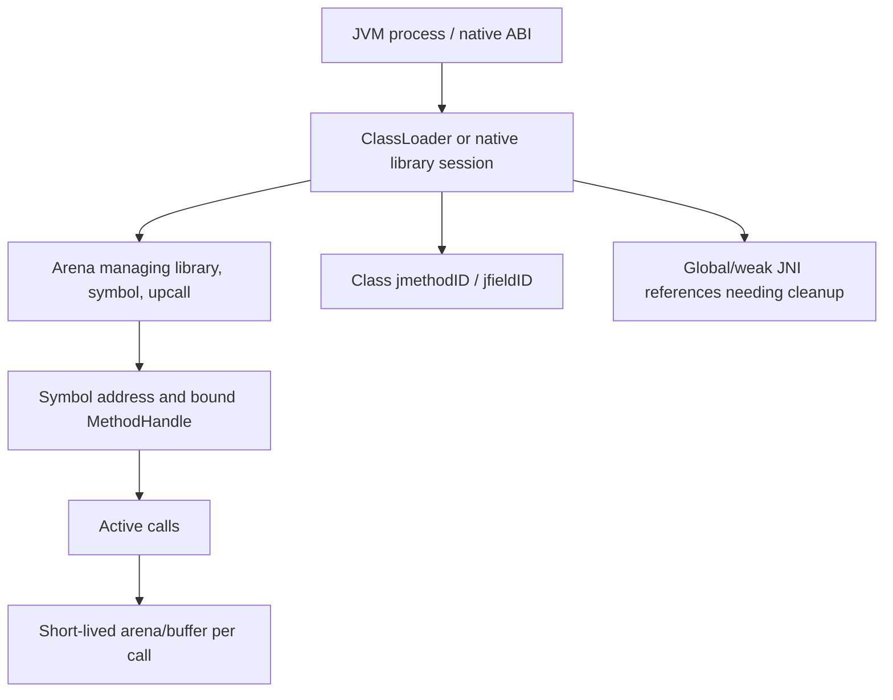

# Caching lookup, layout, MethodHandle, or JNI identifiers with the right lifecycle

## 1. Why cache in Java native interoperability?

When Java calls C/C++ via the Foreign Function & Memory (FFM) API or Java Native Interface (JNI), the program typically goes through **two phases with different costs and lifecycles**:

1. **Link setup:** loading the library, looking up the function/symbol name, describing native data types, creating a `MethodHandle`, or obtaining a `jmethodID`/`jfieldID`.
2. **Execution:** passing arguments, converting data, invoking the native function, retrieving the result, and releasing temporary resources.

If a function is called thousands of times, repeating the setup phase on every call can increase overhead. We usually want to **look up once, call many times**. However, caching with the wrong lifecycle causes bugs that are harder to detect than not caching at all: use-after-close, calling into an unloaded library, classloader leaks, using `JNIEnv*` from another thread, or using a `jmethodID` of an unloaded class.

The goal of this lesson is to know **which objects to cache, who owns them, how long they remain valid, and when they must be cleaned up/reinitialized**. This is an optimization measured by benchmarks, not a reason to keep all native resources alive until the JVM exits.

**Versions in the examples:** FFM is official in `java.lang.foreign` starting from **JDK 22**; JNI continues to be supported from earlier JDKs and the JNI example uses **JDK 17+**. The FFM APIs in JDK 19–21 are preview/incubator with their own requirements and differences; do not apply JDK 22 code verbatim to JDK 17.

## 2. Classification: what is metadata, and what carries a resource lifecycle?

| Value to cache | Can it be reused? | Lifecycle / important conditions |
| --- | --- | --- |
| FFM `MemoryLayout`, `ValueLayout`, `FunctionDescriptor` | **Yes**, usually `static final` or per ABI | Immutable descriptors; must match platform, ABI, alignment, calling convention, and C signature |
| `Linker.nativeLinker()` | **Yes**, usually reused across the runtime | Tied to the current platform's ABI; do not swap ABI descriptors across OS/CPU |
| `SymbolLookup.libraryLookup(path, arena)` | **Yes**, within a resource session | The native library and symbols obtained from the lookup depend on the provided **arena**; closing the arena invalidates the corresponding scope |
| `SymbolLookup.loaderLookup()` | **Yes**, per calling classloader | Lookup relates to libraries tied to the caller's classloader; the lookup/segment itself keeps the loader reachable while alive |
| `MemorySegment` pointing to a **function address** (`lookup.find`) | **Yes**, while the library and scope remain valid | Do not keep the address to call after the owner resource is closed/unloaded |
| Downcall `MethodHandle` **bound** to a symbol | **Yes**, across many calls to the same function | Signature must be exact; the native target and any resources tied to the symbol must remain alive |
| **Unbound** downcall `MethodHandle` (`downcallHandle(descriptor)`) | **Yes**, can be used for multiple addresses with the same ABI | Each invocation must supply a valid symbol address; the lifetime of each address is still checked |
| `MemorySegment` holding a data buffer, C string, or native pointer | **Only within the appropriate scope** | A buffer belongs to whichever arena allocated it; never use the pointer after free/close |
| Upcall stub (`Linker.upcallStub`) | **Yes**, while the callback registration remains valid | The stub is tied to an arena; the native side must not keep the callback pointer after the arena closes |
| JNI `jmethodID`, `jfieldID` | **Yes**, per identity of the **actual class** | Valid until that class is unloaded; the ID does not by itself prevent class unloading |
| JNI `jclass`, `jobject` as a **local reference** | **No**, not across native calls/threads | Valid only within the local-reference frame; to store long-term, use `NewGlobalRef` or a weak ref strategy |
| JNI **global reference** (`jclass`, `jobject`) | **Yes**, until `DeleteGlobalRef` | Keeps the object/class alive, risking keeping the classloader or large objects alive |
| JNI `JNIEnv*` | **No**, do not use across threads | Tied to a thread; a native thread must attach properly and obtain its own `JNIEnv*` |
| JNI `JavaVM*` | Can be kept across the JVM runtime | Used to `GetEnv`/attach threads; unlike `JNIEnv*`, it does not imply ownership of a Java object |

**Mandatory distinction:** `jmethodID`/`jfieldID` are JVM metadata linkage IDs, **not `jobject` references**. Do not call `NewGlobalRef`/`DeleteGlobalRef` on them. Conversely, `jclass` **is** a reference to a `Class` object and therefore follows JNI local/global rules.

## 3. Tie the cache to an owner instead of just the function name

Think about lifetime hierarchically:



The diagram represents **ownership relationships**, not that every API creates a physical child resource. A practical rule:

> A cache may live as long as the **owner capable of guaranteeing the object remains valid**, and must not outlive the resources it depends on.

For example: `FunctionDescriptor` can exist for the entire process; a `MethodHandle` bound to `libmath_v1.so` should only exist during the v1 library session. If hot-reloading v2, you must create a new symbol/handle cache and only close the v1 owner after all calls using v1 have finished.

### 3.1. Cache keys must contain enough context

Caching solely by the string `"add"` is too weak if the application has multiple plugins. The same symbol name can exist in two different libraries. You need to consider:
- The library path/identifier and the actual native version.
- The symbol name, `FunctionDescriptor`, ABI/architecture, and linker options.
- The classloader/module or plugin session that created the lookup.
- The handle kind: bound directly to an address or a generic handle taking the address at call time.

With JNI, a class name such as `com.example.Widget` **is not enough**: two classloaders can load two class definitions with the same name but different identities. Only use an ID with the class/loader that produced that ID.

### 3.2. Separate global metadata from session-scoped resource caches

A sensible design:

```text
Immutable metadata (layouts, descriptors) ─── long-lived, shareable
Session(owner: arena + library) ────────────── open / in use / closed
  ├─ SymbolLookup
  ├─ symbol segments
  └─ bound MethodHandles
Call(temporary arena) ──────────────────────── create / use / close
  └─ native buffers, strings, return storage
```

Do not keep per-request temporary arenas in a long-lived cache; nor should you recreate a library lookup/MethodHandle for every element in a loop if the library and signature are the same.

## 4. FFM: caching layouts and descriptors properly

`MemoryLayout` describes the size, alignment, padding, and structure of native memory. `FunctionDescriptor` describes the parameter/return types of a native function. These are immutable metadata, suitable for `static final` **when the ABI is fixed**.

```java
import java.lang.foreign.FunctionDescriptor;
import java.lang.foreign.ValueLayout;

public final class NativeSignatures {
    private NativeSignatures() {}

    // C: int add_ints(int a, int b)
    public static final FunctionDescriptor ADD_INTS =
            FunctionDescriptor.of(
                    ValueLayout.JAVA_INT,
                    ValueLayout.JAVA_INT,
                    ValueLayout.JAVA_INT
            );
}
```

`ValueLayout.JAVA_INT` describes a 32-bit integer, matching `int` on common target platforms. Do not arbitrarily assume that every `long` in C corresponds to `JAVA_LONG`: on 64-bit Windows, C `long` is typically 32-bit, whereas on many 64-bit Unix systems it is 64-bit. For `size_t`, pointers, `struct`, union, packed layouts, bit-fields, or variadic functions, verify the actual ABI (headers, toolchain, `jextract`/canonical layouts where appropriate).

Example of a `struct` with padding per the C ABI:

```c
struct Packet {
    char tag;
    int size;
};
```

This struct typically has padding between `tag` and `size`. Measure the actual size, offset, and alignment; `MemoryLayout.structLayout(...)` **does not automatically infer all C compiler padding**. Do not cache an incorrect layout and reuse it across both Windows and Linux. If the native definition changes, update the descriptor/layout and rebuild together.

`FunctionDescriptor` **contains no machine code** and does not keep a library open; caching it is safer than caching native pointers. However, a wrong descriptor can cause `Linker.downcallHandle` to generate a call with the wrong ABI, causing data corruption or a JVM crash. Caching only speeds things up; it does not make a wrong signature right.

## 5. FFM: looking up symbols and creating MethodHandles once

Setup flow with JDK 22+:

```text
Path to library
      |
      v
Arena.ofShared / ofConfined
      |
      v
SymbolLookup.libraryLookup(path, arena)
      |
      v
lookup.find("add_ints") -> function address MemorySegment
      |
      v
Linker.nativeLinker().downcallHandle(address, descriptor)
      |
      v
Cache MethodHandle per open session
      |
      v
invokeExact(...) multiple times
```

**Why cache the `MethodHandle` too?** `lookup.find` avoids repeated symbol address lookups; `downcallHandle` also needs to build an adapter for the calling convention/signature. Placing both on the setup path keeps the hot path short and easy to optimize. However, actual effectiveness depends on the JVM, JIT, call path, and data copying cost; you must measure to conclude.

### 5.1. Complete example on Linux: caching one handle for three calls

The example uses C/GCC, a Linux shared library, and **JDK 22+**.

File **`fast_add.c`**:

```c
int add_ints(int a, int b) {
    return a + b;
}
```

Build the library:

```bash
cc -O2 -fPIC -shared -o libfastadd.so fast_add.c
```

File **`ForeignCacheDemo.java`**:

```java
import java.lang.foreign.Arena;
import java.lang.foreign.FunctionDescriptor;
import java.lang.foreign.Linker;
import java.lang.foreign.MemorySegment;
import java.lang.foreign.SymbolLookup;
import java.lang.foreign.ValueLayout;
import java.lang.invoke.MethodHandle;
import java.nio.file.Path;

public final class ForeignCacheDemo {
    private static final FunctionDescriptor ADD_SIGNATURE =
            FunctionDescriptor.of(
                    ValueLayout.JAVA_INT,
                    ValueLayout.JAVA_INT,
                    ValueLayout.JAVA_INT
            );

    public static void main(String[] args) throws Throwable {
        if (args.length != 1) {
            throw new IllegalArgumentException("Supply a shared-library path");
        }

        // Arena owns the library session; do not close while calls are still active.
        try (Arena libraryArena = Arena.ofShared()) {
            SymbolLookup lookup = SymbolLookup.libraryLookup(
                    Path.of(args[0]).toAbsolutePath(),
                    libraryArena
            );
            MemorySegment function = lookup.find("add_ints").orElseThrow();

            // Created once; the handle is bound to this session's function address.
            MethodHandle add = Linker.nativeLinker()
                    .downcallHandle(function, ADD_SIGNATURE);

            for (int i = 0; i < 3; i++) {
                int result = (int) add.invokeExact(i, 10);
                System.out.println(result);
            }
        }
    }
}
```

Run commands:

```bash
javac ForeignCacheDemo.java
java --enable-native-access=ALL-UNNAMED \
     ForeignCacheDemo ./libfastadd.so
```

**Exact stdout** with the compiled sample library:

```text
10
11
12
```

This example demonstrates four principles:
1. `ADD_SIGNATURE` is immutable metadata and can outlive the library.
2. `lookup`, `function`, and `add` are created **once** for three calls.
3. `libraryArena` remains open throughout the calls and is closed after the loop.
4. The call uses `(int) add.invokeExact(i, 10)` so the call site has the exact signature `(int, int) -> int`.

With JDK 22, `libraryLookup` and `downcallHandle` belong to APIs that require native access, so the classpath example uses the `--enable-native-access=ALL-UNNAMED` flag. With named modules, grant permission to the appropriate module. If the library or symbol does not exist, the program throws an exception during **setup**, rather than creating a dummy handle and continuing.

**Important:** do not store `add` in an infinitely lived static map and then close `libraryArena`. Even though the Java reference to the `MethodHandle` still exists, the native function address inside it is no longer guaranteed to be valid after the owner is closed/unloaded. Treat that handle as part of the library session.

### 5.2. How to structure a service: open, use, close

For a library used by multiple requests, use a session-managing object:

```text
ForeignService.open(path):
    create libraryArena (usually shared if called from multiple threads)
    create libraryLookup and cache the required symbols/MethodHandles
ForeignService.add(a, b):
    ensure the service is OPEN and the owner is still alive
    invoke the cached handle
ForeignService.close():
    reject new calls
    wait for all in-flight calls to complete
    close the arena and discard the session-scoped cache
```

This is **design pseudocode**, not standalone Java code. In Java, the lifecycle can be represented with `AutoCloseable` + `try-with-resources`. Explicit synchronization is required if `close()` can run concurrently with a downcall; checking a `closed` flag alone does not eliminate the race of closing the arena mid-call.

`Arena.ofConfined()` is suitable for resources used only on **a single thread**. If you cache a handle or symbol tied to a confined arena and pass it to another worker thread, you may encounter `WrongThreadException`/wrong ownership. `Arena.ofShared()` supports access from multiple threads, but closing must be properly timed. `Arena.global()` has JVM lifetime and cannot be closed; use it only for resources intentionally kept for the entire process, not as a default escape hatch from cleanup requirements.

`Arena.ofAuto()` relies on GC for deallocation, which is unsuitable when timely library closing is required during hot reload/shutdown.

### 5.3. Bound and unbound MethodHandles

FFM has two common downcall styles:

```java
// Address bound: the handle's Java type is (int, int)int.
MethodHandle bound = linker.downcallHandle(symbol, descriptor);

// Address unbound: the Java type is (MemorySegment, int, int)int.
MethodHandle generic = linker.downcallHandle(descriptor);
```

This is **illustrative code assuming** `linker`, `symbol`, and `descriptor` are already declared; it is not a standalone file. A **bound** handle is suitable when the same symbol is called repeatedly. An **unbound** handle is shared across multiple symbols with the same descriptor, but **each call must still pass a currently valid address**. Do not use an address from an old plugin version with a handle from a new version.

`invokeExact` requires the argument and return types at the Java call site to match the exact `MethodType`; a call with mismatched types can throw `WrongMethodTypeException`. Use `handle.type()` when debugging. `invoke` can insert valid Java type conversions, but it cannot fix a wrong native ABI descriptor. Avoid `invokeWithArguments`/boxing in a hot loop if you are optimizing overhead.

## 6. Caching data and upcalls: ownership matters more than speed

The following three objects **should not be cached globally by default**:

- **Buffer/C string:** a `MemorySegment` allocated by `arena.allocate(...)` lives only as long as the arena that created it. If C retains the pointer after Java closes the arena, that is a native use-after-free. You must know clearly whether the native code **copies the data** or **retains the pointer**.
- **Native object handle:** a pointer value to a C resource (`create_session`/`destroy_session`) often has its own lifecycle, which may be shorter than the library's. Keeping the library open does not revive an object after `destroy_session`.
- **Upcall stub/callback:** `Linker.upcallStub` produces a callback address tied to an arena. When a native library retains a callback pointer to invoke asynchronously, you must keep the stub and necessary callback targets alive until unregistered and ensure no callbacks are still running **before closing the arena**.

Distinguish between the **arena holding per-call temporary data** and the **arena owning the library and symbols**. You can cache handles using a long-lived `libraryArena`, while allocating per-request buffers inside `try (Arena requestArena = Arena.ofConfined())`. When `requestArena` closes, only the request's buffers are freed; the library owner is not closed.

If a native function takes a pointer and retains it for asynchronous use, you must not pass a buffer from a `requestArena` that will close immediately after the function returns. The native API must have a clear contract regarding ownership, release, and synchronization.

## 7. JNI: caching `jmethodID` and `jfieldID` per class

JNI provides these lookup calls:

```c
jmethodID mid = (*env)->GetMethodID(env, cls, "compute", "(I)I");
jmethodID smid = (*env)->GetStaticMethodID(env, cls, "compute", "(I)I");
jfieldID fid = (*env)->GetFieldID(env, cls, "size", "I");
```

The snippet above only illustrates **the API and JNI signatures**, assuming a valid `JNIEnv *env`, `jclass cls`, and corresponding method/field. After obtaining an ID, you can call `CallIntMethod`, `CallStaticIntMethod`, `GetIntField`, etc. repeatedly without looking up the name/signature again. `GetMethodID` differs from `GetStaticMethodID`, and `GetFieldID` differs from `GetStaticFieldID`: do not mix up static/instance caches.

Important rules:

1. **IDs remain valid until the defining class is unloaded.** Class unloading can happen when the classloader is no longer reachable (e.g., plugin/hot reload). An ID does not keep the class alive on its own.
2. **Class identity includes the classloader.** The same class name in a different classloader does not have the same usable ID.
3. **`jclass` from `FindClass`/`GetObjectClass` is typically a local reference.** Do not store a local `jclass` across native methods and reuse it.
4. **To keep a `jclass` long-term**, you must create a global reference via `NewGlobalRef` (or a weak global reference with promotion handling); global refs must be deleted with `DeleteGlobalRef`.
5. **A global `jclass` keeps the class/loader reachable**, so it can actively delay class unloading; in plugin systems it must be released at the right time.
6. **Do not confuse a JNI ID with a C function address**: `jmethodID` represents a Java method of a class; a symbol from `dlsym`/FFM is a native code address.
7. When a JNI lookup fails, check for a pending Java exception before continuing. `GetMethodID`/`GetFieldID` can also trigger initialization of an uninitialized class; an initializer failure is not simply a "null ID".

### 7.1. Local, global, and weak global references

| JNI reference | When to use | Management obligation |
| --- | --- | --- |
| Local `jobject`/`jclass` | Used within a single native call / local frame | Do not retain after the native call ends; delete local references inside loops if creating many |
| Strong global (`NewGlobalRef`) | Caching a Java class/object that must survive across multiple native calls | `DeleteGlobalRef` when the session ends; watch for memory/classloader leaks |
| Weak global (`NewWeakGlobalRef`) | Wanting a weak cache that allows GC | Before use, promote to a strong local/global via `NewLocalRef`/`NewGlobalRef`, check for `NULL`; release the weak ref |
| `jmethodID`/`jfieldID` | Caching method/field metadata | Do not call DeleteGlobalRef; stop using when the class unloads, create new IDs after reload |

Do not simply call `IsSameObject(weak, NULL)` and then use the weak reference in subsequent native operations: GC can reclaim the object between the two steps. You must **promote** the weak ref to a strong local ref before using it; this local ref guarantees the object stays alive during the operation, then delete it when appropriate.

## 8. Runnable JNI example on Linux: cache IDs, hold global class, clean up when done

The example is intentionally **single-threaded** to make the lifecycle clear. For multithreaded production code, see the synchronization rules in Section 9.

File **`JniIdCache.java`** (JDK 17+):

```java
public final class JniIdCache {
    static {
        System.loadLibrary("jniidcache");
    }

    private static int square(int value) {
        return value * value;
    }

    private static native void initIds();
    private static native int invokeSquare(int value);
    private static native void releaseIds();

    public static void main(String[] args) {
        initIds();
        try {
            System.out.println(invokeSquare(7));
            System.out.println(invokeSquare(8));
        } finally {
            releaseIds();
        }
    }
}
```

Generate the exact header:

```bash
javac -h . JniIdCache.java
```

Create **`jni_id_cache.c`** (matching the symbol names declared in `JniIdCache.h`):

```c
#include "JniIdCache.h"

// Single-thread demo: C statics belong to only one cache lifecycle.
static jclass g_class = NULL;
static jmethodID g_square = NULL;

JNIEXPORT void JNICALL Java_JniIdCache_initIds(
        JNIEnv *env, jclass owner) {
    if (g_class != NULL) {
        return;
    }

    // owner is a local reference during the initIds call.
    jclass global = (jclass)(*env)->NewGlobalRef(env, owner);
    if (global == NULL) {
        return; // Usually has a pending exception if failed due to OOM.
    }

    jmethodID id = (*env)->GetStaticMethodID(
            env, global, "square", "(I)I");

    if (id == NULL) {
        (*env)->DeleteGlobalRef(env, global);
        return; // Preserve the Java exception from GetStaticMethodID.
    }

    g_class = global;
    g_square = id;
}

JNIEXPORT jint JNICALL Java_JniIdCache_invokeSquare(
        JNIEnv *env, jclass owner, jint value) {
    (void)owner;

    if (g_class == NULL || g_square == NULL) {
        jclass ex = (*env)->FindClass(
                env, "java/lang/IllegalStateException");
        if (ex != NULL) {
            (*env)->ThrowNew(env, ex, "JNI cache not initialized");
        }
        return 0;
    }

    return (*env)->CallStaticIntMethod(
            env, g_class, g_square, value);
}

JNIEXPORT void JNICALL Java_JniIdCache_releaseIds(
        JNIEnv *env, jclass owner) {
    (void)owner;

    if (g_class != NULL) {
        (*env)->DeleteGlobalRef(env, g_class);
        g_class = NULL;
    }
    g_square = NULL;
}
```

With `JAVA_HOME` pointing to a JDK that includes JNI headers, build and run on Linux:

```bash
cc -fPIC -shared \
   -I"$JAVA_HOME/include" -I"$JAVA_HOME/include/linux" \
   -o libjniidcache.so jni_id_cache.c
java -Djava.library.path=. JniIdCache
```

**Exact stdout:**

```text
49
64
```

Why does this example handle the lifecycle properly?

- `initIds()` looks up the method once, and the two calls reuse the same `g_square`.
- `owner` is a local JNI reference; C creates a **global `jclass`** to use across subsequent native calls.
- C keeps `g_square` (an ID, not a Java reference) alongside the lifetime of the class kept alive by `g_class`.
- `releaseIds()` deletes the global ref and clears the ID. Afterwards, the old `g_square` is not reused; when starting a new lifecycle, `initIds()` must be called to look it up again.
- `NULL` checks are performed during lookup; JVM APIs are never called with an uninitialized ID.

**Intentional limitation of the demo:** the two C statics do not use a mutex and do not support calls concurrent with `releaseIds`. Do not copy this code verbatim into a multithreaded server, because deleting a global ref while another thread is executing `CallStaticIntMethod` is a serious bug. In a real service, synchronize state + block new calls + wait for in-flight calls to finish before cleanup; you can initialize during class initialization and maintain one owner per classloader.

**Design note:** holding `g_class` with a global reference can keep the classloader alive. If you want the classloader to be unloadable, you must delete the ref when stopping the plugin; relying solely on `JNI_OnUnload` to clean up a global `jclass` can create a dependency cycle that prevents unloading from ever happening. For native libraries that are unloaded/reloaded, the native cache linkage must follow the classloader/library instance lifecycle permitted by the JVM.

## 9. Multithreaded JNI and classloaders: two bugs that often happen silently

### 9.1. Do not cache `JNIEnv*` globally

`JNIEnv*` is valid only for **its corresponding thread**. Every JNI entrypoint receives the current thread's `JNIEnv *env`; use this parameter directly. Native threads created by C/C++ can use `JavaVM*` (properly saved, typically from `JNI_OnLoad`) to call `GetEnv` or `AttachCurrentThread`, and then `DetachCurrentThread` properly when finished. Do not take `JNIEnv*` from thread A and pass it to thread B, even if both threads access the same global `jclass`.

This rule is independent of whether `jmethodID` is shared: **the ID can be reused for the same living class**, whereas the `JNIEnv*` interface pointer must belong to the right thread.

### 9.2. Classloaders and hot reload

Suppose a plugin with loader L1 loads `com.example.PluginApi`, and the native cache holds `jmethodID` M1. After a reload, loader L2 loads a **different** `com.example.PluginApi`. Even if the name and parameter count match, M1 must not be arbitrarily used with L2's class. To be safe:

1. Each loader session creates **its own cache** for the classes it owns.
2. Initialize IDs when the class/session needs them; verify the exact native signatures.
3. When stopping the plugin, block new calls and wait for in-flight calls.
4. Delete global refs and resources of the old session.
5. Create new IDs for the new session; do not reuse a global map keyed solely by class name.

If Java manages metadata by `Class<?>`, you can consider `ClassValue` instead of a global `ConcurrentHashMap<String, ...>`; however, `ClassValue` does not replace the obligation to explicitly close/release **native resources**. Similarly, a Java cache holding `ClassLoader` as a strong key can prevent unloading; the cache structure itself needs a lifecycle policy.

### 9.3. Thread-safe initialization and resource cleanup

Java `static final` fields are initialized according to class initialization rules, suitable for **immutable metadata**. A lazy per-library cache can use locks/synchronization or `computeIfAbsent` properly, but `computeIfAbsent` **does not automatically handle** multiple open/close sessions, in-flight calls, or native cleanup racing with lookup.

The state model should be explicit:

```mermaid
stateDiagram-v2
    [*] --> NEW
    NEW --> OPEN: load + resolve + cache
    OPEN --> CLOSING: beginShutdown
    CLOSING --> CLOSED: activeCalls == 0; release owner
    CLOSED --> [*]
```



In `OPEN`, calls acquire permission to use a live session; when transitioning to `CLOSING`, reject new calls and let existing ones complete. Only then `close` the arena / `DeleteGlobalRef`. Implementations can use a read-write lock, reference counting, or another lifecycle mechanism with the same guarantees. For JNI C code, protect global state with appropriate native synchronization primitives or ensure serialized lifecycle management from Java.

## 10. When should you not cache?

**Do not cache merely because an object looks expensive to create.** Consider reusability, correctness, and workload characteristics:

- If native calls are rare or off the hot path, repeated lookups are sometimes simpler and the speed difference is negligible.
- If plugins are reloaded frequently, a global cache is harder to manage than a per-session cache.
- For native memory and callbacks, prioritize correct ownership over saving a few allocations.
- If the number of libraries/symbols grows per tenant/plugin, an unbounded cache can keep classloaders, libraries, and native memory alive forever.
- If the real bottleneck is copying/encoding between Java and C, caching a `MethodHandle` will not solve it; consider **batching** calls, reducing data conversions, reusing managed buffers, and designing APIs that cross the Java/native boundary less often.

Do not cache a raw native address without knowing which library the symbol belongs to. Do not cache objects referencing a closed request arena. Do not cache a JNI local reference as a static variable. Do not treat a `MethodHandle` as proof that the native function is still loaded.

## 11. Comparing before and after

The example below is **FFM pseudocode** to illustrate where costs lie, not a complete Java program.

**Unoptimized — setup inside the loop:**

```text
for each item:
    create arena
    libraryLookup(path, arena)
    find("process")
    build FunctionDescriptor
    linker.downcallHandle(symbol, descriptor)
    invoke
    close arena
```

**Separated setup and hot path:**

```text
descriptor = immutableSignature
owner = new NativeSession(path)
owner.open() // create arena, libraryLookup, find, downcallHandle once

for each item:
    requestArena = shortLivedArena()
    prepare inputs in requestArena
    owner.cachedHandle.invokeExact(...)
    requestArena.close()

owner.stopNewCalls()
owner.waitForActiveCalls()
owner.close()
```

The same applies to JNI: look up `GetMethodID`/`GetFieldID` at initialization of the **class identity** rather than repeating it on every call. However, if data comes from many different classes, the ID cache must be partitioned by the actual class.

**Definition of "successful optimization":** the same results/safety, less redundant setup, no leaked native resources, classloaders still unload as required, and improved performance metrics under a real workload.

## 12. Proper benchmarking: separating lookup, call, and data costs

To know whether caching helps, benchmark at least three parts:

| Item | What to measure? | Pitfalls to avoid |
| --- | --- | --- |
| Setup | `libraryLookup`, `find`, descriptor creation, `downcallHandle`, or `GetMethodID` | Mixing one-time OS load cost with repeated lookup cost |
| Steady-state | `invokeExact`/JNI call using an initialized cache | Missing JIT warmup; lacking measures to prevent dead-code elimination |
| End-to-end | Buffer encoding/copying, native compute, decoding, cleanup | Measuring only an add-two-numbers function and extrapolating to the whole system |

Use **JMH** for Java-side microbenchmarks, with proper warmup/measurement iterations and fork configuration. Report the environment (JDK, OS/CPU, compiler/JNI/FFM versions), operations/sec or ns/op, allocation/op, and error rate if any. Do not claim a fixed speedup ratio; effectiveness depends on the JDK version, call kind, concurrency, and data.

When comparing two designs, ensure both have **the same lifecycle semantics** and the same level of correctness. A benchmark that is "fast" because it skips the release step or uses a pointer after close is an invalid benchmark.

## 13. Troubleshooting lifecycle caching errors

| Symptom | Likely cause | How to check/fix |
| --- | --- | --- |
| FFM `IllegalStateException` after `arena.close()` | Segment/lookup is out of scope | Track the owner; only call while the arena is alive; create a new session |
| FFM `WrongThreadException` | A confined segment/arena is used from another thread | Use the same owner thread or design a shared arena properly |
| FFM `WrongMethodTypeException` | `invokeExact` call site has the wrong type | Print `handle.type()`, compare against the descriptor and cast/call site |
| JVM crash or garbage data during downcall | Wrong ABI/descriptor or invalid pointer | Verify C headers, ABI, library version, and memory lifetime |
| JNI crash when calling again after plugin reload | `jmethodID`/`jfieldID` from an unloaded class | Cache per loader/class, create new IDs in the new session |
| Native callback intermittently crashes after a request | Upcall stub/buffer closed while native code still holds the pointer | Keep the owner alive until unregistered + drain callbacks |
| Unable to unload classloader/native library | Java cache/global `jclass` still holds a strong ref | Analyze the reference graph; release global refs/caches per session |
| `JNIEnv*` fails when used on a background native thread | Using an interface pointer from another thread | `JavaVM->GetEnv`/attach the right thread and detach properly |
| Cache grows unboundedly | Cache keyed by symbol/tenant without eviction | Set a quota/lifecycle owner; clean up per plugin/session |

If an FFM downcall has already bound an address to a library, **do not try calling it after close to test**: an invalid native pointer can cause a crash. Check owner state using application lifecycle logic, not by intentionally calling a dead pointer.

## 14. Safe cache design checklist

Before shipping a cache to production, be able to answer:

1. **What is being cached?** Immutable metadata, symbol address, bound/unbound `MethodHandle`, JNI ID, or JNI object reference?
2. **Who owns it?** Process/ABI, classloader, native library session, `Arena`, native object, or thread?
3. **Is the key complete?** Library version, symbol, signature, class identity, ABI, and relevant options?
4. **Who closes it?** `Arena.close`, native `destroy`, callback unregister, `DeleteGlobalRef`, classloader shutdown?
5. **How are in-flight calls handled?** Is it guaranteed that no pointer or global reference is used during cleanup?
6. **Is threading valid?** Confined/shared arena, owner thread, `JNIEnv*` of the right thread?
7. **What happens after reload?** Is the old cache invalidated and are new handles/IDs created for the right library/class?
8. **Has it been measured?** Setup and steady-state separately, benchmarked in a realistic environment, without trading off correctness?

**Rule of thumb to remember:** cache `layout`/`descriptor` by **ABI**, cache `lookup`/`MethodHandle` by **native library session + arena**, cache JNI method/field IDs by **class identity/classloader**, hold JNI `jclass` with a **global reference when genuinely needed**, and never cache `JNIEnv*` across threads.

## 15. References

- FFM `SymbolLookup` (JDK 22), loader lookup, and arena lifetime: https://docs.oracle.com/en/java/javase/22/docs/api/java.base/java/lang/foreign/SymbolLookup.html
- FFM `Linker` and bound/unbound downcall handles (JDK 22): https://docs.oracle.com/en/java/javase/22/docs/api/java.base/java/lang/foreign/Linker.html
- FFM `FunctionDescriptor` (JDK 22): https://docs.oracle.com/en/java/javase/22/docs/api/java.base/java/lang/foreign/FunctionDescriptor.html
- FFM `Arena` (JDK 22): https://docs.oracle.com/en/java/javase/22/docs/api/java.base/java/lang/foreign/Arena.html
- FFM package overview, native calls, and memory lifetime (JDK 22): https://docs.oracle.com/en/java/javase/22/docs/api/java.base/java/lang/foreign/package-summary.html
- JNI Design Overview, field/method IDs, and reference lifetimes: https://docs.oracle.com/en/java/javase/17/docs/specs/jni/design.html
- JNI Functions, `NewGlobalRef`, `GetMethodID`, `GetFieldID`: https://docs.oracle.com/en/java/javase/22/docs/specs/jni/functions.html
- Android NDK JNI tips, caching IDs, and class unloading (general JNI principles apply; consider Android runtime differences): https://developer.android.com/ndk/guides/jni-tips