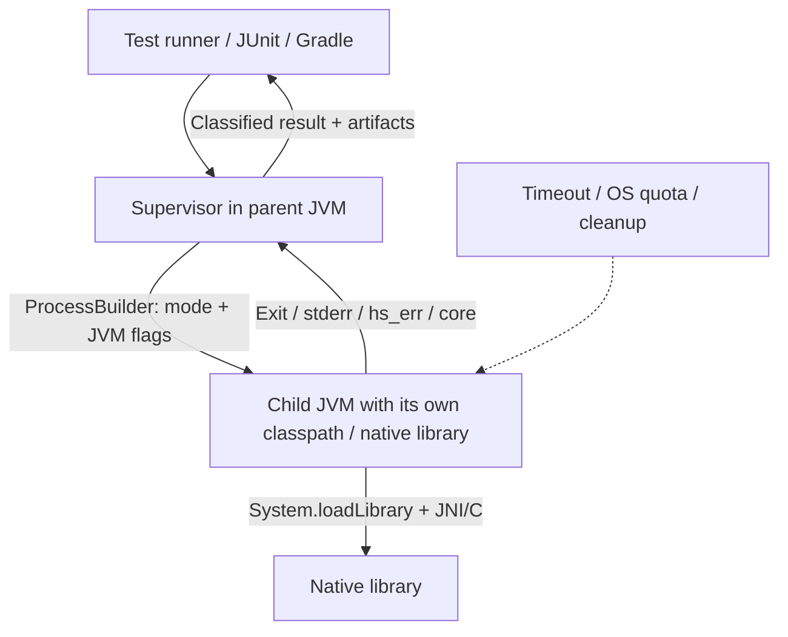

# Running Crashing or Load-Failing Tests in a Separate Process

## 1. Why must native testing have a process boundary?

When a Java application calls native code via JNI (Java Native Interface), certain errors can cause **the entire JVM hosting the test** to terminate. This is different from a normal assertion failure or Java exception.

- Invalid C/C++ pointer access, `abort()`, ABI errors, native heap corruption, or certain JVM errors can cause a fatal error, `SIGSEGV`/`SIGABRT` on Unix systems, or an access violation on Windows. JUnit's `try/catch` and `assertThrows` are not guaranteed to catch errors that terminate the process.
- `System.loadLibrary(...)` can throw `UnsatisfiedLinkError` when a library is missing, has the wrong architecture, is missing a dependent library, or is missing a JNI symbol. This is a **Java `Error`** that can be observed and tested while the JVM is still alive, but loading a native library sometimes triggers faulty native initialization code, a crash, or a hang.
- A test that kills the JVM test worker mid-run can lose unexecuted test cases, cause Gradle/Maven to report a disconnected test worker, and fail to retain sufficient raw logs to diagnose the error.
- Native code can hang or spawn excessive threads/resources; merely setting `@Timeout` or `Future.get(timeout)` in the same JVM does not guarantee cancellation of a stuck native call.

**Design approach:** the test runner lives in the **parent process (supervisor)**, while each risky scenario runs in a **child JVM or child native executable**. The parent inspects the exit code, deadline, stdout/stderr, `hs_err_pid`, core dump, and diagnostic artifacts to draw a conclusion. If the child process dies, the test runner remains alive and can report the results of the remaining scenarios.

A Java subprocess is also a separate OS process; a container is not required just to create a basic crash boundary. Containers/sandboxes can add quotas, permissions, and isolation levels for high-risk tests.

## 2. Properly classifying what is being tested

| Scenario | Behavior in the child JVM | What the parent needs to prove |
|---|---|---|
| Success | Loads library/calls native successfully, exits normally | `exit=0`, correct response; not just that "the process started" |
| Missing or misloaded library | Usually throws `UnsatisfiedLinkError`; child may exit with a non-zero code if uncaught | Correct load error message/type, does not kill the test runner; logs are sufficient to distinguish the cause |
| JNI symbol not found when calling native method | May throw `UnsatisfiedLinkError` on method invocation | Distinguish missing symbol from missing `.so/.dll/.dylib` |
| Real crash in C/C++ | Child JVM usually dies, possibly with `hs_err_pid` and core/minidump | Detect abnormal termination, preserve evidence, and verify it is not a load error |
| `Runtime.halt(code)` or `System.exit(code)` | Child actively exits with the chosen code | Tests the supervisor's lifecycle; **this only simulates process termination**, not a native crash |
| Deadlock/hang | Child stays alive but does not return a result within the deadline | Timeout, request termination, force kill if needed, and do not let the job hang indefinitely |
| Killed by OOM killer/OS kill | May terminate without the JVM writing a fatal log | Record exit/termination, correlate with OS/container logs, avoid concluding `SIGSEGV` |

**Distinguish three layers of errors:** (1) Java exception/`Error` thrown by the runtime; (2) abnormal process termination; (3) actual root cause in native code/loader. A non-zero exit code only proves unsuccessful termination; it **does not by itself prove** a segmentation fault occurred.

### Why is `assertThrows(UnsatisfiedLinkError.class, ...)` not enough?

A JUnit test in the same JVM can check the missing-library case with `assertThrows`. However, a real library-loading test must also account for native initialization code (such as `JNI_OnLoad`), dependent libraries, and process-wide load state. If the library crashes right at load time, JUnit can die with it. Furthermore, a native library loaded/initialized in a process can leave behind state that is hard to reset completely between test cases; a class that failed initialization can also remain in a class initialization error state.

Therefore, for scenarios with fatal risk or requiring a clean load state, use a **fresh child JVM for each case**. Load-error scenarios guaranteed to only throw a Java `Error` can be tested directly in-JVM for narrow unit tests; a subprocess is still useful to keep fixtures independent and obtain clear logs.

## 3. Two-JVM test suite architecture



Each test run should have a clear contract:

1. **Input:** scenario name, binary/library under test, working directory, JVM flags, controlled environment, deadline, and dedicated artifact directory.
2. **Execution:** use `ProcessBuilder` with an argument array; start the process, handle output so pipes do not fill up, and wait within a finite deadline.
3. **Observation:** distinguish `START_FAILURE`, `EXIT_ZERO`, `JAVA_LOAD_ERROR`, `UNEXPECTED_NONZERO`, `TIMEOUT`, `NATIVE_FATAL` based on concrete evidence.
4. **Cleanup:** close streams, terminate overdue children, verify whether the process is still alive, and reap descendants if the child spawns subprocesses.
5. **Reporting:** summarize the verdict, recording the exit code, duration, stderr path, fatal log/core, and native binary version; the test runner must not confuse "parent is still alive" with "child succeeded".

Only mark `NATIVE_FATAL` when there is matching evidence (fatal log, OS event, or core/minidump), rather than assigning that label to every `exit != 0`.

## 4. Runnable Java 17+ example: load error, abrupt exit, and hang

The first example **does not require a C compiler**. It demonstrates how the parent JVM runs each case in a child JVM, recognizing native load errors, abrupt termination, and timeouts without dying itself. Section 5 then adds a real native `abort()`.

Create the following two files in the **same directory**. The program uses no frameworks outside the JDK.

**`NativeFailureChild.java`**

```java
public final class NativeFailureChild {
    private static native void abortInC();

    public static void main(String[] args) throws InterruptedException {
        if (args.length != 1) {
            throw new IllegalArgumentException("mode is required");
        }

        switch (args[0]) {
            case "ok" -> System.out.println("child: ok");

            case "missing-library" ->
                System.loadLibrary("this_native_library_must_not_exist_260");

            case "abrupt-exit" ->
                Runtime.getRuntime().halt(73);

            case "hang" ->
                Thread.sleep(30_000);

            case "native-abort" -> {
                System.loadLibrary("crashprobe");
                abortInC();
            }

            default -> throw new IllegalArgumentException("unknown mode");
        }
    }
}
```

**`NativeFailureHarness.java`**

```java
import java.io.IOException;
import java.nio.file.Files;
import java.nio.file.Path;
import java.util.List;
import java.util.Locale;
import java.util.concurrent.TimeUnit;

public final class NativeFailureHarness {
    private static String javaExecutable() {
        String executable = System.getProperty("os.name")
                .toLowerCase(Locale.ROOT).contains("win")
                ? "java.exe" : "java";
        return Path.of(System.getProperty("java.home"),
                "bin", executable).toString();
    }

    private static String runChild(String mode, Path logs)
            throws IOException, InterruptedException {
        Path stderr = logs.resolve(mode + ".stderr.log");
        ProcessBuilder builder = new ProcessBuilder(
                javaExecutable(),
                "-XX:ErrorFile=" + logs.resolve("hs_err_pid%p.log"),
                "-Djava.library.path=.",
                "-cp", System.getProperty("java.class.path"),
                "NativeFailureChild", mode
        );

        // stdout is discarded; stderr is written to a file to avoid filling the pipe.
        builder.redirectOutput(ProcessBuilder.Redirect.DISCARD);
        builder.redirectError(stderr.toFile());

        Process child = builder.start();
        try {
            if (!child.waitFor(5, TimeUnit.SECONDS)) {
                child.destroy();
                if (!child.waitFor(1, TimeUnit.SECONDS)) {
                    child.destroyForcibly();
                    child.waitFor();
                }
                return "TIMEOUT";
            }
        } catch (InterruptedException e) {
            child.destroyForcibly();
            Thread.currentThread().interrupt();
            throw e;
        }

        int exit = child.exitValue();
        return switch (mode) {
            case "ok" -> exit == 0 ? "PASS" : "UNEXPECTED_EXIT";

            case "missing-library" ->
                exit != 0
                    && Files.readString(stderr).contains("UnsatisfiedLinkError")
                    ? "LOAD_FAILURE" : "UNEXPECTED_EXIT";

            case "abrupt-exit" ->
                exit == 73 ? "ABRUPT_EXIT" : "UNEXPECTED_EXIT";

            case "hang" -> "UNEXPECTED_EXIT";

            case "native-abort" ->
                exit != 0 ? "NONZERO_INSPECT_LOG" : "UNEXPECTED_SUCCESS";

            default -> "UNEXPECTED_MODE";
        };
    }

    public static void main(String[] args) throws Exception {
        Path logs = Path.of("probe-logs").toAbsolutePath();
        Files.createDirectories(logs);

        List<String> modes = args.length == 0
                ? List.of("ok", "missing-library",
                          "abrupt-exit", "hang")
                : List.of(args);

        for (String mode : modes) {
            String result = runChild(mode, logs);
            System.out.println(mode + "=" + result);
        }
        System.out.println("parent: alive");
    }
}
```

Compile/run with **Java 17 or newer** in the directory containing the two files:

```bash
javac NativeFailureChild.java NativeFailureHarness.java
java NativeFailureHarness
```

Expected standard output when the JDK can start the child within 5 seconds and the test library name does not exist:

```text
ok=PASS
missing-library=LOAD_FAILURE
abrupt-exit=ABRUPT_EXIT
hang=TIMEOUT
parent: alive
```

Why these lines appear:

- `ok`: the child JVM completes with code `0`. The line `child: ok` does not appear on the parent console because of `redirectOutput(DISCARD)`; the test relies on the exit code.
- `missing-library`: `System.loadLibrary` searches for the library using the JVM/OS mechanism, does not find the chosen name, and throws `UnsatisfiedLinkError`. The child does not catch it and exits with a non-zero code. The parent reads `probe-logs/missing-library.stderr.log` to confirm the error type before returning `LOAD_FAILURE`.
- `abrupt-exit`: `Runtime.halt(73)` stops the child JVM directly, producing exit code `73` in a normal environment; the parent receives `ABRUPT_EXIT`. This is **not** `SIGSEGV`, does not run C, and must not be used to verify a crash handler or pointer checks.
- `hang`: the child sleeps for 30 seconds, while the parent waits at most 5 seconds. The parent requests termination (`destroy`), waits 1 more second, and then calls `destroyForcibly` if needed; it returns `TIMEOUT`.
- `parent: alive`: the coordinator JVM continues after the three failure scenarios. This demonstrates the **process** boundary; it does not prove that the library or worker has sandboxed system access.

The parent code intentionally does not print the child's entire stack trace so that stdout has easily comparable results; load error details are in the `*.stderr.log` file. A CI test should attach that file on failure. If the library name happens to exist on the machine, or the JVM starts slower than 5 seconds, the result will differ: use a random/controlled library name and configure a deadline suitable for the CI machine.

**Example assumptions:** the Java sources are compiled and the parent runs in the same directory, the classpath contains both classes, and the child inherits the parent's working directory. By default, the child's `-cp` takes the parent's classpath. In a real system, normalize the **classpath and library paths to absolute paths**, check the working directory/environment and subprocess dependencies accurately; `-Djava.library.path=.` does not automatically add native libraries to the Java classpath.

### Why not use `new Thread(...)` or `ExecutorService`?

A thread in the same JVM still shares the address space with native code and can die along with it when native code crashes. `Future.get(5, TimeUnit.SECONDS)` only bounds the caller's wait time; `cancel(true)` cannot force uncooperative native code to stop. `ProcessBuilder` creates an OS boundary so the test runner can handle child termination and enforce timeout/kill at the process level.

## 5. Creating a real native crash with JNI, but running only in the child JVM

If the goal is to prove that the pipeline captures and reports a real **fatal native error**, `Runtime.halt` in the previous example is not enough. Build a separate JNI library that intentionally calls `abort()`; do not load or call it directly in the test runner's JVM.

Create a third file **`crashprobe.c`**:

```c
#include <jni.h>
#include <stdlib.h>
#include "NativeFailureChild.h"

JNIEXPORT void JNICALL Java_NativeFailureChild_abortInC(
        JNIEnv *env, jclass cls) {
    (void)env;
    (void)cls;
    abort();  // Intentionally terminate the process hosting the child JVM.
}
```

This is a JNI library **designed to crash intentionally**, not production code. The commands below are specifically for Linux with a C compiler and corresponding JDK. Set `JAVA_HOME` to the JDK used to compile/run:

```bash
javac -h . NativeFailureChild.java NativeFailureHarness.java
cc -std=c11 -O0 -g -Wall -Wextra -fPIC -shared \
   -I"$JAVA_HOME/include" -I"$JAVA_HOME/include/linux" \
   crashprobe.c -o libcrashprobe.so

java NativeFailureHarness native-abort
```

Expected on a Linux environment where the library can be loaded: the child enters `abort()` and is terminated abnormally; the parent stays alive. The parent's stdout is **typically**:

```text
native-abort=NONZERO_INSPECT_LOG
parent: alive
```

This is the **harness** output, not the OS/JVM stack trace. The actual exit code and generated files vary by OS/JDK/core settings. After running the command, inspect `probe-logs/native-abort.stderr.log`, the `probe-logs/hs_err_pid<PID>.log` file if HotSpot generated one, and core/minidump according to the operating system configuration. If the library is missing or fails to load, the child can also exit non-zero; therefore, the `NONZERO_INSPECT_LOG` label forces the tester to **read the evidence before declaring that a native crash occurred**.

On Windows, a compiler and JNI headers for Windows (`include/win32`) and a DLL of the right architecture are required; on macOS, use `include/darwin` and the appropriate shared library. Do not copy Linux build commands verbatim to another operating system. Do not write tests that intentionally write to a garbage pointer to "force" `SIGSEGV`: undefined behavior can corrupt data, fail to crash, or crash outside the intended point. `abort()` is a more deterministic way to test **fatal termination**.

If you want to test a specific pointer bug, run a **separate native repro** with minimal input, debug symbols, and sanitizers; evaluate using specific diagnostics from ASan/UBSan or a debugger. Do not rely on the exit code alone to prove a memory access bug was caught.

### How `hs_err_pid` is generated and read

Depending on the error type, HotSpot attempts to create a fatal error report when the JVM crashes. Pattern used in the parent:

```text
-XX:ErrorFile=<artifact-directory>/hs_err_pid%p.log
```

`%p` is replaced with the PID so different child JVMs rarely overwrite each other's files. The report may contain the signal/exception, `Problematic frame`, native frames, loaded libraries, and JVM information. `Problematic frame` only indicates where the crash was detected; memory corruption may have occurred earlier. The file **does not always exist**: `SIGKILL`, OS OOM kill, lack of write permissions, or certain severe errors can prevent the JVM from creating the report. `Runtime.halt` in the example also does not create a fatal log by default.

An automated test program should check the artifact path by the child's PID/request, combined with the error type in stderr and OS events. Verify that the file was actually created in the **current run** to avoid mistakenly reporting an old `hs_err` file left in the same directory.

## 6. Library load errors have different causes

`UnsatisfiedLinkError` is often oversimplified as "missing file". In practice, it needs to be classified:

| Symptom | Possible cause | Evidence to check |
|---|---|---|
| `no X in java.library.path` | JVM cannot find the library by name/path | `System.mapLibraryName("X")`, `java.library.path`, working dir, filename |
| `Can't load ...`, `wrong ELF class`, `not a valid Win32 application` | Wrong CPU architecture/bitness, file format incompatible with OS | OS, JDK and native binary architecture, `file`/`readelf`/corresponding PE/Mach-O tools |
| `libdependency.so: cannot open shared object file` or dependent DLL error | Loader cannot find a **dependent library** of the main library | `ldd`/`readelf -d` on trusted files, `otool -L`, appropriate DLL dependency tools |
| `undefined symbol` | Missing dependent symbol, ABI/version mismatch, improper linking | Symbol table, dependency version, compiler flags |
| `Native method not found` or `UnsatisfiedLinkError` when calling native method | JNI entry point/signature mismatch or not properly registered | `javac -h` header, `javap -s`, exported symbols, `RegisterNatives` |
| Crash or hang right at `System.loadLibrary` | Faulty native init code/`JNI_OnLoad`/global constructor, conflict with another library | `hs_err_pid`, stderr, native debugger, debug symbols, and loader trace |

`System.loadLibrary("crashprobe")` uses a logical name and OS-specific filename mapping; `System.load("/absolute/path/libcrashprobe.so")` uses an absolute path. OS mechanisms for finding dependent libraries (e.g., ELF loader, `rpath`, `RUNPATH`, `LD_LIBRARY_PATH`) are at a different layer from the Java classpath. Changing `-cp` usually does not fix a missing native library error.

On Linux, you can use `readelf -d libcrashprobe.so`, `ldd` for **trusted binaries**, or controlled loader tracing to understand dependencies. Do not execute or pass untrusted native files to tools that might trigger unexpected code. For external libraries, prefer static metadata analysis first. On Windows, check architecture/DLL dependencies and loader search rules; on macOS, check install names, rpath, code signing, and architecture.

**State trap:** a load failure due to a Java `Error` can be caught, but a failed `static` class initialization or a partially loaded native library can leave behind notable process/class loader state. For test cases requiring clean initial conditions, spawn a new child JVM instead of relying on "unloading and reloading the library" in the same JVM. Java has no general API to force the OS/JVM to unload an arbitrary native library on demand for a test case.

## 7. Automated test design and JUnit/Gradle/Maven integration

The reliable approach is that **each process-destructive native scenario lives in a child**; JUnit or the main framework only invokes the harness and evaluates the verdict. A test case can succeed when the child crashes, **if that crash itself is the behavior intentionally being verified** and the evidence confirms the right crash type.

Example assertion contract in the test runner:

- Success scenario: requires `exit=0`, correct business result, no timeout.
- Missing library scenario: requires child non-zero **and** stderr containing `UnsatisfiedLinkError` matching the library name/load path; parent JVM stays running.
- JNI crash scenario: requires child to terminate abnormally, not `UnsatisfiedLinkError`; on supported environments, requires evidence of `SIGABRT`/native frame/OS event or a newly generated fatal log from the exact child.
- Hang scenario: requires child to stay alive past the deadline, be terminated, and be cleaned up; meanwhile, the test runner continues.
- Unexpected scenario: if the child is killed by the OS because CI ran out of RAM instead of the expected crash, the test must fail as an environment condition error, not automatically pass just because the exit code is non-zero.

If using JUnit 5, the subprocess invocation should live in a test utility returning a structure like `ProbeResult(mode, started, timedOut, exitCode, stderrPath, fatalLogPath, duration)`. Assertions compare **termination type + evidence**, while artifacts are saved to CI when a test fails. `@Timeout` can serve as a fallback layer so the entire test suite does not hang, but it **does not replace** timeout and kill for the OS child.

With Gradle/Maven, test fork/forkEvery/reuseForks settings control the lifecycle of the **test runner JVM** at the build-tool level; they do not automatically turn a risky native call inside a test case into a safe subprocess. When fatal native code kills the test worker, the build tool may still stop or mark the suite as failed. The most proactive approach is to spawn a child from the test utility and avoid loading risky native libraries into the runner. Only use container or test framework isolation if you have verified the exact process boundary and how artifacts are collected.

In CI, you can split into two groups: safe Java/JNI tests that run fast and frequently; crash/loader/destructive tests with their own timeouts, environments, and artifacts. Do not use group labels to permanently skip crashing test cases: they are critical checks for native library packaging.

## 8. Operational issues that make tests error-prone

### 8.1. Timeout and cleanup

- Set a deadline for the **entire request** (process startup, library loading, execution, returning output), not just a timeout on a Java `Future`.
- Use `waitFor(timeout, TimeUnit.SECONDS)` to tell whether the child has finished; if it expires, call `destroy()`, wait briefly, and call `destroyForcibly()` when needed. `destroyForcibly()` does not automatically mean killing the entire process tree.
- When the parent thread is interrupted, clean up the child and propagate the interrupt status; do not swallow `InterruptedException`. If the system must prove complete cleanup, manage descendants as well and use appropriate OS boundaries.
- If a native worker spawns subprocesses, use a process group/cgroup on Linux or a Windows Job Object if needed. Killing only the direct PID can leave orphans behind.
- The 5-second deadline in the demo is a pedagogical value. Slow CI, loading large libraries, or running sanitizers requires environment-configurable deadlines; avoid flaky tests caused by choosing too tight a threshold.

### 8.2. Stdout/stderr and logs

- `ProcessBuilder` creates pipes for stdout/stderr by default. If the child writes enough data while the parent waits in `waitFor` **without draining the streams**, the child can block and look like a native hang.
- The demo discards stdout (`Redirect.DISCARD`) and writes stderr to a file, so neither pipe fills up. For tests that must inspect the child's response, use a framed protocol, drain continuously with limits, or redirect to a file to read later.
- Set log size limits, rotation/retention, and disk quotas in CI; a child spamming logs can fill the disk. Crash logs/cores may contain sensitive information.
- Separate artifacts per test/run/PID to avoid race conditions and reading stale logs by mistake. Do not strip out all stderr before analyzing `UnsatisfiedLinkError`.

### 8.3. Paths, environment, and native libraries

- Launch using `ProcessBuilder`'s argument list rather than interpolating user data into `sh -c` or `cmd /c`. If an executable path contains spaces, the argument list preserves argument boundaries properly.
- Use the exact `java.home/bin/java` or JVM launcher under test, and record `java -version`, OS/architecture, compiler, and native library. Do not assume `java` on `PATH` is the same JDK as the runner.
- Verify working directory, classpath, module path, library search path, OS environment, and dependency paths. Use absolute paths when packaging tests for CI.
- Test packaging: the Java JAR/classes may be correct while the native binary is missing, has the wrong classifier, wrong name, missing dependent DLL, or wrong architecture.
- Do not pass runner secrets to the child unless truly necessary. For untrusted inputs, use least-privilege user permissions and an appropriate sandbox/container/VM.

### 8.4. Do not attribute solely from the exit code

On some Unix systems, shells typically represent a process killed by a signal as `128 + signal number`, e.g., `139` for `SIGSEGV`. However, `Process.exitValue()`, shells, container runtimes, and Windows have different representations; a program can also choose that exit code itself. Therefore, **do not hardcode `139` as universal proof**. `0` is also not always sufficient proof of business success if the child swallows an error and exits normally.

When a child is killed without `hs_err_pid`, check kernel/system logs, container OOM status, or the job runner monitor. Distinguish lack of diagnostic data from certainty that no error occurred.

## 9. Extending to native executables and sanitizer tests

Not every scenario requires spawning a child JVM. If the library has a standalone native test executable, the supervisor can run the C/C++ binary directly to check memory safety before bringing it into JNI:

```java
ProcessBuilder builder = new ProcessBuilder(
        "/absolute/path/to/native-test", "--case", "decode-corrupt");
```

The line above is an **illustrative snippet**, not a standalone Java program; handle timeouts/streams/exits with the same mechanism as `NativeFailureHarness`. A native test binary is advantageous because sanitizers are usually easier to set up than inside a large JVM. Compile C/C++ tests with debug symbols and, when appropriate:

```bash
cc -g -O1 -fno-omit-frame-pointer -fsanitize=address \
   -o native-test native-test.c
./native-test
```

The command is a **template** assuming an existing `native-test.c`, not a file included with the example. AddressSanitizer can detect many out-of-bounds/use-after-free bugs; UndefinedBehaviorSanitizer can help with certain classes of UB. No sanitizer proves all pointer operations are safe. Use minimal test inputs, reduce optimization when debugging if needed, and record compiler/runtime versions.

If you need to verify a crash in the JNI call path, you must run the actual child JVM and native binary with debug info as in Section 5. A standalone native executable tests C bugs well, but may not reproduce JNI ownership, local/global refs, thread attach, or ABI issues at the Java–C boundary.

### Resource isolation for heavy fault-inducing tests

A separate process keeps the parent JVM from sharing an address space with the child, but the child can still consume CPU/RAM and affect the CI machine. When tests intentionally cause OOM/deadlock or process untrusted native code, use appropriate OS/container quotas (e.g., Linux cgroups for memory/CPU/PID, Job Objects on Windows), maximum runtime, and file size quotas. `-Xmx` only controls the Java heap; it does not limit total native allocations of the child JVM. Containers still typically share the host kernel and must restrict permissions, network, and filesystem according to the threat model.

## 10. Recommended test matrix

| Case | Expectation | Evidence retained |
|---|---|---|
| Valid JNI call | Child returns exit 0 and correct business result | stdout/protocol response, library version |
| Non-existent native library | `UnsatisfiedLinkError` in child; runner stays alive | stderr, library name, and `java.library.path` |
| Wrong architecture or dependency library | Child reports load error at the right layer, does not crash runner | stderr + ELF/PE/Mach-O metadata and dependencies |
| Missing JNI symbol | Error at native method call; parent classifies as linking failure | Java method signature, header, and exported symbols |
| `JNI_OnLoad` failure | Java load error or fatal child crash depending on condition; runner stays alive | exit + stderr/hs_err + debug frames |
| `abort()` from JNI | Child is terminated abnormally; parent stays alive | newly generated crash log, OS event, and native frame |
| Native use-after-free bug | Sanitizer/native debugger produces matching report | sanitizer report, repro input, build ID |
| Native hang | Child times out/is killed, leaves no orphans | deadline, elapsed, process tree state |
| Child emits huge logs | Runner does not deadlock/fill disk due to output | log limits and retention, timeout |
| Running many tests concurrently | No log or PID mix-ups, does not exhaust workers/quotas | per-test artifacts, load, and peak resources |
| Crash after writing side effects | Does not default to infinite retries | task state, idempotency key, and reconciliation |

For a cross-platform native library distribution pipeline, run at least one pass on **each supported OS/architecture/JDK combination**, because loaders, library names, JNI toolchains, and crash reporting differ. Testing on Linux x86_64 does not automatically prove Windows DLLs or macOS `.dylib`s are correct.

## 11. Common implementation mistakes

1. **Intentionally calling `abort()` directly inside JUnit's test JVM.** This can terminate the test worker and lose the suite's results. Always put fatal native call sites in a subprocess.
2. **Treating `Runtime.halt` as a native crash.** It only simulates abnormal child termination; testing crash handlers/fatal logs requires a real native error.
3. **Treating every `exit != 0` as a segfault.** Missing libraries, command errors, timeout kills, and OS OOMs can all be non-zero. You must correlate stderr, fatal logs, and the OS.
4. **Waiting for a process without reading stdout/stderr.** Pipes can fill up and stall the child; redirect or drain continuously with limits.
5. **Setting `@Timeout` and assuming the native call is forcibly stopped.** You need a deadline and kill at the OS process level.
6. **Using relative paths that depend on where tests are run.** IDEs, Gradle, Maven, and CI have different working directories; normalize binary/classpath/library paths.
7. **Misreading an `hs_err` from a previous run.** Each test needs its own artifact namespace and timestamp/PID validation.
8. **Only running missing-library tests, not tests with the real library.** You need positive load/call tests, dependency checks, and runtime compatibility as well.
9. **Increasing parallelism without limit.** Each child JVM has its own startup, heap, stack, threads, and native memory; CI can OOM even if each test is independent.
10. **Intentionally writing to an invalid pointer in C to get exit code `139`.** C undefined behavior may not crash and easily causes misdiagnosis; use `abort()` for fatal lifecycle tests or sanitizers for memory bugs.
11. **Hiding load errors with `catch (Throwable)` and exiting `0`.** Then the test runner loses the ability to classify; if catching to build a protocol response, emit the exact error state and use consistent exit codes/conventions.
12. **Assuming a child process creates a complete security sandbox.** The process can still access files, network, or host resources according to its permissions; OS policies and quotas are needed if tests are untrusted.

## 12. Checklist before putting tests into CI

- [ ] Every test with fatal native risk runs in a **separate process**; the runner does not load crash-prone libraries.
- [ ] Scenarios for **Java load/link error**, **simulated termination**, **real native crash**, **timeout**, and **OS kill** are clearly defined.
- [ ] Processes are launched with the right, controlled launcher, classpath, native library, working dir, environment, and arguments.
- [ ] Deadlines are finite; stdout/stderr cannot cause deadlock; children and descendants are cleaned up via appropriate OS mechanisms.
- [ ] Tests assert both termination status and **root-cause evidence**, not relying solely on exit code.
- [ ] `stderr`, fatal logs, core/minidump (if any), build ID, and version are saved for the current run.
- [ ] CI has resource limits, log quotas, and concurrency sized to the host's capacity.
- [ ] A success scenario exists for comparison, and distribution artifacts are tested on the right OS/architecture.
- [ ] If a test fails, the error state is clearly visible; if the child crashes as expected, the test records that the crash condition **was verified**.
- [ ] Crashing tests do not run with privileges/sensitive data beyond what is needed.

**Technical conclusion:** In the Java native interoperability module, isolating crashing or load-failing tests into child JVMs enables testing process-destructive behavior in a controlled way. The most important part is not merely creating a `ProcessBuilder`, but **identifying the error type with evidence, enforcing timeouts, and collecting artifacts before issuing a verdict**.