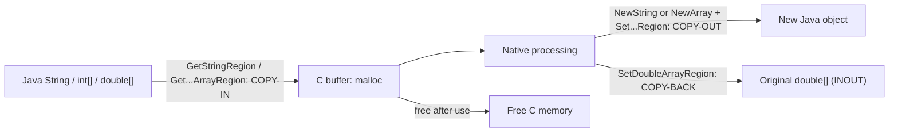

# Practice Lab: Passing Unicode Strings and Numeric Arrays with an Explicit Copy Policy

## 1. Problem Statement and Expected Outcomes

Build a **Java ↔ C bridge via JNI** to pass Unicode strings and two types of numeric arrays, in which **every copy across the memory boundary is specified by a clear API and contract**. The lab uses Java 17+ to run on common JDKs; the C example has been compiled with GCC on Linux.

Complete four operations:

1. **`copyUtf16(String)` — IN → new OUT:** receives a `String`, copies its UTF-16 code units into C memory, and creates a new Java `String` with the same content. Preserves emoji, Vietnamese diacritics, combining characters, and `U+0000`.
2. **`copyUtf8(byte[])` — IN → new OUT:** Java explicitly encodes the string using **standard UTF-8** into a `byte[]`; C copies the bytes with an explicit length into a new Java `byte[]`; Java decodes it back. Do not treat byte data as a `\0`-terminated C-string.
3. **`reverseInts(int[])` — IN → new OUT:** copies `int[]` into C memory, reverses the elements on the copy, and creates a result `int[]`; the source array remains unchanged.
4. **`scaleDoubles(double[], double)` — INOUT:** copies `double[]` into C memory, multiplies each element, and **writes back only** to the original Java array using an explicit JNI call.

**Pass criteria:** the code compiles and runs; output is correct; Unicode strings round-trip without data loss; the source `int[]` remains unchanged; `double[]` changes only when `SetDoubleArrayRegion` is called; no native pointers are retained after returning, no memory leaks; able to explain who owns and frees each memory region.

### Prerequisites

- JDK **17 or later**, including `javac`, `javac -h`, and JNI header files in `$JAVA_HOME/include`.
- C compiler: GCC/Clang on Linux/macOS or MSVC Developer Command Prompt on Windows.
- Java and the native library share the same CPU architecture/bitness. Build commands for Linux/macOS/Windows are listed separately.
- Use UTF-8 for Java/C/Markdown source files. The Java commands below specify `-encoding UTF-8`.

## 2. Copy Policy Design

| Function | Input Data and Ownership | Copy Java → C | Copy C → Java | Mutability After Call |
| --- | --- | --- | --- | --- |
| `copyUtf16(String)` | Java owns the immutable string | `GetStringRegion` → `malloc` `jchar[]` buffer | `NewString` from buffer | Returns a string with the same content; input unchanged |
| `copyUtf8(byte[])` | Java owns the UTF-8 `byte[]` | `GetByteArrayRegion` → `jbyte[]` buffer | `NewByteArray` + `SetByteArrayRegion` | Returns a new array; input unchanged |
| `reverseInts(int[])` | Java owns the input `int[]` | `GetIntArrayRegion` → `jint[]` buffer | `NewIntArray` + `SetIntArrayRegion` | Returns a new reversed array; input remains unchanged |
| `scaleDoubles(double[], factor)` | Java owns the **INOUT** array | `GetDoubleArrayRegion` → `jdouble[]` buffer | `SetDoubleArrayRegion` into the original array | Caller sees the new values after the function returns successfully |

In each function, `malloc` creates a **C-owned copy** and `free` releases it before the JNI return. The `jstring`, `jbyteArray`, and `jintArray` created via JNI are **Java objects managed by the JVM**; do not call `free` on them. JNI local references are valid only within the scope of the call (unless converted to global references and managed properly; this lab does not do that). Do not store `JNIEnv*`, buffer pointers, or local references for use after the JNI return.

**IN:** reads the input without writing back to it. **New OUT:** creates a new Java object/array. **INOUT:** copies data into native memory, computes on the copy, and calls `Set...ArrayRegion` to write back. This is an explicit copy policy defined by **the lab's API contract**, independent of whether the JVM decides to pin or copy a Java array.

Why not use `GetIntArrayElements` or `GetPrimitiveArrayCritical` for this lab? Those APIs may return a pointer to pinned data or a copy depending on the JVM and situation; `isCopy` only reports the specific decision made for that call. They have a `Release...` contract and their own restrictions. In contrast, `Get...ArrayRegion` takes a **C buffer allocated by us**, serving as an explicit copy-in point; `Set...ArrayRegion` serves as an explicit copy-back point.

## 3. Unicode: Choosing One Representation at the Boundary

A Java `String` is a sequence of **UTF-16 code units**; `String.length()` counts code units, not Unicode code points or UTF-8 bytes. Emoji outside the Basic Multilingual Plane typically require **two UTF-16 code units (a surrogate pair)**. Combining marks can make the number of code points differ from the number of user-perceived graphemes.

There are two clear approaches in this lab:

### Approach A — Preserve UTF-16 Code Units

- JNI `GetStringLength` retrieves the number of `jchar` values to copy.
- `GetStringRegion(env, source, 0, length, buffer)` copies that exact number of code units into the C buffer.
- `NewString(env, buffer, length)` creates a Java `String` from **the exact number of code units**, without needing/relying on a terminating `\0` byte.
- `jchar` is a 16-bit UTF-16 unit in JNI; **do not treat each `jchar` as a Unicode code point**. Surrogate pairs must be preserved intact for round-tripping. This form **does not automatically perform Unicode NFC/NFD normalization**.

Approach A is useful when C actually operates on UTF-16; if a C library expects UTF-8, **do not** cast `jchar*` to `char*`.

### Approach B — Use Standard UTF-8 Explicitly Encoded by Java

- Java calls `text.getBytes(StandardCharsets.UTF_8)`; the length passed to C is `bytes.length`, not `text.length()`.
- C handles a `(pointer, length)` pair; it must accept `0x00` bytes inside the buffer.
- Java receives the `byte[]` back and uses `new String(bytes, StandardCharsets.UTF_8)` to decode it.

**Do not confuse standard UTF-8 with JNI Modified UTF-8.** `GetStringUTFChars` and `NewStringUTF` use **Modified UTF-8**: `U+0000` is represented differently from standard UTF-8, and supplementary characters go through surrogate encoding. Do not pass the result of `GetStringUTFChars` directly to a parser that requires standard UTF-8, or assume `strlen` reflects the original text length. This lab deliberately chooses `GetStringRegion` and the `byte[]`/`StandardCharsets.UTF_8` path to avoid this ambiguity.

`new String(bytes, StandardCharsets.UTF_8)` and `String.getBytes(UTF_8)` by default may **replace invalid data** (for example, unpaired surrogates or malformed UTF-8 byte sequences). For data requiring an **absolutely lossless round-trip at the UTF-16 code unit level**, use Approach A. For a standard UTF-8 protocol, require valid Unicode input and configure `CharsetEncoder`/`CharsetDecoder` to report errors using `CodingErrorAction.REPORT` if invalid data must be rejected instead of replaced.

## 4. Complete Java Code

Create a working directory and place the file **`NativeCopyLab.java`** directly inside it:

```java
import java.nio.charset.StandardCharsets;
import java.util.Arrays;

public final class NativeCopyLab {
    static {
        System.loadLibrary("native_copy_lab");
    }

    private static native String copyUtf16(String source);
    private static native byte[] copyUtf8(byte[] utf8);
    private static native int[] reverseInts(int[] source);
    private static native void scaleDoubles(double[] values, double factor);

    public static void main(String[] args) {
        String text = "Tiếng Việt 🌍 | x\0y | e\u0301";
        String utf16Result = copyUtf16(text);
        byte[] utf8Bytes = text.getBytes(StandardCharsets.UTF_8);
        String utf8Result = new String(copyUtf8(utf8Bytes), StandardCharsets.UTF_8);

        System.out.println("utf16.equal=" + text.equals(utf16Result));
        System.out.println("utf8.equal=" + text.equals(utf8Result));
        System.out.println("embeddedNul=" + (utf8Result.indexOf('\0') >= 0));

        int[] inputInts = {1, -2, 3, 0};
        int[] reversed = reverseInts(inputInts);
        System.out.println("inputInts=" + Arrays.toString(inputInts));
        System.out.println("reversedInts=" + Arrays.toString(reversed));

        double[] values = {1.5, -2.0, 0.25};
        scaleDoubles(values, 2.0);
        System.out.println("scaledDoubles=" + Arrays.toString(values));
    }
}
```

The test string contains Vietnamese characters, the emoji `🌍` (surrogate pair), a NUL byte via `\0`, and `e` + combining acute accent (`\u0301`). Comparing with `String.equals` verifies that the **UTF-16 code unit sequences** are equal; the lab avoids printing strings containing NUL directly so terminal/log output remains predictable.

Generate the JNI header before writing and building the C code:

```bash
javac -encoding UTF-8 -h . NativeCopyLab.java
```

This command generates `NativeCopyLab.class` and **`NativeCopyLab.h`**. Because the `native` methods are `static`, the corresponding C functions take `jclass` as their second parameter; non-`static` native methods take `jobject`. **Do not guess** JNI symbol names when packages, overloads, or characters requiring name mangling are involved; always check against the auto-generated header.

## 5. Complete C Code with Copy-In/Copy-Out

In the same directory, create the file **`native_copy_lab.c`**:

```c
#include "NativeCopyLab.h"
#include <stdint.h>
#include <stdlib.h>

static void throw_java(JNIEnv *env, const char *class_name, const char *message) {
    jclass type = (*env)->FindClass(env, class_name);
    if (type != NULL) {
        (*env)->ThrowNew(env, type, message);
        (*env)->DeleteLocalRef(env, type);
    }
}

static void *allocate_buffer(JNIEnv *env, jsize length, size_t element_size) {
    if (length <= 0) {
        return NULL;
    }
    if ((size_t)length > SIZE_MAX / element_size) {
        throw_java(env, "java/lang/OutOfMemoryError", "native buffer too large");
        return NULL;
    }
    void *buffer = malloc((size_t)length * element_size);
    if (buffer == NULL) {
        throw_java(env, "java/lang/OutOfMemoryError", "native allocation failed");
    }
    return buffer;
}

JNIEXPORT jstring JNICALL Java_NativeCopyLab_copyUtf16(
        JNIEnv *env, jclass clazz, jstring source) {
    (void)clazz;
    if (source == NULL) {
        throw_java(env, "java/lang/NullPointerException", "source");
        return NULL;
    }
    jsize length = (*env)->GetStringLength(env, source);
    if (length == 0) {
        return (*env)->NewString(env, NULL, 0);
    }

    jchar *copy = allocate_buffer(env, length, sizeof(jchar));
    if (copy == NULL) {
        return NULL;
    }
    (*env)->GetStringRegion(env, source, 0, length, copy);
    if ((*env)->ExceptionCheck(env)) {
        free(copy);
        return NULL;
    }
    jstring result = (*env)->NewString(env, copy, length);
    free(copy);
    return result;
}

JNIEXPORT jbyteArray JNICALL Java_NativeCopyLab_copyUtf8(
        JNIEnv *env, jclass clazz, jbyteArray utf8) {
    (void)clazz;
    if (utf8 == NULL) {
        throw_java(env, "java/lang/NullPointerException", "utf8");
        return NULL;
    }
    jsize length = (*env)->GetArrayLength(env, utf8);
    jbyteArray result = (*env)->NewByteArray(env, length);
    if (result == NULL || length == 0) {
        return result;
    }
    jbyte *copy = allocate_buffer(env, length, sizeof(jbyte));
    if (copy == NULL) {
        return NULL;
    }
    (*env)->GetByteArrayRegion(env, utf8, 0, length, copy);
    if (!(*env)->ExceptionCheck(env)) {
        (*env)->SetByteArrayRegion(env, result, 0, length, copy);
    }
    free(copy);
    return (*env)->ExceptionCheck(env) ? NULL : result;
}

JNIEXPORT jintArray JNICALL Java_NativeCopyLab_reverseInts(
        JNIEnv *env, jclass clazz, jintArray source) {
    (void)clazz;
    if (source == NULL) {
        throw_java(env, "java/lang/NullPointerException", "source");
        return NULL;
    }
    jsize length = (*env)->GetArrayLength(env, source);
    jintArray result = (*env)->NewIntArray(env, length);
    if (result == NULL || length == 0) {
        return result;
    }
    jint *copy = allocate_buffer(env, length, sizeof(jint));
    if (copy == NULL) {
        return NULL;
    }
    (*env)->GetIntArrayRegion(env, source, 0, length, copy);
    if ((*env)->ExceptionCheck(env)) {
        free(copy);
        return NULL;
    }
    for (jsize i = 0; i < length / 2; ++i) {
        jint tmp = copy[i];
        copy[i] = copy[length - 1 - i];
        copy[length - 1 - i] = tmp;
    }
    (*env)->SetIntArrayRegion(env, result, 0, length, copy);
    free(copy);
    return (*env)->ExceptionCheck(env) ? NULL : result;
}

JNIEXPORT void JNICALL Java_NativeCopyLab_scaleDoubles(
        JNIEnv *env, jclass clazz, jdoubleArray values, jdouble factor) {
    (void)clazz;
    if (values == NULL) {
        throw_java(env, "java/lang/NullPointerException", "values");
        return;
    }
    jsize length = (*env)->GetArrayLength(env, values);
    if (length == 0) {
        return;
    }
    jdouble *copy = allocate_buffer(env, length, sizeof(jdouble));
    if (copy == NULL) {
        return;
    }
    (*env)->GetDoubleArrayRegion(env, values, 0, length, copy);
    if (!(*env)->ExceptionCheck(env)) {
        for (jsize i = 0; i < length; ++i) {
            copy[i] *= factor;
        }
        (*env)->SetDoubleArrayRegion(env, values, 0, length, copy);
    }
    free(copy);
}
```

### Reading Each JNI Section Correctly

- `GetStringRegion` **copies in** by `jchar` count; `NewString` **copies out** into a Java object. After `NewString`, the C buffer can be freed immediately with `free`. For length 0, an empty string is created without allocating a buffer.
- `GetByteArrayRegion` and `GetIntArrayRegion` copy from a Java array into a **separate buffer**; `NewByteArray`/`NewIntArray` and `Set...Region` create and populate the new result. Modifying the C buffer does not alter the Java input.
- `GetDoubleArrayRegion` copies in; the multiplication loop runs on the C buffer; `SetDoubleArrayRegion` is **the only copy-back point**, so the caller observes the modified `double[]`. Do not assume the Set operation is an atomic transaction if multiple threads modify the array concurrently.
- `jsize` is used to count elements. `malloc(length * sizeof(T))` is executed only after checking for `size_t` multiplication overflow; the code handles length 0, `null` values, allocation failures, and branches with a pending JNI exception.
- `free(copy)` runs on every allocated branch. The code does not call `Release...Elements` because it **never** uses `Get...Elements`, and it does not call `free` on Java objects or `JNIEnv*`.

`jint` is a 32-bit JNI integer and `jdouble` is a 64-bit JNI floating-point number; use the exact `jint`, `jdouble`, and `jchar` types when declaring C parameters and buffers. Do not replace `jint` with `long` because the size of `long` depends on the operating system's ABI.

## 6. Compiling the Native Library and Running

### Linux

Start in the directory containing the three files `NativeCopyLab.java`, `NativeCopyLab.h`, and `native_copy_lab.c`; `$JAVA_HOME` must point to the **JDK** in use:

```bash
javac -encoding UTF-8 -h . NativeCopyLab.java
gcc -std=c11 -O2 -Wall -Wextra -fPIC -shared \
  -I"$JAVA_HOME/include" -I"$JAVA_HOME/include/linux" \
  -o libnative_copy_lab.so native_copy_lab.c
java -Djava.library.path=. NativeCopyLab
```

### macOS

```bash
javac -encoding UTF-8 -h . NativeCopyLab.java
clang -std=c11 -O2 -Wall -Wextra -dynamiclib \
  -I"$JAVA_HOME/include" -I"$JAVA_HOME/include/darwin" \
  -o libnative_copy_lab.dylib native_copy_lab.c
java -Djava.library.path=. NativeCopyLab
```

### Windows (MSVC Developer Command Prompt)

```bat
javac -encoding UTF-8 -h . NativeCopyLab.java
cl /nologo /W4 /LD /I"%JAVA_HOME%\include" /I"%JAVA_HOME%\include\win32" native_copy_lab.c /link /OUT:native_copy_lab.dll
java -Djava.library.path=. NativeCopyLab
```

Build commands depend on the operating system and compiler; the JNI example on Linux has been tested with OpenJDK 21 and GCC. The macOS/Windows commands are corresponding toolchain instructions and must be verified in the target environment.

`System.loadLibrary("native_copy_lab")` takes a **logical name**, not a filename; the JVM typically maps it to `libnative_copy_lab.so`, `libnative_copy_lab.dylib`, and `native_copy_lab.dll`, respectively. Place `-Djava.library.path=.` **before** the class name so the JVM searches for the native file in the working directory. This path only helps locate the main library; if there are other native dependencies, the OS loader's search path must also be handled.

### Expected Output

```text
utf16.equal=true
utf8.equal=true
embeddedNul=true
inputInts=[1, -2, 3, 0]
reversedInts=[0, 3, -2, 1]
scaledDoubles=[3.0, -4.0, 0.5]
```

The output above was run successfully with **OpenJDK 21 + GCC** on Linux. The `inputInts` line proves that the reverse operation occurred only on **a copy**; the `scaledDoubles` line proves that the caller sees changes when JNI performs **copy-back**.

## 7. Data Lifecycle Explanation



For `copyUtf16`/`copyUtf8`/`reverseInts`, Java keeps the source reference and receives a **new result**; there is no alias to the native buffer. For `scaleDoubles`, Java keeps **the same `double[]` object**, but the new contents appear only after copy-back. The C library does not retain or manage the lifecycle of Java objects after this function.

An easily overlooked point: explicit copying carries a cost of **O(n) time** in array size and additional **O(n)** native memory during processing. The trade-off is clear ownership, no reliance on JVM heap pinning, and easy control over where data is written back. For huge data, consider chunking, streaming processing, or designing a direct buffer with its own lifecycle; benchmark performance before abandoning the copy policy.

## 8. Required Tests and Variations

After a successful run, verify further by changing the Java data in `main` or adding `if (...) throw new AssertionError(...)` assertions:

| Case | Test Call | Expected Behavior |
| --- | --- | --- |
| Empty string | `copyUtf16("")` | Returns an empty string, no error |
| Empty bytes | `copyUtf8(new byte[0])` | Returns a length-0 `byte[]` |
| Empty numeric arrays | `reverseInts(new int[0])`; `scaleDoubles(new double[0], 3)` | No error; result is empty array / unchanged |
| Supplementary Unicode | `"🌍"` | `copyUtf16` and UTF-8 round-trip still yield `equals == true` |
| NUL character | `"a\0b"` | Preserves the embedded NUL without truncating the string |
| Combining character | `"e\u0301"` | Preserves the UTF-16 code unit sequence without automatic NFC normalization |
| Integer input | `int[] a = {1,2,3}`; modify result after `reverseInts(a)` | `a` remains `{1,2,3}` |
| INOUT | `double[] a = {1.5,-2.0}`; `scaleDoubles(a,2)` | `a` itself becomes `{3.0,-4.0}` |
| Null argument | `copyUtf16(null)`, `reverseInts(null)`, `scaleDoubles(null,2)` | Throws `NullPointerException` with the parameter name as message |
| Special floating-point values | Array containing `NaN`, `Infinity`, `-0.0` | Follows IEEE 754 multiplication; verify with appropriate checks, do not use `==` for `NaN` |

The native methods in the example are declared `private`. If you want to create a separate Java test class, change them to package-private (remove `private`) **in the exact same class** without changing method names/signatures; or place the assertions directly in `main`.

### Testing the Copy Policy by Behavior Instead of Guessing Addresses

1. Save the source `int[]` before calling `reverseInts`. After the call, modify an element in the returned array and confirm the source is unchanged. This is **new OUT**.
2. Call `scaleDoubles` on an array while holding a second reference pointing to **the same array**; the second reference must see the modified data. This is **INOUT copy-back**.
3. Pass a `String` containing NUL through both the UTF-16 and UTF-8 paths; compare values using `.equals`, without using `strlen` in C to truncate data.
4. For malformed UTF-8 input, use `CharsetDecoder` in `REPORT` mode and confirm an error is reported instead of silently replacing with `U+FFFD`.

Example configuration for **strict UTF-8 decoding** (an additional illustrative snippet inside a Java method, not a standalone file):

```java
var decoder = StandardCharsets.UTF_8.newDecoder()
        .onMalformedInput(java.nio.charset.CodingErrorAction.REPORT)
        .onUnmappableCharacter(java.nio.charset.CodingErrorAction.REPORT);
String decoded = decoder.decode(
        java.nio.ByteBuffer.wrap(receivedBytes)).toString();
```

`receivedBytes` in this snippet is a program-allocated `byte[]` variable. Under strict configuration, `decode` throws `CharacterCodingException` when a UTF-8 byte sequence is invalid. Proving that a byte array preserves bytes does not automatically prove that the byte array is valid UTF-8 text.

## 9. Common Errors and Root Cause Troubleshooting

| Symptom | Possible Cause | How to Check/Fix |
| --- | --- | --- |
| `UnsatisfiedLinkError: no native_copy_lab in java.library.path` | JVM cannot find `.so`/`.dylib`/`.dll` | Logical name, working directory, architecture, `-Djava.library.path` placed before the class name |
| `UnsatisfiedLinkError` when calling `copyUtf16` even though the library loaded | C function missing symbol or wrong JNI signature | Regenerate `javac -h`, inspect with `nm -D` (Linux) or export table (Windows) |
| Vietnamese text/emoji corrupted after round-trip | Confusing UTF-16, Modified UTF-8, standard UTF-8; wrong byte length | Compare `text.length()` with `bytes.length`; check encoding contract and surrogates |
| String truncated at NUL | Using `strlen`, `strcpy`, `printf("%s")` on binary payload | Pass `(pointer, length)`; do not use a NUL terminator to infer length |
| Java `int[]` mutates when only OUT was expected | Using `SetIntArrayRegion` on the source array or writing directly to a pinned region | Create `NewIntArray` then Set into the **result** array |
| Java `double[]` does not change | Computed only on the C buffer and forgot copy-back | Call `SetDoubleArrayRegion` on `values` after processing |
| Data lost after JNI return / crash | Keeping a `free`d pointer, storing a local reference, or violating lifetime | Do not let pointers/native buffers outlive the call; manage lifetimes explicitly |
| Memory error with large arrays | `malloc` failed, size multiplication overflowed | Check `SIZE_MAX`, OOM, free before returning, chunk when needed |
| Wrong `int` when porting C | Using C `long` for Java `int`, or calling the wrong ABI | Use `jint`, `jdouble`, and the header generated by `javac -h` |
| Non-deterministic results when multiple threads modify `double[]` | Shared Java array written concurrently | Use synchronization or separate ownership; region copy does not create a multi-threaded transaction |

**Critical logic bug:** `SetDoubleArrayRegion` in the example is the action that writes back to the Java heap. If omitted, the Java array will not automatically reflect modifications just because C updated `copy`. Conversely, if modifying the C buffer for a function declared **IN**, do not call Set back into the source just to "synchronize" — doing so breaks the immutable-input contract.

**JNI exceptions:** after a JNI call raises a Java exception, do not continue arbitrary JNI operations; check `ExceptionCheck`, free self-allocated native memory, and return so the JVM throws the exception. `New...Array`/`NewString` can fail due to out-of-memory. The sample functions show sufficient error branches for the practice lab without using pointers after `free`.

## 10. Extensions After Completing the Basic Lab

- **Real transformation:** replace `copyUtf8(byte[])` with valid processing on **standard UTF-8 bytes**, such as counting bytes or prepending an ASCII prefix at a valid boundary; validate UTF-8 before slicing by code point. Do not slice at an arbitrary byte offset in the middle of a multi-byte character.
- **Testing malformed Unicode:** use `CharsetEncoder`/`CharsetDecoder` with `CodingErrorAction.REPORT`; clearly observe the difference between a UTF-16 code unit round-trip and a UTF-8 encoding round-trip.
- **Large numeric arrays:** measure time and peak native memory when reversing 1 million `jint` elements; compare full-array copying with chunk-by-chunk processing. Keep the same ownership policy for meaningful benchmarks.
- **Inter-process binary formats:** when sending `jint`/`jdouble` arrays over files/network, do not `memcpy` raw buffers directly as a protocol without defining byte order, IEEE representation, version, and alignment; choose an encoding with an explicit contract.
- **Foreign Function & Memory API (JDK 22+):** a similar lab can be designed with `MemorySegment` and `Arena` (native region lifecycle), using explicit `MemorySegment.copy`/`MemorySegment.copyFrom` operations. This is a separate advanced branch: the main JNI example above does not require JDK 22+.

## 11. Acceptance Checklist

The lab is complete when you can demonstrate in both code and run output:

- [ ] Vietnamese Unicode, surrogate pairs, `\0`, and combining marks pass through both UTF-16/UTF-8 paths within the exact limits of each encoding.
- [ ] Each function has an **IN / new OUT / INOUT** table; the copy-in, copy-out, or copy-back points are at the exact `Get...Region`, `New...`, and `Set...Region` calls.
- [ ] `reverseInts` does not modify the source `int[]`; `scaleDoubles` modifies the exact `double[]` passed in.
- [ ] Every `malloc` buffer is `free`d before returning; no pointers or local JNI references are retained across calls.
- [ ] `null` branches, empty arrays, memory errors, and JNI exceptions are handled explicitly.
- [ ] `javac -h` generates the header; the native library is built for the right OS/CPU; `java -Djava.library.path=. NativeCopyLab` produces the output shown in section 6.
- [ ] Able to explain why **standard UTF-8 ≠ JNI Modified UTF-8**, why `String.length()` is not the UTF-8 length, and why C must not use `strlen` on a byte payload containing NUL.

## Technical References

- JNI Specification, **String Operations**, **Array Operations**, and `Get...Region`/`Set...Region` functions: https://docs.oracle.com/en/java/javase/21/docs/specs/jni/functions.html
- JNI Specification, **Primitive Types**, **Modified UTF-8**, and native function names: https://docs.oracle.com/en/java/javase/21/docs/specs/jni/types.html
- `CharsetEncoder` (handling malformed/unmappable input): https://docs.oracle.com/en/java/javase/21/docs/api/java.base/java/nio/charset/CharsetEncoder.html
- `StandardCharsets.UTF_8`: https://docs.oracle.com/en/java/javase/21/docs/api/java.base/java/nio/charset/StandardCharsets.html
- `javac -h` (generating JNI headers): https://docs.oracle.com/en/java/javase/21/docs/specs/man/javac.html