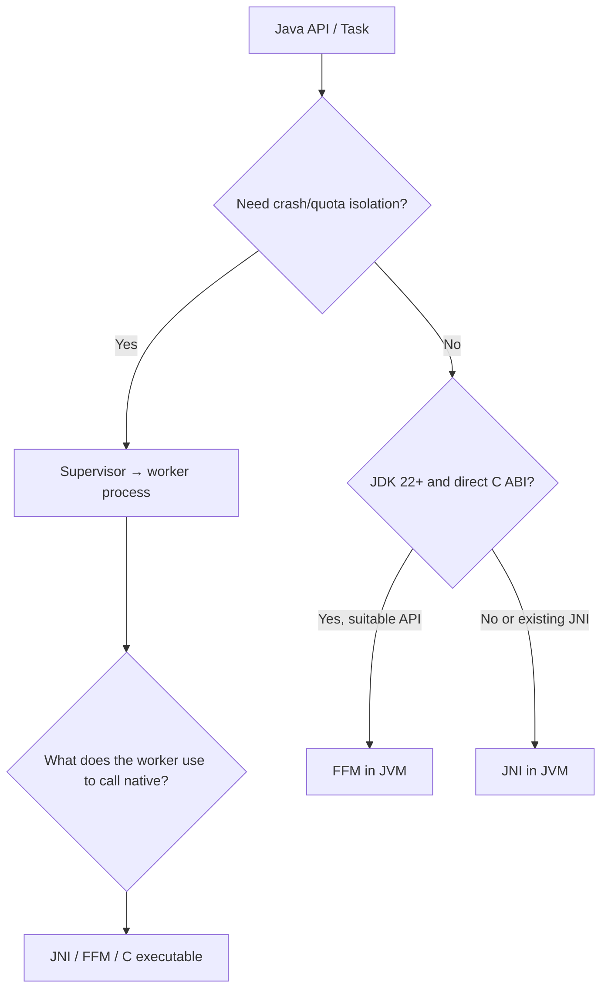
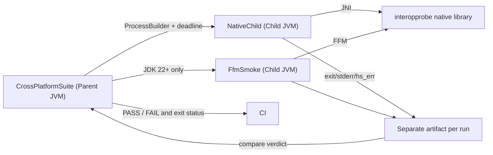

# Practice Exercise: Creating a Cross-Platform Test Suite and a Decision Matrix for JNI, FFM, or a Separate Process

## 1. Objectives, Scope, and Deliverables

Java can call native libraries using **JNI** (Java Native Interface) or the **FFM API** (Foreign Function & Memory API). Both can execute C/C++ machine code within the same JVM process. Another approach is to place native code in a **separate process** and communicate via IPC. This practice exercise combines two tasks:

1. Create a **cross-platform test suite** for a small C library, verifying both the JNI and FFM call paths as well as the system's response when loading fails, hangs, or crashes. The test suite runs each dangerous scenario in a child JVM so it does not terminate the coordinator.
2. Build a **decision matrix** for choosing JNI, FFM, or a separate process based on JDK, native API, performance cost, reliability, security, resource limit requirements, and distributability.

After this lesson, learners must be able to independently prove that: the library is built for the right OS/CPU; the child JVM resolves the right symbol and returns the result; load failures are classified; timeouts do not hang the test runner; native crashes are observed with evidence; and technical choices are well-founded.

**Prerequisites:** JDK 17+, a C compiler suitable for the operating system, ability to run commands in a terminal, and understanding of C functions, Java methods, and JNI signatures. The Java 17 program serves as the common baseline. **FFM is standardized from JDK 22**: FFM examples only compile/run on JDK 22+; do not attempt to run `java.lang.foreign` with JDK 17 or substitute incubator APIs with different signatures. The sample CI uses JDK 17 and 25 to compare compatibility.

**Deliverables of the practice exercise:** four Java files (`NativeBridge.java`, `NativeChild.java`, `CrossPlatformSuite.java`, `FfmSmoke.java`), one C file (`interopprobe.c`), build commands for Linux/macOS/Windows, a CI matrix, probe results, a decision matrix, and an architecture selection record for a real-world scenario.

## 2. Separating Three Frequently Confused Aspects

| Aspect | Verification Question | Example |
|---|---|---|
| **Native call mechanism** | How does Java call a native function, and is a C wrapper required? | JNI, FFM downcall |
| **Fault boundary** | When native code calls `abort()`, `SIGSEGV`, or hangs, which process dies? | Same JVM or native worker/child JVM |
| **Cross-platform distribution** | Are the binary, ABI, dependencies, architecture, and runtime compatible? | `.so` on Linux, `.dylib` on macOS, `.dll` on Windows |

JNI and FFM are **two linking mechanisms between Java ↔ native**. A separate process is a **decision about the execution boundary**; a worker process can still use JNI or FFM internally. Therefore, the decision matrix must not treat the three options as three completely equivalent "alternative libraries."

- JNI has existed for a long time and is suitable for native code that needs to manipulate Java objects, arrays, callbacks, and existing JNI libraries; in return, it requires writing/maintaining JNI glue code and adhering to rules for references, threads, and pending exceptions.
- FFM in JDK 22+ provides `Linker`, `SymbolLookup`, `FunctionDescriptor`, `MemorySegment`, and `Arena` to call the C ABI directly. Most Java instructions accessing via `MemorySegment` have bounds/lifetime checks, but a wrong descriptor, wrong address, or buggy native code can still kill the JVM.
- A worker process uses `ProcessBuilder`/IPC to reduce the impact of native errors and apply separate OS quotas. In return, it incurs process startup, serialization, data transfer, restart, timeout, and side-effect management overhead.



This is a **decision-guidance** diagram, not an absolute rule: an existing JNI library can still be wrapped in a worker, and FFM does not provide a sandbox simply because it does not use JNI.

## 3. Test Suite Design: Supervisor and Child Cases

A dangerous native test should not run inside the JUnit/Gradle test runner's JVM. If C calls `abort()` or corrupts the heap, `assertThrows` cannot guarantee catching that fatal error; the entire test runner could terminate. With a `System.loadLibrary` error, the JVM usually throws `UnsatisfiedLinkError`, but errors in `JNI_OnLoad` or a native static initializer can be more severe.

The exercise uses **a parent JVM** running each **child JVM** with the following cases:

| Case | Mechanism | PASS Condition |
|---|---|---|
| `jni-ok` | JNI in child | Child exits 0 and prints exact `JNI_SUM=42` |
| `load-missing` | JNI library loader | Child exits non-zero, stderr contains `UnsatisfiedLinkError` |
| `hang` | Intentionally hung child | Parent confirms deadline exceeded, stops child, stays alive |
| `native-crash` | C calls `abort()` from JNI in child | Child terminates abnormally, has marker just before entering native and new `hs_err_pid` fatal evidence; if evidence is missing, FAIL for investigation |
| `ffm-ok` | FFM downcall in child on JDK 22+ | Child exits 0 and prints `FFM_SUM=42` |

This is **outcome testing**, not benchmarking. A non-zero exit alone (`exit != 0`) is not enough to conclude a native crash: startup errors, missing libraries, wrong JNI symbols, and OS kills can also produce a nonzero exit. `Runtime.halt()` can simulate a dead child but does not confirm `SIGABRT`/native frames; therefore, the real case uses C `abort()` in a **separate child**.

Architecture:



Place the source files below in **an independent fixture directory**. Each test run creates a new artifact directory so it does not mistakenly read `hs_err` from a previous run.

## 4. Writing the C Library and JNI Class

**File `NativeBridge.java`** — Java class calling JNI and containing two native methods:

```java
public final class NativeBridge {
    static {
        System.loadLibrary("interopprobe");
    }

    public static native int add(int a, int b);
    public static native void abortInNative();

    private NativeBridge() {
    }
}
```

The logical name `interopprobe` is mapped by `System.loadLibrary` to the OS-specific library. The `abortInNative()` method is strictly for **negative testing** in a child JVM and must never be called in an application/test runner holding important state.

**File `interopprobe.c`** — C exports one C ABI symbol for FFM, two JNI methods, and an explicit crash point:

```c
#include <jni.h>
#include <stdlib.h>
#include "NativeBridge.h"

#if defined(_WIN32)
#define PROBE_EXPORT __declspec(dllexport)
#else
#define PROBE_EXPORT __attribute__((visibility("default")))
#endif

PROBE_EXPORT int native_add(int a, int b) {
    return a + b;
}

JNIEXPORT jint JNICALL Java_NativeBridge_add(
        JNIEnv *env, jclass clazz, jint a, jint b) {
    (void)env;
    (void)clazz;
    return (jint)native_add((int)a, (int)b);
}

JNIEXPORT void JNICALL Java_NativeBridge_abortInNative(
        JNIEnv *env, jclass clazz) {
    (void)env;
    (void)clazz;
    abort(); /* Intentional: only call from a child JVM. */
}
```

**Code reading:** `native_add` is a simple exported C function for FFM to look up the symbol directly. JNI has two entry points matching the header pattern generated by `javac -h`; `JNIEXPORT` and `JNICALL` are defined per platform. `abort()` terminates the process hosting the child JVM in the manner allowed by the OS/runtime and can generate a fatal report. The example uses small values `19 + 23` so integer overflow does not occur; the ABI assumes a 32-bit C `int`, which holds on the common targets listed, but a real cross-platform project must verify layout/size/endianness for structs and platform-dependent types such as `long`.

Do not replace `abort()` with dereferencing a garbage pointer just to trigger `SIGSEGV`: C undefined behavior might not crash where expected, making the test non-deterministic. When testing real memory errors, use minimal inputs, AddressSanitizer/UndefinedBehaviorSanitizer, symbols, and a separate debugger.

## 5. Child Program: Observable Behaviors

**File `NativeChild.java`** — Java 17+:

```java
public final class NativeChild {
    public static void main(String[] args) throws InterruptedException {
        if (args.length != 1) {
            throw new IllegalArgumentException("one scenario required");
        }

        switch (args[0]) {
            case "jni-ok" ->
                System.out.println("JNI_SUM=" + NativeBridge.add(19, 23));

            case "load-missing" ->
                System.loadLibrary("interopprobe_missing_fixture_274");

            case "hang" ->
                Thread.sleep(60_000);

            case "native-crash" -> {
                System.out.println("ENTER_ABORT");
                System.out.flush();
                NativeBridge.abortInNative();
            }

            default -> throw new IllegalArgumentException(
                    "unknown scenario: " + args[0]);
        }
    }
}
```

Key points to understand:

- `NativeBridge` is only initialized when calling `add` or `abortInNative`. The `load-missing` scenario calls a separate non-existent library and does not depend on the built `interopprobe` JNI library.
- `System.loadLibrary` throws `UnsatisfiedLinkError` if the library cannot be found/loaded according to loader rules; the error type and detailed cause are written to the child JVM's stderr. The hypothetical fixture name must be checked not to collide with a real library in the CI environment.
- `hang` simulates unresponsiveness with a 60-second sleep. This is **not** proof of a native deadlock; it only tests the parent's timeout and cleanup capabilities.
- Before `abortInNative`, the child flushes the `ENTER_ABORT` marker so the parent knows execution passed through that call path. A marker is supplementary evidence; a marker **does not replace** a fatal log or OS crash evidence.

## 6. Java 17 Supervisor: Using ProcessBuilder, Timeout, Log Files, and Verdict

**File `CrossPlatformSuite.java`** — compiles on Java 17+, runs on Linux/macOS/Windows. The default test suite runs only `jni-ok`, `load-missing`, and `hang`; the real crash case and FFM are invoked separately so the environment can be managed.

```java
import java.io.IOException;
import java.nio.file.Files;
import java.nio.file.Path;
import java.util.ArrayList;
import java.util.Arrays;
import java.util.List;
import java.util.Locale;
import java.util.concurrent.TimeUnit;
import java.util.stream.Stream;

public final class CrossPlatformSuite {
    private record Outcome(
            boolean timedOut,
            boolean aliveAfterCleanup,
            int exitCode,
            String stdout,
            String stderr,
            boolean hasFatalReport,
            Path artifactDir) {
    }

    private static Path workingDir() {
        return Path.of("").toAbsolutePath().normalize();
    }

    private static String javaExecutable() {
        boolean windows = System.getProperty("os.name")
                .toLowerCase(Locale.ROOT).startsWith("windows");
        return Path.of(
                System.getProperty("java.home"),
                "bin",
                windows ? "java.exe" : "java").toString();
    }

    private static Outcome execute(String mode)
            throws IOException, InterruptedException {
        Path root = workingDir().resolve("probe-artifacts");
        Files.createDirectories(root);
        // New directory per run: avoid confusing old fatal logs.
        Path artifacts = Files.createTempDirectory(root, mode + "-");
        Path stdout = artifacts.resolve("stdout.txt");
        Path stderr = artifacts.resolve("stderr.txt");

        Path libraryFile = workingDir().resolve(
                System.mapLibraryName("interopprobe"));
        List<String> command = new ArrayList<>();
        command.add(javaExecutable());

        // JDK 22+ supports the native access flag; Java 17 does not.
        if (Runtime.version().feature() >= 22) {
            command.add("--enable-native-access=ALL-UNNAMED");
        }
        command.add("-Djava.library.path=" + workingDir());
        command.add("-Dprobe.native.path=" + libraryFile);
        command.add("-XX:ErrorFile="
                + artifacts.resolve("hs_err_pid%p.log"));
        command.add("-cp");
        // Child inherits the parent's working directory.
        command.add(System.getProperty("java.class.path"));

        if ("ffm-ok".equals(mode)) {
            if (Runtime.version().feature() < 22) {
                throw new IllegalArgumentException(
                        "FFM stable API requires JDK 22+");
            }
            command.add("FfmSmoke");
        } else {
            command.add("NativeChild");
            command.add(mode);
        }

        ProcessBuilder pb = new ProcessBuilder(command);
        // Redirect both streams: avoid filling the pipe during waitFor.
        pb.redirectOutput(stdout.toFile());
        pb.redirectError(stderr.toFile());

        Process child = pb.start();
        boolean finished;
        long seconds = "hang".equals(mode)
                ? 2
                : Long.getLong("probe.timeout.seconds", 20L);
        try {
            finished = child.waitFor(seconds, TimeUnit.SECONDS);
            if (!finished) {
                child.destroy();
                if (!child.waitFor(2, TimeUnit.SECONDS)) {
                    child.destroyForcibly();
                    if (!child.waitFor(2, TimeUnit.SECONDS)) {
                        throw new IllegalStateException(
                                "child survived forced termination");
                    }
                }
            }
        } catch (InterruptedException e) {
            child.destroyForcibly();
            Thread.currentThread().interrupt();
            throw e;
        }

        boolean fatal;
        try (Stream<Path> entries = Files.list(artifacts)) {
            fatal = entries.anyMatch(path ->
                path.getFileName().toString().startsWith("hs_err_pid"));
        }

        return new Outcome(
                !finished,
                child.isAlive(),
                finished ? child.exitValue() : -1,
                Files.readString(stdout),
                Files.readString(stderr),
                fatal,
                artifacts);
    }

    private static boolean passed(String mode, Outcome o) {
        return switch (mode) {
            case "jni-ok" ->
                !o.timedOut() && o.exitCode() == 0
                && o.stdout().lines().anyMatch("JNI_SUM=42"::equals);

            case "load-missing" ->
                !o.timedOut() && o.exitCode() != 0
                && o.stderr().contains("UnsatisfiedLinkError");

            case "hang" ->
                o.timedOut() && !o.aliveAfterCleanup();

            case "native-crash" ->
                !o.timedOut() && o.exitCode() != 0
                && o.stdout().lines().anyMatch("ENTER_ABORT"::equals)
                && o.hasFatalReport();

            case "ffm-ok" ->
                !o.timedOut() && o.exitCode() == 0
                && o.stdout().lines().anyMatch("FFM_SUM=42"::equals);

            default -> false;
        };
    }

    public static void main(String[] args) throws Exception {
        List<String> modes = args.length == 0
                ? List.of("jni-ok", "load-missing", "hang")
                : Arrays.asList(args);

        int failed = 0;
        for (String mode : modes) {
            try {
                Outcome o = execute(mode);
                boolean ok = passed(mode, o);
                System.out.println(mode + "=" + (ok ? "PASS" : "FAIL"));
                if (!ok) {
                    failed++;
                    System.err.println("inspect: " + o.artifactDir());
                }
            } catch (IOException | IllegalStateException e) {
                failed++;
                System.out.println(mode + "=ERROR");
                System.err.println(e);
            }
        }

        System.out.println("suite=" + (failed == 0 ? "PASS" : "FAIL"));
        if (failed != 0) {
            System.exit(1);
        }
    }
}
```

### Explanation of Harness Guarantees and Limitations

1. **No shell dependency:** `ProcessBuilder(List<String>)` passes each argument separately; avoids `sh -c`/`cmd /c` concatenating commands with untrusted input.
2. **Right JDK launcher:** taken from `java.home/bin/java` (`java.exe` on Windows) rather than assuming `java` in `PATH` matches the JDK under test.
3. **Status distinction:** `exitCode` is only retrieved when the child actually finishes before timeout; `-1` in `Outcome` is a sentinel for timeout set by the harness, **not the child's actual exit code**.
4. **Timeout and cleanup:** `waitFor` has a deadline, `destroy` requests termination, followed by `destroyForcibly`. Specific behavior depends on the OS; it does not automatically clean up all subprocesses/descendants spawned by the child itself.
5. **No output pipe deadlock:** stdout/stderr are redirected to files. Large systems need quotas/rotation because a child can write excessive logs.
6. **Crash evidence:** `hs_err_pid%p.log` is placed in the **new** directory for that run. `native-crash` only PASSes when seeing the marker + nonzero exit + fatal report; if the environment does not generate `hs_err`, the result is FAIL so OS events/core dumps can be checked per CI policy, rather than falsely declaring a crash by exit code.
7. **Classpath and library path:** the child uses the parent's classpath and working directory. The example is run from the fixture directory containing `.class` files and the native library. Real projects should pass absolute classpath/module path/native directory from build configuration, rather than relying on an IDE's working directory selection.
8. **Native access:** the `--enable-native-access=ALL-UNNAMED` flag is added on JDK 22+ to execute restricted native operations on the classpath; when using a real module path, grant native access to the specific module per JDK policy. This flag is **not** a sandbox or quota.
9. **Start failure:** spawn errors due to incorrect executable/permissions/path are reported as `ERROR` and fail the suite. An `ERROR` status must not be mistaken for a native library test PASS.
10. **Stability:** 20 seconds is the default timeout for normal cases, 2 seconds for `hang`. You can set `-Dprobe.timeout.seconds=60` on slow CI; for the test that intentionally sleeps 60 seconds, keep the deadline under 60 seconds. Account for JVM startup, JIT, and CI machine load.
11. **Sample limitations:** if the parent is interrupted during kill, the test suite propagates the interrupt. Production systems need process group/cgroup/Job Object management to reap the entire process tree and enforce resource limits.

The program returns **exit 1** for a failed suite so CI can detect it; the test runner stays alive through each child crash/hang, but must not mark all error scenarios as PASS by arbitrary convention.

## 7. Compiling the Native Library on Linux, macOS, and Windows

In the directory containing `NativeBridge.java`, `NativeChild.java`, `CrossPlatformSuite.java`, and `interopprobe.c`, compile Java and **generate the JNI header using the compiler itself**:

```bash
javac -h . NativeBridge.java NativeChild.java CrossPlatformSuite.java
```

The output includes `NativeBridge.h` along with the `.class` files. The header confirms the entry point names, parameter types, and calling convention for `NativeBridge.add/abortInNative`. Do not manually edit JNI symbol names by guesswork after changing packages/classes.

### Linux (GCC/Clang, POSIX shell)

```bash
# JAVA_HOME points to the JDK used to build/run.
cc -std=c11 -O0 -g -Wall -Wextra -fPIC -shared \
  -I"$JAVA_HOME/include" \
  -I"$JAVA_HOME/include/linux" \
  interopprobe.c -o libinteropprobe.so

java CrossPlatformSuite
```

### macOS (Clang, POSIX shell)

```bash
cc -std=c11 -O0 -g -Wall -Wextra -fPIC -dynamiclib \
  -I"$JAVA_HOME/include" \
  -I"$JAVA_HOME/include/darwin" \
  interopprobe.c -o libinteropprobe.dylib

java CrossPlatformSuite
```

### Windows (MSVC Developer Command Prompt)

```bat
cl /nologo /LD /Zi /I"%JAVA_HOME%\include" /I"%JAVA_HOME%\include\win32" interopprobe.c /link /OUT:interopprobe.dll
java CrossPlatformSuite
```

The line above requires a **Developer Command Prompt with the MSVC environment loaded** and the `JAVA_HOME` variable pointing to the right JDK; if using PowerShell, adapt the environment variable syntax rather than pasting `%JAVA_HOME%` verbatim. The DLL must match the JVM's architecture (e.g., both x64 or both ARM64 if the toolchain supports it); the Windows loader also needs to locate dependent DLLs.

These commands are three **different build options per OS**; do not run all three sequentially in one terminal. The program uses `System.mapLibraryName("interopprobe")` to construct the OS-appropriate binary name for FFM. Do not copy a Linux `.so` to macOS/Windows; do not assume a single native artifact works across all CPU architectures.

### Expected Stdout of the Default Suite

When the library builds/loads successfully, the child JVM starts within the deadline, and the missing-library fixture truly does not exist:

```text
jni-ok=PASS
load-missing=PASS
hang=PASS
suite=PASS
```

The `JNI_SUM=42` line produced by the child is written to a separate artifact, not printed directly on the parent console. `load-missing` PASS means **the intentionally created error was properly detected**; it does not mean the main native library is missing. `hang` PASS means the parent enforced the timeout and cleaned up the child.

Read `probe-artifacts/<run-id>/stdout.txt` and `stderr.txt` to diagnose issues. `<run-id>` is a random directory name from `Files.createTempDirectory`, not a fixed name. If the suite FAILS, the program prints the exact artifact path to inspect.

## 8. Running FFM on JDK 22+ with the Same C Binary

FFM allows calling the C function `native_add` directly without creating a separate JNI wrapper for this function. **Do not include the FFM file in the `javac` step using JDK 17**.

**File `FfmSmoke.java`** — requires JDK 22+:

```java
import java.lang.foreign.Arena;
import java.lang.foreign.FunctionDescriptor;
import java.lang.foreign.Linker;
import java.lang.foreign.SymbolLookup;
import java.lang.foreign.ValueLayout;
import java.lang.invoke.MethodHandle;
import java.nio.file.Path;

public final class FfmSmoke {
    public static void main(String[] args) throws Throwable {
        Path library = Path.of(
                System.getProperty("probe.native.path")).toAbsolutePath();

        try (Arena arena = Arena.ofConfined()) {
            var symbol = SymbolLookup.libraryLookup(library, arena)
                    .find("native_add").orElseThrow();

            MethodHandle add = Linker.nativeLinker().downcallHandle(
                    symbol,
                    FunctionDescriptor.of(
                            ValueLayout.JAVA_INT,
                            ValueLayout.JAVA_INT,
                            ValueLayout.JAVA_INT));

            int value = (int) add.invokeExact(19, 23);
            System.out.println("FFM_SUM=" + value);
        }
    }
}
```

After switching to a suitable JDK 22+ (e.g., JDK 25), compile the FFM class and run it **via the parent**:

```bash
javac FfmSmoke.java
java CrossPlatformSuite ffm-ok
```

Expected stdout, if `interopprobe` is built for the right OS/CPU, the symbol is exported, and native-access is granted:

```text
ffm-ok=PASS
suite=PASS
```

The parent runs `FfmSmoke` in a child JVM and passes `--enable-native-access=ALL-UNNAMED` on JDK 22+. `SymbolLookup.libraryLookup(Path, Arena)` locates the library by path, `find("native_add")` looks up the symbol, `FunctionDescriptor` describes the C function `int native_add(int,int)`, and `MethodHandle.invokeExact(19,23)` executes the downcall. `Arena.ofConfined()` controls the lookup lifetime in this example snippet.

**Do not misunderstand FFM safety:** Java `MemorySegment` has bounds and lifetime checks when accessed through the proper APIs. However, if you declare a wrong `FunctionDescriptor`, use the wrong symbol, or the C function itself has memory corruption, FFM can still put the JVM into undefined behavior/crash. Therefore, the FFM test also runs in a child.

If `ffm-ok` FAILS: check the JDK version (must be ≥22), the native-access flag, whether `native_add` is actually exported, the ABI of C `int`, OS file naming, dependencies, and the correct architecture. Do not fix it by arbitrarily changing the descriptor until the error "goes away"; an ABI mismatch can create hard-to-reproduce bugs.

## 9. Testing a Real Native Crash and Investigating Artifacts

The `native-crash` case calls `abort()` in C. Only run it after the native library has built/loaded successfully:

```bash
java CrossPlatformSuite native-crash
```

If HotSpot generates the fatal report at the specified path and the marker is written before `abort()`, the parent output is typically:

```text
native-crash=PASS
suite=PASS
```

**Do not promise this stdout on every environment.** On some OS/JVMs, `abort()` may terminate the process before `hs_err_pid` is created; in that case, the harness returns `native-crash=FAIL` and exit 1, even though the child actually died due to a native abort. This is an **insufficient evidence verdict per the sample test policy**, requiring inspection of the OS crash report, core/minidump, process supervisor, and stderr. Only extend the detector when there are platform-specific rules and concrete evidence; do not treat a nonzero exit as a crash by default.

In `hs_err_pid*.log` (if present), look for signal/exception, `Problematic frame`, native frames, C module, PID, and thread; correlate the artifact with the run and the current binary build. You can configure core dumps/Windows crash dumps separately per CI, but core files may contain sensitive data and require appropriate access permissions and retention. If the child is killed by OS OOM kill or `SIGKILL`, the JVM may not have a chance to write `hs_err`.

The `native-crash` test only verifies **fault tolerance, evidence collection, and termination interpretation**. It does **not** test the library's memory safety: for specific out-of-bounds/use-after-free bugs, you need sanitizers, minimal input tests, fuzzing, and symbols. When testing untrusted C code, use CPU/RAM/PID quotas and an external sandbox; process isolation alone does not block filesystem/network permissions.

## 10. Cross-Platform CI: Minimum Applicable Matrix

A cross-platform test suite is not just running three `.java` files on a developer machine. You must compile the **native binary directly on the target runner/architecture** or use accurately built/tested artifacts, run positive + negative cases, and save logs on failure.

Recommended matrix:

| Axis | Starting Values | Reason |
|---|---|---|
| OS | Linux, macOS, Windows | Test different loaders/symbols/dependencies/binary formats |
| JDK | 17 and a supported JDK ≥22 (e.g., 25) | JNI baseline and FFM stable API |
| Architecture | x86_64 and ARM64 where runners/toolchains are available | Catch classifier/ABI/bitness and native binary mismatches |
| Mode | `jni-ok`, `load-missing`, `hang`, `ffm-ok` when JDK is sufficient | Separate positive, loader, lifecycle, and foreign downcall |
| Destructive negative | `native-crash` in a controlled job | Collect fatal logs/OS reports without losing the whole suite |

**Sample workflow `.github/workflows/native-matrix.yml`** below assumes the fixture files are in the job's root working directory. If placed in `tests/native-probe/`, add the appropriate `working-directory` to the `run` steps. This workflow uses runners that the repository is configured to allow running actions on; on Windows it uses MSVC provided by the environment setup step.

```yaml
name: Native interoperability matrix

on:
  push:
  pull_request:
  workflow_dispatch:

jobs:
  probe:
    strategy:
      fail-fast: false
      matrix:
        os: [ubuntu-latest, macos-latest, windows-latest]
        java: [17, 25]
    runs-on: ${{ matrix.os }}
    steps:
      - uses: actions/checkout@v4

      - uses: actions/setup-java@v4
        with:
          distribution: temurin
          java-version: ${{ matrix.java }}

      - name: Build Java 17 sources and JNI header
        run: javac -h . NativeBridge.java NativeChild.java CrossPlatformSuite.java

      - name: Prepare MSVC
        if: runner.os == 'Windows'
        uses: ilammy/msvc-dev-cmd@v1

      - name: Build Linux native library
        if: runner.os == 'Linux'
        shell: bash
        run: |
          cc -std=c11 -O0 -g -fPIC -shared \
            -I"$JAVA_HOME/include" -I"$JAVA_HOME/include/linux" \
            interopprobe.c -o libinteropprobe.so

      - name: Build macOS native library
        if: runner.os == 'macOS'
        shell: bash
        run: |
          cc -std=c11 -O0 -g -fPIC -dynamiclib \
            -I"$JAVA_HOME/include" -I"$JAVA_HOME/include/darwin" \
            interopprobe.c -o libinteropprobe.dylib

      - name: Build Windows native library
        if: runner.os == 'Windows'
        shell: cmd
        run: cl /nologo /LD /Zi /I"%JAVA_HOME%\include" /I"%JAVA_HOME%\include\win32" interopprobe.c /link /OUT:interopprobe.dll

      - name: JNI, load-error and timeout probes
        run: java CrossPlatformSuite

      - name: FFM smoke on stable FFM JDK
        if: matrix.java >= 22
        run: |
          javac FfmSmoke.java
          java CrossPlatformSuite ffm-ok

      - name: Native crash probe, manually requested
        if: github.event_name == 'workflow_dispatch'
        run: java CrossPlatformSuite native-crash

      - name: Upload probe evidence
        if: always()
        uses: actions/upload-artifact@v4
        with:
          name: native-${{ matrix.os }}-jdk${{ matrix.java }}
          path: probe-artifacts/
          if-no-files-found: ignore
```

**Workflow evaluation:** these six OS/JDK combinations do not automatically cover every architecture; `ubuntu-latest`, `macos-latest`, and `windows-latest` provide architectures based on the provider's actual runners. To assert support for Linux ARM64 or macOS x86_64, add runners explicitly targeting that architecture along with the corresponding compiler/Java. Do not infer ABI from the OS name alone.

Using the same C source but compiling independently on each runner verifies actual symbol export and linkage. When moving to a production repository, pin actions by commit SHA per supply-chain policy, verify compiler/JDK versions, and upload artifacts with appropriate retention. The crash command is placed under `workflow_dispatch` because it requires managing core/fatal diagnostics, quotas, and signal differences across OSes; once a reliable verification set is defined per platform, it can be included in scheduled or PR pipelines.

## 11. Additional Negative Testing: ABI, Loader, and Native Dependencies

The basic fixture only proves a few paths. In a real project, add tests with **clear outcomes and preconditions**:

| Negative Fixture | How to Create Scenario | Outcome to Assert |
|---|---|---|
| Wrong bitness/architecture | Run 64-bit JVM with a wrong-target-architecture native library built by CI | Load failure with OS/JVM diagnostics; test must SKIP with a reason if a wrong-arch binary cannot be built |
| Missing dependent library | Build a library linked to a helper DLL/so/dylib then remove the dependency from the child's loader path | Load failure is distinguished from missing the main library file |
| Wrong JNI symbol | Compile DLL/shared library without exporting the JNI entry point or alter the signature in the fixture | Linkage error when calling the `native` method, no false pass |
| Missing FFM symbol | Look up an unexported symbol, `find(...)` returns empty and the app handles the error | Do not confuse with Java array bounds or C boundary errors |
| FFM descriptor ABI mismatch | Use a C fixture with a fixed signature and compare against the Java descriptor | Detect via schema/build/static checks; **do not attempt to call a mismatched signature in the parent JVM** |
| Real JNI crash | `abortInNative` in child | Fatal log/OS evidence matches the run, runner stays alive |
| Native deadlock/hang | Separate experimental native worker waits indefinitely under control | Deadline + cleanup, no orphans left behind |
| Native memory corruption | Run native fixture under ASan/UBSan in a separate process | Sanitizer report leads to FAIL of the memory-safety test |
| Package missing native artifact | Omit an OS/arch classifier in a test package | Integration test detects load failure on the exact target |

With FFM, `SymbolLookup.find("nonexistent_symbol")` returns `Optional.empty()`; that is a normal symbol-lookup error that can be handled safely in Java. Do not turn "not found" into a foreign call to an invalid address just to test a negative path.

**Important:** a test case that detects the expected error can be marked PASS; however, detecting the wrong error (e.g., JVM dies from CI out-of-memory instead of a C crash) must be FAIL/INCONCLUSIVE, even though both end with a non-zero exit.

## 12. Decision Matrix: JNI, FFM, or Separate Process

Use the table below to answer the second requirement of the practice exercise. The "Separate worker/process" column describes a **deployment pattern**; inside the worker, JNI or FFM can still be used.

| Criterion | JNI in JVM | FFM in JVM (JDK 22+) | Separate Worker/Process |
|---|---|---|---|
| JDK 17 support required | **Yes**, long-standing JNI API | **No** for stable `java.lang.foreign` API; incubator/preview releases differ | **Yes**, using `ProcessBuilder`/IPC |
| Simple C ABI functions, minimal Java objects | Requires C JNI wrapper | **Suitable**; call via `Linker` with exact signature | Suitable when isolation matters more than latency |
| Native needs complex Java objects/callbacks | **Usually suitable**, has JNI API | FFM upcalls and bindings need explicit design; does not directly replace all JNI object APIs | Must serialize data/design RPC, cannot share Java objects directly |
| Existing JNI library | **Least change**, reuses wrapper | May require a new C ABI or replacing bindings | Move JNI library into worker when isolation is needed |
| C/C++ code with stable C ABI | Uses JNI shim | **Advantageous**; C++ usually needs `extern "C"` wrapper for stable ABI | Can use an executable with an independent protocol |
| Millions of tiny calls | Relatively suitable; measure JNI overhead | Relatively suitable; measure downcall overhead | IPC/serialization can be expensive; consider batching/shared memory |
| Native library risks `SIGSEGV`/`abort` | Crash can bring down entire JVM | Crash can bring down entire JVM | **Preferred** fault boundary isolation |
| Native call can hang uninterruptibly | Java interrupt does not guarantee stopping | Same | Supervisor timeout, kill/restart worker |
| Need hard limit on total native CPU/RAM/PID | Cannot separate quota from main JVM | Cannot separate quota from main JVM | **Preferred** OS cgroup/container/Job Object/quota for worker |
| Memory/lifetime safety of Java binding | JNI manages references, get/release manually | `MemorySegment` has appropriate bounds/lifetime checks; wrong descriptor is still dangerous | IPC has schema; native worker must still manage memory |
| Untrusted native code | High risk in main process | High risk in main process | Prefer worker + sandbox/least privilege; separate process alone is not a security sandbox |
| Cross-platform packaging | JNI headers, compiler, binary per OS/arch, library dependencies | Native ABI and binary per OS/arch, JDK 22+, native access flags/permissions | Adds executable/worker + IPC, startup/health/quota; still has binary per OS |
| Independent deploy/observe/restart | Hard to reset process-wide native state | Native library/lifetime also has constraints | Easy to restart worker and save separate crash artifacts; must manage concurrency |
| Complexity cost | C glue, JNI references, and ABI | Descriptors, arenas, layouts, upcalls, and JDK version | Protocol, lifecycle, backpressure, logging, timeout, version negotiation |

### Ordered Decision Rules

1. **Is crash isolation, privilege isolation, or a hard quota required?** If yes, design the worker process first; then choose JNI or FFM inside the worker. Do not use FFM as an excuse to skip fault isolation.
2. **Need JDK 17 support or deep interaction with Java objects and legacy JNI libraries?** JNI is usually more practical; if the library is risky, place JNI inside a worker.
3. **JDK 22+, clean native C ABI, and clear signature/lifetime descriptions possible?** Prioritize evaluating FFM; prototype and benchmark before replacing all JNI.
4. **Are call count, payload size, latency, and native state critical?** Measure in practice: in-process JNI/FFM avoids IPC; long-lived workers and batching can reduce process startup cost.
5. **Do supported OS/arch/JDK combinations have binaries/toolchains, tests, and metrics?** Every option must answer the packaging question; choosing a technology based solely on Java code is not enough.

### Filling Decisions for Sample Scenarios

| Scenario | Decision | Rationale and Mandatory Verification |
|---|---|---|
| Java 17, stable JNI native driver, Java callbacks needed | **JNI in JVM** if risk is accepted; with JNI/ABI tests | Existing JNI, high migration cost; test runtime crashes and leaks |
| JDK 25, C library exporting small math operations, controllable memory layout | **FFM in JVM** if reliability is sufficient | Reduces JNI shims; test native symbols, descriptors, arenas, and ABI across all platforms |
| Legacy media decoder with crash history on external input | **Worker process + JNI or FFM** | Needs fault isolation, timeout, quota, and appropriate sandbox; test abort/crash/hang |
| Native OCR engine using heavy RAM, may hang, backend must keep serving | **Worker process + OS resource limit** | `-Xmx` does not limit native allocations; supervisor must clean up/restart worker |
| Java 17 app wanting to use stable FFM API immediately | **Not suitable on JDK 17** | Keep JNI or upgrade target JDK appropriately; do not copy preview APIs to production without verification |
| Accessing C++ object graph with unstable ABI across compilers/platforms | **JNI wrapper/stable C ABI or worker RPC** | FFM requires exact C ABI/calling convention; do not call arbitrarily mangled symbols directly |

A very common **hybrid architecture** is: main Java server → versioned/timeout IPC → worker → JNI/FFM → C library. In this model, JNI/FFM determines how the worker talks to native code; the process boundary determines the blast radius and kill/restart capability.

## 13. Practice Submission and Self-Assessment Criteria

### Part A — Runnable Results

- [ ] Complete 3 baseline Java sources, 1 FFM source, and 1 C source with consistent names/classes/JNI header.
- [ ] Java 17 baseline compiles with `javac -h`; native library is named correctly per `System.mapLibraryName` on Linux/macOS/Windows.
- [ ] `java CrossPlatformSuite` outputs three PASS case lines and `suite=PASS` in the configured environment; separate stdout/stderr artifacts exist.
- [ ] `java CrossPlatformSuite ffm-ok` runs only on JDK 22+ with native access and returns FFM_SUM=42 from the same C symbol.
- [ ] `native-crash` runs in a child; parent does not die. If fatal log is not generated, document the environment limitation and cross-check OS evidence; do not force PASS via exit code.
- [ ] OS × JDK CI matrix exists; architecture is explicitly noted per actual runner; artifacts are uploaded on failure.

### Part B — Decision Matrix for a Real Use Case

Write a short paragraph answering:

1. Is the native API C ABI or C++/JNI-specific? Does it require Java callbacks or object graphs inside the JVM?
2. Which baseline JDK and OS/architectures must be supported?
3. Can native failures cause data loss or stop the main service? Are there deadline, OOM/crash isolation, or sandbox requirements?
4. What are the calls/second, payload size, and p99 latency requirements? Can data be batched or shared over IPC?
5. Who owns memory, threads, file handles, and resources? Who collects crash dumps, restarts workers, and cleans up the process tree?
6. Which JNI/FFM/process decision is chosen, and what benchmark/test evidence would change that decision?

**Passing criteria:** the decision must explain at least **JDK, ABI, fault tolerance, memory safety, resource limits, performance, and packaging**. Conclusions like "FFM is newer so it's always better" or "a separate process means absolute safety" are not accepted.

### Part C — Recording Test Evidence

Save a results table generated by your own execution environment:

| OS/arch | JDK | Mode | Verdict | Exit/timeout | Artifact/binary version |
|---|---|---|---|---|---|
| Combination run | 17 or 22+ | `jni-ok` | PASS/FAIL | actual exit code | stdout and binary identifier |
| Combination run | 17 or 22+ | `load-missing` | PASS/FAIL | actual exit code | stderr/loader diagnostic |
| Combination run | 17 or 22+ | `hang` | PASS/FAIL | deadline and cleanup | process log |
| Combination run | 22+ | `ffm-ok` | PASS/FAIL | actual exit code | function descriptor/symbol |
| Crash test combination | 17 or 22+ | `native-crash` | PASS/FAIL/INCONCLUSIVE | exit + fatal evidence | `hs_err`/OS dump if present |

Do not pre-fill `SIGABRT` exit numbers or pretend `hs_err_pid` exists: operating systems, JVMs, and runtime configurations can produce different results. Testing verifies by actual evidence, not by "a signal number that is always right."

## 14. Troubleshooting When the Practice Exercise Does Not Run as Expected

| Symptom | What to Check |
|---|---|
| `javac` reports unknown `java.lang.foreign` | Compiling `FfmSmoke` with JDK <22; separate Java 17 baseline and JDK 22+ steps |
| `NativeBridge.h` header not generated | Run `javac -h . NativeBridge.java` properly and check compiler/JDK |
| `UnsatisfiedLinkError: no interopprobe` | OS-specific binary name, working directory, `java.library.path`, and actual file existence |
| Binary exists but loader still fails | JVM/CPU architecture, dependent libraries, DLL search/rpath, file permissions, binary format |
| FFM `find("native_add")` is empty | Function not exported, renamed/mangled, wrong visibility, or loading a different binary |
| FFM downcall crashes | Wrong FunctionDescriptor/ABI, pointer/lifetime, or C bug; do not assume FFM eliminates native crashes |
| `load-missing` FAILS unexpectedly | Check stderr: missing-library fixture collides with a real name, child failed to start, or stderr lacks `UnsatisfiedLinkError` |
| `hang` does not time out | Deadline not smaller than child wait time, child exited early, or parent did not run the right case |
| Suite hangs when child prints large logs | Parent did not drain/redirect stdout/stderr, log disk full |
| `native-crash` FAILS even though child died | Missing `hs_err`, OS handled abort itself, wrong library, or crash on load; check marker, stderr, core, and OS events |
| PASSes on dev machine but FAILS in CI | Working dir, JDK, ABI, compiler flags, dependencies, environment, resource quotas, and architecture differ |
| CI only has 3 operating systems | Other architectures not covered; verify host architecture and add runners |

Some deep-analysis tools: `-Xcheck:jni` to check JNI violation categories, `hs_err_pid*.log` to investigate fatal JVM events, `gdb`/`lldb` for native stacks, `readelf`/`otool`/DLL dependency tools for the loader, ASan/UBSan for memory errors. Tools serve different purposes; no single tool with one report can prove an entire native library safe.

## 15. Notes on Separate Processes in Real Systems

In the demo, each test spawns a child JVM. That is suitable for **test isolation**, but if a production application must call native code many times per second, starting a process per request can incur high startup/memory costs. You can maintain a **long-lived worker pool** with IPC (JSON Lines, length-prefixed binary protocol, sockets, gRPC…), bounded queues, request IDs, and timeouts. When a worker crashes, the supervisor needs to reconcile task state; do not blindly retry tasks that already caused side effects before the crash.

- **Memory management:** `-Xmx` limits the Java heap, not total native memory. Use OS quotas (Linux cgroup/container, Windows Job Object, corresponding mechanisms) when needed.
- **Process management:** `Process.destroyForcibly()` does not guarantee killing the entire process tree; if a worker spawns children, use process groups/cgroups/Job Objects and verify cleanup.
- **Permission management:** process separation **does not automatically create a security sandbox**; the worker still has user, filesystem, network, and kernel permissions per the environment. Least privilege, ACLs, seccomp/containers/VMs are needed when handling untrusted native code.
- **Protocol management:** distinguish business errors, protocol errors, native crashes, timeouts, and OS kills; limit input/output, validate IPC, enforce log quotas, and use idempotency keys for side effects.
- **Build management:** verify SHA/build ID, correct OS/CPU and ABI; test the final packaged binary, not just a temporary library built on a developer machine.

### Standard References to Consult

- Java Native Interface specification: https://docs.oracle.com/en/java/javase/17/docs/specs/jni/index.html
- FFM `SymbolLookup` from Java 22: https://docs.oracle.com/en/java/javase/22/docs/api/java.base/java/lang/foreign/SymbolLookup.html
- Java 22 `java.lang.foreign` API: https://docs.oracle.com/en/java/javase/22/docs/api/java.base/java/lang/foreign/package-summary.html
- Native access and restricted methods on JDK 25: https://docs.oracle.com/en/java/javase/25/core/restricted-methods.html
- Java `ProcessBuilder`: https://docs.oracle.com/en/java/javase/17/docs/api/java.base/java/lang/ProcessBuilder.html

**Core outcome of the practice exercise:** a cross-platform pipeline must verify the **actual binary, native call path, load failures, crashes/hangs, diagnostic evidence, and isolation policy**. The decision matrix must clearly show *why* JNI or FFM is used within a given process, and *when* native code must be separated out of the main JVM.