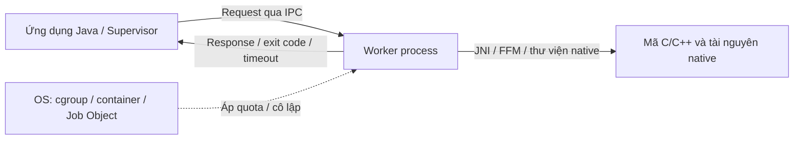

# Chọn tiến trình riêng khi cần ranh giới chịu lỗi hoặc giới hạn tài nguyên

## 1. Vấn đề trong tương tác Java với mã native

Khi Java gọi mã native qua JNI, Foreign Function & Memory API (FFM) hoặc một thư viện có mã C/C++ ở bên dưới, lời gọi đó có thể chạy **trong cùng tiến trình hệ điều hành với JVM**. Ranh giới Java/native không đồng nghĩa với ranh giới tiến trình:

- Mã native có thể truy cập vùng nhớ ngoài cơ chế an toàn kiểu và kiểm tra biên của Java. Lỗi con trỏ, truy cập vùng nhớ đã giải phóng, tràn bộ đệm hay gọi sai ABI có thể dẫn đến `SIGSEGV`, `SIGABRT`, lỗi truy cập bộ nhớ trên Windows hoặc chấm dứt toàn bộ JVM.
- Native code có thể bị treo, deadlock, tiêu thụ CPU vô hạn, cấp phát bộ nhớ ngoài heap, tạo thread và mở file descriptor/handle. Việc đặt `-Xmx` chỉ giới hạn **Java heap**, không đặt trần cho tổng RAM của tiến trình hay CPU mà native code sử dụng.
- `try/catch` trong Java xử lý exception Java. Nó **không** khôi phục an toàn một JVM đã bị `abort()`, lỗi bộ nhớ nghiêm trọng hoặc trạng thái native đã làm hỏng bộ nhớ tiến trình. `Thread.interrupt()` hay `Future.cancel(true)` cũng không bảo đảm dừng một lời gọi native đang bị kẹt.
- Nếu native code chạy trong JVM chính, một lỗi chí mạng có thể đưa xuống cả HTTP server, job scheduler hoặc thành phần điều phối đang hoạt động.

**Quy tắc:** Khi yêu cầu chịu lỗi hoặc kiểm soát tài nguyên quan trọng hơn chi phí gọi qua tiến trình, hãy đặt phần native rủi ro trong **tiến trình con riêng** (worker/helper). JVM chính làm supervisor và giao tiếp qua một giao thức liên tiến trình (IPC). Khi worker crash, treo hoặc vượt quota, supervisor có thể ghi nhận lỗi, dừng/thay worker và tiếp tục phục vụ tác vụ khác.

## 2. Ranh giới thực sự thay đổi điều gì?



**Cùng tiến trình:** JVM và thư viện native chia sẻ không gian địa chỉ, tài nguyên tiến trình và số phận khi process bị chấm dứt. Catch exception hoặc tạo thread Java riêng không biến native call thành một vùng chịu lỗi độc lập.

**Khác tiến trình:** JVM chính và worker có địa chỉ ảo, heap, stack, bảng handle/file descriptor và trạng thái kết thúc tiến trình riêng. Một segmentation fault trong worker thường chỉ làm worker kết thúc; supervisor nhận EOF, exit code bất thường hoặc mất kết nối. Hệ điều hành có thể đặt quota cho worker mà không áp trực tiếp lên JVM chính.

Nhưng **tách tiến trình không phải sandbox bảo mật hoàn chỉnh**. Hai tiến trình vẫn có thể cùng user, kernel, mạng, filesystem, quyền truy cập bí mật và giới hạn tài nguyên của host. Worker tiêu thụ hết RAM toàn máy vẫn có thể ảnh hưởng supervisor; OS có thể chọn giết tiến trình khác. Muốn ràng buộc tin cậy mạnh hơn phải dùng quyền hệ điều hành tối thiểu, quota, container/VM, sandbox phù hợp và kiểm soát IPC.

## 3. Chọn mô hình triển khai

| Phương án | Được gì | Giới hạn và khi phù hợp |
|---|---|---|
| JNI/FFM chạy trong JVM chính | Gọi trực tiếp, trao đổi dữ liệu ít phải sao chép, độ trễ nhỏ | Lỗi native có thể làm chết JVM; phù hợp thư viện đủ tin cậy, kiểm chứng tốt, tần suất gọi cao và không cần hard quota riêng |
| Thread hoặc `ExecutorService` riêng trong JVM | Quản lý luồng, phối hợp và timeout mức logic Java | **Không** cô lập crash, address space hay memory native; interrupt không bảo đảm hủy native call |
| Worker là tiến trình hệ điều hành riêng | Fault boundary, restart riêng, exit status, timeout và OS quota cho worker | Tốn phí khởi động, serialization/IPC, vận hành lifecycle; phù hợp codec, parser, driver, thư viện cũ hoặc tác vụ native không ổn định |
| Worker trong container/sandbox hoặc VM | Có thể bổ sung giới hạn CPU/RAM/PID, quyền, filesystem, network và mức cách ly mạnh hơn | Cần cấu hình runtime, giám sát và chính sách bảo mật; container vẫn dùng chung kernel host |

Không nên đặt tất cả native call vào tiến trình riêng một cách máy móc. Đầu tiên phải đánh giá mức độ rủi ro, yêu cầu độ trễ/thông lượng, kích thước payload, số lần gọi và chi phí vận hành.

### Dấu hiệu nên chọn tiến trình riêng

1. Thư viện native không đáng tin cậy, có lịch sử `SIGSEGV`/`abort`, chịu dữ liệu đầu vào chưa kiểm soát hoặc phụ thuộc driver/ABI khó bảo đảm.
2. Một lời gọi có thể treo và không có cơ chế hủy đáng tin từ phía thư viện.
3. Công việc có đỉnh CPU/RAM/native memory lớn, có thể dùng quota hệ điều hành mà không bóp nghẹt JVM chính.
4. Có thể định nghĩa request/response rõ ràng; worker ít cần truy cập trực tiếp vào object graph và trạng thái sống của JVM.
5. Cần cập nhật/restart worker độc lập, giảm blast radius và thu thập crash dump/log của native code riêng.

Nếu độ trễ chỉ vài microsecond và phải trao đổi hàng triệu object nhỏ, phí IPC và sao chép dữ liệu có thể vượt lợi ích. Hãy benchmark trước khi quyết định.

## 4. Cấu trúc supervisor–worker và hợp đồng IPC

Một thiết kế tối thiểu:

- **Supervisor Java:** nhận công việc, gán request ID, kiểm tra đầu vào, khởi động/chọn worker, áp deadline, giám sát sống/chết, kiểm tra exit code và quyết định retry.
- **Worker:** nhận request đã xác thực, gọi thư viện native, trả response có cấu trúc; không nắm quyền thao tác tùy ý lên tài nguyên của supervisor.
- **Kênh IPC:** stdin/stdout, socket TCP loopback, Unix domain socket, named pipe, gRPC hoặc message queue. Chọn theo tần suất gọi, lưu lượng, yêu cầu streaming và môi trường OS.
- **Hệ điều hành/runtime triển khai:** đặt quota CPU, RAM, PID, file descriptor, quyền filesystem/network; thu thập exit reason, RSS và log.

Ví dụ hai message JSON minh họa hợp đồng, **không phải code Java của ví dụ ở mục 5**:

```json
{"requestId":"req-42","operation":"decode","inputRef":"job/42/input.bin","deadlineMs":5000}
{"requestId":"req-42","status":"ok","outputRef":"job/42/output.bin"}
```

Quy ước rõ version giao thức, encoding, giới hạn kích thước, cách đóng khung message (ví dụ JSON Lines mỗi dòng một message hoặc length-prefix), thứ tự trả lời và lỗi có thể retry. Với dữ liệu lớn, cân nhắc truyền đường dẫn/handle tới vùng dữ liệu **đã được cấp quyền** thay vì nhồi hàng trăm MB qua JSON; đồng thời tránh path traversal, file bất hợp lệ và chia sẻ vùng nhớ thiếu đồng bộ.

Không lẫn stdout dành cho protocol với log debug: nếu dùng JSON Lines qua stdout, chuyển log sang stderr hoặc file riêng. Đối với request có side effect, phải định nghĩa idempotency key và trạng thái không chắc chắn khi worker chết trước lúc gửi ACK.

## 5. Ví dụ chạy được trên Java 17+: worker lỗi, worker treo và supervisor vẫn sống

Ví dụ dùng **JVM thứ hai để giả lập worker native** nhằm chứng minh ranh giới tiến trình mà không cần biên dịch thư viện C. Khi triển khai thật, thay lệnh chạy `NativeWorker` bằng executable/native helper đã đóng gói. Tạo hai tệp cùng thư mục:

**`NativeWorker.java`**

```java
public final class NativeWorker {
    public static void main(String[] args) throws InterruptedException {
        String mode = args.length == 0 ? "ok" : args[0];

        switch (mode) {
            case "ok" -> System.out.println("worker: ok");
            case "fail" -> {
                System.out.println("worker: simulated failure");
                System.exit(7);
            }
            case "hang" -> Thread.sleep(30_000);
            default -> {
                System.out.println("worker: invalid mode");
                System.exit(2);
            }
        }
    }
}
```

**`Supervisor.java`**

```java
import java.nio.file.Path;
import java.time.Duration;
import java.util.List;
import java.util.Locale;
import java.util.concurrent.TimeUnit;

public final class Supervisor {
    private static String javaExecutable() {
        String exe = System.getProperty("os.name")
                .toLowerCase(Locale.ROOT).contains("win")
                ? "java.exe" : "java";
        return Path.of(System.getProperty("java.home"), "bin", exe).toString();
    }

    private static int runWorker(String mode, Duration timeout) throws Exception {
        ProcessBuilder builder = new ProcessBuilder(
                javaExecutable(), "-cp", System.getProperty("java.class.path"),
                "NativeWorker", mode
        );
        // Demo đơn giản: thừa kế stdout/stderr để không làm đầy pipe chưa đọc.
        builder.inheritIO();
        Process child = builder.start();

        try {
            if (child.waitFor(timeout.toMillis(), TimeUnit.MILLISECONDS)) {
                return child.exitValue();
            }

            child.destroy(); // Yêu cầu dừng theo cơ chế OS.
            if (!child.waitFor(1, TimeUnit.SECONDS)) {
                child.destroyForcibly();
                child.waitFor();
            }
            return 124; // Mã do supervisor quy ước cho timeout.
        } catch (InterruptedException e) {
            child.destroyForcibly();
            Thread.currentThread().interrupt();
            throw e;
        }
    }

    public static void main(String[] args) throws Exception {
        for (String mode : List.of("ok", "fail", "hang")) {
            int exit = runWorker(mode, Duration.ofSeconds(5));
            System.out.printf("mode=%s exit=%d%n", mode, exit);
        }
        System.out.println("supervisor: alive");
    }
}
```

Biên dịch và chạy trong thư mục chứa hai file:

```bash
javac NativeWorker.java Supervisor.java
java Supervisor
```

Với máy chạy bình thường (worker khởi động trong 5 giây), đầu ra chuẩn là:

```text
worker: ok
mode=ok exit=0
worker: simulated failure
mode=fail exit=7
mode=hang exit=124
supervisor: alive
```

Giải thích từng kết quả:

- `ok`: worker in thông báo, kết thúc mã `0`; supervisor nhận `exitValue() == 0`.
- `fail`: worker tự kết thúc mã `7`; JVM supervisor không bị tắt. Trong thực tế, native crash thường tạo exit status/signal đặc thù hệ điều hành, **không phải lúc nào cũng là 7**.
- `hang`: worker ngủ 30 giây, vượt deadline 5 giây; supervisor yêu cầu dừng, dùng force kill nếu cần và trả mã timeout quy ước `124`. Mã `124` ở đây là **quy ước của supervisor**, không phải mã exit tự nhiên của child.
- Cuối cùng supervisor vẫn chạy đến dòng `supervisor: alive`. Không tạo thread Java riêng nào có thể cung cấp fault boundary tương đương trước crash native.

`ProcessBuilder` nhận **danh sách argument**, không ghép lệnh shell. Khi cần gọi binary thật, sử dụng đường dẫn executable tin cậy và các argument riêng: `new ProcessBuilder(nativeBinary, "--input", inputPath)`. Không tạo một chuỗi `sh -c`/`cmd /c` chứa dữ liệu người dùng vì rủi ro injection.

Ví dụ minh họa lifecycle đơn giản; hệ thống thực còn cần đọc/ghi IPC có giới hạn, ngắt việc gửi request mới khi worker chết, quản lý nhiều worker và bảo đảm dọn cả cây tiến trình con khi worker có spawn subprocess.

## 6. Timeout, crash và stream: những chi tiết dễ sai

**Timeout có hai tầng khác nhau.** Deadline của supervisor (`waitFor(timeout, ...)`) phát hiện việc xử lý lâu; khi hết hạn phải chấm dứt worker và quản lý tài nguyên của nó. Deadline **không tự giới hạn CPU/RAM**, và timeout ở Java không bảo đảm native code đang chạy trong cùng JVM sẽ dừng. Dùng cả timeout end-to-end ở IPC và quota OS khi cần hard limit.

**Không để pipe bị đầy.** `ProcessBuilder` mặc định tạo pipe cho stdout/stderr. Nếu supervisor gọi `waitFor()` nhưng không đọc hai stream, worker có thể kẹt khi pipe đầy và không kết thúc. Cách an toàn tùy nhu cầu:

- Với demo/CLI đơn giản: `inheritIO()` như trên.
- Với job nền: `redirectOutput(...)` và `redirectError(...)` vào file có rotation/quota, hoặc có hai bộ đọc bất đồng bộ draining stdout và stderr.
- Nếu stdout là protocol: đọc liên tục theo frame, giới hạn kích thước/bytes mỗi request; stderr phải được drain riêng hoặc redirect an toàn. `redirectErrorStream(true)` chỉ phù hợp khi có thể gộp log và payload, **không dùng** khi stdout cần JSON thuần.

**Xử lý trạng thái kết thúc:** phân biệt `exit=0`, lỗi nghiệp vụ có mã xác định, native crash, process start failure (ví dụ binary không tồn tại), protocol error, timeout và worker bị OS kill. Mỗi loại phải có log/metric, chính sách retry và cảnh báo phù hợp. Không giả định mọi exit code khác 0 đều retry được.

**Dọn dẹp:** `destroy()` thường yêu cầu dừng mềm theo OS, `destroyForcibly()` yêu cầu kết thúc cưỡng bức; hành vi cụ thể phụ thuộc nền tảng. Có thể dùng `ProcessHandle` để quan sát descendant, nhưng không được mặc định một lệnh kill child sẽ chấm dứt mọi cháu. Trong hệ thống cần quản lý cả cây tiến trình, cân nhắc process group, cgroup hoặc Windows Job Object và cleanup ở tầng quản lý process.

## 7. Giới hạn CPU, RAM và quyền ở đâu?

Java tiêu chuẩn cung cấp `ProcessBuilder` để khởi chạy/giám sát tiến trình, **không có API cross-platform tự đặt hard limit RAM/CPU cho mọi native child**. Chọn công cụ thực sự có quyền thực thi ràng buộc:

| Mục tiêu | Cơ chế phù hợp | Không nên nhầm với |
|---|---|---|
| Dừng một job chạy quá thời gian | Deadline supervisor + kill worker/process group | `Thread.interrupt()` đối với native call không hợp tác |
| Giới hạn RAM tổng của worker | Linux cgroup/container `memory.max` hoặc quota tương đương; Windows Job Object | `-Xmx` chỉ giới hạn Java heap, không bao gồm toàn bộ native allocation/RSS |
| Giới hạn CPU dùng được | Linux cgroup CPU quota, container `--cpus`, Windows Job Object | Java thread priority hoặc `Thread.sleep()` |
| Giới hạn số tiến trình/thread | cgroup `pids.max`, container `--pids-limit`, chính sách OS | Chỉ đếm thread trong Java |
| Hạn chế file descriptor/handle, file, network, đặc quyền | `ulimit`/rlimit khi áp dụng đúng, container policy, user riêng, ACL, seccomp/AppArmor/SELinux tùy OS | Một lớp Java wrapper không thay thế OS policy |

Ví dụ **minh họa vận hành Linux qua Docker** (cần image đã build và tương thích tính năng):

```bash
docker run --rm --memory=512m --cpus=1 --pids-limit=64 \
  --network=none --read-only --tmpfs /tmp:rw,noexec,nosuid \
  --cap-drop=ALL my-native-worker:version
```

Docker flags trên đặt một số quota và hạn chế quyền cho container worker; cần kiểm tra runtime thực tế, cgroup, nhu cầu ghi file và đặc tính hệ điều hành. `--memory` tác động tổng bộ nhớ tính theo chính sách cgroup, có thể dẫn đến OOM kill. Ngay cả với quota, host-level exhaustion, disk I/O, kernel bug hoặc cấu hình container sai vẫn có thể ảnh hưởng hệ thống khác.

Nếu worker thực chất là JVM con, `-Xmx256m` có thể **bổ sung** trần Java heap để giữ chỗ cho metaspace, stack, direct buffer và native memory trong giới hạn container lớn hơn. Không đặt `-Xmx` đúng bằng toàn bộ memory quota rồi cho rằng đã an toàn.

## 8. Thiết kế chịu lỗi trong sản phẩm thực tế

### Giao thức và trạng thái

- Gắn `requestId` cho từng request; lưu trạng thái `PENDING/RUNNING/SUCCEEDED/FAILED/TIMED_OUT/UNKNOWN` ở supervisor. Response phải khớp request ID, version schema và kích thước cho phép.
- Có **deadline tổng** từ lúc xếp hàng đến lúc trả kết quả; phân biệt thời gian chờ queue, khởi động worker, xử lý native và truyền dữ liệu. Đừng chỉ timeout `waitFor()` sau khi request đã treo.
- Với write/side effect, worker chết sau khi làm xong nhưng trước khi ACK tạo trạng thái **không biết chắc đã thành công hay chưa**. Dùng idempotency key, transaction/outbox hoặc đối soát trước khi retry; không hứa exactly-once chỉ nhờ IPC.
- Worker có version API rõ ràng. Kiểm tra handshake/capability đầu phiên; không gửi request mới vào worker đang shutdown, crash loop hoặc chưa sẵn sàng.

### Phục hồi và chống lây lan sự cố

- Supervisor giám sát PID/health heartbeat, mã thoát, timeout, số lần restart, RSS, CPU, log và crash dump (nếu có, tránh ghi bí mật).
- Retry có giới hạn, exponential backoff và jitter; lỗi định dạng input hoặc vi phạm schema nên trả lỗi dứt khoát, không retry vô hạn. Với crash lặp lại trên cùng input, đưa job vào dead-letter/quarantine để tránh crash loop.
- Worker pool giữ số tiến trình cố định hoặc bounded; dùng queue có giới hạn và backpressure. Tăng vô hạn số worker có thể làm cạn RAM/PID ngay cả khi mỗi worker có quota.
- Startup/cleanup phải idempotent; xử lý shutdown của supervisor, worker bị kill, timeout và orphan processes. Dùng process group/cgroup/Job Object khi cần dọn các subprocess của worker.
- Đặt liveness/readiness riêng: một process tồn tại chưa có nghĩa native subsystem sẵn sàng hoặc còn xử lý được.

### Nguyên tắc bảo mật

- Chạy worker dưới user/quyền riêng có ít đặc quyền; không mặc định truyền toàn bộ environment/secrets của supervisor cho worker. Chỉ truyền biến môi trường thực sự cần.
- Xác thực peer IPC nếu có đường kết nối từ bên ngoài; hạn chế port, socket/file permission, kích thước message, path truy cập và request rate.
- Không tin dữ liệu do worker gửi chỉ vì nó là tiến trình cùng máy; kiểm tra schema, độ dài, đường dẫn và kết quả trước khi sử dụng.
- Nếu xử lý dữ liệu không tin cậy, dùng sandbox/container/VM phù hợp threat model. Process isolation giúp **giảm phạm vi ảnh hưởng của lỗi**, không tự bảo đảm chống mã native độc hại.

## 9. Chi phí, tối ưu và kiểm chứng

IPC mang lại chi phí khởi động, context switch, serialization và copying. Để không làm giảm thông lượng không cần thiết:

1. Giữ worker lâu dài bằng một pool vừa đủ thay vì mở process mỗi request; nhưng khởi động lại định kỳ khi có bằng chứng memory leak/fragmentation hoặc tính trạng thái khó khôi phục.
2. Batch các thao tác nhỏ khi đáp ứng deadline; streaming hoặc shared memory có kiểm soát có thể hữu ích cho payload lớn, song tăng phức tạp và trách nhiệm đồng bộ.
3. Đo `p50/p95/p99` end-to-end latency, CPU, RSS/native memory, số lần crash/restart, thời gian queue, timeout, tỉ lệ retry và memory peak theo tải.
4. Benchmark cùng payload, tần suất và quy mô worker trên máy triển khai thật. Tính cả thời gian startup lạnh, JSON parse, file copy, GC của JVM chính và OOM behavior; không chỉ đo thời gian hàm native.

Bộ kiểm chứng tối thiểu nên có:

| Kịch bản | Kết quả mong đợi |
|---|---|
| Worker hoàn thành bình thường | Supervisor nhận đúng response và `exit=0` (hoặc trạng thái thành công từ protocol) |
| Worker trả lỗi nghiệp vụ | Trả lỗi có phân loại, không làm tắt supervisor |
| Native worker crash/abort | Mất worker được phát hiện; JVM chính còn sống, request được đánh dấu `FAILED/UNKNOWN` phù hợp |
| Worker deadlock hoặc không phản hồi | Deadline hết hạn, worker bị dừng, request `TIMED_OUT`, không rò orphan |
| Worker cấp phát vượt quota | OS giới hạn/kill worker; supervisor còn chạy nếu host và chính sách cấp tài nguyên còn đủ |
| Worker ghi stdout/stderr liên tục | Không deadlock do pipe, log/response có giới hạn kích thước |
| Crash sau side effect trước ACK | Không retry mù gây xử lý lặp; áp dụng idempotency/đối soát |
| Nhiều request đến khi pool đầy | Queue bounded/backpressure, JVM chính không tạo vô hạn process |

## 10. Lỗi thường gặp và cách tự kiểm tra quyết định

- **“Đã bọc `try/catch` nên native crash sẽ không làm chết JVM.”** Sai: native crash có thể kết thúc process trước khi Java bắt được exception.
- **“Đưa native vào thread khác là đủ an toàn.”** Sai: các thread chia sẻ address space và process lifetime.
- **“`Future.get(5, SECONDS)` giới hạn CPU/RAM.”** Sai: nó chỉ giới hạn thời gian chờ của caller; công việc có thể tiếp tục và tiêu thụ tài nguyên.
- **“`-Xmx` chính là RAM hard limit.”** Sai: heap chỉ là một phần footprint của JVM; native process còn có memory riêng.
- **“`destroyForcibly()` giết cả cây con.”** Không được bảo đảm. Quản lý process group/cgroup/Job Object nếu worker spawn process khác.
- **“Tách worker nghĩa là code native không thể gây hại.”** Sai: cần sandbox/quyền/quota cụ thể; worker vẫn có thể tác động filesystem, mạng, tài nguyên chung.
- **“Lỗi thì retry luôn.”** Nguy hiểm với side effect không idempotent và crash do input cố định.
- **“Chỉ kiểm tra exit code.”** Chưa đủ cho worker sống lâu: cần protocol correlation, timeout, health, log, quota và nhận diện EOF bất thường.

**Checklist ra quyết định:** Native code có thể làm hỏng JVM chính không? Có thể bị treo hoặc vượt native memory không? Hậu quả khi crash là gì? Có thể tách request/response không? Latency và lưu lượng IPC có chấp nhận được không? OS sẽ cưỡng chế quota bằng cơ chế nào? Ai restart/cleanup và ai xử lý side effect không chắc trạng thái? Nếu cần fault boundary hoặc hard quota rõ ràng, thiết kế worker process độc lập cùng supervisor và quota OS; nếu không, chọn tích hợp trong JVM sau khi đánh giá độ tin cậy và hiệu năng.