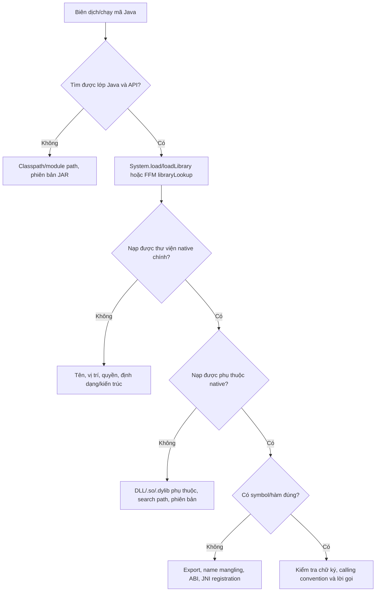

# Phân loại lỗi không thấy thư viện, thiếu phụ thuộc và không thấy ký hiệu khi Java gọi native

## 1. Mục tiêu và cách nhìn đúng

Trong Java native interoperability (JNI, JNA hoặc Foreign Function & Memory API), thông báo “không thấy” có thể xuất hiện ở **nhiều tầng khác nhau**. Cùng là `UnsatisfiedLinkError`, nhưng nguyên nhân có thể là thiếu tệp thư viện chính, thiếu một thư viện mà nó phụ thuộc, sai kiến trúc, hoặc thiếu hàm native được gọi. Phải xác định **tầng thất bại** trước khi sửa đường dẫn.

Sau bài này, bạn có thể:
- Phân biệt lỗi tìm **lớp Java/JAR** với lỗi tìm **thư viện native** (`.so`, `.dylib`, `.dll`).
- Phân biệt không tìm thấy **thư viện chính**, không tải được **phụ thuộc bắc cầu**, và không phân giải được **symbol/hàm**.
- Chọn lệnh chẩn đoán đúng trên Linux, macOS, Windows; nhận ra lỗi kiến trúc, ABI và phiên bản.
- Chẩn đoán JNI bằng `javac -h` và symbol đã export; hiểu khác biệt khi dùng FFM API.

**Phạm vi:** “thư viện” ở đây chủ yếu là thư viện native được Java tải hoặc gọi. Java dependency cũng được nhắc đến để tránh nhầm triệu chứng, nhưng trọng tâm là ranh giới Java ↔ mã máy.

## 2. Chuỗi nạp và liên kết: lỗi ở mắt xích nào?



Các tầng khác nhau sử dụng các cơ chế tìm kiếm khác nhau:

| Tầng | Thứ cần tìm | Cơ chế/đường dẫn liên quan |
| --- | --- | --- |
| Java compile/runtime | `.class`, `.jar`, module, phương thức Java | `-classpath`/`-cp`, `--module-path`, dependency graph |
| JVM tìm thư viện native chính với `loadLibrary` | Ví dụ `libcodec.so`, `libcodec.dylib`, `codec.dll` | Tên logic trong `System.loadLibrary("codec")`; cơ chế JVM và `java.library.path` |
| Bộ nạp động của hệ điều hành | Các thư viện phụ thuộc (`DT_NEEDED`, load commands, DLL imports) | Linux: `RPATH/RUNPATH`, `LD_LIBRARY_PATH`, cache/default dirs; macOS: install name/`@rpath`; Windows: DLL search order |
| Bộ liên kết động / JNI / FFM | Hàm hoặc biến được export | Symbol table, tên chính xác, JNI naming/`RegisterNatives`, ABI, phiên bản thư viện |

**Điểm then chốt:** tìm thấy tệp `libcodec.so` **không chứng minh** mọi thư viện mà nó cần đều tồn tại, và nạp thành công tệp `.so` **không chứng minh** hàm `decode` đã được export với tên/chữ ký mà phía gọi yêu cầu.

## 3. Bảng nhận diện triệu chứng

Các câu thông báo dưới đây là **ví dụ điển hình**, phụ thuộc JDK và hệ điều hành; không coi chúng là chuỗi cố định trên mọi máy.

| Triệu chứng / pha phát sinh | Phân loại sơ bộ | Cần xác minh đầu tiên |
| --- | --- | --- |
| `javac: cannot find symbol`, `package ... does not exist` | **Lỗi biên dịch Java** | Import, tên lớp, JAR, phiên bản API, `-cp`/module path |
| `ClassNotFoundException`, `NoClassDefFoundError` | **Không nạp được lớp Java**; riêng `NoClassDefFoundError` đôi khi là hậu quả của khởi tạo lớp thất bại trước đó | Stack trace đầu tiên, classpath/module path, `Caused by` |
| `java.lang.NoSuchMethodError` / `NoSuchFieldError` | **Không tương thích binary của API Java** | Phiên bản JAR biên dịch so với lúc chạy, dependency bị trùng |
| `UnsatisfiedLinkError: no codec in java.library.path` | **Không định vị được thư viện native chính** | Tên logic, tên tệp thực, đường dẫn mà JVM đang dùng |
| `UnsatisfiedLinkError: Can't load library: /.../libcodec.so` | **Không nạp được tệp native được chỉ đích danh** | Tệp, quyền, định dạng, kiến trúc, phụ thuộc; xem chi tiết lỗi OS |
| `libhelper.so: cannot open shared object file: No such file or directory` trong lúc nạp `libcodec.so` | **Thiếu phụ thuộc native bắc cầu** | `readelf -d`, `ldd` với tệp tin cậy, đường dẫn tìm phụ thuộc |
| Windows: `The specified module could not be found` dù `codec.dll` tồn tại | **Có thể thiếu DLL phụ thuộc** (hoặc tìm sai DLL chính) | `dumpbin /DEPENDENTS`, DLL search order, kiến trúc |
| Linux: `undefined symbol: helper_init`; macOS: `Symbol not found: ...`; Windows: `The specified procedure could not be found` | **Không phân giải được symbol native** | Bản thư viện thực đã nạp, export table, tên C/C++, phiên bản ABI |
| `UnsatisfiedLinkError: 'int ...NativeMath.add(int, int)'` khi gọi `native` method | **JNI method chưa được nối tới implementation phù hợp** | `javac -h`, export `Java_...` hoặc đăng ký `RegisterNatives` |
| `ld: undefined reference to ...` khi chạy `gcc`/`g++` | **Lỗi ở bước link mã C/C++** trước khi chạy Java | Cờ `-l`, thứ tự link, thư viện cung cấp symbol, mangling |
| `wrong ELF class`, `bad CPU type`, lỗi Win32/bitness, `GLIBCXX_... not found` | **Sai kiến trúc/ABI/phiên bản native runtime** | x86-64/arm64, 32/64-bit, libc/libstdc++ và toolchain |

**Không suy luận từ tên exception duy nhất.** `UnsatisfiedLinkError` vừa có thể xảy ra ở `System.loadLibrary`, vừa có thể xuất hiện khi gọi một phương thức `native`. Vị trí stack trace quyết định nhánh điều tra.

## 4. Ba nhóm lỗi native phải tách rõ

### 4.1. Không tìm thấy thư viện chính

Ví dụ Java gọi:

```java
System.loadLibrary("codec");
```

JVM nhận **tên logic** `codec`, không nhận chuỗi `libcodec.so` hoặc đường dẫn. Tên tệp được ánh xạ theo nền tảng; thông thường là `libcodec.so` (Linux), `libcodec.dylib` (macOS), `codec.dll` (Windows). Có thể kiểm tra ánh xạ bằng `System.mapLibraryName("codec")`.

Dấu hiệu: thông báo kiểu `no codec in java.library.path`, hoặc chính thư viện được yêu cầu không có ở vị trí JVM tìm. Kiểm tra:
1. Tệp thực sự tồn tại trong container/máy **đang chạy tiến trình Java**, với đúng tên và đúng chữ hoa/thường.
2. `java.library.path` của **tiến trình đó** chứa thư mục cần thiết; nếu chỉnh bằng `-Djava.library.path=...`, đặt trước tên lớp/JAR khi khởi động JVM.
3. Nếu biết đường dẫn tuyệt đối, `System.load("/absolute/path/libcodec.so")` giúp kiểm tra việc tìm **tệp chính**; cách này không tự giải quyết các thư viện phụ thuộc.
4. Tệp bên trong JAR không tự trở thành thư viện mà OS loader có thể mở từ filesystem. Một số framework tự trích xuất thư viện ra tệp thực; hãy kiểm tra vị trí trích xuất, quyền và cơ chế dọn dẹp của chúng.

Đừng nhầm `java.library.path` với `CLASSPATH`. `System.setProperty("java.library.path", "...")` sau khi JVM đã chạy **không phải** biện pháp đáng tin để đổi đường tìm thư viện trên các phiên bản/JVM.

### 4.2. Có thư viện chính, nhưng thiếu phụ thuộc của nó

Giả sử `libcodec.so` phụ thuộc `libhelper.so.2`:

```text
Java -> System.loadLibrary("codec")
     -> tìm thấy libcodec.so
     -> OS loader đọc DT_NEEDED: libhelper.so.2
     -> không tìm được libhelper.so.2
     -> lỗi nạp libcodec.so
```

**Chẩn đoán đúng:** kiểm tra `NEEDED`/imports của `libcodec`, vị trí `libhelper`, và quy tắc tìm thư viện **của OS loader**. Trên Linux, có thể phải điều chỉnh `RUNPATH` (`$ORIGIN` dùng cho đường dẫn tương đối với thư viện), cấu hình linker cache hoặc môi trường của tiến trình. Trên Windows, DLL phụ thuộc được tra theo quy tắc DLL search order; dù nạp DLL chính bằng đường dẫn tuyệt đối, các DLL phụ thuộc vẫn cần được tìm hợp lệ.

Tình huống dễ nhầm: `codec.dll` ở đúng thư mục và `java.library.path` cũng đúng, nhưng vẫn báo “module not found”. Phải kiểm tra **những DLL mà `codec.dll` import**, không chỉ sự tồn tại của nó.

### 4.3. Nạp được thư viện, nhưng thiếu symbol

**Symbol** là tên mà linker/loader dùng để định vị hàm hoặc biến native. Lỗi có thể đến từ:
- Hàm chưa được build hoặc chưa export (`hidden` visibility, không đưa object file vào thư viện).
- Sai tên do C++ name mangling, `extern "C"` bị thiếu, chữ hoa/thường hoặc hậu tố phiên bản.
- Thư viện phiên bản cũ được nạp thay cho phiên bản mong đợi; symbol chỉ có trong phiên bản mới.
- JNI method có tên/signature không khớp, hoặc `RegisterNatives` chưa đăng ký.
- FFM `SymbolLookup.find("name")` tìm sai tên hoặc dùng sai lookup scope.

**Phân biệt thời điểm:** lỗi `undefined reference` từ chương trình linker khi build mã C/C++ khác với `undefined symbol` lúc runtime. Native loader có thể báo symbol thiếu ngay khi nạp hoặc muộn hơn khi resolve/call, tùy nền tảng và chế độ liên kết.

Cần xem **symbol xuất ra của đúng tệp binary được nạp**, không chỉ grep mã nguồn C/C++.

## 5. Quy trình chẩn đoán theo bằng chứng

### Bước 1 — Chốt thời điểm, thông báo gốc, môi trường

Lưu **lần lỗi đầu tiên** (full stack trace, `Caused by`, toàn bộ dòng native loader), lệnh khởi động Java, JDK/JRE, kiến trúc máy/container và cách đóng gói thư viện. Xác định lỗi xảy ra:
- khi `javac` biên dịch;
- khi JVM tải lớp Java;
- tại `System.load`/`System.loadLibrary` hoặc `SymbolLookup.libraryLookup`;
- khi gọi một phương thức `native` hoặc tìm symbol;
- trong quá trình link C/C++.

Một lỗi gốc lúc khởi tạo lớp có thể khiến những lần sau chỉ thấy `NoClassDefFoundError: Could not initialize class ...`. Vì thế, log của lần khởi tạo ban đầu có giá trị hơn log retry.

Kiểm tra môi trường Java:

```bash
java -version
javac -version
java -XshowSettings:properties -version
```

Từ dòng properties, tìm `java.home`, `os.name`, `os.arch`, `java.library.path`. Chạy lệnh trong **đúng runtime** dùng để tái hiện (terminal, IDE, Docker image, container pod, service), vì `JAVA_HOME`, `PATH` và filesystem của các môi trường này có thể khác nhau.

### Bước 2 — Phân nhánh Java hay native

Nếu có `cannot find symbol` ngay tại `javac`, sửa import/API/compile classpath. Nếu có `NoClassDefFoundError`/`ClassNotFoundException`, kiểm tra runtime classpath và nguyên nhân lồng trong stack trace. Nếu có `NoSuchMethodError`, kiểm tra version conflict giữa các JAR. **Chưa dùng `ldd` hoặc sửa `java.library.path`** cho các lỗi thuần Java đó.

Nếu lỗi bắt đầu ở `System.load*`/native lookup, đi tiếp.

### Bước 3 — Kiểm tra thư viện chính

- Ghi lại tên gọi trong mã (`"codec"` hay đường dẫn tuyệt đối), tên tệp được kỳ vọng và tệp thực tế.
- Kiểm tra path, quyền đọc/mở, định dạng, kiến trúc. Với `System.loadLibrary`, ưu tiên cấu hình đúng ở startup; nếu dùng `System.load`, cần đường dẫn tuyệt đối.
- Nếu không tìm được thư viện chính: sửa packaging/deployment hoặc đường tìm của JVM, rồi thử lại trong tiến trình **mới**.

### Bước 4 — Kiểm tra toàn bộ phụ thuộc native

Với Linux, đọc `NEEDED`, `RPATH`/`RUNPATH`; với macOS xem dylib install names, `@rpath`; với Windows liệt kê DLL imports. Tìm phụ thuộc thiếu, version yêu cầu và vị trí mà OS loader thực sự duyệt. Không tự tạo symlink từ thư viện phiên bản không tương thích chỉ để “hết not found”.

### Bước 5 — Kiểm tra symbol, JNI và ABI

- Đối chiếu **tên chính xác** symbol phía caller yêu cầu với export table.
- JNI: so `native` declaration với header sinh bởi `javac -h`, tên `Java_<class>_<method>`, tham số `JNIEnv*`, `jobject`/`jclass`, primitive types; nếu dùng `RegisterNatives`, kiểm tra mapping đã đăng ký.
- C++: kiểm tra `extern "C"`, visibility, mangling, cách build và export.
- FFM: xác minh lookup nhận đúng thư viện, `find` có trả về địa chỉ không, mô tả `FunctionDescriptor`/ABI phù hợp trước khi downcall.
- Đối chiếu cả kiến trúc (32/64-bit, x86-64/aarch64) và native runtime/toolchain version.

### Bước 6 — Xác nhận bản sửa

Khởi động **một tiến trình sạch** với binary và môi trường đúng. Kiểm tra tải thư viện chính thành công, phụ thuộc được tìm, symbol tồn tại và một lời gọi nhỏ cho kết quả đúng. Ghi lại bản binary, checksum/phiên bản, command line và môi trường để tránh “chạy ở máy tôi” nhưng lỗi ở production.

## 6. Lệnh kiểm tra theo hệ điều hành

### Linux (ELF, `.so`)

Giả sử bạn có `libcodec.so` hợp lệ, được build từ nguồn tin cậy:

```bash
file libcodec.so
readelf -h libcodec.so
readelf -d libcodec.so
readelf -Ws libcodec.so
nm -D --defined-only libcodec.so
ldd libcodec.so
```

Cách đọc:
- `file`/`readelf -h`: xem định dạng ELF, 32/64-bit, machine/architecture.
- `readelf -d`: xem các mục `NEEDED`, `RPATH`, `RUNPATH`.
- `readelf -Ws` và `nm -D --defined-only`: kiểm tra symbol mà dynamic linker có thể thấy; đối chiếu tên chính xác.
- `ldd`: cho biết các thư viện phụ thuộc được resolve tới đâu và chỗ nào `not found`. **Chỉ dùng `ldd` với binary tin cậy**; để kiểm tra metadata của binary không tin cậy, ưu tiên `readelf`.

Để quan sát đường tra cứu khi tái hiện trên Linux:

```bash
LD_DEBUG=libs java -Djava.library.path=/opt/app/native -cp app.jar com.example.Main
```

`LD_DEBUG=libs` là cơ chế của dynamic linker trên hệ Linux dùng glibc; không áp dụng giống hệt trên mọi libc/OS. Output dài, lọc theo tên thư viện cần tìm. `LD_LIBRARY_PATH` cũng thuộc tầng native loader (có ràng buộc bảo mật và khác biệt theo môi trường); `RPATH`/`RUNPATH` có quy tắc ưu tiên riêng, không nên kết luận mọi tiến trình đều tìm theo một danh sách cố định.

### macOS (Mach-O, `.dylib`)

```bash
file libcodec.dylib
otool -L libcodec.dylib
otool -l libcodec.dylib
nm -gU libcodec.dylib
```

`otool -L` liệt kê dependent dylibs và install names. Xem `LC_RPATH` trong `otool -l` nếu có `@rpath/...`; `@loader_path` và `@executable_path` cũng là các thành phần giải quyết đường dẫn quan trọng. `nm -gU` hỗ trợ kiểm tra symbol global defined; ký hiệu C trên Mach-O có thể được biểu diễn với dấu `_` phía trước. Không mặc định rằng `DYLD_LIBRARY_PATH` sẽ luôn có hiệu lực: macOS có các hạn chế liên quan tới tiến trình được bảo vệ.

### Windows (PE, `.dll`)

Trong **Developer Command Prompt** có công cụ MSVC:

```bat
dumpbin /HEADERS codec.dll
dumpbin /DEPENDENTS codec.dll
dumpbin /EXPORTS codec.dll
where java
where codec.dll
```

`/HEADERS` cho biết machine/format; `/DEPENDENTS` xem import DLL; `/EXPORTS` xem các tên hàm công khai. `where codec.dll` chỉ phản ánh một số đường tìm qua môi trường shell, **không phải mô phỏng đầy đủ Windows DLL loader**. Kiểm tra PATH, thư mục ứng dụng, các thư mục DLL được cấu hình cho process và kiến trúc của cả JVM lẫn DLL. Có thể dùng công cụ phân tích dependency PE phù hợp nếu lỗi phụ thuộc sâu.

> Không chạy lệnh kiểm tra binary thuộc hệ điều hành khác trên máy hiện tại rồi suy ra “thiếu thư viện”. Phải dùng công cụ đúng định dạng và đúng môi trường triển khai.

## 7. Java 17+: chương trình probe nạp thư viện chính

Tạo **`NativeLibraryProbe.java`**:

```java
public final class NativeLibraryProbe {
    public static void main(String[] args) {
        String name = args.length > 0 ? args[0] : "codec";

        System.out.println("java.version=" + System.getProperty("java.version"));
        System.out.println("os.name=" + System.getProperty("os.name"));
        System.out.println("os.arch=" + System.getProperty("os.arch"));
        System.out.println("java.library.path=" + System.getProperty("java.library.path"));
        System.out.println("mapped.name=" + System.mapLibraryName(name));

        try {
            System.loadLibrary(name);
            System.out.println("loadLibrary=OK");
        } catch (UnsatisfiedLinkError error) {
            System.err.println("loadLibrary=FAILED");
            error.printStackTrace(System.err);
        }
    }
}
```

Biên dịch/chạy:

```bash
javac NativeLibraryProbe.java
java -Djava.library.path=/opt/app/native NativeLibraryProbe codec
```

Chương trình in môi trường mà JVM thực dùng, tên tệp ánh xạ và kết quả nạp. Nếu thư viện `codec` tương thích, load thành công thì dòng cuối trên stdout là `loadLibrary=OK`; nếu không, stderr chứa stack trace gốc. Không cố định toàn bộ output vì tên tệp, đường dẫn và nguyên nhân phụ thuộc OS. Chương trình **chỉ kiểm tra load**, chưa gọi symbol cụ thể; do đó `loadLibrary=OK` không loại trừ lỗi khi gọi `native` method.

Có thể thử `System.load("/absolute/path/to/libcodec.so")` trong chương trình nhỏ riêng để kiểm tra thư viện chính theo đường tuyệt đối; đừng thay logic production mù quáng nếu chưa xử lý các dependency của thư viện.

## 8. Ví dụ JNI chạy được trên Linux: nhận diện lỗi symbol

Ví dụ sau dùng **JDK 17+**, GCC và thư viện JNI tối giản, để thấy rõ tên symbol mà Java mong đợi.

Tạo **`NativeMath.java`**:

```java
public final class NativeMath {
    static {
        System.loadLibrary("native_math");
    }

    private static native int add(int a, int b);

    public static void main(String[] args) {
        System.out.println(add(2, 3));
    }
}
```

Sinh header bằng JDK (tránh tự đoán tên hàm JNI):

```bash
javac -h . NativeMath.java
```

JDK sinh **`NativeMath.h`**, trong đó khai báo function `Java_NativeMath_add`. Tạo **`native_math.c`**:

```c
#include "NativeMath.h"

JNIEXPORT jint JNICALL Java_NativeMath_add(
        JNIEnv *env, jclass clazz, jint a, jint b) {
    (void)env;
    (void)clazz;
    return a + b;
}
```

Biên dịch shared library và chạy, với `JAVA_HOME` trỏ tới thư mục JDK:

```bash
gcc -fPIC -shared \
  -I"$JAVA_HOME/include" -I"$JAVA_HOME/include/linux" \
  -o libnative_math.so native_math.c
nm -D --defined-only libnative_math.so
java -Djava.library.path=. NativeMath
```

**Stdout của `java` khi toàn bộ bước thành công:**

```text
5
```

Ở đây có ba trạng thái dễ phân biệt:
1. **Xóa/đặt sai vị trí** `libnative_math.so`: JVM không tìm thấy thư viện chính; lỗi tại initializer `System.loadLibrary`.
2. **Thư viện có mặt nhưng gọi phương thức native không có implementation**: ví dụ xuất sai tên `Java_NativeMath_add`; thư viện có thể load thành công nhưng `add(2, 3)` sinh `UnsatisfiedLinkError`.
3. **Thư viện được liên kết với một `.so` khác không có trong runtime**: lỗi đến từ OS loader khi nạp phụ thuộc, dù `libnative_math.so` vẫn hiện hữu.

Với ví dụ JNI này, `add` là `static` nên đối số thứ hai ở C là `jclass`; với native method **instance** thì là `jobject`. JNI cho phép đăng ký hàm bằng `RegisterNatives`, nên trong trường hợp đăng ký động, không nhất thiết phải thấy tên `Java_...` trong export table. Khi gọi C++ native code, cần kiểm tra linkage `extern "C"`/name mangling và export visibility. Một symbol có tên đúng nhưng signature/ABI thực tế sai vẫn có thể gây crash hoặc lỗi dữ liệu, không chỉ `UnsatisfiedLinkError`.

## 9. FFM API (JDK 22+): lỗi tra symbol khác lỗi nạp thư viện

FFM API chuẩn hóa trong JDK 22 cung cấp `SymbolLookup.libraryLookup(Path, Arena)` để nạp/truy vấn một thư viện và `find("symbol")` để tìm địa chỉ hàm. Nếu thư viện không thể mở, `libraryLookup` có thể báo `IllegalArgumentException`; nếu mở được nhưng không thấy tên hàm, `find` trả `Optional.empty()`.

Chương trình **`FfmSymbolProbe.java`** (JDK 22+):

```java
import java.lang.foreign.Arena;
import java.lang.foreign.SymbolLookup;
import java.nio.file.Path;

public final class FfmSymbolProbe {
    public static void main(String[] args) {
        if (args.length != 2) {
            System.err.println("Usage: FfmSymbolProbe <library-path> <symbol>");
            return;
        }

        try (Arena arena = Arena.ofConfined()) {
            SymbolLookup lookup = SymbolLookup.libraryLookup(
                    Path.of(args[0]).toAbsolutePath(), arena);
            boolean found = lookup.find(args[1]).isPresent();
            System.out.println(found ? "FOUND" : "MISSING");
        }
    }
}
```

```bash
javac FfmSymbolProbe.java
java --enable-native-access=ALL-UNNAMED FfmSymbolProbe /abs/path/libcodec.so codec_init
```

Ở đây stdout là `FOUND` khi có symbol hoặc `MISSING` khi không có; lỗi nạp/thư viện không hợp lệ có thể tạo exception thay vì hai giá trị đó. Cờ `--enable-native-access=ALL-UNNAMED` là ví dụ cho chương trình ở classpath dùng restricted native access trong JDK 22; khi chạy dưới named module phải cấp quyền cho module tương ứng. Lỗi `IllegalCallerException` do quyền native access khác hoàn toàn với “symbol không tồn tại”. Sau bước tìm symbol, downcall qua `Linker` còn đòi hỏi **đúng native calling convention, `FunctionDescriptor`, layout và lifetime**; chỉ thấy symbol chưa chứng minh lệnh gọi an toàn.

JDK 17 chưa có **API chuẩn** `java.lang.foreign` như JDK 22; không dùng đoạn FFM này để kết luận về một runtime JDK 17. Với JNA, phải kiểm tra thêm cơ chế tìm thư viện và symbol riêng của JNA, cùng JAR `jna` được đưa vào runtime.

## 10. Các ca điển hình và hướng sửa tận gốc

### Ca A — `no codec in java.library.path`

**Quan sát:** không có tệp native tương ứng tại các thư mục mà JVM dùng, trong khi JAR Java vẫn tải được. **Kết luận:** thiếu thư viện trực tiếp. **Sửa:** ship đúng binary cho OS/CPU, tên theo nền tảng, cấu hình load path lúc khởi động JVM; không sửa `-cp` thay cho native path.

### Ca B — `libhelper.so.2: cannot open shared object file`

**Quan sát:** `libcodec.so` tồn tại, `readelf -d` liệt kê `NEEDED` là `libhelper.so.2`, `ldd` trên binary tin cậy cho thấy `libhelper.so.2 => not found`. **Kết luận:** thiếu phụ thuộc native. **Sửa:** đóng gói bản `libhelper` tương thích và cấu hình OS loader path/`RUNPATH` cho đúng; kiểm tra cả dependencies của `libhelper`.

### Ca C — JNI method không nối được

**Quan sát:** `loadLibrary` đã thành công nhưng lúc gọi `NativeMath.add` phát sinh `UnsatisfiedLinkError`; `javac -h` sinh `Java_NativeMath_add`, còn binary không export symbol đó và cũng không có `RegisterNatives` phù hợp. **Kết luận:** thiếu JNI implementation đúng. **Sửa:** build/link object chứa hàm, export với tên và chữ ký JNI chuẩn; rebuild cùng header hiện hành.

### Ca D — Symbol tồn tại ở source nhưng lỗi `undefined symbol`

**Quan sát:** source có `helper_init`, binary đang load không export hoặc đang nạp version khác. **Kết luận:** khác biệt giữa source và artifact/ABI. **Sửa:** kiểm tra đường dẫn binary thực, export visibility, build flags, version pinning; trên C++ kiểm tra mangling. Không vá bằng cách đổi tên symbol ngẫu nhiên.

### Ca E — Mismatched architecture/ABI

**Quan sát:** JVM 64-bit x86-64 nhưng tệp `.so`/`.dll` thuộc 32-bit hoặc arm64; hoặc lỗi `GLIBC_...`/`GLIBCXX_... not found`. **Kết luận:** binary/runtime không tương thích. **Sửa:** phát hành artifact đúng OS/CPU và toolchain/runtime, hoặc build lại với hệ thống target phù hợp. Đổi `java.library.path` không chuyển một binary sai kiến trúc thành binary hợp lệ.

### Ca F — `NoSuchMethodError` sau khi đổi dependency Maven/Gradle

**Quan sát:** stack trace cho biết phương thức Java không có trong class được tải; không có thao tác `System.load*` thất bại. **Kết luận:** Java binary dependency version conflict. **Sửa:** đối chiếu compile/runtime dependency tree, loại phiên bản trùng/xung đột. Không sửa JNI export hoặc OS loader path.

## 11. Các bẫy phổ biến khi điều tra

- **Chỉ kiểm tra `ls libcodec.so` / `dir codec.dll`:** chưa kiểm tra phụ thuộc hoặc symbol. Cần cả native dependency graph và export table.
- **Gán mọi `UnsatisfiedLinkError` cho `java.library.path`:** exception này còn biểu thị không tìm thấy JNI implementation, lỗi định dạng, phiên bản hoặc phụ thuộc.
- **Cho rằng `-Djava.library.path` sửa được mọi DLL/.so phụ thuộc:** search path của OS loader là tầng khác; phải dựa vào `NEEDED`/imports và quy tắc từng OS.
- **Dùng `System.loadLibrary("libcodec.so")`:** truyền tên logic `codec` cho API đó. Nếu có absolute path thực, dùng `System.load(...)`.
- **Sửa property khi JVM đã khởi động:** có thể không thay đổi đường dò native vốn đã được khởi tạo; cấu hình trước startup và chạy lại.
- **Chỉ đọc lỗi sau cùng:** sau lỗi khởi tạo lớp, retry có thể chỉ hiện `NoClassDefFoundError`, che đi nguyên nhân gốc.
- **Chỉ đối chiếu tên hàm bằng mắt:** JNI có quy tắc mangle tên lớp, method và overload; hãy sinh header bằng `javac -h` hoặc kiểm tra đăng ký động.
- **Nhìn thấy export rồi kết luận tương thích:** còn phải kiểm tra calling convention, C/C++ ABI, kiến trúc, các type/layout và phiên bản thư viện.
- **Chạy `ldd` trên file không tin cậy:** ưu tiên công cụ đọc metadata tĩnh như `readelf` khi nguồn binary không được xác minh.
- **Bỏ qua classloader:** cùng một JNI native library có thể bị từ chối nếu đã được nạp qua classloader khác (thông báo kiểu “already loaded in another classloader”). Đây là xung đột ownership/lifecycle, không phải thiếu tệp.

## 12. Checklist kết luận và mẫu ghi nhận sự cố

Chỉ chốt nguyên nhân khi trả lời được:
1. **Tầng nào lỗi?** Java compile/class loading, nạp thư viện chính, nạp native dependency, symbol resolution hay JNI/FFM invocation?
2. **Tên/path thực là gì?** Tên logic, file, full path, binary version/hash và OS/CPU target.
3. **Bằng chứng cụ thể?** Dòng lỗi gốc + `NEEDED`/exports/lookup result, không chỉ suy đoán từ exception.
4. **Bản sửa là gì?** Cấu hình đường dẫn, package dependency, rebuild/export symbol, hay đồng bộ ABI/version?
5. **Đã tái hiện sạch?** Khởi động JVM mới trong môi trường triển khai, load và gọi hàm tối thiểu thành công.

Ví dụ mô tả sự cố tốt:

```text
Pha: OS loader tải phụ thuộc của libcodec.so
Lỗi gốc: libhelper.so.2: cannot open shared object file
Bằng chứng: readelf -d liệt kê NEEDED=libhelper.so.2;
            ldd (binary tin cậy) báo libhelper.so.2 => not found
Nguyên nhân: image runtime thiếu libhelper.so.2 đúng ABI
Khắc phục: đóng gói libhelper.so.2 tương thích và chỉnh RUNPATH
Xác minh: tiến trình Java mới tải codec và gọi API kiểm thử thành công
```

Mẫu này nói rõ *thư viện nào thiếu ở tầng nào*, tránh báo cáo mơ hồ kiểu “Java không thấy thư viện”.

## Tài liệu tham khảo

- Java 17 `Runtime.load` / `loadLibrary`: https://docs.oracle.com/en/java/javase/17/docs/api/java.base/java/lang/Runtime.html
- Java 17 `UnsatisfiedLinkError`: https://docs.oracle.com/en/java/javase/17/docs/api/java.base/java/lang/UnsatisfiedLinkError.html
- JNI Specification — Resolving Native Method Names: https://docs.oracle.com/en/java/javase/17/docs/specs/jni/design.html
- JDK `javac -h` (native headers): https://docs.oracle.com/en/java/javase/25/docs/specs/man/javac.html
- JDK 22 `SymbolLookup`: https://docs.oracle.com/en/java/javase/22/docs/api/java.base/java/lang/foreign/SymbolLookup.html
- Linux `dlopen(3)`: https://man7.org/linux/man-pages/man3/dlopen.3.html
- Windows DLL search order: https://learn.microsoft.com/en-us/windows/win32/dlls/dynamic-link-library-search-order