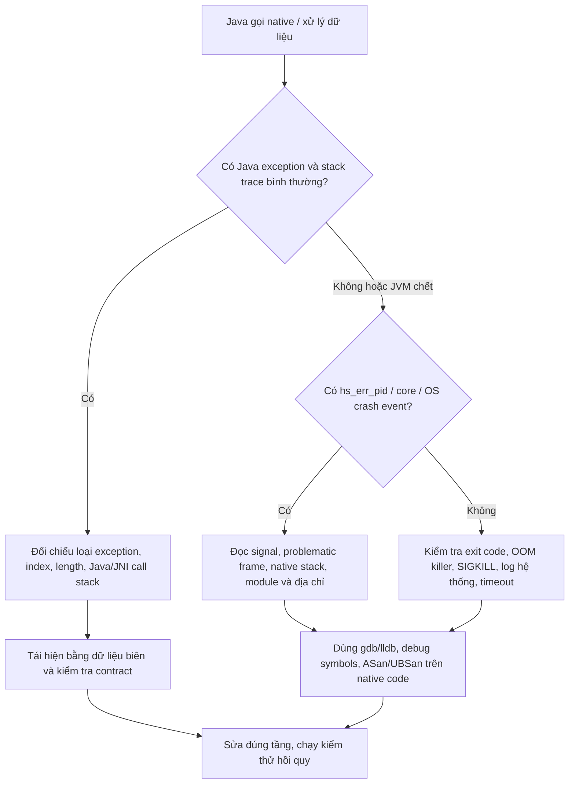

# Điều tra lỗi phạm vi Java khác với truy cập con trỏ không hợp lệ phía C

## 1. Nhận diện đúng hai loại sự cố

Trong ứng dụng Java giao tiếp với C/C++ thông qua JNI (Java Native Interface), JNA hoặc Foreign Function & Memory API (FFM), một lần truy cập sai chỉ số có thể biểu hiện theo hai cách rất khác nhau:

- **Java kiểm tra biên và ném exception:** ví dụ `array[3]` trên mảng Java có độ dài 3. JVM bảo đảm truy cập mảng tuân thủ quy tắc kiểm tra phạm vi; lệnh không truy cập phần tử ngoài mảng và thông thường ném `ArrayIndexOutOfBoundsException`. Chương trình có thể bắt exception và tiếp tục theo cách được thiết kế.
- **C sử dụng con trỏ không hợp lệ:** ví dụ `p[3]` khi `p` chỉ trỏ đến vùng 3 byte, con trỏ đã được `free`, chưa khởi tạo, trỏ nhầm vùng hay bị sai lệch bởi lỗi ABI. Truy cập đó có **undefined behavior** theo C: có thể bị `SIGSEGV`, `SIGBUS`, `EXCEPTION_ACCESS_VIOLATION`, đọc/ghi nhầm dữ liệu hoặc chỉ hỏng ở một bước sau. Java `try/catch` không tạo ra biên an toàn bao quanh truy cập con trỏ này.

Đề bài thuộc nhóm **chẩn đoán lỗi native interoperability**: mục tiêu là xác định lỗi xảy ra ở phép truy cập Java được kiểm tra, ở mã JNI đang kiểm tra dữ liệu, hay trong truy cập bộ nhớ C không an toàn; từ đó chọn bằng chứng và công cụ điều tra đúng.

### Bảng phân biệt nhanh

| Góc nhìn | Lỗi phạm vi ở Java | Truy cập con trỏ C không hợp lệ |
|---|---|---|
| Ví dụ | `a[a.length]`, `list.get(-1)`, `buffer.get(badIndex)` | `p[index]` vượt vùng cấp phát; dereference `NULL`; use-after-free |
| Cơ chế | Runtime/library kiểm tra điều kiện rồi ném exception | C không có tự động kiểm tra kích thước vùng nhớ ở phép dereference |
| Dấu hiệu thường gặp | `ArrayIndexOutOfBoundsException`, `IndexOutOfBoundsException`, stack trace Java | Tín hiệu/lỗi hệ điều hành, JVM fatal error log, core/minidump hoặc dữ liệu bị hỏng âm thầm |
| JVM còn sống? | Thường có thể tiếp tục nếu exception được xử lý đúng; vẫn có thể khiến request thất bại | Nếu fatal native crash trong cùng process, JVM thường chấm dứt; với memory corruption có thể chạy tiếp trong trạng thái không tin cậy |
| Phân tích | Chỉ số, độ dài, Java stack trace, đường đi dữ liệu | C stack, pointer/lifetime, ABI, symbol/debug info, sanitizer, `hs_err_pid` và core dump |
| Cách sửa | Validate index, thống nhất giới hạn, sửa logic lặp/gọi API | Sửa quyền sở hữu bộ nhớ, độ dài buffer, lifetime, con trỏ, JNI contract và boundary |

**Điểm then chốt:** `ArrayIndexOutOfBoundsException` là một Java exception có thể được xử lý; `SIGSEGV` từ native code không tự chuyển thành exception Java. Một con trỏ sai cũng **không bảo đảm** gây `SIGSEGV` ngay tại thao tác sai: hành vi C đã không xác định, nên không được dựa vào việc chương trình “chưa crash” để chứng minh mã đúng.

## 2. Lý do một chỉ số sai lại dẫn đến hai kết quả khác nhau

### 2.1. Java array và các API có kiểm tra phạm vi

Giả sử:

```java
byte[] bytes = {10, 20, 30};
int value = bytes[3]; // Độ dài = 3; index hợp lệ: 0, 1, 2.
```

Khi chạy phép truy cập mảng Java, JVM phải duy trì ngữ nghĩa của ngôn ngữ. Với index nhỏ hơn 0 hoặc lớn hơn/bằng `bytes.length`, Java ném `ArrayIndexOutOfBoundsException`. Exception chứa thông tin thực thi Java (class, phương thức, line number nếu có debug info). Nó **không đồng nghĩa** với hỏng bộ nhớ native.

Các API cũng có kiểm tra riêng: `List.get(index)` và `ByteBuffer.get(index)` thường ném `IndexOutOfBoundsException` khi index không hợp lệ; thao tác đọc tương đối trên `ByteBuffer` thiếu byte có thể ném `BufferUnderflowException`. Không nên nhận diện nguyên nhân chỉ bằng tên exception; kiểm tra API thực tế, `limit`/`position` của buffer và Java stack trace.

Một Java exception bình thường có thể làm một request thất bại nhưng không tạo JVM crash log. Nếu exception không được catch ở một thread, thread đó có thể kết thúc; nếu thoát khỏi `main`, chương trình Java đơn giản có thể kết thúc theo lifecycle của nó. Đó vẫn là cơ chế exception Java, khác với JVM bị crash do native pointer.

### 2.2. C pointer và undefined behavior

Trong C, biểu thức `p[index]` tương đương `*(p + index)`. Compiler **không mang theo** ràng buộc `index < length` chỉ vì hàm có một tham số `length`. Ví dụ sau dùng để **minh họa lỗi, không chạy thử trong JVM đang phục vụ người dùng**:

```c
#include <stddef.h>

unsigned char unsafe_read(const unsigned char *p,
                          size_t length,
                          size_t index) {
    (void)length;           // Không kiểm tra độ dài.
    return p[index];        // UB nếu p sai hoặc index ngoài vùng hợp lệ.
}
```

Một địa chỉ vẫn được hệ điều hành ánh xạ có thể cho phép đọc/ghi sai mà chưa báo lỗi; vì vậy crash có thể xuất hiện rất xa vị trí ghi tràn. Khi truy cập trang không được phép, OS thường báo access violation, và runtime JVM có thể sinh fatal error log nếu sự cố xảy ra trong process Java.

Các loại lỗi native cần phân biệt:

- **Out-of-bounds read/write:** index nằm ngoài object/vùng cấp phát C; kể cả nếu địa chỉ tình cờ vẫn đọc được thì thao tác vẫn sai.
- **Null/dangling pointer:** `NULL`, con trỏ sau `free()`, con trỏ trỏ vào stack frame đã kết thúc hoặc vùng đã `munmap()`.
- **Sai ownership và lifetime:** giữ pointer sau `ReleaseByteArrayElements`, `ReleasePrimitiveArrayCritical`, `free()`, đóng mapping hoặc đóng arena/segment sở hữu vùng nhớ.
- **Sai kích thước và phép toán:** nhầm số phần tử với số byte; overflow phép cộng/nhân; cast số âm `jint` sang `size_t` thành số unsigned rất lớn.
- **ABI/signature mismatch:** khai báo JNI, kiểu tham số, độ rộng dữ liệu, alignment hoặc calling convention khác giữa Java và C; có thể dẫn tới địa chỉ lỗi.
- **Data race native:** nhiều thread đọc/ghi vùng nhớ mà thiếu đồng bộ, làm hỏng pointer hoặc nội dung; lỗi có thể không tái hiện nhất quán.

**Không thể** dùng `try/catch (Exception e)` để bắt một vụ segmentation fault ở C. Việc cài signal handler tùy tiện để “bỏ qua” `SIGSEGV` cũng không làm trạng thái bộ nhớ bị hỏng trở nên an toàn.

### 2.3. JNI là ranh giới gọi hàm, không phải ranh giới tiến trình

Khi Java gọi `native` method, CPU có thể chuyển vào mã C/C++ **trong cùng không gian địa chỉ của JVM**. `JNIEnv*` cung cấp API tương tác với JVM nhưng không biến mọi dereference C thành truy cập Java an toàn.

Một số JNI API như `GetByteArrayRegion` có kiểm tra phạm vi và có thể tạo Java exception. Ngược lại, nếu C lấy địa chỉ dữ liệu rồi tự truy cập `pointer[index]`, JVM không bảo đảm kiểm tra phạm vi thay mã C. Tương tự, thao tác `ByteBuffer.get(index)` ở phía Java được kiểm tra; con trỏ nhận từ `GetDirectBufferAddress` phải được mã native quản lý độ dài và lifetime riêng.

FFM API ở các JDK mới giúp kiểm tra phạm vi/lifetime của `MemorySegment` khi truy cập qua API Java thích hợp; nó không biến mã C được gọi bên ngoài thành memory-safe. Ví dụ trong bài dùng JNI để chạy được với Java 17+.

## 3. Ví dụ Java 17+ và JNI: lỗi Java, lỗi biên được chặn ở C

Ví dụ này chứng minh ba việc: truy cập sai chỉ số Java ném exception; mã JNI **chủ động** kiểm tra biên có thể trả Java exception phù hợp; JVM vẫn sống sau cả hai lỗi được xử lý. Ví dụ **không cố tình gây native crash**, vì crash có thể dừng JVM và không cung cấp kết quả deterministic.

Tạo hai file cùng thư mục, giữ nguyên tên lớp ở default package để JNI symbol khớp.

**`BoundsLab.java`**

```java
public final class BoundsLab {
    static {
        System.loadLibrary("boundslab");
    }

    private static native int nativeRead(byte[] data, int index);

    public static void main(String[] args) {
        byte[] data = {10, 20, 30};

        try {
            int value = data[3];
            System.out.println(value);
        } catch (ArrayIndexOutOfBoundsException ex) {
            System.out.println("JAVA=" + ex.getClass().getSimpleName());
        }

        System.out.println("JNI_OK=" + nativeRead(data, 1));

        try {
            nativeRead(data, 3);
        } catch (ArrayIndexOutOfBoundsException ex) {
            System.out.println("JNI=" + ex.getClass().getSimpleName());
        }

        System.out.println("JVM_ALIVE");
    }
}
```

**`boundslab.c`** (sử dụng JNI header do `javac -h` tạo):

```c
#include <jni.h>
#include "BoundsLab.h"

JNIEXPORT jint JNICALL Java_BoundsLab_nativeRead(
        JNIEnv *env, jclass cls, jbyteArray data, jint index) {
    (void)cls;

    if (data == NULL) {
        jclass exception = (*env)->FindClass(
                env, "java/lang/NullPointerException");
        if (exception != NULL) {
            (*env)->ThrowNew(env, exception, "data must not be null");
        }
        return 0;
    }

    jsize length = (*env)->GetArrayLength(env, data);
    if (index < 0 || index >= length) {
        jclass exception = (*env)->FindClass(
                env, "java/lang/ArrayIndexOutOfBoundsException");
        if (exception != NULL) {
            (*env)->ThrowNew(env, exception, "invalid nativeRead index");
        }
        return 0;
    }

    jbyte value = 0;
    (*env)->GetByteArrayRegion(env, data, index, 1, &value);
    if ((*env)->ExceptionCheck(env)) {
        return 0;
    }

    return (jint)(unsigned char)value;
}
```

Giả sử Linux x86_64, JDK 17+ và compiler C đã cài; `JAVA_HOME` phải trỏ tới JDK đang chạy. Tại thư mục có hai file:

```bash
javac -h . BoundsLab.java
cc -std=c11 -O0 -g -Wall -Wextra -fPIC -shared \
  -I"$JAVA_HOME/include" -I"$JAVA_HOME/include/linux" \
  boundslab.c -o libboundslab.so
java -Xcheck:jni -Djava.library.path=. BoundsLab
```

Stdout mong đợi (với thư viện được biên dịch/nạp thành công):

```text
JAVA=ArrayIndexOutOfBoundsException
JNI_OK=20
JNI=ArrayIndexOutOfBoundsException
JVM_ALIVE
```

Giải thích theo từng bước:

1. `data[3]` làm Java ném exception trước khi lấy phần tử không tồn tại; nhánh `catch` in `JAVA=...`.
2. `nativeRead(data, 1)` vào JNI; C lấy `length=3`, xác minh `1` hợp lệ và dùng `GetByteArrayRegion` sao chép một byte. Giá trị là `20`.
3. `nativeRead(data, 3)` bị điều kiện `index >= length` chặn **trước khi C truy cập vùng nhớ**. `ThrowNew` đặt pending Java exception; sau khi native method trả về, Java bắt được `ArrayIndexOutOfBoundsException`. Giá trị `return 0` ở nhánh ném lỗi không phải kết quả nghiệp vụ: khi JNI trả lại, exception đang pending.
4. `JVM_ALIVE` xuất hiện vì các lỗi đã đi qua đường xử lý exception hợp lệ; **không có việc dereference C sai** trong ví dụ.

Lệnh `javac -h .` sinh `BoundsLab.h`; tên hàm C `Java_BoundsLab_nativeRead` và signature `(JNIEnv *, jclass, jbyteArray, jint)` phải khớp header. Nếu lớp Java nằm trong package, symbol/header sẽ thay đổi theo quy tắc JNI. Với macOS cần thay include hệ điều hành thành `include/darwin` và build thư viện `.dylib`; với Windows cần include `include/win32` và tạo DLL bằng compiler phù hợp. Không giả định lệnh Linux chạy nguyên dạng trên các OS khác.

`-Xcheck:jni` giúp phát hiện một số cách dùng JNI sai (chẳng hạn trạng thái exception chưa được xử lý hoặc reference sai). Nó **không** phải bộ phát hiện mọi truy cập pointer C vượt biên. Với chương trình không có vấn đề JNI, bật option này không thay đổi bản chất của hai kết quả trên.

### Vì sao không tự ý đổi code an toàn thành `pointer[index]`?

Một bản JNI có thể gọi `GetByteArrayElements`, nhận `jbyte*`, rồi dùng `ptr[index]`. Nếu `index` không hợp lệ hoặc pointer dùng sau `ReleaseByteArrayElements`, đây là lỗi C. Kết quả có thể là crash hoặc corruption, không bắt buộc ném `ArrayIndexOutOfBoundsException`. Việc tái hiện **có chủ đích** một crash nên thực hiện trong tiến trình thử nghiệm riêng, với sanitizer, debug symbols và giới hạn tài nguyên; không chạy thử trên JVM sản xuất.

Trong ví dụ an toàn, `GetByteArrayRegion` tránh yêu cầu quản lý lifetime của con trỏ trỏ tới Java array. Khi thực sự cần pointer tới Java array, phải ghép cặp đúng `GetByteArrayElements`/`ReleaseByteArrayElements` hoặc API tương ứng, không giữ pointer sau release; lưu ý JNI có thể pin **hoặc** tạo bản sao, nên không giả định địa chỉ ổn định mãi.

## 4. Quy trình điều tra dựa trên bằng chứng

Điều tra cần trả lời ba câu hỏi theo thứ tự: **JVM còn sống không? Lỗi được ném ở đâu? Bằng chứng nào chỉ tới vùng nhớ và thao tác native cụ thể?**



### Bước 1: Ghi nhận triệu chứng trước khi sửa

Thu thập phiên bản JDK/JVM, OS/kiến trúc CPU, đường dẫn và version `.so/.dll/.dylib`, compiler flags, thời điểm, request ID (không sao chép bí mật), input tái hiện đã tối giản, thông tin concurrent load và loại kết thúc của process. Phân biệt:

- **Có Java stack trace `ArrayIndexOutOfBoundsException`/ `IndexOutOfBoundsException`:** đọc class/method và index, length/limit. Kiểm tra exception đến từ `data[index]`, một Java collection/buffer hay do JNI `ThrowNew` tạo.
- **JVM kết thúc đột ngột có fatal error report:** đọc `hs_err_pid*.log`, `Problematic frame`, signal, PC, dynamic library và native stack. Không quy trách nhiệm cho C chỉ vì có chữ `SIGSEGV`: có thể liên quan JVM, thư viện khác, JIT hoặc memory corruption trước đó.
- **Không có fatal log:** xem hệ điều hành, container OOM kill, `SIGKILL`, process supervisor, quyền ghi log, disk đầy hoặc watchdog. `SIGKILL` không cho JVM cơ hội tạo `hs_err_pid`.
- **Không crash nhưng dữ liệu sai:** nghi stale pointer, buffer overwrite, C data race hoặc lỗi serialization; cần memory sanitizer/canary và kiểm thử dưới tải.

Lưu exception/stack trace đầy đủ khi có thể. Nếu có một `ArrayIndexOutOfBoundsException` Java đồng thời với native crash khác, không mặc định hai sự cố có cùng nguyên nhân chỉ vì xuất hiện gần thời điểm nhau.

### Bước 2: Tái hiện có kiểm soát

Dựng input tối thiểu, xác định kích thước thực của buffer ở cả Java và C. Kiểm thử index `-1`, `0`, `length-1`, `length`, số lớn; riêng với null, buffer rỗng và việc gọi đồng thời cần kiểm chứng contract. Lặp lại trên cùng JDK/native binary khi cần; so sánh với build có debug symbols.

Dùng **tiến trình thử nghiệm** hoặc native worker riêng để cô lập thử nghiệm gây crash. Thao tác sai con trỏ có thể làm hỏng cả JVM, nên tránh dùng môi trường chứa request thực hoặc dữ liệu quan trọng. Kết quả “lần này không crash” không chứng minh lỗi đã được sửa: undefined behavior phụ thuộc layout bộ nhớ, tối ưu hóa compiler, timing và tải.

### Bước 3: Phân tích Java exception

Ví dụ Java stack trace minh họa:

```text
java.lang.ArrayIndexOutOfBoundsException: Index 3 out of bounds for length 3
    at BoundsExample.read(BoundsExample.java:12)
    at BoundsExample.main(BoundsExample.java:5)
```

Đây là **ví dụ minh họa**, không phải output của `BoundsLab` ở trên. Hãy kiểm tra index, length, phép tính offset, điều kiện lặp và độ dài dữ liệu sau decode. Off-by-one phổ biến là `i <= array.length` thay vì `i < array.length`.

Nếu exception phát sinh từ một `native` method do `ThrowNew` hoặc JNI API được kiểm tra, stack trace Java có thể chứa `Native Method`, nhưng điều đó vẫn **khác** với C dereference không hợp lệ làm chết process. Dùng logging/trace ở biên JNI để biết Java exception được phát sinh chủ động hay từ API JNI.

Đừng “sửa” lỗi bằng cách bắt `IndexOutOfBoundsException` rồi bỏ qua mọi nơi. Cần sửa cách tạo index và xác định hợp đồng `index` hợp lệ; chỉ bắt exception để báo lỗi có nghĩa hoặc phục hồi nghiệp vụ thực sự.

### Bước 4: Phân tích JVM native crash

HotSpot thường cố gắng sinh `hs_err_pid<PID>.log` khi gặp fatal error; vị trí mặc định phụ thuộc thư mục làm việc và khả năng ghi, có thể cấu hình:

```bash
java -XX:ErrorFile=/tmp/hs_err_pid%p.log -Djava.library.path=. BoundsLab
```

Lệnh trên chỉ cấu hình vị trí ghi **nếu có fatal JVM error**; ví dụ JNI an toàn không tạo file. Trong trường hợp chương trình thực sự crash, log minh họa có thể chứa:

```text
# A fatal error has been detected by the Java Runtime Environment:
#  SIGSEGV (...)
# Problematic frame:
# C  [libdecoder.so+0x1234]  decode+0x34
```

Các địa chỉ/symbol phía trên là **giả định**. Khi đọc log thật:

1. Xác định loại lỗi (`SIGSEGV`, `SIGBUS`, access violation...), PC và `Problematic frame`. Khung `C` thường là native code, `V` VM code, `J` compiled Java code, `j` interpreted Java; chúng là dấu hiệu vị trí crash, không thay thế root-cause analysis.
2. Đọc phần `Current thread`, `Native frames`, `Java frames` để biết đường gọi từ Java sang JNI, thread có đang ở native hay không.
3. Ghi nhận phiên bản thư viện, load address và offset. Symbol hóa bằng đúng file binary/debug info trùng **build ID**; số offset không đủ nếu bạn dùng binary khác với production.
4. Đọc thông tin environment, memory/threads và báo lỗi trước đó; một truy cập sai từ trước có thể gây crash sau đó trong `malloc`, `free`, GC hoặc thư viện khác.
5. Kiểm tra core/minidump nếu đã được OS cho phép tạo. Core có thể chứa dữ liệu nhạy cảm; lưu và chia sẻ có kiểm soát.

`-XX:ErrorFile` không đảm bảo file luôn có: lỗi `SIGKILL`, kernel OOM, thiếu quyền ghi hoặc tình trạng hư hỏng nghiêm trọng có thể ngăn ghi báo cáo. Trên Linux, hệ thống có thể dùng `systemd-coredump` thay vì lưu file `core` ngay trong thư mục làm việc.

### Bước 5: Dùng debugger/sanitizer đúng tầng

Khi Java stack trace trỏ đúng vào Java array index, bắt đầu bằng debugger Java, log có chọn lọc và unit test. Khi native crash hoặc corruption chưa rõ, hãy bổ sung:

- **gdb/lldb:** chạy JVM kiểm thử kèm native library có symbols; `bt`/`thread apply all bt` để xem C stack, biến `index`, độ dài và pointer lúc fault. Trên Linux có thể dùng `gdb --args java -Djava.library.path=. BoundsLab`, sau đó `run` và `bt` khi có signal. Với code an toàn trong ví dụ sẽ **không xuất hiện** signal cần điều tra.
- **AddressSanitizer (ASan):** phát hiện nhiều lỗi heap/stack out-of-bounds, use-after-free và double-free trong C/C++ được instrument; ví dụ compile source native kiểm thử với `-g -O1 -fsanitize=address -fno-omit-frame-pointer`. Nếu nạp ASan-instrumented shared library vào JVM, cần cấu hình phù hợp compiler/runtime, đôi khi preload sanitizer runtime; cách dễ kiểm soát hơn là tái hiện cùng logic trong native test executable riêng.
- **UndefinedBehaviorSanitizer (UBSan):** giúp nhận diện một số phép toán/UB, có thể dùng `-fsanitize=undefined` với build native; không cam kết bắt mọi lỗi pointer.
- **Valgrind Memcheck (nơi hỗ trợ):** phát hiện nhiều invalid read/write/leak, đổi lại chạy chậm, có thể phải cấu hình suppressions cho runtime JVM. Dùng trên repro native đơn giản khi có thể.
- **`-Xcheck:jni`:** phát hiện một số vi phạm quy tắc JNI; không thay thế ASan hoặc debugger C và không xác minh mọi vòng đời pointer.
- **`jcmd <pid> Thread.print` / Java debugger:** hữu ích khi JVM còn sống, đặc biệt deadlock/native frame; không thể yêu cầu JVM đã chết cung cấp thread dump mới.

Với native code ở thư viện lớn, build lại có debug symbols (`-g`, tránh strip trong bản phục vụ symbolization) và tái hiện cùng commit, compiler options, ABI. Nếu chỉ có địa chỉ, dùng symbolizer/`addr2line` **với đúng module và offset tương ứng**; đừng coi số PC tuyệt đối là offset luôn hợp lệ khi có ASLR.

## 5. Kiểm tra hợp đồng dữ liệu tại biên Java ↔ C

Khi thấy crash gần dòng truy cập buffer, hãy truy vết **một giá trị length và một index xuyên suốt đường đi**.

### Từ Java sang JNI

- Java `byte[]` biết `length`; phía C phải gọi `GetArrayLength` hoặc nhận kích thước đáng tin, không suy ra kích thước từ con trỏ trả về bởi JNI.
- `jint index` là số nguyên có dấu; `size_t` là kiểu unsigned. Kiểm tra `index < 0` **trước khi** chuyển sang `size_t`. Số âm cast sang unsigned có thể thành giá trị rất lớn.
- Nếu truyền vùng con `start`/`count`, tránh kiểm tra `start + count <= capacity` khi phép cộng có khả năng overflow. Sau khi chắc chắn `start <= capacity`, dùng `count <= capacity - start` với kiểu và đơn vị đúng.
- Làm rõ `capacity` đo bằng **byte** hay **số phần tử**, `ByteBuffer.capacity()` hay `limit()`, và có offset hay không. Nhầm `sizeof(T)` là nguồn bug phổ biến.
- Xác định ownership: Java array, native malloc, direct buffer, mapped memory; bên nào cấp phát và bên nào được phép giải phóng? Có thread nào giữ pointer sau release/close không?
- Không lưu `JNIEnv*` để dùng ở thread khác. Native thread có lifecycle riêng phải gắn/dỡ với JVM đúng quy tắc; JNI local references không nên lưu dùng vượt vòng đời hợp lệ.
- Không giả định C string kết thúc bằng `'\0'` khi nhận Java byte array hoặc UTF buffer có chiều dài riêng; việc gọi `strlen()` trên dữ liệu không có terminator có thể đọc vượt biên.

### Ví dụ kiểm tra phạm vi trong C

Khi đã sở hữu một buffer C hợp lệ `data` có dung lượng `capacity` byte, cách kiểm tra cơ bản:

```c
#include <stddef.h>
#include <stdbool.h>

bool read_byte(const unsigned char *data,
               size_t capacity,
               size_t index,
               unsigned char *out) {
    if (out == NULL || data == NULL || index >= capacity) {
        return false;
    }
    *out = data[index];
    return true;
}
```

Đây là **hàm C minh họa**, không phải chương trình độc lập có `main`. Phép kiểm tra chỉ chứng minh index nằm trong `[0, capacity)` **nếu** caller đã bảo đảm `data` trỏ tới object còn sống với ít nhất `capacity` byte và `out` là con trỏ hợp lệ. C không thể tự xác thực lifetime/capacity chỉ từ giá trị pointer. Với concurrency, bên gọi phải bảo đảm vùng nhớ không bị giải phóng hoặc thay đổi bất hợp lệ trong lúc đọc.

Nếu thư viện JNI biến lỗi phạm vi thành Java exception, nên gọi `ThrowNew` cho loại exception phù hợp, return đúng cách và không tiếp tục thực thi JNI API tùy tiện khi đã có pending exception. Không dùng tín hiệu OS để mô phỏng một exception Java đã có thể phát hiện bằng kiểm tra input.

## 6. Ba tình huống điều tra điển hình

### Tình huống A — `ArrayIndexOutOfBoundsException` ngay khi tạo payload

Ứng dụng Java chuyển nội dung mảng vào native codec:

```java
byte[] packet = new byte[4];
for (int i = 0; i <= packet.length; i++) {
    packet[i] = (byte) i;
}
```

Dòng thứ năm của vòng lặp (`i == 4`) vi phạm biên; lỗi được ném ở Java **trước khi** codec native nhận được dữ liệu. Sửa điều kiện thành `i < packet.length`, kiểm thử rỗng/1 phần tử/độ dài tối đa và xem lại nhu cầu độ dài. Không điều tra `SIGSEGV` trong C khi bằng chứng chỉ có exception từ dòng Java này.

### Tình huống B — Java truyền index sai, JNI dùng pointer trực tiếp

Java truyền `index=length` cho JNI. C gọi `GetByteArrayElements` rồi đọc `pointer[index]` mà không kiểm tra. Lúc này quy tắc Java array bounds **không còn tự động bảo vệ** phép truy cập C đó. Code có thể đọc nhầm, crash hay phát sinh memory corruption. Cần sửa biên trong native, xác định chính xác cơ chế lấy/release con trỏ và kiểm thử bằng sanitizer. Nếu dùng `GetByteArrayRegion` với index/count hợp lệ, JNI thực hiện truy cập theo API có kiểm tra; không coi mọi JNI API là unsafe dereference.

### Tình huống C — crash trễ tại `malloc`/`free` hoặc GC

`hs_err_pid` trỏ vào libc allocator hoặc code JVM, trong khi dữ liệu bắt đầu sai từ một native decoder trước đó vài giây. Một write vượt biên C có thể làm hỏng metadata heap rồi chỉ crash khi allocator đụng tới. Phân tích frame cuối cùng rất hữu ích nhưng **không đủ** xác định hàm gây lỗi đầu tiên. Hãy bật sanitizer trên đường native, thu hẹp input, dùng debug heap/canary hoặc tái hiện trong worker riêng; so sánh build có tối ưu và build debug.

## 7. Kế hoạch sửa lỗi và kiểm thử hồi quy

| Trường hợp | Cách sửa tại đúng tầng | Bằng chứng hồi quy |
|---|---|---|
| Java truy cập vượt index | Sửa range/loop, validate length/index, không suppress exception tùy tiện | Unit test index `-1`, `0`, `length-1`, `length`; đúng exception và stack |
| JNI nhận `null`/index bất hợp lệ | Kiểm tra đầu vào và throw Java exception phù hợp trước native pointer access | JNI test trả lỗi xác định; JVM còn sống |
| C đọc/ghi ngoài cấp phát | Dùng capacity đúng đơn vị, kiểm tra overflow và lifetime, xác định ownership | Native unit/fuzz test với ASan/UBSan, không có invalid read/write |
| Use-after-free/double-free | Mô hình sở hữu vùng nhớ, release đúng một lần, loại bỏ pointer tồn tại sau free | Sanitizer, stress test với chu kỳ create/release |
| Sai ABI/JNI signature | Sinh header bằng `javac -h`, kiểm tra kiểu và kiến trúc library | Build/test trên OS và kiến trúc được hỗ trợ |
| Crash hoặc treo native không dễ loại trừ | Tách native worker sang tiến trình riêng, deadline và OS quota | Fault-injection trong worker; JVM supervisor tồn tại sau worker crash |

Một quy trình kiểm thử thực tế gồm: lưu testcase đầu vào đã làm lỗi; cố định version JDK/library/flags; chạy qua test nhỏ, sanitizer và stress/fuzz theo nhu cầu; kiểm tra không còn crash/corruption và không còn exception sai; theo dõi log thực tế sau khi phát hành. Với crash có khả năng phá hỏng process, **tiến trình phụ riêng** giới hạn tác động nhưng không tự sửa lỗi C hoặc bảo vệ tuyệt đối hệ điều hành.

Đừng chỉ kiểm tra “không còn `SIGSEGV`”. Cần kiểm tra kết quả đầu ra, tính toàn vẹn bộ nhớ và tính đúng đắn của ownership/lifetime. Việc exception Java tiếp tục xuất hiện sau khi bổ sung check JNI có thể là **hành vi được mong muốn** để biểu diễn input sai theo hợp đồng.

## 8. Các nhầm lẫn phổ biến

1. **“Java có bounds check nên C được bảo vệ khi nhận `byte[]`.”** Sai: native pointer dereference không mặc nhiên có kiểm tra của Java.
2. **“Nếu C truy cập ngoài biên thì luôn bị `SIGSEGV` ngay.”** Sai: C undefined behavior có thể phá hỏng dữ liệu âm thầm hoặc chỉ crash trễ.
3. **“Đã catch `ArrayIndexOutOfBoundsException` thì xử lý được native crash.”** Sai: native fatal error thường kết thúc cả tiến trình chứa JVM.
4. **“Có `Native Method` trong Java stack trace nghĩa là bị segmentation fault.”** Sai: JNI có thể chủ động tạo Java exception hoặc sử dụng JNI API có kiểm tra.
5. **“`-Xcheck:jni` bắt được mọi con trỏ sai.”** Sai: dùng sanitizer/debugger C cho memory corruption, còn `-Xcheck:jni` kiểm tra nhóm lỗi JNI nhất định.
6. **“`Problematic frame` chính là dòng gây lỗi gốc.”** Chưa chắc: stack ở thời điểm crash có thể chỉ phản ánh nơi hậu quả của một lần ghi sai trước đó trở nên nhìn thấy được.
7. **“Có thể giữ `GetByteArrayElements` pointer sau `ReleaseByteArrayElements`.”** Sai: sử dụng pointer ngoài vòng đời được API cho phép là không hợp lệ.
8. **“Thấy exception Java là không có memory corruption.”** Không đủ kết luận: hai lỗi có thể cùng tồn tại; cần xem lịch sử sự kiện, lỗi native khác và bằng chứng sanitizer.
9. **“Không thấy `hs_err_pid` tức là không có lỗi native.”** Sai: kill từ OS, thiếu quyền, process crash không qua fatal handler hoặc resource exhaustion có thể không tạo file.
10. **“Sửa bằng cách retry vô hạn.”** Sai: cùng một input sai và cùng một pointer bug có thể khiến worker crash liên tục; hãy sửa nguyên nhân và giới hạn retry.

## 9. Checklist điều tra tại hiện trường

- **Tầng gây lỗi:** Java expression/checked API, JNI exception path, hay C pointer dereference?
- **Triệu chứng:** Java exception stack trace, JVM fatal log/core, OS kill, deadlock hay silent corruption?
- **Thông số:** index, length, capacity, offset, đơn vị byte/phần tử, signed/unsigned, overflow?
- **Bộ nhớ:** vùng được cấp phát ở đâu, ai sở hữu, còn sống không, có thread khác đang free hoặc ghi?
- **JNI contract:** header đúng, reference còn hợp lệ, thread/exception state đúng, cặp get/release tương ứng?
- **Bằng chứng:** native build ID, `Problematic frame`, C stack, sanitizer report, input tối giản?
- **Khắc phục:** validate ở tầng Java và tại biên JNI, quản lý lifetime C, lỗi sai được chuyển thành Java exception trước khi truy cập nguy hiểm?
- **Hồi quy:** kiểm thử index biên, payload rỗng/null, fuzz/stress, sanitizer, và native crash cô lập nếu cần?

Khi điều tra đúng tầng, một `ArrayIndexOutOfBoundsException` là dấu hiệu hữu ích của **kiểm tra phạm vi đang hoạt động**. Ngược lại, con trỏ C sai đòi hỏi xem xét **địa chỉ, lifetime, kích thước và bằng chứng native**, kể cả trong trường hợp JVM chưa crash. Mục tiêu là khôi phục hợp đồng dữ liệu và an toàn bộ nhớ tại biên Java–C, chứ không chỉ làm mất một dòng lỗi trong log.