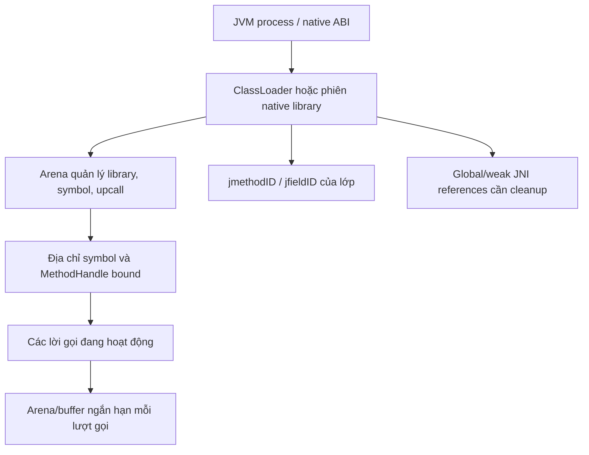

# Lưu lại lookup, layout, MethodHandle hoặc mã định danh JNI đúng vòng đời

## 1. Vì sao cache trong Java native interoperability?

Khi Java gọi C/C++ qua Foreign Function & Memory (FFM) API hoặc Java Native Interface (JNI), chương trình thường trải qua **hai pha có chi phí và vòng đời khác nhau**:

1. **Thiết lập liên kết:** nạp thư viện, tìm tên hàm/symbol, mô tả kiểu dữ liệu native, tạo `MethodHandle`, hoặc lấy `jmethodID`/`jfieldID`.
2. **Thực thi:** truyền tham số, chuyển đổi dữ liệu, gọi native function, lấy kết quả và giải phóng tài nguyên tạm.

Nếu một hàm được gọi hàng nghìn lần, lặp lại phần thiết lập trong từng lượt gọi có thể tăng overhead. Ta thường muốn **tra cứu một lần, gọi nhiều lần**. Nhưng cache sai vòng đời sẽ gây lỗi khó phát hiện hơn việc không cache: use-after-close, gọi vào thư viện đã unload, classloader leak, dùng `JNIEnv*` từ thread khác, hoặc dùng `jmethodID` của lớp đã unload.

Mục tiêu bài học là biết **cache đối tượng nào, ai sở hữu, tới khi nào còn hợp lệ và khi nào phải dọn/khởi tạo lại**. Đây là tối ưu đo bằng benchmark, không phải lý do để giữ mọi tài nguyên native cho đến khi JVM thoát.

**Phiên bản trong ví dụ:** FFM chính thức trong `java.lang.foreign` từ **JDK 22**; JNI tiếp tục được hỗ trợ từ các JDK trước đó và ví dụ JNI dùng **JDK 17+**. Các API FFM ở JDK 19–21 là preview/incubator với yêu cầu và khác biệt riêng, không áp dụng nguyên mã của JDK 22 cho JDK 17.

## 2. Phân loại: thứ nào là metadata, thứ nào mang vòng đời tài nguyên?

| Giá trị muốn cache | Có thể tái sử dụng? | Vòng đời/điều kiện quan trọng |
| --- | --- | --- |
| `MemoryLayout`, `ValueLayout`, `FunctionDescriptor` của FFM | **Có**, thường là `static final` hoặc theo ABI | Mô tả bất biến; phải khớp nền tảng, ABI, alignment, calling convention và chữ ký C |
| `Linker.nativeLinker()` | **Có**, thường dùng lại trong runtime | Gắn với ABI của nền tảng hiện tại; không hoán đổi mô tả ABI giữa OS/CPU |
| `SymbolLookup.libraryLookup(path, arena)` | **Có**, trong một phiên tài nguyên | Native library và symbol lấy từ lookup phụ thuộc **arena** đã cấp; đóng arena làm hết hiệu lực phạm vi tương ứng |
| `SymbolLookup.loaderLookup()` | **Có**, theo classloader gọi | Lookup liên quan các thư viện gắn với classloader của caller; bản thân lookup/segment giữ loader reachable khi còn sống |
| `MemorySegment` trỏ tới **địa chỉ hàm** (`lookup.find`) | **Có**, khi thư viện và scope còn hợp lệ | Không giữ địa chỉ để gọi sau khi tài nguyên owner đóng/unload |
| `MethodHandle` downcall được **bind** tới symbol | **Có**, nhiều lời gọi cùng hàm | Chữ ký phải đúng; mục tiêu native và mọi tài nguyên gắn với symbol còn sống |
| `MethodHandle` downcall **không bind** (`downcallHandle(descriptor)`) | **Có**, có thể dùng cho nhiều địa chỉ cùng ABI | Mỗi invocation phải cung cấp địa chỉ symbol hợp lệ; lifetime của từng địa chỉ vẫn được kiểm tra |
| `MemorySegment` chứa buffer dữ liệu, C string, native pointer | **Chỉ trong scope phù hợp** | Buffer thuộc arena nào thì theo arena đó; cấm dùng con trỏ sau khi free/close |
| Upcall stub (`Linker.upcallStub`) | **Có**, khi callback đăng ký còn hiệu lực | Stub gắn với arena; native side không được giữ callback pointer sau khi arena đóng |
| JNI `jmethodID`, `jfieldID` | **Có**, theo định danh của **lớp thực** | Hợp lệ cho đến khi lớp đó unload; ID không tự ngăn class unloading |
| JNI `jclass`, `jobject` là **local reference** | **Không** xuyên native call/thread | Chỉ hợp lệ trong local-reference frame; nếu lưu lâu cần `NewGlobalRef` hoặc chiến lược weak ref |
| JNI **global reference** (`jclass`, `jobject`) | **Có** cho đến `DeleteGlobalRef` | Giữ đối tượng/lớp sống, có nguy cơ giữ luôn classloader hoặc đối tượng lớn |
| JNI `JNIEnv*` | **Không** dùng chéo thread | Liên kết với thread; thread native phải attach đúng cách rồi lấy `JNIEnv*` của chính nó |
| JNI `JavaVM*` | Có thể giữ trong runtime JVM | Dùng để `GetEnv`/attach thread; khác với `JNIEnv*`, không đồng nghĩa sở hữu Java object |

**Phân biệt bắt buộc:** `jmethodID`/`jfieldID` là ID liên kết metadata của JVM, **không phải `jobject` reference**. Không gọi `NewGlobalRef`/`DeleteGlobalRef` với chúng. Ngược lại, `jclass` **là** reference tới đối tượng `Class` nên chịu các quy tắc local/global JNI.

## 3. Gắn cache với owner thay vì chỉ gắn với tên hàm

Suy nghĩ về lifetime theo thứ bậc:



Sơ đồ biểu thị **quan hệ sở hữu**, không có nghĩa tất cả API đều tạo tài nguyên con vật lý. Một quy tắc thực dụng:

> Cache có thể sống lâu bằng **owner có khả năng đảm bảo đối tượng còn hợp lệ**, và không được sống lâu hơn tài nguyên mà nó phụ thuộc.

Ví dụ: `FunctionDescriptor` có thể tồn tại cả quá trình; `MethodHandle` bind tới `libmath_v1.so` chỉ nên tồn tại trong phiên của thư viện v1. Nếu hot-reload v2, phải tạo cache symbol/handle mới và chỉ đóng owner của v1 sau khi mọi lời gọi dùng v1 đã kết thúc.

### 3.1. Khóa cache phải chứa đủ ngữ cảnh

Cache theo mỗi chuỗi `"add"` là quá yếu nếu ứng dụng có nhiều plugin. Cùng tên symbol có thể tồn tại ở hai thư viện khác nhau. Cần xét:
- Đường dẫn/định danh thư viện và phiên bản native thực tế.
- Tên symbol, `FunctionDescriptor`, ABI/kiến trúc và các linker options.
- Classloader/module hoặc phiên plugin đã tạo lookup.
- Loại handle: bound trực tiếp tới địa chỉ hay handle chung nhận địa chỉ lúc gọi.

Với JNI, một tên lớp như `com.example.Widget` **chưa đủ**: hai classloader có thể nạp hai định nghĩa lớp cùng tên nhưng khác identity. Chỉ sử dụng ID với lớp/loader đã sinh ra ID đó.

### 3.2. Tách metadata toàn cục và cache tài nguyên theo phiên

Một thiết kế hợp lý:

```text
Immutable metadata (layouts, descriptors) ─── lâu dài, chia sẻ được
Session(owner: arena + library) ────────────── mở / đang dùng / đóng
  ├─ SymbolLookup
  ├─ symbol segments
  └─ bound MethodHandles
Call(arena tạm) ────────────────────────────── tạo / sử dụng / đóng
  └─ native buffers, strings, return storage
```

Không giữ arena tạm của từng request trong cache dài hạn; cũng không tạo library lookup/MethodHandle lại cho mọi phần tử trong một vòng lặp nếu cùng thư viện và signature.

## 4. FFM: cache layout và descriptor đúng cách

`MemoryLayout` mô tả kích thước, alignment, padding và cấu trúc bộ nhớ native. `FunctionDescriptor` mô tả tham số/return type của native function. Đây là metadata bất biến, phù hợp cho `static final` **khi ABI cố định**.

```java
import java.lang.foreign.FunctionDescriptor;
import java.lang.foreign.ValueLayout;

public final class NativeSignatures {
    private NativeSignatures() {}

    // C: int add_ints(int a, int b)
    public static final FunctionDescriptor ADD_INTS =
            FunctionDescriptor.of(
                    ValueLayout.JAVA_INT,
                    ValueLayout.JAVA_INT,
                    ValueLayout.JAVA_INT
            );
}
```

`ValueLayout.JAVA_INT` mô tả số nguyên 32 bit, phù hợp với `int` trên các nền tảng mục tiêu thông dụng. Không tùy tiện suy luận rằng mọi `long` trong C tương ứng `JAVA_LONG`: trên Windows 64-bit, C `long` thường 32 bit, còn trên nhiều Unix 64-bit là 64 bit. Với `size_t`, con trỏ, `struct`, union, packed layout, bit-field hoặc variadic function, cần xác minh ABI thực tế (header, toolchain, `jextract`/canonical layouts khi phù hợp).

Ví dụ `struct` có padding theo C ABI:

```c
struct Packet {
    char tag;
    int size;
};
```

Cấu trúc này thường có padding giữa `tag` và `size`. Đo kích thước, offset, alignment thực tế; `MemoryLayout.structLayout(...)` **không tự đoán mọi padding theo C compiler**. Không cache một layout sai và dùng trên cả Windows/Linux. Nếu định nghĩa native thay đổi, sửa descriptor/layout và rebuild cùng lúc.

`FunctionDescriptor` **không chứa mã máy** và không giữ thư viện đang mở; cache nó an toàn hơn cache con trỏ native. Nhưng một descriptor sai có thể khiến `Linker.downcallHandle` tạo lệnh gọi sai ABI, gây hỏng dữ liệu hoặc JVM crash. Cache chỉ tăng tốc, không làm chữ ký sai trở nên đúng.

## 5. FFM: tra symbol và tạo MethodHandle một lần

Quy trình thiết lập với JDK 22+:

```text
Path to library
      |
      v
Arena.ofShared / ofConfined
      |
      v
SymbolLookup.libraryLookup(path, arena)
      |
      v
lookup.find("add_ints") -> MemorySegment địa chỉ hàm
      |
      v
Linker.nativeLinker().downcallHandle(address, descriptor)
      |
      v
Cache MethodHandle theo phiên đang mở
      |
      v
invokeExact(...) nhiều lần
```

**Vì sao cache cả `MethodHandle`?** `lookup.find` tránh được khi dùng lại symbol address; `downcallHandle` còn cần tạo adapter theo calling convention/signature. Đặt cả hai ở setup path sẽ làm hot path ngắn, dễ tối ưu. Tuy nhiên hiệu quả thực tế còn tùy JVM, JIT, đường gọi và chi phí copy dữ liệu; phải đo để kết luận.

### 5.1. Ví dụ đầy đủ trên Linux: cache một handle cho ba lượt gọi

Ví dụ sử dụng C/GCC, shared library Linux và **JDK 22+**.

Tệp **`fast_add.c`**:

```c
int add_ints(int a, int b) {
    return a + b;
}
```

Build thư viện:

```bash
cc -O2 -fPIC -shared -o libfastadd.so fast_add.c
```

Tệp **`ForeignCacheDemo.java`**:

```java
import java.lang.foreign.Arena;
import java.lang.foreign.FunctionDescriptor;
import java.lang.foreign.Linker;
import java.lang.foreign.MemorySegment;
import java.lang.foreign.SymbolLookup;
import java.lang.foreign.ValueLayout;
import java.lang.invoke.MethodHandle;
import java.nio.file.Path;

public final class ForeignCacheDemo {
    private static final FunctionDescriptor ADD_SIGNATURE =
            FunctionDescriptor.of(
                    ValueLayout.JAVA_INT,
                    ValueLayout.JAVA_INT,
                    ValueLayout.JAVA_INT
            );

    public static void main(String[] args) throws Throwable {
        if (args.length != 1) {
            throw new IllegalArgumentException("Supply a shared-library path");
        }

        // Arena sở hữu phiên library, không đóng khi còn lời gọi.
        try (Arena libraryArena = Arena.ofShared()) {
            SymbolLookup lookup = SymbolLookup.libraryLookup(
                    Path.of(args[0]).toAbsolutePath(),
                    libraryArena
            );
            MemorySegment function = lookup.find("add_ints").orElseThrow();

            // Tạo một lần; handle bound tới địa chỉ hàm của phiên này.
            MethodHandle add = Linker.nativeLinker()
                    .downcallHandle(function, ADD_SIGNATURE);

            for (int i = 0; i < 3; i++) {
                int result = (int) add.invokeExact(i, 10);
                System.out.println(result);
            }
        }
    }
}
```

Lệnh chạy:

```bash
javac ForeignCacheDemo.java
java --enable-native-access=ALL-UNNAMED \
     ForeignCacheDemo ./libfastadd.so
```

**Stdout chính xác** với thư viện mẫu đã biên dịch:

```text
10
11
12
```

Ví dụ này thể hiện bốn nguyên tắc:
1. `ADD_SIGNATURE` là metadata bất biến, có thể tồn tại lâu hơn library.
2. `lookup`, `function` và `add` được tạo **một lần** cho ba lần gọi.
3. `libraryArena` còn mở trong suốt lúc gọi và được đóng sau vòng lặp.
4. Lời gọi dùng `(int) add.invokeExact(i, 10)` để call site có chữ ký chính xác `(int, int) -> int`.

Với JDK 22, `libraryLookup` và `downcallHandle` thuộc các API yêu cầu native access, do đó ví dụ classpath dùng cờ `--enable-native-access=ALL-UNNAMED`. Với named module, cấp quyền cho đúng module. Nếu thư viện hoặc symbol không tồn tại, chương trình sẽ throw exception ở **setup**, thay vì tạo một handle giả rồi tiếp tục.

**Quan trọng:** không giữ `add` trong một static map sống vô hạn rồi đóng `libraryArena`. Mặc dù Java reference tới `MethodHandle` vẫn còn, địa chỉ hàm native trong đó không còn được bảo đảm hợp lệ sau khi owner đóng/unload. Hãy coi handle đó là một phần của phiên library.

### 5.2. Cách tổ chức service: mở, dùng, đóng

Với một thư viện dùng bởi nhiều request, dùng một đối tượng quản lý phiên:

```text
ForeignService.open(path):
    tạo libraryArena (thường là shared nếu gọi đa thread)
    tạo libraryLookup và cache các symbol/MethodHandle cần thiết
ForeignService.add(a, b):
    bảo đảm service đang OPEN, owner còn sống
    gọi handle đã cache
ForeignService.close():
    chặn lời gọi mới
    chờ mọi lời gọi đang chạy hoàn tất
    đóng arena và bỏ cache gắn với phiên
```

Đây là **pseudocode thiết kế**, không phải Java code độc lập. Trong Java, có thể biểu diễn lifecycle bằng `AutoCloseable` + `try-with-resources`. Cần cơ chế đồng bộ rõ ràng nếu `close()` có thể chạy cùng lúc với một downcall; kiểm tra cờ `closed` riêng lẻ không loại bỏ race khi đóng arena ở giữa lời gọi.

`Arena.ofConfined()` phù hợp với tài nguyên chỉ sử dụng trên **một thread**. Nếu cache một handle hoặc một symbol liên quan arena confined rồi đưa cho worker thread khác, có thể gặp `WrongThreadException`/sai ownership. `Arena.ofShared()` hỗ trợ truy cập từ nhiều thread, nhưng phải quản lý đóng đúng thời điểm. `Arena.global()` có lifetime JVM và không đóng được; chỉ dùng cho tài nguyên chủ ý sống suốt process, không phải lối thoát mặc định khỏi yêu cầu cleanup.

`Arena.ofAuto()` phụ thuộc GC để giải phóng, không thích hợp khi yêu cầu đóng thư viện đúng thời điểm ở bước hot reload/shutdown.

### 5.3. Bound và unbound MethodHandle

FFM có hai kiểu downcall thường gặp:

```java
// Đã bind địa chỉ: kiểu Java của handle là (int, int)int.
MethodHandle bound = linker.downcallHandle(symbol, descriptor);

// Chưa bind địa chỉ: kiểu Java là (MemorySegment, int, int)int.
MethodHandle generic = linker.downcallHandle(descriptor);
```

Đây là **mã minh họa trong ngữ cảnh đã khai báo** `linker`, `symbol`, `descriptor`; không phải một file độc lập. Handle **bound** phù hợp khi cùng symbol được gọi nhiều lần. Handle **unbound** dùng chung cho nhiều symbol có cùng descriptor nhưng **mỗi lần gọi vẫn phải truyền đúng địa chỉ đang hợp lệ**. Không dùng địa chỉ từ plugin phiên cũ với handle của phiên mới.

`invokeExact` yêu cầu kiểu tham số và kết quả tại Java call site khớp `MethodType` chính xác; một lời gọi với kiểu sai có thể ném `WrongMethodTypeException`. Dùng `handle.type()` khi debug. `invoke` có thể chèn chuyển đổi kiểu Java hợp lệ nhưng không thể sửa một native ABI descriptor sai. Tránh `invokeWithArguments`/boxing trong hot loop nếu đang tối ưu overhead.

## 6. Cache dữ liệu và upcall: quyền sở hữu còn quan trọng hơn tốc độ

Ba đối tượng sau **không nên mặc định cache toàn cục**:

- **Buffer/C string:** `MemorySegment` được `arena.allocate(...)` chỉ sống cùng arena đã tạo nó. Nếu C giữ pointer sau khi Java đóng arena, đó là use-after-free ở phía native. Cần biết rõ native code **copy dữ liệu** hay **giữ lại pointer**.
- **Native object handle:** giá trị pointer tới C resource (`create_session`/`destroy_session`) thường có vòng đời riêng, có thể ngắn hơn library. Giữ library mở không làm object sau `destroy_session` sống lại.
- **Upcall stub/callback:** `Linker.upcallStub` sinh địa chỉ callback gắn với arena. Khi native library giữ callback pointer để gọi bất đồng bộ, phải giữ stub và các callback target cần thiết sống đến lúc unregister và bảo đảm không còn callback đang chạy **trước khi đóng arena**.

Phân biệt **arena chứa dữ liệu tạm mỗi lời gọi** với **arena sở hữu library và symbol**. Có thể cache handle dùng `libraryArena` dài hạn, trong khi tạo buffer từng request trong `try (Arena requestArena = Arena.ofConfined())`. Khi `requestArena` đóng, chỉ buffer thuộc request bị giải phóng; không đóng library owner.

Nếu native function nhận pointer rồi giữ lại để dùng bất đồng bộ, không được chuyển buffer từ `requestArena` sẽ đóng ngay sau khi function trả về. Native API phải có contract rõ về quyền sở hữu, release và đồng bộ.

## 7. JNI: cache `jmethodID` và `jfieldID` theo lớp

JNI cung cấp các phép tra cứu:

```c
jmethodID mid = (*env)->GetMethodID(env, cls, "compute", "(I)I");
jmethodID smid = (*env)->GetStaticMethodID(env, cls, "compute", "(I)I");
jfieldID fid = (*env)->GetFieldID(env, cls, "size", "I");
```

Đoạn trên chỉ minh họa **API và JNI signatures**, giả định có `JNIEnv *env`, `jclass cls` hợp lệ và hàm/field tương ứng. Sau khi lấy ID, có thể gọi `CallIntMethod`, `CallStaticIntMethod`, `GetIntField`... nhiều lần mà không cần tìm lại tên/signature. `GetMethodID` khác `GetStaticMethodID`, `GetFieldID` khác `GetStaticFieldID`: không cache nhầm static/instance.

Các quy tắc quan trọng:

1. **ID hợp lệ tới khi lớp định nghĩa được unload.** Class unloading có thể xảy ra khi classloader không còn reachable (ví dụ plugin/hot reload). ID không tự giữ lớp sống.
2. **Class identity bao gồm classloader.** Cùng tên lớp trong classloader khác không có cùng ID bảo đảm sử dụng được.
3. **`jclass` từ `FindClass`/`GetObjectClass` thường là local reference.** Không lưu `jclass` local qua native method rồi dùng lại.
4. **Giữ `jclass` lâu dài** phải tạo global reference qua `NewGlobalRef` (hoặc weak global và xử lý promotion); global ref phải được xóa bằng `DeleteGlobalRef`.
5. **Global `jclass` giữ lớp/loader reachable**, vì vậy có thể chủ động trì hoãn class unloading; trong hệ plugin cần giải phóng đúng lúc.
6. **Đừng nhầm JNI ID với địa chỉ C function**: `jmethodID` đại diện phương thức Java của một lớp; symbol từ `dlsym`/FFM là địa chỉ native code.
7. Khi JNI lookup thất bại, kiểm tra pending Java exception trước khi tiếp tục. `GetMethodID`/`GetFieldID` cũng có thể khiến lớp chưa khởi tạo được khởi tạo; lỗi initializer không đơn giản là “ID null”.

### 7.1. Local, global và weak global reference

| JNI reference | Khi nào dùng | Nghĩa vụ quản lý |
| --- | --- | --- |
| Local `jobject`/`jclass` | Dùng trong một native call / local frame | Không giữ sau khi native call kết thúc; xóa local reference trong loop nếu tạo nhiều |
| Strong global (`NewGlobalRef`) | Cache Java class/object cần tồn tại nhiều native call | `DeleteGlobalRef` khi kết thúc phiên; cân nhắc memory/classloader leak |
| Weak global (`NewWeakGlobalRef`) | Muốn cache yếu, cho phép GC | Trước khi dùng phải tạo strong local/global bằng `NewLocalRef`/`NewGlobalRef`, kiểm tra `NULL`; giải phóng weak ref |
| `jmethodID`/`jfieldID` | Cache metadata phương thức/field | Không gọi DeleteGlobalRef; ngừng sử dụng khi class unload, tạo ID mới sau reload |

Không được chỉ gọi `IsSameObject(weak, NULL)` rồi dùng weak reference trong các native thao tác sau đó: GC có thể thu hồi đối tượng giữa hai bước. Cần **promote** weak thành strong local trước khi sử dụng; local này bảo đảm đối tượng sống trong khoảng thao tác, rồi xóa khi phù hợp.

## 8. Ví dụ JNI chạy được trên Linux: cache ID, giữ global class, dọn khi xong

Ví dụ cố ý là **single-threaded** để làm rõ vòng đời. Trong production đa thread, xem quy tắc đồng bộ ở mục 9.

Tệp **`JniIdCache.java`** (JDK 17+):

```java
public final class JniIdCache {
    static {
        System.loadLibrary("jniidcache");
    }

    private static int square(int value) {
        return value * value;
    }

    private static native void initIds();
    private static native int invokeSquare(int value);
    private static native void releaseIds();

    public static void main(String[] args) {
        initIds();
        try {
            System.out.println(invokeSquare(7));
            System.out.println(invokeSquare(8));
        } finally {
            releaseIds();
        }
    }
}
```

Sinh header chính xác:

```bash
javac -h . JniIdCache.java
```

Tạo **`jni_id_cache.c`** (đúng tên symbol khai báo trong `JniIdCache.h`):

```c
#include "JniIdCache.h"

// Demo single-thread: C statics chỉ thuộc một vòng đời cache.
static jclass g_class = NULL;
static jmethodID g_square = NULL;

JNIEXPORT void JNICALL Java_JniIdCache_initIds(
        JNIEnv *env, jclass owner) {
    if (g_class != NULL) {
        return;
    }

    // owner là local reference trong lời gọi initIds.
    jclass global = (jclass)(*env)->NewGlobalRef(env, owner);
    if (global == NULL) {
        return; // Thường có pending exception nếu thất bại do OOM.
    }

    jmethodID id = (*env)->GetStaticMethodID(
            env, global, "square", "(I)I");

    if (id == NULL) {
        (*env)->DeleteGlobalRef(env, global);
        return; // Giữ nguyên Java exception từ GetStaticMethodID.
    }

    g_class = global;
    g_square = id;
}

JNIEXPORT jint JNICALL Java_JniIdCache_invokeSquare(
        JNIEnv *env, jclass owner, jint value) {
    (void)owner;

    if (g_class == NULL || g_square == NULL) {
        jclass ex = (*env)->FindClass(
                env, "java/lang/IllegalStateException");
        if (ex != NULL) {
            (*env)->ThrowNew(env, ex, "JNI cache not initialized");
        }
        return 0;
    }

    return (*env)->CallStaticIntMethod(
            env, g_class, g_square, value);
}

JNIEXPORT void JNICALL Java_JniIdCache_releaseIds(
        JNIEnv *env, jclass owner) {
    (void)owner;

    if (g_class != NULL) {
        (*env)->DeleteGlobalRef(env, g_class);
        g_class = NULL;
    }
    g_square = NULL;
}
```

Với `JAVA_HOME` trỏ tới JDK có header JNI, build và chạy trên Linux:

```bash
cc -fPIC -shared \
   -I"$JAVA_HOME/include" -I"$JAVA_HOME/include/linux" \
   -o libjniidcache.so jni_id_cache.c
java -Djava.library.path=. JniIdCache
```

**Stdout chính xác:**

```text
49
64
```

Tại sao ví dụ làm đúng vòng đời?

- `initIds()` tìm method một lần, rồi hai lời gọi dùng lại cùng `g_square`.
- `owner` là local JNI reference; C tạo **global `jclass`** để dùng qua các native call tiếp theo.
- C giữ `g_square` (ID, không phải Java reference) song song với vòng đời của lớp đã được giữ bởi `g_class`.
- `releaseIds()` xóa global ref rồi loại bỏ ID. Sau đó không dùng lại `g_square` cũ; khi khởi tạo vòng đời mới phải gọi `initIds()` để tra cứu lại.
- Có check `NULL` khi lookup; không cố gọi JVM API bằng ID chưa khởi tạo.

**Giới hạn cố ý của demo:** hai C static chưa dùng mutex và không hỗ trợ lời gọi đồng thời với `releaseIds`. Không copy nguyên mã vào server đa thread, vì giải phóng global ref khi một thread khác đang `CallStaticIntMethod` là lỗi nghiêm trọng. Trong service thực, đồng bộ state + chặn lời gọi mới + chờ in-flight calls xong trước cleanup; có thể dùng init lúc class initialization và một owner per classloader.

**Lưu ý thiết kế:** giữ `g_class` bằng global reference có thể giữ classloader sống. Nếu muốn classloader có thể unload, phải xóa ref ở thời điểm dừng plugin; chỉ dựa vào `JNI_OnUnload` để dọn global `jclass` có thể tạo vòng phụ thuộc khiến việc unload không xảy ra. Với native library được unload/reload, liên kết cache native phải đi theo vòng đời classloader/library instance được JVM cho phép.

## 9. JNI đa thread và classloader: hai lỗi thường xảy ra âm thầm

### 9.1. Không cache `JNIEnv*` toàn cục

`JNIEnv*` chỉ hợp lệ cho **thread tương ứng**. Mỗi JNI entrypoint nhận `JNIEnv *env` của thread hiện tại; dùng trực tiếp đối số này. Native thread do C/C++ tạo có thể dùng `JavaVM*` (đã lưu hợp lệ, thường từ `JNI_OnLoad`) để gọi `GetEnv` hoặc `AttachCurrentThread`, rồi `DetachCurrentThread` đúng quy tắc sau khi xong. Không lấy `JNIEnv*` từ thread A rồi gửi cho thread B, dù hai thread cùng truy cập một global `jclass`.

Quy tắc này độc lập với việc `jmethodID` có được chia sẻ hay không: **ID có thể dùng lại cho cùng lớp còn sống**, còn interface pointer `JNIEnv*` phải đúng thread.

### 9.2. Classloader và hot reload

Một plugin có loader L1 tải `com.example.PluginApi`, native cache giữ `jmethodID` M1. Sau reload, loader L2 tải một `com.example.PluginApi` **khác**. Dù tên/số tham số trùng khớp, M1 không được dùng tùy tiện với lớp L2. Để an toàn:

1. Mỗi phiên loader tạo **cache riêng** cho các class mà nó sở hữu.
2. Khởi tạo ID khi lớp/phiên cần chúng; kiểm tra đúng native signatures.
3. Khi ngừng plugin, ngăn các lời gọi mới và chờ in-flight calls.
4. Xóa global refs và resources của phiên cũ.
5. Tạo ID mới cho phiên mới, không reuse map toàn cục khóa bằng class name đơn thuần.

Nếu Java quản lý metadata theo `Class<?>`, có thể cân nhắc `ClassValue` thay vì một `ConcurrentHashMap<String, ...>` toàn cục; nhưng `ClassValue` không thay nghĩa vụ giải phóng **native resources** có close rõ ràng. Tương tự, một cache Java giữ `ClassLoader` làm strong key có thể ngăn unload; chính cấu trúc cache cũng cần chính sách lifecycle.

### 9.3. Khởi tạo thread-safe và dọn tài nguyên

`static final` Java được khởi tạo theo quy tắc class initialization, phù hợp cho **metadata bất biến**. Lazy cache theo thư viện có thể dùng khóa/đồng bộ hoặc `computeIfAbsent` đúng cách, nhưng `computeIfAbsent` **không tự xử lý** trường hợp nhiều phiên đóng/mở, lời gọi đang chạy, hoặc cleanup native bị đua với lookup.

Mô hình trạng thái nên rõ ràng:

```mermaid
stateDiagram-v2
    [*] --> NEW
    NEW --> OPEN: load + resolve + cache
    OPEN --> CLOSING: beginShutdown
    CLOSING --> CLOSED: activeCalls == 0; release owner
    CLOSED --> [*]
```



Trong `OPEN` các lời gọi lấy quyền sử dụng một phiên đang sống; khi sang `CLOSING`, từ chối lượt mới và để lượt cũ hoàn thành. Chỉ sau đó mới `close` arena / `DeleteGlobalRef`. Việc triển khai có thể dùng read-write lock, reference counting hoặc một cơ chế lifecycle có cùng bảo đảm. Với JNI code C, phải bảo vệ global state bằng primitive đồng bộ native phù hợp hoặc bảo đảm serialized lifecycle từ Java.

## 10. Khi nào không nên cache?

**Không cache chỉ vì đối tượng có vẻ tạo tốn chi phí.** Hãy xem khả năng reuse, correctness và đặc tính tải:

- Nếu lời gọi native là hiếm hoặc nằm ngoài hot path, lookup lặp lại đôi khi đơn giản hơn và chênh lệch tốc độ không đáng kể.
- Nếu plugin được reload thường xuyên, cache global khó quản lý hơn cache theo phiên.
- Với native memory và callbacks, ưu tiên đúng ownership hơn tiết kiệm vài allocation.
- Nếu số lượng library/symbol tăng theo tenant/plugin, cache vô hạn có thể giữ classloaders, libraries và bộ nhớ native mãi không giải phóng.
- Nếu bottleneck thực nằm ở copying/encoding giữa Java và C, cache MethodHandle không giải quyết được; cân nhắc **batching** các lời gọi, giảm chuyển đổi dữ liệu, tái sử dụng buffer có quản lý và thiết kế API ít qua biên giới Java/native.

Không cache native raw address mà không biết symbol thuộc thư viện nào. Không cache đối tượng có reference tới arena request đã đóng. Không cache JNI local reference như biến static. Không xem `MethodHandle` là bằng chứng native function luôn còn nạp.

## 11. Đối chiếu cách viết trước và sau

Ví dụ dưới là **pseudocode FFM** để minh họa vị trí chi phí, không phải chương trình Java hoàn chỉnh.

**Chưa tối ưu — setup trong vòng lặp:**

```text
for each item:
    create arena
    libraryLookup(path, arena)
    find("process")
    build FunctionDescriptor
    linker.downcallHandle(symbol, descriptor)
    invoke
    close arena
```

**Đã tách setup và hot path:**

```text
descriptor = immutableSignature
owner = new NativeSession(path)
owner.open() // create arena, libraryLookup, find, downcallHandle once

for each item:
    requestArena = shortLivedArena()
    prepare inputs in requestArena
    owner.cachedHandle.invokeExact(...)
    requestArena.close()

owner.stopNewCalls()
owner.waitForActiveCalls()
owner.close()
```

Với JNI cũng vậy, tra cứu `GetMethodID`/`GetFieldID` lúc init của **class identity** thay vì lặp trong mỗi call. Nhưng nếu dữ liệu đến từ nhiều lớp khác nhau, ID cache phải được phân chia theo class thực.

**Định nghĩa “tối ưu thành công”:** cùng kết quả/độ an toàn, ít setup thừa, native resources không rò rỉ, classloader vẫn unload theo yêu cầu, và số đo hiệu năng cải thiện dưới workload thật.

## 12. Benchmark đúng: tách lookup, call và chi phí dữ liệu

Để biết cache có ích hay không, benchmark ít nhất ba phần:

| Hạng mục | Đo cái gì? | Vấn đề cần tránh |
| --- | --- | --- |
| Setup | `libraryLookup`, `find`, tạo descriptor, `downcallHandle` hoặc `GetMethodID` | Trộn chi phí load lần đầu của OS với chi phí tra cứu lặp lại |
| Steady-state | `invokeExact`/JNI call dùng cache đã khởi tạo | Không warmup JIT; thiếu biện pháp ngăn dead-code elimination |
| End-to-end | Encode/copy buffer, native compute, decode, cleanup | Chỉ đo hàm cộng hai số rồi suy ra toàn hệ thống |

Nên dùng **JMH** cho microbenchmark phía Java, với warmup/measurement và cấu hình forks hợp lý. Báo cáo environment (JDK, OS/CPU, compiler/JNI/FFM version), operations/sec hoặc ns/op, allocation/op, error rate nếu có. Đừng khẳng định tỷ lệ speedup cố định; hiệu quả phụ thuộc phiên JDK, loại lời gọi, concurrency và dữ liệu.

Khi so hai thiết kế, phải đảm bảo cả hai có **cùng nghĩa lifecycle** và cùng mức correctness. Một benchmark “nhanh” vì bỏ bước release hoặc dùng pointer sau close là benchmark sai.

## 13. Xử lý lỗi cache sai vòng đời

| Biểu hiện | Khả năng liên quan | Cách kiểm tra/sửa |
| --- | --- | --- |
| FFM `IllegalStateException` sau `arena.close()` | Segment/lookup đã hết scope | Theo dấu owner; chỉ gọi khi arena còn sống; tạo phiên mới |
| FFM `WrongThreadException` | Segment/arena confined được dùng từ thread khác | Dùng cùng owner thread hoặc thiết kế shared arena đúng cách |
| FFM `WrongMethodTypeException` | Call site `invokeExact` sai kiểu | In `handle.type()`, đối chiếu descriptor và cast/call site |
| JVM crash hoặc dữ liệu rác khi downcall | ABI/descriptor sai hoặc pointer invalid | Xác minh C header, ABI, library version, memory lifetime |
| JNI crash khi gọi lại sau plugin reload | `jmethodID`/`jfieldID` của class đã unload | Cache theo loader/lớp, tạo ID mới trong phiên mới |
| Native callback thỉnh thoảng crash sau request | Upcall stub/buffer bị đóng khi native vẫn giữ pointer | Giữ owner tới khi unregister + drain callbacks |
| Không unload được classloader/native library | Java cache/global `jclass` còn giữ strong ref | Phân tích reference graph; release global refs/cache theo phiên |
| `JNIEnv*` gây lỗi khi dùng ở background native thread | Dùng interface pointer của thread khác | `JavaVM->GetEnv`/attach đúng thread và detach hợp lệ |
| Cache tăng không giới hạn | Cache key theo symbol/tenant mà không evict | Đặt quota/lifecycle owner; cleanup theo plugin/session |

Nếu một FFM downcall đã bind địa chỉ tới thư viện, **đừng thử gọi sau close để kiểm tra**: native pointer không còn hợp lệ có thể gây crash. Kiểm tra điều kiện owner bằng logic lifecycle của ứng dụng, không bằng cách cố ý gọi pointer chết.

## 14. Checklist thiết kế cache an toàn

Trước khi đưa cache vào production, trả lời được:

1. **Cache cái gì?** Metadata bất biến, symbol address, bound/unbound `MethodHandle`, JNI ID, hay JNI object reference?
2. **Ai sở hữu?** Process/ABI, classloader, native library session, `Arena`, native object hay thread?
3. **Key đủ chưa?** Phiên bản thư viện, symbol, signature, class identity, ABI và các options liên quan?
4. **Ai đóng?** `Arena.close`, native `destroy`, callback unregister, `DeleteGlobalRef`, classloader shutdown?
5. **In-flight call được xử lý thế nào?** Có đảm bảo không dùng pointer hoặc global reference trong lúc cleanup?
6. **Thread có hợp lệ?** Confined/shared arena, thread owner, `JNIEnv*` của đúng thread?
7. **Sau reload thì sao?** Invalidate cache cũ và tạo handle/ID mới đúng thư viện/lớp chưa?
8. **Đã đo chưa?** Setup và steady-state riêng, benchmark trên môi trường thật, không đánh đổi correctness?

**Nguyên tắc nhớ lâu:** cache `layout`/`descriptor` theo **ABI**, cache `lookup`/`MethodHandle` theo **phiên native library + arena**, cache JNI method/field ID theo **class identity/classloader**, giữ JNI `jclass` bằng **global reference khi thật sự cần**, và tuyệt đối không cache `JNIEnv*` dùng chéo thread.

## 15. Tài liệu tham khảo

- FFM `SymbolLookup` (JDK 22), loader lookup và lifetime arena: https://docs.oracle.com/en/java/javase/22/docs/api/java.base/java/lang/foreign/SymbolLookup.html
- FFM `Linker` và bound/unbound downcall handles (JDK 22): https://docs.oracle.com/en/java/javase/22/docs/api/java.base/java/lang/foreign/Linker.html
- FFM `FunctionDescriptor` (JDK 22): https://docs.oracle.com/en/java/javase/22/docs/api/java.base/java/lang/foreign/FunctionDescriptor.html
- FFM `Arena` (JDK 22): https://docs.oracle.com/en/java/javase/22/docs/api/java.base/java/lang/foreign/Arena.html
- FFM package overview, native calls và memory lifetime (JDK 22): https://docs.oracle.com/en/java/javase/22/docs/api/java.base/java/lang/foreign/package-summary.html
- JNI Design Overview, field/method IDs và reference lifetimes: https://docs.oracle.com/en/java/javase/17/docs/specs/jni/design.html
- JNI Functions, `NewGlobalRef`, `GetMethodID`, `GetFieldID`: https://docs.oracle.com/en/java/javase/22/docs/specs/jni/functions.html
- Android NDK JNI tips, cache IDs và class unloading (áp dụng nguyên lý JNI chung, cân nhắc khác biệt runtime Android): https://developer.android.com/ndk/guides/jni-tips