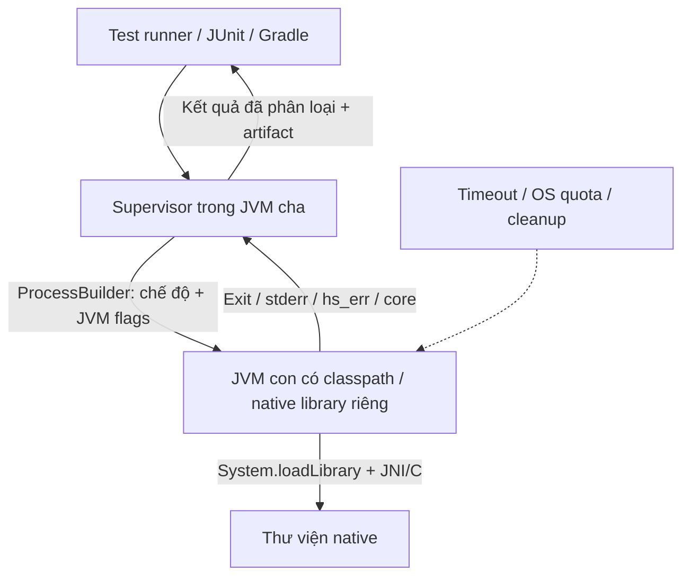

# Chạy kiểm thử gây crash hoặc lỗi nạp trong tiến trình riêng

## 1. Vì sao kiểm thử native phải có ranh giới tiến trình?

Khi một ứng dụng Java gọi mã native bằng JNI (Java Native Interface), một số lỗi có thể khiến **cả JVM chứa bài kiểm thử** dừng lại. Điều này khác với một assertion thất bại hay Java exception thông thường.

- Truy cập con trỏ C/C++ không hợp lệ, `abort()`, lỗi ABI, corruption của heap native hoặc một số lỗi JVM có thể gây fatal error, `SIGSEGV`/`SIGABRT` trên hệ Unix, access violation trên Windows. `try/catch` và `assertThrows` của JUnit không bảo đảm bắt được những lỗi làm chấm dứt process.
- `System.loadLibrary(...)` có thể ném `UnsatisfiedLinkError` khi thiếu thư viện, sai kiến trúc, thiếu thư viện phụ thuộc hoặc thiếu symbol JNI. Đây là **Java `Error`** có thể quan sát và kiểm thử khi JVM còn sống, nhưng việc nạp native library đôi khi còn kích hoạt mã khởi tạo native lỗi, crash hoặc treo.
- Một thử nghiệm khiến JVM test worker chết giữa chừng có thể làm mất các testcase chưa chạy, khiến Gradle/Maven báo test worker mất kết nối, và không giữ đủ log gốc để xác định lỗi.
- Native code có thể bị treo hoặc tạo thread/tài nguyên vượt mức; chỉ đặt `@Timeout` hay `Future.get(timeout)` trong cùng JVM không bảo đảm huỷ được một native call mắc kẹt.

**Cách thiết kế:** test runner ở **tiến trình cha (supervisor)**, còn từng tình huống nguy hiểm chạy trong **JVM con hoặc executable native con**. Cha xem exit code, deadline, stdout/stderr, `hs_err_pid`, core dump và các artifact chẩn đoán để đưa ra kết luận. Nếu tiến trình con chết, test runner vẫn sống và có thể báo kết quả các tình huống còn lại.

Một subprocess Java cũng là một tiến trình OS riêng; không cần một container chỉ để tạo ranh giới crash cơ bản. Container/sandbox có thể bổ sung quota, quyền và mức cách ly khi thử nghiệm rủi ro cao.

## 2. Phân loại đúng điều gì đang được kiểm thử

| Tình huống | Hành vi trong JVM con | Điều cha cần chứng minh |
|---|---|---|
| Thành công | Nạp thư viện/gọi native thành công, kết thúc bình thường | `exit=0`, response đúng; không phải chỉ là “process có khởi chạy” |
| Thiếu hoặc nạp sai library | Thường ném `UnsatisfiedLinkError`; child có thể kết thúc với mã khác 0 nếu không catch | Đúng thông điệp/loại lỗi nạp, không làm chết test runner; log đủ để phân biệt nguyên nhân |
| Không tìm thấy JNI symbol lúc gọi native method | Có thể ném `UnsatisfiedLinkError` ở lần gọi method | Phân biệt thiếu symbol với không tìm thấy `.so/.dll/.dylib` |
| Crash thực trong C/C++ | JVM con thường chết, có thể có `hs_err_pid` và core/minidump | Phát hiện kết thúc bất thường, giữ bằng chứng và xác minh không phải lỗi nạp |
| `Runtime.halt(code)` hoặc `System.exit(code)` | Child chủ động kết thúc với mã đã chọn | Kiểm tra được lifecycle của supervisor; **đây chỉ là mô phỏng kết thúc process**, không phải native crash |
| Deadlock/hang | Child vẫn còn nhưng không trả kết quả trong deadline | Timeout, yêu cầu dừng, nếu cần force kill và không để job treo vô thời hạn |
| Bị OOM killer/OS kill | Có thể kết thúc mà JVM không ghi fatal log | Ghi nhận exit/termination, đối chiếu log OS/container, tránh kết luận là `SIGSEGV` |

**Phân biệt ba lớp lỗi:** (1) Java exception/`Error` do runtime ném; (2) process kết thúc bất thường; (3) nguyên nhân thực ở native code/loader. Exit code khác 0 chỉ chứng minh kết thúc không thành công, **không tự chứng minh** có segmentation fault.

### Vì sao `assertThrows(UnsatisfiedLinkError.class, ...)` chưa đủ?

Một test JUnit cùng JVM có thể kiểm tra trường hợp thư viện thiếu bằng `assertThrows`. Tuy nhiên, bài kiểm thử nạp thư viện thực sự phải xét cả mã khởi tạo native (như `JNI_OnLoad`), thư viện phụ thuộc và trạng thái nạp process-wide. Nếu library crash ngay khi nạp, JUnit có thể chết theo. Thêm nữa, một native library đã nạp/khởi tạo trong process có thể để lại trạng thái khó đặt lại hoàn toàn giữa các testcase; lớp đã thất bại khi khởi tạo cũng có thể có trạng thái lỗi class initialization.

Vì vậy, với các kịch bản có nguy cơ fatal hoặc cần trạng thái nạp sạch, dùng **JVM con mới cho từng trường hợp**. Kịch bản load error chắc chắn chỉ ném Java `Error` có thể kiểm thử ngay trong JVM cho unit test hẹp; subprocess vẫn hữu ích để giữ fixture độc lập và nhận log rõ ràng.

## 3. Kiến trúc bộ kiểm thử bằng hai JVM



Mỗi lượt test nên có hợp đồng rõ:

1. **Input:** tên kịch bản, binary/library cần thử, working directory, JVM flags, environment có kiểm soát, deadline và thư mục artifact riêng.
2. **Execution:** dùng `ProcessBuilder` với argument array; tạo process, xử lý output để không đầy pipe, đợi trong một deadline hữu hạn.
3. **Observation:** phân biệt `START_FAILURE`, `EXIT_ZERO`, `JAVA_LOAD_ERROR`, `UNEXPECTED_NONZERO`, `TIMEOUT`, `NATIVE_FATAL` dựa trên bằng chứng cụ thể.
4. **Cleanup:** đóng stream, chấm dứt child quá hạn, kiểm tra process còn sống và thu gom các descendant nếu child spawn subprocess.
5. **Reporting:** tóm tắt verdict, ghi rõ exit code, thời gian, đường dẫn stderr, fatal log/core và version native binary; test runner không nhầm việc “parent còn sống” với “child thành công”.

Chỉ đánh dấu `NATIVE_FATAL` khi có bằng chứng phù hợp (fatal log, OS event hoặc core/minidump), chứ không gán nhãn đó cho mọi `exit != 0`.

## 4. Ví dụ Java 17+ có thể chạy ngay: lỗi nạp, dừng đột ngột và treo

Ví dụ đầu tiên **không cần compiler C**. Nó chứng minh cách JVM cha chạy từng trường hợp trong JVM con, nhận ra lỗi nạp native, dừng đột ngột và timeout mà không tự chết. Sau đó mục 5 bổ sung native `abort()` thật.

Tạo hai file sau trong **cùng thư mục**. Chương trình không dùng framework ngoài JDK.

**`NativeFailureChild.java`**

```java
public final class NativeFailureChild {
    private static native void abortInC();

    public static void main(String[] args) throws InterruptedException {
        if (args.length != 1) {
            throw new IllegalArgumentException("mode is required");
        }

        switch (args[0]) {
            case "ok" -> System.out.println("child: ok");

            case "missing-library" ->
                System.loadLibrary("this_native_library_must_not_exist_260");

            case "abrupt-exit" ->
                Runtime.getRuntime().halt(73);

            case "hang" ->
                Thread.sleep(30_000);

            case "native-abort" -> {
                System.loadLibrary("crashprobe");
                abortInC();
            }

            default -> throw new IllegalArgumentException("unknown mode");
        }
    }
}
```

**`NativeFailureHarness.java`**

```java
import java.io.IOException;
import java.nio.file.Files;
import java.nio.file.Path;
import java.util.List;
import java.util.Locale;
import java.util.concurrent.TimeUnit;

public final class NativeFailureHarness {
    private static String javaExecutable() {
        String executable = System.getProperty("os.name")
                .toLowerCase(Locale.ROOT).contains("win")
                ? "java.exe" : "java";
        return Path.of(System.getProperty("java.home"),
                "bin", executable).toString();
    }

    private static String runChild(String mode, Path logs)
            throws IOException, InterruptedException {
        Path stderr = logs.resolve(mode + ".stderr.log");
        ProcessBuilder builder = new ProcessBuilder(
                javaExecutable(),
                "-XX:ErrorFile=" + logs.resolve("hs_err_pid%p.log"),
                "-Djava.library.path=.",
                "-cp", System.getProperty("java.class.path"),
                "NativeFailureChild", mode
        );

        // stdout bị bỏ; stderr được ghi file để tránh đầy pipe.
        builder.redirectOutput(ProcessBuilder.Redirect.DISCARD);
        builder.redirectError(stderr.toFile());

        Process child = builder.start();
        try {
            if (!child.waitFor(5, TimeUnit.SECONDS)) {
                child.destroy();
                if (!child.waitFor(1, TimeUnit.SECONDS)) {
                    child.destroyForcibly();
                    child.waitFor();
                }
                return "TIMEOUT";
            }
        } catch (InterruptedException e) {
            child.destroyForcibly();
            Thread.currentThread().interrupt();
            throw e;
        }

        int exit = child.exitValue();
        return switch (mode) {
            case "ok" -> exit == 0 ? "PASS" : "UNEXPECTED_EXIT";

            case "missing-library" ->
                exit != 0
                    && Files.readString(stderr).contains("UnsatisfiedLinkError")
                    ? "LOAD_FAILURE" : "UNEXPECTED_EXIT";

            case "abrupt-exit" ->
                exit == 73 ? "ABRUPT_EXIT" : "UNEXPECTED_EXIT";

            case "hang" -> "UNEXPECTED_EXIT";

            case "native-abort" ->
                exit != 0 ? "NONZERO_INSPECT_LOG" : "UNEXPECTED_SUCCESS";

            default -> "UNEXPECTED_MODE";
        };
    }

    public static void main(String[] args) throws Exception {
        Path logs = Path.of("probe-logs").toAbsolutePath();
        Files.createDirectories(logs);

        List<String> modes = args.length == 0
                ? List.of("ok", "missing-library",
                          "abrupt-exit", "hang")
                : List.of(args);

        for (String mode : modes) {
            String result = runChild(mode, logs);
            System.out.println(mode + "=" + result);
        }
        System.out.println("parent: alive");
    }
}
```

Biên dịch/chạy bằng **Java 17 hoặc mới hơn** trong thư mục có hai file:

```bash
javac NativeFailureChild.java NativeFailureHarness.java
java NativeFailureHarness
```

Đầu ra chuẩn mong đợi khi JDK có thể khởi động child trong 5 giây và tên thư viện thử nghiệm không tồn tại:

```text
ok=PASS
missing-library=LOAD_FAILURE
abrupt-exit=ABRUPT_EXIT
hang=TIMEOUT
parent: alive
```

Tại sao các dòng xuất hiện:

- `ok`: JVM con hoàn tất với mã `0`. Dòng `child: ok` không xuất hiện trên console cha vì `redirectOutput(DISCARD)`; phép thử căn cứ vào exit code.
- `missing-library`: `System.loadLibrary` tìm thư viện theo cơ chế của JVM/OS, không thấy tên đã chọn nên ném `UnsatisfiedLinkError`. Child không catch và kết thúc khác 0. Cha đọc `probe-logs/missing-library.stderr.log` để xác nhận loại lỗi trước khi trả `LOAD_FAILURE`.
- `abrupt-exit`: `Runtime.halt(73)` dừng JVM con trực tiếp, cho exit code `73` trong môi trường thông thường; parent nhận `ABRUPT_EXIT`. Đây **không** phải `SIGSEGV`, không chạy C, và không được dùng để xác minh crash handler hoặc kiểm tra con trỏ.
- `hang`: child ngủ 30 giây, trong khi parent chờ tối đa 5 giây. Parent yêu cầu dừng (`destroy`), đợi thêm 1 giây rồi `destroyForcibly` nếu cần; trả `TIMEOUT`.
- `parent: alive`: JVM điều phối tiếp tục sau ba tình huống lỗi. Đây là minh chứng của ranh giới **process**, không chứng minh library hay worker có quyền truy cập hệ thống bị sandbox.

Mã cha cố ý không in toàn bộ stack trace của child để stdout có kết quả dễ so sánh; thông tin lỗi nạp nằm trong file `*.stderr.log`. Một test CI nên đính kèm file đó khi có thất bại. Nếu tên thư viện vô tình tồn tại trên máy, hoặc JVM khởi động chậm hơn 5 giây, kết quả sẽ khác: hãy dùng tên thư viện ngẫu nhiên/được kiểm soát và cấu hình deadline phù hợp máy CI.

**Các giả định của ví dụ:** Java source được biên dịch và parent chạy tại cùng thư mục, classpath chứa hai lớp, child kế thừa working directory của parent. Mặc định `-cp` của child lấy classpath của parent. Trong hệ thống thực nên chuẩn hóa **classpath và đường dẫn library thành absolute path**, kiểm tra working directory/environment và gói dependency của subprocess chính xác; `-Djava.library.path=.` không tự thêm thư viện native vào Java classpath.

### Vì sao không dùng `new Thread(...)` hoặc `ExecutorService`?

Thread trong cùng JVM vẫn chia sẻ address space với native code và có thể chết theo khi native crash. `Future.get(5, TimeUnit.SECONDS)` chỉ giới hạn thời gian đợi ở caller; `cancel(true)` không cưỡng chế native code không hợp tác phải dừng. `ProcessBuilder` tạo ranh giới OS để test runner có thể xử lý child kết thúc và thực thi timeout/kill ở mức process.

## 5. Tạo một native crash thật bằng JNI, nhưng chỉ chạy ở JVM con

Nếu mục tiêu là chứng minh pipeline lưu và báo cáo **fatal native error** thực sự, `Runtime.halt` ở ví dụ trước là chưa đủ. Dựng riêng một thư viện JNI cố ý `abort()`; không nạp hoặc gọi nó trực tiếp trong JVM của test runner.

Tạo file thứ ba **`crashprobe.c`**:

```c
#include <jni.h>
#include <stdlib.h>
#include "NativeFailureChild.h"

JNIEXPORT void JNICALL Java_NativeFailureChild_abortInC(
        JNIEnv *env, jclass cls) {
    (void)env;
    (void)cls;
    abort();  // Cố ý kết thúc process chứa JVM con.
}
```

Đây là thư viện JNI **có chủ ý crash**, không phải mã sản phẩm. Lệnh dưới đây dành riêng cho Linux có compiler C và JDK tương ứng. Đặt `JAVA_HOME` trỏ tới JDK dùng để biên dịch/chạy:

```bash
javac -h . NativeFailureChild.java NativeFailureHarness.java
cc -std=c11 -O0 -g -Wall -Wextra -fPIC -shared \
   -I"$JAVA_HOME/include" -I"$JAVA_HOME/include/linux" \
   crashprobe.c -o libcrashprobe.so

java NativeFailureHarness native-abort
```

Kỳ vọng trên môi trường Linux có thư viện nạp được: child vào `abort()`, bị kết thúc bất thường; parent vẫn sống. Stdout của parent **thường** là:

```text
native-abort=NONZERO_INSPECT_LOG
parent: alive
```

Đây là output của **harness**, không phải stack trace OS/JVM. Exit code thực sự và file tạo ra khác nhau theo OS/JDK/thiết lập core. Sau lệnh, kiểm tra `probe-logs/native-abort.stderr.log`, file `probe-logs/hs_err_pid<PID>.log` nếu HotSpot tạo được, và core/minidump theo cấu hình hệ điều hành. Nếu library thiếu hoặc không nạp được, child cũng có thể kết thúc khác 0; do đó nhãn `NONZERO_INSPECT_LOG` buộc người kiểm thử **đọc bằng chứng trước khi tuyên bố native crash đã xảy ra**.

Trên Windows, cần compiler và JNI headers cho Windows (`include/win32`) và DLL đúng kiến trúc; trên macOS dùng `include/darwin` và shared library phù hợp. Không áp lệnh build Linux nguyên xi sang hệ điều hành khác. Không tạo test cố ý ghi vào con trỏ rác để “ép” `SIGSEGV`: undefined behavior có thể hủy dữ liệu, không crash hoặc crash ngoài điểm mong muốn. `abort()` là một cách kiểm thử **fatal termination** dễ xác định mục đích hơn.

Nếu muốn kiểm thử một bug pointer cụ thể, chạy **repro native riêng** với input tối thiểu, debug symbols và sanitizer; đánh giá bằng diagnostic cụ thể của ASan/UBSan hoặc debugger. Đừng dùng riêng exit code để chứng minh lỗi truy cập bộ nhớ đã được bắt.

### Cơ chế sinh và đọc `hs_err_pid`

Tùy loại lỗi, HotSpot cố gắng tạo fatal error report khi JVM crash. Mẫu sử dụng ở parent:

```text
-XX:ErrorFile=<artifact-directory>/hs_err_pid%p.log
```

`%p` được thay bằng PID nên các JVM con khác nhau ít đè file nhau. Báo cáo có thể chứa signal/exception, `Problematic frame`, native frames, loaded libraries và thông tin JVM. Phần `Problematic frame` chỉ nơi crash được phát hiện; memory corruption có thể đã xảy ra trước đó. File **không luôn tồn tại**: `SIGKILL`, OS OOM kill, thiếu quyền ghi hoặc một số lỗi nghiêm trọng có thể ngăn JVM tạo báo cáo. `Runtime.halt` trong ví dụ cũng không tạo fatal log mặc định.

Một chương trình kiểm thử tự động nên kiểm tra đường dẫn artifact theo PID/request của child, kết hợp loại lỗi trong stderr và sự kiện hệ điều hành. Cần kiểm tra file thực sự được tạo ở **lượt chạy hiện tại**, tránh báo cáo nhầm file `hs_err` cũ sót trong cùng thư mục.

## 6. Lỗi nạp thư viện có nhiều nguyên nhân khác nhau

`UnsatisfiedLinkError` thường được hiểu quá đơn giản là “thiếu file”. Thực tế cần phân loại:

| Triệu chứng | Nguyên nhân có thể | Bằng chứng cần kiểm tra |
|---|---|---|
| `no X in java.library.path` | JVM không tìm thấy library theo tên/path | `System.mapLibraryName("X")`, `java.library.path`, working dir, tên file |
| `Can't load ...`, `wrong ELF class`, `not a valid Win32 application` | Sai kiến trúc CPU/bitness, định dạng file không phù hợp OS | OS, kiến trúc JDK và native binary, `file`/`readelf`/công cụ PE/Mach-O tương ứng |
| `libdependency.so: cannot open shared object file` hoặc lỗi DLL phụ thuộc | Loader không tìm thấy **thư viện phụ thuộc** của library chính | `ldd`/`readelf -d` với file tin cậy, `otool -L`, công cụ DLL dependency phù hợp |
| `undefined symbol` | Thiếu symbol phụ thuộc, sai ABI/version, linking không phù hợp | Symbol table, phiên bản dependency, compiler flags |
| `Native method not found` hay `UnsatisfiedLinkError` khi gọi native method | JNI entry point/signature không khớp hoặc chưa đăng ký đúng | Header `javac -h`, `javap -s`, exported symbols, `RegisterNatives` |
| Crash hoặc treo ngay lúc `System.loadLibrary` | Mã khởi tạo native/`JNI_OnLoad`/global constructor lỗi, conflict với library khác | `hs_err_pid`, stderr, native debugger, debug symbols và trace loader |

`System.loadLibrary("crashprobe")` dùng tên logic và cơ chế ánh xạ sang tên file theo OS; `System.load("/absolute/path/libcrashprobe.so")` dùng đường dẫn tuyệt đối. Các cơ chế tìm thư viện phụ thuộc của OS (ví dụ ELF loader, `rpath`, `RUNPATH`, `LD_LIBRARY_PATH`) là tầng khác với Java classpath. Việc thay `-cp` thường không sửa được lỗi thiếu native library.

Trên Linux có thể dùng `readelf -d libcrashprobe.so`, `ldd` đối với **binary đáng tin cậy** hoặc trace loader có kiểm soát để hiểu dependency. Không thực thi/đưa file native không đáng tin vào công cụ có thể kích hoạt mã ngoài dự kiến. Với library từ bên ngoài, ưu tiên phân tích metadata tĩnh trước. Trên Windows, kiểm tra architecture/DLL dependencies, loader search rules; trên macOS kiểm tra install names, rpath, code signing và kiến trúc.

**Bẫy trạng thái:** thất bại nạp do Java `Error` có thể catch, nhưng việc khởi tạo class `static` thất bại hoặc native library nạp một phần có thể để lại trạng thái process/class loader đáng lưu ý. Đối với testcase cần điều kiện đầu vào sạch, tạo JVM con mới thay vì dựa vào “unload thư viện rồi nạp lại” trong cùng JVM. Java không có API chung để buộc OS/JVM unload một native library tùy ý theo yêu cầu của testcase.

## 7. Thiết kế kiểm thử tự động và tích hợp JUnit/Gradle/Maven

Cách đáng tin cậy là **mỗi kịch bản native phá hủy process nằm ở child**; JUnit hoặc framework chính chỉ gọi harness và đánh giá verdict. Một ca kiểm thử có thể thành công khi child bị crash, **nếu chính crash đó là hành vi được cố ý kiểm chứng** và bằng chứng xác nhận đúng loại crash.

Ví dụ hợp đồng assertion ở test runner:

- Kịch bản thành công: yêu cầu `exit=0`, kết quả nghiệp vụ đúng, không có timeout.
- Kịch bản thiếu library: yêu cầu child khác 0 **và** stderr có `UnsatisfiedLinkError` phù hợp tên thư viện/đường nạp; JVM cha vẫn chạy.
- Kịch bản crash JNI: yêu cầu child kết thúc bất thường, không phải `UnsatisfiedLinkError`; với môi trường có hỗ trợ, cần chứng cứ `SIGABRT`/native frame/OS event hoặc fatal log mới sinh từ đúng child.
- Kịch bản hang: yêu cầu child sống quá deadline, bị dừng và được dọn sạch; đồng thời test runner tiếp tục.
- Kịch bản bất ngờ: nếu child bị OS kill do CI hết RAM thay vì crash dự kiến, test phải báo lỗi điều kiện môi trường, không tự động pass vì exit khác 0.

Nếu dùng JUnit 5, lệnh gọi subprocess nên nằm trong test utility, trả cấu trúc kiểu `ProbeResult(mode, started, timedOut, exitCode, stderrPath, fatalLogPath, duration)`. Assertion so sánh **loại kết thúc + bằng chứng**, còn các artifact được lưu vào CI khi test fail. `@Timeout` có thể là lớp dự phòng để không treo cả test suite, nhưng **không thay** timeout và kill dành cho OS child.

Với Gradle/Maven, cơ chế test fork/forkEvery/reuseForks kiểm soát vòng đời **test runner JVM** ở mức build tool, không tự biến một native call nguy hiểm trong một testcase thành subprocess an toàn. Khi native code fatal làm chết test worker, build tool vẫn có thể dừng hoặc đánh dấu suite lỗi. Cách chủ động nhất là tạo child từ test utility và tránh nạp native library nguy hiểm vào runner. Chỉ dùng isolation của container hoặc test framework nếu đã xác minh chính xác ranh giới process và cách thu thập artifact.

Ở CI, có thể chia hai nhóm: test Java/JNI an toàn chạy nhanh, thường xuyên; crash/loader/destructive test có timeout, environment và artifact riêng. Không dùng nhãn nhóm để bỏ qua mãi những testcase gây crash: chúng là phép kiểm tra quan trọng đối với quá trình đóng gói thư viện native.

## 8. Vấn đề vận hành làm phép thử dễ sai

### 8.1. Timeout và cleanup

- Đặt deadline cho **toàn bộ request** (khởi động process, nạp library, thực thi, trả output), không chỉ timeout ở một Java `Future`.
- Dùng `waitFor(timeout, TimeUnit.SECONDS)` để biết child đã kết thúc; nếu hết hạn thì `destroy()`, đợi thời gian ngắn và `destroyForcibly()` khi cần. `destroyForcibly()` không đồng nghĩa kill cả cây tiến trình.
- Khi thread cha bị interrupt, dọn child và truyền lại trạng thái interrupt; không nuốt `InterruptedException`. Nếu hệ thống cần chứng minh cleanup hoàn tất, quản lý cả descendant và dùng ranh giới OS phù hợp.
- Native worker có spawn subprocess thì dùng process group/cgroup trên Linux hoặc Windows Job Object nếu cần. Chỉ kill PID trực tiếp có thể để lại orphan.
- Deadline 5 giây trong demo là giá trị học tập. CI chậm, load library lớn hoặc chạy sanitizer cần deadline được cấu hình theo môi trường; tránh test flaky do chọn mốc quá sát.

### 8.2. Stdout/stderr và log

- `ProcessBuilder` mặc định tạo pipe cho stdout/stderr. Nếu child ghi đủ nhiều mà parent chờ `waitFor` **không drain stream**, child có thể bị block và trông như treo native.
- Demo bỏ stdout (`Redirect.DISCARD`) và ghi stderr vào file, do đó không bị đầy hai pipe. Với test phải kiểm tra response của child, dùng protocol có framing, đọc liên tục theo giới hạn hoặc redirect vào file để đọc sau.
- Đặt giới hạn kích thước log, rotation/retention và quota disk trong CI; một child spam log có thể làm đầy đĩa. Crash log/core có thể chứa thông tin nhạy cảm.
- Tách artifact mỗi test/lượt/PID để tránh race condition và việc đọc nhầm log cũ. Đừng lọc bỏ toàn bộ stderr trước khi phân tích `UnsatisfiedLinkError`.

### 8.3. Đường dẫn, environment và thư viện native

- Khởi chạy bằng argument list của `ProcessBuilder` thay vì nối dữ liệu người dùng vào `sh -c` hoặc `cmd /c`. Nếu có executable path chứa khoảng trắng, argument list vẫn giữ đúng ranh giới tham số.
- Dùng đúng `java.home/bin/java` hoặc launcher JVM cần kiểm thử, ghi lại `java -version`, OS/architecture, compiler và thư viện native. Không mặc định `java` trên `PATH` là cùng JDK của runner.
- Xác minh working directory, classpath, module path, library search path, environment của OS và đường dẫn dependency. Dùng absolute paths khi đóng gói test cho CI.
- Kiểm thử packaging: JAR/class Java có thể đã đúng nhưng native binary bị thiếu, sai classifier, sai tên, thiếu DLL phụ thuộc hoặc sai architecture.
- Không chuyển bí mật của runner sang child trừ khi thực sự cần. Với input không tin cậy, dùng quyền user tối thiểu và sandbox/container/VM phù hợp.

### 8.4. Không quy kết chỉ từ exit code

Trên một số hệ Unix, shell thường biểu diễn process bị signal bằng `128 + signal number`, ví dụ `139` cho `SIGSEGV`. Tuy nhiên, `Process.exitValue()`, shell, container runtime và Windows có cách biểu diễn khác; program cũng có thể tự chọn exit code đó. Vì vậy **không hardcode `139` làm bằng chứng phổ quát**. `0` cũng không luôn đủ chứng minh nghiệp vụ thành công nếu child nuốt lỗi rồi tự thoát bình thường.

Khi child bị killed mà không có `hs_err_pid`, kiểm tra kernel/system log, container OOM status hoặc giám sát job runner. Phân biệt thiếu dữ liệu chẩn đoán với chắc chắn lỗi không xảy ra.

## 9. Mở rộng sang native executable và test sanitizer

Không phải tình huống nào cũng cần tạo JVM con. Nếu thư viện có native test executable độc lập, supervisor có thể chạy trực tiếp binary C/C++ để kiểm tra memory safety trước khi đưa vào JNI:

```java
ProcessBuilder builder = new ProcessBuilder(
        "/absolute/path/to/native-test", "--case", "decode-corrupt");
```

Dòng trên là **đoạn minh họa**, không phải chương trình Java độc lập; xử lý timeout/stream/exit theo cùng cơ chế như `NativeFailureHarness`. Native test binary có lợi vì sanitizer thường dễ thiết lập hơn trong JVM lớn. Compile C/C++ test với debug symbols và khi phù hợp:

```bash
cc -g -O1 -fno-omit-frame-pointer -fsanitize=address \
   -o native-test native-test.c
./native-test
```

Lệnh là **mẫu** giả định có `native-test.c` hiện hữu, không phải file đi kèm ví dụ. AddressSanitizer có thể phát hiện nhiều out-of-bounds/use-after-free; UndefinedBehaviorSanitizer có thể hỗ trợ một số loại UB. Không sanitizer nào chứng minh mọi thao tác con trỏ đều an toàn. Dùng test input tối thiểu, giảm tối ưu khi debug khi cần, và lưu version compiler/runtime.

Nếu yêu cầu xác minh crash trong JNI call path, phải chạy đúng JVM con và native binary có debug info như mục 5. Native executable độc lập kiểm tra lỗi C tốt nhưng có thể không tái hiện được lỗi JNI ownership, local/global refs, thread attach hoặc ABI ở giao diện Java–C.

### Resource isolation cho test gây lỗi nặng

Một tiến trình riêng giúp JVM cha không chung address space với child, nhưng child vẫn có thể chiếm CPU/RAM và ảnh hưởng máy CI. Khi test cố ý gây OOM/deadlock hoặc xử lý native code khó tin cậy, dùng quota OS/container thích hợp (ví dụ Linux cgroup cho memory/CPU/PID, Job Object trên Windows), thời gian chạy tối đa và file size quota. `-Xmx` chỉ kiểm soát Java heap, không giới hạn toàn bộ native allocation của JVM con. Container thường vẫn dùng chung kernel host và phải giới hạn quyền, network và filesystem theo threat model.

## 10. Ma trận kiểm thử đề xuất

| Trường hợp | Kỳ vọng | Bằng chứng giữ lại |
|---|---|---|
| JNI call hợp lệ | Child trả exit 0 và kết quả nghiệp vụ đúng | stdout/protocol response, version library |
| Native library không tồn tại | `UnsatisfiedLinkError` trong child; runner sống | stderr, tên thư viện và `java.library.path` |
| Thư viện sai architecture hoặc dependency | Child báo lỗi nạp đúng tầng, không crash runner | stderr + metadata ELF/PE/Mach-O và dependency |
| Thiếu JNI symbol | Error tại lần gọi native method; parent phân loại là linking failure | Java method signature, header và exported symbols |
| `JNI_OnLoad` gặp lỗi | Java load error hoặc fatal child crash theo điều kiện; runner sống | exit + stderr/hs_err + debug frames |
| `abort()` từ JNI | Child bị kết thúc bất thường; parent còn sống | crash log mới phát sinh, OS event và native frame |
| Native bug use-after-free | Sanitizer/native debugger có báo cáo phù hợp | sanitizer report, input tái hiện, build ID |
| Native hang | Child bị timeout/kill, không để orphan | deadline, elapsed, trạng thái process tree |
| Child xuất log rất lớn | Runner không deadlock/cháy disk do output | giới hạn và retention log, timeout |
| Chạy đồng thời nhiều test | Không nhầm log hoặc PID, không làm cạn worker/quota | artifact per-test, tải và peak resource |
| Crash sau khi đã ghi side effect | Không mặc định retry vô hạn | trạng thái tác vụ, idempotency key và đối soát |

Với pipeline phân phối native library đa nền tảng, phải chạy ít nhất một lượt trên **mỗi tổ hợp OS/architecture/JDK được hỗ trợ**, vì loader, tên thư viện, JNI toolchain và crash reporting khác nhau. Kiểm thử Linux x86_64 không tự chứng minh DLL Windows hay `.dylib` macOS đúng.

## 11. Lỗi triển khai thường gặp

1. **Cố ý `abort()` ngay trong test JVM của JUnit.** Việc này có thể chấm dứt test worker và làm mất kết quả suite. Luôn đưa điểm gọi fatal native vào subprocess.
2. **Coi `Runtime.halt` là native crash.** Nó chỉ mô phỏng việc child kết thúc bất thường; test crash handler/fatal log cần lỗi native thật.
3. **Coi mọi `exit != 0` là segfault.** Thiếu library, lỗi command, timeout bị kill và OS OOM có thể đều khác 0. Phải đối chiếu stderr, fatal log và hệ điều hành.
4. **Chờ process nhưng không đọc stdout/stderr.** Pipe có thể đầy và làm child kẹt; redirect hoặc drain liên tục có giới hạn.
5. **Đặt `@Timeout` rồi nghĩ native call được cưỡng chế dừng.** Cần deadline và kill ở mức OS process.
6. **Dùng đường dẫn tương đối phụ thuộc nơi chạy test.** IDE, Gradle, Maven và CI có working directory khác nhau; chuẩn hóa đường dẫn binary/classpath/library.
7. **Đọc nhầm `hs_err` từ lượt trước.** Mỗi test cần artifact namespace riêng và xác thực thời gian/PID.
8. **Chỉ chạy test thiếu thư viện, không chạy test có thư viện thật.** Cần cả positive load/call test, dependency check và runtime compatibility.
9. **Tăng parallelism không giới hạn.** Mỗi JVM con có startup, heap, stack, thread và native memory riêng; CI có thể OOM dù từng test độc lập.
10. **Cố tình viết con trỏ sai vào C để có exit code `139`.** C undefined behavior có thể không crash, dễ gây chẩn đoán sai; dùng `abort()` cho test fatal lifecycle hoặc sanitizer cho bug bộ nhớ.
11. **Giấu lỗi load bằng `catch (Throwable)` rồi thoát `0`.** Khi đó test runner mất khả năng phân loại; nếu catch để tạo protocol response, phải phát trạng thái lỗi chính xác và sử dụng exit code/quy ước nhất quán.
12. **Tự tin rằng child process tạo sandbox bảo mật hoàn chỉnh.** Process vẫn có thể truy cập file, network hoặc tài nguyên host theo quyền; cần OS policy và quota nếu test không đáng tin.

## 12. Checklist trước khi đưa phép thử vào CI

- [ ] Mỗi bài test có rủi ro fatal native chạy trong **process riêng**; runner không nạp thư viện có thể crash.
- [ ] Xác định rõ kịch bản **Java load/link error**, **simulated termination**, **real native crash**, **timeout** và **OS kill**.
- [ ] Process được khởi chạy với launcher, classpath, native library, working dir, environment và arguments đúng, có kiểm soát.
- [ ] Deadline hữu hạn; stdout/stderr không thể gây deadlock; child và descendant được dọn dẹp theo cơ chế OS thích hợp.
- [ ] Test assert cả trạng thái kết thúc và **bằng chứng nguyên nhân**, không dựa duy nhất vào exit code.
- [ ] `stderr`, fatal log, core/minidump (nếu có), build ID và version được lưu cho lượt chạy hiện tại.
- [ ] CI có resource limits, log quota và mức chạy song song vừa sức host.
- [ ] Có kịch bản thành công để so sánh, và artifact phân phối được kiểm thử đúng OS/architecture.
- [ ] Nếu test fail, trạng thái lỗi hiện rõ; nếu child crash đúng kỳ vọng, test ghi nhận điều kiện crash **đã được xác minh**.
- [ ] Không để test gây crash chạy với quyền/dữ liệu nhạy cảm ngoài nhu cầu.

**Kết luận kỹ thuật:** Trong module Java native interoperability, tách các phép thử gây crash hoặc lỗi nạp vào JVM con giúp kiểm thử được hành vi phá hủy process một cách có kiểm soát. Phần quan trọng nhất không phải chỉ tạo `ProcessBuilder`, mà là **xác định loại lỗi bằng bằng chứng, cưỡng chế timeout và thu thập artifact trước khi đưa ra verdict**.