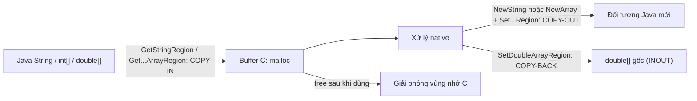

# Bài thực hành: Truyền chuỗi Unicode và mảng số với chính sách sao chép tường minh

## 1. Đề bài và kết quả cần đạt

Xây dựng một cầu nối **Java ↔ C qua JNI** để truyền chuỗi Unicode và hai loại mảng số, trong đó **mọi lần sao chép qua ranh giới bộ nhớ đều được chỉ ra bằng API và hợp đồng rõ ràng**. Bài dùng Java 17+ để chạy với nhiều JDK phổ biến; ví dụ C đã được biên dịch với GCC trên Linux.

Hoàn thành bốn thao tác:

1. **`copyUtf16(String)` — IN → OUT mới:** nhận `String`, sao chép các UTF-16 code unit vào vùng nhớ C, tạo một `String` Java mới có cùng nội dung. Giữ nguyên emoji, dấu tiếng Việt, ký tự kết hợp và `U+0000`.
2. **`copyUtf8(byte[])` — IN → OUT mới:** Java tự mã hóa chuỗi bằng **UTF-8 chuẩn** thành `byte[]`; C sao chép các byte với độ dài tường minh sang một `byte[]` Java mới; Java giải mã lại. Không coi dữ liệu byte là C-string kết thúc bằng `\0`.
3. **`reverseInts(int[])` — IN → OUT mới:** sao chép `int[]` vào vùng nhớ C, đảo phần tử trên bản sao, tạo `int[]` kết quả; mảng nguồn không đổi.
4. **`scaleDoubles(double[], double)` — INOUT:** sao chép `double[]` vào vùng nhớ C, nhân từng phần tử, **chỉ ghi trả** vào chính mảng Java ban đầu bằng lệnh JNI tường minh.

**Tiêu chí đạt:** mã biên dịch và chạy được; đầu ra đúng; chuỗi Unicode round-trip không mất dữ liệu; `int[]` nguồn giữ nguyên; `double[]` chỉ đổi khi `SetDoubleArrayRegion` được gọi; không giữ con trỏ native sau khi trả về, không rò bộ nhớ; giải thích được ai sở hữu và giải phóng mỗi vùng nhớ.

### Cần có

- JDK **17 trở lên**, gồm `javac`, `javac -h`, và tệp header JNI trong `$JAVA_HOME/include`.
- Trình biên dịch C: GCC/Clang trên Linux/macOS hoặc MSVC Developer Command Prompt trên Windows.
- Java và thư viện native cùng kiến trúc CPU/bitness. Lệnh build Linux/macOS/Windows được nêu riêng.
- Dùng UTF-8 cho tệp nguồn Java/C/Markdown. Các lệnh Java bên dưới chỉ định `-encoding UTF-8`.

## 2. Thiết kế chính sách sao chép

| Hàm | Dữ liệu vào và quyền sở hữu | Copy Java → C | Copy C → Java | Quyền thay đổi sau lời gọi |
| --- | --- | --- | --- | --- |
| `copyUtf16(String)` | Java sở hữu chuỗi bất biến | `GetStringRegion` → `malloc` buffer `jchar[]` | `NewString` từ buffer | Trả chuỗi cùng nội dung; không đổi input |
| `copyUtf8(byte[])` | Java sở hữu `byte[]` UTF-8 | `GetByteArrayRegion` → buffer `jbyte[]` | `NewByteArray` + `SetByteArrayRegion` | Trả mảng mới; không đổi input |
| `reverseInts(int[])` | Java sở hữu `int[]` đầu vào | `GetIntArrayRegion` → buffer `jint[]` | `NewIntArray` + `SetIntArrayRegion` | Trả mảng đảo mới; input giữ nguyên |
| `scaleDoubles(double[], factor)` | Java sở hữu mảng **INOUT** | `GetDoubleArrayRegion` → buffer `jdouble[]` | `SetDoubleArrayRegion` vào mảng gốc | Caller nhìn thấy giá trị mới sau khi hàm trả thành công |

Ở mỗi hàm, `malloc` tạo **bản sao do C sở hữu** và `free` giải phóng nó trước khi JNI return. Các `jstring`, `jbyteArray`, `jintArray` được tạo bằng JNI là **đối tượng Java do JVM quản lý**, không gọi `free` trên chúng. Tham chiếu JNI local chỉ hợp lệ trong phạm vi lời gọi (trừ khi chuyển thành global reference và quản lý đúng cách; bài này không làm vậy). Không lưu `JNIEnv*`, con trỏ buffer hoặc local reference để dùng sau khi JNI return.

**IN:** đọc đầu vào, không ghi lại vào input. **OUT mới:** tạo đối tượng/mảng Java mới. **INOUT:** sao chép dữ liệu vào native, tính toán trên bản sao rồi gọi `Set...ArrayRegion` để ghi trả. Đây là chính sách copy rõ ràng theo **hợp đồng API của bài**, không phụ thuộc JVM quyết định pin hay copy một mảng Java.

Tại sao không dùng `GetIntArrayElements` hoặc `GetPrimitiveArrayCritical` cho bài này? Các API đó có thể trả con trỏ tới dữ liệu được pin hoặc bản sao tùy JVM và tình huống; `isCopy` chỉ cho biết quyết định cụ thể ở lần gọi. Chúng có hợp đồng `Release...` và những hạn chế riêng. Ngược lại, `Get...ArrayRegion` nhận **buffer C do ta cấp**, làm điểm copy-in tường minh; `Set...ArrayRegion` làm điểm copy-back tường minh.

## 3. Unicode: chọn một biểu diễn tại ranh giới

`String` Java là dãy **UTF-16 code unit**; `String.length()` đếm code unit, không phải số Unicode code point hay số byte UTF-8. Emoji ngoài Basic Multilingual Plane thường cần **hai UTF-16 code unit (surrogate pair)**. Các dấu kết hợp có thể làm số code point khác số grapheme người dùng nhìn thấy.

Có hai cách rõ ràng trong bài:

### Cách A — Giữ nguyên UTF-16 code unit

- JNI `GetStringLength` lấy số `jchar` cần sao chép.
- `GetStringRegion(env, source, 0, length, buffer)` chép chính xác số code unit đó sang buffer C.
- `NewString(env, buffer, length)` tạo `String` Java từ **đúng số code unit**, không cần/không dựa vào byte `\0` kết thúc.
- `jchar` là đơn vị UTF-16 16 bit theo JNI; **không coi mỗi `jchar` là một Unicode code point**. Cặp surrogate phải được giữ nguyên nếu muốn round-trip. Dạng này **không tự chuẩn hóa Unicode NFC/NFD**.

Cách A hữu ích khi C thực sự làm việc trên UTF-16; nếu một thư viện C mong đợi UTF-8, **không** ép cast `jchar*` sang `char*`.

### Cách B — Dùng UTF-8 chuẩn do Java mã hóa rõ ràng

- Java gọi `text.getBytes(StandardCharsets.UTF_8)`; độ dài để truyền C là `bytes.length`, không phải `text.length()`.
- C xử lý cặp `(pointer, length)`; phải chấp nhận byte `0x00` nằm giữa buffer.
- Java nhận lại `byte[]` và dùng `new String(bytes, StandardCharsets.UTF_8)` để giải mã.

**Không nhầm UTF-8 chuẩn với Modified UTF-8 của JNI.** `GetStringUTFChars`, `NewStringUTF` dùng **Modified UTF-8**: `U+0000` được biểu diễn khác UTF-8 chuẩn, và supplementary characters đi qua surrogate encoding. Không đưa trực tiếp kết quả `GetStringUTFChars` cho parser yêu cầu UTF-8 chuẩn hoặc giả định `strlen` thể hiện độ dài văn bản gốc. Bài chủ động chọn `GetStringRegion` và đường `byte[]`/`StandardCharsets.UTF_8` để không có nhập nhằng này.

`new String(bytes, StandardCharsets.UTF_8)` và `String.getBytes(UTF_8)` mặc định có thể **thay thế dữ liệu không hợp lệ** (ví dụ surrogate lẻ hoặc chuỗi byte UTF-8 lỗi). Với dữ liệu cần round-trip **lossless tuyệt đối ở mức UTF-16 code unit**, dùng Cách A. Với giao thức UTF-8 chuẩn, yêu cầu đầu vào Unicode hợp lệ và cấu hình `CharsetEncoder`/`CharsetDecoder` báo lỗi bằng `CodingErrorAction.REPORT` nếu cần từ chối dữ liệu sai thay vì thay thế.

## 4. Mã Java đầy đủ

Tạo thư mục làm bài, đặt file **`NativeCopyLab.java`** ngay trong thư mục đó:

```java
import java.nio.charset.StandardCharsets;
import java.util.Arrays;

public final class NativeCopyLab {
    static {
        System.loadLibrary("native_copy_lab");
    }

    private static native String copyUtf16(String source);
    private static native byte[] copyUtf8(byte[] utf8);
    private static native int[] reverseInts(int[] source);
    private static native void scaleDoubles(double[] values, double factor);

    public static void main(String[] args) {
        String text = "Tiếng Việt 🌍 | x\0y | e\u0301";
        String utf16Result = copyUtf16(text);
        byte[] utf8Bytes = text.getBytes(StandardCharsets.UTF_8);
        String utf8Result = new String(copyUtf8(utf8Bytes), StandardCharsets.UTF_8);

        System.out.println("utf16.equal=" + text.equals(utf16Result));
        System.out.println("utf8.equal=" + text.equals(utf8Result));
        System.out.println("embeddedNul=" + (utf8Result.indexOf('\0') >= 0));

        int[] inputInts = {1, -2, 3, 0};
        int[] reversed = reverseInts(inputInts);
        System.out.println("inputInts=" + Arrays.toString(inputInts));
        System.out.println("reversedInts=" + Arrays.toString(reversed));

        double[] values = {1.5, -2.0, 0.25};
        scaleDoubles(values, 2.0);
        System.out.println("scaledDoubles=" + Arrays.toString(values));
    }
}
```

Chuỗi kiểm thử có chữ Việt, emoji `🌍` (surrogate pair), byte NUL qua `\0`, và `e` + combining acute accent (`\u0301`). Việc so `String.equals` xác nhận **dãy UTF-16 code unit** bằng nhau; bài không in trực tiếp chuỗi chứa NUL để terminal/log tránh hiển thị khó kiểm soát.

Tạo JNI header trước khi viết và build mã C:

```bash
javac -encoding UTF-8 -h . NativeCopyLab.java
```

Lệnh này sinh `NativeCopyLab.class` và **`NativeCopyLab.h`**. Vì các method `native` là `static`, hàm C tương ứng nhận `jclass` làm tham số thứ hai; method native không `static` sẽ nhận `jobject`. **Đừng tự đoán** tên symbol JNI nếu có package, overload hoặc ký tự cần name mangling; luôn đối chiếu header sinh tự động.

## 5. Mã C đầy đủ với copy-in/copy-out

Trong cùng thư mục, tạo file **`native_copy_lab.c`**:

```c
#include "NativeCopyLab.h"
#include <stdint.h>
#include <stdlib.h>

static void throw_java(JNIEnv *env, const char *class_name, const char *message) {
    jclass type = (*env)->FindClass(env, class_name);
    if (type != NULL) {
        (*env)->ThrowNew(env, type, message);
        (*env)->DeleteLocalRef(env, type);
    }
}

static void *allocate_buffer(JNIEnv *env, jsize length, size_t element_size) {
    if (length <= 0) {
        return NULL;
    }
    if ((size_t)length > SIZE_MAX / element_size) {
        throw_java(env, "java/lang/OutOfMemoryError", "native buffer too large");
        return NULL;
    }
    void *buffer = malloc((size_t)length * element_size);
    if (buffer == NULL) {
        throw_java(env, "java/lang/OutOfMemoryError", "native allocation failed");
    }
    return buffer;
}

JNIEXPORT jstring JNICALL Java_NativeCopyLab_copyUtf16(
        JNIEnv *env, jclass clazz, jstring source) {
    (void)clazz;
    if (source == NULL) {
        throw_java(env, "java/lang/NullPointerException", "source");
        return NULL;
    }
    jsize length = (*env)->GetStringLength(env, source);
    if (length == 0) {
        return (*env)->NewString(env, NULL, 0);
    }

    jchar *copy = allocate_buffer(env, length, sizeof(jchar));
    if (copy == NULL) {
        return NULL;
    }
    (*env)->GetStringRegion(env, source, 0, length, copy);
    if ((*env)->ExceptionCheck(env)) {
        free(copy);
        return NULL;
    }
    jstring result = (*env)->NewString(env, copy, length);
    free(copy);
    return result;
}

JNIEXPORT jbyteArray JNICALL Java_NativeCopyLab_copyUtf8(
        JNIEnv *env, jclass clazz, jbyteArray utf8) {
    (void)clazz;
    if (utf8 == NULL) {
        throw_java(env, "java/lang/NullPointerException", "utf8");
        return NULL;
    }
    jsize length = (*env)->GetArrayLength(env, utf8);
    jbyteArray result = (*env)->NewByteArray(env, length);
    if (result == NULL || length == 0) {
        return result;
    }
    jbyte *copy = allocate_buffer(env, length, sizeof(jbyte));
    if (copy == NULL) {
        return NULL;
    }
    (*env)->GetByteArrayRegion(env, utf8, 0, length, copy);
    if (!(*env)->ExceptionCheck(env)) {
        (*env)->SetByteArrayRegion(env, result, 0, length, copy);
    }
    free(copy);
    return (*env)->ExceptionCheck(env) ? NULL : result;
}

JNIEXPORT jintArray JNICALL Java_NativeCopyLab_reverseInts(
        JNIEnv *env, jclass clazz, jintArray source) {
    (void)clazz;
    if (source == NULL) {
        throw_java(env, "java/lang/NullPointerException", "source");
        return NULL;
    }
    jsize length = (*env)->GetArrayLength(env, source);
    jintArray result = (*env)->NewIntArray(env, length);
    if (result == NULL || length == 0) {
        return result;
    }
    jint *copy = allocate_buffer(env, length, sizeof(jint));
    if (copy == NULL) {
        return NULL;
    }
    (*env)->GetIntArrayRegion(env, source, 0, length, copy);
    if ((*env)->ExceptionCheck(env)) {
        free(copy);
        return NULL;
    }
    for (jsize i = 0; i < length / 2; ++i) {
        jint tmp = copy[i];
        copy[i] = copy[length - 1 - i];
        copy[length - 1 - i] = tmp;
    }
    (*env)->SetIntArrayRegion(env, result, 0, length, copy);
    free(copy);
    return (*env)->ExceptionCheck(env) ? NULL : result;
}

JNIEXPORT void JNICALL Java_NativeCopyLab_scaleDoubles(
        JNIEnv *env, jclass clazz, jdoubleArray values, jdouble factor) {
    (void)clazz;
    if (values == NULL) {
        throw_java(env, "java/lang/NullPointerException", "values");
        return;
    }
    jsize length = (*env)->GetArrayLength(env, values);
    if (length == 0) {
        return;
    }
    jdouble *copy = allocate_buffer(env, length, sizeof(jdouble));
    if (copy == NULL) {
        return;
    }
    (*env)->GetDoubleArrayRegion(env, values, 0, length, copy);
    if (!(*env)->ExceptionCheck(env)) {
        for (jsize i = 0; i < length; ++i) {
            copy[i] *= factor;
        }
        (*env)->SetDoubleArrayRegion(env, values, 0, length, copy);
    }
    free(copy);
}
```

### Đọc đúng từng đoạn JNI

- `GetStringRegion` **copy-in** theo số `jchar`; `NewString` **copy-out** thành đối tượng Java. Sau `NewString`, buffer C có thể được `free` ngay. Với độ dài 0, tạo chuỗi rỗng mà không cần cấp phát buffer.
- `GetByteArrayRegion` và `GetIntArrayRegion` copy từ mảng Java sang **buffer riêng**; `NewByteArray`/`NewIntArray` và `Set...Region` tạo/điền kết quả mới. Thay đổi buffer C không làm đầu vào Java đổi.
- `GetDoubleArrayRegion` copy-in; vòng nhân chạy trên buffer C; `SetDoubleArrayRegion` là **điểm copy-back duy nhất**, do đó caller quan sát `double[]` đã đổi. Không giả định thao tác Set là transaction atomic nếu nhiều thread cùng sửa mảng.
- `jsize` dùng để đếm phần tử. `malloc(length * sizeof(T))` chỉ thực hiện sau khi kiểm tra nguy cơ overflow phép nhân `size_t`; mã xử lý độ dài 0, giá trị `null`, lỗi cấp phát, và nhánh có JNI exception đang pending.
- `free(copy)` chạy ở mọi nhánh đã cấp phát. Mã không gọi `Release...Elements` vì **không hề** dùng `Get...Elements`, và không gọi `free` với Java object hay `JNIEnv*`.

`jint` là số nguyên JNI 32 bit, `jdouble` là số thực JNI 64 bit; dùng đúng `jint`, `jdouble`, `jchar` khi khai báo đối số/buffer C. Không thay `jint` bằng `long` vì kích thước `long` phụ thuộc ABI của hệ điều hành.

## 6. Biên dịch native library và chạy

### Linux

Bắt đầu tại thư mục chứa ba file `NativeCopyLab.java`, `NativeCopyLab.h`, `native_copy_lab.c`; `$JAVA_HOME` phải trỏ về **JDK** đang dùng:

```bash
javac -encoding UTF-8 -h . NativeCopyLab.java
gcc -std=c11 -O2 -Wall -Wextra -fPIC -shared \
  -I"$JAVA_HOME/include" -I"$JAVA_HOME/include/linux" \
  -o libnative_copy_lab.so native_copy_lab.c
java -Djava.library.path=. NativeCopyLab
```

### macOS

```bash
javac -encoding UTF-8 -h . NativeCopyLab.java
clang -std=c11 -O2 -Wall -Wextra -dynamiclib \
  -I"$JAVA_HOME/include" -I"$JAVA_HOME/include/darwin" \
  -o libnative_copy_lab.dylib native_copy_lab.c
java -Djava.library.path=. NativeCopyLab
```

### Windows (MSVC Developer Command Prompt)

```bat
javac -encoding UTF-8 -h . NativeCopyLab.java
cl /nologo /W4 /LD /I"%JAVA_HOME%\include" /I"%JAVA_HOME%\include\win32" native_copy_lab.c /link /OUT:native_copy_lab.dll
java -Djava.library.path=. NativeCopyLab
```

Lệnh xây dựng phụ thuộc hệ điều hành và bộ biên dịch; ví dụ JNI trên Linux đã được kiểm thử với OpenJDK 21 và GCC. Các lệnh macOS/Windows là hướng dẫn tương ứng theo toolchain và cần kiểm tra trong môi trường đích.

`System.loadLibrary("native_copy_lab")` nhận **tên logic**, không phải filename; thông thường JVM ánh xạ lần lượt thành `libnative_copy_lab.so`, `libnative_copy_lab.dylib`, `native_copy_lab.dll`. Đặt `-Djava.library.path=.` ở **trước** tên lớp để JVM tìm file native trong thư mục làm bài. Đường này chỉ giúp tìm thư viện chính; nếu có dependency native khác, còn phải xử lý đường tìm của OS loader.

### Output mong đợi

```text
utf16.equal=true
utf8.equal=true
embeddedNul=true
inputInts=[1, -2, 3, 0]
reversedInts=[0, 3, -2, 1]
scaledDoubles=[3.0, -4.0, 0.5]
```

Kết quả trên đã được chạy thành công với **OpenJDK 21 + GCC** trên Linux. Dòng `inputInts` chứng minh thao tác reverse chỉ diễn ra trên **bản sao**; dòng `scaledDoubles` chứng minh caller thấy thay đổi khi JNI thực hiện **copy-back**.

## 7. Diễn giải vòng đời dữ liệu



Với `copyUtf16`/`copyUtf8`/`reverseInts`, Java giữ tham chiếu nguồn và nhận **kết quả mới**; không có alias tới buffer native. Với `scaleDoubles`, Java vẫn giữ **cùng đối tượng `double[]`**, nhưng nội dung mới chỉ xuất hiện sau copy-back. Thư viện C không tự giữ hoặc quản lý vòng đời đối tượng Java sau hàm này.

Một điểm dễ bỏ qua: copy tường minh mang chi phí **O(n) thời gian** theo kích thước mảng và thêm bộ nhớ native **O(n)** trong lúc xử lý. Giá trị đổi lại là ownership rõ, không dựa vào pin heap JVM, và dễ kiểm soát nơi dữ liệu được ghi ngược. Với dữ liệu khổng lồ, cân nhắc chia khối, xử lý streaming hoặc thiết kế buffer trực tiếp có vòng đời riêng; phải đo hiệu năng trước khi bỏ chính sách copy.

## 8. Bài kiểm tra bắt buộc và biến thể

Sau khi chạy thành công, kiểm chứng thêm bằng cách thay dữ liệu Java trong `main` hoặc thêm các khẳng định `if (...) throw new AssertionError(...)`:

| Trường hợp | Gọi thử | Kỳ vọng |
| --- | --- | --- |
| Chuỗi rỗng | `copyUtf16("")` | Trả chuỗi rỗng, không lỗi |
| Bytes rỗng | `copyUtf8(new byte[0])` | Trả `byte[]` dài 0 |
| Mảng số rỗng | `reverseInts(new int[0])`; `scaleDoubles(new double[0], 3)` | Không lỗi; kết quả mảng rỗng/không đổi |
| Unicode supplementary | `"🌍"` | `copyUtf16` và UTF-8 round-trip vẫn `equals == true` |
| Ký tự NUL | `"a\0b"` | Bảo toàn NUL ở giữa, không cắt chuỗi |
| Ký tự kết hợp | `"e\u0301"` | Giữ nguyên dãy UTF-16 code unit, không tự NFC-normalize |
| Đầu vào integer | `int[] a = {1,2,3}`; sửa kết quả sau `reverseInts(a)` | `a` vẫn `{1,2,3}` |
| INOUT | `double[] a = {1.5,-2.0}`; `scaleDoubles(a,2)` | Chính `a` thành `{3.0,-4.0}` |
| Null argument | `copyUtf16(null)`, `reverseInts(null)`, `scaleDoubles(null,2)` | Ném `NullPointerException` với thông điệp tên tham số |
| Số thực đặc biệt | Mảng có `NaN`, `Infinity`, `-0.0` | Tuân theo phép nhân IEEE 754; đối chiếu bằng kiểm thử phù hợp, không dùng `==` cho `NaN` |

Các phương thức native trong ví dụ được khai báo `private`. Nếu muốn tạo class kiểm thử Java riêng, chuyển chúng sang package-private (bỏ `private`) **trong đúng cùng class**, không đổi tên method/signature; hoặc đặt các khẳng định ngay trong `main`.

### Thử chính sách copy bằng hành vi thay vì suy đoán địa chỉ

1. Lưu bản `int[]` nguồn trước khi gọi `reverseInts`. Sau lời gọi, sửa phần tử trong mảng trả về, xác nhận nguồn không đổi. Đây là **OUT mới**.
2. Gọi `scaleDoubles` trên một mảng, giữ tham chiếu thứ hai trỏ **cùng mảng**; tham chiếu thứ hai phải nhìn thấy dữ liệu đã đổi. Đây là **INOUT copy-back**.
3. Chuyển `String` có NUL qua cả hai đường UTF-16 và UTF-8; so giá trị bằng `.equals`, không dùng `strlen` ở C để cắt dữ liệu.
4. Với đầu vào malformed UTF-8, dùng `CharsetDecoder` ở chế độ `REPORT` và xác nhận lỗi được báo thay vì âm thầm thay bằng `U+FFFD`.

Ví dụ cấu hình **giải mã UTF-8 nghiêm ngặt** (đoạn minh họa bổ sung bên trong một method Java, không phải file độc lập):

```java
var decoder = StandardCharsets.UTF_8.newDecoder()
        .onMalformedInput(java.nio.charset.CodingErrorAction.REPORT)
        .onUnmappableCharacter(java.nio.charset.CodingErrorAction.REPORT);
String decoded = decoder.decode(
        java.nio.ByteBuffer.wrap(receivedBytes)).toString();
```

`receivedBytes` ở đoạn này là biến `byte[]` do chương trình cấp. Nếu cấu hình nghiêm ngặt, `decode` ném `CharacterCodingException` khi chuỗi byte UTF-8 sai. Việc chứng minh byte array bảo toàn byte không tự động chứng minh byte array đó là văn bản UTF-8 hợp lệ.

## 9. Lỗi thường gặp và cách tìm nguyên nhân

| Triệu chứng | Nguyên nhân có thể | Hướng kiểm tra/sửa |
| --- | --- | --- |
| `UnsatisfiedLinkError: no native_copy_lab in java.library.path` | JVM không tìm được `.so`/`.dylib`/`.dll` | Tên logic, thư mục chạy, kiến trúc, `-Djava.library.path` đặt trước tên lớp |
| `UnsatisfiedLinkError` khi gọi `copyUtf16` dù library đã load | Hàm C thiếu symbol hoặc sai chữ ký JNI | Sinh lại `javac -h`, xem `nm -D` (Linux) hoặc export table (Windows) |
| Chữ Việt/emoji bị lỗi sau round-trip | Nhầm UTF-16, Modified UTF-8, UTF-8 chuẩn; sai độ dài byte | So `text.length()` với `bytes.length`; kiểm tra encoding contract và surrogate |
| Chuỗi bị cắt ở NUL | Dùng `strlen`, `strcpy`, `printf("%s")` trên payload nhị phân | Truyền `(pointer, length)`; không dùng NUL terminator để suy ra độ dài |
| Java `int[]` tự đổi khi chỉ mong OUT | Dùng `SetIntArrayRegion` lên mảng nguồn hoặc ghi trực tiếp vùng pin | Tạo `NewIntArray` rồi Set vào mảng **kết quả** |
| Java `double[]` không đổi | Chỉ tính toán trên buffer C và quên copy-back | `SetDoubleArrayRegion` lên `values` sau xử lý |
| Dữ liệu mất sau JNI return / crash | Giữ con trỏ đã `free`, lưu local reference hoặc vi phạm lifetime | Không để con trỏ/native buffer sống vượt lời gọi; quản lý vòng đời rõ ràng |
| Lỗi bộ nhớ với mảng lớn | `malloc` thất bại, nhân kích thước overflow | Kiểm tra `SIZE_MAX`, OOM, giải phóng trước return, chia block khi cần |
| Sai `int` khi port C | Dùng C `long` cho Java `int`, hoặc gọi nhầm ABI | Dùng `jint`, `jdouble` và header sinh bởi `javac -h` |
| Kết quả bất định khi nhiều thread cùng sửa `double[]` | Java array cùng chia sẻ bị ghi đồng thời | Dùng đồng bộ hoặc ownership riêng; region copy không tạo transaction đa thread |

**Lỗi logic quan trọng:** `SetDoubleArrayRegion` trong mẫu là hành động ghi trả vào Java heap. Nếu bỏ nó, mảng Java không tự nhận biến đổi chỉ vì C đã sửa `copy`. Ngược lại, nếu sửa C buffer cho một hàm khai báo **IN**, không được tự Set lại nguồn chỉ vì muốn “đồng bộ” — như vậy phá hợp đồng bất biến đầu vào.

**Ngoại lệ JNI:** sau một JNI call phát sinh Java exception, không tiếp tục thao tác JNI tùy ý; kiểm tra `ExceptionCheck`, giải phóng vùng nhớ native tự cấp và trả về để JVM ném exception. `New...Array`/`NewString` có thể thất bại do thiếu bộ nhớ. Hàm mẫu thể hiện nhánh lỗi đủ cho bài thực hành, không dùng con trỏ sau `free`.

## 10. Mở rộng sau khi hoàn thành bài cơ bản

- **Chuyển đổi thật sự:** thay `copyUtf8(byte[])` bằng xử lý hợp lệ trên các **byte UTF-8 chuẩn**, chẳng hạn thống kê số byte hoặc thêm tiền tố ASCII tại vị trí hợp lệ; cần kiểm tra UTF-8 trước khi cắt theo code point. Đừng cắt tại vị trí byte tùy ý giữa một ký tự đa byte.
- **Kiểm thử malformed Unicode:** dùng `CharsetEncoder`/`CharsetDecoder` với `CodingErrorAction.REPORT`; quan sát rõ khác nhau giữa round-trip UTF-16 code unit và vòng mã hóa UTF-8.
- **Mảng số lớn:** đo thời gian và peak native memory khi đảo 1 triệu `jint`; so phương án copy nguyên mảng với xử lý từng chunk. Giữ chính sách ownership giống nhau để benchmark có ý nghĩa.
- **Định dạng nhị phân giữa các tiến trình:** khi truyền mảng `jint`/`jdouble` qua file/network, không `memcpy` raw buffer trực tiếp làm protocol mà chưa xác định byte order, IEEE representation, version và alignment; chọn encoding có hợp đồng rõ.
- **Foreign Function & Memory API (JDK 22+):** có thể thiết kế bài tương tự với `MemorySegment` và `Arena` (vòng đời vùng native), dùng thao tác `MemorySegment.copy`/`MemorySegment.copyFrom` rõ ràng. Đây là nhánh nâng cao riêng: ví dụ JNI chính ở trên không yêu cầu JDK 22+.

## 11. Checklist nghiệm thu

Bài hoàn thành khi bạn chỉ ra được trong code và kết quả chạy:

- [ ] Unicode tiếng Việt, surrogate pair, `\0` và combining mark đi qua hai đường UTF-16/UTF-8 với đúng giới hạn của từng encoding.
- [ ] Mỗi hàm có bảng **IN / OUT mới / INOUT**; điểm copy-in, copy-out hoặc copy-back nằm ở đúng lời gọi `Get...Region`, `New...` và `Set...Region`.
- [ ] `reverseInts` không làm đổi `int[]` nguồn; `scaleDoubles` đổi chính `double[]` được truyền vào.
- [ ] Mọi buffer `malloc` đều được `free` trước return; không giữ con trỏ hay local JNI reference qua lời gọi.
- [ ] Các nhánh `null`, mảng rỗng, lỗi bộ nhớ và JNI exception được xử lý tường minh.
- [ ] `javac -h` sinh header; thư viện native được build đúng OS/CPU; `java -Djava.library.path=. NativeCopyLab` cho output như phần 6.
- [ ] Giải thích được tại sao **UTF-8 chuẩn ≠ JNI Modified UTF-8**, tại sao `String.length()` không phải độ dài UTF-8 và tại sao C không được dùng `strlen` với payload byte có NUL.

## Tài liệu kỹ thuật đối chiếu

- JNI Specification, **String Operations**, **Array Operations** và các hàm `Get...Region`/`Set...Region`: https://docs.oracle.com/en/java/javase/21/docs/specs/jni/functions.html
- JNI Specification, **Primitive Types**, **Modified UTF-8** và native function names: https://docs.oracle.com/en/java/javase/21/docs/specs/jni/types.html
- `CharsetEncoder` (xử lý malformed/unmappable input): https://docs.oracle.com/en/java/javase/21/docs/api/java.base/java/nio/charset/CharsetEncoder.html
- `StandardCharsets.UTF_8`: https://docs.oracle.com/en/java/javase/21/docs/api/java.base/java/nio/charset/StandardCharsets.html
- `javac -h` (tạo JNI header): https://docs.oracle.com/en/java/javase/21/docs/specs/man/javac.html