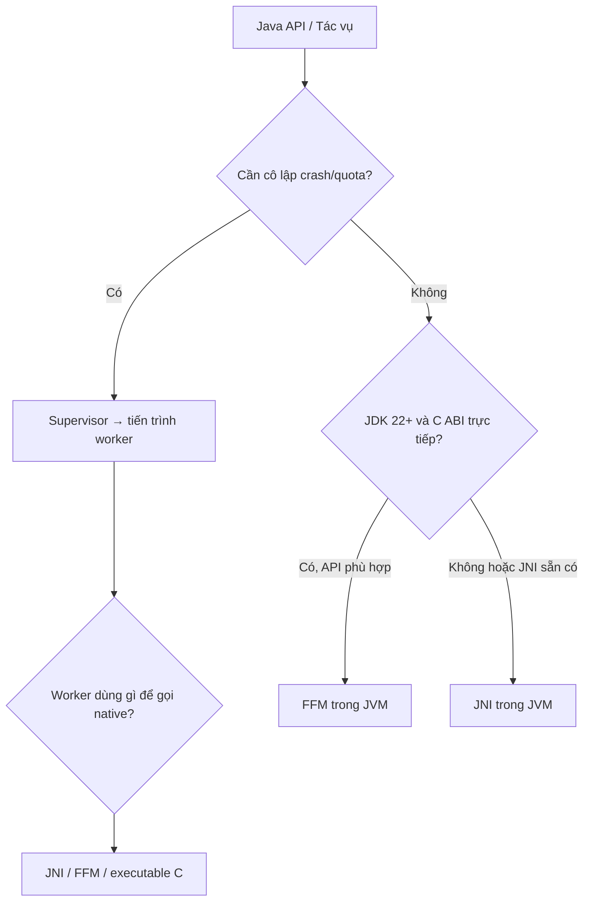
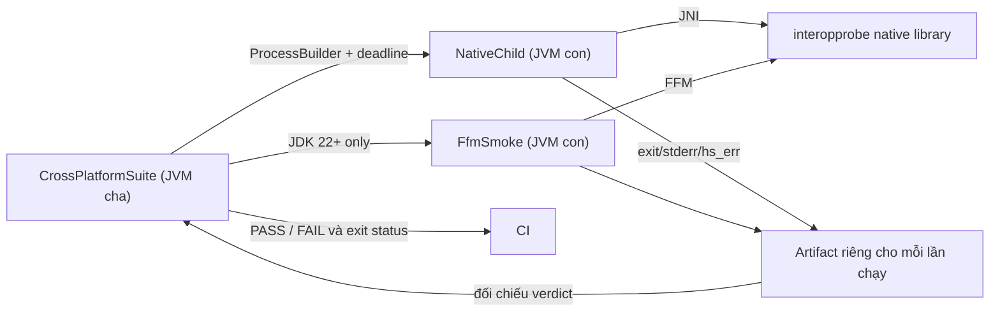

# Bài thực hành: Tạo bộ kiểm thử đa nền tảng và bảng quyết định JNI, FFM hoặc tiến trình riêng

## 1. Mục tiêu, phạm vi và sản phẩm cần hoàn thành

Java có thể gọi thư viện native bằng **JNI** (Java Native Interface) hoặc **FFM API** (Foreign Function & Memory API). Cả hai có thể chạy mã máy C/C++ trong cùng tiến trình JVM. Một cách khác là đặt native code trong **tiến trình riêng** rồi trao đổi qua IPC. Bài thực hành này kết hợp hai việc:

1. Tạo **bộ kiểm thử đa nền tảng** cho một thư viện C nhỏ, xác nhận cả đường gọi JNI, FFM và phản ứng của hệ thống khi nạp lỗi, treo hoặc crash. Bộ kiểm thử chạy từng tình huống nguy hiểm trong JVM con để không làm chết trình điều phối.
2. Xây dựng **bảng quyết định** lựa chọn JNI, FFM hoặc tiến trình riêng theo JDK, API native, chi phí hiệu năng, độ tin cậy, bảo mật, yêu cầu giới hạn tài nguyên và khả năng phân phối.

Sau bài học, người học phải tự chứng minh được: thư viện được build đúng OS/CPU; JVM con nhận được symbol đúng và trả kết quả; lỗi nạp được phân loại; timeout không làm test runner treo; native crash được quan sát bằng bằng chứng; lựa chọn kỹ thuật có căn cứ.

**Tiền đề:** có JDK 17+, compiler C phù hợp hệ điều hành, khả năng chạy lệnh trong terminal và hiểu C function, Java method, JNI signature. Chương trình Java 17 là nền chung. **FFM chuẩn hóa từ JDK 22**: ví dụ FFM chỉ biên dịch/chạy trên JDK 22+; không cố chạy `java.lang.foreign` với JDK 17 hay tự thay bằng API incubator có chữ ký khác. Trong CI mẫu dùng JDK 17 và 25 để đối chiếu khả năng tương thích.

**Kết quả bàn giao của bài thực hành:** bốn file Java (`NativeBridge.java`, `NativeChild.java`, `CrossPlatformSuite.java`, `FfmSmoke.java`), một file C (`interopprobe.c`), lệnh build theo Linux/macOS/Windows, ma trận CI, kết quả probe, bảng quyết định và biên bản chọn kiến trúc cho một tình huống thực tế.

## 2. Tách ba khía cạnh thường bị nhầm lẫn

| Khía cạnh | Câu hỏi kiểm chứng | Ví dụ |
|---|---|---|
| **Cơ chế gọi native** | Java gọi hàm native thế nào, phải có C wrapper hay không? | JNI, FFM downcall |
| **Ranh giới chịu lỗi** | Khi native `abort()`, `SIGSEGV` hoặc treo, tiến trình nào chết? | Cùng JVM hay native worker/JVM con |
| **Phân phối đa nền tảng** | Binary, ABI, dependency, kiến trúc và runtime có tương thích không? | `.so` trên Linux, `.dylib` trên macOS, `.dll` trên Windows |

JNI và FFM là **hai cơ chế liên kết Java ↔ native**. Tiến trình riêng là **quyết định về ranh giới thực thi**; một worker process vẫn có thể sử dụng JNI hoặc FFM bên trong. Vì vậy bảng quyết định không được xem ba lựa chọn là ba “thư viện thay thế” hoàn toàn tương đương.

- JNI có mặt từ lâu, phù hợp native code cần thao tác với Java objects, arrays, callbacks và các thư viện JNI hiện hữu; đổi lại cần viết/duy trì glue code JNI và tuân thủ quy tắc reference, thread, pending exception.
- FFM JDK 22+ cung cấp `Linker`, `SymbolLookup`, `FunctionDescriptor`, `MemorySegment`, `Arena` để gọi C ABI trực tiếp. Phần lớn lệnh Java truy cập qua `MemorySegment` có kiểm tra phạm vi/lifetime, nhưng descriptor sai, địa chỉ sai hoặc code native lỗi vẫn có thể làm chết JVM.
- Worker process dùng `ProcessBuilder`/IPC để giảm tác động của lỗi native và áp quota OS riêng. Đổi lại phát sinh khởi động process, serialization, truyền dữ liệu, restart, timeout và quản lý side effect.



Đây là sơ đồ **gợi ý quyết định**, không phải luật tuyệt đối: một thư viện JNI hiện hữu vẫn có thể được bọc trong worker, và FFM không cung cấp sandbox chỉ vì không dùng JNI.

## 3. Thiết kế bộ kiểm thử: supervisor và các child case

Một phép kiểm thử native nguy hiểm không nên chạy trong JVM của JUnit/Gradle test runner. Nếu C gọi `abort()` hoặc làm hỏng heap, `assertThrows` không thể bảo đảm bắt được lỗi fatal đó; cả test runner có thể chấm dứt. Với `System.loadLibrary` lỗi, JVM thường ném `UnsatisfiedLinkError`, nhưng lỗi trong `JNI_OnLoad` hoặc static initializer native có thể nghiêm trọng hơn.

Bài tập dùng **một JVM cha** chạy từng **JVM con** với các trường hợp:

| Case | Cơ chế | Điều kiện PASS |
|---|---|---|
| `jni-ok` | JNI trong child | Child exit 0 và in chính xác `JNI_SUM=42` |
| `load-missing` | JNI library loader | Child exit khác 0, stderr có `UnsatisfiedLinkError` |
| `hang` | Child bị treo có chủ đích | Cha xác nhận quá deadline, dừng được child, còn sống |
| `native-crash` | C gọi `abort()` từ JNI trong child | Child kết thúc bất thường, có marker vừa vào native và bằng chứng fatal `hs_err_pid` mới; nếu thiếu bằng chứng, FAIL để điều tra |
| `ffm-ok` | FFM downcall trong child trên JDK 22+ | Child exit 0 và in `FFM_SUM=42` |

Đây là **kiểm thử kết quả**, không phải đo benchmark. Một chuỗi `exit != 0` chưa đủ kết luận native crash: lỗi khởi động, thiếu thư viện, sai JNI symbol và OS kill cũng có thể cho nonzero exit. `Runtime.halt()` có thể mô phỏng child chết nhưng không xác nhận `SIGABRT`/native frame; vì vậy case thật dùng C `abort()` trong **child riêng**.

Kiến trúc:



Đặt các file nguồn dưới đây trong **một thư mục fixture độc lập**. Mỗi lần chạy test tạo thư mục artifact mới, không đọc nhầm `hs_err` từ lượt trước.

## 4. Viết thư viện C và lớp JNI

**File `NativeBridge.java`** — lớp Java gọi JNI và chứa hai method native:

```java
public final class NativeBridge {
    static {
        System.loadLibrary("interopprobe");
    }

    public static native int add(int a, int b);
    public static native void abortInNative();

    private NativeBridge() {
    }
}
```

Tên logic `interopprobe` được `System.loadLibrary` ánh xạ thành thư viện tương ứng OS. Phương thức `abortInNative()` chỉ phục vụ **negative test** trong JVM con, tuyệt đối không được gọi trong ứng dụng/test runner đang giữ trạng thái quan trọng.

**File `interopprobe.c`** — C export một symbol C ABI cho FFM, hai JNI method và điểm tạo crash rõ ràng:

```c
#include <jni.h>
#include <stdlib.h>
#include "NativeBridge.h"

#if defined(_WIN32)
#define PROBE_EXPORT __declspec(dllexport)
#else
#define PROBE_EXPORT __attribute__((visibility("default")))
#endif

PROBE_EXPORT int native_add(int a, int b) {
    return a + b;
}

JNIEXPORT jint JNICALL Java_NativeBridge_add(
        JNIEnv *env, jclass clazz, jint a, jint b) {
    (void)env;
    (void)clazz;
    return (jint)native_add((int)a, (int)b);
}

JNIEXPORT void JNICALL Java_NativeBridge_abortInNative(
        JNIEnv *env, jclass clazz) {
    (void)env;
    (void)clazz;
    abort(); /* Có chủ đích: chỉ gọi từ JVM con. */
}
```

**Đọc mã:** `native_add` là C function export đơn giản để FFM tìm symbol trực tiếp. JNI có hai điểm vào theo tên/mẫu header do `javac -h` sinh ra; `JNIEXPORT` và `JNICALL` được định nghĩa theo platform. `abort()` kết thúc process chứa JVM con theo cách mà OS/runtime cho phép và có thể tạo fatal report. Ví dụ dùng giá trị nhỏ `19 + 23` nên không xảy ra tràn số nguyên; ABI giả định C `int` 32-bit, đúng trên các mục tiêu phổ biến được liệt kê, nhưng một dự án cross-platform thật phải xác minh layout/kích thước/endianness cho struct và các kiểu platform-dependent như `long`.

Đừng thay `abort()` bằng phép dereference con trỏ rác chỉ để tạo `SIGSEGV`: C undefined behavior có thể không crash ở chỗ dự kiến, làm bài kiểm thử thiếu xác định. Khi kiểm thử lỗi bộ nhớ thực tế, dùng input tối giản, AddressSanitizer/UndefinedBehaviorSanitizer, symbols và debugger riêng.

## 5. Chương trình child: các hành vi có thể quan sát

**File `NativeChild.java`** — Java 17+:

```java
public final class NativeChild {
    public static void main(String[] args) throws InterruptedException {
        if (args.length != 1) {
            throw new IllegalArgumentException("one scenario required");
        }

        switch (args[0]) {
            case "jni-ok" ->
                System.out.println("JNI_SUM=" + NativeBridge.add(19, 23));

            case "load-missing" ->
                System.loadLibrary("interopprobe_missing_fixture_274");

            case "hang" ->
                Thread.sleep(60_000);

            case "native-crash" -> {
                System.out.println("ENTER_ABORT");
                System.out.flush();
                NativeBridge.abortInNative();
            }

            default -> throw new IllegalArgumentException(
                    "unknown scenario: " + args[0]);
        }
    }
}
```

Điểm cần hiểu:

- `NativeBridge` chỉ được khởi tạo khi gọi `add` hoặc `abortInNative`. Kịch bản `load-missing` gọi thư viện riêng không tồn tại, không phụ thuộc thư viện JNI `interopprobe` đã build.
- `System.loadLibrary` ném `UnsatisfiedLinkError` nếu thư viện không thể tìm/nạp theo quy tắc loader; loại lỗi và nguyên nhân chi tiết được ghi ở stderr của JVM con. Tên giả định là fixture phải được kiểm tra không trùng thư viện thật trong môi trường CI.
- `hang` mô phỏng không phản hồi bằng giấc ngủ 60 giây. Đây **không phải** chứng minh một native deadlock, chỉ là kiểm tra khả năng timeout và cleanup của parent.
- Trước `abortInNative`, child flush marker `ENTER_ABORT` để parent biết đã đi qua đường gọi đó. Marker là một bằng chứng bổ sung; marker **không thay thế** fatal log hoặc OS crash evidence.

## 6. Supervisor Java 17: dùng ProcessBuilder, timeout, file log và verdict

**File `CrossPlatformSuite.java`** — biên dịch trên Java 17+, chạy trên Linux/macOS/Windows. Bộ kiểm thử mặc định chỉ chạy `jni-ok`, `load-missing`, `hang`; case crash thực và FFM được gọi riêng để có thể quản lý môi trường.

```java
import java.io.IOException;
import java.nio.file.Files;
import java.nio.file.Path;
import java.util.ArrayList;
import java.util.Arrays;
import java.util.List;
import java.util.Locale;
import java.util.concurrent.TimeUnit;
import java.util.stream.Stream;

public final class CrossPlatformSuite {
    private record Outcome(
            boolean timedOut,
            boolean aliveAfterCleanup,
            int exitCode,
            String stdout,
            String stderr,
            boolean hasFatalReport,
            Path artifactDir) {
    }

    private static Path workingDir() {
        return Path.of("").toAbsolutePath().normalize();
    }

    private static String javaExecutable() {
        boolean windows = System.getProperty("os.name")
                .toLowerCase(Locale.ROOT).startsWith("windows");
        return Path.of(
                System.getProperty("java.home"),
                "bin",
                windows ? "java.exe" : "java").toString();
    }

    private static Outcome execute(String mode)
            throws IOException, InterruptedException {
        Path root = workingDir().resolve("probe-artifacts");
        Files.createDirectories(root);
        // Thư mục mới cho từng lượt: không nhầm fatal log cũ.
        Path artifacts = Files.createTempDirectory(root, mode + "-");
        Path stdout = artifacts.resolve("stdout.txt");
        Path stderr = artifacts.resolve("stderr.txt");

        Path libraryFile = workingDir().resolve(
                System.mapLibraryName("interopprobe"));
        List<String> command = new ArrayList<>();
        command.add(javaExecutable());

        // JDK 22+ hỗ trợ flag native access; Java 17 không có.
        if (Runtime.version().feature() >= 22) {
            command.add("--enable-native-access=ALL-UNNAMED");
        }
        command.add("-Djava.library.path=" + workingDir());
        command.add("-Dprobe.native.path=" + libraryFile);
        command.add("-XX:ErrorFile="
                + artifacts.resolve("hs_err_pid%p.log"));
        command.add("-cp");
        // Child kế thừa working directory của parent.
        command.add(System.getProperty("java.class.path"));

        if ("ffm-ok".equals(mode)) {
            if (Runtime.version().feature() < 22) {
                throw new IllegalArgumentException(
                        "FFM stable API requires JDK 22+");
            }
            command.add("FfmSmoke");
        } else {
            command.add("NativeChild");
            command.add(mode);
        }

        ProcessBuilder pb = new ProcessBuilder(command);
        // Redirect cả hai kênh: không để pipe đầy khi waitFor.
        pb.redirectOutput(stdout.toFile());
        pb.redirectError(stderr.toFile());

        Process child = pb.start();
        boolean finished;
        long seconds = "hang".equals(mode)
                ? 2
                : Long.getLong("probe.timeout.seconds", 20L);
        try {
            finished = child.waitFor(seconds, TimeUnit.SECONDS);
            if (!finished) {
                child.destroy();
                if (!child.waitFor(2, TimeUnit.SECONDS)) {
                    child.destroyForcibly();
                    if (!child.waitFor(2, TimeUnit.SECONDS)) {
                        throw new IllegalStateException(
                                "child survived forced termination");
                    }
                }
            }
        } catch (InterruptedException e) {
            child.destroyForcibly();
            Thread.currentThread().interrupt();
            throw e;
        }

        boolean fatal;
        try (Stream<Path> entries = Files.list(artifacts)) {
            fatal = entries.anyMatch(path ->
                path.getFileName().toString().startsWith("hs_err_pid"));
        }

        return new Outcome(
                !finished,
                child.isAlive(),
                finished ? child.exitValue() : -1,
                Files.readString(stdout),
                Files.readString(stderr),
                fatal,
                artifacts);
    }

    private static boolean passed(String mode, Outcome o) {
        return switch (mode) {
            case "jni-ok" ->
                !o.timedOut() && o.exitCode() == 0
                && o.stdout().lines().anyMatch("JNI_SUM=42"::equals);

            case "load-missing" ->
                !o.timedOut() && o.exitCode() != 0
                && o.stderr().contains("UnsatisfiedLinkError");

            case "hang" ->
                o.timedOut() && !o.aliveAfterCleanup();

            case "native-crash" ->
                !o.timedOut() && o.exitCode() != 0
                && o.stdout().lines().anyMatch("ENTER_ABORT"::equals)
                && o.hasFatalReport();

            case "ffm-ok" ->
                !o.timedOut() && o.exitCode() == 0
                && o.stdout().lines().anyMatch("FFM_SUM=42"::equals);

            default -> false;
        };
    }

    public static void main(String[] args) throws Exception {
        List<String> modes = args.length == 0
                ? List.of("jni-ok", "load-missing", "hang")
                : Arrays.asList(args);

        int failed = 0;
        for (String mode : modes) {
            try {
                Outcome o = execute(mode);
                boolean ok = passed(mode, o);
                System.out.println(mode + "=" + (ok ? "PASS" : "FAIL"));
                if (!ok) {
                    failed++;
                    System.err.println("inspect: " + o.artifactDir());
                }
            } catch (IOException | IllegalStateException e) {
                failed++;
                System.out.println(mode + "=ERROR");
                System.err.println(e);
            }
        }

        System.out.println("suite=" + (failed == 0 ? "PASS" : "FAIL"));
        if (failed != 0) {
            System.exit(1);
        }
    }
}
```

### Giải thích các bảo đảm và giới hạn của harness

1. **Không phụ thuộc shell:** `ProcessBuilder(List<String>)` truyền từng argument riêng; tránh `sh -c`/`cmd /c` ghép lệnh với input chưa tin cậy.
2. **Launcher đúng JDK:** lấy từ `java.home/bin/java` (`java.exe` trên Windows) thay vì mặc định `java` trong `PATH` trùng JDK đang kiểm thử.
3. **Phân biệt trạng thái:** `exitCode` chỉ được lấy khi child thực sự kết thúc trước timeout; `-1` trong `Outcome` là sentinel cho timeout do harness đặt, **không phải mã exit thật của child**.
4. **Timeout và cleanup:** `waitFor` có deadline, `destroy` yêu cầu dừng, sau đó `destroyForcibly`. Cơ chế cụ thể phụ thuộc OS; không mặc định sẽ dọn tất cả subprocess/cháu mà child tự tạo.
5. **Không kẹt output pipe:** stdout/stderr được redirect sang file. Hệ thống lớn cần quota/rotation vì child có thể ghi quá nhiều log.
6. **Crash evidence:** `hs_err_pid%p.log` nằm trong thư mục **mới** của lượt chạy. `native-crash` chỉ PASS khi thấy marker + nonzero exit + fatal report; nếu môi trường không tạo `hs_err`, kết quả FAIL để kiểm tra OS event/core theo chính sách CI, không tuyên bố crash sai bằng exit code.
7. **Classpath và library path:** child dùng classpath và working directory của parent. Ví dụ được chạy từ thư mục fixture chứa `.class` và native library. Dự án thật nên truyền absolute classpath/module path/native directory từ cấu hình build, không phụ thuộc IDE chọn thư mục làm việc.
8. **Native access:** flag `--enable-native-access=ALL-UNNAMED` được thêm trên JDK 22+ để thực thi restricted native operations ở classpath; khi dùng module path thật, cấp native access cho module cụ thể theo chính sách JDK. Flag này **không phải** sandbox hay quota.
9. **Start failure:** lỗi spawn do executable/quyền/đường dẫn không đúng được trình bày là `ERROR` và làm suite fail. Trạng thái `ERROR` không được nhầm thành test native library PASS.
10. **Độ ổn định:** thời gian 20 giây là timeout mặc định cho case thường, 2 giây cho case `hang`. Có thể đặt `-Dprobe.timeout.seconds=60` trên CI chậm; đối với bài test cố ý ngủ 60 giây, giữ deadline nhỏ hơn 60 giây. Cần tính cả startup JVM, JIT và máy CI đang tải.
11. **Giới hạn mẫu:** nếu parent bị interrupt trong lúc kill, bộ kiểm thử truyền tiếp interrupt. Hệ thống production cần quản lý process group/cgroup/Job Object để thu gom toàn bộ cây tiến trình và giới hạn tài nguyên.

Chương trình trả **exit 1** cho suite fail để CI có thể phát hiện; test runner vẫn sống qua từng child crash/hang, nhưng không được đánh dấu tất cả tình huống lỗi là PASS theo quy ước tùy tiện.

## 7. Biên dịch native library trên Linux, macOS và Windows

Tại thư mục có `NativeBridge.java`, `NativeChild.java`, `CrossPlatformSuite.java`, `interopprobe.c`, biên dịch Java và **sinh JNI header bằng chính compiler**:

```bash
javac -h . NativeBridge.java NativeChild.java CrossPlatformSuite.java
```

Kết quả gồm `NativeBridge.h` cùng các `.class`. Header xác nhận tên entry point, kiểu tham số và calling convention cho `NativeBridge.add/abortInNative`. Đừng tự sửa tên JNI symbol theo suy đoán sau khi đổi package/class.

### Linux (GCC/Clang, shell POSIX)

```bash
# JAVA_HOME trỏ tới JDK dùng để build/run.
cc -std=c11 -O0 -g -Wall -Wextra -fPIC -shared \
  -I"$JAVA_HOME/include" \
  -I"$JAVA_HOME/include/linux" \
  interopprobe.c -o libinteropprobe.so

java CrossPlatformSuite
```

### macOS (Clang, shell POSIX)

```bash
cc -std=c11 -O0 -g -Wall -Wextra -fPIC -dynamiclib \
  -I"$JAVA_HOME/include" \
  -I"$JAVA_HOME/include/darwin" \
  interopprobe.c -o libinteropprobe.dylib

java CrossPlatformSuite
```

### Windows (MSVC Developer Command Prompt)

```bat
cl /nologo /LD /Zi /I"%JAVA_HOME%\include" /I"%JAVA_HOME%\include\win32" interopprobe.c /link /OUT:interopprobe.dll
java CrossPlatformSuite
```

Dòng trên yêu cầu **Developer Command Prompt đã nạp môi trường MSVC** và biến `JAVA_HOME` trỏ đúng JDK; nếu dùng PowerShell cần thay cú pháp biến môi trường, không paste nguyên `%JAVA_HOME%`. Thư viện DLL phải cùng kiến trúc với JVM (ví dụ cả hai đều x64 hoặc cả hai đều ARM64 nếu toolchain hỗ trợ); Windows loader cũng cần tìm được DLL phụ thuộc.

Các lệnh là ba phương án build **khác nhau cho từng OS**, không chạy nối cả ba trong một terminal. Chương trình dùng `System.mapLibraryName("interopprobe")` để dựng tên binary cho FFM phù hợp OS. Không chép `.so` Linux sang macOS/Windows; không giả định một artifact native dùng chung mọi kiến trúc CPU.

### Stdout kỳ vọng của suite mặc định

Khi build/nạp thư viện thành công, JVM con khởi động kịp deadline, và fixture thiếu thư viện thực sự không tồn tại:

```text
jni-ok=PASS
load-missing=PASS
hang=PASS
suite=PASS
```

Dòng `JNI_SUM=42` do child tạo được ghi vào artifact riêng, không in trực tiếp trên console cha. `load-missing` PASS nghĩa là **phát hiện đúng lỗi được cố ý tạo**; không có nghĩa native library chính bị thiếu. `hang` PASS nghĩa là parent đã áp timeout và dọn child.

Đọc file `probe-artifacts/<run-id>/stdout.txt`, `stderr.txt` để chẩn đoán. Phần `<run-id>` là tên thư mục ngẫu nhiên từ `Files.createTempDirectory`, không phải tên cố định. Nếu suite FAIL, chương trình in chính đường dẫn artifact cần xem.

## 8. Chạy FFM trên JDK 22+ bằng cùng binary C

FFM cho phép gọi C function `native_add` trực tiếp, không cần tạo JNI wrapper riêng cho function này. **Không đặt file FFM vào bước `javac` dùng JDK 17**.

**File `FfmSmoke.java`** — yêu cầu JDK 22+:

```java
import java.lang.foreign.Arena;
import java.lang.foreign.FunctionDescriptor;
import java.lang.foreign.Linker;
import java.lang.foreign.SymbolLookup;
import java.lang.foreign.ValueLayout;
import java.lang.invoke.MethodHandle;
import java.nio.file.Path;

public final class FfmSmoke {
    public static void main(String[] args) throws Throwable {
        Path library = Path.of(
                System.getProperty("probe.native.path")).toAbsolutePath();

        try (Arena arena = Arena.ofConfined()) {
            var symbol = SymbolLookup.libraryLookup(library, arena)
                    .find("native_add").orElseThrow();

            MethodHandle add = Linker.nativeLinker().downcallHandle(
                    symbol,
                    FunctionDescriptor.of(
                            ValueLayout.JAVA_INT,
                            ValueLayout.JAVA_INT,
                            ValueLayout.JAVA_INT));

            int value = (int) add.invokeExact(19, 23);
            System.out.println("FFM_SUM=" + value);
        }
    }
}
```

Sau khi chuyển sang JDK 22+ phù hợp (ví dụ JDK 25), biên dịch lớp FFM và chạy **qua parent**:

```bash
javac FfmSmoke.java
java CrossPlatformSuite ffm-ok
```

Stdout kỳ vọng, nếu `interopprobe` đã build đúng OS/CPU, symbol export và native-access được cấp:

```text
ffm-ok=PASS
suite=PASS
```

Parent tự chạy `FfmSmoke` trong JVM con và truyền `--enable-native-access=ALL-UNNAMED` trên JDK 22+. `SymbolLookup.libraryLookup(Path, Arena)` tìm thư viện theo đường dẫn, `find("native_add")` tìm symbol, `FunctionDescriptor` mô tả hàm C `int native_add(int,int)`, còn `MethodHandle.invokeExact(19,23)` thực thi downcall. `Arena.ofConfined()` kiểm soát vòng đời lookup trong đoạn ví dụ.

**Không nhầm tính an toàn của FFM:** Java `MemorySegment` có cơ chế kiểm tra phạm vi và vòng đời khi truy cập qua API phù hợp. Nhưng nếu khai sai `FunctionDescriptor`, dùng symbol sai hoặc chính C function có memory corruption, FFM vẫn có thể đưa JVM vào undefined behavior/crash. Vì vậy phép thử FFM cũng chạy ở child.

Nếu `ffm-ok` FAIL: kiểm tra version JDK (phải ≥22), native-access flag, `native_add` có thực sự export, ABI của C `int`, tên file OS, dependencies và đúng kiến trúc. Đừng sửa bằng cách đổi descriptor tùy tiện cho đến khi “hết lỗi”; sai ABI có thể tạo lỗi khó tái hiện.

## 9. Kiểm thử native crash thật và điều tra artifact

Case `native-crash` gọi `abort()` ở C. Chỉ chạy sau khi đã build/nạp thư viện native thành công:

```bash
java CrossPlatformSuite native-crash
```

Nếu HotSpot tạo fatal report tại đường dẫn đã chỉ định và marker được ghi trước `abort()`, kết quả parent thường là:

```text
native-crash=PASS
suite=PASS
```

**Không hứa stdout này trên mọi môi trường.** Trên một số OS/JVM, `abort()` có thể chấm dứt process trước khi tạo `hs_err_pid`; khi đó harness trả `native-crash=FAIL` và exit 1, dù thực tế child đã chết do native abort. Đây là verdict **chưa đủ bằng chứng theo chính sách test mẫu**, cần kiểm tra OS crash report, core/minidump, process supervisor và stderr. Chỉ mở rộng bộ phát hiện khi có quy tắc nền tảng và bằng chứng cụ thể, không coi nonzero exit là crash theo mặc định.

Trong `hs_err_pid*.log` (nếu có), tìm signal/exception, `Problematic frame`, native frames, module C, PID và thread; đồng nhất artifact với lượt chạy và binary build hiện tại. Có thể cấu hình core dump/Windows crash dump riêng theo CI, nhưng core có thể chứa dữ liệu nhạy cảm, cần quyền truy cập và retention phù hợp. Nếu child bị OS OOM kill hoặc `SIGKILL`, JVM có thể không có cơ hội ghi `hs_err`.

Test `native-crash` chỉ kiểm tra **khả năng chịu lỗi, thu thập chứng cứ và diễn giải kết thúc**. Nó **không** kiểm tra an toàn bộ nhớ của thư viện: với out-of-bounds/use-after-free cụ thể, cần sanitizer, test input tối giản, fuzzing và symbols. Khi cần test code C không đáng tin, dùng quota CPU/RAM/PID và sandbox bên ngoài; process isolation đơn thuần không chặn quyền filesystem/network.

## 10. CI đa nền tảng: ma trận tối thiểu có thể áp dụng

Một bộ kiểm thử đa nền tảng không chỉ chạy ba file `.java` trên máy phát triển. Phải biên dịch **binary native ngay trên đúng runner/kiến trúc** hoặc dùng artifact đã được build/test chính xác, chạy positive + negative cases và lưu log khi có lỗi.

Ma trận khuyến nghị:

| Trục | Giá trị khởi đầu | Lý do |
|---|---|---|
| OS | Linux, macOS, Windows | Kiểm loader/symbol/dependency/định dạng binary khác nhau |
| JDK | 17 và một JDK ≥22 còn được hỗ trợ (ví dụ 25) | JNI baseline và FFM stable API |
| Architecture | x86_64 và ARM64 nơi runner/toolchain có sẵn | Bắt lỗi classifier/ABI/bitness và native binary không khớp |
| Mode | `jni-ok`, `load-missing`, `hang`, `ffm-ok` khi đủ JDK | Tách positive, loader, lifecycle và foreign downcall |
| Negative phá hủy | `native-crash` ở job được kiểm soát | Thu thập fatal log/OS report, không làm mất toàn suite |

**Workflow mẫu `.github/workflows/native-matrix.yml`** dưới đây giả định các file fixture nằm ở thư mục làm việc gốc của job. Nếu đặt trong `tests/native-probe/`, phải thêm `working-directory` đúng cho các bước `run`. Workflow này sử dụng runner mà repository đã được cấu hình cho phép chạy actions; trên Windows dùng MSVC do bước chuẩn bị môi trường cung cấp.

```yaml
name: Native interoperability matrix

on:
  push:
  pull_request:
  workflow_dispatch:

jobs:
  probe:
    strategy:
      fail-fast: false
      matrix:
        os: [ubuntu-latest, macos-latest, windows-latest]
        java: [17, 25]
    runs-on: ${{ matrix.os }}
    steps:
      - uses: actions/checkout@v4

      - uses: actions/setup-java@v4
        with:
          distribution: temurin
          java-version: ${{ matrix.java }}

      - name: Build Java 17 sources and JNI header
        run: javac -h . NativeBridge.java NativeChild.java CrossPlatformSuite.java

      - name: Prepare MSVC
        if: runner.os == 'Windows'
        uses: ilammy/msvc-dev-cmd@v1

      - name: Build Linux native library
        if: runner.os == 'Linux'
        shell: bash
        run: |
          cc -std=c11 -O0 -g -fPIC -shared \
            -I"$JAVA_HOME/include" -I"$JAVA_HOME/include/linux" \
            interopprobe.c -o libinteropprobe.so

      - name: Build macOS native library
        if: runner.os == 'macOS'
        shell: bash
        run: |
          cc -std=c11 -O0 -g -fPIC -dynamiclib \
            -I"$JAVA_HOME/include" -I"$JAVA_HOME/include/darwin" \
            interopprobe.c -o libinteropprobe.dylib

      - name: Build Windows native library
        if: runner.os == 'Windows'
        shell: cmd
        run: cl /nologo /LD /Zi /I"%JAVA_HOME%\include" /I"%JAVA_HOME%\include\win32" interopprobe.c /link /OUT:interopprobe.dll

      - name: JNI, load-error and timeout probes
        run: java CrossPlatformSuite

      - name: FFM smoke on stable FFM JDK
        if: matrix.java >= 22
        run: |
          javac FfmSmoke.java
          java CrossPlatformSuite ffm-ok

      - name: Native crash probe, manually requested
        if: github.event_name == 'workflow_dispatch'
        run: java CrossPlatformSuite native-crash

      - name: Upload probe evidence
        if: always()
        uses: actions/upload-artifact@v4
        with:
          name: native-${{ matrix.os }}-jdk${{ matrix.java }}
          path: probe-artifacts/
          if-no-files-found: ignore
```

**Đánh giá workflow:** sáu tổ hợp OS/JDK ở đây chưa tự động bao phủ mọi architecture; `ubuntu-latest`, `macos-latest`, `windows-latest` cung cấp kiến trúc theo runner thực tế của nhà cung cấp. Muốn khẳng định hỗ trợ Linux ARM64 hoặc macOS x86_64, bổ sung runner được chỉ định rõ kiến trúc đó và compiler/Java tương ứng. Không suy ra ABI chỉ từ tên OS.

Dùng cùng source C nhưng compile độc lập trên từng runner giúp kiểm tra symbol export và linkage thực tế. Khi đưa vào repository production, nên pin action theo commit SHA theo chính sách supply-chain, xác minh compiler/JDK version và upload artifact với retention phù hợp. Lệnh crash được đặt ở `workflow_dispatch` vì cần quản lý core/fatal diagnostics, quota và khác biệt signal giữa OS; sau khi đã định nghĩa được bộ kiểm chứng đáng tin cho từng platform, có thể đưa vào pipeline định kỳ hoặc PR.

## 11. Kiểm thử âm bổ sung: ABI, loader và native dependency

Bộ fixture cơ bản chỉ chứng minh một số đường đi. Trong dự án thật, bổ sung các test có **kết quả và precondition rõ**:

| Negative fixture | Cách tạo tình huống | Kết quả cần khẳng định |
|---|---|---|
| Sai bitness/architecture | Chạy JVM 64-bit với native library sai target architecture do CI tạo | Load failure có diagnostic của OS/JVM; test phải SKIP có lý do nếu không tạo được binary sai arch |
| Thiếu dependent library | Build thư viện liên kết tới một helper DLL/so/dylib rồi loại dependency ra khỏi loader path của child | Load failure được phân biệt với thiếu file thư viện chính |
| Sai JNI symbol | Compile DLL/shared library không export JNI entry point hoặc sửa signature trong fixture | Lỗi linkage khi gọi `native` method, không pass giả |
| Thiếu FFM symbol | Tìm symbol không export, `find(...)` trả rỗng và ứng dụng quyết định lỗi | Không lẫn với Java array bounds hay lỗi biên C |
| Descriptor FFM không khớp ABI | Dùng fixture C với chữ ký xác định và so với mô tả Java | Detect bằng kiểm tra schema/build/static test; **không cố gọi sai signature vào JVM cha** |
| JNI crash thực | `abortInNative` trong child | Fatal log/OS evidence đúng lượt, runner sống |
| Native deadlock/hang | Native worker thử nghiệm riêng chờ vô hạn có kiểm soát | Deadline + cleanup, không còn orphan |
| Native memory corruption | Chạy fixture native dưới ASan/UBSan, trong process riêng | Sanitizer report dẫn tới FAIL của memory-safety test |
| Package thiếu native artifact | Bỏ classifier một OS/arch trong bản đóng gói thử nghiệm | Integration test phát hiện load failure trên đúng mục tiêu |

Với FFM `SymbolLookup.find("nonexistent_symbol")` trả `Optional.empty()`; đó là lỗi tìm symbol thường có thể xử lý an toàn tại Java. Đừng biến việc “tìm không thấy” thành một foreign call tới địa chỉ không hợp lệ chỉ để kiểm thử negative path.

**Quan trọng:** một testcase phát hiện đúng lỗi dự kiến có thể được đánh dấu PASS; nhưng phát hiện sai lỗi (ví dụ JVM chết vì thiếu RAM của CI thay vì crash C) phải FAIL/INCONCLUSIVE, dù kết thúc đều khác 0.

## 12. Bảng quyết định JNI, FFM hay tiến trình riêng

Dùng bảng dưới đây để trả lời yêu cầu thứ hai của bài thực hành. Cột “tiến trình riêng” mô tả **kiểu triển khai**; bên trong worker vẫn có thể dùng JNI/FFM.

| Tiêu chí | JNI trong JVM | FFM trong JVM (JDK 22+) | Worker/process riêng |
|---|---|---|---|
| JDK 17 cần hỗ trợ | **Có**, API JNI lâu đời | **Không** với API ổn định `java.lang.foreign`; các bản incubator/preview khác biệt | **Có**, dùng `ProcessBuilder`/IPC |
| Hàm C ABI đơn giản, ít cần Java object | Dùng wrapper JNI C | **Phù hợp**; gọi qua `Linker` với signature đúng | Phù hợp khi cần isolate hơn là latency |
| Native cần thao tác Java objects/callbacks phức tạp | **Thường phù hợp**, có JNI API | FFM upcall và bindings cần thiết kế rõ; không thay thế trực tiếp mọi JNI object API | Phải serialise dữ liệu/thiết kế RPC, không chia sẻ Java object trực tiếp |
| Thư viện JNI có sẵn | **Ít thay đổi nhất**, tận dụng wrapper | Có thể cần C ABI mới hoặc thay binding | Chuyển JNI library vào worker khi cần cô lập |
| Code C/C++ có ABI C ổn định | Dùng JNI shim | **Thuận lợi**; C++ thường cần wrapper `extern "C"` cho stable ABI | Có thể dùng executable có protocol độc lập |
| Hàng triệu lệnh gọi cực nhỏ | Tương đối phù hợp; đo JNI overhead | Tương đối phù hợp; đo downcall overhead | IPC/serialization có thể đắt; cân nhắc batching/shared memory |
| Native library có nguy cơ `SIGSEGV`/`abort` | Crash có thể tắt cả JVM | Crash có thể tắt cả JVM | **Ưu tiên** cô lập fault boundary |
| Native call có thể treo không hủy được | Java interrupt không bảo đảm dừng | Tương tự | Supervisor timeout, kill/restart worker |
| Cần hard limit tổng CPU/RAM/PID của native | Không tách quota khỏi JVM chính | Không tách quota khỏi JVM chính | **Ưu tiên** cgroup/container/Job Object/quota OS cho worker |
| Memory/lifetime safety của Java binding | JNI tự quản references, get/release | `MemorySegment` có kiểm tra phạm vi/lifetime phù hợp; descriptor sai vẫn nguy hiểm | IPC có schema; native worker vẫn phải quản lý bộ nhớ |
| Native code không tin cậy | Rủi ro cao trong process chính | Rủi ro cao trong process chính | Ưu tiên worker + sandbox/quyền tối thiểu; process riêng chưa đủ làm security sandbox |
| Đóng gói đa nền tảng | JNI headers, compiler, binary per OS/arch, library dependencies | Native ABI và binary per OS/arch, JDK 22+, flags/quyền native access | Thêm executable/worker + IPC, startup/health/quota; vẫn có binary per OS |
| Triển khai/quan sát/restart độc lập | Khó reset trạng thái native process-wide | Native library/lifetime cũng có ràng buộc | Dễ restart worker và lưu crash artifacts riêng; phải quản lý concurrency |
| Chi phí complexity | Glue C, JNI references và ABI | Descriptors, arenas, layouts, upcall và version JDK | Protocol, lifecycle, backpressure, logging, timeout, version negotiation |

### Quy tắc ra quyết định theo thứ tự

1. **Có yêu cầu cô lập crash, cô lập quyền hoặc hard quota?** Nếu có, thiết kế worker process trước; sau đó chọn JNI hay FFM bên trong worker. Không dùng FFM như lý do để bỏ fault isolation.
2. **Cần hỗ trợ JDK 17 hoặc tương tác sâu với Java objects và thư viện JNI cũ?** JNI thường thực tế hơn; nếu thư viện rủi ro, đặt JNI trong worker.
3. **JDK 22+, native C ABI gọn, có thể mô tả signature/lifetime rõ?** Ưu tiên đánh giá FFM; thử prototype và benchmark trước khi thay toàn bộ JNI.
4. **Số lần gọi, kích thước payload, latency và trạng thái native có quan trọng?** Đo thực tế: JNI/FFM ở cùng process tránh IPC; worker lâu dài và batch có thể giảm phí process startup.
5. **Tổ hợp OS/arch/JDK hỗ trợ đã có binary/toolchain, tests và metrics chưa?** Mọi phương án đều phải trả lời được câu hỏi packaging; chọn kỹ thuật chỉ dựa trên code Java là chưa đủ.

### Điền quyết định cho các tình huống mẫu

| Tình huống | Quyết định | Lý do và xác minh bắt buộc |
|---|---|---|
| Java 17, driver native JNI đang ổn định, cần Java callback | **JNI trong JVM** nếu chấp nhận rủi ro; có test JNI/ABI | JNI sẵn có, chi phí di chuyển cao; kiểm runtime crash và leak |
| JDK 25, thư viện C export các phép toán nhỏ, kiểm soát được memory layout | **FFM trong JVM** nếu độ tin cậy đủ tốt | Giảm JNI shim; test native symbol, descriptors, arena và ABI trên mọi platform |
| Media decoder cũ có lịch sử crash với input từ bên ngoài | **Worker process + JNI hoặc FFM** | Cần fault isolation, timeout, quota và sandbox thích hợp; test abort/crash/hang |
| Native OCR engine dùng RAM lớn, có thể treo, backend phải phục vụ tiếp | **Worker process + OS resource limit** | `-Xmx` không giới hạn native allocation, supervisor phải dọn/khởi động lại worker |
| Ứng dụng Java 17 muốn dùng stable FFM API ngay | **Chưa phù hợp trên JDK 17** | Giữ JNI hoặc nâng target JDK phù hợp; không copy API preview sang production mà không đối chiếu |
| Truy cập C++ object graph không ổn định ABI giữa compiler/platform | **JNI wrapper/C ABI ổn định hoặc worker RPC** | FFM cần C ABI/calling convention đúng; không gọi trực tiếp symbol mangled tùy tiện |

Một **kiến trúc lai** rất phổ biến là: Java server chính → IPC có version/timeout → worker → JNI/FFM → C library. Trong mô hình này, JNI/FFM quyết định cách worker nói chuyện với native; process boundary quyết định blast radius và khả năng kill/restart.

## 13. Bài nộp thực hành và tiêu chí tự đánh giá

### Phần A — Kết quả có thể chạy

- [ ] Có đủ 3 Java source baseline, 1 FFM source và 1 C source với tên/class/JNI header nhất quán.
- [ ] Biên dịch được Java 17 baseline bằng `javac -h`; native library có tên đúng `System.mapLibraryName` trên Linux/macOS/Windows.
- [ ] `java CrossPlatformSuite` cho ba dòng case PASS và `suite=PASS` ở môi trường đã setup; có stdout/stderr artifact riêng.
- [ ] `java CrossPlatformSuite ffm-ok` chỉ chạy trên JDK 22+ với native access và trả FFM_SUM=42 từ cùng C symbol.
- [ ] `native-crash` được chạy trong child; parent không chết. Nếu fatal log không được tạo, ghi rõ hạn chế môi trường và đối chiếu OS evidence, không ép PASS bằng exit code.
- [ ] Có ma trận CI OS × JDK; architecture được chỉ rõ theo runner thực tế; artifact được lưu sau lỗi.

### Phần B — Bảng quyết định cho một use case thật

Viết một đoạn ngắn trả lời:

1. Native API là C ABI hay C++/JNI-specific? Nó cần Java callbacks hoặc object graph trong JVM không?
2. Baseline JDK và OS/architecture nào bắt buộc hỗ trợ?
3. Native lỗi có thể làm mất dữ liệu hoặc dừng dịch vụ chính không? Có deadline, OOM/crash isolation hay sandbox requirement không?
4. Số lệnh gọi/giây, payload size và yêu cầu p99 latency là bao nhiêu? Có thể batch hoặc chia sẻ dữ liệu qua IPC không?
5. Ai sở hữu memory, thread, file handle và resource? Ai thu thập crash dumps, restart worker và dọn process tree?
6. Quyết định chọn JNI/FFM/process nào, bằng chứng benchmark/test nào sẽ khiến quyết định thay đổi?

**Tiêu chí đạt:** quyết định phải giải thích ít nhất **JDK, ABI, khả năng chịu lỗi, memory safety, giới hạn tài nguyên, hiệu năng và packaging**. Không chấp nhận kết luận kiểu “FFM mới hơn nên luôn tốt hơn” hoặc “process tách riêng nghĩa là tuyệt đối an toàn”.

### Phần C — Ghi nhận bằng chứng kiểm thử

Lưu một bảng kết quả do chính môi trường chạy tạo ra:

| OS/arch | JDK | Mode | Verdict | Exit/timeout | Artifact/binary version |
|---|---|---|---|---|---|
| Tổ hợp đã chạy | 17 hoặc 22+ | `jni-ok` | PASS/FAIL | exit code thật | stdout và binary identifier |
| Tổ hợp đã chạy | 17 hoặc 22+ | `load-missing` | PASS/FAIL | exit code thật | stderr/loader diagnostic |
| Tổ hợp đã chạy | 17 hoặc 22+ | `hang` | PASS/FAIL | deadline và cleanup | log tiến trình |
| Tổ hợp đã chạy | 22+ | `ffm-ok` | PASS/FAIL | exit code thật | function descriptor/symbol |
| Tổ hợp thử crash | 17 hoặc 22+ | `native-crash` | PASS/FAIL/INCONCLUSIVE | exit + fatal evidence | `hs_err`/OS dump nếu có |

Đừng điền sẵn số exit của `SIGABRT` hoặc giả vờ có `hs_err_pid`: hệ điều hành, JVM và cấu hình runtime có thể cho kết quả khác nhau. Kiểm thử xác định bằng chứng thực tế, không bằng “một mã số signal luôn đúng”.

## 14. Chẩn đoán khi bài thực hành không chạy như dự kiến

| Triệu chứng | Nên kiểm tra |
|---|---|
| `javac` báo không biết `java.lang.foreign` | Đang biên dịch `FfmSmoke` bằng JDK <22; tách bước Java 17 baseline và JDK 22+ |
| Header `NativeBridge.h` không sinh | Chạy đúng `javac -h . NativeBridge.java` và kiểm tra compiler/JDK |
| `UnsatisfiedLinkError: no interopprobe` | Tên binary theo OS, thư mục chạy, `java.library.path` và file thực sự tồn tại |
| Có binary nhưng loader vẫn thất bại | Kiến trúc JVM/CPU, thư viện phụ thuộc, DLL search/rpath, quyền file, format binary |
| FFM `find("native_add")` rỗng | Hàm chưa export, bị đổi tên/mangled, visibility sai hoặc đang load binary khác |
| FFM downcall bị crash | Sai FunctionDescriptor/ABI, pointer/lifetime hoặc lỗi C; không mặc định FFM loại trừ native crash |
| `load-missing` FAIL bất ngờ | Kiểm tra stderr: fixture thiếu library trùng tên thật, child không khởi động, hoặc stderr không có `UnsatisfiedLinkError` |
| `hang` không timeout | Deadline không nhỏ hơn thời gian child chờ, child đã exit sớm hoặc parent không chạy case đúng |
| Suite kẹt khi child in log lớn | Parent chưa drain/redirect stdout/stderr, disk log đầy |
| `native-crash` FAIL dù child chết | Thiếu `hs_err`, hệ điều hành tự xử lý abort, sai library hoặc crash khi load; xem marker, stderr, core và OS events |
| Chạy trên máy phát triển PASS nhưng CI FAIL | Working dir, JDK, ABI, compiler flags, dependency, environment, resource quota và architecture khác |
| CI chỉ có 3 hệ điều hành | Chưa bao phủ các architecture khác; xác minh host architecture và bổ sung runners |

Một số phương tiện phân tích sâu: `-Xcheck:jni` để kiểm tra nhóm vi phạm JNI, `hs_err_pid*.log` để điều tra fatal JVM event, `gdb`/`lldb` cho native stack, `readelf`/`otool`/công cụ DLL dependency cho loader, ASan/UBSan cho lỗi bộ nhớ. Các công cụ có nhiệm vụ khác nhau, không công cụ nào chỉ với một báo cáo có thể chứng minh toàn bộ thư viện native an toàn.

## 15. Lưu ý về tiến trình riêng trong hệ thống thật

Trong demo, mỗi test spawn một child JVM. Cách đó phù hợp **test isolation**, nhưng nếu ứng dụng production phải gọi native nhiều lần/giây, mở một process mỗi request có thể tốn startup/memory lớn. Có thể giữ **pool worker sống lâu** cùng IPC (JSON Lines, length-prefix binary protocol, socket, gRPC…), queue bounded, request ID và timeout. Khi worker crash, supervisor cần đối soát trạng thái nhiệm vụ; không retry mù các tác vụ đã gây side effect trước crash.

- **Quản lý bộ nhớ:** `-Xmx` giới hạn Java heap, không đặt hard limit cho tổng native memory. Dùng OS quota (Linux cgroup/container, Windows Job Object, cơ chế tương ứng) khi cần.
- **Quản lý tiến trình:** `Process.destroyForcibly()` không bảo đảm giết cả process tree; nếu worker spawn child, dùng process group/cgroup/Job Object và kiểm tra cleanup.
- **Quản lý quyền:** tách process **không tự tạo sandbox an ninh**; worker vẫn có quyền user, filesystem, network và kernel theo môi trường. Cần least privilege, ACL, seccomp/container/VM khi xử lý native code không tin cậy.
- **Quản lý giao thức:** phân biệt business error, protocol error, native crash, timeout và OS kill; giới hạn input/output, xác thực IPC, log có quota và idempotency key cho side effect.
- **Quản lý build:** xác thực SHA/build ID, đúng OS/CPU và ABI; test binary đóng gói cuối cùng, không chỉ test thư viện build tạm ở máy lập trình.

### Tài liệu chuẩn nên đối chiếu

- Java Native Interface specification: https://docs.oracle.com/en/java/javase/17/docs/specs/jni/index.html
- FFM `SymbolLookup` từ Java 22: https://docs.oracle.com/en/java/javase/22/docs/api/java.base/java/lang/foreign/SymbolLookup.html
- Java 22 `java.lang.foreign` API: https://docs.oracle.com/en/java/javase/22/docs/api/java.base/java/lang/foreign/package-summary.html
- Native access và restricted methods trên JDK 25: https://docs.oracle.com/en/java/javase/25/core/restricted-methods.html
- Java `ProcessBuilder`: https://docs.oracle.com/en/java/javase/17/docs/api/java.base/java/lang/ProcessBuilder.html

**Kết quả cốt lõi của bài thực hành:** một pipeline đa nền tảng phải kiểm chứng được **binary thực sự, đường gọi native, lỗi nạp, crash/hang, bằng chứng chẩn đoán và chính sách cách ly**. Bảng quyết định phải cho thấy rõ *tại sao* JNI hay FFM được dùng trong một tiến trình nhất định, và *khi nào* cần tách native ra khỏi JVM chính.