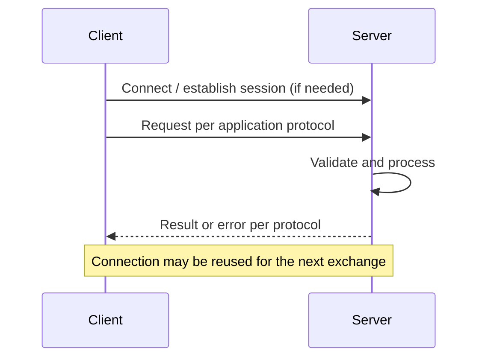

# The Client–Server Model and the Role of Application Protocols

## 1. Big Picture and Objectives

When a Java application fetches data from an API, a browser opens a web page, or a chat application sends a message, there are usually two different questions:

- **Who requests, and who provides the service?** This is a question about the **client–server model**.
- **How do the two sides understand messages and coordinate actions?** This is a question about the **application protocol**.

After this lesson, you should be able to explain client/server roles, describe a network communication round-trip, distinguish application protocols from TCP/UDP/IP/TLS, read a simple HTTP exchange, and build a small application protocol in Java yourself.

**Key takeaway:** The client–server model divides *roles*; the application protocol defines the *rules of exchange*. The two concepts complement each other, but they are not synonymous.

## 2. The Client–Server Model: Roles and Responsibilities

A **client** is the program that initiates using a service, such as sending a request to fetch product information. A **server** is the program that provides the service, listening for or accepting requests, processing them, and sending back results. One server typically serves many clients; one client can connect to many servers.

Example with a library service:

| Component | Role in the interaction |
|---|---|
| Java application calling `GET /books/42` | Client: creates the request, sends it, waits for/receives and processes the result |
| API service handling `/books/42` | Server: receives the request, authenticates/validates, retrieves data, and responds |
| Database called by the API | Server to the API; the API itself acts as a client of the database |
| Reverse proxy in front of the API | Server to external clients; client to the backend service |

Roles are **tied to an interaction**, not permanently tied to a machine. The same program can act as a server in one direction and as a client in another. Client/server can also run on the **same machine** (e.g., `localhost`); network connections do not necessarily go over the Internet.

In traditional applications, a server may wait for connections at an **IP address + port** (endpoint), while the client actively connects. For example, `127.0.0.1:8080` points to port 8080 on the same machine. Ports help the operating system route traffic to the right service; they do not by themselves describe the protocol or business payload. `8080` is commonly used in web development, but it is not a mandatory property of HTTP.

A typical request–response flow:



**Request–response is not the only model.** A server can push events over an open connection (Server-Sent Events), two sides can communicate bidirectionally after establishing a WebSocket, and a task can be answered asynchronously. The specific exchange pattern is determined by the protocol and application design.

## 3. What Happens When a Client Calls a Service?

Consider the address `https://api.example.test/books/42` (an illustrative domain name, not a live API):

1. **Identify the target:** the client parses the URL into the scheme `https`, host `api.example.test`, path `/books/42`, and default port 443 if the URL does not specify another port.
2. **Find the address:** the system may query DNS to learn the host's IP address; the result may already be cached, so a DNS query is not necessarily made every time.
3. **Establish communication:** with HTTP/1.1 or HTTP/2 over HTTPS, the client typically establishes a TCP connection and then negotiates TLS. With HTTP/3, HTTP runs on QUIC over UDP; QUIC integrates TLS 1.3 security and has its own connection-establishment mechanism.
4. **Send the application request:** the client sends the method, path, headers, and body (if any) in the format of the HTTP version being used.
5. **Server processing:** the component receiving the request may route through a reverse proxy, authenticate, call other services, or query a database.
6. **Response:** the server returns a status, metadata, and content; the client interprets the response according to HTTP and the API contract.
7. **Continue or close:** depending on the protocol, connection state, and configuration, the connection may be reused or closed.

These steps are a **logical model**: caches, proxies, connection pooling, DNS caches, and HTTP versions can change the actual number of exchanges. Perceived latency also depends on server processing, the network path, payload size, and whether a new connection has to be established.

### Which Layer Solves What?

| Layer/mechanism | Question answered | Key point to remember |
|---|---|---|
| IP (network) | Which device across the network does the packet go to? | IP addresses and routing; IP itself does not guarantee delivery |
| TCP (transport) | How do we get a reliable, ordered byte stream? | TCP does not preserve boundaries of individual application messages |
| UDP (transport) | How do we send datagrams with minimal transport-layer mechanisms? | UDP does not itself guarantee delivery, ordering, or deduplication |
| QUIC (transport over UDP) | How do we get reliable streams and secure connections for applications like HTTP/3? | Do not equate QUIC with raw UDP |
| TLS (security) | How do we protect confidentiality/integrity and authenticate the server via certificates? | HTTPS over TCP uses TLS; HTTP/3 integrates TLS 1.3 into QUIC |
| HTTP, DNS, SMTP, WebSocket… (application) | What do messages mean and what must each party do? | Defines syntax, semantics, and interaction rules |

**TCP success does not mean the business request succeeded.** A TCP connection can deliver all bytes, yet the server can still return HTTP `404`, `409`, `500`, or an application response indicating invalid data. Conversely, when a client times out, you cannot always conclude the server did not process the request: the server may have completed it, while the response was lost or arrived too late.

## 4. An Application Protocol Is a Communication Contract

An application protocol defines what two independent programs need in order to understand and coordinate with each other:

1. **Format (syntax):** whether messages are text or binary, which fields are required, how characters are encoded, and how to recognize the start/end.
2. **Meaning (semantics):** what `GET`, `POST`, or a `HELLO` command means; which operations are valid; what counts as success.
3. **Sequence (interaction):** which side sends first; whether a handshake, login, session persistence, or acknowledgment is required.
4. **Results/errors:** status codes, response structure, how errors are represented, and under what conditions the client may retry.
5. **Compatibility:** versioning, extension fields, and how to handle unsupported messages/fields.
6. **Application-level security:** caller identity, access permissions, what data is allowed to be exposed, and input limits (alongside transport security when needed).

A pair of programs **do not automatically understand each other** just because they both use TCP: if the server expects a line `HELLO Ada\n` and the client sends JSON or HTTP, the server has no reason to understand the message. That is an application protocol error, not an IP routing error.

### HTTP Protocol Example

HTTP describes how to express a request and response, including method, target, headers, body, and status. Here is a *text-format illustration* of an HTTP/1.1 exchange (on the wire, header lines use CRLF and headers end with a blank line):

```http
GET /health HTTP/1.1
Host: api.example.test
Accept: application/json

```

```http
HTTP/1.1 200 OK
Content-Type: application/json
Content-Length: 15
Connection: close

{"status":"ok"}
```

In this example:

- `GET /health` says the client wants to retrieve service health; `Host` identifies the target host in HTTP/1.1.
- `200 OK` indicates success at the HTTP layer, while the detailed meaning of the JSON is defined by the **API contract**.
- `Content-Type` tells the receiver the content type; `Content-Length: 15` is the number of **bytes** of the illustrative UTF-8 body `{"status":"ok"}`, excluding headers.
- Headers/body are parts of the protocol; JSON is just a **data format** that can be carried in the body. **REST** is an API design style with its own constraints, not another name for HTTP.

HTTP has multiple versions: HTTP/2 and HTTP/3 do not encode messages on the network as text lines like HTTP/1.1, even though the concepts of method, status, headers, and semantics are preserved. Do not take the HTTP/1.1 printout above as a byte-level description of HTTP/2 or HTTP/3.

### Common Application Protocols

| Protocol | Purpose and typical exchange pattern |
|---|---|
| HTTP/HTTPS | Web resources, APIs; request/response, streamable; HTTPS is HTTP over an appropriate secure channel |
| DNS | Domain name mapping and queries; commonly uses UDP, also uses TCP and secure variants |
| SMTP | Email transfer between systems; uses commands and response codes |
| WebSocket | After setup, enables bidirectional messaging over a single connection |
| MQTT | Publish/subscribe via a broker, common in devices/IoT |
| gRPC | RPC framework with a wire protocol and service conventions; typically uses HTTP/2 and Protocol Buffers |

**Do not confuse roles and technologies:** an API can use HTTP, but HTTP does not by itself define which fields the `/books/42` endpoint returns; that is the specific API's contract. Similarly, switching from JSON to Protocol Buffers does not by itself turn TCP into a new application protocol.

## 5. Especially Important in Java Networking: TCP Is a Byte Stream

Suppose a client calls `OutputStream.write(...)` twice to send `HELLO ` and `Ada\n`. The server may receive them in a single read, in several reads, or in different chunks. **The boundaries of individual `write` calls are not preserved by TCP as message boundaries.**

Therefore, an application protocol running over TCP must define its own way to separate messages (**framing**), for example:

- **Delimiter:** each message ends with `\n`; you must specify how to handle payloads that contain newlines.
- **Length prefix:** send the byte count of the message first, then read that exact number of bytes; you must check the maximum length.
- **Format-specific rules:** HTTP/1.1 uses rules to determine body length such as `Content-Length` or chunked transfer coding; HTTP/2 and HTTP/3 have their own binary framing.

In all cases, the receiving side must handle incomplete data, premature connection closure, timeouts, and invalid input. Calling `read()` just once and assuming a full message was received is a common bug.

## 6. Java 17+ Example: Client and Server Using a Small Protocol

Let's define a learning protocol **LINE/1** over TCP, one request per connection:

| Sender | Message form (UTF-8, terminated by an LF byte) | Meaning |
|---|---|---|
| Client | `HELLO <name>\n` | Greet the server with a non-empty name |
| Server | `WELCOME <name>\n` | Accept the greeting |
| Server | `ERROR BAD_REQUEST\n` | Invalid request |

This is **not a standard protocol**. It only illustrates why both sides must agree on framing (LF), encoding (UTF-8), syntax (command and name), semantics (greeting/reply), and errors. The example runs both server and client on loopback within **a single program** so it needs no Internet access and produces repeatable results.

Create the file `ClientServerProtocolDemo.java`:

```java
import java.io.BufferedReader;
import java.io.BufferedWriter;
import java.io.InputStreamReader;
import java.io.OutputStreamWriter;
import java.net.InetAddress;
import java.net.ServerSocket;
import java.net.Socket;
import java.nio.charset.StandardCharsets;
import java.util.concurrent.ExecutorService;
import java.util.concurrent.Executors;
import java.util.concurrent.Future;
import java.util.concurrent.TimeUnit;

public class ClientServerProtocolDemo {
    public static void main(String[] args) throws Exception {
        ExecutorService executor = Executors.newSingleThreadExecutor();

        try (ServerSocket listener = new ServerSocket(
                0, 1, InetAddress.getLoopbackAddress())) {

            Future<String> serverReceived = executor.submit(() -> {
                try (Socket peer = listener.accept()) {
                    peer.setSoTimeout(3_000);
                    BufferedReader in = new BufferedReader(
                            new InputStreamReader(
                                    peer.getInputStream(), StandardCharsets.UTF_8));
                    BufferedWriter out = new BufferedWriter(
                            new OutputStreamWriter(
                                    peer.getOutputStream(), StandardCharsets.UTF_8));

                    String request = in.readLine(); // read until LF
                    String response;
                    if (request != null
                            && request.startsWith("HELLO ")
                            && !request.substring(6).isBlank()) {
                        response = "WELCOME " + request.substring(6);
                    } else {
                        response = "ERROR BAD_REQUEST";
                    }

                    out.write(response);
                    out.write('\n');  // fixed LF per LINE/1
                    out.flush();
                    return request;
                }
            });

            try (Socket client = new Socket(
                    InetAddress.getLoopbackAddress(), listener.getLocalPort())) {
                client.setSoTimeout(3_000);
                BufferedReader in = new BufferedReader(
                        new InputStreamReader(
                                client.getInputStream(), StandardCharsets.UTF_8));
                BufferedWriter out = new BufferedWriter(
                        new OutputStreamWriter(
                                client.getOutputStream(), StandardCharsets.UTF_8));

                out.write("HELLO Ada\n");
                out.flush();

                System.out.println("Client sent: HELLO Ada");
                System.out.println("Client received: " + in.readLine());
            }

            System.out.println("Server received: "
                    + serverReceived.get(3, TimeUnit.SECONDS));
        } finally {
            executor.shutdownNow();
        }
    }
}
```

Compile and run on JDK 17 or later, in the directory containing the file:

```bash
javac ClientServerProtocolDemo.java
java ClientServerProtocolDemo
```

Expected output when the machine allows TCP loopback connections:

```text
Client sent: HELLO Ada
Client received: WELCOME Ada
Server received: HELLO Ada
```

**Explanation by role:**

1. `ServerSocket(0, 1, loopback)` opens an ephemeral TCP port chosen by the OS; `getLocalPort()` provides the actual port for the client to connect to. The parameter `1` is the requested backlog, not a limit on the total number of clients in a real service.
2. The server runs in a separate task so it can wait on `accept()` while the main thread opens the client `Socket`. Both sides are on the same machine, yet they still have two **logical roles**.
3. The client sends the UTF-8 bytes of `HELLO Ada\n` and calls `flush()` to push buffered content out. The server uses `readLine()` to read exactly one LF-terminated frame.
4. The server checks the command, builds `WELCOME Ada\n`, and sends it back. The client reads the response, while `Future.get()` lets the main thread verify which line the server received.
5. `try-with-resources` closes the sockets; `setSoTimeout` limits how long a read operation waits. This is a single exchange, not a server ready to serve continuously.

**Intentional limitations:** the example does not use TLS, authentication, line-length limits, multi-client handling, abuse protection, or retries; nor does it handle shutdown and network errors like a production service. Do not expose this demo server to the Internet. For real HTTP systems, you typically use an HTTP library/framework such as `java.net.http.HttpClient` (client) and an appropriate web server/framework (server), rather than writing an HTTP parser yourself with `Socket`.

## 7. When Designing a Real-World Client–Server API

A good contract should answer: what the client sends, what it receives, and how non-ideal situations are handled.

- **Endpoints and operations:** define URLs/resources, methods, request/response schemas, and validation rules. Clearly distinguish between “not found”, “unauthorized”, and “server error”.
- **Status and errors:** choose appropriate HTTP statuses; provide stable application error codes and clear messages. Do not assume “got a response” means “business operation succeeded”.
- **Timeouts and retries:** set time limits; retry only when you understand the risk of duplicate execution. For operations with side effects, consider an **idempotency key** or server-side protection.
- **Security:** use TLS and verify certificates when appropriate; authenticate and authorize; limit input sizes and avoid logging secrets. TLS secures the transport channel, but it does not replace application-level authorization checks.
- **Evolvability:** versioning rules, backward-compatible field extensions, and how to handle clients/servers on different versions.
- **Observability:** log with correlation/request IDs, collect latency, error rates, and timeouts; distinguish DNS, connection, TLS, HTTP, and business errors when diagnosing issues.
- **Resources and load:** connection pooling, concurrency limits, backpressure, and rate limiting according to actual needs; do not default to creating a new connection for every request.

Example: a client sends an order-creation request, times out, and resends it. If the server already created the order but the response never arrived, a naive retry can create **two orders**. This is why API semantics (idempotency, operation status, error codes) directly affect how a client handles networking.

## 8. Common Misconceptions

| Misconception | Correct understanding |
|---|---|
| “A client is always a browser; a server is always a physical machine.” | Any program can act as a client or server; roles depend on each interaction. |
| “Opening TCP means the API works.” | TCP only handles byte transport; the application can still fail on syntax, auth, state, or business logic. |
| “One `write` corresponds to one `read` on the other side.” | TCP does not preserve message boundaries. You must have framing and read a complete frame accordingly. |
| “JSON is a network protocol; REST is HTTP.” | JSON is a data format; REST is an architectural style; HTTP is an application protocol. |
| “HTTP only runs on TCP; HTTPS is just port 443.” | HTTP/3 uses QUIC over UDP; HTTPS requires an appropriate security mechanism, not just a port number. |
| “If the client times out, the server definitely hasn't done anything.” | The server may have already processed it; you need retry/idempotency design and a way to check the outcome. |
| “TLS is enough to protect an endpoint.” | TLS protects the communication channel; the application still needs auth, authorization, validation, and load control. |

## 9. Self-Check

1. **When an API server calls a database, what is the API?** It is a server when receiving requests from external applications, and at the same time a client when sending requests to the database.
2. **Why can two programs both using TCP still fail to talk to each other?** Because TCP transports a byte stream, whereas applications must agree on encoding, framing, command content, states, and errors.
3. **How is receiving a `404` different from a “connection refused” error?** `404` is an HTTP response returned by an HTTP component; “connection refused” happens at the connection step, before any HTTP response exists.
4. **Why can't you retry every `POST` after a timeout?** Because the operation may already have been executed by the server; retrying can create duplicate side effects if the API lacks appropriate safeguards.
5. **In the Java example, why are `\n` and `flush()` used?** LF marks the end of a message; `flush` pushes data out of the writer's buffer so the other side can read it without waiting for the connection to close.

**Conclusion:** When reading or designing Java network applications, always separate three things: the **roles** of the parties (client/server), the **transport/security mechanism** (IP, TCP/UDP/QUIC, TLS), and the **application contract** (HTTP or a custom protocol). This separation helps you choose APIs, read traces, and diagnose errors at the right layer.