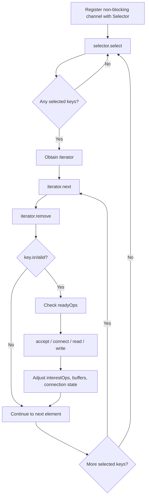

# Iterating the Selected-Key Set and Removing Processed Keys in Java NIO Selector

## 1. The Problem: The Selector Reported Readiness, Why Does the Loop Keep Processing Repeatedly?

In Java NIO, `Selector` allows a single thread to monitor multiple `SelectableChannel` instances in non-blocking mode. When one or more channels have ready I/O events (readable, writable, connectable, acceptable), the application retrieves the `SelectionKey` instances from the **selected-key set** and processes them.

A typical loop skeleton:

```java
// Illustrative snippet inside an event loop; the selector is already open.
while (running) {
    selector.select();

    Iterator<SelectionKey> iterator =
            selector.selectedKeys().iterator();

    while (iterator.hasNext()) {
        SelectionKey key = iterator.next();
        iterator.remove(); // crucial step: consume this round's notification

        if (!key.isValid()) {
            continue;
        }

        // Dispatch based on the key's readiness flags.
    }
}
```

The `iterator.remove()` call is not just for code neatness. **The selected-key set is a set of keys that the application must actively remove after processing**; it does not automatically empty itself after each `select()`. If old keys are left there, subsequent iterations may see the same key again, interpret stale readiness as a new event, or waste CPU on repeated processing.

This lesson focuses directly on the requirement **"Iterating the selected-key set and removing processed keys"** under **Selector**: understanding the three sets/pieces of information of a Selector, using the iterator properly, distinguishing remove from cancel, dispatching valid events, avoiding non-blocking I/O bugs, and running a Java 17 example proving that a key is selected twice without being cancelled when only `iterator.remove()` is called.

## 2. Three Things Easily Confused: Registration, Selected, Readiness

A `SelectionKey` associates a channel with a selector after registration. You must distinguish:

| Concept | How to Obtain | Meaning |
|---|---|---|
| **Registered-key set** | `selector.keys()` | Keys registered with the selector, until cancelled/closed and the appropriate deregistration step completes |
| **Selected-key set** | `selector.selectedKeys()` | Keys placed into the set by the selection process for the application to process; **the application actively removes them** once it has accepted the work |
| **Interest set** of a key | `key.interestOps()` | Operations the application is currently interested in: `OP_ACCEPT`, `OP_CONNECT`, `OP_READ`, `OP_WRITE` depending on channel type |
| **Ready set** of a key | `key.readyOps()` or `isReadable()`… | Operations the selector observed as ready in the corresponding selection round |

The two sets `keys()` and `selectedKeys()` are not two separate "socket pools". **The exact same `SelectionKey` object** can simultaneously be a registered key and a selected key.

- **Registration:** `channel.register(selector, SelectionKey.OP_READ)` creates/retrieves a key bound to the selector and configures the initial interest set.
- **Selection:** `selector.select()` checks the readiness of interested operations, then adds/updates keys in the selected set.
- **Consuming selection:** `iterator.remove()` **only removes the key from the selected-key set**; it does not cancel the registration.
- **Deregistration:** `key.cancel()` invalidates the key; the selector handles deregistration at the appropriate step. This is a different action, intended for a channel/connection you no longer want to monitor.

A channel that has been `cancel()`ed should no longer be dispatched as a live connection. Conversely, a key that was just `iterator.remove()`d can still be selected again in a subsequent `select()` round when the channel continues to satisfy the readiness condition.

### 2.1. Interest Differs from Ready

`interestOps` says **"I want to know when I can do this"**; `readyOps` says **"the selection step observed an opportunity to do this"**. The two bitmasks are not necessarily equal.

For example, a `SocketChannel` is interested in `OP_READ | OP_WRITE`, but in this round it is only readable, so `readyOps` may contain `OP_READ`. Conversely, a channel can be readable and writable at the same time. Do not use `interestOps()` as proof that an event has arrived.

`isReadable()` / `isWritable()` / `isAcceptable()` / `isConnectable()` check bits in the ready set; they **do not perform I/O** and **do not automatically remove the key from the selected set**.

### 2.2. The Selected Set Is Not Automatically Cleared

Per the `Selector` contract, a selection operation updates the selected keys. For a key not yet in the selected set, the key may be added; for a key already present, new readiness is combined/updated according to the API mechanism. **Selection does not automatically clear the entire selected set before returning.**

Consequences:

- `selector.select()` returning does not mean `selectedKeys()` contains only **brand-new** keys the application has never seen.
- `selectedKeys().size()` is not necessarily equal to the return value of `select()`; do not use the two numbers as the same metric.
- A key forgotten and not removed can remain across multiple rounds, leading to repeated dispatches or easily misunderstood readiness state.

**Key takeaway:** for every processed key, you must **consume the selected entry** properly so that subsequent rounds can select it again when appropriate.

## 3. Safe Iteration Pattern Using Iterator

The most commonly used pattern is:

```java
// Illustrative code, running on the thread that owns the selector.
int selectedCount = selector.select(1_000);

Iterator<SelectionKey> iterator =
        selector.selectedKeys().iterator();

while (iterator.hasNext()) {
    SelectionKey key = iterator.next();
    iterator.remove();

    if (!key.isValid()) {
        continue;
    }
    // Continue processing the key...
}
```

**Why use `Iterator.remove()`?**

1. It removes **the exact element just retrieved** from the selected set via the Iterator interface.
2. You can continue iterating over the set without triggering `ConcurrentModificationException` from calling `selectedKeys().remove(key)` inside a for-each loop.
3. Removing early helps avoid leaving the key in the selected set if the handler `continue`s, returns early, or modifies the interest set.
4. After full iteration, the selected set is usually **empty**, while valid keys remain in the registered-key set.

**Note:** `selectedKeys()` is a set from which **removing elements** is permitted, but it is not a set to arbitrarily `add` application-created keys into. Adding keys to the selected set is the selector's job. To change which readiness types are monitored, use `interestOps` on the key; do not try to add keys to the selected set using `add()`.

### 3.1. Why Remove Before the Handler?

A commonly preferred pattern:

```java
SelectionKey key = iterator.next();
iterator.remove();
try {
    handle(key);
} catch (IOException e) {
    closeConnection(key);
}
```

This is **illustrative code**: `handle` and `closeConnection` are application-defined. The idea is that **the entry is already removed before application logic can throw an exception**. If `iterator.remove()` is placed at the end of the handler and the handler throws an error, that entry may remain, causing repeated errors in subsequent rounds.

**This does not mean always ignoring exceptions:** a failing handler must be logged, the channel properly closed/cancelled, and attachments/buffers released per contract. Removing early only addresses the **selected entry** lifecycle; it does not replace error handling.

### 3.2. Why Not Use For-Each and `set.remove(key)`?

**Do not:**

```java
// INCORRECT ITERATION/REMOVAL CODE; illustrates the bug only.
for (SelectionKey key : selector.selectedKeys()) {
    selector.selectedKeys().remove(key); // modifying collection outside iterator
    // ...
}
```

Some `Set`/`Iterator` implementations detect concurrent structural modification; removing elements directly from the Set while a for-each loop is iterating can result in `ConcurrentModificationException`. Using **the active Iterator** and calling `iterator.remove()` is the clear pattern with standard semantics.

**Do not** call `selector.selectedKeys().clear()` inside the loop: you will wipe out events that **have not been dispatched yet**.

### 3.3. Can `selectedKeys().clear()` Be Used After the Loop?

Yes, in some designs, the application processes all selected keys and then calls `clear()`. However, compared to `iterator.remove()` during iteration:

- If a handler throws an exception mid-loop, `clear()` at the end may not run.
- `clear()` deletes **all** selected entries, including ones you have not processed if there is an early-exit branch.
- Calling clear before finishing all processing can lose information about keys still awaiting dispatch in that same round.

Therefore, in a synchronous event loop, **removing each key at the right time** is both easier to control and avoids retaining stale state. If using a batching mechanism, clearly define when an event is considered accepted/handed off and who is responsible for processing it.

## 4. The Full Selector Cycle



Typical dispatch code on a server using `ServerSocketChannel` and `SocketChannel`:

```java
// Illustrative code inside an event loop; handle* methods are application-implemented.
while (running) {
    selector.select();

    Iterator<SelectionKey> it =
            selector.selectedKeys().iterator();

    while (it.hasNext()) {
        SelectionKey key = it.next();
        it.remove();

        if (!key.isValid()) {
            continue;
        }

        try {
            if (key.isAcceptable()) {
                handleAccept(key);
            }
            if (key.isValid() && key.isConnectable()) {
                handleConnect(key);
            }
            if (key.isValid() && key.isReadable()) {
                handleRead(key);
            }
            if (key.isValid() && key.isWritable()) {
                handleWrite(key);
            }
        } catch (IOException error) {
            closeConnection(key);
        }
    }
}
```

Notice the `if` statements re-checking `isValid()` in later branches: an earlier handler may detect EOF/error and call `key.cancel()`. At that point, checking `isReadable()`/`isWritable()` on an invalid key can throw `CancelledKeyException`. In larger applications, you can consolidate handling into a clearer state machine and ensure closing/cancelling happens in one centralized branch.

`isAcceptable`, `isReadable`, `isWritable` are readiness snapshots, **not a guarantee that I/O will succeed or complete**. Between selection and the operation, system state can change.

## 5. Runnable Java 17 Example: The Same Key Selected Again After Removal

The example below uses `Pipe.SourceChannel`/`Pipe.SinkChannel` to create an internal byte stream, requiring no TCP socket permissions, firewall rules, or Internet connection. `Pipe.SourceChannel` is a `SelectableChannel` and can register `OP_READ` with a selector when non-blocking. This preserves the exact **selected-key set mechanism** of Java NIO while producing deterministic output.

Procedure:

1. Open a `Selector` and a `Pipe`; register `source` in non-blocking mode, interested in `OP_READ`.
2. Write `ONE` to sink; the selector selects source as readable.
3. Iterate with the iterator, remove the key, then read the payload. The selected set becomes empty again.
4. Verify the key is still valid and registered; **remove does not cancel registration**.
5. Write `TWO`; the same key is selected again in the next select call.
6. At the end of the program, call `key.cancel()` to illustrate the difference from selected-key removal.

Save the file **`SelectedKeyIterationDemo.java`**:

```java
import java.io.IOException;
import java.nio.ByteBuffer;
import java.nio.channels.Pipe;
import java.nio.channels.SelectionKey;
import java.nio.channels.Selector;
import java.nio.charset.StandardCharsets;
import java.util.Iterator;
import java.util.concurrent.TimeUnit;

public class SelectedKeyIterationDemo {

    private static void send(Pipe.SinkChannel sink, String text)
            throws IOException {
        ByteBuffer data = StandardCharsets.US_ASCII.encode(text);
        while (data.hasRemaining()) {
            sink.write(data);
        }
    }

    private static void dispatch(Selector selector, String label)
            throws IOException {

        long deadline = System.nanoTime()
                + TimeUnit.SECONDS.toNanos(3);

        while (selector.selectedKeys().isEmpty()) {
            long remaining = deadline - System.nanoTime();
            if (remaining <= 0L) {
                throw new IOException("Timed out waiting for selection");
            }
            long timeoutMs = Math.max(
                    1L, TimeUnit.NANOSECONDS.toMillis(remaining));
            selector.select(timeoutMs);
        }

        Iterator<SelectionKey> iterator =
                selector.selectedKeys().iterator();

        while (iterator.hasNext()) {
            SelectionKey key = iterator.next();
            iterator.remove(); // Remove only from the selected set.

            if (!key.isValid()) {
                continue;
            }
            if (key.isReadable()) {
                Pipe.SourceChannel source =
                        (Pipe.SourceChannel) key.channel();
                ByteBuffer buffer = ByteBuffer.allocate(32);
                int n = source.read(buffer);
                if (n <= 0) {
                    throw new IOException(
                            "Readable key without available bytes");
                }

                buffer.flip();
                String payload = StandardCharsets.US_ASCII
                        .decode(buffer).toString();
                System.out.println(label + ": " + payload);
            }
        }

        System.out.println("Selected keys remaining: "
                + selector.selectedKeys().size());
    }

    public static void main(String[] args) throws Exception {
        try (Selector selector = Selector.open()) {
            Pipe pipe = Pipe.open();
            try (Pipe.SourceChannel source = pipe.source();
                 Pipe.SinkChannel sink = pipe.sink()) {

                source.configureBlocking(false);

                SelectionKey key =
                        source.register(selector, SelectionKey.OP_READ);

                send(sink, "ONE");
                dispatch(selector, "Event 1");

                System.out.println("Key still registered: "
                        + selector.keys().contains(key));

                send(sink, "TWO");
                dispatch(selector, "Event 2");

                key.cancel();
                System.out.println("Key valid after cancel: "
                        + key.isValid());
            }
        }
    }
}
```

Run on JDK 17+ in the directory containing the file:

```bash
javac -encoding UTF-8 SelectedKeyIterationDemo.java
java SelectedKeyIterationDemo
```

**Exact stdout on a successful run:**

```text
Event 1: ONE
Selected keys remaining: 0
Key still registered: true
Event 2: TWO
Selected keys remaining: 0
Key valid after cancel: false
```

### Result Analysis

- The first `sink.write` makes data available on `source`. `selector.select(timeout)` places the key into the selected set.
- `iterator.next()` retrieves the key, and `iterator.remove()` **only removes the element from the selected set**. In the same loop, `source.read` reads `ONE`; the selected set has no elements left.
- `selector.keys().contains(key)` prints `true`: the registration remains even though the selected set is empty.
- After `send("TWO")`, the channel is readable again; **that exact same key** is placed into the selected set and handled as a new event. This confirms that remove **does not prevent the key from being selected again**.
- Finally, `key.cancel()` immediately turns `isValid()` into `false`. Data might still sit in the channel if unread, but the application no longer wants to receive selections for this registration.
- Both wait loops use a **deadline** instead of assuming `select` always wakes up in a single call. `selectedKeys().isEmpty()` is checked after each `select` call to tolerate cases where `select` returns `0`.

**Example scope:** `Pipe` is used to observe the Selector reliably, not as a multi-connection TCP server. In a TCP application, `ServerSocketChannel`/`SocketChannel` provide similar keys with `OP_ACCEPT`/`OP_READ`/`OP_WRITE`, and handlers must deal with partial reads/writes, EOF, framing, errors, and shutdown.

## 6. Distinguishing Remove, Cancel, Close, and Changing interestOps

These four common operations have different effects:

| Operation | What Changes | Will the Key Be Selected in Future Rounds? |
|---|---|---|
| `iterator.remove()` | Removes the **entry** from the selected-key set | **Yes**, if the key is still valid/registered and has matching readiness |
| `selector.selectedKeys().clear()` | Deletes **all entries** from the selected-key set | Yes, for registered keys; but may skip processing events from the current round |
| `key.cancel()` | Marks registration as cancelled; key is no longer valid | **No** longer as a valid key; selector handles deregistration |
| `channel.close()` | Closes the channel; keys bound to the channel are cancelled | No; channel resources can no longer be used |
| `key.interestOps(mask)` | Changes the operations to monitor | Possibly, depending on the mask, ready state, and next selection |

### 6.1. `iterator.remove()` Is Not a TCP ACK

Do not interpret remove as "all bytes in the socket have been received" or "the business transaction has been processed". Remove is only **consuming the event entry in the key set returned by the selector**.

For example, an application receives a readable notification and reads a partial frame. It should still remove the key from this round's selected set, **while keeping** the incomplete data state in an attachment/buffer to continue reading next time. If it is no longer interested in reading due to overload or asynchronous processing, it can temporarily **remove `OP_READ` from the interest set** and restore it later, rather than using the selected set as an application queue.

### 6.2. `cancel()` Has a Stronger Impact Than Remove

`key.cancel()` cancels the channel's registration with the selector; this call immediately makes the key invalid. Removing the key from internal sets completes through the Selector's cancellation/selection mechanism, not necessarily by synchronously deleting the entire registry at the exact moment the `cancel` line runs.

Do not call `cancel()` after **every** readable event: if you do, the channel will not be selected again for the next message. Cancel when the connection has closed, is no longer of interest, or encounters a fatal error—not to clear the notification currently being inspected.

### 6.3. `interestOps` Is the Tool for Controlling Subsequent Events

`OP_READ` and `OP_WRITE` are often toggled based on connection state. For example, if sending a response where `SocketChannel.write` only consumes part of the buffer, you must keep the remaining portion and express interest in writable:

```java
// Illustrative code: channel is a non-blocking SocketChannel;
// key is valid; outgoing is a flipped ByteBuffer.
channel.write(outgoing);

if (outgoing.hasRemaining()) {
    key.interestOps(key.interestOps() | SelectionKey.OP_WRITE);
} else {
    key.interestOps(key.interestOps() & ~SelectionKey.OP_WRITE);
}
```

Clearing `OP_WRITE` from the interest set when no data is pending is important: sockets are usually writable **most of the time**, so leaving `OP_WRITE` enabled continuously can cause the selector to wake up repeatedly and spin the event loop hot on CPU even when there is nothing to send.

**Remember the two separate layers:** `iterator.remove()` cleans up the current round's selected entry; `interestOps(...)` decides **which readiness types** you want reported in subsequent selection rounds.

## 7. When a Key Has Multiple Readiness Flags

A `SocketChannel` can have multiple readiness flags enabled in the same selection round, such as `OP_READ` and `OP_WRITE`. Therefore, if you only use an `if/else if` chain, you may handle one operation and miss the chance to handle another in the current round.

A pattern that checks key validity after each branch:

```java
// Illustrative code, not a standalone program.
if (key.isReadable()) {
    processRead(key);
}
if (key.isValid() && key.isWritable()) {
    processWrite(key);
}
```

**Do not force every ready bit to be handled immediately at all costs:** a server may prioritize reading, cap bytes per round to ensure fairness, or temporarily clear an interest bit when not ready to process. However, the event loop must accurately manage pending I/O state and never lose data between selected-entry removals.

One branch may invalidate the key—for instance, the server sees EOF and closes the socket while reading. Re-checking `isValid()` before a subsequent readiness operation is necessary; in complex code, catch `CancelledKeyException` at an appropriate dispatch boundary and close resources properly.

### 7.1. `OP_ACCEPT`

- Applies only to `ServerSocketChannel`.
- `accept()` on a non-blocking server channel can return `null`. When a new socket arrives, call `configureBlocking(false)` before registering it with the selector.
- For each accepted connection, create attachment/connection state and register `OP_READ` or the appropriate interest.
- Do not forget to close the socket if it is rejected or if registration fails.

### 7.2. `OP_CONNECT`

- When a `SocketChannel` initiates a connection in non-blocking mode, `OP_CONNECT` indicates you can check/complete the connection process.
- Call `finishConnect()` properly, handle failure exceptions, and once connected, update the interest set (usually removing `OP_CONNECT`, adding `OP_READ`, and conditionally `OP_WRITE`).
- Do not treat a selected entry with `OP_CONNECT` as meaning the application handshake or TLS handshake is complete.

### 7.3. `OP_READ`

- `SocketChannel.read(buffer)` can return `n > 0`, `0` if no bytes are currently readable, or `-1` when EOF is reached per channel semantics.
- TCP does not preserve message boundaries. This read may yield an incomplete frame; store data/decoder state in the attachment and use a delimiter/length prefix to reassemble messages.
- If you want to defer reading until a worker finishes, you can temporarily remove `OP_READ` from the interest set to avoid uncontrolled backpressure.
- Readable does not mean a single read will process the entire stream or every valid request.

### 7.4. `OP_WRITE`

- `SocketChannel.write(buffer)` can return `0` when the socket buffer is not ready to accept more bytes, and may return fewer bytes than remaining.
- Retain the pending `ByteBuffer` across event rounds; enable `OP_WRITE` **only when there is actually pending data**.
- Once pending data is consumed, clear `OP_WRITE` to prevent the event loop from spinning continuously.
- A completed `write` only speaks to sending/buffering bytes per the API; it does not prove the client has processed the business message.

## 8. Classic Bugs Directly Related to the Selected-Key Set

### Bug 1: Not Removing After `next()`

```java
// Bug illustration: the key remains in the selected set.
while (iterator.hasNext()) {
    SelectionKey key = iterator.next();
    handle(key);
    // Missing iterator.remove().
}
```

Consequence: the selected set is not cleanly consumed, subsequent rounds still see the old key, and counting and dispatching can repeat or become unwieldy. Fix: remove immediately after `next()` before calling the handler.

### Bug 2: Using `cancel()` to "Clean Up Events"

```java
// Bug illustration if you intend to keep the socket active.
SelectionKey key = iterator.next();
key.cancel();
```

Consequence: the registration is cancelled even though the connection still needs to read subsequent requests. Fix: use `iterator.remove()` to clear the selected entry; call `cancel` only when truly ending monitoring of the channel.

### Bug 3: Confusing `selectedKeys().clear()` with Releasing All Sockets

Clear only removes **entries in the selected set**; it does not close channels, cancel registrations, or release application buffers. Conversely, closing the selector/channels changes resource lifecycles but does not handle business logic on behalf of clients.

### Bug 4: Leaving `OP_WRITE` Always Enabled

If a key is interested in `OP_WRITE` even when the outgoing queue is empty, the socket can be continuously writable, causing a fast select–dispatch spin loop and high CPU usage. Do not solve this by **not removing** the key; adjust `interestOps` appropriately.

### Bug 5: Relying on `select()` Return Value as the Number of Events Left to Process

`select()` returns the number of keys whose ready-operation sets were updated during the selection operation per the API; that is not necessarily `selectedKeys().size()` when keys remain from a previous round. Always **iterate the actual selected set** and remove processed entries.

### Bug 6: Blocking Operations on the Event-Loop Thread

If a handler calls a database, external API, or runs long CPU-bound work directly inside the selected-key traversal loop, one slow key can block all other connections. Design per-event work limits, offload work appropriately, or use a framework with a managed event loop/worker pool. When offloading tasks to workers, define who owns the buffer/attachment and when interest ops are updated.

### Bug 7: Modifying the Same Selected Set from Another Thread

A selector typically has an **owner thread** responsible for selection and traversal. Workers can request state updates from the owner using a thread-safe queue and `selector.wakeup()`. Do not let multiple threads arbitrarily iterate/remove from the same selected set: this invites races, inconsistent state, or concurrent modification exceptions. `wakeup()` breaks out of `select`; **it does not automatically register channels or run tasks for you**.

## 9. Selected Set, Readiness, and the Principle of Not Losing Work

An important principle: **Removing an entry from the selected set does not mean discarding data**. If non-blocking I/O is handled properly, the connection state carries the remaining work until completion.

Example:

```text
t0: selector reports key as readable
t1: iterator.next(), iterator.remove()
t2: channel.read(buffer) reads 7 bytes
t3: frame requires 20 bytes -> keep 7 bytes in buffer/decoder state
t4: selector goes back to waiting; key still registered for OP_READ
t5: remaining 13 bytes arrive -> key is selected again
t6: continue reading, decode 20-byte frame, process request
```

Conversely, if the application receives a selected entry and calls `clear()` on the ByteBuffer, throwing away the first 7 bytes, the bug is in **application state management**, not in `iterator.remove()`. Separating **consuming the readiness notification** from **consuming the channel payload** makes code easier to verify.

### Readiness Is Level-Triggered in Practical Thinking

NIO Selector is typically used under a readiness model: if a channel still meets the readable/writable condition and the key is still interested in that operation, it can continue to be selected in subsequent rounds. Do not assume "exactly one event per byte", nor assume that once selected, all bytes will be drained in a single read.

Do not turn `Iterator.remove()` mentally into "edge permanently ACKed". Re-selection depends on readiness, interest ops, key validity, channel state, and the selector/provider.

### Balancing Fairness Across Many Connections

An event-loop thread may handle thousands of selected keys. If one connection has a huge backlog, draining every byte from it before moving to the next key can starve other connections. You can enforce budgets:

- Cap the maximum bytes or frames processed per key per round.
- Offload long computations to a worker pool.
- Temporarily remove `OP_READ` when downstream queues are overloaded; restore when capacity returns.
- Enable `OP_WRITE` only when there is pending output.
- Maintain metrics for selected key counts, bytes read/written, dispatch latency, pending bytes, and zero-progress loop iterations.

**Do not rate-limit by leaving keys in the selected set forever**; remove event entries and manage fairness explicitly via state and interest ops.

## 10. Cancelling Keys, Closing Channels, and Orderly Shutdown

When a client closes a connection or a handler encounters an unrecoverable error:

1. Remove the selected entry via the iterator during the active traversal loop.
2. Cancel the key with `key.cancel()` if you no longer want to receive events.
3. Close the `SocketChannel`/channel appropriately, and release the connection's buffers/attachments/queues.
4. Let the selector finish processing cancelled keys in a reasonable selection cycle.
5. When shutting down the entire event loop, use a stop flag, `selector.wakeup()` to exit `select()`, close channels, close the selector, and manage remaining running tasks per policy.

**Do not use `selectedKeys().clear()` as a shutdown command**; that operation does not release sockets, stop threads, or close the selector.

A pattern with cleanup in an event loop:

```java
// Illustrative code; channel may be an accepted SocketChannel.
Iterator<SelectionKey> it = selector.selectedKeys().iterator();
while (it.hasNext()) {
    SelectionKey key = it.next();
    it.remove();

    if (!key.isValid()) {
        continue;
    }

    try {
        dispatch(key);
    } catch (IOException error) {
        key.cancel();
        try {
            key.channel().close();
        } catch (IOException closeError) {
            error.addSuppressed(closeError);
        }
        recordFailure(error);
    }
}
```

`dispatch` and `recordFailure` are application-implemented functions; this snippet is **not a standalone class**. Production code should also handle parser/business-logic exceptions, cancel tasks, clean up attachments, and ensure error logging does not inadvertently terminate the event loop.

## 11. Frequently Asked Questions

### 11.1. Does `selectedKeys().iterator().remove()` close the socket?

**No.** `remove()` on the iterator deletes the key from the **selected-key set**, whereas `key.cancel()` cancels the registration and `channel.close()` closes the channel.

### 11.2. Why can an already-processed key appear again?

Because readiness in a later selection round may still exist or arise anew while the key remains valid/registered and `interestOps` still monitors that operation. That is exactly what the server wants when the client has more data to read.

### 11.3. Can `iterator.remove()` be called before `key.isValid()`?

**Yes**, and this is a very common pattern. Even if the key is no longer valid, the application still removes the entry from the selected set. Then it skips the invalid key or cleans up if needed.

### 11.4. If a handler throws `IOException`, is the selected entry retained?

If you remove **before** the handler, no. If you only remove **after** the handler in code without `finally`, an exception can leave the element behind. You must also properly close/cancel the failed channel.

### 11.5. Do you need to call `key.cancel()` every time after `iterator.remove()`?

**No.** Doing so would cancel the key's registration, stopping the channel from being monitored as intended. Cancellation is for connections no longer monitored or encountering unrecoverable errors.

### 11.6. Is `selectedKeys().clear()` faster than Iterator?

Do not draw performance conclusions from an assumption. What matters is semantics: clear can drop unprocessed entries if a break/exception occurs; `iterator.remove()` provides per-key control. When optimizing an event loop, benchmark and measure latency/CPU before changing a reliable pattern.

### 11.7. Why is `key.isWritable()` often true and causing the server to busy-loop?

Because sockets usually have available space in the send buffer. If `OP_WRITE` is always enabled without outgoing data, the selector will keep reporting writable. Remove `OP_WRITE` when the queue is empty and add it back when data is pending.

### 11.8. Can the selected-key set be used as a work queue between threads?

**No.** This set is a Selector-managed structure for readiness. When offloading is needed, create a separate synchronized application queue, keep state/ownership clear, and use `selector.wakeup()` so the owner thread updates interest ops.

### 11.9. Is `Selector.select(0)` polling?

**No.** The `select(long timeout)` overload with a timeout of `0` means **wait indefinitely** per API semantics. To check immediately without waiting, use `selectNow()`; for a bounded timeout, use a positive value.

### 11.10. If `select()` returns `0`, can all selected keys be ignored?

Do not infer an empty selected set solely from a return value of `0`. There may be leftover keys the application forgot to remove in a previous round; additionally, `select` can wake up due to `wakeup`/interrupt/timeout. Check and iterate the selected set properly, and ensure stale keys are not inadvertently retained.

## 12. Practice Exercises

**Exercise 1 — identify the bug:** Consider the snippet:

```java
// Reading-only example, not standalone runnable.
for (SelectionKey key : selector.selectedKeys()) {
    if (key.isReadable()) {
        readFrom(key);
    }
}
```

**Answer:** Does not remove the selected entry after processing; the key can remain in the selected set across subsequent iterations. Switch to `Iterator` and call `remove()` immediately after `next()`. Also add `isValid()`/error handling, and `readFrom` must respect non-blocking I/O.

**Exercise 2 — distinguish operations:** After handling `OP_READ`, you need to keep the channel to continue receiving future data. Choose one: `iterator.remove()`, `key.cancel()`, `key.channel().close()`.

**Answer:** `iterator.remove()`. The other two operations end monitoring/close the channel, which is unsuitable if you want to keep the connection alive.

**Exercise 3 — predict output:** In `SelectedKeyIterationDemo`, why does `Key still registered: true` appear after `Selected keys remaining: 0`?

**Answer:** The key is no longer in the **selected-key set** after removal, but it is still in the **registered-key set**. A key can be selected again when new data arrives on the source.

**Exercise 4 — multiple readiness flags:** If both `OP_READ` and `OP_WRITE` are ready, but `handleRead` closes the socket, should `handleWrite` still be called?

**Answer:** No. Check `key.isValid()` and connection lifecycle after reading; the handler may have cancelled the key and closed the channel. Continuing to dispatch could cause `CancelledKeyException` or I/O errors.

**Exercise 5 — partial frame:** Read 10 bytes of a message requiring 50 bytes. After `iterator.remove()`, should the key be cancelled to wait for a new request?

**Answer:** No. Keep the 10 bytes in state/buffer and continue monitoring `OP_READ` as appropriate. Remove only consumes the notification in the selected set; it does not lose stored bytes if the code manages state properly.

**Exercise 6 — metrics:** Why shouldn't the return value of `select()` and `selectedKeys().size()` be treated as the same?

**Answer:** `select()` returns the number of keys whose ready-operation sets were updated in that selection round, whereas the selected-key set may already contain keys not removed by the application in a previous round. They reflect different concepts.

**Exercise 7 — idle write:** The selector loop keeps receiving `OP_WRITE` even with no data to send. What should you do?

**Answer:** Clear the `OP_WRITE` bit from the interest set when the outgoing queue is empty; re-enable it only when a buffer is pending. Do not solve this by leaving the key in the selected set.

**Exercise 8 — concurrency:** A worker thread wants to enable `OP_WRITE` for a channel. Should it modify the selected set directly?

**Answer:** No. Keep the event loop as the selector owner, enqueue the update request into a thread-safe queue, call `selector.wakeup()`, and adjust `interestOps` on the owner thread; ensure buffer/connection state is not accessed concurrently without synchronization.

## 13. Checklist for Writing a Correct Selector Loop

Before deploying a Java NIO event loop:

1. Channels have `configureBlocking(false)` called before registering with the selector.
2. `select()`/`select(timeout)`/`selectNow()` is chosen with the right semantics, with a `wakeup` mechanism for shutdown or cross-thread requests.
3. Selected-set iteration uses `Iterator<SelectionKey>`, calling `iterator.remove()` **immediately after `next()`**.
4. Check `key.isValid()` before readiness; re-check after handlers that may cancel/close the key.
5. Dispatch via `isAcceptable`, `isConnectable`, `isReadable`, `isWritable` matching the channel type.
6. Do not confuse `selectedKeys()` with `keys()`, `interestOps()`, `readyOps()`.
7. `OP_READ` handles partial reads, EOF, and message framing; `OP_WRITE` handles partial writes and disables interest when pending output is drained.
8. Exceptions are handled in a controlled manner; failed keys/sockets are cancelled/closed and attachments are cleaned up.
9. Selected entries are not kept as a work queue; offloading has clear ownership and a `wakeup` mechanism.
10. Metrics exist for selector loop duration, selected count, dispatched key count, I/O progress, CPU usage, and latency.
11. Shutdown closes channels, cancels registrations, wakes up the selector, closes the selector, and releases dependent resources in the proper order.

**Remember:** `selectedKeys()` is **the list of readiness events awaiting application consumption**, not the list of all registered sockets. `iterator.remove()` confirms you have **taken that entry out of the processing round**; it **does not cancel the key, close the channel, ACK over the network, or replace payload processing**. Iterating and removing properly, combined with `interestOps` and a non-blocking I/O state machine, keeps the Selector loop free from stale readiness, false busy-loops, and lost work.

References: Java SE 17 API `java.nio.channels.Selector`, `java.nio.channels.SelectionKey`, `java.nio.channels.SelectableChannel`, `java.nio.channels.Pipe`, `java.nio.channels.SocketChannel`, `java.nio.channels.ServerSocketChannel`.