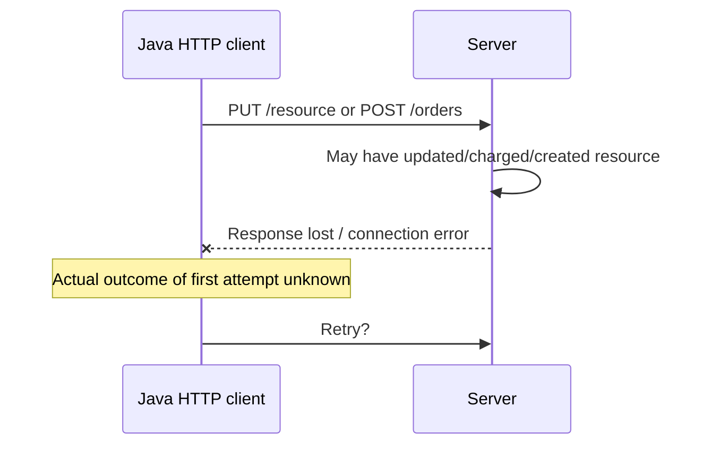

# GET, HEAD, POST, PUT, DELETE and the Safe and Idempotent Semantics of HTTP

## 1. HTTP Methods Determine "What Does the Client Want to Do?"

When programming Java networking and designing HTTP APIs, you should not choose `GET`, `HEAD`, `POST`, `PUT`, `DELETE` merely out of the habit of "read with GET, write with POST." According to HTTP Semantics (RFC 9110), **the request method expresses the semantics that the client requests for the target resource**, so that the server, client, caches, and intermediaries understand how to interact.

There are two very important properties:

- **Safe:** the client **does not request and does not expect any state change on the server** as the effect of the method. Safe does not mean security-safe or that the server strictly never writes logs, metrics, or performs internal tasks.
- **Idempotent:** the **intended** effect on the server of multiple **identical** requests is equivalent to a single request. Idempotent does not mean identical responses, that code runs only once, or that all side effects are automatically deduplicated.

Examples:

```text
GET    /products/42              -> request to view a representation of the product
HEAD   /products/42              -> request headers/metadata, without body
POST   /orders                   -> request the collection to process/create a new order
PUT    /products/42              -> create/replace state at the specified URI
DELETE /products/42              -> request to remove the resource association at the URI
```

**Why distinguish them?** Browsers may prefetch GET, caches may reuse GET responses, clients may retry PUT when a connection drops, whereas retrying a POST that creates an order without controls can create duplicate orders. If GET accidentally performs data deletion, even a crawler visiting the URL could trigger a dangerous action.

This lesson dives into **five methods**, the meaning of safe/idempotent, common status codes, GET/HEAD and caching, POST–PUT differences, the idempotent nature of DELETE, retrying after network errors, concurrency control, and **a runnable Java 17 program** using `HttpClient` and a loopback HTTP server.

## 2. Standard Semantics Comparison Table

| Method | Safe? | Idempotent? | Primary Meaning |
|---|---|---|---|
| **GET** | **Yes** | **Yes** | Request transfer of a current representation of the resource |
| **HEAD** | **Yes** | **Yes** | Same as GET in information goal, but **without response content** |
| **POST** | **Not by default** | **Not by default** | Request the target resource to process the content according to its own semantics |
| **PUT** | **No** | **Yes** | Request to create/replace the state of the target resource with the submitted representation |
| **DELETE** | **No** | **Yes** | Request to remove the association between the target URI and the current functionality of the resource |

**Three things to remember:**

1. **GET and HEAD are safe, and therefore also idempotent.**
2. **PUT and DELETE are idempotent but not safe**, because they request state modification.
3. **POST is not considered safe or idempotent by default**. A specific API can design POST to be deduplicated, but it must have its own contract and implementation.

The word "safe" here **does not** mean information security. `GET` over unencrypted HTTP can still leak data; `POST` over HTTPS still needs authentication and authorization. This classification describes **operation semantics**, not security quality.

## 3. What Does "Safe" Mean?

Safe refers to **the action requested by the client**. A compliant GET or HEAD must not have effects that a user viewing information does not expect, such as deducting money, creating an order, deleting a profile, or modifying shopping cart state.

However, the server is allowed to have side effects **that are not the client's requested goal**, such as writing access logs, incrementing visit counters, updating metrics, warming caches, measuring performance, or recording security events. These side effects do not by themselves cause GET/HEAD to lose their safe property.

### A Flawed Design That Easily Causes Consequences

```http
GET /admin/delete-user?userId=42 HTTP/1.1
Host: api.example.test
```

If the handler actually deletes user 42, the API has placed a **state-changing action** into a safe method. Search crawlers, link previews, browsers, or prefetch features could invoke the URL without intending to delete. Even with authentication, this still violates semantics and can create CSRF risks or unintended operations.

**Fix:** use a state-changing method such as `DELETE` or `POST` according to the contract, full authentication/authorization, and CSRF protection in cookie-based web applications. Changing the method **does not automatically make a request secure** if the server lacks protection; however, choosing the right method is an essential condition so clients and intermediaries do not misinterpret it.

### Safe Does Not Require Immutable Data

Two GETs to the same URI may receive different prices because the seller just updated them, because data changes over time, or because a cache expired. GET is still safe if **the client sending GET did not request that change**.

## 4. What Does "Idempotent" Mean?

A state-setting operation like `SET balanceDisplay = 100` repeated with the same request has the same desired state after one or many times. Conversely, repeating `INCREMENT counter BY 1` can cause the counter to increase multiple times.

```text
SET theme = dark    (one or more times) -> theme remains dark
ADD 1 to counter    (twice)             -> counter increases by 2
```

In HTTP, `PUT` is typically a **set representation** operation at a specific URI; `DELETE` is a **remove association** operation; both are idempotent by semantics. `POST` is defined more generally and can mean "append to collection," so it is not idempotent by default.

### Do Not Confuse Idempotence with Identical Responses

```text
PUT /profiles/42   { "name": "Lan" }
    -> 201 Created      (did not exist, now created)

PUT /profiles/42   { "name": "Lan" }
    -> 204 No Content   (same resource, state is still Lan)
```

```text
DELETE /profiles/42
    -> 204 No Content   (deleted)

DELETE /profiles/42
    -> 404 Not Found    (nothing left at that URI)
```

The responses differ, but the **intended effect** of repeating the identical request remains the same as a single one. Therefore, you must not use `statusCode1 == statusCode2` to test idempotency.

### Do Not Confuse Idempotence with Exactly-Once

A server receiving two identical PUTs can still run the handler twice, write two logs, and record two metrics. HTTP does not promise to invoke code only once. If side effects such as payments, emails, webhooks, or job enqueuing are not deduplicated, **standard method idempotency alone is not enough** to guarantee that all external systems execute only once.

Idempotency also **does not guarantee atomicity**. Two concurrent commands updating multiple databases/resources may require transactions or another coordination mechanism.

### "Identical" Is a Mandatory Condition

`PUT /state` with body `{"version":1}` and `PUT /state` with body `{"version":2}` are **two different requests**; you cannot conclude they commute or prevent lost updates. To prevent overwriting a newer version with an older one, use optimistic locking such as ETag and `If-Match` (typically returning `412 Precondition Failed` when the condition is not met).

## 5. GET: Fetch Representation, Request No Change

`GET` requests the server to transfer a selected representation of the target resource. It is **safe** and **idempotent**.

Request:

```http
GET /products/42 HTTP/1.1
Host: api.example.test
Accept: application/json
```

Response:

```http
HTTP/1.1 200 OK
Content-Type: application/json
ETag: "product-v3"

{"id":42,"name":"Keyboard"}
```

This is an example; not every GET succeeds with `200`: the server may return `206 Partial Content` if ranges are supported and conditions are appropriate, `304 Not Modified` for conditional requests, `404 Not Found` if the resource does not exist, or `401/403` statuses due to authentication/authorization.

### GET and Caching

GET is the foundational method of HTTP caching. However, **GET does not mean caches are always allowed to store the response**; you must consider the rules of RFC 9111, `Cache-Control`, `Vary`, authorization, status, and freshness.

Example where a client has ETag `"product-v3"`:

```http
GET /products/42 HTTP/1.1
Host: api.example.test
If-None-Match: "product-v3"
```

If the representation has not changed according to the condition, the server can return `304 Not Modified` with appropriate validator information, without sending the representation body as in a `200` response. A cache/client with a valid old copy will reuse it according to the rules.

### GET Body and Sensitive Data

HTTP defines no general semantics for a GET request body. Sending a body with GET can cause incompatibilities with servers, proxies, or gateways. In typical APIs, select resources via path/query; when complex structured data needs to be processed, design an appropriate contract and method instead of expecting GET bodies to always be supported.

Do not arbitrarily put tokens, passwords, or sensitive personal information into query strings: query URLs can appear in browser history, logs, and shared contexts. This is a security/privacy issue **distinct** from safeness.

## 6. HEAD: Metadata of GET, Without Response Body

`HEAD` is similar to GET in its information goal, but the server **does not send the response body content**.

```http
HEAD /products/42 HTTP/1.1
Host: api.example.test
```

```http
HTTP/1.1 200 OK
Content-Type: application/json
Content-Length: 27
ETag: "product-v3"

```

After the blank line ending the headers, there is **no content**. If `Content-Length` is sent accurately, it describes the content size that the corresponding GET would send, **not the number of body bytes in HEAD**. Some headers only known when generating content may be omitted in HEAD according to HTTP semantics.

HEAD is commonly used to:

- Check whether a resource exists or is accessible via status code.
- Inspect metadata such as `Content-Type`, `Content-Length`, `ETag`, `Last-Modified`.
- Check information that helps validate or update a cache.
- Estimate information before fetching large data, if the server supports it properly.

HEAD is also **safe + idempotent**, but it is not a free operation: the server may still have to query data to generate headers. An API may not support HEAD and return `405 Method Not Allowed`; do not assume every framework automatically handles HEAD identically to GET.

**Common mistake:** treating HEAD like GET and accidentally writing the representation body. The server must strictly omit response content, even when reporting a non-zero `Content-Length`.

## 7. POST: Process Request According to Target Resource Semantics

`POST` requests the target resource to process the submitted representation according to the resource's own semantics. It is commonly used to:

- Submit a form or comment.
- Request a collection to create a new item where **the server chooses the URI/ID**.
- Send data to a processor, job queue, or business action.
- Trigger an operation that does not fit PUT replacing a representation at a known URI.

Example:

```http
POST /orders HTTP/1.1
Host: api.example.test
Content-Type: application/json

{"productId":42,"quantity":1}
```

The server may return:

```http
HTTP/1.1 201 Created
Location: /orders/801
Content-Type: application/json

{"id":801,"status":"created"}
```

A `POST` **is not required to create a resource**. For asynchronous work, the server may return `202 Accepted` when it only accepts the work for processing; that does not promise the work is finished. A POST with a normal result can also return `200 OK` with a representation of the result.

### POST Is Neither Safe Nor Idempotent by Default

Two `POST /orders` requests with the same content can create two different orders:

```text
POST /orders {"item":"A"} -> created order #1
POST /orders {"item":"A"} -> created order #2
```

Repeating the request has a **cumulative effect** different from a single one, so you cannot blindly retry POST when a response is lost. The client only knows a timeout occurred and cannot be sure whether the server committed or not.

### Making POST Idempotent by API Contract

For example, the client sends:

```http
POST /payments HTTP/1.1
Host: api.example.test
Idempotency-Key: pay-transaction-2026-001
Content-Type: application/json

{"amount":1000,"currency":"VND"}
```

If the API **supports** the key by contract, the server can ensure retries of the same business intent do not create additional payments. However, simply sending a header name is not enough. The server must implement:

1. A stable key for the same operation, and a different key for a new operation.
2. Key scoping by client/tenant, method, endpoint, and payload fingerprint.
3. Atomicity when two requests with the same key arrive nearly concurrently.
4. Stored processed result or state for replay/reconciliation.
5. Key expiration policy and handling of same-key but different-payload cases.
6. Downstream side effects (DB, queue, email, payment gateway) that do not cause duplicate execution.

This is an **application guarantee**, not something that makes POST considered idempotent by default in HTTP for every endpoint.

## 8. PUT: Create/Replace Resource at a Specified URI

`PUT` requests the server to create or replace the state of the **target resource** with the transferred representation. Typically, the client already knows the URI:

```http
PUT /profiles/42 HTTP/1.1
Host: api.example.test
Content-Type: application/json

{"displayName":"Lan","city":"Hue"}
```

If PUT successfully creates a new resource, `201 Created` is the standard response. If the target already exists and is successfully replaced, the server may return `200 OK` or `204 No Content` depending on the response content.

### Why Is PUT Idempotent but Not Safe?

Because the request intentionally **modifies state**, it is not safe. However, placing the same representation two or three times at the same URI does not ask to create multiple resources or accumulate effects. The desired state remains the transferred representation.

**Do not assume PUT is a "partial update" by default.** PUT expresses creating/replacing the state defined by the representation. For a resource with multiple fields, how missing fields are handled must be specified by the server. If a partial update is needed, HTTP has `PATCH` with its own contract; do not assume a PUT only updates the fields present in the JSON.

### Where Do PUT and POST Differ?

| Factor | PUT at `/profiles/42` | POST at `/profiles` |
|---|---|---|
| Target | Specific chosen resource | Collection/processor receiving the request |
| Who usually chooses the new URI? | Client already knows/chooses the URI | Server usually assigns the URI |
| Primary request | Create/replace target resource state | Have target process content per contract |
| Idempotent by method | Yes | Not by default |
| Retrying identical request | Usually more suitable, still needs contract and deadline | Needs idempotency/reconciliation or safety proof |

Do not use `PUT /orders/42` such that each call creates `/orders/43`, `/orders/44` like a repeated POST to a collection; that violates expectations about target resources and idempotency.

### Lost Updates and the If-Match Condition

Idempotency does not solve two clients concurrently editing with different payloads. Use ETag/version and preconditions:

```http
PUT /profiles/42 HTTP/1.1
Host: api.example.test
If-Match: "v7"
Content-Type: application/json

{"displayName":"Lan","city":"Hue"}
```

If the current representation no longer matches `"v7"` under `If-Match` semantics, the server typically returns `412 Precondition Failed`. This is **optimistic concurrency control**, not an idempotency key. The two mechanisms serve complementary purposes.

## 9. DELETE: Remove Resource Association While Remaining Idempotent

`DELETE` requests the server to remove the association between the target URI and that resource's current functionality. It may result in physical deletion, soft delete, a tombstone, or scheduling asynchronous deletion per the contract. Do not assume an HTTP DELETE must immediately erase every byte from storage.

```http
DELETE /products/42 HTTP/1.1
Host: api.example.test
```

A successful DELETE may return:

- `204 No Content`: the action was performed, no content returned.
- `200 OK`: includes a representation of the state/result.
- `202 Accepted`: accepted for processing, may not be completed yet.

### Why Is DELETE Idempotent When the Second Call Can Return 404?

```text
Initially: /products/42 exists
DELETE /products/42 -> 204
DELETE /products/42 -> 404
GET    /products/42 -> 404
```

Even though the responses differ, the **desired final state** of removing the resource remains "no association left." Therefore, DELETE is **idempotent but not safe**.

The server can also choose to return `204` for repeated DELETEs, depending on the API contract. There is no requirement that every repetition return the same status.

### Does DELETE Have a Request Body?

HTTP defines no general semantics for DELETE request content; you should not rely on an arbitrary DELETE body unless you control all clients/proxies/servers and have a clear contract. Put the resource identifier in the URI, or design another operation when complex payloads need to be sent.

**DELETE does not automatically guarantee all side effects occur only once.** A system with webhooks, search indexes, billing, or event streams needs deduplication, transactions/compensation, and observability at the business layer.

## 10. Comparing State and Status Across an Operation Sequence

Suppose the server has a `/records` collection and a fixed resource `/records/fixed`:

| Step | Request | Illustrative Response | State of Interest |
|---|---|---|---|
| 1 | `PUT /records/fixed` body `one` | `201` | Create record `fixed=one` |
| 2 | Identical PUT | `204` | Still `fixed=one` |
| 3 | `GET /records/fixed` | `200` body `one` | Read-only |
| 4 | `HEAD /records/fixed` | `200`, no body | Metadata only |
| 5 | `POST /records` body `one` | `201`, ID `generated-1` | Create new resource |
| 6 | Identical POST | `201`, ID `generated-2` | Create second new resource |
| 7 | `DELETE /records/fixed` | `204` | Remove `fixed` record association |
| 8 | Identical DELETE | `404` | Still no `fixed` |
| 9 | `GET /records/fixed` | `404` | Confirm resource is gone |

This sequence shows that **status codes can change while idempotency still holds**. It also demonstrates that POST is typically not idempotent in APIs that create resources with server-assigned IDs. This is the result of **an illustrative server contract**, not a requirement that every API return those exact nine status codes.

## 11. Runnable Java 17: HttpServer + HttpClient with All Five Methods

The example runs on JDK 17+ over loopback `127.0.0.1`, requiring no Internet connection, external packages, or pre-installed servers. To demonstrate HTTP semantics, it uses:

- `java.net.http.HttpClient` to create requests with appropriate methods/bodies.
- `com.sun.net.httpserver.HttpServer` from the JDK module `jdk.httpserver` to run a small HTTP server.
- `ConcurrentHashMap` to store records in memory; `AtomicInteger` to generate IDs for POST. Data is not persisted after the JVM stops.
- `HttpRequest.Builder.method(...)` to send `HEAD`, `POST`, `PUT`, `DELETE`; `HttpResponse` to receive status codes and bodies.
- The HTTP server performs the same lookup for `GET` and `HEAD`, but the HEAD response has no body.

Create **`HttpMethodSemanticsDemo.java`** (complete, standalone program):

```java
import com.sun.net.httpserver.HttpExchange;
import com.sun.net.httpserver.HttpServer;

import java.io.IOException;
import java.io.OutputStream;
import java.net.InetAddress;
import java.net.InetSocketAddress;
import java.net.URI;
import java.net.http.HttpClient;
import java.net.http.HttpRequest;
import java.net.http.HttpResponse;
import java.nio.charset.StandardCharsets;
import java.time.Duration;
import java.util.concurrent.ConcurrentHashMap;
import java.util.concurrent.atomic.AtomicInteger;

public class HttpMethodSemanticsDemo {
    private static final ConcurrentHashMap<String, String> records =
            new ConcurrentHashMap<>();
    private static final AtomicInteger nextId = new AtomicInteger();

    private static void reply(
            HttpExchange exchange, int status, String body)
            throws IOException {

        byte[] bytes = body.getBytes(StandardCharsets.UTF_8);
        exchange.getResponseHeaders().set(
                "Content-Type", "text/plain; charset=utf-8");

        if ("HEAD".equals(exchange.getRequestMethod())) {
            if (status == 200) {
                exchange.getResponseHeaders().set(
                        "Content-Length", Integer.toString(bytes.length));
            }
            exchange.sendResponseHeaders(status, -1);
            exchange.close();
            return;
        }

        if (status == 204 || bytes.length == 0) {
            exchange.sendResponseHeaders(status, -1);
            exchange.close();
            return;
        }

        exchange.sendResponseHeaders(status, bytes.length);
        try (OutputStream out = exchange.getResponseBody()) {
            out.write(bytes);
        }
        exchange.close();
    }

    private static void handle(HttpExchange exchange)
            throws IOException {

        String method = exchange.getRequestMethod();
        String path = exchange.getRequestURI().getPath();

        if ("/records".equals(path)) {
            if (!"POST".equals(method)) {
                exchange.getResponseHeaders().set("Allow", "POST");
                reply(exchange, 405, "method not allowed");
                return;
            }

            String value = new String(
                    exchange.getRequestBody().readAllBytes(),
                    StandardCharsets.UTF_8);
            String id = "generated-" + nextId.incrementAndGet();
            records.put(id, value);

            exchange.getResponseHeaders().set(
                    "Location", "/records/" + id);
            reply(exchange, 201, id);
            return;
        }

        if (!path.startsWith("/records/")
                || path.length() <= "/records/".length()) {
            reply(exchange, 404, "not found");
            return;
        }

        String id = path.substring("/records/".length());

        switch (method) {
            case "GET", "HEAD" -> {
                String value = records.get(id);
                reply(exchange, value == null ? 404 : 200,
                        value == null ? "not found" : value);
            }
            case "PUT" -> {
                String value = new String(
                        exchange.getRequestBody().readAllBytes(),
                        StandardCharsets.UTF_8);
                String old = records.put(id, value);
                if (old == null) {
                    reply(exchange, 201, "created");
                } else {
                    reply(exchange, 204, "");
                }
            }
            case "DELETE" -> {
                String old = records.remove(id);
                reply(exchange, old == null ? 404 : 204,
                        old == null ? "not found" : "");
            }
            default -> {
                exchange.getResponseHeaders().set(
                        "Allow", "GET, HEAD, PUT, DELETE");
                reply(exchange, 405, "method not allowed");
            }
        }
    }

    private static HttpResponse<String> call(
            HttpClient client, String base, String path,
            String method, String body) throws Exception {

        HttpRequest.BodyPublisher publisher = body == null
                ? HttpRequest.BodyPublishers.noBody()
                : HttpRequest.BodyPublishers.ofString(body);

        HttpRequest request = HttpRequest.newBuilder(
                        URI.create(base + path))
                .timeout(Duration.ofSeconds(3))
                .method(method, publisher)
                .build();

        return client.send(request,
                HttpResponse.BodyHandlers.ofString(
                        StandardCharsets.UTF_8));
    }

    public static void main(String[] args) throws Exception {
        InetAddress loopback = InetAddress.getByAddress(
                new byte[] { 127, 0, 0, 1 });
        HttpServer server = HttpServer.create(
                new InetSocketAddress(loopback, 0), 0);
        server.createContext("/records",
                HttpMethodSemanticsDemo::handle);
        server.start();

        try {
            String base = "http://127.0.0.1:"
                    + server.getAddress().getPort();

            // Java 17: HttpClient does not implement AutoCloseable.
            HttpClient client = HttpClient.newHttpClient();
            HttpResponse<String> put1 = call(
                    client, base, "/records/fixed", "PUT", "one");
            HttpResponse<String> put2 = call(
                    client, base, "/records/fixed", "PUT", "one");
            HttpResponse<String> get = call(
                    client, base, "/records/fixed", "GET", null);
            HttpResponse<String> head = call(
                    client, base, "/records/fixed", "HEAD", null);

            HttpResponse<String> post1 = call(
                    client, base, "/records", "POST", "one");
            HttpResponse<String> post2 = call(
                    client, base, "/records", "POST", "one");

            HttpResponse<String> delete1 = call(
                    client, base, "/records/fixed", "DELETE", null);
            HttpResponse<String> delete2 = call(
                    client, base, "/records/fixed", "DELETE", null);
            HttpResponse<String> getAfter = call(
                    client, base, "/records/fixed", "GET", null);

            if (put1.statusCode() != 201
                    || put2.statusCode() != 204
                    || get.statusCode() != 200
                    || !"one".equals(get.body())
                    || head.statusCode() != 200
                    || !head.body().isEmpty()
                    || post1.statusCode() != 201
                    || post2.statusCode() != 201
                    || delete1.statusCode() != 204
                    || delete2.statusCode() != 404
                    || getAfter.statusCode() != 404) {
                throw new IllegalStateException(
                        "Unexpected HTTP method result");
            }

            System.out.println(
                    "PUT first: " + put1.statusCode());
            System.out.println(
                    "PUT repeated: " + put2.statusCode());
            System.out.println("GET value: " + get.body());
            System.out.println("HEAD status: "
                    + head.statusCode()
                    + ", body length: " + head.body().length());
            System.out.println("POST #1: "
                    + post1.statusCode() + ", id: " + post1.body());
            System.out.println("POST #2: "
                    + post2.statusCode() + ", id: " + post2.body());
            System.out.println(
                    "DELETE first: " + delete1.statusCode());
            System.out.println(
                    "DELETE repeated: " + delete2.statusCode());
            System.out.println(
                    "GET after delete: " + getAfter.statusCode());
        } finally {
            server.stop(0);
        }
    }
}
```

Compile and run commands (JDK 17; the HTTP server module is part of the JDK):

```bash
javac --release 17 --add-modules jdk.httpserver -encoding UTF-8 HttpMethodSemanticsDemo.java
java --add-modules jdk.httpserver HttpMethodSemanticsDemo
```

**Exact stdout** in an environment that allows opening loopback sockets:

```text
PUT first: 201
PUT repeated: 204
GET value: one
HEAD status: 200, body length: 0
POST #1: 201, id: generated-1
POST #2: 201, id: generated-2
DELETE first: 204
DELETE repeated: 404
GET after delete: 404
```

### Output Analysis

- **PUT 201 → 204**: the same body `one` creates the resource on the first call and sets the same value on the subsequent call. An idempotent request **is not required** to return the same status.
- **GET one**: reads state without requesting any change.
- **HEAD body length 0**: HEAD retrieves the corresponding status/headers without sending representation content.
- **Two POSTs create two IDs**: the server deliberately uses `nextId.incrementAndGet()` for each POST; having the same payload is not enough to prevent duplicate resource creation.
- **DELETE 204 → 404**: the resource was already deleted on the first call, and the repeated request asks for no further change; the subsequent GET proves `fixed` is gone.
- **Status checks in code**: the demo throws an exception if an API behaves outside the illustrative contract; it does not just print output and assume it is correct.

**Demo limitations:** in-memory only, with no authentication/TLS/database/durable commit/idempotency key/ETag/cache/proxy/concurrency testing. `HttpServer` is a learning server on loopback; do not use it directly as a production internet API. `HttpClient` on **Java 17** does not implement `AutoCloseable`, so the demo does not use try-with-resources for the client; the server lifecycle is closed with `server.stop(0)`. In an environment that blocks local sockets, the program will throw an error instead of producing the stdout above.

## 12. Retrying After Timeout: Why Must It Rely on Semantics?

A common scenario:



The client may encounter an `IOException`, timeout, or connection reset **before receiving the final response**. You cannot conclude from that alone that the server did not receive or did not process the request. Idempotent methods help determine whether a request can be safely repeated **with respect to its intended effect**, but you still must follow server policies and business contracts.

| Request | Retry Same Request After Error? | Things to Watch |
|---|---|---|
| GET | Usually a good candidate | Limit attempts, timeouts, cache/auth, do not bypass rate limits |
| HEAD | Usually a good candidate | No body, metadata may change over time |
| PUT | Can retry due to idempotent semantics | Keep same URI/body/headers, watch preconditions/concurrency, actual side effects |
| DELETE | Can retry due to idempotent semantics | `404` after retry may reflect already deleted; contract distinguishes errors from final outcome |
| POST | **Do not assume safe automatically** | Needs an idempotency key or specific proof/policy, especially with side effects |

### Overall Deadline and Backoff

A client should not retry indefinitely just because GET/PUT/DELETE are idempotent. Set an **overall deadline**, connect/request timeouts, a reasonable retry count, and exponential backoff with jitter when appropriate; respect `Retry-After` and rate limits per the contract.

### What Does an Idempotency Key Solve?

A server-supported `Idempotency-Key` helps distinguish a **new request** from a **retry of the same intent**. It is useful for POSTs that create orders/payments. The server needs to implement result storage and deduplication atomically enough, bound key lifetimes, and detect payload mismatches. It **is not a property that HTTP provides automatically for POST**.

### Why Not Just Change POST to PUT?

Changing the method string does not turn "deduct money once per request" into idempotent behavior. The application must genuinely represent the resource by URI/operation with deterministic state or have transaction deduplication. If you call PUT but the handler executes `balance -= amount` on every call, it still violates idempotency expectations.

## 13. Caching, Conditional Requests, and Related Security

**Safe**, **idempotent**, and **cacheable** are three different properties. A response can be safe and idempotent yet not cacheable because of sensitive data or `Cache-Control: no-store`.

- GET typically has important caching mechanisms, but you must consider `Cache-Control`, `Vary`, authorization, freshness, and status per RFC 9111.
- HEAD can provide metadata so a cache can validate/update a stored representation; it returns no response body.
- POST is only cacheable under specific HTTP caching conditions, not "every POST is cacheable."
- A successful PUT/DELETE can invalidate related cache entries according to HTTP rules; do not treat their responses as a default cacheable GET representation.
- `If-None-Match`/ETag can serve conditional GET; `If-Match`/ETag can serve concurrent update control.
- `Cache-Control: no-store` does not replace auth, nor does it turn POST/PUT/DELETE into safe methods.
- `Location` typically appears with `201 Created` to indicate the newly created resource URI; `Allow` supports `405 Method Not Allowed` responses.

### Security at the Protection Layer Is a Separate Problem

A GET endpoint returning private data over `http://` without TLS **does not** become secure just because the method is safe. Conversely, `POST` over HTTPS can still be abused if authorization, CSRF protection, validation, or rate limits are missing. Do not put secrets in URI queries unnecessarily; logs and tracking easily record URLs.

Especially for systems with financial side effects, enforce identity authentication, idempotency, and auditing at the business layer rather than inferring these guarantees from the words `GET`/`POST`/`PUT`.

## 14. Common Mistakes

| Mistake | Why Is It Wrong? | Right Approach |
|---|---|---|
| `GET /delete?user=42` deletes data | Violates safe; prefetch/crawlers can trigger it | Use an appropriate unsafe method + auth/CSRF |
| Assuming safe = no side effects at all | Logs, metrics, cache refresh are allowed | Safe is about **client-requested** effects |
| Assuming multiple GETs must return the same body | State can change over time or via other actors | Idempotent does not require immutable responses |
| HEAD sends a response body | Violates HEAD semantics | Return appropriate headers/status without sending a body |
| Assuming HEAD is always cheap and needs no DB query | Generating metadata also consumes resources | Design appropriate caching/monitoring |
| Automatically retrying `POST /orders` after timeout | Can create duplicate orders | Idempotency key/lookup/reconciliation |
| Assuming every POST creates a resource | POST has many other processing semantics | Rely on the target's contract |
| Treating PUT as incrementing a counter once per request | No longer has the same effect if retried | PUT sets a deterministic state |
| Assuming PUT with missing fields only updates present fields | Can lose data or cause misunderstandings | Specify replacement semantics, consider PATCH |
| Repeated PUT returns 201 then 204 so "not idempotent" | Confuses response with desired state | Compare the requested effect |
| Second DELETE returns 404 so "not idempotent" | First deletion already achieved the state | DELETE is idempotent by method |
| Assuming DELETE immediately erases every physical byte | Can be soft delete or async processing | Document state, retention, 202 |
| Idempotent means exactly-once | Handler and downstream can still run multiple times | Deduplication, transaction/outbox |
| Idempotent replaces optimistic concurrency | PUTs with different payloads still overwrite each other | `If-Match`/ETag/version |
| GET is cacheable by default even with private info | Can leak data | Cache-Control, privacy/auth-aware caching |
| Unlimited retries for idempotent requests | Overload and SLA violations | Retry budget, backoff, jitter |
| Using DELETE/GET body without checking compatibility | Intermediaries may reject/ignore it | Design a portable contract |
| Relying on status `200` to guess method semantics | Same status can correspond to many contracts | Read method, URI, body, status, and API docs |

## 15. Self-Check Questions and Answers

**Question 1.** Which methods among GET, HEAD, POST, PUT, DELETE are both safe and idempotent?

**Answer:** `GET` and `HEAD`.

**Question 2.** Which methods are idempotent but not safe?

**Answer:** `PUT` and `DELETE`. Both can request changes to server state, but repeating an identical request has the same intended effect.

**Question 3.** Must POST create a new resource?

**Answer:** No. POST requests the target resource to process content according to its own semantics. It can create a resource, submit a form, trigger a job, or perform another action.

**Question 4.** `DELETE /item/1` returns `204` then `404`. Does this contradict idempotency?

**Answer:** No. The final state is still that the item is no longer present. Status code is not the measure of idempotency.

**Question 5.** Can sending `PUT /item/1` twice with the same body return `201` then `204`?

**Answer:** Yes. One creates it, and the next sets the same state again. Different responses can still represent the same intended effect.

**Question 6.** If GET updates an access log, does GET lose its safe property?

**Answer:** No. Logging is an internal side effect not requested by the client as an action; GET must not be used to cause business changes such as payments or deletions.

**Question 7.** Can HEAD have a `Content-Length: 1000` header yet an empty body?

**Answer:** Yes. When sent validly, Content-Length describes the content of the corresponding GET; HEAD returns no response body.

**Question 8.** `POST /payments` times out after the client sends the request. Can it be retried?

**Answer:** Not by default. The server may have already executed the payment. You need server-supported idempotency, a request ID/status query, or reconciliation.

**Question 9.** Does PUT's idempotency solve two users concurrently editing the same resource?

**Answer:** No. Two different bodies are two different requests and can overwrite each other. Use version/ETag with `If-Match` or appropriate transactions.

**Question 10.** If a server designs a POST endpoint with deduplication, does POST become an HTTP default idempotent method?

**Answer:** No. Only that specific API has an idempotency guarantee. Clients cannot generalize this to all POST endpoints.

**Question 11.** Why should `GET /admin/delete` not be used?

**Answer:** GET is safe and can be invoked by crawlers/prefetch/link previews. Destructive actions require an unsafe method along with proper authentication, authorization, and CSRF protections.

**Question 12.** If you see `202 Accepted` from DELETE, is the deletion guaranteed to be complete?

**Answer:** Not yet. `202` may only indicate that the request was accepted for processing. You need to track/query status according to the contract.

## 16. API Design Checklist and Conclusion

1. **Identify the resource, URI, and requested business effect** before choosing a method.
2. **GET** to query a representation; **HEAD** to retrieve metadata without content. Do not put business create/update/delete operations into these two safe methods.
3. **POST** when the target resource processes the request per contract, especially when the server chooses the new URI or executes an action; design idempotency for operations at risk of duplication.
4. **PUT** when the client wants to set a representation at a specified target URI. Clearly specify replacement semantics, statuses, preconditions, and missing fields.
5. **DELETE** when you want to remove a resource association. Define soft delete/async delete, statuses, and how to confirm the result.
6. Do not use "idempotent" as a synonym for "read-only," "same response," "exactly-once," or "no transaction needed."
7. When retrying, define **identical requests**, an overall deadline, backoff/jitter, and unknown outcomes after network errors.
8. For POST side effects, implement idempotency keys + deduplication + reconciliation on the server, not just adding a header on the client.
9. For multiple editors, use `If-Match`/version or appropriate transactions; idempotency does not prevent lost updates.
10. Evaluate cacheability, authorization, CSRF, privacy, TLS, and HTTP statuses separately. A safe method can still be implemented insecurely.
11. Write integration tests for **repeated PUT/DELETE** with different responses but correct final state, and **repeated POST** with/without a key.
12. Measure responses/statuses, transaction commits, request IDs, and downstream side effects instead of relying solely on the client having called `send()` successfully.

**Summary:** `GET` and `HEAD` are **safe + idempotent**; `PUT` and `DELETE` are **idempotent but not safe**; `POST` **does not have those two properties by default**. Idempotency is evaluated by the **requested effect** of multiple identical calls, not by comparing status codes. When encountering timeouts or dropped connections, transaction success may be unknown; API design requires controlled retries and application-layer proof of processing.

### Official References

- [RFC 9110 `9.2 — Safe and Idempotent](https://www.rfc-editor.org/rfc/rfc9110#section-9.2)
- [RFC 9110 `9.3 — Method Definitions](https://www.rfc-editor.org/rfc/rfc9110#section-9.3)
- [RFC 9110 `13 — Conditional Requests](https://www.rfc-editor.org/rfc/rfc9110#section-13)
- [RFC 9111 — HTTP Caching](https://www.rfc-editor.org/rfc/rfc9111)
- [Java SE 17 — HttpClient API](https://docs.oracle.com/en/java/javase/17/docs/api/java.net.http/java/net/http/HttpClient.html)
- [Java SE 17 — HttpRequest API](https://docs.oracle.com/en/java/javase/17/docs/api/java.net.http/java/net/http/HttpRequest.html)
- [Java SE 17 — HttpServer API](https://docs.oracle.com/en/java/javase/17/docs/api/jdk.httpserver/com/sun/net/httpserver/HttpServer.html)