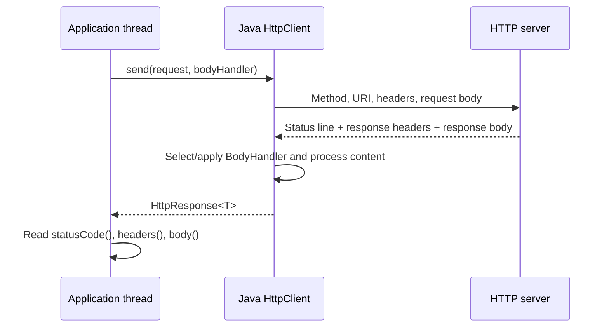

# Sending Synchronous HTTP Requests with HttpClient.send and Interpreting statusCode, headers, and body in Java 17

## 1. Goal: Receiving an HTTP Response Is More Than Just Getting a JSON String

Java 11 and later include `java.net.http.HttpClient`, and Java 17 provides a stable version of this API for sending HTTP/HTTPS requests. With the **`send(HttpRequest, HttpResponse.BodyHandler<T>)`** method, the calling thread waits for the request to be sent and the response to be received according to the chosen body-handling strategy. The returned result is an **`HttpResponse<T>`** consisting of several parts with **distinct** meanings:

- **`statusCode()`:** the HTTP status code, indicating what kind of result the server or HTTP component returned, such as `200`, `201`, `204`, `302`, `404`, or `500`.
- **`headers()`:** the HTTP response headers, such as `Content-Type`, `Location`, `Cache-Control`, and `ETag`. Headers add semantics for **format, navigation, caching, length, and policy**, rather than being the payload itself.
- **`body()`:** the response content converted by the **BodyHandler** into a Java type of your choice. It can be `String`, `byte[]`, `Path`, `InputStream`, or `Void`; it is **not** always JSON/String by default.
- **`uri()`, `version()`, `request()`, `previousResponse()`:** additional information about the URI, HTTP version, corresponding request, and the redirect chain automatically followed when configuration allows.

A common misconception that causes bugs: **HTTP status 404 or 500 does not normally cause `HttpClient.send` to throw an exception on its own**. If the server returns a valid HTTP response, `send` can still return an `HttpResponse` normally; the application must **check the status**, read the headers/body appropriately, and decide whether it represents success or a business error.

This lesson focuses on **synchronous sending with `send` and correctly interpreting the three results `statusCode`, `headers`, and `body`** in a networking context; it also explains redirects, charsets, timeouts, exceptions, BodyHandler selection, cleanup, and a Java 17 example with a loopback server that can run offline.

## 2. What Steps Does a Request/Response Go Through?



**Synchronous** means the thread calling `send` waits for a result matching the `BodyHandler`. It does not mean the underlying HTTP/TCP cannot operate asynchronously, or that all work on the server has been durably committed. With `BodyHandlers.ofInputStream()`, `send` may return as soon as the content stream is ready for the caller to read further; **the caller remains responsible for consuming/closing the stream**. With `ofString`, the content is received and decoded into a string before `body()` can be used.

These layers must not be conflated:

| Layer | What is observed | What is not automatically guaranteed |
|---|---|---|
| Connection/transport | Byte-transfer I/O or network error | That the server processed the business operation successfully |
| HTTP response | Status + headers + content sent by the server | That a `2xx` code satisfies all application-specific expectations |
| BodyHandler | Converts content into a Java type | That JSON/XML content is schema-valid, safe, or business-correct |
| Business logic | Inspects status/header/body and data | Exactly-once downstream effects without another contract |

## 3. Building a Standard Java 17 HttpClient and HttpRequest

This example of sending a GET to an endpoint **only illustrates the API structure**; `https://example.com` is an example host and does not need to be called for real while reading this lesson:

```java
// Illustrative snippet inside a method that may throw Exception.
HttpClient client = HttpClient.newBuilder()
        .connectTimeout(Duration.ofSeconds(3))
        .followRedirects(HttpClient.Redirect.NEVER)
        .build();

HttpRequest request = HttpRequest.newBuilder()
        .uri(URI.create("https://example.com/products/42"))
        .timeout(Duration.ofSeconds(5))
        .header("Accept", "application/json")
        .GET()
        .build();

HttpResponse<String> response = client.send(
        request, HttpResponse.BodyHandlers.ofString(
                StandardCharsets.UTF_8));
```

Required imports for this snippet: `java.net.URI`, `java.net.http.HttpClient`, `HttpRequest`, `HttpResponse`, `java.time.Duration`, and `java.nio.charset.StandardCharsets`. The complete program in section 11 includes the imports and a real server for testing.

### Role of Each Component

1. `HttpClient.newBuilder()` creates client configuration such as connect timeout, preferred protocol version, redirect policy, proxy, SSL, and authenticator if needed.
2. `HttpRequest.newBuilder()` creates a request with URI, method, headers, body publisher (when needed), and request timeout.
3. `HttpResponse.BodyHandlers.ofString(StandardCharsets.UTF_8)` determines how the body is received: decoding bytes into a String using the specified charset.
4. `client.send(request, bodyHandler)` sends the request **synchronously** and may throw `IOException` or `InterruptedException`. When it returns successfully, you receive an `HttpResponse<String>`.
5. `response.statusCode()` does **not** automatically classify JSON errors or business errors; `response.headers()` and `response.body()` must be interpreted according to the contract.

**Creating a reusable HttpClient:** you should generally reuse `HttpClient` instead of creating a new client for every request, so the runtime can manage connections and resources efficiently. Notably, **in Java 17**, `HttpClient` **does not implement `AutoCloseable`**, so do not use `try (HttpClient client = ...)` when targeting compilation on Java 17. Newer Java versions have a different lifecycle API; this lesson targets JDK 17 compatibility.

### Timeouts Have Two Different Meanings

- `HttpClient.Builder.connectTimeout(...)`: relates to the deadline for establishing a **new connection**; it does not replace the overall request deadline.
- `HttpRequest.Builder.timeout(...)`: limits the response time for the request according to `HttpClient` semantics. Upon expiration, `send` may throw `HttpTimeoutException` or `HttpConnectTimeoutException` (related to the connection deadline).
- You still need an **overall business deadline** across multiple calls, retries, parsing, and downstream processing; do not assume `connectTimeout(3s)` and `request.timeout(5s)` automatically govern an entire multi-request workflow.

Do not treat a timeout as proof that the server has not processed the request. If the request has side effects, a lost response can leave the business outcome **unknown**.

## 4. The First Result: `statusCode()`

`response.statusCode()` returns an integer representing the HTTP status code. You should classify it by **1xx–5xx groups**, while still reading the specific code and application contract:

| Range | General meaning | Common examples |
|---|---|---|
| **1xx** | Informational/interim protocol response | `100 Continue`; usually not the final response of `send` |
| **2xx** | Request was successfully processed at the HTTP level per specific semantics | `200 OK`, `201 Created`, `202 Accepted`, `204 No Content` |
| **3xx** | Redirection or conditional result regarding representation | `301`, `302`, `303`, `307`, `308`, `304 Not Modified` |
| **4xx** | Request/client-side error per HTTP semantics | `400`, `401`, `403`, `404`, `409`, `412`, `429` |
| **5xx** | Server/gateway failed to fulfill an apparently valid request | `500`, `502`, `503`, `504` |

**Important:** `HttpClient.send` *does not throw an error by default just because the response is `404` or `500`*. A valid HTTP `404` response will be returned as an `HttpResponse`; you must inspect the error body yourself, log it, or convert it into a domain exception if the API contract requires.

### Do Not Lump All 2xx Together as "Business-Completed"

- `200 OK`: request succeeded according to the method; the body may contain data or result information.
- `201 Created`: a new resource was created; `Location` typically indicates the URI of the corresponding resource.
- `202 Accepted`: the server **accepted the request**, but processing may not be complete yet; usually requires polling a status endpoint or a callback per the contract.
- `204 No Content`: success **with no response body**. Do not parse an empty String as JSON and report a false error.

### 3xx Requires Considering the Redirect Policy

A `302 Found` response may include a `Location` header; if configured with `HttpClient.Redirect.NEVER`, the client **does not follow it automatically** and you will observe status `302` along with `Location` in the response. If redirects are allowed, `HttpClient` may issue additional requests; in that case `response.statusCode()` is typically the status of the **final response**, `response.uri()` may be the URI after redirection, and `previousResponse()` can describe the prior history.

**`304 Not Modified`** relates to conditional requests/caching, **not** a redirect requiring you to open a URL from `Location`. Do not handle all 3xx codes identically.

### 4xx and 5xx Must Be Interpreted Per the Application Protocol

`404 Not Found` can mean the resource does not exist, is hidden due to permissions, or the server could not find the endpoint. `401` usually relates to authentication requirements; `403` is access denial, and `429` relates to rate limiting. `500/503` may indicate a server error or temporary overload, but **do not automatically guarantee** that retrying is safe.

Do not just check `status >= 400` and silently discard the error body: the body may contain domain error codes, a correlation ID, retry information, or validation details; however, **do not flood logs with sensitive data**.

### Example of Intentional Handling

```java
// Illustrative snippet: response is HttpResponse<String>.
int status = response.statusCode();
if (status >= 200 && status < 300) {
    // Handle success per contract; 202/204 need separate branches.
} else if (status == 404) {
    // Resource does not exist yet or is not exposed.
} else if (status == 429 || status == 503) {
    // Check Retry-After, deadline, and idempotency before retrying.
} else {
    // Analyze the error content and return an appropriate result.
}
```

The snippet above is **not exhaustive for all codes**; its purpose is to show that status classification must depend on the API. Do not automatically retry every `5xx` request, especially POST operations that may already have been applied before the failure occurred.

## 5. The Second Result: `headers()` and the `HttpHeaders` Structure

`response.headers()` returns `java.net.http.HttpHeaders`. It contains **multiple header names**, and each name can have **one or more values**. Commonly used methods:

- `headers().firstValue("Content-Type")` returns `Optional<String>`.
- `headers().allValues("Set-Cookie")` returns `List<String>`, which may contain multiple values.
- `headers().map()` returns a map of header names to lists of values; useful for inspection, though you should not assume presentation order.
- `headers().firstValueAsLong("Content-Length")` returns `OptionalLong` if present and parseable according to API rules.

**HTTP field names are case-insensitive.** Therefore, `firstValue("content-type")` or `firstValue("CONTENT-TYPE")` should both work for the `Content-Type` header. Header **values**, however, may have their own syntax rules and not every value can be compared by unconditionally lowercasing it.

```java
// Illustrative snippet; response has type HttpResponse<String>.
String mediaType = response.headers()
        .firstValue("content-type")
        .orElse("<not provided>");

String location = response.headers()
        .firstValue("LOCATION")
        .orElse("<none>");

List<String> cookies = response.headers()
        .allValues("Set-Cookie");
```

### Some Important Headers

| Header | Meaning when interpreting | Common mistake |
|---|---|---|
| `Content-Type` | Content type, e.g. `application/json` or `text/plain; charset=utf-8` | Assuming a String automatically gives you a parsed JSON object |
| `Content-Length` | Content length per HTTP rules (in bytes) | Comparing it to `response.body().length()`, which is UTF-16 code units |
| `Content-Encoding` | Content coding such as `gzip` when applied | Confusing it with charset; reading raw bytes incorrectly or failing to decompress properly |
| `Location` | URI related to redirection or a newly created resource | Treating every Location as a redirect; `201` can use Location for the new resource |
| `ETag` | Representation/resource validator | Treating ETag as a unique key to deduplicate POSTs |
| `Last-Modified` | Modification timestamp according to the server | Treating it as an absolute clock guarantee or concluding content never changed |
| `Cache-Control` | Caching directives | Assuming `max-age` means the response is always cached regardless of auth |
| `Retry-After` | Suggested retry delay for applicable statuses | Retrying infinitely or ignoring deadlines/idempotency |
| `WWW-Authenticate` | Authentication challenge | Blindly resending credentials to an untrusted endpoint |
| `Vary` | Request headers that can affect representation selection | Using a cache key based solely on URL in all cases |
| `Set-Cookie` | One or more cookies with their own syntax | Joining all cookies into a single comma-separated string improperly |
| `X-Request-ID` (API-dependent) | Correlation ID for logs/traces | Trusting externally supplied values without validation |

**Do not assume a header is always present.** `firstValue` returns an `Optional` specifically to handle absence; calling `get()` without checking easily causes `NoSuchElementException`. Headers can also have multiple values or complex syntax: properly parsing `Cache-Control`, `Link`, or `Set-Cookie` requires following each field's grammar.

### Headers Can Reveal Sensitive Information

Do not dump all headers into production logs. `Set-Cookie`, session IDs, authorization-related fields, or user metadata can be sensitive. Extract only the headers needed for diagnostics and apply redaction or an allowlist.

## 6. The Third Result: `body()` Depends on the BodyHandler

What determines the **data type** of `HttpResponse<T>` is the second argument to `send`:

```java
// Illustrative code: request and client already exist.
HttpResponse<String> textResponse = client.send(
        request,
        HttpResponse.BodyHandlers.ofString(StandardCharsets.UTF_8));
String text = textResponse.body();
```

`BodyHandler<T>` creates a `BodySubscriber<T>` appropriate for the response; **T does not have to be String**. Not every response has a body, and "body read successfully" does not mean the status is 2xx.

| BodyHandler | Type of `body()` | When to use |
|---|---|---|
| `BodyHandlers.ofString(StandardCharsets.UTF_8)` | `String` | Text/JSON/HTML when the charset is known |
| `BodyHandlers.ofString()` | `String` | Text using the handler's charset determination from the response; must know the contract |
| `BodyHandlers.ofByteArray()` | `byte[]` | Binary data or when custom decoding with metadata/checksum is needed |
| `BodyHandlers.ofFile(path)` | `Path` | Downloading content to a file; manage status/path/disk and cleanup |
| `BodyHandlers.ofInputStream()` | `InputStream` | Streaming reads for sequential processing and memory control |
| `BodyHandlers.discarding()` | `Void` | Intentionally discarding response content |
| `BodyHandlers.ofLines()` | `Stream<String>` | Line-oriented text responses; must manage stream closing |

**The handler is chosen before the body is known.** If an API normally returns a large file but returns a small JSON on error, using `BodyHandlers.ofFile` for all statuses can cause an error body to be written into the file intended as the data file. You can use `BodyHandlers.ofFileDownload` when appropriate, or `BodyHandlers.fromSubscriber`/`BodyHandlers.ofInputStream`/a custom BodyHandler to choose a strategy based on `ResponseInfo.statusCode()` and headers. Do not treat status and body type as independent.

### 6.1. `ofString` Decodes Bytes into Characters

Given:

```http
HTTP/1.1 200 OK
Content-Type: text/plain; charset=utf-8

Xin chào
```

`BodyHandlers.ofString(StandardCharsets.UTF_8)` decodes bytes as UTF-8. If the server sends text in a different charset, forcing UTF-8 can produce garbled characters. Conversely, `BodyHandlers.ofByteArray()` preserves the raw bytes for inspection or decoding as needed.

**`Content-Length` is not the String length.** HTTP content length is measured in **bytes** of the transmitted content, whereas `String.length()` in Java counts **UTF-16 code units**. For example, Vietnamese characters may occupy multiple bytes in UTF-8 without corresponding to the same number of Java characters.

### 6.2. A String Does Not Automatically Become a JSON Object

`HttpResponse<String>.body()` is a **string** even if the server returns `Content-Type: application/json`. To obtain a Java DTO, you need a parser library such as Jackson/Gson/Jakarta JSON or other valid logic, and then **validate the schema and data**. Body content is untrusted even when the status is 200; avoid passing it directly into SQL, logs, or HTML templates without escaping or validation.

### 6.3. `ofInputStream` Requires Closing

`ofInputStream` provides a content stream for the caller to consume and close. Example **illustrative code**:

```java
HttpResponse<InputStream> r = client.send(
        request, HttpResponse.BodyHandlers.ofInputStream());

try (InputStream in = r.body()) {
    // Read sequentially with a size limit and process the content.
}
```

If the stream is not read/closed, connection resources may remain occupied and affect connection reuse. For large data, streaming avoids loading the entire body onto the heap at once; however, you must enforce practical size limits, deadlines, and error handling while reading.

### 6.4. A Non-Existent Body Differs from an Empty JSON Body

Status `204 No Content` **has no response content**; `304 Not Modified` also returns no representation body. With `BodyHandlers.ofString`, a valid response with no content usually produces an empty `String`. Do not try to parse it as JSON and report "server returned invalid JSON" when the contract specifies no body.

A `404` **can have a body** containing an error message. Do not assume that "for 4xx the body is always null" or "if status is not 200, ignore the body".

## 7. Reading All Three Parts Together to Understand a Response Correctly

Consider the response:

```http
HTTP/1.1 201 Created
Location: /items/42
Content-Type: application/json

{"id":42,"name":"book"}
```

Correct interpretation:

- **`statusCode() == 201`**: the server reports that the resource was successfully created per HTTP semantics.
- **`headers().firstValue("Location")`**: may provide the URI of the new resource. `Location` is not a JSON body and does not force the client to follow it automatically like a redirect.
- **`headers().firstValue("Content-Type")`**: describes the response content media type; an appropriate parser is needed if you want a DTO.
- **`body()`** with `ofString(UTF_8)` is a string containing JSON text, not a Java object.
- **Business validation**: if the API requires an `id` field, parse/validate according to the contract, handling missing fields, wrong types, and unexpected statuses.

Another response:

```http
HTTP/1.1 404 Not Found
Content-Type: application/problem+json

{"type":"about:blank","title":"Not Found","status":404}
```

There is no `IOException` here if the response is received intact. `HttpClient.send` can return an `HttpResponse<String>` with `statusCode() == 404` and a body containing the error. The application must decide whether to convert it into a domain exception, a result object, or fallback handling code.

### A Pattern for Classifying and Returning Results

```java
// Illustrative code using variable HttpResponse<String> response.
int status = response.statusCode();
String body = response.body();

if (status == 200) {
    // Parse body according to media type and API contract.
} else if (status == 201) {
    // Inspect Location and the newly created representation.
} else if (status == 204) {
    // Success, do not parse body.
} else if (status == 404) {
    // Read error body with size limit, return not-found/domain error.
} else {
    // Other policy based on specific status, retry budget, etc.
}
```

Do not use a rigid `status == 200` branch for every API: a successful POST may return 201, DELETE may return 204, and an asynchronous job may return 202; a different status **does not automatically mean an error**.

## 8. Redirects: Seeing 302 or the Final Response Depends on HttpClient

`HttpClient.Builder.followRedirects(...)` offers these options:

- `HttpClient.Redirect.NEVER`: does not follow redirects automatically; the caller receives the `3xx` response along with `Location` if sent by the server.
- `HttpClient.Redirect.NORMAL`: allows normal redirects, but does not automatically downgrade from HTTPS to HTTP under the NORMAL policy.
- `HttpClient.Redirect.ALWAYS`: allows broader redirects; you must consider the risk of sending sensitive information to another host or lowering security protections.

**Do not treat Redirect.ALWAYS as a safe default.** For internal APIs, webhooks, or systems processing user-supplied URLs, you need host allowlists, scheme restrictions, SSRF mitigations, credential protection, and prevention of unintended redirects to internal networks.

If `followRedirects` is enabled, the final response may be `200` after one or more `301/302` responses; you will not see `302` directly in the final `statusCode()`. Check `response.previousResponse()` if you want the redirect history, and `response.uri()` if you need the final response URI.

With `Redirect.NEVER`:

```text
GET /redirect
<- 302 Found
   Location: /ok
   Body: redirect
```

The application sees status `302` and Location `/ok`. **Do not confuse** `Location` on `201 Created` with a redirect: the same header has different meanings depending on the status and contract.

## 9. Exceptions During `send`: Separating Network Errors from HTTP Error Statuses

The signature of `send` in Java 17 can throw:

```java
// Illustrative API signature (generics abbreviated for context).
<T> HttpResponse<T> send(
        HttpRequest request, HttpResponse.BodyHandler<T> handler)
        throws IOException, InterruptedException;
```

Two different failure paths:

- **Java/transport-level errors:** DNS resolution failure, connection failure, TLS handshake error, network reset, timeout, corrupted content, body read error, etc. These can throw `IOException` or a subclass.
- **HTTP response status indicating an error:** the server returns `400`, `404`, `429`, or `500` in a valid HTTP response. **Does not necessarily throw an exception**; the application receives the status and body.

### Handling Timeouts, I/O, and Interruption

```java
// Illustrative code inside a method with client and request.
try {
    HttpResponse<String> response = client.send(
            request,
            HttpResponse.BodyHandlers.ofString(StandardCharsets.UTF_8));
    // Check statusCode/headers/body here.
} catch (HttpTimeoutException timeout) {
    // Client did not receive result in time. Outcome may be unknown.
} catch (IOException transportError) {
    // Network, SSL, stream, or other I/O error.
} catch (InterruptedException interrupted) {
    Thread.currentThread().interrupt();
    // Stop/mark request cancelled per application lifecycle.
}
```

Required imports for this snippet include `java.net.http.HttpTimeoutException` and `java.io.IOException`. `HttpConnectTimeoutException` extends `HttpTimeoutException`, so if you want to distinguish connect timeouts from other timeouts, you must catch them in the proper order or check the subtype.

**Do not swallow `InterruptedException`.** Restoring the interrupt flag lets the calling layer/cancellation policy observe it; then stop the task appropriately. Do not call `send` again in an infinite loop if the thread is being cancelled.

### A Timeout Does Not Prove the Server Did Not Apply the Operation

Suppose the client sends `POST /payments` and waits for a response. If `send` times out, the server may have already committed the payment while the response was lost. Retrying the POST with a new ID could create two transactions. You need a contract supporting an **idempotency key**, request ID, status reconciliation, and bounded retries.

For GET/HEAD/PUT/DELETE, the safe/idempotent nature of the method helps in designing a retry policy, but you still need an overall deadline, backoff, status checks, authorization, and an understanding of the API's actual behavior. There is no "any IOException ⇒ safe to retry everything."

## 10. Choosing a BodyHandler for Size and Memory Safety

### Small Text Bodies with a Known Contract

`BodyHandlers.ofString(UTF_8)` is a simple choice for learning and for handling small JSON/text APIs. However, a body can be too large, causing the JVM to consume excessive heap when buffering all data. For untrusted endpoints or large file downloads, **you must limit body size** using streaming/byte-limiting mechanisms rather than assuming the server always sends an accurate and small `Content-Length`.

### Binary Content

`BodyHandlers.ofByteArray()` is suitable when exact bytes need to be processed (images, files, checksums, non-standard charsets). Do not use `String` to hold binary data and save it later, as integrity can be lost during decoding/encoding.

### Saving to a File

`BodyHandlers.ofFile(path)` can write the body directly to a `Path`. If the API returns `404` with a text error, the handler should not mistakenly keep it as a "successful" file. Check the status and design body handling accordingly; for temporary files, enforce a rename/commit policy only after verifying status/checksum, clean up failed files, and protect paths against path traversal if filenames come from external data.

### Streaming Bodies

With `ofInputStream`, `send` can return before the entire body is read; the caller must read/close the stream inside `try-with-resources`, enforce memory/time budgets, and avoid holding connections indefinitely if the remote sends data slowly. Handlers like `ofLines()` also have a resource lifecycle that must be managed.

### Charset and Content-Encoding Are Two Different Concepts

`charset=utf-8` describes **how bytes are converted into characters** for text. `Content-Encoding: gzip` (if present) describes **content coding** applied to the bytes. Do not assume that choosing `ofString(UTF_8)` automatically handles all content codings or data structures. For responses that differ from the contract, inspect the headers and how the server/client handles encoding per the API.

### Do Not Blindly Trust Content-Length

A response can be transmitted using different framing mechanisms, be compressed, or omit an explicit content length. `Content-Length` may be absent; in a `HEAD` response it may describe the length of the corresponding GET even though **HEAD has no body**. Do not rely on it to prove the number of characters received.

## 11. Runnable Java 17 Program: status, header, body, 404, 204, and redirect

To avoid depending on the Internet, this example creates a **loopback HttpServer** right inside the JVM and uses `HttpClient.send(...)` to send **five synchronous GET requests**, receiving different responses. The goal is to demonstrate the API and produce verifiable output without needing accounts, tokens, DNS, or frameworks.

Mock endpoints:

| Endpoint | Status | Notable header | Response content |
|---|---|---|---|
| `GET /ok` | `200` | `Content-Type` and `X-Lesson` | `Hello Java 17` |
| `GET /created` | `201` | `Location: /items/42` | `created` |
| `GET /missing` | `404` | `Content-Type` | `not found` |
| `GET /empty` | `204` | No body | Empty |
| `GET /redirect` | `302` | `Location: /ok` | `redirect`; not followed due to NEVER policy |

**Note:** `201` on GET is only used to demonstrate the technique of **reading status/headers** in a mock server. According to HTTP semantics, **creating resources via GET violates safe semantics**, and real APIs should use POST/PUT appropriately. This example does not create a resource when calling `GET /created`; the server simply returns a simulated `201` response to show how to read `Location`. When building real APIs, use `201` for resource-creation operations per the contract, not for GET.

File **`HttpClientSyncSendDemo.java`**:

```java
import com.sun.net.httpserver.HttpExchange;
import com.sun.net.httpserver.HttpServer;
import java.io.IOException;
import java.io.OutputStream;
import java.net.InetAddress;
import java.net.InetSocketAddress;
import java.net.URI;
import java.net.http.HttpClient;
import java.net.http.HttpRequest;
import java.net.http.HttpResponse;
import java.nio.charset.StandardCharsets;
import java.time.Duration;

public class HttpClientSyncSendDemo {
    private static void respond(HttpExchange exchange, int status,
                                String content) throws IOException {
        byte[] data = content.getBytes(StandardCharsets.UTF_8);
        exchange.getResponseHeaders().set(
                "Content-Type", "text/plain; charset=utf-8");
        exchange.getResponseHeaders().set("X-Lesson", "sync-send");

        if (status == 204) {
            exchange.sendResponseHeaders(204, -1);
            exchange.close();
            return;
        }

        exchange.sendResponseHeaders(status, data.length);
        try (OutputStream out = exchange.getResponseBody()) {
            out.write(data);
        }
        exchange.close();
    }

    private static void handle(HttpExchange exchange)
            throws IOException {
        try {
            if (!exchange.getRequestMethod().equals("GET")) {
                exchange.getResponseHeaders().set("Allow", "GET");
                respond(exchange, 405, "method not allowed");
                return;
            }
            switch (exchange.getRequestURI().getPath()) {
                case "/ok" -> respond(exchange, 200, "Hello Java 17");
                case "/created" -> {
                    exchange.getResponseHeaders().set(
                            "Location", "/items/42");
                    respond(exchange, 201, "created");
                }
                case "/missing" -> respond(exchange, 404, "not found");
                case "/empty" -> respond(exchange, 204, "");
                case "/redirect" -> {
                    exchange.getResponseHeaders().set("Location", "/ok");
                    respond(exchange, 302, "redirect");
                }
                default -> respond(exchange, 404, "not found");
            }
        } catch (IOException error) {
            exchange.close();
            throw error;
        }
    }

    private static HttpResponse<String> get(HttpClient client,
                                            String base, String path)
            throws IOException, InterruptedException {
        HttpRequest request = HttpRequest.newBuilder()
                .uri(URI.create(base + path))
                .timeout(Duration.ofSeconds(3))
                .GET()
                .build();
        return client.send(request,
                HttpResponse.BodyHandlers.ofString(
                        StandardCharsets.UTF_8));
    }

    public static void main(String[] args) throws Exception {
        InetAddress loopback = InetAddress.getByAddress(
                new byte[] { 127, 0, 0, 1 });
        HttpServer server = HttpServer.create(
                new InetSocketAddress(loopback, 0), 0);
        server.createContext("/", HttpClientSyncSendDemo::handle);
        server.start();
        try {
            String base = "http://127.0.0.1:"
                    + server.getAddress().getPort();
            HttpClient client = HttpClient.newBuilder()
                    .followRedirects(HttpClient.Redirect.NEVER)
                    .connectTimeout(Duration.ofSeconds(2))
                    .build();

            HttpResponse<String> ok = get(client, base, "/ok");
            HttpResponse<String> created = get(
                    client, base, "/created");
            HttpResponse<String> missing = get(
                    client, base, "/missing");
            HttpResponse<String> empty = get(
                    client, base, "/empty");
            HttpResponse<String> redirect = get(
                    client, base, "/redirect");

            if (ok.statusCode() != 200
                    || created.statusCode() != 201
                    || missing.statusCode() != 404
                    || empty.statusCode() != 204
                    || redirect.statusCode() != 302
                    || !empty.body().isEmpty()) {
                throw new IllegalStateException(
                        "Unexpected HTTP response");
            }

            System.out.println(
                    "GET /ok -> " + ok.statusCode());
            System.out.println("content-type: "
                    + ok.headers().firstValue("content-type")
                            .orElse("<missing>"));
            System.out.println("x-lesson: "
                    + ok.headers().firstValue("X-LESSON")
                            .orElse("<missing>"));
            System.out.println("body: " + ok.body());
            System.out.println(
                    "GET /created -> " + created.statusCode());
            System.out.println("location: "
                    + created.headers().firstValue("location")
                            .orElse("<missing>"));
            System.out.println(
                    "GET /missing -> " + missing.statusCode());
            System.out.println("error body: " + missing.body());
            System.out.println(
                    "GET /empty -> " + empty.statusCode());
            System.out.println(
                    "empty body length: " + empty.body().length());
            System.out.println(
                    "GET /redirect -> " + redirect.statusCode());
            System.out.println("redirect location: "
                    + redirect.headers().firstValue("LOCATION")
                            .orElse("<missing>"));
        } finally {
            server.stop(0);
        }
    }
}
```

Compile/run **on JDK 17 or later**, in the directory containing the file. `HttpServer` resides in the `jdk.httpserver` module; the following commands explicitly specify the module so the JVM can access that API:

```bash
javac --release 17 --add-modules jdk.httpserver -encoding UTF-8 HttpClientSyncSendDemo.java
java --add-modules jdk.httpserver HttpClientSyncSendDemo
```

**Exact stdout** in an environment that allows opening a loopback TCP socket:

```text
GET /ok -> 200
content-type: text/plain; charset=utf-8
x-lesson: sync-send
body: Hello Java 17
GET /created -> 201
location: /items/42
GET /missing -> 404
error body: not found
GET /empty -> 204
empty body length: 0
GET /redirect -> 302
redirect location: /ok
```

### Analyzing Output Across the Three Components

1. `GET /ok -> 200`: the status is `200`, which says nothing about whether the response body has been parsed into a DTO.
2. `content-type` is retrieved via `headers().firstValue("content-type")`, regardless of the casing the server used for the header name. `X-LESSON` still finds `X-Lesson`.
3. `body: Hello Java 17` is the content decoded by `BodyHandlers.ofString(UTF_8)`, distinct from headers and status.
4. `GET /created -> 201` with `location: /items/42`: demonstrates receiving a status with `Location`; in practice, create resources using POST/PUT appropriately, **do not turn GET into a resource-creating operation**.
5. `GET /missing -> 404`, yet the program **does not catch IOException**: the server sent a valid response, so `send` returns an `HttpResponse` with `statusCode() == 404` and `body() == "not found"`.
6. `GET /empty -> 204`: `BodyHandlers.ofString` produces an empty string when the response has no content; the code verifies `empty.body().isEmpty()`.
7. `GET /redirect -> 302`, `redirect location: /ok`: because of `Redirect.NEVER`, `HttpClient` does not automatically follow through to fetch `/ok`, so the status is `302`.
8. `server.stop(0)` is called in `finally` to shut down the local server even if the client encounters an exception. The program **does not use** `try (HttpClient client = ...)` for Java 17 compatibility.

This example is meant to verify how the API reads responses; it does not measure throughput, send data over the Internet, or demonstrate a production HTTPS server model. Results depend on whether the environment permits loopback sockets; if blocked, an I/O error will occur rather than producing fake output.

## 12. Why Must status, headers, and body Be Checked Together?

Several real-world scenarios are easily misunderstood:

### 12.1. Status 200 with a Mismatched Content-Type

The API expects JSON, but the server returns `200 OK` with an HTML login page or proxy text. If the client immediately parses the body as JSON, the resulting error fails to explain the root cause. Check the media type first, then parse the content with the appropriate parser, and handle schema/validation errors clearly.

### 12.2. Status 204 While Attempting to Read JSON

A successful DELETE request returns 204 with no body. A client that runs a JSON parser on an empty string and reports "server returned invalid JSON" is misinterpreting the response. Accept 204 per the contract as a successful result without a representation.

### 12.3. Status 404 Still Has a Body

The server returns 404 with an error JSON. `send` does not throw an exception if a valid HTTP response was received. The client should read the status and error body **with a size limit**, rather than classifying 404 as a "DNS/network failure."

### 12.4. Status 302 While Looking Only at the Body

With the `NEVER` redirect policy, 302 may return a short body; the actual target to handle is usually in `Location`. If redirects are followed, the final response status differs from intermediate statuses; you must know how the client is configured.

### 12.5. Status 202 Does Not Prove the Job Is Done

The server accepts a request for background processing, returning `202 Accepted` and a `Location` pointing to a status endpoint. If the client marks a payment as completed solely because of 202, it misinterprets the business outcome. You must track the status per the contract.

### 12.6. Status 200 with an Oversized Response Body

`ofString` can consume memory to hold all the data. If the endpoint is untrusted, enforce a body size limit, choose a streaming/file strategy, and handle truncation/cancellation when the quota is exceeded. `Content-Length` may be absent or insufficient to protect all scenarios.

## 13. Common Mistakes When Using HttpClient.send

| Mistake | Consequence | Correct approach |
|---|---|---|
| Calling only `response.body()` and ignoring status | May process error HTML/JSON as successful data | Always inspect `statusCode()` and the contract |
| Assuming 404/500 always throws `IOException` | Misses valid HTTP error response branches | Distinguish network exceptions from HTTP statuses |
| Treating only `status == 200` as success | Ignores valid 201, 202, 204 | Analyze specific statuses per method |
| Parsing JSON on 204 | False parse error because body must be empty | Handle no-content separately |
| Treating `HEAD` as having a body like GET | Waits for or parses non-existent content | HEAD does not send response content |
| Getting headers via `map().get("Content-Type")` assuming fixed key casing | May fail to find the header or mishandle multiple values | Use `firstValue`/`allValues` |
| Calling `Optional.get()` without checking | `NoSuchElementException` when header is absent | `orElse`, `ifPresent`, validate required fields |
| Treating `Content-Length` as `String.length()` | Wrong for UTF-8/non-BMP characters or transfer semantics | Distinguish byte length, charset, and decoded String |
| Using `ofString` for large files | High heap usage, potential OOME | `ofFile`/`ofInputStream`, size limit |
| Not closing `InputStream` from `ofInputStream` | Leaks/holds connections, misses body errors | `try-with-resources`, data size limits |
| Setting `HttpClient.Redirect.ALWAYS` for untrusted URLs | May follow redirects to risky hosts/schemes | Redirect policy and host/scheme allowlist |
| Mistaking `Location` in 201 for a redirect | Automatically GETs the resource out of workflow | Interpret status + Location per semantics |
| Assuming timeout proves the server did not process | Retries POST with duplicate side effects | Idempotency key/reconciliation |
| Swallowing `InterruptedException` | Poor request cancellation, thread keeps working | Restore interrupt flag and stop per lifecycle |
| Creating a new HttpClient for every request | Loses connection/resource reuse optimizations | Reuse the client |
| Using `try (HttpClient ... )` on JDK 17 | Fails to compile | Java 17 client is not AutoCloseable |
| Trusting body/status from server without validation | Injection, data/schema errors, secret leaks in logs | Validate schema, media type, redaction |
| Assuming any 2xx means transaction completed | `202` may only mean accepted | Track application status |
| Retrying every IOException/5xx infinitely | Generates load, duplicate side effects, exceeds deadline | Bounded retry, backoff, idempotency awareness |
| Not setting request timeout/deadline | Thread waits too long, increases resource contention | Set timeouts, manage overall budget and cancellation |

## 14. Practice: Building an Operable Client Service

For a real API, instead of scattering `send` and `System.out.println` everywhere, separate responsibilities:

1. **Create an explicitly configured HttpClient**: connect timeout, redirect policy, TLS, proxy, version preference, and cookie/auth policy if needed.
2. **Define a request builder** per endpoint and method: URI from a trusted source, valid headers, bounded BodyPublisher, and properly scoped auth.
3. **Send with `send`** on an appropriate thread. Do not call synchronous `send` directly on an event-loop thread serving thousands of connections if it blocks the dispatch loop.
4. **Classify status and headers first**: 2xx success, 3xx redirect, 4xx/5xx error, Content-Type, Location, Retry-After, ETag, etc.
5. **Choose a BodyHandler** for the content type/size; prefer streaming or files for large data, and remember cleanup.
6. **Parse/validate the body** only when the contract specifies a body; separate network errors from HTTP errors and validation errors.
7. **Apply a retry policy** based on idempotency, request identity, and overall deadline; avoid repeating POSTs with side effects without deduplication.
8. **Record safe telemetry**: method, normalized host/path, status, duration, correlation ID, error class, retry count; do not log Authorization/cookies/sensitive bodies.
9. **Test** 200/201/204/302/400/404/429/500, timeouts, reset connections, cross-host redirects, charsets, and large bodies.
10. **Maintain the boundary between HTTP success and business success**: 200 with error-in-body depending on the API, 202 job in progress, or 204 no content must be handled differently.

### When Should You Consider `sendAsync`?

`sendAsync` returns a `CompletableFuture<HttpResponse<T>>` instead of directly blocking the calling thread. It fits pipelines that do not want to block, but requires proper handling of completion, callbacks, cancellation, and resource ownership. **Do not assume sendAsync makes the network faster**; the key difference is the thread-dispatching model and how results are coordinated. This lesson intentionally focuses on **synchronous `send`** so learners master status/headers/body first.

## 15. Self-Check Questions

**Question 1.** Does `send` always throw `IOException` when receiving HTTP `404`?

**Answer:** No. If a valid HTTP response is received, `send` can return an `HttpResponse` with `statusCode() == 404` and an error body; HTTP statuses must be classified separately from network errors.

**Question 2.** What does `HttpResponse<String>.body()` return if the server sends JSON?

**Answer:** A text string decoded according to the BodyHandler, not a Java JSON object. A parser and validation are needed if you want a DTO.

**Question 3.** Why should you not compare `Content-Length` with `body().length()`?

**Answer:** Content-Length refers to **bytes** per HTTP semantics, whereas `String.length` counts UTF-16 code units. Multi-byte UTF-8 characters, content coding, or no-content responses make the two concepts different.

**Question 4.** Can you look up `Content-Type` using `headers().firstValue("content-type")`?

**Answer:** Yes. HTTP header names are case-insensitive; the `HttpHeaders` API handles this. The value may be absent, so you must handle the `Optional`.

**Question 5.** Should a `204` response have its JSON body parsed?

**Answer:** No. 204 is success with no content. Do not run a parser on an empty string.

**Question 6.** With `Redirect.NEVER`, `GET /redirect` receives 302 and `Location`. Does `send` automatically navigate to the URI in `Location`?

**Answer:** No. The client returns the 302 response for the application to decide; if configured to follow redirects, the final response status/URI may differ.

**Question 7.** The server returns `201` with `Location`; how should the client interpret `Location`?

**Answer:** Typically the URI of the created resource; do not treat this as a mandatory redirect instruction. Consider the status and API contract.

**Question 8.** Does `BodyHandlers.ofInputStream` require closing the stream?

**Answer:** Yes. The caller must manage the stream and resource lifecycle; `send` can return as soon as the stream is open rather than after consuming the entire body.

**Question 9.** `send` throws `InterruptedException`; what needs to be done?

**Answer:** Restore the interrupt flag via `Thread.currentThread().interrupt()` and execute cancellation/cleanup policy rather than silently swallowing the exception.

**Question 10.** `HttpRequest.timeout(3 seconds)` expires on a payment POST. Can you conclude the server has not charged the account?

**Answer:** No. The response may have been lost after the server committed. You need a server-supported idempotency key, request ID, and reconciliation.

**Question 11.** `GET /ok` returns `200` but `Content-Type` is `text/html` even though the client expects JSON. What should you do?

**Answer:** Do not parse blindly. Inspect the status, media type, bounded body, and contract; the server/proxy may have returned an error or login page.

**Question 12.** Should you create a new `HttpClient` for every request?

**Answer:** Usually no. Reusing the client improves resource/connection efficiency; configure the Java 17 lifecycle properly and note that the client can be used across multiple threads per the API.

**Question 13.** Does `HttpClient.send` always wait for the entire response body to be read completely?

**Answer:** It depends on the BodyHandler. With `ofString`, it must receive/decode the content to return a String; with `ofInputStream`, the response can return with the stream for the caller to read further. Thus, the body lifecycle can extend past when `send` returns.

**Question 14.** Why should you not retry every `503` status infinitely?

**Answer:** It can overload the system and repeat unsafe side effects. You must consider the method, idempotency, `Retry-After`, deadline, backoff, and business state.

## 16. Final Checklist and Reference Documentation

Before finalizing Java client code using `send`:

- [ ] Use a **reusable HttpClient** with appropriate connect/request timeouts; do not use try-with-resources for `HttpClient` on JDK 17.
- [ ] Build the **HttpRequest** properly (URI, method, Accept/Content-Type, body when needed, scoped authentication).
- [ ] Choose a `BodyHandler<T>` suited to the response type/size, understanding that `T` determines what `body()` is.
- [ ] After `send`, read **`statusCode()` first**; do not treat 404/500 as `IOException`.
- [ ] Interpret **headers** via `firstValue`/`allValues`, handle absent values, and do not rely on casing or order.
- [ ] Interpret **body** according to status, `Content-Type`, charset, and contract; do not parse 204/304 as having content.
- [ ] Handle **redirect policy** and `Location` with host/scheme and security considerations.
- [ ] Separate **transport errors** (`IOException`, timeouts) from HTTP errors (`4xx/5xx`) and domain validation.
- [ ] Restore the interrupt flag on `InterruptedException`; clean up streams/files and stop per lifecycle.
- [ ] Enforce memory/size limits for large bodies and do not log cookies/tokens/sensitive payloads.
- [ ] Retry with a budget and idempotency/reconciliation, without assuming timeout = unprocessed.
- [ ] Test 200/201/204/302/404 statuses and error bodies, case-insensitive header lookup, charsets/redirects/timeouts.

**Summary:** `HttpClient.send(request, handler)` sends HTTP **synchronously** and returns an `HttpResponse<T>` when a response is received according to the BodyHandler; the application must read **statusCode** to classify the result, **headers** to understand metadata/directives, and **body** to process content of the right type. Do not confuse HTTP 404/500 with `IOException`, `204` with a JSON-bearing response, or `String.length()` with `Content-Length`. The choice of BodyHandler and timeout/redirect/retry policies determines the correctness and resource safety of the HTTP client.

### Official Documentation

- [Java SE 17 — HttpClient.send](https://docs.oracle.com/en/java/javase/17/docs/api/java.net.http/java/net/http/HttpClient.html)
- [Java SE 17 — HttpRequest and request timeout](https://docs.oracle.com/en/java/javase/17/docs/api/java.net.http/java/net/http/HttpRequest.html)
- [Java SE 17 — HttpResponse and BodyHandlers](https://docs.oracle.com/en/java/javase/17/docs/api/java.net.http/java/net/http/HttpResponse.html)
- [Java SE 17 — HttpHeaders](https://docs.oracle.com/en/java/javase/17/docs/api/java.net.http/java/net/http/HttpHeaders.html)
- [Java SE 17 — HttpServer used in the demo](https://docs.oracle.com/en/java/javase/17/docs/api/jdk.httpserver/com/sun/net/httpserver/HttpServer.html)
- [RFC 9110 — HTTP Semantics/status/headers](https://www.rfc-editor.org/rfc/rfc9110)
- [RFC 9111 — HTTP Caching](https://www.rfc-editor.org/rfc/rfc9111)
