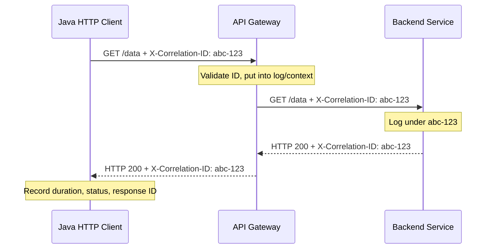

# Attaching Correlation IDs to Connect Client and Server Traces in Java Networking

## 1. Context: Requests Cross Multiple Components, Logs Are Fragmented

A Java application sends an HTTP request to an API gateway. The gateway calls service A, service A calls service B, and then the response travels back to the client. Each component has its own clock, threads, log files, and monitoring system. When a `502 Bad Gateway` or timeout occurs, looking only at the gateway logs is often not enough to answer:

- Which request did the client send, when, and what status did it receive?
- Did the gateway receive that exact request, and which backend did it forward it to?
- How did the backend receive the request, start processing, and complete it?
- Which additional HTTP attempts did a retry create, and are they related to the original logical request?
- Which error logs belong to the exact path of the request among thousands of concurrent requests?

If the logs only record:

```text
12:00:01 CLIENT send GET /orders
12:00:01 GATEWAY downstream call
12:00:02 BACKEND slow database
12:00:03 GATEWAY timeout
```

then the relationship between these lines is very ambiguous. A **correlation ID** solves the link-identification problem by attaching **a consistent technical identifier** to request metadata, propagating it across allowed hops, and including it in each component's logs/tracing.

Example of logs with the ID attached:

```text
CLIENT  correlation_id=demo-req-001 method=GET /orders
GATEWAY correlation_id=demo-req-001 route=orders status=502
BACKEND correlation_id=demo-req-001 operation=query-order timeout=true
CLIENT  correlation_id=demo-req-001 status=502
```

Now you can filter by `correlation_id=demo-req-001` to narrow down the investigation. **A correlation ID does not automatically create a full distributed trace**, does not contain latency measurements, and does not prove that a request succeeded or was authenticated; it is a **linking key** for other recorded facts.

### Learning Objectives

1. Understand how correlation ID, request ID, trace ID, and span ID differ.
2. Know how to generate an ID at the start of a logical request, send it via an HTTP header, receive and forward it through gateways/services, and return it in the response when appropriate.
3. Know how to normalize, validate, and manage the trust boundary of externally provided IDs.
4. Use `java.net.http.HttpClient` on the client and `com.sun.net.httpserver.HttpServer` on the server in a **real compilable/runnable Java 17** example.
5. Design structured logs, thread/async context propagation, metrics, and trace correlation to diagnose end-to-end errors.
6. Avoid putting PII/tokens into IDs, log injection, spoofing, high cardinality, context-loss bugs, and confusing correlation with authentication/idempotency.

**Scope:** this topic belongs to the **Configuration and Observability** section of Java networking. The lesson focuses on **attaching IDs to connect client ↔ server traces**, not replacing a full course on tracing SDKs or log storage.

## 2. How the ID Travels Across Client, Gateway, and Backend

Illustrative model:



A valid flow typically has four stages:

1. **Start the request:** a trusted entry point generates a new correlation ID if none exists, or accepts an ID issued by a trusted upstream **according to policy**.
2. **Send the request:** the client adds the agreed-upon header, such as `X-Correlation-ID`, to the HTTP request.
3. **Receive and forward:** the server validates the ID, places it into the request context/logs, and **attaches it to all related outgoing calls**; do not unnecessarily generate a new ID at every hop.
4. **Return the response:** the server may echo the effective ID in the response header so the client/support can link errors, especially when the server had to replace an invalid ID. The response and logs must still accurately reflect status, duration, and business outcome.

### Same ID Does Not Mean Same TCP Connection

A logical request may traverse multiple TCP connections, HTTP/2 streams, proxies, TLS tunnels, queues, or retries. A correlation ID is application/observability metadata, **not a TCP sequence number**, connection identifier, or WebSocket session ID. Two requests on a single keep-alive connection **can** have different correlation IDs.

### Asynchronous Cases

If an HTTP server enqueues work and returns `202 Accepted` while a worker processes it minutes later, the correlation ID should be passed via **message metadata** to the worker (according to policy). The fact that the HTTP connection itself has ended **does not make correlation meaningless**. The worker should explicitly record trace context, job ID, and processing state to avoid inferring that `202` means completion.

## 3. Easily Confused Terms

| Identifier | Primary Purpose | Scope / Lifecycle |
|---|---|---|
| **Correlation ID** | Group logs/events related to a workflow or logical request | Usually preserved across multiple services/hops |
| **Request ID** | Identify a specific **HTTP request/attempt** | May change per hop or retry, depending on convention |
| **Trace ID** | Identify a distributed trace in a tracing system | Preserved across spans within the same trace |
| **Span ID** | Identify an operation/span within a trace | **Each span has its own ID**, not kept identical across hops |
| **Parent span ID** | Indicate the causal relationship between spans | Depends on the active parent of the operation |
| **Job/Task ID** | Identify a stored/asynchronously processed task | May outlive the HTTP request |
| **Idempotency key** | Help the server detect resent commands with side effects | Business contract, **not** synonymous with correlation ID |
| **User ID / Tenant ID** | Identity of the user/owning unit | Business and security data, do not use in place of correlation ID |

A correlation ID **may** coincide with a request ID or trace ID by design in a small system, but you must **name and document the contract clearly**. Do not assume they are always synonymous; when there are multiple retries, a logical request should keep the correlation ID while each attempt has its own request/attempt ID for investigation.

Example:

```text
logical_request correlation_id=flow-42
    attempt=1 request_id=req-a -> timeout
    attempt=2 request_id=req-b -> HTTP 200

Both attempts share correlation_id=flow-42
but that does not mean request_id=req-a and req-b are a single HTTP exchange.
```

### Correlation ID Is Not a Business Transaction ID

A payment transaction may involve multiple HTTP calls, webhooks, callbacks, database transactions, and asynchronous tasks. A correlation ID is an observability key; it does **not** prove an exact single payment or replace the transaction ID/idempotency key defined by the API. Do not treat an ID sent by the client as proof that the user is authorized to access an order.

## 4. Choosing a Consistent HTTP Header Contract

HTTP does not have a single mandatory `X-Correlation-ID` header across all applications. It is a **common convention, not a W3C standard**. Some systems use `X-Request-ID`, `X-Correlation-ID`, `Request-ID`, or standard tracing fields like `traceparent`.

Choose an explicit contract, for example:

| Rule | Illustrative Choice |
|---|---|
| Application header name | `X-Correlation-ID` |
| Log field name | `correlation_id` |
| ID format | UUID v4 or controlled opaque ASCII ID |
| Length | Maximum 64 ASCII characters for the example |
| Allowed characters | Leading alphanumeric, followed by alphanumeric/dot/underscore/hyphen |
| Missing ID | Entry point generates `UUID.randomUUID()` |
| Malformed ID or multiple values | Discard invalid value, generate a new ID |
| ID issued by a trusted upstream | Validate and preserve according to policy |
| Response | Echo effective ID in `X-Correlation-ID` |
| Downstream forwarding | Send the exact effective ID on outbound requests |
| Audit/security | Do not treat ID as a secret/auth token; do not authorize based on it |

**HTTP header names are case-insensitive.** In Java 17, `HttpHeaders.firstValue("x-correlation-id")` can still find the `X-Correlation-ID` header. However, logging/search systems should use **one consistent field name** to avoid having to search `correlationId`, `correlation_id`, and `requestId` with multiple queries.

### Why Restrict Length and Characters?

An ID from an HTTP request is **untrusted input**. If you let extremely long strings or strings containing newlines/control characters into logs:

- There is a risk of **log injection/log forging**: faking a new log line.
- It wastes bytes on every hop and in indexing/storage.
- It increases search complexity and cardinality.
- It can create header ambiguity when a request contains multiple values or an intermediary combines them.

The limit in the example is `[A-Za-z0-9][A-Za-z0-9._-]{0,63}`: at most 64 ASCII characters, no whitespace, quotes, commas, or control characters. **This is an illustrative policy**, not a universal standard for `traceparent`. Do not use the demo's arbitrary regex to parse W3C trace context.

### Do Not Put Personal Data in the ID

**Do not create IDs like `email@example.com_2026-11-01`, `customer-12345-password`, or attach access tokens to the correlation header.** Use random opaque identifiers. An ID should not encode information that could expose users, devices, orders, secrets, or tenants when passing through logs/third parties.

## 5. Who Has the Right to Generate or Trust a Correlation ID?

An entry point must distinguish between **syntactically valid** and **trusted by origin**:

- An external client can send a string that looks valid, such as `internal-admin-123`, but it is **not verified just because it passes a regex**.
- At a public-facing gateway, a strong policy is to **mint a new root correlation ID** and store any upstream-provided ID in a separate field (if genuinely needed), bounded and marked untrusted.
- At internal hops whose identity is authenticated via mTLS/authorization, it can be acceptable to keep the correlation ID issued by a trusted upstream.
- When receiving missing/invalid/duplicate headers, you can generate a new ID; keep a mapping between old/new if needed for audit, while avoiding logging raw bad input verbatim.
- Echoing a correlation ID in the response can help the client/support, but it does not grant permissions or expose logs to whoever holds the ID.

**The demo in section 9 accepts syntactically valid IDs** to illustrate propagation, and replaces malformed IDs with a UUID. **This is not a complete trust policy for the Internet**: a production gateway must evaluate upstream identity and trust boundaries, not just regex.

### Should Every Service Generate a New ID?

No, if you want to trace the **same logical request** end-to-end. If the gateway issues `corr-001` but the backend issues `corr-002` without recording the relation, logs are split in two. Better:

- Keep a **shared correlation ID** across allowed hops.
- Add a **hop-specific request/span ID** to identify the details of each operation.
- If crossing a trust boundary requires resetting the ID, governed logs/traces can record a **safe link/mapping**, without letting callers forge relationships.

### UUIDs and Uniqueness

`UUID.randomUUID()` in Java 17 generates a pseudo-random UUID v4 suitable for opaque identifiers in many situations. It reduces collision probability to very low levels, but it is **not cryptographic proof of authentication** and does not replace an enforced unique database key. Do not use plain timestamps (`System.currentTimeMillis()`) or an un-namespaced process-local counter if multiple instances could issue duplicate IDs.

## 6. Attaching the ID in Java HttpClient and Reading the Response

Java 17's `java.net.http.HttpClient` does not automatically generate `X-Correlation-ID` for every request. With the raw JDK HTTP client, the application must attach the header or use an appropriate client wrapper/interceptor instrumentation layer.

```java
// Illustrative snippet inside a method that may throw IOException,
// InterruptedException. This is not a standalone Java class.
String correlationId = UUID.randomUUID().toString();

HttpClient client = HttpClient.newBuilder()
        .connectTimeout(Duration.ofSeconds(3))
        .build();

HttpRequest request = HttpRequest.newBuilder()
        .uri(URI.create("https://api.example.test/orders"))
        .timeout(Duration.ofSeconds(5))
        .header("X-Correlation-ID", correlationId)
        .GET()
        .build();

HttpResponse<String> response = client.send(
        request, HttpResponse.BodyHandlers.ofString(
                StandardCharsets.UTF_8));

String echoed = response.headers()
        .firstValue("x-correlation-id")
        .orElse("<missing>");

System.out.println("request=" + correlationId);
System.out.println("response=" + echoed);
```

Required imports: `java.util.UUID`, `java.net.URI`, `java.net.http.HttpClient`, `HttpRequest`, `HttpResponse`, `java.time.Duration`, `java.nio.charset.StandardCharsets`.

**Do not assume the response always echoes the header.** This is an additional contract that the server/gateway must implement. If the response header is missing or different, the upstream may not have implemented it, an intermediary may have stripped the header, or the server may have replaced the ID. The client should record both `outbound_id` and `response_id` in telemetry and apply an explicit policy rather than silently asserting they are always identical.

### One HttpClient Sending Multiple Requests

A single `HttpClient` can reuse pooled connections and serve many requests; **the ID belongs to the logical request or request context**, not to the `HttpClient` itself. If you attach one correlation ID to a global client configuration and share it across all users, all log lines will be mixed together.

### With Async HTTP Requests

`client.sendAsync(...)` returns a `CompletableFuture<HttpResponse<T>>`. The correlation ID must still be attached to the `HttpRequest` built before sending. If `thenApply`/`thenCompose` callbacks run on another thread, the logging context must also be propagated there; **a header in the HTTP request does not automatically update the MDC of the callback thread**.

### With Traditional HttpURLConnection

`HttpURLConnection` has `setRequestProperty("X-Correlation-ID", id)` before connecting, with the same principles: create/attach the ID to the request at the right time, read `getHeaderField("X-Correlation-ID")` from the response, and do not modify headers after the request connection is opened.

## 7. Receiving the ID on the Server and Forwarding Downstream

A typical HTTP server does:

```text
INBOUND:
  rawHeaders = request.headers
  incomingID = exactly one format-valid X-Correlation-ID?
  effectiveID = incomingID if policy allows,
                otherwise generate new UUID
  requestContext.correlationId = effectiveID

PROCESS:
  log("request.started", correlation_id=effectiveID, ...)
  if calling downstream:
      outboundRequest.header("X-Correlation-ID", effectiveID)
      log("downstream.started", correlation_id=effectiveID, ...)

OUTBOUND:
  response.header("X-Correlation-ID", effectiveID)
  log("request.finished", correlation_id=effectiveID,
      status=..., duration_ms=...)
  cleanup requestContext
```

**Use the server-decided `effectiveID`**, and do not continue sending a suspicious raw value from the incoming header. If the input is not trusted, regenerate the ID before logging/forwarding.

### Why Check for Multiple Values?

HTTP can carry multiple header lines with the same name, or an intermediary may fold values together. For an identifier that allows only **a single value**, the server should specify clearly:

- Missing header → generate new.
- Exactly one valid value → accept according to trust policy.
- Multiple values or a value like `abc,def` → reject/regenerate, do not arbitrarily pick the first/last part.
- Value exceeding length limit, containing newlines, spaces, or Unicode outside the allowed policy → do not put directly into logs.

With the JDK `HttpServer`, `exchange.getRequestHeaders().get("X-Correlation-ID")` returns a list of values; inspect the list and count rather than `getFirst` if you need to distinguish duplicate values.

### Propagating the ID Across HTTP Hops

A backend that receives an incoming correlation ID must **actively** attach the outbound header when calling the next service:

```java
// Illustrative snippet: effectiveId is an ID validated from the request.
// 'baseUri' is provided by trusted configuration, not an arbitrary user URL.
HttpRequest child = HttpRequest.newBuilder()
        .uri(baseUri.resolve("/inventory"))
        .header("X-Correlation-ID", effectiveId)
        .timeout(Duration.ofSeconds(2))
        .GET()
        .build();
```

**Do not apply this header unconditionally to untrusted hosts.** Although a correlation ID is not a secret, it is still linking metadata; leaking it can allow third parties to correlate requests. Especially when following redirects to another origin, you need a policy restricting outbound headers and destinations.

## 8. What Should Be Observed in the End-to-End Example?

The runnable program will produce:

```text
Java CLIENT
   |
   | GET /good
   | X-Correlation-ID: demo-req-001
   v
Java GATEWAY (localhost / loopback)
   | log: GATEWAY inbound correlation_id=demo-req-001
   | GET /good
   | X-Correlation-ID: demo-req-001
   v
Java BACKEND (localhost / loopback)
   | log: BACKEND inbound correlation_id=demo-req-001
   | response X-Correlation-ID: demo-req-001
   v
GATEWAY
   | response X-Correlation-ID: demo-req-001
   v
CLIENT
   | log: CLIENT response correlation_id=demo-req-001
```

It also runs an additional request with **`X-Correlation-ID: bad value with spaces`**. The gateway checks the format, generates a new random UUID, forwards it to the backend, and echoes the new ID to the client. Because the generated ID is random, the example prints a **boolean check result** for this branch so stdout can be matched deterministically.

### Demo Scope and Boundaries

- Uses `java.net.http.HttpClient` to send requests.
- Uses **two** `com.sun.net.httpserver.HttpServer` instances on TCP loopback: gateway and backend.
- Handles only short text bodies, with no authentication/authorization, rate limits, or TLS since the goal is demonstrating metadata.
- Caps the correlation ID at 64 ASCII characters using `Pattern`.
- Accepts a format-valid ID to demonstrate propagation (lab policy).
- Replaces malformed IDs with `UUID.randomUUID()`, without writing dirty raw input to server logs.
- Backend echoes the ID in the header; gateway checks that the downstream ID matches to detect broken correlation.
- Client compares the outbound ID with the response header and checks HTTP status/body.
- No Internet, non-loopback DNS, accounts, tokens, or external libraries.

**This is an observability demo**, not a production security gateway. Real applications need upstream authentication, structured logs, deadlines, payload bounds, and proper trace instrumentation.

## 9. Runnable Java 17 Program: CLIENT → GATEWAY → BACKEND

Save all of the following code as **`CorrelationPropagationDemo.java`**:

```java
import com.sun.net.httpserver.HttpExchange;
import com.sun.net.httpserver.HttpServer;
import java.io.IOException;
import java.io.OutputStream;
import java.net.InetAddress;
import java.net.InetSocketAddress;
import java.net.URI;
import java.net.http.HttpClient;
import java.net.http.HttpRequest;
import java.net.http.HttpResponse;
import java.nio.charset.StandardCharsets;
import java.time.Duration;
import java.util.List;
import java.util.UUID;
import java.util.regex.Pattern;

public class CorrelationPropagationDemo {
    private static final String HEADER = "X-Correlation-ID";
    private static final Pattern ALLOWED =
            Pattern.compile("[A-Za-z0-9][A-Za-z0-9._-]{0,63}");
    private static final Pattern UUID_FORMAT = Pattern.compile(
            "[0-9a-f]{8}-[0-9a-f]{4}-[0-9a-f]{4}-"
                    + "[0-9a-f]{4}-[0-9a-f]{12}");

    private static final HttpClient CLIENT = HttpClient.newBuilder()
            .connectTimeout(Duration.ofSeconds(2))
            .followRedirects(HttpClient.Redirect.NEVER)
            .build();

    private static String correlationId(HttpExchange exchange) {
        List<String> received = exchange.getRequestHeaders().get(HEADER);
        if (received != null && received.size() == 1) {
            String candidate = received.get(0);
            if (candidate != null && ALLOWED.matcher(candidate).matches()) {
                return candidate;
            }
        }
        return UUID.randomUUID().toString();
    }

    private static void respond(
            HttpExchange exchange, int status, String body, String id)
            throws IOException {
        byte[] bytes = body.getBytes(StandardCharsets.UTF_8);
        exchange.getResponseHeaders().set(HEADER, id);
        exchange.getResponseHeaders().set(
                "Content-Type", "text/plain; charset=utf-8");
        exchange.sendResponseHeaders(status, bytes.length);
        try (OutputStream out = exchange.getResponseBody()) {
            out.write(bytes);
        }
        exchange.close();
    }

    private static HttpResponse<String> send(
            String address, String id)
            throws IOException, InterruptedException {
        HttpRequest request = HttpRequest.newBuilder()
                .uri(URI.create(address))
                .timeout(Duration.ofSeconds(3))
                .header(HEADER, id)
                .GET()
                .build();
        return CLIENT.send(request,
                HttpResponse.BodyHandlers.ofString(
                        StandardCharsets.UTF_8));
    }

    public static void main(String[] args) throws Exception {
        InetAddress loopback = InetAddress.getByAddress(
                new byte[] {127, 0, 0, 1});
        HttpServer backend = HttpServer.create(
                new InetSocketAddress(loopback, 0), 0);
        backend.createContext("/", exchange -> {
            String id = correlationId(exchange);
            if (exchange.getRequestURI().getPath().equals("/good")) {
                System.out.println(
                        "BACKEND inbound correlation_id=" + id);
            } else {
                System.out.println("BACKEND received UUID: "
                        + UUID_FORMAT.matcher(id).matches());
            }
            respond(exchange, 200, "backend-ok", id);
        });
        backend.start();

        HttpServer gateway = HttpServer.create(
                new InetSocketAddress(loopback, 0), 0);
        String backendBase = "http://127.0.0.1:"
                + backend.getAddress().getPort();
        gateway.createContext("/", exchange -> {
            String id = correlationId(exchange);
            String path = exchange.getRequestURI().getPath();
            if (path.equals("/good")) {
                System.out.println(
                        "GATEWAY inbound correlation_id=" + id);
            } else {
                System.out.println("GATEWAY replaced malformed ID: "
                        + UUID_FORMAT.matcher(id).matches());
            }

            try {
                HttpResponse<String> upstream = send(
                        backendBase + path, id);
                String returned = upstream.headers()
                        .firstValue(HEADER).orElse("");
                if (!id.equals(returned)) {
                    respond(exchange, 502,
                            "upstream correlation mismatch", id);
                    return;
                }
                respond(exchange, upstream.statusCode(),
                        "gateway->" + upstream.body(), id);
            } catch (InterruptedException interruption) {
                Thread.currentThread().interrupt();
                respond(exchange, 502, "interrupted", id);
            } catch (IOException networkFailure) {
                respond(exchange, 502, "upstream I/O error", id);
            }
        });
        gateway.start();

        try {
            String base = "http://127.0.0.1:"
                    + gateway.getAddress().getPort();
            String expectedId = "demo-req-001";

            System.out.println(
                    "CLIENT outgoing correlation_id=" + expectedId);
            HttpResponse<String> success = send(
                    base + "/good", expectedId);
            String echoed = success.headers()
                    .firstValue(HEADER).orElse("");
            System.out.println(
                    "CLIENT response correlation_id=" + echoed);
            boolean joined = success.statusCode() == 200
                    && "gateway->backend-ok".equals(success.body())
                    && expectedId.equals(echoed);
            if (!joined) {
                throw new IllegalStateException("Trace not joined");
            }
            System.out.println("Same ID across hops: " + joined);

            String malformed = "bad value with spaces";
            HttpResponse<String> fallback = send(
                    base + "/invalid", malformed);
            String generated = fallback.headers()
                    .firstValue(HEADER).orElse("");
            boolean validFallback = fallback.statusCode() == 200
                    && UUID_FORMAT.matcher(generated).matches()
                    && !generated.equals(malformed)
                    && "gateway->backend-ok".equals(fallback.body());
            if (!validFallback) {
                throw new IllegalStateException(
                        "Unsafe incoming ID was not replaced");
            }
            System.out.println(
                    "CLIENT received generated UUID: " + validFallback);
        } finally {
            gateway.stop(0);
            backend.stop(0);
        }
    }
}
```

Compile and run with **JDK 17 or later** (the `jdk.httpserver` module is explicitly listed to use the sample server):

```bash
javac --release 17 --add-modules jdk.httpserver -encoding UTF-8 CorrelationPropagationDemo.java
java --add-modules jdk.httpserver CorrelationPropagationDemo
```

**Exact stdout when the environment permits TCP loopback:**

```text
CLIENT outgoing correlation_id=demo-req-001
GATEWAY inbound correlation_id=demo-req-001
BACKEND inbound correlation_id=demo-req-001
CLIENT response correlation_id=demo-req-001
Same ID across hops: true
GATEWAY replaced malformed ID: true
BACKEND received UUID: true
CLIENT received generated UUID: true
```

### Explaining Each Part of the Output

1. `CLIENT outgoing`: the ID `demo-req-001` is a **fixed demo value for deterministic stdout**; production clients typically use a random ID or upstream context.
2. `GATEWAY inbound`: the gateway receives the client header and accepts it under the **syntax-only lab policy**; it logs the ID with the request.
3. `BACKEND inbound`: the gateway added that header to the outgoing `HttpRequest`, so the backend sees the same ID.
4. `CLIENT response`: the gateway returns the used ID in the response's `X-Correlation-ID`.
5. `Same ID across hops: true`: the demo verifies HTTP 200 status, the body from backend through gateway, and that the echoed ID equals the ID sent by the client. Server logs show the same value.
6. `GATEWAY replaced malformed ID`: the inbound value contains spaces so it fails `ALLOWED`; the gateway generates a UUID v4 instead of logging/forwarding it.
7. `BACKEND received UUID`: the backend sees the gateway-generated ID in a valid format.
8. `CLIENT received generated UUID`: the client receives a response header containing the generated UUID, not the original invalid string.

### Why Not Print the Generated UUID in the Error Branch?

UUIDs are **random**, so printing the raw UUID would change the output on every run. The program prints a boolean check for deterministic stdout. In a real logging system, after validating/normalizing, **the gateway and backend should log the effective ID** in structured logs at appropriate events; the example already demonstrated this with the `demo-req-001` branch.

### Technical Limitations of the Demo

- Both HTTP servers use loopback **without HTTPS** solely to avoid certificate dependencies. On real networks, HTTPS/TLS and policy-based auth are required.
- Does not read large input bodies or arbitrary user requests; the sample server only returns small fixed responses.
- Does not simulate tracing spans, metrics exporters, production logging backends, queues, distributed clocks, or failure injection.
- Does not distinguish permissions of the upstream sending a syntactically valid ID; at a real trust boundary, you must **authenticate the source and have a mint/overwrite policy**.
- `HttpClient.Redirect.NEVER` prevents headers from being sent along redirects outside the test scope.
- The code does not use `ThreadLocal` or `MDC` because the demo intentionally passes metadata explicitly over HTTP; the section below explains how to integrate with logging frameworks.

## 10. Joining Logs by Correlation ID: Structure and Querying

A useful log entry must have **context and events**, not just an ID. Example JSON format with independent fields:

```json
{
  "timestamp": "2026-11-01T09:00:00Z",
  "level": "INFO",
  "service": "order-gateway",
  "operation": "GET /orders/{id}",
  "correlation_id": "demo-req-001",
  "request_id": "gateway-req-17",
  "http_status": 502,
  "duration_ms": 837,
  "error_type": "upstream_timeout"
}
```

This is a **simulated sample log**, not an event that actually occurred. The fields specify:

- `timestamp`: UTC time for observation/relative ordering; clocks across machines may skew.
- `service` / `operation`: identifies where and what kind of work; avoid using raw URLs with user-specific segments as the operation name.
- `correlation_id`: key to find related events.
- `request_id` / `attempt` / `span_id`: separate identifiers per hop/attempt, if present.
- `http_status` and `error_type`: distinguish HTTP responses, transport exceptions, and business rejections.
- `duration_ms`: elapsed time measured by an in-process monotonic clock, not inferred from wall clocks across machines.

**There is no need to log every header, body, or token.** Correlation IDs support investigation even when logged data is tightly restricted.

### How to Connect Traces from Client to Server

1. On the client, log request start with `correlation_id`, method, sanitized route/host, start time, and deadline.
2. On the gateway, log inbound start, routing decision, and downstream call with the same ID.
3. On the backend, log DB/downstream processing with the ID, adding a local span/request ID to pinpoint the exact stage.
4. At every hop, log response status/exception type, duration, and ID.
5. When the client encounters an error, take the sent ID (and the echoed response ID if different), and query logs by time/ID/service.
6. If the trace backend has its own `trace_id`, store the mapping to `correlation_id` in log/span attributes when allowed by contract.

Conceptual query example:

```text
WHERE correlation_id = "demo-req-001"
ORDER BY timestamp ASC
FIELDS service, operation, http_status, duration_ms, error_type
```

The exact query language depends on Elasticsearch, Loki, Splunk, Cloud Logging, Datadog, your SIEM, or the tool you use. The query is **illustrative**, not syntax guaranteed to run on every system.

### Clock Skew and Ordering

Two log entries with differing wall-clock timestamps do not guarantee exact causal order if clocks are unsynchronized or collectors have delays. Distributed tracing provides better parent-child relationships and timing; **a correlation ID only groups data**, and does not replace a causal graph.

## 11. Propagating Request Context in Java Threads and Async Code

An ID received from an HTTP header is only useful if the logger and every related outgoing call **access the exact ID of that request**. For a server handling multiple concurrent requests, never use a shared `static String currentCorrelationId`; request A and B will overwrite each other.

### Clear Solution: Explicit Context Passing

In Java 17, you can define an immutable record:

```java
// Illustrative Java 17 code; not a standalone program.
record RequestContext(String correlationId) {}

void handle(RequestContext ctx, Order order) {
    // log with ctx.correlationId()
    // call downstream with header from ctx.correlationId()
}
```

Advantages: context is bound to the request by signature, easy to unit test, independent of the current thread. Disadvantages: you must pass `ctx` through layers/methods or use an appropriate abstraction to avoid too many parameters.

### With CompletableFuture and Thread Pools

`CompletableFuture.supplyAsync(...)` may run callbacks on a different thread. A `ThreadLocal`/logging context attached to the inbound thread **is not automatically copied** to that executor. A task must:

- Copy an immutable **`RequestContext`** into the closure and pass it to the worker.
- Or use a tracing/logging framework's context propagation utility with a clear scope/lifecycle.
- If using thread-local-based MDC, set the value for the processing scope and **clear/restore it in `finally`** so thread pools do not leak request A's ID into request B.
- Do not assume `InheritableThreadLocal` is an automatic solution for all thread pools or reactive pipelines.

### Illustrative Code Capturing Context into a Task

```java
// Illustrative snippet, not standalone because executor/log/handleAsyncJob are app-defined.
RequestContext captured = requestContext;
CompletableFuture<?> result = CompletableFuture.runAsync(
        () -> handleAsyncJob(captured), executor);
```

The `captured` variable is immutable per request, so it cannot be overwritten by a new request. If `handleAsyncJob` uses a logging framework MDC, the worker must set/restore the MDC around that scope rather than assuming the parent thread's MDC is still active.

### MDC Is Not a Java SE 17 API

MDC (Mapped Diagnostic Context) is typically provided by SLF4J/Logback or Log4j, **not part of `java.net.http` or the standard JDK logging API**. Do not copy `MDC.put(...)` code and assume it compiles with JDK 17 alone. You need dependencies, logging pattern/JSON encoder configuration, and context cleanup tests. With OpenTelemetry Java instrumentation, trace/span IDs can be injected into the logging context via integration; do not assume an agent is enabled in every application.

## 12. When to Use W3C Trace Context Instead of a Custom Header?

In large microservices systems, having only `X-Correlation-ID` helps find logs but does not give you a full **distributed span tree**. W3C Trace Context defines standard headers for trace propagation:

- `traceparent`: contains version, trace ID, parent span ID, and trace flags.
- `tracestate`: vendor-specific tracing metadata following the standard's syntax/limits.
- `baggage` (separate W3C spec): key-value context that can be propagated across hops, requiring privacy/security controls.

For **version 00** of `traceparent`, the structure is:

```text
traceparent: 00-4bf92f3577b34da6a3ce929d0e0e4736-00f067aa0ba902b7-01
             ^^ ^^^^^^^^^^^^^^^^^^^^^^^^^^^^^^^^ ^^^^^^^^^^^^^^^^ ^^
             v  trace-id (32 hex)                parent-id        flags
```

In the example:
- `version`: 2 hex characters.
- `trace-id`: 32 lowercase hex characters, 16 bytes, **must not be all zeros**.
- `parent-id`: 16 lowercase hex characters, 8 bytes, **must not be all zeros**.
- `trace-flags`: 2 hex characters; the sampled bit is a hint about recording the trace, **not an access permission**.

**Relationship across hops:** the trace ID usually stays the same within a trace; each span has its own ID, so `parent-id` in outbound `traceparent` is updated for new operations/spans. You should not copy the entire `traceparent` verbatim and call it complete instrumentation in all cases. Practical advice: **use the OpenTelemetry SDK/Java agent or trusted instrumentation** to properly extract/inject context, create spans, and handle sampling/versioning.

### Correlation ID and Trace ID Can Coexist

A good log can contain:

```json
{
  "correlation_id": "demo-req-001",
  "trace_id": "4bf92f3577b34da6a3ce929d0e0e4736",
  "span_id": "00f067aa0ba902b7",
  "service": "inventory",
  "duration_ms": 21
}
```

**Difference:** your correlation ID can link multiple traces/jobs/retries in the same workflow, while a trace ID links spans according to the tracing model. Do not assume a correlation ID has W3C format or inject it into `traceparent` via arbitrary string concatenation.

### Trace Context from External Callers Is Also Untrusted

Like correlation IDs, incoming `traceparent`/`tracestate` can be spoofed, invalid, or carry unusual sampling flags. Depending on trust policy, a gateway may **start a new trace**, validate header format, reset sampling, or drop unnecessary metadata. **Do not use `traceparent` for authentication.**

**Baggage can leak to third parties** if instrumentation automatically propagates it over HTTP; do not put PII, secrets, tokens, or internal-only data into baggage without an explicit security policy/allowlist.

## 13. Retries, Redirects, Fan-Out, and Background Jobs

A real-world path is rarely a single request straight to one server.

### Retries: Keep Logical Correlation, Distinguish Attempts

Suppose calling inventory fails due to a timeout on attempt 1 and succeeds on attempt 2:

```text
correlation_id = workflow-001
  attempt 1: attempt_id=inv-1 status=timeout
  attempt 2: attempt_id=inv-2 status=200
```

Keep the shared correlation ID so related logs can find each other, but record **`attempt_index`**, route, duration, and error type for each attempt. If tracing is enabled, each attempt typically has its own span. Do not generate the same request ID for multiple attempts without recording an attempt index, making it hard for metrics to detect a retry storm.

**Do not confuse with idempotency:** retrying a POST with side effects requires an API-supported idempotency key, not just a correlation ID. The server may have already committed before the client lost the response; the same ID in logs helps investigation, but **does not prevent creating duplicate transactions**.

### Redirects: Control Where Headers Are Sent

If an HTTP client follows `Location` to another host, validate the destination/scheme/host against a security policy. A correlation header is not a credential, but it can still leak user behavior links and business workflows. For `Authorization`/cookies, you must be even stricter. The demo example chooses `HttpClient.Redirect.NEVER` to avoid this situation.

### Fan-Out: One Parent Request, Multiple Downstream Calls

```text
client -> gateway (corr=flow-9)
                +-> pricing (corr=flow-9, child span A)
                +-> inventory (corr=flow-9, child span B)
                +-> shipping (corr=flow-9, child span C)
```

The shared correlation ID shows they all belong to the workflow, while span/operation IDs distinguish the branches. Do not rely on aggregated log line order to determine causal relationships when branches run in parallel.

### Queues and Background Workers

When an HTTP handler enqueues a job:

- Attach the correlation ID to **message metadata** or a context envelope per contract, avoiding placing metadata inside an unvalidated payload.
- The worker **extracts and validates** metadata at the consumer boundary and writes it to logs.
- If there are multiple retries/deliveries, record `job_id`, `delivery_attempt`, and message ID separately.
- If the job is long-lived, the correlation ID can be kept across the lifecycle, while each sub-operation has its own deadline, span, and metrics.
- Protect context from leaking to the next job if the worker thread/process reuses resources.

### WebSocket/gRPC and Non-HTTP Protocols

The mindset still applies, but the **metadata carrier** differs: gRPC metadata, WebSocket handshake headers or application-level messages, message queue headers. Do not assume that setting `X-Correlation-ID` in an HTTP handshake automatically gives an ID to every subsequent WebSocket message. For long-lived streams, you may need separate identifiers **per message/operation**.

## 14. Security and Privacy in Correlation Systems

Correlation IDs are metadata, yet because they are propagated and stored across many systems, they carry significant risks.

| Risk | Why It Happens | Mitigation |
|---|---|---|
| **ID spoofing** | Caller sends an ID matching another user's request | Mint ID at untrusted boundary, only trust authenticated upstream |
| **Log injection** | Header contains newline/control characters | Strict allowlist/length, structured logging |
| **High cardinality** | Using correlation ID as a metrics tag | Use correlation in logs/traces, **not** as a high-cardinality label |
| **PII leakage** | ID contains email/user ID/order number | Opaque random IDs, data minimization |
| **Cross-tenant linking** | One ID used to link events across multiple tenants | Per-tenant authz, protect log access, separate security context |
| **Leaky redirects** | Forwarding ID/context to unapproved hosts | Host/scheme allowlist, explicit propagation policy |
| **Header ambiguity** | Duplicate headers and differing proxy normalization | Require a single value; reject/regenerate when ambiguous |
| **Denial of service** | Extremely long IDs or attackers forcing sampling | Header size limits; validate before logging; tracing policy |
| **Cross-thread context leakage** | Failing to clear MDC after a request | Scope/restore in `finally`, test thread pool reuse |
| **Unbounded storage** | Logging every request/body with ID | Retention, sampling, quotas, redaction |
| **Confused deputy** | Backend uses correlation ID as access permission | **Never** authorize based on ID |
| **Untrusted baggage** | Propagating context keys externally | Allowlist metadata, no secrets/PII |

### Correlation ID Is Not a Secret

Even though UUID v4 is hard to guess, IDs can still appear in response headers, support tickets, logs, traces, screenshots, and proxies. **Never use a correlation ID as a bearer token or password**; holding an ID does not automatically grant permission to view logs or another person's information.

### Should You Put the ID in the URL?

Prefer **HTTP headers**. Putting it in a query string like `?correlation_id=...` can expose the ID in browser history, intermediary access logs, analytics, and referrers; it can also alter cache keys or routing. When support IDs are needed in a UI, return them via response headers or UI according to policy and control data sharing.

### Log Viewing Access Controls

Correlation IDs make logs easier to find, but must not expose data. A user providing an ID in a ticket is not proof they own the data inside the logs; support tools must still enforce authentication, authorization, and redaction.

## 15. Practical Observability: How Logs, Traces, and Metrics Connect

Three signals are commonly used together:

| Signal | Where to Put Correlation? | What Is It Used For? |
|---|---|---|
| **Logs** | `correlation_id` field, optionally with `trace_id`/`span_id` | Viewing events, errors, business decisions, and controlled details |
| **Traces** | W3C trace context and span attributes when needed | Viewing call graphs, latency per span/hop, parent-child relationships |
| **Metrics** | Low-cardinality labels: service, route template, status class | Tracking error rates, latency, saturation; use exemplars/trace links if supported |

**Do not put per-request UUIDs into a Prometheus `correlation_id` label.** A separate metric time series per request creates massive cardinality and high memory/storage costs. Use IDs in logs/traces; metrics should use bounded tags like `method=GET`, `route=/orders/{id}`, `status_class=5xx`.

### Linking Logs → Traces

When tracing is enabled:

1. The server extracts W3C trace context or starts a new trace.
2. Logger instrumentation enriches log events with `trace_id`/`span_id` from the active span.
3. The log backend allows clicking/filtering by trace ID or span ID.
4. The trace UI highlights slow/failing spans; the span's logs provide details.
5. If the application has its own correlation ID, attach it to the request context/logs/controlled span attributes to search across both systems.

If **there is no trace SDK**, correlation IDs still help filter logs, but **do not automatically provide a span tree, sampling, network timing, or links**. That is an important distinction when reporting a system's observability capabilities.

### Sampling

Trace sampling may only store a percentage of requests. Not seeing a trace for a correlation ID **does not prove the request never reached the server**. Logs/metrics may still exist if recorded under a different configuration; you need to understand sampling/retention and cases where telemetry is dropped/backpressured.

## 16. Workflow for Troubleshooting a Real Incident

Suppose a user reports "Orders API timed out" and sends correlation ID `c-2026-abcd` from the UI.

**Step 1 — Verify the ticket and permission scope.** Do not rely solely on the ID; check user/tenant/resource against support access policy.

**Step 2 — Query client logs.** Search the ID to find the normalized URL, HTTP method, attempt count, deadline, status, or exception class; note the timestamp and duration.

**Step 3 — Search gateway logs.** If missing, check whether the client actually sent the request, whether a reverse proxy stripped the header, and check service name/time window/clock skew/log sampling. Do not jump to concluding the network disconnected just because logs have not appeared.

**Step 4 — Follow downstream.** Search services A/B by ID; if a hop has a different ID, check extraction/validation/trust boundaries, async propagation, queue metadata, redirects, and retries.

**Step 5 — Check traces if available.** Filter by the trace ID/span ID attached in logs to identify which span was slow; account for sampling and trace exporter delay.

**Step 6 — Distinguish response from business outcome.** An `HTTP 504` from the gateway does not prove the backend did not commit. For POSTs with side effects, look up the idempotency key, transaction ID, and business state.

**Step 7 — Conclude with evidence.** Report which request, which hop, where it timed out, whether it retried, and whether the transaction state is verified. Do not paste access tokens or sensitive full payloads into tickets just because they share a correlation ID.

### When the ID Is Not Found on the Backend

Common possibilities:

- The client forgot to attach the header on one code path.
- A proxy/gateway stripped/renamed the header.
- The gateway generated a new ID without logging the mapping.
- An async callback / worker did not carry the context.
- Backend logs did not print the `correlation_id` field due to a misconfigured logging pattern/config.
- Trace/log sampling or exporter dropped the data.
- The backend was never called due to an error at the gateway.
- Wrong search time window, timezone, or service filter.

Investigate in order of evidence, avoiding concluding "backend never received it" merely because a log search returned no results.

## 17. Common Implementation Mistakes

| Mistake | Consequence | Fix |
|---|---|---|
| Each service generates a new ID for the same request | Broken log trail | Forward one chosen correlation ID according to policy |
| Reusing the same ID for all requests of a shared HttpClient | Mixes thousands of users | ID belongs to **request context**, not singleton client |
| Forgetting to attach outbound header | Backend has no ID | Client wrapper/instrumentation and integration tests |
| Logging ID without sending header | Only one service observable | Synchronize log context and outbound propagation |
| Trusting regex-valid ID as identity | Logs/traces can be spoofed | Trust boundary, independent authz |
| Using correlation ID as idempotency key | Does not prevent duplicate side effects per contract | Dedicated server-enforced idempotency key |
| Embedding email/token in ID | Leaks PII/secrets via logs/headers | Opaque UUID/random |
| Accepting unbounded header lengths | DoS and bloated log storage | Length cap + allowlist |
| Arbitrarily picking first value of duplicate header | Header ambiguity/proxy mismatch | Reject/regenerate or explicit policy |
| Logging raw CRLF from header | Log forging | Sanitize/validate before logging |
| Putting ID in metric labels | Cardinality explosion | Use ID in logs/traces, bounded metric tags |
| Not returning response ID | Client doesn't know server used a new ID | Echo effective ID per contract |
| Allowing header on cross-host redirects unconditionally | Metadata leak/wrong trust scope | Redirect allowlist/propagation policy |
| Leaving ThreadLocal/MDC set after request | Next request logged with wrong ID | Scope and cleanup in `finally` |
| Assuming CompletableFuture inherits MDC | Context lost in thread pool | Capture/propagate explicit context |
| Using a shared mutable context for concurrent requests | Race, logs mixed across workflows | Immutable per-request context |
| Catching HTTP error and generating a new ID for the same logical attempt | Lost failure link | Keep ID, log status/exception and attempt |
| Not distinguishing retries | Hard to tell duplicate requests | Keep correlation ID, add attempt ID/index |
| Copying entire traceparent across hops when creating new spans | Broken tracing parent-child hierarchy | Use standard propagator/tracer |
| Using correlation ID as trace ID without defining format | Tracing parser errors | Document contract, use W3C if needed |
| Assuming logged ID means distributed tracing exists | No spans/timing/call graph | Trace instrumentation + log linking |
| Assuming HTTP 200 proves async work finished | False business success | Track job state/contract |
| Logging full URLs/queries | Sensitive data leak, cardinality | Route templates, redaction, allowlist |
| Not enforcing authorization on log search by ID | Cross-tenant data probing | Support RBAC, audit, retention |

## 18. Meaningful Testing: Unit, Integration, and Failure Injection

### Unit Tests for ID Policy

| Scenario | Input | Expected |
|---|---|---|
| Missing header | No `X-Correlation-ID` | Generate new ID |
| Valid header | `demo-req-001` | Preserve **if trust policy allows** |
| Header with whitespace | `bad value` | Reject/regenerate |
| Header with comma | `abc,def` | Do not treat as a valid ID |
| Header with CR/LF | Out-of-policy data | Reject safely before logging (HTTP parser may reject early) |
| ID longer than limit | 65+ chars under demo policy | Reject/regenerate |
| Duplicate header | Two values with same name | Do not pick arbitrarily |
| ID with Unicode/emoji | Outside illustrative ASCII policy | Reject/regenerate |
| Valid header with different casing | `x-correlation-id` | Server reads case-insensitively |
| Spoofed ID from public boundary | Even if format-valid | Mint/overwrite per security policy |

### End-to-End Integration Tests

1. Client sends ID → gateway receives same ID → backend receives same ID → response echoes.
2. Gateway generates ID when missing → backend receives generated ID → client receives that ID in response.
3. Malformed header → raw value does not appear in logs, generated ID has valid format.
4. Two concurrent requests with two IDs → logs/bodies/contexts do not mix.
5. Retry attempt 1/2 → logical ID preserved, attempt ID/index differs.
6. Backend returns `404`/`500` or times out → client logs still keep ID, do not treat HTTP errors as transport exceptions.
7. Gateway with async callbacks and thread pool → context propagation works, MDC cleaned up.
8. Proxy or load balancer → header not stripped/mismatched outside policy.
9. Redirect to external host → headers not leaked outside allowlist.
10. Queue/worker → message metadata preserves correlation, job ID and delivery attempt distinguished.
11. Trace enabled → logs carry trace/span IDs, span tree linked properly, sampling understood.
12. Metrics → labels do not contain high-cardinality IDs.

### Failure Injection

If you intentionally kill the backend before it responds, the gateway should still log **correlation ID + I/O/timeout error**; the client result may be `502/504` or an exception depending on architecture. The ID helps investigate the failure, though it does not prove the backend failed to complete a business side effect.

**Do not use a synthetic stdout test to claim a production system has end-to-end tracing.** The demo above only proves header propagation and correlation across two local HTTP servers inside a JVM.

## 19. FAQ and Self-Check Questions

**Q1.** Does a correlation ID need to be secret like an access token?

**A:** No, it is a technical identifier for linking telemetry. Still protect access to logs/traces and avoid unnecessary ID leaks, but never use the ID for authentication.

**Q2.** Is HTTP `X-Correlation-ID` a mandatory standard header like `Content-Type`?

**A:** No. It is a convention used in many applications, not a universal mandatory field. Client and server must share a contract; if using standard distributed tracing, look at W3C `traceparent`.

**Q3.** Is a regex-valid ID from a client guaranteed to be issued by a trusted client?

**A:** No. Regex only checks syntax. Trust boundaries and upstream identity determine whether to accept the value or mint a new ID.

**Q4.** Should the correlation ID be changed every time a request goes from gateway to backend?

**A:** Usually no if you want the same logical request to be searchable across logs. Keep the effective ID, and add separate request/span IDs per hop.

**Q5.** Does an HTTP call retried twice need two correlation IDs?

**A:** In the common model, attempts belonging to the same workflow share **one correlation ID**, while each attempt has its own index/ID. Each system's contract should still state this explicitly.

**Q6.** Why echo the ID in the response?

**A:** Client/support can record the actual ID the server used, especially when the server replaced an invalid incoming ID. Echoing is only metadata, not authorization.

**Q7.** Can `UUID.randomUUID()` replace an idempotency key?

**A:** Not by default. Idempotency requires a server contract that stores/deduplicates side effects. A correlation UUID does not enforce that on its own.

**Q8.** Why not store the correlation ID as a Prometheus label for every request?

**A:** Each ID is usually near-unique, creating a massive number of time series. Keep IDs in logs/traces and let metrics use bounded labels.

**Q9.** Does Java 17 `HttpClient` automatically attach `X-Correlation-ID`?

**A:** Not in the standard API. The application attaches the header in `HttpRequest.Builder` or uses an appropriate instrumentation/wrapper.

**Q10.** Will a `CompletableFuture` callback running on another thread automatically see the MDC from the HTTP thread?

**A:** Do not assume so. Use context propagation or capture `RequestContext` and scope MDC on the worker thread.

**Q11.** If the gateway returns `502` and backend logs do not have the ID, can we conclude the backend never received the request?

**A:** Not necessarily. The header could have been dropped, context lost, the field omitted from logs, sampling/export dropped, or the backend not called. You must cross-check multiple sources.

**Q12.** Do `trace_id` and `span_id` have the same value across all hops?

**A:** No. Trace ID is usually kept for a trace; each span has its own span ID, and outbound `traceparent` updates the parent ID when creating a new span.

**Q13.** Can baggage hold a customer's email for easy lookup?

**A:** It should not. Baggage can propagate to third parties and does not inherently guarantee integrity/confidentiality. Use minimal metadata following security/privacy policies.

**Q14.** Does a correlation ID allow viewing logs of another tenant?

**A:** No. Log viewing permissions must be controlled by support identity/authorization. Never treat an ID as a bearer token.

**Q15.** If an ID is replaced at a public boundary, how can the client find server logs?

**A:** The server can echo the **effective ID** in the response; if a mapping between upstream-provided ↔ minted ID is needed, store the mapping in a controlled logging system rather than exposing sensitive metadata.

**Q16.** Are logs with `correlation_id` but without duration or status enough to detect bottlenecks?

**A:** No. The ID only groups data. Analyzing latency requires timing/phases, status, trace spans, and appropriate metrics.

**Q17.** Why use a fixed ID in the demo but recommend random IDs in production?

**A:** A fixed ID makes stdout easy to compare; production needs opaque IDs that are unlikely to collide across many requests and do not encode user identity.

**Q18.** Does HTTP/2 multiplexing cause requests to share a correlation ID?

**A:** No. Independent requests/streams can share a TCP connection, yet each logical request has its own context/ID. Correlation IDs do not belong to the transport connection.

## 20. End-to-End Correlation Implementation Checklist

1. **Lock down the contract**: header name, log field, format, length, trust boundary, missing/invalid/duplicate behavior.
2. **Generate IDs safely** for logical requests at trusted entry points; never embed PII/user IDs/tokens/passwords.
3. **Validate before logging/forwarding**; reject/regenerate malformed, oversized, or ambiguous values.
4. **Never treat IDs as authentication/idempotency**; authorization and side-effect protection remain independent.
5. **Attach to all relevant outbound HTTP requests** per policy, across gateways/backends and only to allowed destinations.
6. **Echo effective ID in responses** when required by contract, and have clients log both outbound and response IDs.
7. **Write structured logs**: `correlation_id`, service, operation, status, duration, error class, attempt/hop, and trace/span fields if present.
8. **Keep context accurate under concurrency**: per-request immutable context, async propagation, scope/clear MDC.
9. **Avoid high-cardinality metric labels**, using logs/traces for ID lookups and bounded metric tags.
10. **Preserve logical ID across retries**, recording separate attempt index/request ID, ensuring deadlines and idempotency.
11. **Do not copy `traceparent` arbitrarily**; if using distributed tracing, integrate W3C/OpenTelemetry propagators.
12. **Protect telemetry data**: redact secrets, restrict baggage/redirects, enforce RBAC, retention, and auditing.
13. **Test all three legs** client→gateway→backend, plus malformed/duplicate/missing IDs and concurrent/async/retry/error paths.
14. **Monitor for broken correlation**: percentage of inbound requests with valid IDs, downstream missing, response mismatches, exporter/sampling drops.
15. **Interpret results accurately**: correlation helps trace events, but does not by itself confirm HTTP success or business commit.

**Conclusion:** A correlation ID is an **end-to-end technical identifier** that connects client, gateway, and server logs. Generate or accept IDs at trust boundaries; validate bounds and syntax; propagate them via headers across HTTP hops; and include them in structured logs and responses per contract. Distinguish correlation IDs from **request IDs, trace IDs, span IDs, and idempotency keys**. When full call graphs and standard tracing are needed, add W3C Trace Context/OpenTelemetry rather than expecting a single header to become complete distributed tracing.

### References

- [Java SE 17 — HttpRequest.Builder.header](https://docs.oracle.com/en/java/javase/17/docs/api/java.net.http/java/net/http/HttpRequest.Builder.html)
- [Java SE 17 — HttpClient.send and sendAsync](https://docs.oracle.com/en/java/javase/17/docs/api/java.net.http/java/net/http/HttpClient.html)
- [Java SE 17 — HttpResponse / HttpHeaders](https://docs.oracle.com/en/java/javase/17/docs/api/java.net.http/java/net/http/HttpResponse.html)
- [Java SE 17 — HttpServer and HttpExchange](https://docs.oracle.com/en/java/javase/17/docs/api/jdk.httpserver/com/sun/net/httpserver/HttpServer.html)
- [Java SE 17 — UUID.randomUUID](https://docs.oracle.com/en/java/javase/17/docs/api/java.base/java/util/UUID.html#randomUUID())
- [W3C Trace Context — traceparent / tracestate](https://www.w3.org/TR/trace-context/)
- [W3C Baggage](https://www.w3.org/TR/baggage/)
- [OpenTelemetry Java — instrumentation and context propagation](https://opentelemetry.io/docs/languages/java/instrumentation/)
- [OpenTelemetry — Baggage security](https://opentelemetry.io/docs/concepts/signals/baggage/)
- [RFC 9110 — HTTP Semantics](https://www.rfc-editor.org/rfc/rfc9110)