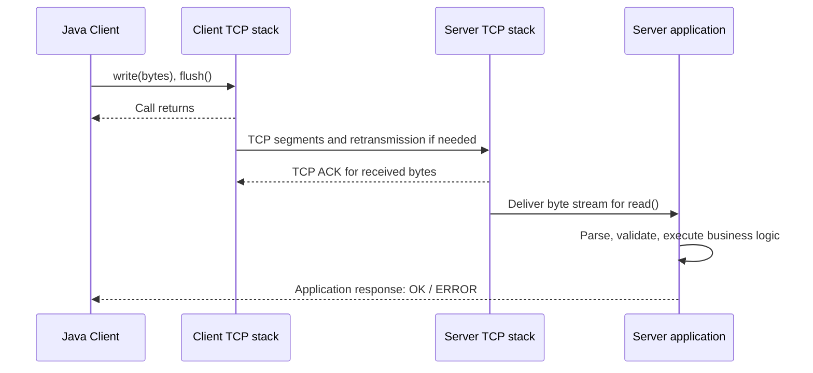
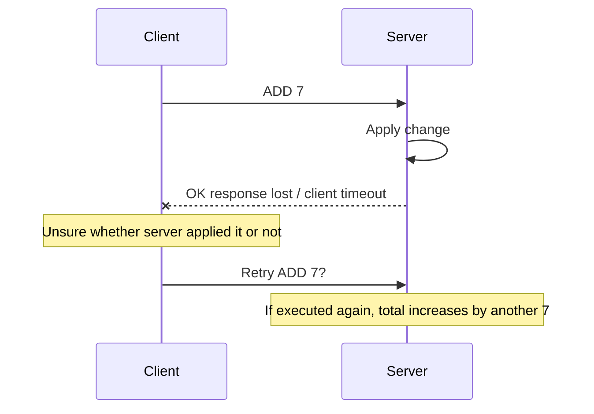

# Sending Successfully Over TCP Differs from Application-Layer Processing Success

## 1. The Problem: `write()` Succeeds, Business Logic Still Fails

Suppose a Java application sends the command `ADD 7` over a TCP connection. Both `OutputStream.write(...)` and `flush()` return normally. What can the client conclude?

- It knows that **the client-side write call did not report an error** at that moment.
- It **does not yet know for sure** whether the data has reached the server application, been fully read as a complete message, passed syntax validation, or been processed according to business rules.
- Only when the server returns a meaningful response such as `OK APPLIED TOTAL=7` does the client have **application-layer evidence** that the server *reported* the operation was applied according to the protocol contract. Guarantees regarding durability, transactions, or queryability still depend on the server design.

This is an important boundary in the **“Messages over TCP”** topic: TCP supports transporting a **byte stream**, whereas the **application protocol** must define messages, validation, business execution, state, and responses.

A common mistake is seeing `write()`/`flush()` not throw an exception and logging “order created” or “payment completed”. Without corresponding processing evidence from the server, that conclusion goes beyond what the socket API proves.

After this lesson, you will understand the levels of “success”, the meaning of TCP ACK, the limits of `write`/`flush`/`close`, how to design application responses, handle timeouts and retries, along with a runnable Java 17 example.

## 2. Different Levels of Acknowledgment Along a Message's Path

Consider a TCP client and server:



The diagram separates the logical steps. In practice, the operating system has buffers, segments can be coalesced or split, read/write calls do not pair one-to-one, and TCP ACKs may occur at different times from the `write` call.

| Observation Point | Confirming Party | What Can Be Concluded | What Is **Not Yet** Guaranteed |
|---|---|---|---|
| `OutputStream.write` returns successfully | Client-side write API | The write call completed without reporting an error; data was accepted according to the semantics of the relevant stream/buffer | Whether the remote application has received or processed the data |
| `BufferedOutputStream.flush` or `BufferedWriter.flush` returns | Client-side buffer API | Data buffered at the `Buffered*` layer was pushed down to the underlying stream without error | Whether bytes have traversed the network, been read by the server, or business logic has completed |
| Peer's TCP ACK | Receiving TCP stack | The receiving TCP has acknowledged the bytes according to TCP's sequence/ACK mechanism | Whether the application thread has called `read`; whether the frame is valid; whether the transaction has committed |
| Server `read`s a complete frame | Server application | The application has received data that can be parsed according to framing | Whether the data is valid per business rules; whether the operation has been executed |
| Server sends `ERROR ...` | Application protocol | The server reports that it does not accept or cannot process the command under the contract | Should not be interpreted as a network transmission error |
| Server sends `OK APPLIED ...` | Application protocol | The server **claims** it has applied the operation with the guarantee level defined by the contract | Not automatically durable across crashes or replicated across nodes |
| Server confirms after durable commit (if applicable) | Application/storage system | Additional guarantee of durable write according to the contract | Not automatically “exactly once” for all external side effects |

**There is no rule that “TCP ACK = application success”.** TCP ACK is a **transport-layer** mechanism confirming byte reception according to TCP protocol state; it has no idea what “order”, “record”, “SQL statement”, or “payment” means.

## 3. Exact Meaning of Operations in Java Socket

### 3.1. `write` and `flush`

With `Socket.getOutputStream()`, a developer can call:

```java
// Illustrative code; socket is already connected and owned by the caller to close.
OutputStream out = socket.getOutputStream();
out.write("PING\n".getBytes(StandardCharsets.UTF_8));
out.flush();
```

The snippet above **is not a standalone program**. It indicates that a local write/flush did not report an error if it ran normally. That **does not mean** the server has finished processing `PING`. Specifically, an `OutputStream` obtained directly from a socket does not “flush all data across the network” in the sense of waiting for an ACK or waiting for business logic; `flush` only has stream-class-dependent meaning. When using `BufferedWriter` or `BufferedOutputStream`, `flush` pushes data stored in the **writer/stream buffer** down to the underlying layer.

Because TCP has a **kernel send buffer** and asynchronous transmission mechanisms, a write call can complete before all bytes actually traverse the network or before the remote application reads them. If the connection breaks or the peer closes abruptly, the error may surface **on a subsequent operation**, or the client may fail to receive an application acknowledgment.

**“Socket is still connected” is also not enough:** `Socket.isConnected()` indicates that the socket **was once connected successfully**, not a continuous liveness check. `isClosed()` mainly reflects the local closing state.

### 3.2. `read` and framing

TCP is a **continuous byte stream** and does not preserve individual application message boundaries. For example, a client writes `HEL` and then `LO\n`; the server may read them as one or multiple different chunks. A client sending two commands in a single `write` also does not force the server to receive “two messages” in a single `read`.

The application protocol must specify **framing**: each message ends with `\n`; or has a length prefix; or uses the framing structure of HTTP/2, HTTP/3, WebSocket, etc. When reading from `InputStream`, the return value is:

- A positive number: the number of bytes received in that read call.
- `-1`: **end-of-stream (EOF)** has been reached after all available data was consumed.
- With regular `InputStream.read(byte[])` and a non-empty buffer: you must not assume a single read always returns the entire message.

`BufferedReader.readLine()` can return `null` when encountering EOF with no remaining characters; a line without a trailing `\n` can also be returned at EOF. Therefore, the protocol needs to specify whether a final line missing a delimiter is accepted, length limits, and how to handle incomplete data. In the example, the client always sends a newline and the server expects a fixed number of requests.

### 3.3. `close`, `shutdownOutput`, and FIN/RST

`close()` and `shutdownOutput()` affect the **connection/stream lifecycle**, and do not mean “the server successfully recorded the order”. A TCP FIN indicates one side will no longer send more bytes; it is not an application acknowledgment. A TCP RST or an exception during send/read reports a transport error, but **does not always indicate how much the server managed to process** before the failure.

Do not use “called `close` without exception” as a substitute for a business confirmation response.

### 3.4. Which Phase Does a Timeout Belong To?

| Setting | Typical Scope |
|---|---|
| `socket.connect(endpoint, timeoutMs)` | Waiting for **TCP connection establishment** |
| `socket.setSoTimeout(timeoutMs)` | Waiting for a **blocking read** on the socket |
| `BufferedWriter.flush()` | Pushing the application buffer to the underlying stream; not a deadline for waiting on a response |
| Overall business deadline | Must be designed on the client/framework side; includes connect, send, processing, read, and retry time |

If `readLine()` encounters a `SocketTimeoutException` after the client has sent a command, **you cannot conclude from the timeout alone that the server has not executed the command**. The server may have finished processing, while the response was delayed, lost, or the connection was closed before the client received it.

## 4. The Application Protocol Must Specify What “Success” Means

Suppose an application needs a simple text protocol over TCP:

```text
Request:  ADD <positive-integer>\n
Success:  OK APPLIED TOTAL=<sum>\n
Failure:  ERROR INVALID_AMOUNT\n
```

In the illustrative contract:

- `ADD -3` is a message that **can be sent over TCP**, but it violates the business rule “only accept positive numbers”, so the server returns `ERROR INVALID_AMOUNT`.
- `ADD 7` is valid; the server adds `7` to an in-memory variable and returns `OK APPLIED TOTAL=7`.
- `OK APPLIED` only confirms that **a variable in the server process** was updated before generating the response. The example **has no database or durable storage**; if the server crashes, state in RAM can be lost.
- The client must **read and understand the response**. Merely sending a command without waiting for a response does not tell whether the business operation succeeded or failed.

A real-world protocol also needs to define versioning, encoding, maximum message length, authentication, idempotency, correlation/request IDs, unknown command errors, timeouts, and connection-closing rules.

If a project uses HTTP, response semantics are determined by **HTTP semantics + API contract**: `202 Accepted` typically indicates the request was accepted for processing but is not necessarily completed; `200 OK` can represent various kinds of results, and you still need to examine the payload/API contract. Do not infer a durable commit or exactly-once execution from a 2xx status code alone.

## 5. Java 17+ Example: Write Succeeds, First Command Rejected, Second Command Applied

The following program runs **offline** on loopback, within the same JVM, though client and server use two TCP sockets and two different threads. It sends two commands over the same connection. Both `write`/`flush` calls complete, but only the valid command mutates application state.

Create the file **`TransportVsApplicationDemo.java`**:

```java
import java.io.BufferedReader;
import java.io.BufferedWriter;
import java.io.EOFException;
import java.io.InputStreamReader;
import java.io.OutputStreamWriter;
import java.net.InetAddress;
import java.net.ServerSocket;
import java.net.Socket;
import java.nio.charset.StandardCharsets;
import java.util.concurrent.ExecutorService;
import java.util.concurrent.Executors;
import java.util.concurrent.Future;
import java.util.concurrent.TimeUnit;

public class TransportVsApplicationDemo {

    public static void main(String[] args) throws Exception {
        ExecutorService workers = Executors.newSingleThreadExecutor();

        try (ServerSocket listener = new ServerSocket(
                0, 1, InetAddress.getLoopbackAddress())) {

            Future<Integer> serverResult = workers.submit(() -> {
                try (Socket peer = listener.accept()) {
                    peer.setSoTimeout(3_000);
                    BufferedReader in = new BufferedReader(
                            new InputStreamReader(peer.getInputStream(),
                                    StandardCharsets.UTF_8));
                    BufferedWriter out = new BufferedWriter(
                            new OutputStreamWriter(peer.getOutputStream(),
                                    StandardCharsets.UTF_8));

                    int total = 0;
                    for (int i = 0; i < 2; i++) {
                        String command = in.readLine();
                        if (command == null) {
                            throw new EOFException("Missing command");
                        }

                        if (command.equals("ADD -3")) {
                            out.write("ERROR INVALID_AMOUNT\n");
                        } else if (command.equals("ADD 7")) {
                            total += 7;
                            out.write("OK APPLIED TOTAL=" + total + "\n");
                        } else {
                            out.write("ERROR BAD_COMMAND\n");
                        }
                        out.flush();
                    }
                    return total;
                }
            });

            try (Socket client = new Socket(
                    InetAddress.getLoopbackAddress(),
                    listener.getLocalPort())) {
                client.setSoTimeout(3_000);
                BufferedReader in = new BufferedReader(
                        new InputStreamReader(client.getInputStream(),
                                StandardCharsets.UTF_8));
                BufferedWriter out = new BufferedWriter(
                        new OutputStreamWriter(client.getOutputStream(),
                                StandardCharsets.UTF_8));

                out.write("ADD -3\n");
                out.flush();
                System.out.println("write/flush returned: ADD -3");
                System.out.println(
                        "Application response: " + in.readLine());

                out.write("ADD 7\n");
                out.flush();
                System.out.println("write/flush returned: ADD 7");
                System.out.println(
                        "Application response: " + in.readLine());
            }

            System.out.println("Server final total: "
                    + serverResult.get(3, TimeUnit.SECONDS));
        } finally {
            workers.shutdownNow();
        }
    }
}
```

Compile and run with JDK 17 or later:

```bash
javac -encoding UTF-8 TransportVsApplicationDemo.java
java TransportVsApplicationDemo
```

Output in an environment that allows loopback TCP sockets:

```text
write/flush returned: ADD -3
Application response: ERROR INVALID_AMOUNT
write/flush returned: ADD 7
Application response: OK APPLIED TOTAL=7
Server final total: 7
```

**Accurate interpretation:**

1. `ServerSocket` opens an OS-assigned loopback port (`0`), and the server task waits on `accept()`.
2. The client sends `ADD -3\n` using `BufferedWriter`; `flush` pushes the writer buffer to the socket and returns normally. The program prints “write/flush returned” as a **local observation**, not proof of remote business success.
3. The server reads the complete line, checks the business rule, and sends `ERROR INVALID_AMOUNT`. Only after the client **reads the application response** does it know the operation was rejected. The `total` variable remains `0`.
4. The client sends `ADD 7\n`; the write call also returns normally. The server reads the full frame and updates `total` to `7` **before** sending `OK APPLIED TOTAL=7`.
5. The client receives `OK APPLIED TOTAL=7`. `Future.get` returns the server-side `total` of `7`, allowing us to observe the actual state in the example.
6. `setSoTimeout` prevents read operations from blocking indefinitely; `try-with-resources` closes the sockets. This is only a single-connection, two-command demo, without TLS, authentication, a database, durable commits, or automatic retries.

**Takeaway from the output itself:** both “write/flush returned” lines appear; one request results in `ERROR`, and the other results in `OK`. The two application outcomes **differ** even though the client-side write calls **both reported no errors**.

### Why Not Create an Example Where “the Server TCP-ACKed but Has Not Processed Yet”?

In real operation, TCP ACKs are generated by the TCP stack, not by the Java business handler. Accurately measuring individual TCP ACKs requires observing traffic/stack behavior and is affected by the OS, buffers, delayed ACKs, or offloading. Intentionally sleeping the server and having `write` succeed **does not directly measure** TCP ACK. Therefore, the example above strictly proves the core lesson: **a write API returning without error does not imply business success**.

## 6. When a Response Is Lost: State May Be Indeterminate

A harder problem is:



When a client has sent a request and timed out waiting for a response, there are at least these possibilities: the server has not received the full frame, the server received it but has not processed it yet, the server processed it and then failed before replying, or the server replied but the client did not receive it. **The same client-side timeout symptom is not enough to distinguish those possibilities.**

Therefore, you should separate three observable states:

| State Known by Client | Meaning | Next Step |
|---|---|---|
| **Confirmed success by server** | Definite application response received per contract | Record success at the contract-promised level |
| **Confirmed rejection by server** | Definite business error response received, e.g., `INVALID_AMOUNT` | Fix input/display error; do not blindly retry the same payload |
| **No final result received** | Only a network error, timeout, or closed connection before receiving a response | Mark state as *unknown*, query by request ID, reconcile, or use safe retry |

You should not log “failed” as if the server definitely did nothing after a read timeout. Nor should you log “success” just because `write` succeeded. For commands with side effects, **unknown outcome** is a design state that must be handled explicitly.

### Request Identifiers and Idempotency

For APIs that create orders, debit funds, or perform critical updates:

1. The client attaches a stable **idempotency key/request ID** for a single business intent.
2. The server stores/checks the key along with the result or processing status under an appropriate transaction policy.
3. When the client times out, it can **query status** by ID or retry with the **same ID** to avoid executing twice if the server provides corresponding idempotency guarantees.
4. The server must define key retention duration, how to handle concurrent duplicate requests in flight, and how to distinguish a retry with the same payload from the same key with a different payload.

**Idempotency does not appear automatically from TCP, HTTP, or an arbitrary ID.** It is an application-layer commitment and must be implemented properly at the point where side effects execute. For systems with databases, queues, or third-party services, end-to-end “exactly once” also requires transaction/reconciliation architecture; it should not be promised solely from a TCP ACK or an `OK` response.

## 7. Confirmation Level Also Depends on the Business Contract

Two servers can both return `OK` yet mean different things:

- **Received:** a syntactically valid message was received, not necessarily enqueued.
- **Accepted/Queued:** accepted or queued for processing; the work may not have run yet.
- **Processed/Applied:** business logic has run under a specific definition; not necessarily durably persisted.
- **Committed/Durable:** the change has been confirmed committed by the storage system at the described durability level.
- **Replicated/Delivered downstream:** may be another confirmation level in distributed systems, depending on replica count and downstream components.

There is no single universal `OK` for all these levels. The protocol must state clearly: which response marks **final success**, which response only indicates **asynchronous processing acceptance**, and what the client must do while status is still pending.

For example, HTTP `202 Accepted` usually indicates the request was accepted for processing but **has not yet completed**. A `200 OK` reflects success according to the request's semantics, but the contract must still specify whether data was committed. For a POST creating a resource, `201 Created` indicates the resource was created under HTTP semantics, while specific storage/durability guarantees still depend on the system.

## 8. Guidelines for Designing a TCP Protocol with Application Acknowledgments

When building your own TCP socket application (chat server, command protocol, telemetry, or internal service), clarify:

- **Framing:** delimiter, length prefix, maximum size, encoding, and behavior on partial frames. Do not rely on `write`/`read` call counts as message boundaries.
- **Correlation:** message IDs to match responses with requests, especially when pipelining or concurrency is present.
- **Semantics:** what each command does, validation, state, business error cases, and stable error codes.
- **Application-layer ACK:** emit only when reaching a contract-defined state milestone (received/queued/processed/committed); do not confuse with TCP ACK.
- **Timeouts:** set connect timeout, read/request timeout, and overall deadline; define the unknown state when a response is missing.
- **Retry:** retry only when semantically safe, or when idempotency/deduplication exists. Exponential backoff and jitter can help reduce load, but do not replace correctness.
- **Liveness and cleanup:** handle EOF, half-close, connection loss, resource limits, and graceful shutdown. `isConnected()` does not replace an application health check.
- **Security:** use TLS/authentication where appropriate, authorization, and input/logging limits. TCP's reliable byte ordering does **not** guarantee a trustworthy data source or valid content.
- **Observability:** track “bytes written”, “TCP connected”, “request received”, “validated”, “applied”, “committed”, “response sent”, and “response received” separately. They are distinct events.

If the system uses HTTP, Java `HttpClient`/frameworks often help handle the wire protocol; however, you must still decide which API outcome counts as success and how to handle indeterminate outcomes.

## 9. Common Misconceptions

| Misconception | Accurate Understanding |
|---|---|
| “`write()` returned, so the server received the message.” | Write completed at the local API; data may still be in buffers/in flight and unread by the remote side. |
| “`flush()` synchronized with the server.” | For buffered writers, flush pushes data to the underlying stream; there are no semantics for waiting on server processing. |
| “TCP ACK is an application ACK.” | TCP's ACK reflects byte transmission state at the TCP stack; an app ACK is defined by the business protocol. |
| “TCP delivers each message intact per `write`.” | TCP is a byte stream; framing must be used to delimit messages. |
| “`readLine()` returning data means business logic is done.” | The application has only read a frame; parsing/validation/execution/commit depend on the contract. |
| “Closing the socket normally means the transaction succeeded.” | EOF/FIN is not a confirmation of business processing. |
| “Timeout = server did not process; retry is definitely safe.” | The server may have processed it and lost the response; you must manage unknown outcomes and idempotency. |
| “HTTP `200`/`202` means data was durably saved.” | You must check status semantics and the specific contract; `202` does not mean work is finished. |
| “Sent over TCP, so it will definitely execute only once.” | TCP guarantees a byte stream within one connection; it does not provide deduplication for business commands across connections/retries. |
| “Server `write OK` means the client received the response.” | The response may be lost or the client may have timed out; the server also does not automatically know whether the client interpreted the result. |

## 10. Self-Check and Answers

**Question 1.** The client calls `BufferedWriter.write("ADD -3\n")`, and `flush()` throws no exception. Can it log “business operation succeeded”?

**Answer:** No. Those calls confirm that the local write/flush operations reported no errors. An application response is required, and the server may reject it because of the negative input.

**Question 2.** What does a TCP ACK confirm?

**Answer:** It confirms that bytes were received by the peer's TCP stack according to the sequence/ACK mechanism; it does not confirm that the handler has read, validated, processed, or committed them.

**Question 3.** Why must there be a delimiter or length prefix?

**Answer:** Because TCP is a continuous byte stream; a single write and a single read do not create message boundaries. Framing allows the server to know when it has received a complete request.

**Question 4.** A client sends an order-creation command and hits a read timeout. Can it assert that the order was not created?

**Answer:** No. The outcome may be **unknown**; you need to use a request ID, query status, or retry safely according to the contract/idempotency.

**Question 5.** The server returned `OK APPLIED` but the data is only held in RAM. Is recovery after a crash guaranteed?

**Answer:** No. This is the application confirming that the operation was applied **in memory**; a durable commit requires additional storage design and separate confirmation.

**Question 6.** Can `Socket.isConnected()` replace an application health check?

**Answer:** No. This property only indicates that the socket **was once** connected successfully. An appropriate heartbeat/health-check protocol or request/response is needed to check actual liveness.

**Question 7.** If the server writes a response without error, can the server conclude that the client received and recorded the business outcome?

**Answer:** No. The server needs an application acknowledgment from the client if it wants to know the client processed the response; and even that ACK can be lost. Designs must bound the guarantees on each side.

## 11. Key Takeaways

**Transport-layer success and application-layer success are two different commitments.** TCP provides an ordered byte stream and ACK/retransmission mechanisms; Java `write`/`flush` only report the status of the local write call. Only the **application** understands what command a message represents, whether it is valid, how far it has been processed, and what response to return. If a response is lost, the state may be indeterminate; handling it properly requires a contract, request IDs, idempotency, and reconciliation at the level appropriate for the business domain.

References: Java SE 17 API for `java.net.Socket`, `java.io.OutputStream`, `java.io.BufferedWriter`, `java.io.InputStream`; RFC 9293 (*Transmission Control Protocol*); RFC 9110 (*HTTP Semantics*).