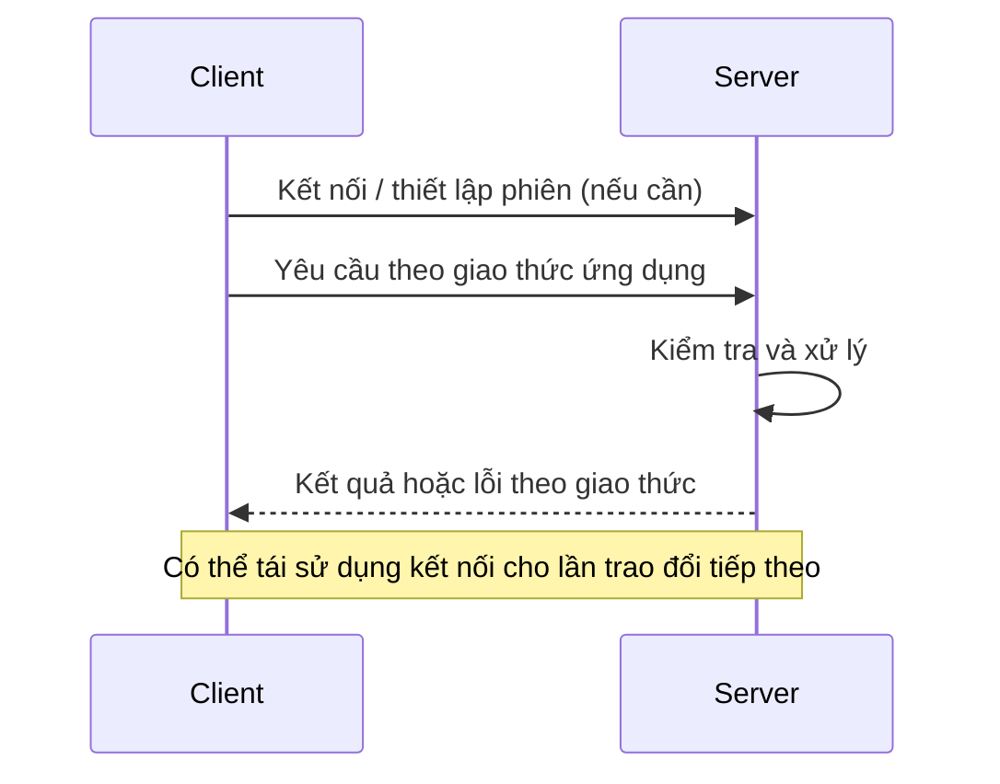

# Mô hình máy khách–máy chủ và vai trò của giao thức ứng dụng

## 1. Bức tranh tổng thể và mục tiêu

Khi một ứng dụng Java lấy dữ liệu từ API, trình duyệt mở trang web, hoặc ứng dụng trò chuyện gửi tin nhắn, thường có hai câu hỏi khác nhau:

- **Ai yêu cầu, ai cung cấp dịch vụ?** Đây là câu hỏi về **mô hình máy khách–máy chủ (client–server)**.
- **Hai phía hiểu thông điệp và phối hợp hành động như thế nào?** Đây là câu hỏi về **giao thức ứng dụng (application protocol)**.

Sau bài này, bạn cần giải thích được vai trò client/server, mô tả một vòng giao tiếp qua mạng, phân biệt giao thức ứng dụng với TCP/UDP/IP/TLS, đọc một trao đổi HTTP đơn giản và tự xây một giao thức ứng dụng nhỏ bằng Java.

**Điểm cốt lõi:** Mô hình client–server phân chia *vai trò*; giao thức ứng dụng xác định *quy tắc trao đổi*. Hai khái niệm bổ sung nhau nhưng không đồng nghĩa.

## 2. Mô hình client–server: vai trò và trách nhiệm

**Client** là chương trình khởi xướng việc sử dụng một dịch vụ, chẳng hạn gửi yêu cầu lấy thông tin sản phẩm. **Server** là chương trình cung cấp dịch vụ, lắng nghe hoặc tiếp nhận yêu cầu, xử lý và gửi lại kết quả. Một server thường phục vụ nhiều client; một client có thể kết nối nhiều server.

Ví dụ với dịch vụ thư viện:

| Thành phần | Vai trò trong lần giao tiếp |
|---|---|
| Ứng dụng Java gọi `GET /books/42` | Client: tạo yêu cầu, gửi, chờ/nhận và xử lý kết quả |
| Dịch vụ API xử lý `/books/42` | Server: nhận yêu cầu, xác thực/kiểm tra, truy xuất dữ liệu và phản hồi |
| Cơ sở dữ liệu do API gọi | Server đối với API; chính API lại đóng vai client của cơ sở dữ liệu |
| Reverse proxy trước API | Server đối với client ngoài; client đối với dịch vụ phía sau |

Vai trò **gắn với một tương tác**, không gắn vĩnh viễn với một máy. Cùng một chương trình có thể vừa làm server ở một hướng vừa làm client ở hướng khác. Client/server cũng có thể chạy trên **cùng máy** (ví dụ `localhost`); kết nối mạng không bắt buộc đi qua Internet.

Trong ứng dụng truyền thống, server có thể chờ kết nối tại một **địa chỉ IP + cổng** (endpoint), còn client chủ động kết nối. Ví dụ `127.0.0.1:8080` chỉ tới cổng 8080 trên chính máy đó. Cổng giúp hệ điều hành phân phối lưu lượng đến đúng dịch vụ; nó không tự mô tả giao thức hay nội dung nghiệp vụ. `8080` thường được dùng khi phát triển web nhưng không phải đặc tính bắt buộc của HTTP.

Một luồng yêu cầu–phản hồi điển hình:



**Yêu cầu–phản hồi không phải mô hình duy nhất.** Một server có thể gửi sự kiện trên kết nối đã mở (Server-Sent Events), hai phía có thể trao đổi hai chiều sau khi thiết lập WebSocket, và một tác vụ có thể được trả lời bất đồng bộ. Cách trao đổi cụ thể do giao thức và thiết kế ứng dụng quyết định.

## 3. Điều gì xảy ra khi client gọi một dịch vụ?

Xét địa chỉ `https://api.example.test/books/42` (tên miền minh họa, không phải một API đang chạy):

1. **Xác định đích:** client phân tích URL thành scheme `https`, host `api.example.test`, đường dẫn `/books/42` và cổng mặc định 443 nếu URL không ghi cổng khác.
2. **Tìm địa chỉ:** hệ thống có thể tra DNS để biết địa chỉ IP của host; kết quả có thể đã được lưu trong cache, nên không nhất thiết truy vấn DNS mỗi lần.
3. **Thiết lập giao tiếp:** với HTTP/1.1 hoặc HTTP/2 qua HTTPS, thông thường client kết nối TCP rồi thương lượng TLS. Với HTTP/3, HTTP chạy trên QUIC qua UDP; QUIC tích hợp bảo mật TLS 1.3 và có cơ chế thiết lập kết nối riêng.
4. **Gửi yêu cầu ứng dụng:** client gửi phương thức, đường dẫn, các header và body nếu có theo định dạng của phiên bản HTTP đang dùng.
5. **Server xử lý:** thành phần nhận yêu cầu có thể định tuyến qua reverse proxy, xác thực, gọi dịch vụ khác hoặc truy vấn cơ sở dữ liệu.
6. **Phản hồi:** server trả trạng thái, metadata và nội dung; client diễn giải phản hồi theo HTTP và hợp đồng API.
7. **Tiếp tục hoặc kết thúc:** tùy giao thức, trạng thái kết nối và cấu hình, kết nối có thể được tái sử dụng hoặc đóng.

Các bước là **mô hình logic**: cache, proxy, connection pooling, DNS cache và các phiên bản HTTP có thể thay đổi số lần trao đổi thực tế. Độ trễ cảm nhận còn phụ thuộc vào xử lý server, đường truyền, kích thước dữ liệu và việc có phải thiết lập kết nối mới hay không.

### Lớp nào giải quyết việc gì?

| Lớp/cơ chế | Trả lời câu hỏi | Điều cần nhớ |
|---|---|---|
| IP (mạng) | Gói dữ liệu đi đến thiết bị nào qua mạng? | Địa chỉ IP và định tuyến; bản thân IP không bảo đảm giao hàng |
| TCP (vận chuyển) | Làm sao có luồng byte đáng tin cậy, đúng thứ tự? | TCP không giữ ranh giới từng thông điệp ứng dụng |
| UDP (vận chuyển) | Làm sao chuyển datagram với ít cơ chế ở tầng vận chuyển? | UDP không tự bảo đảm giao hàng, thứ tự hoặc chống trùng |
| QUIC (vận chuyển trên UDP) | Làm sao có các stream tin cậy và kết nối bảo mật phục vụ ứng dụng như HTTP/3? | Không đồng nhất QUIC với UDP thuần |
| TLS (bảo mật) | Làm sao bảo vệ tính bí mật/toàn vẹn và xác thực phía máy chủ theo chứng chỉ? | HTTPS qua TCP dùng TLS; HTTP/3 tích hợp TLS 1.3 trong QUIC |
| HTTP, DNS, SMTP, WebSocket… (ứng dụng) | Thông điệp có nghĩa gì và các bên phải làm gì? | Định nghĩa cú pháp, ngữ nghĩa và quy tắc tương tác |

**TCP thành công không có nghĩa yêu cầu nghiệp vụ thành công.** Kết nối TCP có thể truyền đủ byte nhưng server vẫn trả HTTP `404`, `409`, `500`, hoặc phản hồi ứng dụng báo dữ liệu không hợp lệ. Ngược lại, khi client timeout, không thể luôn kết luận server chưa xử lý: có thể server đã hoàn tất nhưng phản hồi bị mất hoặc đến quá muộn.

## 4. Giao thức ứng dụng là một hợp đồng giao tiếp

Một giao thức ứng dụng xác định những điều cần để hai chương trình độc lập có thể hiểu và phối hợp với nhau:

1. **Định dạng (syntax):** thông điệp là text hay binary, trường nào bắt buộc, cách mã hóa ký tự, cách nhận ra điểm bắt đầu/kết thúc.
2. **Ý nghĩa (semantics):** `GET`, `POST` hay lệnh `HELLO` nghĩa là gì; thao tác nào hợp lệ; điều gì được xem là thành công.
3. **Trình tự (interaction):** bên nào gửi trước; có cần handshake, đăng nhập, giữ phiên hay xác nhận nhận tin không.
4. **Kết quả/lỗi:** mã trạng thái, cấu trúc phản hồi, cách biểu diễn lỗi và điều kiện client có thể thử lại.
5. **Khả năng tương thích:** phiên bản, trường mở rộng, cách xử lý thông điệp/trường không được hỗ trợ.
6. **Bảo mật ở phạm vi ứng dụng:** định danh người gọi, quyền truy cập, dữ liệu được phép lộ và giới hạn đầu vào (cùng với bảo mật đường truyền khi cần).

Một cặp chương trình **không tự hiểu nhau** chỉ vì dùng chung TCP: nếu server mong một dòng `HELLO Ada\n` mà client gửi JSON hoặc HTTP, server chưa có lý do để hiểu thông điệp. Đó là lỗi giao thức ứng dụng, không phải lỗi định tuyến IP.

### Ví dụ giao thức HTTP

HTTP mô tả cách diễn đạt một yêu cầu và phản hồi, trong đó có phương thức, target, header, body và status. Đây là cách *minh họa dạng text* cho một lần trao đổi HTTP/1.1 (trên wire, các dòng header dùng CRLF và kết thúc header bằng dòng trống):

```http
GET /health HTTP/1.1
Host: api.example.test
Accept: application/json

```

```http
HTTP/1.1 200 OK
Content-Type: application/json
Content-Length: 15
Connection: close

{"status":"ok"}
```

Trong ví dụ này:

- `GET /health` nói client muốn lấy trạng thái dịch vụ; `Host` xác định host đích trong HTTP/1.1.
- `200 OK` thể hiện thành công ở tầng HTTP, còn ý nghĩa chi tiết của JSON do **hợp đồng API** định nghĩa.
- `Content-Type` giúp bên nhận biết kiểu nội dung; `Content-Length: 15` là số **byte** của body UTF-8 minh họa `{"status":"ok"}`, không tính header.
- Header/body là những thành phần của giao thức; JSON chỉ là **định dạng dữ liệu** có thể chứa trong body. **REST** là phong cách thiết kế API với các ràng buộc riêng, không phải tên khác của HTTP.

HTTP có nhiều phiên bản: HTTP/2 và HTTP/3 không mã hóa message trên mạng dưới dạng dòng text giống HTTP/1.1, dù các khái niệm method, status, header và semantics vẫn được duy trì. Không lấy bản in HTTP/1.1 phía trên làm mô tả byte-level của HTTP/2 hoặc HTTP/3.

### Các giao thức ứng dụng thường gặp

| Giao thức | Mục đích và kiểu trao đổi thường gặp |
|---|---|
| HTTP/HTTPS | Tài nguyên web, API; request/response, có thể stream; HTTPS là HTTP trên kênh bảo mật thích hợp |
| DNS | Ánh xạ và truy vấn thông tin tên miền; thường dùng UDP, cũng dùng TCP và các biến thể bảo mật |
| SMTP | Chuyển thư điện tử giữa các hệ thống; có lệnh và mã phản hồi |
| WebSocket | Sau bước thiết lập, cho phép nhắn tin hai chiều trên một kết nối |
| MQTT | Publish/subscribe qua broker, phổ biến trong thiết bị/IoT |
| gRPC | Framework RPC với giao thức wire và quy ước dịch vụ; thường dùng HTTP/2 và Protocol Buffers |

**Đừng nhầm vai trò và công nghệ:** một API có thể dùng HTTP, nhưng HTTP không tự xác định endpoint `/books/42` trả những trường nào; đó là hợp đồng cụ thể của API. Tương tự, đổi JSON sang Protocol Buffers không tự biến TCP thành một giao thức ứng dụng mới.

## 5. Đặc biệt quan trọng khi làm mạng với Java: TCP là luồng byte

Giả sử client hai lần gọi `OutputStream.write(...)` để gửi `HELLO ` và `Ada\n`. Server có thể nhận chúng trong một lần đọc, vài lần đọc, hoặc theo các đoạn khác. **Ranh giới của từng lệnh `write` không được TCP bảo toàn thành ranh giới message.**

Vì thế, giao thức ứng dụng chạy trên TCP phải tự định nghĩa cách tách thông điệp (**framing**), ví dụ:

- **Dấu kết thúc:** mỗi thông điệp kết thúc bởi `\n`; phải quy định cách xử lý nếu payload chứa xuống dòng.
- **Tiền tố độ dài:** gửi số byte của message trước, sau đó đọc chính xác số byte đó; cần kiểm tra độ dài tối đa.
- **Định dạng có quy tắc riêng:** HTTP/1.1 dùng các quy tắc xác định độ dài body như `Content-Length` hoặc chunked transfer coding; HTTP/2 và HTTP/3 có framing nhị phân của mình.

Trong mọi trường hợp, phía nhận phải xử lý dữ liệu chưa đủ, kết nối đóng sớm, timeout và input không hợp lệ. Chỉ gọi `read()` một lần rồi giả định đã nhận trọn message là lỗi phổ biến.

## 6. Ví dụ Java 17+: client và server dùng một giao thức nhỏ

Ta tự định nghĩa một giao thức học tập **LINE/1** qua TCP, một yêu cầu cho mỗi kết nối:

| Phía gửi | Dạng thông điệp (UTF-8, kết thúc bằng byte LF) | Ý nghĩa |
|---|---|---|
| Client | `HELLO <name>\n` | Chào server với tên không rỗng |
| Server | `WELCOME <name>\n` | Chấp nhận lời chào |
| Server | `ERROR BAD_REQUEST\n` | Yêu cầu không hợp lệ |

Đây **không phải giao thức chuẩn**. Nó chỉ minh họa vì sao hai phía cần thống nhất framing (LF), encoding (UTF-8), cú pháp (lệnh và tên), semantics (chào/đáp) và lỗi. Ví dụ chạy server và client trên loopback trong **cùng một chương trình** để không cần Internet và cho kết quả lặp lại được.

Tạo file `ClientServerProtocolDemo.java`:

```java
import java.io.BufferedReader;
import java.io.BufferedWriter;
import java.io.InputStreamReader;
import java.io.OutputStreamWriter;
import java.net.InetAddress;
import java.net.ServerSocket;
import java.net.Socket;
import java.nio.charset.StandardCharsets;
import java.util.concurrent.ExecutorService;
import java.util.concurrent.Executors;
import java.util.concurrent.Future;
import java.util.concurrent.TimeUnit;

public class ClientServerProtocolDemo {
    public static void main(String[] args) throws Exception {
        ExecutorService executor = Executors.newSingleThreadExecutor();

        try (ServerSocket listener = new ServerSocket(
                0, 1, InetAddress.getLoopbackAddress())) {

            Future<String> serverReceived = executor.submit(() -> {
                try (Socket peer = listener.accept()) {
                    peer.setSoTimeout(3_000);
                    BufferedReader in = new BufferedReader(
                            new InputStreamReader(
                                    peer.getInputStream(), StandardCharsets.UTF_8));
                    BufferedWriter out = new BufferedWriter(
                            new OutputStreamWriter(
                                    peer.getOutputStream(), StandardCharsets.UTF_8));

                    String request = in.readLine(); // đọc đến LF
                    String response;
                    if (request != null
                            && request.startsWith("HELLO ")
                            && !request.substring(6).isBlank()) {
                        response = "WELCOME " + request.substring(6);
                    } else {
                        response = "ERROR BAD_REQUEST";
                    }

                    out.write(response);
                    out.write('\n');  // LF cố định theo LINE/1
                    out.flush();
                    return request;
                }
            });

            try (Socket client = new Socket(
                    InetAddress.getLoopbackAddress(), listener.getLocalPort())) {
                client.setSoTimeout(3_000);
                BufferedReader in = new BufferedReader(
                        new InputStreamReader(
                                client.getInputStream(), StandardCharsets.UTF_8));
                BufferedWriter out = new BufferedWriter(
                        new OutputStreamWriter(
                                client.getOutputStream(), StandardCharsets.UTF_8));

                out.write("HELLO Ada\n");
                out.flush();

                System.out.println("Client sent: HELLO Ada");
                System.out.println("Client received: " + in.readLine());
            }

            System.out.println("Server received: "
                    + serverReceived.get(3, TimeUnit.SECONDS));
        } finally {
            executor.shutdownNow();
        }
    }
}
```

Biên dịch và chạy trên JDK 17 trở lên, tại thư mục chứa file:

```bash
javac ClientServerProtocolDemo.java
java ClientServerProtocolDemo
```

Kết quả chuẩn trong điều kiện máy cho phép kết nối TCP loopback:

```text
Client sent: HELLO Ada
Client received: WELCOME Ada
Server received: HELLO Ada
```

**Giải thích theo vai trò:**

1. `ServerSocket(0, 1, loopback)` mở một cổng TCP tạm do hệ điều hành chọn; `getLocalPort()` cung cấp cổng thật để client kết nối. Tham số `1` là backlog được đề nghị, không phải giới hạn tổng số client của một dịch vụ thực tế.
2. Server chạy trong một task riêng để có thể chờ `accept()` trong lúc luồng chính mở `Socket` client. Hai phía cùng máy nhưng vẫn có hai **vai trò logic**.
3. Client gửi byte UTF-8 của `HELLO Ada\n` và `flush()` để đẩy nội dung đang đệm. Server dùng `readLine()` để đọc đúng một frame kết thúc bằng LF.
4. Server kiểm tra lệnh, tạo thông điệp `WELCOME Ada\n` và gửi lại. Client đọc phản hồi, còn `Future.get()` cho phép luồng chính xác nhận server đã nhận dòng nào.
5. `try-with-resources` đóng các socket; `setSoTimeout` hạn chế thời gian chờ thao tác đọc. Đây là một lần giao tiếp, không phải server sẵn sàng phục vụ liên tục.

**Giới hạn có chủ đích:** ví dụ không dùng TLS, xác thực, giới hạn độ dài dòng, cơ chế đa client, chống lạm dụng hay retry; nó cũng chưa xử lý quá trình shutdown và lỗi mạng như một dịch vụ production. Không mở server minh họa này ra Internet. Với hệ thống HTTP thực tế, thường dùng thư viện/framework HTTP như `java.net.http.HttpClient` (client) và web server/framework phù hợp (server), thay vì tự viết parser HTTP bằng `Socket`.

## 7. Khi thiết kế một API client–server thực tế

Một hợp đồng tốt cần trả lời được: client gửi gì, nhận gì và xử lý các tình huống không lý tưởng ra sao.

- **Endpoint và operations:** xác định URL/resource, method, request/response schema và quy tắc validation. Viết rõ khác biệt giữa “không tìm thấy”, “không có quyền” và “server lỗi”.
- **Trạng thái và lỗi:** chọn HTTP status phù hợp; đưa mã lỗi ứng dụng ổn định và thông điệp dễ hiểu. Không mặc định “có phản hồi” là “nghiệp vụ thành công”.
- **Timeout và retry:** đặt giới hạn thời gian; chỉ retry khi hiểu rủi ro thực thi trùng. Với thao tác có side effect, cân nhắc **idempotency key** hoặc bảo vệ ở server.
- **An toàn:** dùng TLS và kiểm tra chứng chỉ khi phù hợp; xác thực, phân quyền; hạn chế kích thước input và tránh ghi bí mật vào log. TLS bảo mật đường truyền nhưng không thay thế kiểm tra quyền ở ứng dụng.
- **Khả năng tiến hóa:** quy tắc versioning, mở rộng trường theo hướng tương thích, cách xử lý client/server phiên bản khác nhau.
- **Quan sát:** log theo correlation/request ID, thu thập latency, tỷ lệ lỗi, timeout; phân biệt lỗi DNS, kết nối, TLS, HTTP và lỗi nghiệp vụ khi chẩn đoán.
- **Tài nguyên và tải:** pool kết nối, giới hạn concurrency, backpressure và rate limit theo nhu cầu thực tế; không mặc định mỗi request phải tạo một kết nối mới.

Ví dụ: client gửi yêu cầu tạo đơn hàng, hết timeout rồi gửi lại. Nếu server đã tạo đơn nhưng phản hồi chưa đến, retry ngây thơ có thể tạo **hai đơn**. Đây là lý do semantics của API (idempotency, trạng thái thao tác, mã lỗi) có ảnh hưởng trực tiếp đến cách client xử lý mạng.

## 8. Các nhầm lẫn thường gặp

| Nhầm lẫn | Cách hiểu đúng |
|---|---|
| “Client luôn là browser; server luôn là máy chủ vật lý.” | Bất kỳ chương trình nào cũng có thể đóng vai client/server; vai trò phụ thuộc từng giao tiếp. |
| “Mở được TCP nghĩa là API hoạt động.” | TCP chỉ hỗ trợ vận chuyển byte; ứng dụng còn có thể lỗi về cú pháp, auth, trạng thái hoặc nghiệp vụ. |
| “Một lần `write` ứng với một lần `read` bên kia.” | TCP không giữ ranh giới message. Phải có framing và đọc đủ theo framing. |
| “JSON là giao thức mạng; REST là HTTP.” | JSON là format dữ liệu; REST là phong cách kiến trúc; HTTP là giao thức ứng dụng. |
| “HTTP chỉ chạy trên TCP; HTTPS chỉ là cổng 443.” | HTTP/3 dùng QUIC trên UDP; HTTPS yêu cầu cơ chế bảo mật phù hợp, không được xác định chỉ bằng số cổng. |
| “Client timeout thì server chắc chắn chưa làm gì.” | Server có thể đã xử lý; cần thiết kế retry/idempotency và khả năng kiểm tra kết quả. |
| “TLS đủ để bảo vệ endpoint.” | TLS bảo vệ kênh giao tiếp; ứng dụng vẫn cần auth, phân quyền, validation và kiểm soát tải. |

## 9. Tự kiểm tra kiến thức

1. **API server gọi database thì API là gì?** Là server khi nhận yêu cầu từ ứng dụng ngoài, đồng thời là client khi gửi yêu cầu tới database.
2. **Vì sao hai chương trình cùng dùng TCP vẫn có thể không nói chuyện được?** Vì TCP chuyển luồng byte, còn ứng dụng cần thống nhất encoding, framing, nội dung lệnh, trạng thái và lỗi.
3. **Nhận `404` khác gì lỗi “connection refused”?** `404` là phản hồi HTTP do một thành phần HTTP trả về; “connection refused” xảy ra ở bước kết nối, trước khi có phản hồi HTTP.
4. **Tại sao không thể retry mọi `POST` sau timeout?** Vì thao tác có thể đã được server thực thi; retry có thể tạo side effect trùng nếu API không có bảo đảm phù hợp.
5. **Trong ví dụ Java, vì sao có `\n` và `flush()`?** LF đánh dấu hết một thông điệp; flush đẩy dữ liệu từ bộ đệm writer để phía kia có thể đọc mà không chờ đóng kết nối.

**Kết luận:** Khi đọc hoặc thiết kế ứng dụng mạng Java, hãy luôn tách ba việc: **vai trò** của các bên (client/server), **cơ chế vận chuyển/bảo mật** (IP, TCP/UDP/QUIC, TLS) và **hợp đồng ứng dụng** (HTTP hoặc giao thức riêng). Sự phân biệt này giúp bạn chọn API, đọc trace và chẩn đoán lỗi đúng lớp.