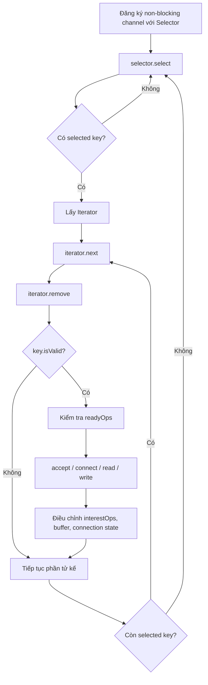

# Duyệt selected-key set và loại khóa đã xử lý trong Java NIO Selector

## 1. Bài toán: Selector đã báo sẵn sàng, vì sao vòng lặp vẫn xử lý lặp?

Trong Java NIO, `Selector` cho phép một thread giám sát nhiều `SelectableChannel` ở chế độ non-blocking. Khi một hoặc nhiều channel có sự kiện I/O sẵn sàng (readable, writable, connectable, acceptable), ứng dụng lấy các `SelectionKey` trong **selected-key set** và xử lý.

Khung lặp điển hình:

```java
// Đoạn mã minh họa bên trong một event loop; selector đã được mở.
while (running) {
    selector.select();

    Iterator<SelectionKey> iterator =
            selector.selectedKeys().iterator();

    while (iterator.hasNext()) {
        SelectionKey key = iterator.next();
        iterator.remove(); // bước quan trọng: tiêu thụ thông báo của lượt này

        if (!key.isValid()) {
            continue;
        }

        // Dispatch theo các cờ readiness của key.
    }
}
```

Lời gọi `iterator.remove()` không chỉ để làm đẹp code. **Selected-key set là tập khóa mà ứng dụng phải chủ động lấy ra sau khi xử lý**; nó không tự rỗng sau mỗi `select()`. Nếu cứ để khóa cũ ở đó, vòng lặp sau có thể thấy lại cùng một khóa, diễn dịch readiness cũ như sự kiện mới, hoặc tiêu tốn CPU để xử lý lặp.

Bài này tập trung vào đúng yêu cầu **“Duyệt selected-key set và loại khóa đã xử lý”** thuộc phần **Selector**: hiểu ba tập/thông tin của Selector, dùng iterator đúng cách, phân biệt remove và cancel, dispatch event hợp lệ, tránh lỗi I/O non-blocking, và chạy ví dụ Java 17 chứng minh một key được chọn hai lần mà không hề bị hủy khi chỉ gọi `iterator.remove()`.

## 2. Ba thứ dễ bị nhầm: đăng ký, selected, readiness

Một `SelectionKey` gắn một channel với một selector sau khi đăng ký. Phải phân biệt:

| Khái niệm | Cách lấy | Ý nghĩa |
|---|---|---|
| **Registered-key set** | `selector.keys()` | Các key được đăng ký với selector, cho đến khi bị hủy/đóng và hoàn tất bước deregistration thích hợp |
| **Selected-key set** | `selector.selectedKeys()` | Những key được quá trình selection đưa vào tập để ứng dụng xử lý; **ứng dụng chủ động loại** khi đã nhận việc |
| **Interest set** của một key | `key.interestOps()` | Các operation mà ứng dụng đang quan tâm: `OP_ACCEPT`, `OP_CONNECT`, `OP_READ`, `OP_WRITE` theo loại channel |
| **Ready set** của một key | `key.readyOps()` hoặc `isReadable()`… | Các operation mà selector quan sát được là sẵn sàng ở lượt selection tương ứng |

Hai tập `keys()` và `selectedKeys()` không phải hai kho “socket riêng”. **Cùng một đối tượng `SelectionKey`** có thể đồng thời là key đã đăng ký và là key được chọn.

- **Đăng ký:** `channel.register(selector, SelectionKey.OP_READ)` tạo/lấy key gắn với selector, cấu hình interest set ban đầu.
- **Chọn:** `selector.select()` kiểm tra sự sẵn sàng của những operation quan tâm, rồi thêm/cập nhật key trong selected set.
- **Tiêu thụ selection:** `iterator.remove()` **chỉ loại key khỏi selected-key set**, không hủy registration.
- **Hủy đăng ký:** `key.cancel()` vô hiệu hóa key; selector xử lý deregistration ở bước phù hợp. Đây là hành động khác, dành cho channel/connection không muốn theo dõi tiếp.

Một channel đã bị `cancel()` không nên còn được dispatch như một kết nối sống. Ngược lại, một key vừa được `iterator.remove()` vẫn có thể được chọn lại vào lượt `select()` sau, khi channel tiếp tục thỏa điều kiện readiness.

### 2.1. Interest khác ready

`interestOps` nói **“tôi muốn biết khi nào có thể làm việc này”**; `readyOps` nói **“bước selection đã quan sát được cơ hội làm việc này”**. Hai bitmask không nhất thiết bằng nhau.

Ví dụ `SocketChannel` quan tâm `OP_READ | OP_WRITE`, nhưng lượt này chỉ readable thì `readyOps` có thể chứa `OP_READ`. Ngược lại, một channel có thể readable và writable đồng thời. Đừng dùng `interestOps()` làm bằng chứng event đã đến.

Các `isReadable()` / `isWritable()` / `isAcceptable()` / `isConnectable()` kiểm tra bit trong ready set; **không thực hiện I/O** và **không tự loại key khỏi selected set**.

### 2.2. Selected set không tự được clear

Theo hợp đồng `Selector`, một lượt selection cập nhật selected keys. Với key chưa nằm trong selected set, key có thể được thêm; với key đã nằm sẵn, readiness mới được kết hợp/cập nhật theo cơ chế API. **Selection không tự xóa toàn bộ selected set trước khi trả về.**

Hệ quả:

- `selector.select()` trả về không đồng nghĩa `selectedKeys()` chỉ gồm các key **mới tinh** chưa từng được ứng dụng thấy.
- `selectedKeys().size()` không nhất thiết bằng giá trị trả về từ `select()`; không dùng hai con số làm cùng một metric.
- Một key bị quên không remove có thể ở lại giữa nhiều vòng, dẫn tới dispatch lặp hoặc trạng thái readiness dễ bị hiểu nhầm.

**Điểm mấu chốt:** với mỗi key được xử lý, phải **tiêu thụ selected entry** đúng cách để lượt sau chọn lại khi thích hợp.

## 3. Mẫu duyệt an toàn bằng Iterator

Mẫu thường dùng nhất là:

```java
// Mã minh họa, chạy trong thread sở hữu selector.
int selectedCount = selector.select(1_000);

Iterator<SelectionKey> iterator =
        selector.selectedKeys().iterator();

while (iterator.hasNext()) {
    SelectionKey key = iterator.next();
    iterator.remove();

    if (!key.isValid()) {
        continue;
    }
    // Tiếp tục xử lý key...
}
```

**Tại sao dùng `Iterator.remove()`?**

1. Nó loại **đúng phần tử vừa lấy** ra khỏi selected set qua giao diện Iterator.
2. Có thể tiếp tục duyệt tập đó mà không tự tạo `ConcurrentModificationException` do gọi `selectedKeys().remove(key)` trong vòng for-each.
3. Loại sớm giúp tránh giữ key ở selected set nếu handler `continue`, trả về sớm hoặc làm thay đổi interest set.
4. Sau khi duyệt hết, selected set thường **rỗng**, trong khi các key còn hiệu lực vẫn tiếp tục nằm trong registered-key set.

**Lưu ý:** `selectedKeys()` là tập được phép **loại phần tử** nhưng không phải tập để tùy tiện `add` key do ứng dụng tự tạo. Việc đưa key vào selected set là công việc của selector. Muốn thay đổi loại readiness theo dõi, dùng `interestOps` trên key; không cố thêm key vào selected set bằng `add()`.

### 3.1. Vì sao remove trước handler?

Một mẫu thường được ưa chuộng:

```java
SelectionKey key = iterator.next();
iterator.remove();
try {
    handle(key);
} catch (IOException e) {
    closeConnection(key);
}
```

Đây là **mã minh họa**: `handle` và `closeConnection` do ứng dụng định nghĩa. Ý tưởng là **entry đã được lấy ra trước khi logic ứng dụng có thể ném exception**. Nếu đặt `iterator.remove()` ở cuối handler mà handler ném lỗi, entry đó có thể ở lại, làm lặp lỗi trong vòng sau.

**Không đồng nghĩa luôn bỏ qua exception:** handler thất bại phải được ghi nhận, đóng/cancel đúng channel và giải phóng attachment/buffer theo hợp đồng. Đặt remove sớm chỉ giải quyết vòng đời **selected entry**, không thay thế xử lý lỗi.

### 3.2. Vì sao không dùng for-each rồi `set.remove(key)`?

**Không nên:**

```java
// MÃ SAI VỀ CÁCH DUYỆT/XÓA; chỉ minh họa lỗi.
for (SelectionKey key : selector.selectedKeys()) {
    selector.selectedKeys().remove(key); // sửa collection ngoài iterator
    // ...
}
```

Một số `Set`/`Iterator` có cơ chế phát hiện concurrent structural modification; tự xóa phần tử từ Set trong khi for-each đang duyệt có thể dẫn đến `ConcurrentModificationException`. Dùng **Iterator chính đang duyệt** và gọi `iterator.remove()` là mẫu rõ ràng, có semantics chuẩn.

**Không nên** gọi `selector.selectedKeys().clear()` bên trong vòng lặp: bạn sẽ xóa cả những sự kiện **chưa được dispatch**.

### 3.3. Dùng `selectedKeys().clear()` sau vòng được không?

Có thể, trong một số thiết kế, ứng dụng xử lý toàn bộ selected keys rồi `clear()`. Nhưng so với `iterator.remove()` khi duyệt:

- Nếu handler ném exception giữa vòng, `clear()` ở cuối có thể không chạy.
- `clear()` xóa **tất cả** selected entries, kể cả những entry bạn chưa xử lý nếu có nhánh thoát sớm.
- Việc gọi clear ngay trước khi xử lý hết có thể làm mất thông tin những key còn chờ dispatch trong chính lượt đó.

Vì vậy trong event loop đồng bộ, **remove từng key đúng lúc** vừa dễ kiểm soát vừa tránh giữ trạng thái cũ. Nếu dùng cơ chế batch, hãy định nghĩa rõ khi nào sự kiện được coi là đã nhận/chuyển giao và ai chịu trách nhiệm xử lý.

## 4. Chu trình đầy đủ của Selector



Đoạn mã dispatch điển hình ở server dùng `ServerSocketChannel` và `SocketChannel`:

```java
// Mã minh họa trong event loop, các hàm handle* do ứng dụng cài.
while (running) {
    selector.select();

    Iterator<SelectionKey> it =
            selector.selectedKeys().iterator();

    while (it.hasNext()) {
        SelectionKey key = it.next();
        it.remove();

        if (!key.isValid()) {
            continue;
        }

        try {
            if (key.isAcceptable()) {
                handleAccept(key);
            }
            if (key.isValid() && key.isConnectable()) {
                handleConnect(key);
            }
            if (key.isValid() && key.isReadable()) {
                handleRead(key);
            }
            if (key.isValid() && key.isWritable()) {
                handleWrite(key);
            }
        } catch (IOException error) {
            closeConnection(key);
        }
    }
}
```

Chú ý các lệnh `if` có kiểm tra `isValid()` lại ở những nhánh sau: một handler có thể phát hiện EOF/lỗi và gọi `key.cancel()`. Lúc đó kiểm tra `isReadable()`/`isWritable()` của key không còn hợp lệ có thể ném `CancelledKeyException`. Với ứng dụng lớn, có thể gom xử lý thành một state machine rõ ràng hơn và bảo đảm đóng/cancel ở một nhánh tập trung.

`isAcceptable`, `isReadable`, `isWritable` là readiness snapshot, **không phải lời hứa I/O sẽ thành công hoặc hoàn tất**. Giữa selection và thao tác, trạng thái hệ thống có thể thay đổi.

## 5. Ví dụ Java 17 chạy được: cùng một key được chọn lại sau khi remove

Ví dụ dưới đây dùng `Pipe.SourceChannel`/`Pipe.SinkChannel` để tạo luồng byte nội bộ, không cần quyền mở TCP socket, firewall hay kết nối Internet. `Pipe.SourceChannel` là `SelectableChannel`, có thể đăng ký `OP_READ` với selector khi non-blocking. Điều này giữ đúng **cơ chế selected-key set** của Java NIO, đồng thời tạo output xác định.

Quy trình:

1. Mở `Selector` và một `Pipe`; đăng ký `source` ở chế độ non-blocking, quan tâm `OP_READ`.
2. Ghi `ONE` vào sink; selector chọn source readable.
3. Duyệt iterator, remove key, rồi đọc payload. Selected set trở lại rỗng.
4. Kiểm tra key vẫn còn valid và registered; **remove không hủy registration**.
5. Ghi `TWO`; cùng key tiếp tục được chọn ở lần select sau.
6. Cuối chương trình, gọi `key.cancel()` để minh họa sự khác biệt với selected-key remove.

Lưu file **`SelectedKeyIterationDemo.java`**:

```java
import java.io.IOException;
import java.nio.ByteBuffer;
import java.nio.channels.Pipe;
import java.nio.channels.SelectionKey;
import java.nio.channels.Selector;
import java.nio.charset.StandardCharsets;
import java.util.Iterator;
import java.util.concurrent.TimeUnit;

public class SelectedKeyIterationDemo {

    private static void send(Pipe.SinkChannel sink, String text)
            throws IOException {
        ByteBuffer data = StandardCharsets.US_ASCII.encode(text);
        while (data.hasRemaining()) {
            sink.write(data);
        }
    }

    private static void dispatch(Selector selector, String label)
            throws IOException {

        long deadline = System.nanoTime()
                + TimeUnit.SECONDS.toNanos(3);

        while (selector.selectedKeys().isEmpty()) {
            long remaining = deadline - System.nanoTime();
            if (remaining <= 0L) {
                throw new IOException("Timed out waiting for selection");
            }
            long timeoutMs = Math.max(
                    1L, TimeUnit.NANOSECONDS.toMillis(remaining));
            selector.select(timeoutMs);
        }

        Iterator<SelectionKey> iterator =
                selector.selectedKeys().iterator();

        while (iterator.hasNext()) {
            SelectionKey key = iterator.next();
            iterator.remove(); // Chỉ bỏ khỏi selected set.

            if (!key.isValid()) {
                continue;
            }
            if (key.isReadable()) {
                Pipe.SourceChannel source =
                        (Pipe.SourceChannel) key.channel();
                ByteBuffer buffer = ByteBuffer.allocate(32);
                int n = source.read(buffer);
                if (n <= 0) {
                    throw new IOException(
                            "Readable key without available bytes");
                }

                buffer.flip();
                String payload = StandardCharsets.US_ASCII
                        .decode(buffer).toString();
                System.out.println(label + ": " + payload);
            }
        }

        System.out.println("Selected keys remaining: "
                + selector.selectedKeys().size());
    }

    public static void main(String[] args) throws Exception {
        try (Selector selector = Selector.open()) {
            Pipe pipe = Pipe.open();
            try (Pipe.SourceChannel source = pipe.source();
                 Pipe.SinkChannel sink = pipe.sink()) {

                source.configureBlocking(false);

                SelectionKey key =
                        source.register(selector, SelectionKey.OP_READ);

                send(sink, "ONE");
                dispatch(selector, "Event 1");

                System.out.println("Key still registered: "
                        + selector.keys().contains(key));

                send(sink, "TWO");
                dispatch(selector, "Event 2");

                key.cancel();
                System.out.println("Key valid after cancel: "
                        + key.isValid());
            }
        }
    }
}
```

Chạy trên JDK 17+ trong thư mục chứa file:

```bash
javac -encoding UTF-8 SelectedKeyIterationDemo.java
java SelectedKeyIterationDemo
```

**Stdout chính xác khi chạy thành công:**

```text
Event 1: ONE
Selected keys remaining: 0
Key still registered: true
Event 2: TWO
Selected keys remaining: 0
Key valid after cancel: false
```

### Phân tích kết quả

- Lần đầu `sink.write` làm dữ liệu sẵn sàng ở `source`. `selector.select(timeout)` đưa key vào selected set.
- `iterator.next()` lấy key, `iterator.remove()` **chỉ xóa phần tử khỏi selected set**. Trong cùng vòng, `source.read` lấy dữ liệu `ONE`; selected set hết phần tử.
- `selector.keys().contains(key)` in `true`: registration vẫn còn dù selected set đã rỗng.
- Sau khi `send("TWO")`, channel lại readable; **chính key đó** được đưa vào selected set và xử lý như một sự kiện mới. Điều này xác nhận remove **không cấm chọn lại key**.
- Cuối cùng `key.cancel()` làm `isValid()` thành `false` ngay. Dữ liệu có thể vẫn nằm trong channel nếu chưa đọc, nhưng ứng dụng đã không còn muốn nhận selection cho registration này.
- Hai vòng chờ có **deadline** thay vì giả định `select` luôn thức dậy đúng một lần. `selectedKeys().isEmpty()` được kiểm tra sau từng lần `select` để chịu được trường hợp `select` trả `0`.

**Phạm vi ví dụ:** `Pipe` dùng để quan sát Selector một cách ổn định, không phải TCP server nhiều kết nối. Trong ứng dụng TCP, `ServerSocketChannel`/`SocketChannel` cung cấp các key tương tự với `OP_ACCEPT`/`OP_READ`/`OP_WRITE`, và handler phải xử lý partial read/write, EOF, framing, lỗi và shutdown.

## 6. Phân biệt remove, cancel, close và đổi interestOps

Bốn thao tác thường gặp có hiệu quả khác nhau:

| Thao tác | Điều thay đổi | Key còn được select ở lượt sau? |
|---|---|---|
| `iterator.remove()` | Bỏ **entry** khỏi selected-key set | **Có**, nếu key còn valid/registered và có readiness phù hợp |
| `selector.selectedKeys().clear()` | Xóa **mọi entry** khỏi selected-key set | Có, với key còn đăng ký; nhưng có thể bỏ sót việc xử lý event của lượt hiện tại |
| `key.cancel()` | Đánh dấu hủy registration, key không còn valid | **Không** tiếp tục như key hợp lệ; selector xử lý deregistration |
| `channel.close()` | Đóng channel, các key gắn channel bị hủy | Không; tài nguyên kênh không còn dùng được |
| `key.interestOps(mask)` | Đổi operation muốn theo dõi | Có thể, nhưng phụ thuộc mask, ready state và lần selection tiếp theo |

### 6.1. `iterator.remove()` không phải ACK TCP

Không nên hiểu remove là “đã nhận hết byte trong socket” hoặc “đã xử lý business transaction”. Remove chỉ là **tiêu thụ event entry trong tập key do selector trả về**.

Ví dụ ứng dụng nhận thông báo readable rồi đọc một phần frame. Nó vẫn nên remove key khỏi selected set của lượt này, **nhưng giữ** trạng thái dữ liệu dở dang trong attachment/buffer để lần sau đọc tiếp. Nếu không còn quan tâm đọc vì quá tải hoặc đang xử lý bất đồng bộ, có thể tạm **gỡ `OP_READ` khỏi interest set** và khôi phục sau, thay vì dùng selected set như hàng đợi ứng dụng.

### 6.2. `cancel()` có tác động mạnh hơn remove

`key.cancel()` hủy đăng ký của channel với selector; lời gọi này làm key không còn hợp lệ ngay. Quá trình loại key khỏi các tập nội bộ hoàn tất qua cơ chế cancellation/selection của Selector, không nhất thiết là xóa đồng bộ toàn bộ registry vào đúng thời điểm dòng `cancel` chạy.

Đừng gọi `cancel()` sau **mỗi** sự kiện readable: nếu làm vậy, channel không được chọn lại cho message tiếp theo. Hủy khi kết nối đã đóng, không còn được quan tâm hoặc gặp lỗi nghiêm trọng, chứ không phải để xóa thông báo đang xét.

### 6.3. `interestOps` là công cụ điều khiển sự kiện tiếp theo

`OP_READ`, `OP_WRITE` thường được bật/tắt theo tình trạng kết nối. Ví dụ nếu gửi response mà `SocketChannel.write` mới tiêu thụ một phần buffer, cần giữ phần còn lại và quan tâm writable:

```java
// Mã minh họa: channel là SocketChannel non-blocking;
// key valid; outgoing là ByteBuffer đã flip().
channel.write(outgoing);

if (outgoing.hasRemaining()) {
    key.interestOps(key.interestOps() | SelectionKey.OP_WRITE);
} else {
    key.interestOps(key.interestOps() & ~SelectionKey.OP_WRITE);
}
```

Việc xóa `OP_WRITE` khỏi interest set khi không còn dữ liệu chờ là quan trọng: socket thường writable **hầu hết thời gian**, nên bật `OP_WRITE` liên tục có thể khiến selector thức dậy liên tục và event loop chạy nóng CPU dù không có gì cần gửi.

**Nhớ hai lớp riêng:** `iterator.remove()` dọn selected entry của lượt hiện tại; `interestOps(...)` quyết định muốn được báo **loại readiness nào** trong các lần selection tiếp theo.

## 7. Khi một key có nhiều readiness flags

Một `SocketChannel` có thể có nhiều readiness flags được bật trong cùng một lượt selection, ví dụ `OP_READ` và `OP_WRITE`. Vì vậy nếu bạn chỉ dùng một chuỗi `if/else if`, có thể xử lý một operation rồi bỏ lỡ cơ hội xử lý operation khác trong lượt hiện tại.

Mẫu có kiểm tra key valid sau mỗi nhánh là:

```java
// Mã minh họa, không phải chương trình độc lập.
if (key.isReadable()) {
    processRead(key);
}
if (key.isValid() && key.isWritable()) {
    processWrite(key);
}
```

**Không ép mọi ready bit phải được xử lý ngay bằng mọi giá:** server có thể ưu tiên đọc, hạn chế số byte mỗi lượt để bảo đảm fairness, hoặc tạm bỏ interest bit khi chưa sẵn sàng xử lý. Nhưng event loop phải quản lý chính xác tình trạng pending I/O và không để mất dữ liệu giữa các lần selected entry được remove.

Một nhánh có thể làm key invalid, ví dụ server thấy EOF và đóng socket khi đọc. Kiểm tra `isValid()` lại trước thao tác readiness sau là biện pháp cần thiết; trong code phức tạp, bắt `CancelledKeyException` ở ranh giới dispatch thích hợp và đóng tài nguyên đúng quy tắc.

### 7.1. `OP_ACCEPT`

- Chỉ áp dụng cho `ServerSocketChannel`.
- `accept()` trên server channel non-blocking có thể trả `null`. Khi có socket mới, gọi `configureBlocking(false)` trước khi register vào selector.
- Với mỗi kết nối đã accept, tạo attachment/connection state và register `OP_READ` hoặc interest phù hợp.
- Không được quên đóng socket nếu reject hoặc register lỗi.

### 7.2. `OP_CONNECT`

- Khi `SocketChannel` được tạo kết nối theo non-blocking mode, `OP_CONNECT` cho biết có thể kiểm tra/hoàn tất tiến trình kết nối.
- Gọi `finishConnect()` đúng cách, xử lý exception thất bại, sau khi connect hoàn tất thì cập nhật interest set (thường bỏ `OP_CONNECT`, thêm `OP_READ` và có điều kiện `OP_WRITE`).
- Không coi selected entry có `OP_CONNECT` là application handshake hoặc TLS handshake đã hoàn tất.

### 7.3. `OP_READ`

- `SocketChannel.read(buffer)` có thể trả `n > 0`, `0` nếu chưa đọc được byte, hoặc `-1` khi đã gặp EOF theo ngữ nghĩa channel.
- TCP không giữ ranh giới message. Đọc lần này có thể thiếu frame; lưu dữ liệu/decoder state trong attachment, dùng delimiter/length prefix để ghép thông điệp.
- Nếu muốn xử lý đọc sau khi worker làm xong, có thể tạm gỡ `OP_READ` khỏi interest set để tránh không kiểm soát backpressure.
- Readable không có nghĩa chỉ cần đọc một lần là đã xử lý toàn bộ stream hoặc mọi request hợp lệ.

### 7.4. `OP_WRITE`

- `SocketChannel.write(buffer)` có thể trả `0` khi buffer socket chưa sẵn sàng nhận thêm byte và có thể trả số nhỏ hơn số byte còn lại.
- Giữ pending `ByteBuffer` qua các lần event; bật `OP_WRITE` **khi thật sự còn dữ liệu chờ**.
- Khi pending data đã được tiêu thụ, bỏ `OP_WRITE` để tránh event loop quay liên tục.
- Việc `write` hoàn thành chỉ nói về việc gửi/đệm byte theo API, không chứng minh client đã xử lý thông điệp nghiệp vụ.

## 8. Các lỗi kinh điển liên quan trực tiếp đến selected-key set

### Lỗi 1: không remove sau `next()`

```java
// Minh họa lỗi: khóa vẫn nằm trong selected set.
while (iterator.hasNext()) {
    SelectionKey key = iterator.next();
    handle(key);
    // Thiếu iterator.remove().
}
```

Hậu quả: selected set không được tiêu thụ sạch, vòng sau còn nhìn thấy key cũ, việc đếm và dispatch có thể lặp/cồng kềnh. Khắc phục: remove ngay sau `next()` trước khi gọi handler.

### Lỗi 2: dùng `cancel()` để “dọn event”

```java
// Minh họa lỗi nếu muốn giữ socket đang hoạt động.
SelectionKey key = iterator.next();
key.cancel();
```

Hậu quả: registration bị hủy, dù kết nối vẫn cần đọc request kế tiếp. Khắc phục: `iterator.remove()` để dọn selected entry; `cancel` chỉ khi thật sự kết thúc theo dõi channel.

### Lỗi 3: nhầm `selectedKeys().clear()` với release tất cả socket

Clear chỉ xóa **entry trong selected set**; nó không đóng channel, không hủy registration, không giải phóng bộ đệm ứng dụng. Ngược lại, đóng selector/channel làm thay đổi vòng đời tài nguyên nhưng không xử lý nghiệp vụ thay client.

### Lỗi 4: luôn bật `OP_WRITE`

Nếu key quan tâm `OP_WRITE` dù outgoing queue rỗng, socket có thể liên tục writable, gây vòng select–dispatch lặp nhanh và sử dụng CPU cao. Không giải quyết bằng việc **không remove** key; phải chỉnh `interestOps` hợp lý.

### Lỗi 5: dựa vào `select()` return value làm số event còn xử lý

`select()` trả số key có ready-operation set được cập nhật trong quá trình selection theo API; đó không nhất thiết là `selectedKeys().size()` khi còn key từ vòng trước. Hãy **duyệt selected set thật** và luôn loại entry đã xử lý.

### Lỗi 6: thao tác blocking trên event-loop thread

Nếu handler gọi database, external API hoặc xử lý CPU lâu ngay trong vòng selected-key traversal, một key chậm có thể chặn mọi kết nối khác. Cần thiết kế giới hạn công việc mỗi event, offload công việc phù hợp, hoặc dùng framework có event loop/worker pool đã quản lý. Khi đưa tác vụ sang worker, phải định nghĩa ai sở hữu buffer/attachment và lúc nào cập nhật interest ops.

### Lỗi 7: thay đổi cùng selected set từ thread khác

Selector thường có một **owner thread** chịu trách nhiệm selection và traversal. Worker có thể yêu cầu owner cập nhật trạng thái bằng thread-safe queue và `selector.wakeup()`. Không để nhiều thread tùy tiện duyệt/xóa cùng selected set: dễ gặp race, trạng thái không nhất quán hoặc exception do concurrent modifications. `wakeup()` giúp thoát khỏi `select`, **không tự đăng ký channel hoặc xử lý task thay bạn**.

## 9. Selected set, readiness và nguyên tắc không làm mất việc

Một nguyên tắc quan trọng: **Remove entry khỏi selected set không đồng nghĩa bỏ dữ liệu**. Nếu xử lý đúng non-blocking I/O, connection state sẽ mang phần việc cần làm cho đến khi hoàn tất.

Ví dụ:

```text
t0: selector thông báo key readable
t1: iterator.next(), iterator.remove()
t2: channel.read(buffer) đọc 7 byte
t3: frame cần 20 byte -> giữ 7 byte trong buffer/decoder state
t4: selector quay lại chờ; key vẫn đăng ký OP_READ
t5: 13 byte còn lại đến -> key lại được chọn
t6: đọc tiếp, giải mã frame 20 byte, xử lý yêu cầu
```

Ngược lại, nếu ứng dụng nhận selected entry rồi gọi `clear()` trên ByteBuffer bỏ đi 7 byte đầu, lỗi nằm ở **state management của application**, không nằm ở `iterator.remove()`. Phân biệt việc **tiêu thụ thông báo readiness** với việc **tiêu thụ payload trong channel** giúp code dễ kiểm chứng.

### Readiness là level-triggered theo cách tư duy thực dụng

NIO Selector thường được dùng theo mô hình readiness: nếu channel còn điều kiện readable/writable và key vẫn quan tâm operation đó, có thể tiếp tục được chọn ở các lượt sau. Không suy diễn rằng “mỗi byte đúng một event”, cũng không giả định đã được chọn rồi thì mọi byte sẽ hết sau một lần đọc.

Không nên chuyển tư duy từ `Iterator.remove()` thành “edge được ACK vĩnh viễn”. Việc select lại phụ thuộc readiness, interest ops, key validity, trạng thái channel và selector/provider.

### Cân bằng fairness giữa nhiều kết nối

Một event-loop thread có thể xử lý hàng nghìn selected keys. Nếu một connection có backlog rất lớn, đọc đến cạn mọi byte của nó trước khi chuyển key tiếp theo có thể làm connection khác bị đói. Có thể đặt budget:

- Tối đa số byte hoặc số frame xử lý cho mỗi key mỗi vòng.
- Đưa phần tính toán dài ra worker pool.
- Tạm gỡ `OP_READ` khi queue downstream quá tải; khôi phục khi có capacity.
- Chỉ bật `OP_WRITE` khi có pending output.
- Duy trì metrics về số key selected, số byte đọc/ghi, latency dispatch, pending bytes và số vòng lặp không có tiến triển.

**Không giới hạn bằng cách giữ key ở selected set mãi**; hãy loại event entry và quản lý fairness bằng state/interest ops một cách tường minh.

## 10. Hủy khóa, đóng channel và shutdown có trật tự

Khi một client đóng kết nối hoặc handler gặp lỗi không thể tiếp tục:

1. Remove selected entry qua iterator theo vòng lặp đang duyệt.
2. Hủy key bằng `key.cancel()` nếu không còn muốn nhận event.
3. Đóng `SocketChannel`/channel phù hợp, và giải phóng buffer/attachment/queue của connection.
4. Để selector hoàn tất xử lý các canceled keys trong chu kỳ selection hợp lý.
5. Khi shutdown toàn bộ event loop, dùng cờ dừng, `selector.wakeup()` để thoát khỏi `select()`, đóng channel, đóng selector và quản lý các tác vụ còn chạy theo chính sách.

**Không dùng `selectedKeys().clear()` như một lệnh shutdown**; thao tác đó không giải phóng socket, không dừng thread và không đóng selector.

Một pattern có cleanup trong event loop:

```java
// Mã minh họa, channel có thể là SocketChannel đã được chấp nhận.
Iterator<SelectionKey> it = selector.selectedKeys().iterator();
while (it.hasNext()) {
    SelectionKey key = it.next();
    it.remove();

    if (!key.isValid()) {
        continue;
    }

    try {
        dispatch(key);
    } catch (IOException error) {
        key.cancel();
        try {
            key.channel().close();
        } catch (IOException closeError) {
            error.addSuppressed(closeError);
        }
        recordFailure(error);
    }
}
```

`dispatch` và `recordFailure` là các hàm do ứng dụng cài; đoạn code này **không phải class độc lập**. Sản xuất thực tế nên xử lý thêm exception từ parser/logic nghiệp vụ, hủy tác vụ, cleanup attachment, và bảo đảm error logging không làm event loop bị dừng ngoài ý muốn.

## 11. Câu hỏi thường gặp

### 11.1. `selectedKeys().iterator().remove()` có hủy socket không?

**Không.** `remove()` trên iterator xóa key khỏi **selected-key set**, trong khi `key.cancel()` mới hủy registration và `channel.close()` mới đóng channel.

### 11.2. Tại sao key đã xử lý lại có thể xuất hiện lần nữa?

Vì readiness ở lần selection sau có thể vẫn tồn tại hoặc xuất hiện mới, trong khi key còn valid/registered và `interestOps` vẫn theo dõi operation đó. Chính đó là điều server mong muốn khi client còn dữ liệu khác để đọc.

### 11.3. Có thể gọi `iterator.remove()` trước `key.isValid()` không?

**Có**, và đây là mẫu rất hay dùng. Kể cả key không còn valid, ứng dụng cũng loại entry khỏi selected set. Sau đó bỏ qua key invalid hoặc cleanup nếu cần.

### 11.4. Nếu một handler ném `IOException`, selected entry có bị giữ lại?

Nếu bạn remove **trước** handler thì không. Nếu bạn chỉ remove **sau** handler trong code không có `finally`, exception có thể khiến phần tử bị bỏ lại. Cần đồng thời đóng/cancel channel lỗi đúng cách.

### 11.5. Có cần gọi `key.cancel()` mỗi lần sau `iterator.remove()`?

**Không.** Điều đó sẽ hủy đăng ký key, khiến channel không còn được theo dõi như mong muốn. Hủy dành cho connection ngừng theo dõi hoặc bị lỗi không thể phục hồi.

### 11.6. `selectedKeys().clear()` có nhanh hơn Iterator không?

Không nên kết luận hiệu năng từ một giả thuyết. Điều quan trọng là semantics: clear có thể loại entry chưa xử lý nếu xảy ra break/exception; iterator.remove đem lại kiểm soát từng key. Nếu tối ưu event loop, benchmark và đo latency/CPU trước khi thay đổi pattern đáng tin cậy.

### 11.7. Vì sao `key.isWritable()` thường true và server bị busy-loop?

Do socket thường có sẵn khả năng ghi vào send buffer. Nếu luôn quan tâm `OP_WRITE` mà không có outgoing data, selector sẽ tiếp tục báo writable. Hãy gỡ `OP_WRITE` khi queue rỗng và thêm lại khi có dữ liệu đang chờ.

### 11.8. Có thể dùng selected-key set làm hàng đợi công việc giữa các thread không?

**Không nên.** Tập này là cấu trúc do Selector quản lý cho readiness. Khi cần offload, tạo queue ứng dụng riêng có đồng bộ, giữ state/ownership rõ ràng và dùng `selector.wakeup()` để owner thread cập nhật interest ops.

### 11.9. `Selector.select(0)` có phải polling không?

**Không.** Overload `select(long timeout)` với timeout bằng `0` có nghĩa là **chờ vô hạn** theo semantics API. Muốn kiểm tra ngay mà không chờ, dùng `selectNow()`; muốn timeout có giới hạn, dùng giá trị dương.

### 11.10. Nếu `select()` trả `0`, có được bỏ hết selected keys không?

Không được suy ra selected set rỗng chỉ từ giá trị trả `0`. Có thể có key còn lại do ứng dụng chưa remove từ vòng trước; ngoài ra `select` có thể thức dậy vì `wakeup`/interrupt/timeout. Hãy kiểm tra và duyệt selected set theo đúng quy trình, đồng thời bảo đảm các key cũ không bị giữ vô ý.

## 12. Bài tập thực hành

**Bài 1 — xác định lỗi:** Xét đoạn code:

```java
// Ví dụ chỉ để đọc, không chạy độc lập.
for (SelectionKey key : selector.selectedKeys()) {
    if (key.isReadable()) {
        readFrom(key);
    }
}
```

**Đáp án:** Không loại selected entry sau khi xử lý; key có thể còn trong selected set qua vòng lặp sau. Hãy đổi sang `Iterator` và gọi `remove()` ngay sau `next()`. Cần thêm `isValid()`/xử lý lỗi, và `readFrom` phải tôn trọng non-blocking I/O.

**Bài 2 — phân biệt thao tác:** Sau khi xử lý `OP_READ`, cần giữ channel để tiếp tục nhận dữ liệu trong tương lai. Chọn một: `iterator.remove()`, `key.cancel()`, `key.channel().close()`.

**Đáp án:** `iterator.remove()`. Hai thao tác còn lại kết thúc việc theo dõi/đóng channel, không phù hợp nếu muốn duy trì kết nối.

**Bài 3 — dự đoán output:** Với chương trình `SelectedKeyIterationDemo`, vì sao `Key still registered: true` xuất hiện sau `Selected keys remaining: 0`?

**Đáp án:** Key không còn nằm trong **selected-key set** sau khi remove, nhưng vẫn nằm trong **registered-key set**. Một key có thể được chọn lại khi source có dữ liệu mới.

**Bài 4 — nhiều readiness flags:** Nếu `OP_READ` và `OP_WRITE` đều ready, nhưng `handleRead` đóng socket, có nên tiếp tục gọi `handleWrite` không?

**Đáp án:** Không. Phải kiểm tra `key.isValid()` và lifecycle connection sau khi đọc; handler có thể hủy key và đóng channel. Dispatch tiếp có thể gây `CancelledKeyException` hoặc lỗi I/O.

**Bài 5 — partial frame:** Đọc được 10 byte trong message cần 50 byte. Sau `iterator.remove()` nên hủy key chờ request mới không?

**Đáp án:** Không. Giữ 10 byte trong state/buffer và tiếp tục theo dõi `OP_READ` khi phù hợp. Remove chỉ tiêu thụ notification trong selected set, không làm mất byte đã lưu nếu code quản lý đúng.

**Bài 6 — đo chỉ số:** Vì sao giá trị trả về từ `select()` và `selectedKeys().size()` không được coi là một?

**Đáp án:** `select()` trả số key có ready-operation set được cập nhật trong đợt selection, còn selected-key set có thể đã chứa các key chưa được ứng dụng loại ở đợt trước. Chúng phản ánh khái niệm khác nhau.

**Bài 7 — idle write:** Vòng selector cứ nhận `OP_WRITE` dù không có dữ liệu gửi. Nên làm gì?

**Đáp án:** Gỡ bit `OP_WRITE` khỏi interest set khi outgoing queue rỗng; chỉ bật lại khi có buffer pending. Không giải quyết bằng việc giữ key ở selected set.

**Bài 8 — concurrency:** Worker thread muốn bật `OP_WRITE` cho một channel. Nên sửa trực tiếp selected set không?

**Đáp án:** Không. Giữ event loop làm owner của selector, đưa yêu cầu cập nhật vào queue an toàn giữa thread, gọi `selector.wakeup()` và điều chỉnh `interestOps` trong owner thread; bảo đảm buffer/connection state không bị truy cập đồng thời thiếu đồng bộ.

## 13. Checklist viết vòng Selector đúng

Trước khi deploy một event loop Java NIO:

1. Channel được `configureBlocking(false)` trước khi register với selector.
2. `select()`/`select(timeout)`/`selectNow()` được chọn đúng semantics, có cách `wakeup` khi shutdown hoặc nhận yêu cầu từ thread khác.
3. Vòng selected set dùng `Iterator<SelectionKey>`, gọi `iterator.remove()` **ngay sau `next()`**.
4. Kiểm tra `key.isValid()` trước readiness; kiểm tra lại sau handler có thể cancel/close key.
5. Dispatch theo `isAcceptable`, `isConnectable`, `isReadable`, `isWritable` đúng loại channel.
6. Không nhầm `selectedKeys()` với `keys()`, `interestOps()`, `readyOps()`.
7. `OP_READ` xử lý partial read, EOF và message framing; `OP_WRITE` xử lý partial write và tắt interest khi hết pending output.
8. Exceptions được xử lý có kiểm soát; key/socket lỗi được cancel/close và attachment được cleanup.
9. Không giữ selected entries như hàng đợi công việc; offload có ownership rõ ràng và cơ chế `wakeup`.
10. Có metrics cho selector loop duration, selected count, số key dispatch, I/O progress, CPU usage và độ trễ.
11. Shutdown đóng các channel, hủy registration, đánh thức selector, đóng selector và giải phóng các resource phụ thuộc theo thứ tự phù hợp.

**Ghi nhớ:** `selectedKeys()` là **danh sách sự kiện readiness đang chờ ứng dụng tiêu thụ**, không phải danh sách mọi socket đã đăng ký. `iterator.remove()` xác nhận đã **lấy entry đó khỏi lượt xử lý**; nó **không hủy key, không đóng channel, không ACK mạng và không thay thế xử lý payload**. Duyệt và remove đúng cách, phối hợp với `interestOps` và state machine I/O non-blocking, giúp vòng Selector không xử lý stale readiness, không busy-loop sai và không đánh mất công việc thực sự.

Tài liệu tham khảo: Java SE 17 API `java.nio.channels.Selector`, `java.nio.channels.SelectionKey`, `java.nio.channels.SelectableChannel`, `java.nio.channels.Pipe`, `java.nio.channels.SocketChannel`, `java.nio.channels.ServerSocketChannel`.