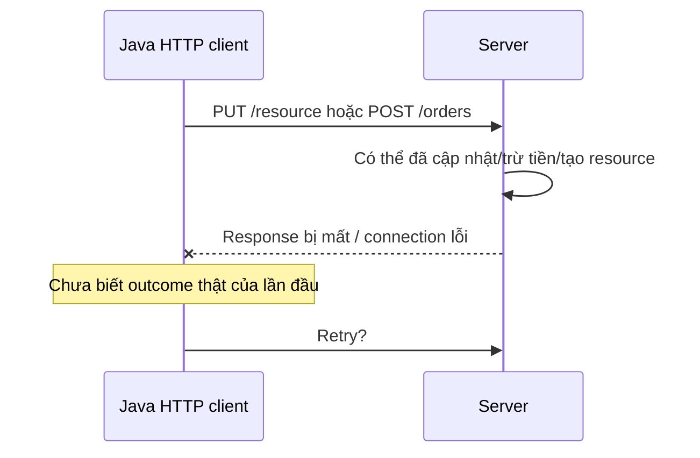

# GET, HEAD, POST, PUT, DELETE và ý nghĩa an toàn, lũy đẳng của HTTP

## 1. Phương thức HTTP quyết định “client muốn làm gì?”

Khi lập trình Java networking và thiết kế HTTP API, bạn không nên chọn `GET`, `HEAD`, `POST`, `PUT`, `DELETE` chỉ theo thói quen “đọc thì GET, ghi thì POST”. Theo HTTP Semantics (RFC 9110), **request method biểu thị ngữ nghĩa mà client yêu cầu đối với tài nguyên đích**, để server, client, cache và các thành phần trung gian hiểu cách tương tác.

Có hai thuộc tính rất quan trọng:

- **Safe (an toàn):** client **không yêu cầu và không trông đợi thay đổi trạng thái ở server** như hiệu quả của method. Safe không đồng nghĩa an toàn bảo mật hay server tuyệt đối không ghi log, metrics hoặc thực hiện tác vụ nội bộ.
- **Idempotent (lũy đẳng):** hiệu quả **được yêu cầu** trên server của nhiều request **giống hệt nhau** tương đương với một request. Idempotent không đồng nghĩa response giống nhau, code chỉ được chạy một lần, hoặc mọi tác động phụ đều tự động chống trùng.

Ví dụ:

```text
GET    /products/42              -> xin xem biểu diễn của sản phẩm
HEAD   /products/42              -> xin headers/metadata, không lấy body
POST   /orders                   -> yêu cầu collection xử lý/tạo đơn mới
PUT    /products/42              -> tạo/thay trạng thái tại URI chỉ định
DELETE /products/42              -> yêu cầu bỏ liên kết tài nguyên tại URI
```

**Tại sao cần phân biệt?** Trình duyệt có thể prefetch GET, cache có thể dùng lại response GET, client có thể retry PUT khi connection đứt, nhưng retry POST tạo đơn hàng mà không có kiểm soát có thể tạo đơn trùng. Nếu GET vô tình thực hiện xóa dữ liệu, một crawler thăm URL cũng có thể kích hoạt hành động nguy hiểm.

Bài này đi sâu vào **năm method**, ý nghĩa safe/idempotent, những status code thường gặp, GET/HEAD và cache, khác biệt POST–PUT, đặc tính lũy đẳng của DELETE, retry sau lỗi mạng, kiểm soát tranh chấp và **một chương trình Java 17 chạy được** dùng `HttpClient` và server HTTP loopback.

## 2. Bảng so sánh ngữ nghĩa chuẩn

| Method | Safe? | Idempotent? | Ý nghĩa chính |
|---|---|---|---|
| **GET** | **Có** | **Có** | Yêu cầu chuyển một biểu diễn hiện tại của tài nguyên |
| **HEAD** | **Có** | **Có** | Như GET về mục tiêu thông tin, nhưng **không có response content** |
| **POST** | **Không mặc định** | **Không mặc định** | Yêu cầu tài nguyên đích xử lý content theo semantics riêng |
| **PUT** | **Không** | **Có** | Yêu cầu tạo/thay trạng thái của resource đích bằng representation gửi lên |
| **DELETE** | **Không** | **Có** | Yêu cầu xóa mối liên hệ giữa target URI và chức năng hiện tại của resource |

**Ba điều phải nhớ:**

1. **GET và HEAD safe, nên cũng idempotent.**
2. **PUT và DELETE idempotent nhưng không safe**, bởi chúng yêu cầu sửa trạng thái.
3. **POST không được coi là safe hay idempotent theo mặc định**. Một API có thể thiết kế POST cụ thể chống trùng, nhưng phải có hợp đồng/triển khai riêng.

Chữ “an toàn” ở đây **không phải** an toàn thông tin. `GET` trên HTTP không mã hóa vẫn có thể lộ dữ liệu; `POST` trên HTTPS vẫn cần xác thực và phân quyền. Phân loại này nói về **ngữ nghĩa thao tác**, không đánh giá chất lượng bảo mật.

## 3. “Safe” nghĩa là gì?

Safe nói về **hành động được client yêu cầu**. Một GET hay HEAD đúng chuẩn không được có tác dụng mà người dùng xem thông tin không mong đợi, chẳng hạn trừ tiền, tạo đơn hàng, xóa hồ sơ hoặc thay đổi trạng thái giỏ hàng.

Tuy nhiên, server được phép có các side effect **không phải mục tiêu client yêu cầu** như ghi access log, tăng bộ đếm truy cập, cập nhật metrics, làm nóng cache, đo hiệu năng hoặc ghi sự kiện bảo mật. Những side effect này không tự khiến GET/HEAD mất thuộc tính safe.

### Một thiết kế sai dễ gây hậu quả

```http
GET /admin/delete-user?userId=42 HTTP/1.1
Host: api.example.test
```

Nếu handler thực sự xóa user 42, API đã đặt **hành động thay đổi trạng thái** vào method safe. Search crawler, link preview, trình duyệt hoặc chức năng prefetch có thể gọi URL mà không chủ đích xóa. Kể cả có xác thực, đây vẫn là sai semantics và có thể tạo nguy cơ CSRF hoặc thao tác ngoài ý muốn.

**Sửa:** dùng một phương thức thay đổi trạng thái như `DELETE` hoặc `POST` theo contract, xác thực/phân quyền đầy đủ và kiểm soát CSRF trong ứng dụng web dùng cookie. Đổi method **không tự làm yêu cầu an toàn** nếu server thiếu bảo vệ; nhưng chọn đúng method là điều kiện quan trọng để client và intermediary không hiểu sai.

### Safe không yêu cầu dữ liệu bất biến

Hai GET cùng URI có thể nhận giá khác nhau vì người bán vừa cập nhật, vì dữ liệu thay đổi theo thời gian hoặc vì cache đã hết hạn. GET vẫn safe nếu **việc client gửi GET không yêu cầu tạo ra thay đổi đó**.

## 4. “Idempotent” nghĩa là gì?

Một phép đặt trạng thái như `SET balanceDisplay = 100` lặp lại cùng yêu cầu có cùng trạng thái mong muốn sau một hay nhiều lần. Ngược lại, `INCREMENT counter BY 1` lặp lại có thể làm counter tăng nhiều lần.

```text
SET theme = dark    (một hoặc nhiều lần) -> theme vẫn dark
ADD 1 to counter    (hai lần)            -> counter tăng thêm 2
```

Trong HTTP, `PUT` thường là kiểu **đặt representation** tại URI cụ thể; `DELETE` là kiểu **bỏ liên kết**; cả hai idempotent theo semantics. `POST` được định nghĩa tổng quát hơn, có thể là “append vào collection” nên không mặc định lũy đẳng.

### Không nhầm lũy đẳng với cùng response

```text
PUT /profiles/42   { "name": "Lan" }
    -> 201 Created      (chưa tồn tại, giờ được tạo)

PUT /profiles/42   { "name": "Lan" }
    -> 204 No Content   (cùng resource, trạng thái vẫn là Lan)
```

```text
DELETE /profiles/42
    -> 204 No Content   (đã xóa)

DELETE /profiles/42
    -> 404 Not Found    (không còn gì tại URI ấy)
```

Response khác nhau nhưng **hiệu quả được yêu cầu** của việc lặp lại request giống hệt vẫn giống một lần. Vì thế không được dùng phép so `statusCode1 == statusCode2` để kiểm tra idempotency.

### Không nhầm lũy đẳng với exactly-once

Một server nhận hai PUT giống nhau vẫn có thể chạy handler hai lần, ghi hai log và đo hai metrics. HTTP không hứa chỉ gọi code một lần. Nếu side effect như thanh toán, email, webhook hoặc enqueue job không được chống trùng thì **tính idempotent của phương thức theo chuẩn chưa đủ** để đảm bảo mọi hệ thống bên ngoài chỉ thực hiện một lần.

Idempotency cũng **không bảo đảm atomicity**. Hai lệnh đồng thời cập nhật nhiều database/resource có thể cần transaction hoặc một cơ chế phối hợp khác.

### “Giống hệt” là điều kiện bắt buộc

`PUT /state` với body `{"version":1}` và `PUT /state` với body `{"version":2}` là **hai request khác nhau**; không được kết luận chúng giao hoán hoặc tránh lost update. Muốn ngăn ghi đè phiên bản mới bằng bản cũ, dùng optimistic locking như ETag và `If-Match` (thường trả `412 Precondition Failed` khi điều kiện không thỏa).

## 5. GET: lấy biểu diễn, không yêu cầu thay đổi

`GET` yêu cầu server chuyển một representation được chọn của target resource. Nó là **safe** và **idempotent**.

Request:

```http
GET /products/42 HTTP/1.1
Host: api.example.test
Accept: application/json
```

Response:

```http
HTTP/1.1 200 OK
Content-Type: application/json
ETag: "product-v3"

{"id":42,"name":"Keyboard"}
```

Đây là ví dụ, không phải mọi GET đều thành công với `200`: server có thể trả `206 Partial Content` nếu hỗ trợ range và điều kiện thích hợp, `304 Not Modified` cho conditional request, `404 Not Found` nếu resource không tồn tại, hoặc các status `401/403` do xác thực/phân quyền.

### GET và cache

GET là phương thức nền tảng của HTTP caching. Tuy nhiên, **GET không có nghĩa cache luôn được phép lưu**; phải xét quy tắc của RFC 9111, `Cache-Control`, `Vary`, authorization, status và tính fresh.

Ví dụ client có ETag `"product-v3"`:

```http
GET /products/42 HTTP/1.1
Host: api.example.test
If-None-Match: "product-v3"
```

Nếu biểu diễn chưa đổi theo điều kiện, server có thể trả `304 Not Modified` với thông tin validator thích hợp, không gửi representation body như một response `200`. Cache/client có bản cũ hợp lệ sẽ dùng lại theo quy tắc.

### GET body và dữ liệu nhạy cảm

HTTP không định nghĩa ý nghĩa chung cho request body của GET. Gửi body cho GET có thể gây không tương thích với server, proxy hoặc gateway. Trong API thông dụng, chọn resource bằng path/query; khi cần xử lý dữ liệu có cấu trúc phức tạp, thiết kế hợp đồng và method phù hợp thay vì kỳ vọng GET body luôn được hỗ trợ.

Không nhét token, mật khẩu, thông tin cá nhân nhạy cảm vào query tùy tiện: query URL có thể xuất hiện trong history, logging và các bối cảnh chia sẻ. Đây là vấn đề security/privacy **khác** với tính safe.

## 6. HEAD: metadata của GET, không có response body

`HEAD` tương tự GET về mục tiêu thông tin, nhưng server **không gửi nội dung response body**.

```http
HEAD /products/42 HTTP/1.1
Host: api.example.test
```

```http
HTTP/1.1 200 OK
Content-Type: application/json
Content-Length: 27
ETag: "product-v3"

```

Sau dòng trống kết thúc headers là **không có content**. Nếu `Content-Length` được gửi đúng, nó mô tả kích thước content mà GET tương ứng có thể gửi, **không phải số byte body của HEAD**. Một số header chỉ được biết khi tạo content có thể được lược bỏ trong HEAD theo semantics HTTP.

HEAD thường được dùng để:

- Xem resource có tồn tại/được phép truy cập không thông qua status.
- Xem metadata như `Content-Type`, `Content-Length`, `ETag`, `Last-Modified`.
- Kiểm tra một số thông tin giúp xác thực hoặc cập nhật cache.
- Ước lượng thông tin trước khi lấy dữ liệu lớn, nếu server hỗ trợ đúng.

HEAD cũng **safe + idempotent**, nhưng không phải thao tác miễn phí: server vẫn có thể phải truy vấn dữ liệu để sinh headers. Một API có thể không hỗ trợ HEAD và trả `405 Method Not Allowed`; đừng giả định framework nào cũng tự xử lý HEAD chính xác như GET.

**Lỗi phổ biến:** coi HEAD như GET rồi vô tình ghi representation body. Server phải tuân thủ không có response content, dù báo `Content-Length` khác `0`.

## 7. POST: xử lý request theo ngữ nghĩa của target resource

`POST` yêu cầu tài nguyên đích xử lý representation gửi lên theo semantics của resource. Nó thường dùng để:

- Gửi biểu mẫu hoặc comment.
- Yêu cầu collection tạo phần tử mới mà **server chọn URI/ID**.
- Gửi dữ liệu cho một processor, job queue hoặc hành động nghiệp vụ.
- Kích hoạt một operation không phù hợp với PUT thay thế representation tại URI xác định.

Ví dụ:

```http
POST /orders HTTP/1.1
Host: api.example.test
Content-Type: application/json

{"productId":42,"quantity":1}
```

Server có thể trả:

```http
HTTP/1.1 201 Created
Location: /orders/801
Content-Type: application/json

{"id":801,"status":"created"}
```

Một `POST` **không bắt buộc tạo resource**. Với công việc bất đồng bộ, server có thể trả `202 Accepted` khi chỉ chấp nhận xử lý; điều đó không hứa công việc đã hoàn tất. Một POST có kết quả thông thường cũng có thể trả `200 OK` với representation của kết quả.

### POST không safe và không idempotent mặc định

Hai lần `POST /orders` với cùng nội dung có thể tạo hai đơn khác nhau:

```text
POST /orders {"item":"A"} -> created order #1
POST /orders {"item":"A"} -> created order #2
```

Lặp lại request có **hiệu quả tích lũy** khác một lần, nên không thể retry POST một cách mù quáng khi mất response. Client chỉ biết timeout, không chắc server đã commit hay chưa.

### Có thể làm POST idempotent theo hợp đồng API

Ví dụ client gửi:

```http
POST /payments HTTP/1.1
Host: api.example.test
Idempotency-Key: pay-transaction-2026-001
Content-Type: application/json

{"amount":1000,"currency":"VND"}
```

Nếu API **có hỗ trợ** key theo contract, server có thể bảo đảm retry của cùng ý định nghiệp vụ không tạo thêm lần thanh toán. Tuy nhiên, chỉ việc gửi tên header chưa đủ. Server phải triển khai:

1. Key ổn định cho cùng operation, khác key cho operation mới.
2. Phạm vi key theo client/tenant, method, endpoint và payload fingerprint.
3. Atomicity khi hai request trùng key đến gần như đồng thời.
4. Kết quả hoặc trạng thái đã xử lý để trả lại/đối soát.
5. Quy định key hết hạn và trường hợp trùng key nhưng payload khác.
6. Side effect downstream (DB, hàng đợi, email, payment gateway) không gây thực hiện trùng.

Đây là **cam kết của ứng dụng**, không khiến POST được HTTP coi là idempotent mặc định cho mọi endpoint.

## 8. PUT: tạo/thay thế resource tại URI xác định

`PUT` yêu cầu server tạo hoặc thay trạng thái của **target resource** bằng representation được truyền. Thông thường, client đã biết URI:

```http
PUT /profiles/42 HTTP/1.1
Host: api.example.test
Content-Type: application/json

{"displayName":"Lan","city":"Hue"}
```

Nếu PUT tạo resource mới thành công, response `201 Created` là mẫu chuẩn. Nếu target đã tồn tại và được thay thành công, server có thể trả `200 OK` hoặc `204 No Content` tùy nội dung response.

### Vì sao PUT idempotent nhưng không safe?

Vì request có chủ đích **sửa trạng thái**, nên không safe. Nhưng đặt cùng representation hai hay ba lần tại cùng URI không đòi hỏi tạo nhiều resource hoặc cộng dồn hiệu quả. Trạng thái mong muốn vẫn là representation được truyền.

**Không hiểu PUT là “partial update” mặc định.** PUT diễn tả việc tạo/thay trạng thái được định nghĩa bởi representation. Với resource gồm nhiều trường, cách xử lý những trường bị thiếu phải được server quy định. Nếu cần cập nhật một phần, HTTP có `PATCH` với contract riêng; không tự mặc định một PUT chỉ cập nhật các field xuất hiện trong JSON.

### PUT và POST khác nhau ở đâu?

| Yếu tố | PUT tại `/profiles/42` | POST tại `/profiles` |
|---|---|---|
| Đích | Resource cụ thể đã chọn | Collection/processor nhận request |
| Ai thường chọn URI mới? | Client đã biết/chọn URI | Server thường cấp URI |
| Yêu cầu chính | Tạo/thay trạng thái resource đích | Để target xử lý nội dung theo contract |
| Idempotent theo method | Có | Không mặc định |
| Retry request giống hệt | Thường phù hợp hơn, vẫn cần hợp đồng và deadline | Cần idempotency/đối soát hoặc chứng cứ an toàn |

Không dùng `PUT /orders/42` để mỗi lần gọi lại tạo ra `/orders/43`, `/orders/44` như một POST lặp vào collection; điều đó trái với kỳ vọng về target resource và idempotency.

### Lost update và điều kiện If-Match

Idempotency không giải quyết hai client cùng sửa với payload khác nhau. Hãy dùng ETag/version và precondition:

```http
PUT /profiles/42 HTTP/1.1
Host: api.example.test
If-Match: "v7"
Content-Type: application/json

{"displayName":"Lan","city":"Hue"}
```

Nếu representation hiện tại không còn khớp `"v7"` theo semantics `If-Match`, server thường trả `412 Precondition Failed`. Đây là **optimistic concurrency control**, không phải idempotency key. Hai cơ chế có mục đích bổ sung nhau.

## 9. DELETE: xóa liên hệ resource nhưng vẫn lũy đẳng

`DELETE` yêu cầu server xóa mối liên hệ giữa target URI và chức năng hiện tại của resource đó. Nó có thể dẫn tới xóa vật lý, soft delete, tombstone, hoặc lịch xử lý xóa bất đồng bộ theo contract. Không mặc định một HTTP DELETE phải lập tức xóa mọi byte khỏi storage.

```http
DELETE /products/42 HTTP/1.1
Host: api.example.test
```

Một DELETE thành công có thể trả:

- `204 No Content`: action đã được thực hiện, không trả content.
- `200 OK`: có representation về trạng thái/kết quả.
- `202 Accepted`: chấp nhận xử lý, có thể chưa hoàn tất.

### Vì sao DELETE idempotent khi lần hai có thể trả 404?

```text
Ban đầu: /products/42 tồn tại
DELETE /products/42 -> 204
DELETE /products/42 -> 404
GET    /products/42 -> 404
```

Dù response khác, **trạng thái mong muốn** của việc loại bỏ resource cuối cùng vẫn là “không còn association”. Vì vậy DELETE là **idempotent nhưng không safe**.

Server cũng có thể chọn trả `204` cho DELETE lặp lại, tùy API contract. Không có yêu cầu mọi lần lặp phải có status giống nhau.

### DELETE có request body không?

HTTP không định nghĩa ngữ nghĩa chung cho request content của DELETE; không nên dựa vào một body DELETE tùy ý nếu chưa kiểm soát toàn bộ client/proxy/server và có hợp đồng rõ ràng. Hãy đặt định danh resource vào URI, hoặc thiết kế operation khác khi cần truyền payload phức tạp.

**DELETE không tự động bảo đảm tất cả side effect chỉ xảy ra một lần.** Một hệ thống có webhook, search index, billing hoặc event stream cần cơ chế chống trùng, transaction/compensation và quan sát kết quả ở tầng nghiệp vụ.

## 10. Đối chiếu trạng thái và status theo chuỗi thao tác

Giả sử server có collection `/records` và resource cố định `/records/fixed`:

| Bước | Request | Response minh họa | State đáng quan tâm |
|---|---|---|---|
| 1 | `PUT /records/fixed` body `one` | `201` | Tạo record `fixed=one` |
| 2 | PUT giống hệt | `204` | Vẫn `fixed=one` |
| 3 | `GET /records/fixed` | `200` body `one` | Chỉ đọc |
| 4 | `HEAD /records/fixed` | `200`, không có body | Chỉ hỏi metadata |
| 5 | `POST /records` body `one` | `201`, ID `generated-1` | Tạo thêm resource |
| 6 | POST giống hệt | `201`, ID `generated-2` | Tạo thêm resource thứ hai |
| 7 | `DELETE /records/fixed` | `204` | Xóa liên kết record `fixed` |
| 8 | DELETE giống hệt | `404` | Vẫn không còn `fixed` |
| 9 | `GET /records/fixed` | `404` | Xác nhận không còn resource |

Dãy này cho thấy **status có thể đổi trong khi idempotency vẫn đúng**. Nó cũng chứng minh POST thường không idempotent ở API tạo resource mà server cấp ID. Đây là kết quả của **một contract server minh họa**, không phải bắt buộc mọi API trả đúng chín status đó.

## 11. Java 17 chạy được: HttpServer + HttpClient với đủ năm method

Ví dụ chạy bằng JDK 17+ trên loopback `127.0.0.1`, không cần kết nối Internet, package ngoài hoặc server được cài sẵn. Để minh họa HTTP semantics, dùng:

- `java.net.http.HttpClient` tạo request với method/body phù hợp.
- `com.sun.net.httpserver.HttpServer` thuộc module JDK `jdk.httpserver` chạy HTTP server nhỏ.
- `ConcurrentHashMap` lưu bản ghi trong bộ nhớ; `AtomicInteger` tạo ID cho POST. Dữ liệu không bền vững sau khi JVM dừng.
- `HttpRequest.Builder.method(...)` gửi `HEAD`, `POST`, `PUT`, `DELETE`; `HttpResponse` nhận mã và body.
- HTTP server cho `GET` và `HEAD` cùng lookup nhưng response HEAD không có body.

Tạo file **`HttpMethodSemanticsDemo.java`** (chương trình đầy đủ, độc lập):

```java
import com.sun.net.httpserver.HttpExchange;
import com.sun.net.httpserver.HttpServer;

import java.io.IOException;
import java.io.OutputStream;
import java.net.InetAddress;
import java.net.InetSocketAddress;
import java.net.URI;
import java.net.http.HttpClient;
import java.net.http.HttpRequest;
import java.net.http.HttpResponse;
import java.nio.charset.StandardCharsets;
import java.time.Duration;
import java.util.concurrent.ConcurrentHashMap;
import java.util.concurrent.atomic.AtomicInteger;

public class HttpMethodSemanticsDemo {
    private static final ConcurrentHashMap<String, String> records =
            new ConcurrentHashMap<>();
    private static final AtomicInteger nextId = new AtomicInteger();

    private static void reply(
            HttpExchange exchange, int status, String body)
            throws IOException {

        byte[] bytes = body.getBytes(StandardCharsets.UTF_8);
        exchange.getResponseHeaders().set(
                "Content-Type", "text/plain; charset=utf-8");

        if ("HEAD".equals(exchange.getRequestMethod())) {
            if (status == 200) {
                exchange.getResponseHeaders().set(
                        "Content-Length", Integer.toString(bytes.length));
            }
            exchange.sendResponseHeaders(status, -1);
            exchange.close();
            return;
        }

        if (status == 204 || bytes.length == 0) {
            exchange.sendResponseHeaders(status, -1);
            exchange.close();
            return;
        }

        exchange.sendResponseHeaders(status, bytes.length);
        try (OutputStream out = exchange.getResponseBody()) {
            out.write(bytes);
        }
        exchange.close();
    }

    private static void handle(HttpExchange exchange)
            throws IOException {

        String method = exchange.getRequestMethod();
        String path = exchange.getRequestURI().getPath();

        if ("/records".equals(path)) {
            if (!"POST".equals(method)) {
                exchange.getResponseHeaders().set("Allow", "POST");
                reply(exchange, 405, "method not allowed");
                return;
            }

            String value = new String(
                    exchange.getRequestBody().readAllBytes(),
                    StandardCharsets.UTF_8);
            String id = "generated-" + nextId.incrementAndGet();
            records.put(id, value);

            exchange.getResponseHeaders().set(
                    "Location", "/records/" + id);
            reply(exchange, 201, id);
            return;
        }

        if (!path.startsWith("/records/")
                || path.length() <= "/records/".length()) {
            reply(exchange, 404, "not found");
            return;
        }

        String id = path.substring("/records/".length());

        switch (method) {
            case "GET", "HEAD" -> {
                String value = records.get(id);
                reply(exchange, value == null ? 404 : 200,
                        value == null ? "not found" : value);
            }
            case "PUT" -> {
                String value = new String(
                        exchange.getRequestBody().readAllBytes(),
                        StandardCharsets.UTF_8);
                String old = records.put(id, value);
                if (old == null) {
                    reply(exchange, 201, "created");
                } else {
                    reply(exchange, 204, "");
                }
            }
            case "DELETE" -> {
                String old = records.remove(id);
                reply(exchange, old == null ? 404 : 204,
                        old == null ? "not found" : "");
            }
            default -> {
                exchange.getResponseHeaders().set(
                        "Allow", "GET, HEAD, PUT, DELETE");
                reply(exchange, 405, "method not allowed");
            }
        }
    }

    private static HttpResponse<String> call(
            HttpClient client, String base, String path,
            String method, String body) throws Exception {

        HttpRequest.BodyPublisher publisher = body == null
                ? HttpRequest.BodyPublishers.noBody()
                : HttpRequest.BodyPublishers.ofString(body);

        HttpRequest request = HttpRequest.newBuilder(
                        URI.create(base + path))
                .timeout(Duration.ofSeconds(3))
                .method(method, publisher)
                .build();

        return client.send(request,
                HttpResponse.BodyHandlers.ofString(
                        StandardCharsets.UTF_8));
    }

    public static void main(String[] args) throws Exception {
        InetAddress loopback = InetAddress.getByAddress(
                new byte[] { 127, 0, 0, 1 });
        HttpServer server = HttpServer.create(
                new InetSocketAddress(loopback, 0), 0);
        server.createContext("/records",
                HttpMethodSemanticsDemo::handle);
        server.start();

        try {
            String base = "http://127.0.0.1:"
                    + server.getAddress().getPort();

            // Java 17: HttpClient chua trien khai AutoCloseable.
            HttpClient client = HttpClient.newHttpClient();
            HttpResponse<String> put1 = call(
                    client, base, "/records/fixed", "PUT", "one");
            HttpResponse<String> put2 = call(
                    client, base, "/records/fixed", "PUT", "one");
            HttpResponse<String> get = call(
                    client, base, "/records/fixed", "GET", null);
            HttpResponse<String> head = call(
                    client, base, "/records/fixed", "HEAD", null);

            HttpResponse<String> post1 = call(
                    client, base, "/records", "POST", "one");
            HttpResponse<String> post2 = call(
                    client, base, "/records", "POST", "one");

            HttpResponse<String> delete1 = call(
                    client, base, "/records/fixed", "DELETE", null);
            HttpResponse<String> delete2 = call(
                    client, base, "/records/fixed", "DELETE", null);
            HttpResponse<String> getAfter = call(
                    client, base, "/records/fixed", "GET", null);

            if (put1.statusCode() != 201
                    || put2.statusCode() != 204
                    || get.statusCode() != 200
                    || !"one".equals(get.body())
                    || head.statusCode() != 200
                    || !head.body().isEmpty()
                    || post1.statusCode() != 201
                    || post2.statusCode() != 201
                    || delete1.statusCode() != 204
                    || delete2.statusCode() != 404
                    || getAfter.statusCode() != 404) {
                throw new IllegalStateException(
                        "Unexpected HTTP method result");
            }

            System.out.println(
                    "PUT first: " + put1.statusCode());
            System.out.println(
                    "PUT repeated: " + put2.statusCode());
            System.out.println("GET value: " + get.body());
            System.out.println("HEAD status: "
                    + head.statusCode()
                    + ", body length: " + head.body().length());
            System.out.println("POST #1: "
                    + post1.statusCode() + ", id: " + post1.body());
            System.out.println("POST #2: "
                    + post2.statusCode() + ", id: " + post2.body());
            System.out.println(
                    "DELETE first: " + delete1.statusCode());
            System.out.println(
                    "DELETE repeated: " + delete2.statusCode());
            System.out.println(
                    "GET after delete: " + getAfter.statusCode());
        } finally {
            server.stop(0);
        }
    }
}
```

Lệnh biên dịch và chạy (JDK 17; module HTTP server thuộc JDK):

```bash
javac --release 17 --add-modules jdk.httpserver -encoding UTF-8 HttpMethodSemanticsDemo.java
java --add-modules jdk.httpserver HttpMethodSemanticsDemo
```

**Stdout chính xác** trong môi trường cho phép mở socket loopback:

```text
PUT first: 201
PUT repeated: 204
GET value: one
HEAD status: 200, body length: 0
POST #1: 201, id: generated-1
POST #2: 201, id: generated-2
DELETE first: 204
DELETE repeated: 404
GET after delete: 404
```

### Phân tích output

- **PUT 201 → 204**: cùng body `one` tạo resource ở lần đầu và đặt lại cùng giá trị ở lần sau. Một request idempotent **không bắt buộc** trả cùng status.
- **GET one**: đọc trạng thái mà không yêu cầu thay đổi.
- **HEAD body length 0**: HEAD lấy status/headers tương ứng, không gửi representation content.
- **Hai POST tạo hai ID**: server cố tình dùng `nextId.incrementAndGet()` cho mỗi POST; cùng payload không đủ để chống tạo resource trùng.
- **DELETE 204 → 404**: resource đã bị xóa từ lần đầu, request lặp không yêu cầu thay đổi thêm; GET sau đó chứng minh `fixed` không còn.
- **Kiểm tra status trong code**: demo ném exception nếu một API hoạt động ngoài contract minh họa; không chỉ in output rồi mặc định nó đúng.

**Giới hạn của demo:** chỉ lưu RAM, không có authentication/TLS/database/durable commit/idempotency key/ETag/cache/proxy/concurrency test. `HttpServer` là server học tập trên loopback; không đem trực tiếp làm API internet production. `HttpClient` trên **Java 17** không triển khai `AutoCloseable`, nên demo không dùng try-with-resources cho client; vòng đời server được đóng bằng `server.stop(0)`. Với môi trường chặn local socket, chương trình sẽ báo lỗi thay vì tạo ra stdout trên.

## 12. Retry sau timeout: tại sao phải dựa vào ngữ nghĩa?

Một tình huống phổ biến:



Client có thể bị `IOException`, timeout hoặc connection reset **trước khi nhận response cuối**. Không thể chỉ từ điều đó kết luận server chưa nhận hoặc chưa xử lý request. Phương thức idempotent giúp quyết định request có thể được lặp một cách an toàn **về hiệu quả được yêu cầu**, nhưng vẫn phải tuân theo chính sách server và business contract.

| Request | Retry cùng request sau lỗi? | Cần chú ý |
|---|---|---|
| GET | Thường là ứng viên tốt | Giới hạn lần, timeouts, cache/auth, không bỏ qua rate limit |
| HEAD | Thường là ứng viên tốt | Không có body, metadata có thể đổi theo thời gian |
| PUT | Có thể retry do semantics idempotent | Giữ cùng URI/body/headers, xem precondition/concurrency, side effect thực tế |
| DELETE | Có thể retry do semantics idempotent | `404` sau retry có thể phản ánh đã xóa; contract phân biệt lỗi và kết quả cuối |
| POST | **Không tự động giả định an toàn** | Cần idempotency key hoặc bằng chứng/chính sách cụ thể, đặc biệt với side effect |

### Deadline tổng và backoff

Một client không nên retry vô hạn vì GET/PUT/DELETE idempotent. Đặt **overall deadline**, connect/request timeout, số lần retry hợp lý và exponential backoff với jitter khi thích hợp; tôn trọng thông tin `Retry-After` và rate limits theo contract.

### Idempotency key giải quyết điều gì?

Một `Idempotency-Key` được server hỗ trợ giúp phân biệt **request mới** với **retry của cùng một ý định**. Nó hữu ích với POST tạo order/payment. Server cần triển khai lưu kết quả và de-duplication một cách đủ nguyên tử, giới hạn vòng đời key và xác định mismatch payload. Nó **không phải đặc tính mà HTTP tự cung cấp cho POST**.

### Vì sao không chỉ đổi POST thành PUT?

Đổi chuỗi method không biến hành vi “mỗi request trừ tiền một lần” thành idempotent. Ứng dụng phải thực sự biểu diễn resource theo URI/operation có state xác định hoặc có deduplication transaction. Nếu gọi PUT nhưng handler cứ `balance -= amount` ở mỗi lượt, nó vẫn vi phạm kỳ vọng lũy đẳng.

## 13. Cache, conditional requests và bảo mật liên quan

**Safe**, **idempotent** và **cacheable** là ba thuộc tính khác nhau. Có thể safe và idempotent nhưng response không được cache vì dữ liệu nhạy cảm hoặc `Cache-Control: no-store`.

- GET thường có cơ chế caching quan trọng, nhưng phải xét `Cache-Control`, `Vary`, authorization, freshness và status theo RFC 9111.
- HEAD có thể cung cấp metadata để cache xác thực/cập nhật một representation đang lưu; không trả response body.
- POST chỉ cacheable trong những điều kiện cụ thể của HTTP caching, không phải “mọi POST đều có thể cache”.
- PUT/DELETE thành công có thể khiến cache entries liên quan bị vô hiệu theo quy tắc HTTP; không coi response của chúng như một GET representation cacheable mặc định.
- `If-None-Match`/ETag có thể phục vụ conditional GET; `If-Match`/ETag có thể phục vụ kiểm soát concurrent update.
- `Cache-Control: no-store` không thay thế auth, không biến POST/PUT/DELETE thành method safe.
- `Location` thường xuất hiện với `201 Created` để chỉ URI resource vừa tạo; `Allow` hỗ trợ response `405 Method Not Allowed`.

### An toàn ở tầng bảo mật là bài toán riêng

Một endpoint GET trả dữ liệu riêng tư qua `http://` không có TLS **không** trở nên bảo mật chỉ vì method safe. Ngược lại, `POST` qua HTTPS vẫn có thể bị lạm dụng nếu thiếu authorization, CSRF protection, validation hoặc rate limits. Đừng đặt bí mật trong URI query khi không cần thiết; log và tracking dễ lưu lại URL.

Đặc biệt với hệ thống có side effect tài chính, phải xác thực identity, idempotency và audit ở tầng nghiệp vụ, không suy ra các bảo đảm này từ chữ `GET`/`POST`/`PUT`.

## 14. Những lỗi thường gặp

| Lỗi | Vì sao sai? | Cách làm đúng |
|---|---|---|
| `GET /delete?user=42` xóa dữ liệu | Vi phạm safe; prefetch/crawler có thể kích hoạt | Dùng method unsafe phù hợp + auth/CSRF |
| Cho rằng safe = không có bất kỳ side effect | Logs, metrics, cache refresh được phép | Safe nói về hiệu quả **client yêu cầu** |
| Cho rằng GET nhiều lần phải trả cùng body | State có thể thay đổi do thời gian/tác nhân khác | Idempotent không yêu cầu response bất biến |
| HEAD gửi response body | Trái semantics HEAD | Trả headers/status thích hợp nhưng không gửi body |
| Coi HEAD luôn rẻ, không cần truy vấn DB | Tạo metadata cũng tốn tài nguyên | Thiết kế cache/monitoring phù hợp |
| Tự retry `POST /orders` sau timeout | Có thể tạo đơn trùng | Idempotency key/tra cứu/đối soát |
| Coi mọi POST đều tạo resource | POST còn có nhiều ngữ nghĩa xử lý khác | Dựa vào contract của target |
| Coi PUT là tăng counter một lần mỗi request | Không còn cùng hiệu quả nếu retry | PUT đặt trạng thái xác định |
| PUT thiếu field mặc định chỉ sửa field đó | Có thể mất dữ liệu hoặc hiểu nhầm | Quy định replacement, cân nhắc PATCH |
| PUT lặp trả 201 rồi 204 nên “không idempotent” | Nhầm response với state mong muốn | So hiệu quả được yêu cầu |
| DELETE lần hai trả 404 nên “không idempotent” | Xóa lần một đã đủ đạt trạng thái | DELETE idempotent theo method |
| Cho rằng DELETE xóa mọi byte vật lý ngay | Có thể soft delete hoặc xử lý async | Tài liệu hóa trạng thái, retention, 202 |
| Idempotent đồng nghĩa exactly-once | Handler và downstream vẫn có thể chạy nhiều lần | Deduplication, transaction/outbox |
| Idempotent thay thế optimistic concurrency | PUT payload khác nhau vẫn ghi đè nhau | `If-Match`/ETag/version |
| GET mặc định cache được dù chứa thông tin riêng | Có thể làm lộ dữ liệu | Cache-Control, privacy/auth-aware caching |
| Không giới hạn retry idempotent | Quá tải và vi phạm SLA | Retry budget, backoff, jitter |
| Dùng body DELETE/GET mà không xét compatibility | Intermediary có thể từ chối/bỏ qua | Thiết kế contract portable |
| Dựa vào status `200` để đoán method semantics | Cùng status có thể ứng với nhiều contract | Đọc method, URI, body, status và API docs |

## 15. Câu hỏi tự kiểm tra và đáp án

**Câu 1.** Phương thức nào trong GET, HEAD, POST, PUT, DELETE vừa safe vừa idempotent?

**Đáp án:** `GET` và `HEAD`.

**Câu 2.** Phương thức nào idempotent nhưng không safe?

**Đáp án:** `PUT` và `DELETE`. Cả hai có thể yêu cầu thay đổi server state, nhưng lặp request giống hệt có cùng hiệu quả chủ đích.

**Câu 3.** POST có bắt buộc tạo resource mới không?

**Đáp án:** Không. POST yêu cầu target resource xử lý content theo semantics riêng. Nó có thể tạo resource, gửi form, kích hoạt job hoặc thực hiện action khác.

**Câu 4.** `DELETE /item/1` trả `204` rồi `404`. Có mâu thuẫn idempotency không?

**Đáp án:** Không. State cuối vẫn là item không còn hiện diện. Status không phải điều kiện đo idempotency.

**Câu 5.** `PUT /item/1` cùng body gửi hai lần có thể trả `201` rồi `204` không?

**Đáp án:** Có. Một lần tạo mới, một lần đặt lại cùng state. Response khác nhau vẫn có cùng hiệu quả chủ đích.

**Câu 6.** Nếu GET cập nhật access log, GET có mất tính safe không?

**Đáp án:** Không. Log là side effect nội bộ không phải hành động client yêu cầu; GET không được dùng để tạo thay đổi nghiệp vụ như thanh toán hoặc xóa.

**Câu 7.** HEAD có thể có header `Content-Length: 1000` nhưng body rỗng không?

**Đáp án:** Có. Nếu gửi hợp lệ, Content-Length mô tả content của GET tương ứng; HEAD không trả response body.

**Câu 8.** `POST /payments` timeout sau khi client gửi request. Có thể retry không?

**Đáp án:** Không mặc định. Server có thể đã thực hiện thanh toán. Cần idempotency được server hỗ trợ, request ID/truy vấn trạng thái hoặc đối soát.

**Câu 9.** Tính idempotent của PUT có giải quyết hai user đồng thời sửa cùng resource không?

**Đáp án:** Không. Hai body khác nhau là hai request khác nhau và có thể ghi đè nhau. Dùng version/ETag với `If-Match` hoặc transaction phù hợp.

**Câu 10.** Nếu một POST được server thiết kế chống trùng, POST có trở thành method idempotent mặc định của HTTP không?

**Đáp án:** Không. Chỉ API ấy có cam kết idempotency cụ thể. Client không thể suy rộng sang mọi endpoint POST.

**Câu 11.** Vì sao không nên dùng `GET /admin/delete`?

**Đáp án:** GET safe và có thể được crawler/prefetch/link preview gọi. Hành động destructive cần method unsafe và các biện pháp auth, authorization, CSRF phù hợp.

**Câu 12.** Thấy `202 Accepted` từ DELETE thì đã chắc xóa hoàn tất chưa?

**Đáp án:** Chưa. `202` có thể chỉ báo yêu cầu đã được chấp nhận xử lý. Cần theo dõi/truy vấn trạng thái theo contract.

## 16. Checklist khi thiết kế API và kết luận

1. **Xác định resource, URI và hiệu quả nghiệp vụ được yêu cầu**, rồi mới chọn method.
2. **GET** để truy vấn representation; **HEAD** để lấy metadata mà không có content. Đừng đưa thao tác tạo/sửa/xóa nghiệp vụ vào hai method safe.
3. **POST** khi resource đích xử lý request theo contract, đặc biệt khi server chọn URI mới hoặc thực thi action; thiết kế idempotency cho thao tác có nguy cơ trùng.
4. **PUT** khi client muốn đặt representation tại URI đích xác định. Nêu rõ replacement semantics, status, preconditions và các trường bị thiếu.
5. **DELETE** khi muốn loại bỏ liên kết của resource. Định nghĩa soft delete/async delete, status và cách xác nhận kết quả.
6. Đừng dùng “idempotent” làm từ đồng nghĩa “read-only”, “cùng response”, “exactly-once” hoặc “không cần transaction”.
7. Khi có retry, xác định **request giống hệt**, deadline tổng, backoff/jitter và outcome unknown sau lỗi mạng.
8. Với POST side effect, triển khai idempotency key + deduplication + đối soát trên server, không chỉ thêm header ở client.
9. Với nhiều người sửa dữ liệu, dùng `If-Match`/version hoặc giao dịch phù hợp; idempotency không tránh lost update.
10. Xét cacheability, authorization, CSRF, privacy, TLS và HTTP status riêng. Một method safe vẫn có thể được triển khai thiếu bảo mật.
11. Viết integration test cho **PUT/DELETE lặp** với response khác nhau nhưng state cuối đúng và **POST lặp** có/không có key.
12. Đo response/status, transaction commit, request ID và downstream side effects thay vì chỉ dựa vào client đã gọi `send()` thành công.

**Tóm tắt:** `GET` và `HEAD` **safe + idempotent**; `PUT` và `DELETE` **idempotent nhưng không safe**; `POST` **không mặc định có hai thuộc tính đó**. Lũy đẳng được đánh giá theo **hiệu quả yêu cầu** của nhiều lần gọi giống hệt, không phải so status code. Khi gặp timeout hoặc kết nối đứt, thành công của giao dịch có thể chưa rõ; thiết kế API cần retry có kiểm soát và bằng chứng xử lý ở tầng ứng dụng.

### Nguồn tham khảo chính thức

- [RFC 9110 `9.2 — Safe và idempotent](https://www.rfc-editor.org/rfc/rfc9110#section-9.2)
- [RFC 9110 `9.3 — Method Definitions](https://www.rfc-editor.org/rfc/rfc9110#section-9.3)
- [RFC 9110 `13 — Conditional Requests](https://www.rfc-editor.org/rfc/rfc9110#section-13)
- [RFC 9111 — HTTP Caching](https://www.rfc-editor.org/rfc/rfc9111)
- [Java SE 17 — HttpClient API](https://docs.oracle.com/en/java/javase/17/docs/api/java.net.http/java/net/http/HttpClient.html)
- [Java SE 17 — HttpRequest API](https://docs.oracle.com/en/java/javase/17/docs/api/java.net.http/java/net/http/HttpRequest.html)
- [Java SE 17 — HttpServer API](https://docs.oracle.com/en/java/javase/17/docs/api/jdk.httpserver/com/sun/net/httpserver/HttpServer.html)