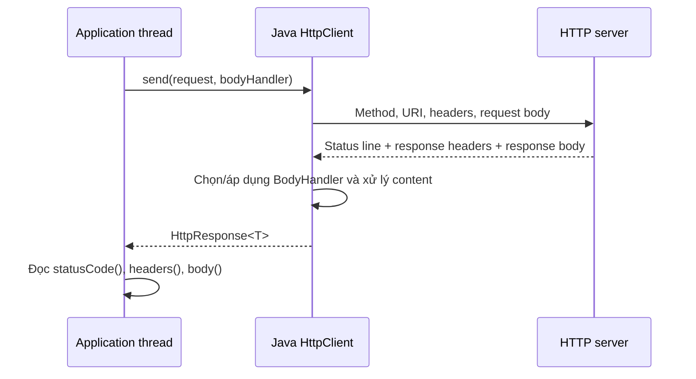

# Gửi HTTP đồng bộ bằng HttpClient.send và diễn giải statusCode, headers, body trong Java 17

## 1. Mục tiêu: nhận phản hồi HTTP không chỉ là lấy chuỗi JSON

Java 11 trở lên có `java.net.http.HttpClient`, và Java 17 dùng ổn định API này để gửi HTTP/HTTPS request. Với phương thức **`send(HttpRequest, HttpResponse.BodyHandler<T>)`**, thread gọi sẽ chờ việc gửi request và nhận phản hồi theo chiến lược xử lý body đã chọn. Kết quả trả về là một **`HttpResponse<T>`** gồm nhiều phần có ý nghĩa **khác nhau**:

- **`statusCode()`:** mã trạng thái HTTP, cho biết server hoặc thành phần HTTP trả về kết quả loại gì, chẳng hạn `200`, `201`, `204`, `302`, `404`, `500`.
- **`headers()`:** các HTTP response header, ví dụ `Content-Type`, `Location`, `Cache-Control`, `ETag`. Header bổ sung ngữ nghĩa **định dạng, điều hướng, cache, độ dài, chính sách**, không phải bản thân payload.
- **`body()`:** nội dung phản hồi được **BodyHandler** biến thành kiểu Java bạn chọn. Nó có thể là `String`, `byte[]`, `Path`, `InputStream` hoặc `Void`; **không** mặc định luôn là JSON/String.
- **`uri()`, `version()`, `request()`, `previousResponse()`:** thêm thông tin về URI, phiên bản HTTP, request tương ứng và chuỗi redirect đã được tự động theo khi cấu hình cho phép.

Một nhầm lẫn thường gây bug: **HTTP status 404 hoặc 500 thường không làm `HttpClient.send` tự ném exception**. Nếu server trả một HTTP response hợp lệ, `send` vẫn có thể trả `HttpResponse` bình thường; ứng dụng cần **kiểm tra status**, đọc headers/body phù hợp và quyết định đó là thành công hay lỗi nghiệp vụ.

Bài học tập trung vào **gửi đồng bộ bằng `send` và diễn giải đúng ba kết quả `statusCode`, `headers`, `body`** trong bối cảnh networking; đồng thời giải thích redirect, charset, timeout, ngoại lệ, lựa chọn BodyHandler, cleanup, và ví dụ Java 17 có server loopback để chạy được ngoại tuyến.

## 2. Một request/response đi qua những bước nào?



**Đồng bộ** có nghĩa thread gọi `send` đợi kết quả phù hợp với `BodyHandler`. Không có nghĩa HTTP/TCP bên dưới không thể hoạt động bất đồng bộ, hoặc mọi công việc ở server đã commit bền vững. Với `BodyHandlers.ofInputStream()`, `send` có thể trả khi stream nội dung đã sẵn sàng để caller đọc tiếp; **caller vẫn chịu trách nhiệm tiêu thụ/đóng stream**. Với `ofString`, nội dung được nhận và giải mã thành chuỗi trước khi `body()` có thể được dùng.

Các thành phần không được đánh đồng:

| Lớp | Điều nhìn thấy | Điều không tự được bảo đảm |
|---|---|---|
| Kết nối/transport | I/O truyền byte hoặc lỗi mạng | Server đã xử lý nghiệp vụ thành công |
| HTTP response | Status + headers + content do server gửi | Mã `2xx` phù hợp với mọi kỳ vọng riêng của ứng dụng |
| BodyHandler | Biến content thành một kiểu Java | Nội dung JSON/XML hợp schema, an toàn hoặc đúng nghiệp vụ |
| Business logic | Kiểm tra status/header/body và data | Tác động downstream exactly-once nếu thiếu contract khác |

## 3. Dựng HttpClient và HttpRequest chuẩn Java 17

Ví dụ gửi GET đến một endpoint **chỉ minh họa cấu trúc API**; địa chỉ `https://example.com` là host ví dụ, không cần gọi thật khi đọc bài:

```java
// Đoạn minh họa trong một phương thức có thể ném Exception.
HttpClient client = HttpClient.newBuilder()
        .connectTimeout(Duration.ofSeconds(3))
        .followRedirects(HttpClient.Redirect.NEVER)
        .build();

HttpRequest request = HttpRequest.newBuilder()
        .uri(URI.create("https://example.com/products/42"))
        .timeout(Duration.ofSeconds(5))
        .header("Accept", "application/json")
        .GET()
        .build();

HttpResponse<String> response = client.send(
        request, HttpResponse.BodyHandlers.ofString(
                StandardCharsets.UTF_8));
```

Các import cần thiết cho đoạn minh họa: `java.net.URI`, `java.net.http.HttpClient`, `HttpRequest`, `HttpResponse`, `java.time.Duration` và `java.nio.charset.StandardCharsets`. Chương trình đầy đủ ở mục 11 đã bao gồm import và server thực để kiểm thử.

### Vai trò của từng thành phần

1. `HttpClient.newBuilder()` tạo cấu hình client như connect timeout, phiên bản giao thức ưu tiên, redirect policy, proxy, SSL và authenticator nếu cần.
2. `HttpRequest.newBuilder()` tạo request có URI, method, headers, body publisher (khi cần) và request timeout.
3. `HttpResponse.BodyHandlers.ofString(StandardCharsets.UTF_8)` quyết định cách nhận body: giải mã byte thành String bằng charset đã chỉ định.
4. `client.send(request, bodyHandler)` gửi request **đồng bộ** và có thể ném `IOException` hoặc `InterruptedException`. Khi trả thành công, bạn nhận `HttpResponse<String>`.
5. `response.statusCode()` **không** tự phân loại JSON error hoặc business error; `response.headers()` và `response.body()` cần được diễn giải theo contract.

**Tạo HttpClient dùng lại:** nên thường tái sử dụng `HttpClient` thay vì tạo client mới cho từng request, để runtime có thể quản lý kết nối/tài nguyên hiệu quả. Đặc biệt **trong Java 17**, `HttpClient` **không triển khai `AutoCloseable`**, nên không dùng `try (HttpClient client = ...)` với mục tiêu biên dịch trên Java 17. Các phiên bản Java mới hơn có lifecycle API khác; bài này cố định tương thích JDK 17.

### Timeout có hai ý nghĩa khác nhau

- `HttpClient.Builder.connectTimeout(...)`: liên quan thời hạn thiết lập **kết nối mới**; không thay thế toàn bộ request deadline.
- `HttpRequest.Builder.timeout(...)`: giới hạn thời gian phản hồi request theo semantics `HttpClient`. Khi hết hạn, `send` có thể ném `HttpTimeoutException` hoặc `HttpConnectTimeoutException` (liên quan thời hạn kết nối).
- Còn cần **deadline nghiệp vụ tổng** cho nhiều call, retry, parsing và downstream processing; không suy ra `connectTimeout(3s)` và `request.timeout(5s)` tự quản lý cả workflow gồm nhiều request.

Đừng coi timeout là bằng chứng server chưa xử lý request. Nếu request có side effect, response bị mất có thể khiến business outcome **chưa xác định**.

## 4. Kết quả đầu tiên: `statusCode()`

`response.statusCode()` trả một số nguyên đại diện HTTP status code. Nên phân loại theo **nhóm 1xx–5xx**, nhưng phải đọc code cụ thể và contract ứng dụng:

| Dải | Ý nghĩa khái quát | Ví dụ thường gặp |
|---|---|---|
| **1xx** | Phản hồi thông tin/tạm thời trong giao thức | `100 Continue`; thường không phải phản hồi cuối của `send` |
| **2xx** | Request được xử lý thành công ở mức HTTP theo semantics cụ thể | `200 OK`, `201 Created`, `202 Accepted`, `204 No Content` |
| **3xx** | Redirection hoặc kết quả có điều kiện liên quan biểu diễn | `301`, `302`, `303`, `307`, `308`, `304 Not Modified` |
| **4xx** | Lỗi phía request/client theo semantics HTTP | `400`, `401`, `403`, `404`, `409`, `412`, `429` |
| **5xx** | Server/gateway không hoàn thành request phù hợp | `500`, `502`, `503`, `504` |

**Quan trọng:** `HttpClient.send` *không mặc định ném lỗi chỉ vì response là `404` hoặc `500`*. Một response HTTP `404` hợp lệ sẽ được trả về như một `HttpResponse`; bạn phải tự xem body lỗi, log hoặc chuyển thành exception domain nếu API contract cần.

### Không gom mọi 2xx thành “đã hoàn tất nghiệp vụ”

- `200 OK`: request thành công theo method; body có thể chứa dữ liệu hoặc thông tin kết quả.
- `201 Created`: resource mới đã được tạo; `Location` thường chỉ URI của resource tương ứng.
- `202 Accepted`: server **đã chấp nhận yêu cầu**, nhưng xử lý có thể chưa hoàn tất; thường cần polling/status endpoint hoặc callback theo contract.
- `204 No Content`: thành công **không có response body**. Đừng parse một String rỗng thành JSON rồi báo lỗi sai.

### 3xx cần xét redirect policy

Một response `302 Found` có thể có header `Location`; nếu cấu hình `HttpClient.Redirect.NEVER`, client **không tự đi tiếp** và bạn sẽ thấy status `302` cùng Location trong phản hồi. Nếu cho phép redirect, `HttpClient` có thể thực hiện thêm request; khi đó `response.statusCode()` thường là status của **response cuối**, `response.uri()` có thể là URI sau redirect và `previousResponse()` có thể mô tả lịch sử trước đó.

**`304 Not Modified`** liên quan conditional request/cache, **không phải** redirect bắt buộc mở URL từ `Location`. Đừng xử lý mọi 3xx giống nhau.

### 4xx và 5xx cần diễn giải theo giao thức ứng dụng

`404 Not Found` có thể nghĩa resource không tồn tại, bị ẩn do permission, hoặc server không tìm thấy endpoint. `401` thường liên quan yêu cầu xác thực; `403` là từ chối quyền truy cập, `429` liên quan rate limiting. `500/503` có thể liên quan server lỗi/tạm quá tải, nhưng **không tự động bảo đảm** retry sẽ an toàn.

Đừng kiểm tra chung `status >= 400` rồi âm thầm vứt error body: body có thể chứa mã lỗi domain, correlation ID, thông tin retry hoặc validation detail; nhưng **không log tràn dữ liệu nhạy cảm**.

### Ví dụ xử lý một cách có chủ đích

```java
// Đoạn minh họa: response là HttpResponse<String>.
int status = response.statusCode();
if (status >= 200 && status < 300) {
    // Xử lý thành công theo contract; 202/204 cần nhánh riêng.
} else if (status == 404) {
    // Resource chưa có hoặc không được công bố.
} else if (status == 429 || status == 503) {
    // Xem Retry-After, deadline, idempotency trước khi retry.
} else {
    // Phân tích nội dung lỗi và trả kết quả phù hợp.
}
```

Đoạn trên **không hoàn chỉnh về tất cả các code**; mục đích là cho thấy việc phân loại status phải tùy API. Không tự retry mọi request bị `5xx`, đặc biệt những lệnh POST có thể đã được áp dụng trước lúc lỗi.

## 5. Kết quả thứ hai: `headers()` và cấu trúc `HttpHeaders`

`response.headers()` trả `java.net.http.HttpHeaders`. Nó chứa **nhiều tên header**, mỗi tên có thể có **một hoặc nhiều giá trị**. Các phương thức thường dùng:

- `headers().firstValue("Content-Type")` trả `Optional<String>`.
- `headers().allValues("Set-Cookie")` trả `List<String>`, có thể gồm nhiều giá trị.
- `headers().map()` trả map tên header tới danh sách giá trị; hữu ích khi quan sát nhưng không nên giả định thứ tự trình bày.
- `headers().firstValueAsLong("Content-Length")` trả `OptionalLong` nếu có và diễn giải được theo quy tắc API.

**Tên trường HTTP không phân biệt chữ hoa/thường.** Vì vậy `firstValue("content-type")` hoặc `firstValue("CONTENT-TYPE")` đều phải hoạt động với header `Content-Type`. Còn **giá trị** có thể có quy tắc cú pháp riêng và không phải giá trị nào cũng được so sánh bằng cách lower-case vô điều kiện.

```java
// Đoạn minh họa; response có kiểu HttpResponse<String>.
String mediaType = response.headers()
        .firstValue("content-type")
        .orElse("<không cung cấp>");

String location = response.headers()
        .firstValue("LOCATION")
        .orElse("<không có>");

List<String> cookies = response.headers()
        .allValues("Set-Cookie");
```

### Một số header quan trọng

| Header | Ý nghĩa khi diễn giải | Sai lầm dễ gặp |
|---|---|---|
| `Content-Type` | Loại nội dung, ví dụ `application/json` hoặc `text/plain; charset=utf-8` | Thấy String là tự động có đối tượng JSON đã parse |
| `Content-Length` | Độ dài content theo quy tắc của HTTP (đơn vị byte) | So với `response.body().length()` là số UTF-16 code units |
| `Content-Encoding` | Content coding như `gzip` khi áp dụng | Nhầm với charset; đọc sai byte hoặc giải nén không phù hợp |
| `Location` | URI liên quan chuyển hướng hoặc resource mới | Mọi Location là redirect; `201` có thể dùng Location cho resource mới |
| `ETag` | Validator của representation/resource | Coi ETag như khóa duy nhất để chống trùng POST |
| `Last-Modified` | Thời điểm modification theo server | Xem như đồng hồ đảm bảo tuyệt đối hoặc tự kết luận nội dung không đổi |
| `Cache-Control` | Chỉ thị caching | Coi có `max-age` là response luôn được lưu cache bất kể auth |
| `Retry-After` | Gợi ý thời gian retry trong những status phù hợp | Retry vô hạn hoặc bỏ qua deadline/idempotency |
| `WWW-Authenticate` | Challenge liên quan xác thực | Cứ gửi lại thông tin đăng nhập vào endpoint không đáng tin |
| `Vary` | Những request-header có thể ảnh hưởng lựa chọn representation | Dùng cache key chỉ theo URL trong mọi trường hợp |
| `Set-Cookie` | Một hoặc nhiều cookie theo cú pháp riêng | Gom mọi cookie vào một chuỗi bằng dấu phẩy không đúng cách |
| `X-Request-ID` (tùy API) | Correlation ID cho log/trace | Tin giá trị do bên ngoài cung cấp mà không kiểm tra |

**Không giả định header luôn tồn tại.** `firstValue` trả `Optional` chính để xử lý vắng mặt; gọi `get()` khi không kiểm tra dễ gây `NoSuchElementException`. Header còn có thể có nhiều giá trị hoặc cú pháp phức tạp: muốn parse `Cache-Control`, `Link` hay `Set-Cookie` đúng cần tuân theo grammar của từng trường.

### Headers có thể tiết lộ thông tin nhạy cảm

Đừng dump toàn bộ headers vào log production. `Set-Cookie`, session IDs, authorization-related fields hoặc metadata người dùng có thể nhạy cảm. Tách những header cần cho diagnostics và áp dụng redaction/allowlist.

## 6. Kết quả thứ ba: `body()` phụ thuộc BodyHandler

Điểm quyết định **kiểu dữ liệu** của `HttpResponse<T>` là đối số thứ hai của `send`:

```java
// Mã minh họa: request và client đã có.
HttpResponse<String> textResponse = client.send(
        request,
        HttpResponse.BodyHandlers.ofString(StandardCharsets.UTF_8));
String text = textResponse.body();
```

`BodyHandler<T>` tạo `BodySubscriber<T>` phù hợp với phản hồi; **T không bắt buộc là String**. Không phải mọi response đều có body, và “body đọc thành công” không nói status là 2xx.

| BodyHandler | Kiểu `body()` | Khi nên dùng |
|---|---|---|
| `BodyHandlers.ofString(StandardCharsets.UTF_8)` | `String` | Text/JSON/HTML khi đã xác định charset |
| `BodyHandlers.ofString()` | `String` | Text theo quyết định charset của handler từ response; phải biết contract |
| `BodyHandlers.ofByteArray()` | `byte[]` | Binary hoặc cần tự giải mã với metadata/checksum |
| `BodyHandlers.ofFile(path)` | `Path` | Tải nội dung xuống file; quản lý status/path/disk và cleanup |
| `BodyHandlers.ofInputStream()` | `InputStream` | Đọc theo stream khi muốn xử lý tuần tự, kiểm soát bộ nhớ |
| `BodyHandlers.discarding()` | `Void` | Có chủ đích không cần lưu response content |
| `BodyHandlers.ofLines()` | `Stream<String>` | Phản hồi dạng text theo dòng; phải quản lý đóng stream |

**Chọn handler trước khi biết body.** Nếu API thường trả file lớn nhưng lỗi trả JSON nhỏ, dùng `BodyHandlers.ofFile` cho mọi status có thể khiến một body lỗi bị ghi vào file dự kiến là file dữ liệu. Có thể dùng `BodyHandlers.ofFileDownload` khi thích hợp hoặc `BodyHandlers.fromSubscriber`/`BodyHandlers.ofInputStream`/custom BodyHandler chọn chiến lược theo `ResponseInfo.statusCode()` và headers. Không coi status/body type là độc lập.

### 6.1. `ofString` giải mã byte thành ký tự

Với:

```http
HTTP/1.1 200 OK
Content-Type: text/plain; charset=utf-8

Xin chào
```

`BodyHandlers.ofString(StandardCharsets.UTF_8)` giải mã byte theo UTF-8. Nếu server gửi text bằng charset khác, dùng UTF-8 sai có thể hiển thị lỗi ký tự. Ngược lại, `BodyHandlers.ofByteArray()` giữ byte để kiểm tra/giải mã tùy yêu cầu.

**`Content-Length` không phải độ dài String.** HTTP content length tính bằng **byte** của content được truyền, còn `String.length()` trong Java tính theo **UTF-16 code units**. Ví dụ ký tự tiếng Việt có thể chiếm nhiều byte trong UTF-8 nhưng không phải nhiều ký tự Java tương ứng.

### 6.2. String không tự biến thành JSON object

`HttpResponse<String>.body()` là **chuỗi** dù server trả `Content-Type: application/json`. Muốn lấy DTO Java, bạn cần thư viện parser như Jackson/Gson/Jakarta JSON hoặc logic hợp lệ khác, sau đó **validate schema và dữ liệu**. Nội dung body không tin cậy dù status là 200; tránh đưa thẳng vào SQL, log, HTML template mà không escape/kiểm tra.

### 6.3. `ofInputStream` cần close

`ofInputStream` cung cấp stream nội dung để caller tiêu thụ/đóng. Ví dụ **mã minh họa**:

```java
HttpResponse<InputStream> r = client.send(
        request, HttpResponse.BodyHandlers.ofInputStream());

try (InputStream in = r.body()) {
    // Đọc tuần tự, có giới hạn kích thước, xử lý nội dung.
}
```

Nếu không đọc/đóng stream, tài nguyên kết nối có thể tiếp tục bị chiếm và gây ảnh hưởng connection reuse. Với dữ liệu lớn, stream giúp tránh đưa toàn bộ body vào heap cùng lúc; nhưng cần giới hạn kích thước thực tế, deadline và xử lý lỗi khi đang đọc.

### 6.4. Body không tồn tại khác body JSON rỗng

Status `204 No Content` **không có response content**; `304 Not Modified` cũng không trả representation body. Với `BodyHandlers.ofString`, response hợp lệ không có content thường tạo `String` rỗng. Đừng cố parse như JSON rồi báo “server trả JSON lỗi” nếu contract vốn không có body.

Một `404` **có thể có body** chứa thông báo lỗi. Không được suy luận rằng “4xx thì body luôn null” hoặc “status không 200 thì bỏ qua body”.

## 7. Đọc ba phần cùng nhau để hiểu đúng response

Xét response:

```http
HTTP/1.1 201 Created
Location: /items/42
Content-Type: application/json

{"id":42,"name":"book"}
```

Diễn giải đúng:

- **`statusCode() == 201`**: server báo resource được tạo thành công theo semantics HTTP.
- **`headers().firstValue("Location")`**: có thể cung cấp URI của resource mới. `Location` không phải một body JSON và không buộc client tự động đi theo như redirect.
- **`headers().firstValue("Content-Type")`**: biểu diễn response content theo media type; cần parser phù hợp nếu muốn DTO.
- **`body()`** với `ofString(UTF_8)` là chuỗi chứa JSON text, không phải object Java.
- **Business validation**: nếu API yêu cầu trường `id`, hãy parse/validate theo contract, xử lý trường thiếu, sai loại và status khác với dự kiến.

Một response khác:

```http
HTTP/1.1 404 Not Found
Content-Type: application/problem+json

{"type":"about:blank","title":"Not Found","status":404}
```

Không có `IOException` ở đây nếu response nhận trọn vẹn. `HttpClient.send` có thể trả `HttpResponse<String>` với `statusCode()==404` và body chứa lỗi. Ứng dụng phải quyết định chuyển thành domain exception, result object hoặc code xử lý fallback.

### Một mẫu phân loại trả kết quả

```java
// Mã minh họa dùng biến HttpResponse<String> response.
int status = response.statusCode();
String body = response.body();

if (status == 200) {
    // Parse body theo media type và API contract.
} else if (status == 201) {
    // Xem Location và representation vừa được tạo.
} else if (status == 204) {
    // Thành công nhưng không parse body.
} else if (status == 404) {
    // Đọc error body có giới hạn, trả not-found/domain error.
} else {
    // Chính sách khác dựa vào status cụ thể, retry budget...
}
```

Không sử dụng một nhánh cứng `status == 200` cho mọi API: POST thành công có thể trả 201, DELETE trả 204, job bất đồng bộ trả 202; khác status **không tự đồng nghĩa lỗi**.

## 8. Redirect: nhìn thấy 302 hay response cuối phụ thuộc HttpClient

`HttpClient.Builder.followRedirects(...)` có lựa chọn:

- `HttpClient.Redirect.NEVER`: không tự động theo redirect; caller nhận response `3xx` cùng `Location` nếu server gửi.
- `HttpClient.Redirect.NORMAL`: cho phép redirect bình thường, nhưng không tự chuyển từ HTTPS sang HTTP theo chính sách NORMAL.
- `HttpClient.Redirect.ALWAYS`: cho phép redirect rộng hơn; phải cân nhắc rủi ro gửi thông tin bí mật sang host khác hoặc giảm mức bảo vệ.

**Không coi Redirect.ALWAYS là mặc định an toàn.** Với API nội bộ, webhook, hệ thống xử lý URL do người dùng cung cấp, cần allowlist host, hạn chế scheme, xử lý SSRF, bảo vệ credentials và tránh redirect tới mạng nội bộ không mong muốn.

Nếu bật followRedirects, response cuối có thể là `200` sau một hoặc nhiều `301/302`; bạn không nhìn thấy `302` trực tiếp ở `statusCode()` cuối. Kiểm tra `response.previousResponse()` nếu muốn biết lịch sử redirect, và `response.uri()` nếu cần URI response cuối.

Với `Redirect.NEVER`:

```text
GET /redirect
<- 302 Found
   Location: /ok
   Body: redirect
```

Ứng dụng thấy status `302` và Location `/ok`. **Đừng nhầm** `Location` ở `201 Created` với redirect: cùng header có ý nghĩa phù hợp theo status và contract.

## 9. Exception khi `send`: tách lỗi mạng khỏi HTTP error status

Chữ ký của `send` trong Java 17 có thể ném:

```java
// Chữ ký API minh họa (các generic được rút gọn theo ngữ cảnh).
<T> HttpResponse<T> send(
        HttpRequest request, HttpResponse.BodyHandler<T> handler)
        throws IOException, InterruptedException;
```

Hai hướng lỗi khác nhau:

- **Lỗi ở mức Java/transport:** DNS không phân giải được, không kết nối, TLS handshake lỗi, network reset, timeout, nội dung nhận bị hỏng, lỗi đọc body, v.v. Có thể ném `IOException` hoặc subclass.
- **HTTP response status báo lỗi:** server trả `400`, `404`, `429`, `500` trong một response HTTP hợp lệ. **Không bắt buộc ném exception**; ứng dụng nhận status và body.

### Xử lý timeout, I/O và interruption

```java
// Mã minh họa trong phương thức có client và request.
try {
    HttpResponse<String> response = client.send(
            request,
            HttpResponse.BodyHandlers.ofString(StandardCharsets.UTF_8));
    // Kiểm tra statusCode/headers/body tại đây.
} catch (HttpTimeoutException timeout) {
    // Client chưa nhận kết quả đúng hạn. Outcome có thể unknown.
} catch (IOException transportError) {
    // Network, SSL, stream hoặc lỗi I/O khác.
} catch (InterruptedException interrupted) {
    Thread.currentThread().interrupt();
    // Ngừng/đánh dấu request bị hủy theo lifecycle ứng dụng.
}
```

Các import cần có cho đoạn này gồm `java.net.http.HttpTimeoutException`, `java.io.IOException`. `HttpConnectTimeoutException` kế thừa `HttpTimeoutException`, nên nếu muốn phân biệt connect timeout với các timeout khác phải bắt đúng thứ tự hoặc kiểm tra subtype.

**Không nuốt `InterruptedException`.** Phục hồi interrupt flag giúp tầng gọi/chính sách hủy nhận biết; sau đó dừng tác vụ phù hợp. Không gọi `send` lại vô hạn nếu thread đang bị hủy.

### Timeout không chứng minh server chưa áp dụng lệnh

Giả sử client gửi `POST /payments` rồi chờ response. Nếu `send` timeout, server có thể đã commit thanh toán nhưng response bị mất. Retry POST với ID mới có thể tạo hai giao dịch. Cần contract hỗ trợ **idempotency key**, request ID, đối soát trạng thái, retry có giới hạn.

Với GET/HEAD/PUT/DELETE, tính safe/idempotent của method giúp xây retry policy nhưng vẫn cần deadline tổng, backoff, kiểm tra status, authorization và hiểu hành vi thực tế của API. Không có “một loại IOException ⇒ an toàn retry mọi thứ”.

## 10. Lựa chọn BodyHandler theo kích thước và an toàn bộ nhớ

### Body text nhỏ và đã biết contract

`BodyHandlers.ofString(UTF_8)` là lựa chọn đơn giản để học và để xử lý API JSON/text nhỏ. Nhưng body có thể quá lớn, khiến JVM tiêu tốn nhiều heap khi gom toàn bộ dữ liệu. Với endpoint không tin cậy hoặc file tải lớn, **cần giới hạn body size** bằng cơ chế streaming/giới hạn bytes, không mặc định server luôn gửi `Content-Length` đúng và nhỏ.

### Nội dung nhị phân

`BodyHandlers.ofByteArray()` phù hợp khi cần xử lý byte chính xác (ảnh, file, checksum, charset khác). Không dùng `String` để chứa dữ liệu binary rồi lưu lại vì có thể mất tính toàn vẹn khi decode/encode.

### Lưu file

`BodyHandlers.ofFile(path)` có thể nhận body vào một `Path`. Nếu API trả `404` cùng text error, đường xử lý không nên giữ nhầm nó thành file “thành công”. Kiểm tra status và thiết kế body handling phù hợp; với file tạm, cần chính sách rename/commit chỉ sau khi xác nhận status/checksum, cleanup file lỗi và bảo vệ path khỏi path traversal nếu tên lấy từ dữ liệu ngoài.

### Stream body

Với `ofInputStream`, `send` có thể trả trước khi toàn bộ body được đọc; caller phải đọc/đóng stream trong `try-with-resources`, bảo vệ memory/budget và không dùng connection vô hạn vì remote gửi dữ liệu chậm. Những handlers như `ofLines()` cũng có resource lifecycle cần quản lý.

### Charset và Content-Encoding là hai khái niệm khác

`charset=utf-8` mô tả **cách biến byte thành ký tự** cho text. `Content-Encoding: gzip` (nếu có) mô tả **content coding** trên bytes. Đừng coi việc chọn `ofString(UTF_8)` tự động giải quyết mọi content coding/cấu trúc dữ liệu. Với response khác contract, hãy kiểm tra header và cách server/client xử lý mã hóa theo API.

### Không tin tuyệt đối Content-Length

Một response có thể được truyền bằng các cơ chế framing khác nhau, có nén hoặc không gửi content length rõ ràng. `Content-Length` có thể vắng mặt; trong `HEAD` nó có thể mô tả độ dài GET tương ứng mà **HEAD không có body**. Không dựa vào đó để chứng minh số ký tự đã nhận.

## 11. Chương trình Java 17 chạy thật: status, header, body, 404, 204 và redirect

Để không phụ thuộc Internet, ví dụ tạo một **HttpServer loopback** ngay trong JVM rồi dùng `HttpClient.send(...)` để gửi **năm request GET đồng bộ**, nhận các response khác nhau. Mục tiêu là chứng minh API và output có thể kiểm tra được, không cần tài khoản, token, DNS hoặc framework.

Các endpoint giả lập:

| Endpoint | Status | Header nổi bật | Response content |
|---|---|---|---|
| `GET /ok` | `200` | `Content-Type` và `X-Lesson` | `Hello Java 17` |
| `GET /created` | `201` | `Location: /items/42` | `created` |
| `GET /missing` | `404` | `Content-Type` | `not found` |
| `GET /empty` | `204` | Không có body | Rỗng |
| `GET /redirect` | `302` | `Location: /ok` | `redirect`; không follow vì cấu hình NEVER |

**Lưu ý:** `201` trên GET chỉ phục vụ minh họa kỹ thuật **đọc status/header** trong một server giả lập. Theo HTTP semantics, **tạo tài nguyên qua GET là sai ngữ nghĩa safe**, và API thực tế nên dùng POST/PUT phù hợp. Ví dụ này không tạo resource khi gọi `GET /created`; server chỉ trả response mô phỏng `201` để cho thấy cách đọc Location. Khi xây API thực, hãy dùng `201` cho thao tác tạo resource đúng contract, không cho GET thao tác tạo.

File **`HttpClientSyncSendDemo.java`**:

```java
import com.sun.net.httpserver.HttpExchange;
import com.sun.net.httpserver.HttpServer;
import java.io.IOException;
import java.io.OutputStream;
import java.net.InetAddress;
import java.net.InetSocketAddress;
import java.net.URI;
import java.net.http.HttpClient;
import java.net.http.HttpRequest;
import java.net.http.HttpResponse;
import java.nio.charset.StandardCharsets;
import java.time.Duration;

public class HttpClientSyncSendDemo {
    private static void respond(HttpExchange exchange, int status,
                                String content) throws IOException {
        byte[] data = content.getBytes(StandardCharsets.UTF_8);
        exchange.getResponseHeaders().set(
                "Content-Type", "text/plain; charset=utf-8");
        exchange.getResponseHeaders().set("X-Lesson", "sync-send");

        if (status == 204) {
            exchange.sendResponseHeaders(204, -1);
            exchange.close();
            return;
        }

        exchange.sendResponseHeaders(status, data.length);
        try (OutputStream out = exchange.getResponseBody()) {
            out.write(data);
        }
        exchange.close();
    }

    private static void handle(HttpExchange exchange)
            throws IOException {
        try {
            if (!exchange.getRequestMethod().equals("GET")) {
                exchange.getResponseHeaders().set("Allow", "GET");
                respond(exchange, 405, "method not allowed");
                return;
            }
            switch (exchange.getRequestURI().getPath()) {
                case "/ok" -> respond(exchange, 200, "Hello Java 17");
                case "/created" -> {
                    exchange.getResponseHeaders().set(
                            "Location", "/items/42");
                    respond(exchange, 201, "created");
                }
                case "/missing" -> respond(exchange, 404, "not found");
                case "/empty" -> respond(exchange, 204, "");
                case "/redirect" -> {
                    exchange.getResponseHeaders().set("Location", "/ok");
                    respond(exchange, 302, "redirect");
                }
                default -> respond(exchange, 404, "not found");
            }
        } catch (IOException error) {
            exchange.close();
            throw error;
        }
    }

    private static HttpResponse<String> get(HttpClient client,
                                            String base, String path)
            throws IOException, InterruptedException {
        HttpRequest request = HttpRequest.newBuilder()
                .uri(URI.create(base + path))
                .timeout(Duration.ofSeconds(3))
                .GET()
                .build();
        return client.send(request,
                HttpResponse.BodyHandlers.ofString(
                        StandardCharsets.UTF_8));
    }

    public static void main(String[] args) throws Exception {
        InetAddress loopback = InetAddress.getByAddress(
                new byte[] { 127, 0, 0, 1 });
        HttpServer server = HttpServer.create(
                new InetSocketAddress(loopback, 0), 0);
        server.createContext("/", HttpClientSyncSendDemo::handle);
        server.start();
        try {
            String base = "http://127.0.0.1:"
                    + server.getAddress().getPort();
            HttpClient client = HttpClient.newBuilder()
                    .followRedirects(HttpClient.Redirect.NEVER)
                    .connectTimeout(Duration.ofSeconds(2))
                    .build();

            HttpResponse<String> ok = get(client, base, "/ok");
            HttpResponse<String> created = get(
                    client, base, "/created");
            HttpResponse<String> missing = get(
                    client, base, "/missing");
            HttpResponse<String> empty = get(
                    client, base, "/empty");
            HttpResponse<String> redirect = get(
                    client, base, "/redirect");

            if (ok.statusCode() != 200
                    || created.statusCode() != 201
                    || missing.statusCode() != 404
                    || empty.statusCode() != 204
                    || redirect.statusCode() != 302
                    || !empty.body().isEmpty()) {
                throw new IllegalStateException(
                        "Unexpected HTTP response");
            }

            System.out.println(
                    "GET /ok -> " + ok.statusCode());
            System.out.println("content-type: "
                    + ok.headers().firstValue("content-type")
                            .orElse("<missing>"));
            System.out.println("x-lesson: "
                    + ok.headers().firstValue("X-LESSON")
                            .orElse("<missing>"));
            System.out.println("body: " + ok.body());
            System.out.println(
                    "GET /created -> " + created.statusCode());
            System.out.println("location: "
                    + created.headers().firstValue("location")
                            .orElse("<missing>"));
            System.out.println(
                    "GET /missing -> " + missing.statusCode());
            System.out.println("error body: " + missing.body());
            System.out.println(
                    "GET /empty -> " + empty.statusCode());
            System.out.println(
                    "empty body length: " + empty.body().length());
            System.out.println(
                    "GET /redirect -> " + redirect.statusCode());
            System.out.println("redirect location: "
                    + redirect.headers().firstValue("LOCATION")
                            .orElse("<missing>"));
        } finally {
            server.stop(0);
        }
    }
}
```

Biên dịch/chạy **trên JDK 17 trở lên**, trong thư mục chứa file. `HttpServer` nằm trong module `jdk.httpserver`; trong lệnh sau nêu module rõ ràng để JVM truy cập API đó:

```bash
javac --release 17 --add-modules jdk.httpserver -encoding UTF-8 HttpClientSyncSendDemo.java
java --add-modules jdk.httpserver HttpClientSyncSendDemo
```

**Stdout chính xác** trên môi trường cho phép mở TCP loopback:

```text
GET /ok -> 200
content-type: text/plain; charset=utf-8
x-lesson: sync-send
body: Hello Java 17
GET /created -> 201
location: /items/42
GET /missing -> 404
error body: not found
GET /empty -> 204
empty body length: 0
GET /redirect -> 302
redirect location: /ok
```

### Phân tích output theo đúng ba thành phần

1. `GET /ok -> 200`: status là `200`, chưa nói gì về việc response body đã được parse thành DTO.
2. `content-type` lấy bằng `headers().firstValue("content-type")`, bất kể server viết tên header với chữ hoa/thường thế nào. `X-LESSON` vẫn tìm ra `X-Lesson`.
3. `body: Hello Java 17` là nội dung đã được `BodyHandlers.ofString(UTF_8)` giải mã, khác với header và status.
4. `GET /created -> 201` cùng `location: /items/42`: demo nhận một status có Location; thực tế tạo resource bằng POST/PUT phù hợp, **không làm GET biến thành operation tạo resource**.
5. `GET /missing -> 404` nhưng chương trình **không bắt IOException**: server đã gửi response hợp lệ, nên `send` trả `HttpResponse` với `statusCode()==404` và `body()=="not found"`.
6. `GET /empty -> 204`: `BodyHandlers.ofString` cho chuỗi rỗng khi response không có content; code xác nhận `empty.body().isEmpty()`.
7. `GET /redirect -> 302`, `redirect location: /ok`: do `Redirect.NEVER`, HttpClient không tự đi tiếp để lấy `/ok`, do đó status là `302`.
8. `server.stop(0)` được gọi trong `finally` để đóng local server ngay cả khi client gặp exception. Chương trình **không dùng** `try (HttpClient client=...)` vì tương thích Java 17.

Ví dụ nhằm kiểm chứng cách API đọc phản hồi, không đo throughput, không gửi tài liệu qua Internet và không giới thiệu mô hình production HTTPS server. Kết quả phụ thuộc môi trường có cho phép socket loopback hay không; khi bị chặn sẽ phát sinh lỗi I/O thay vì tự tạo output giả.

## 12. Vì sao ba phần status, headers, body phải được kiểm tra kết hợp?

Một số kịch bản thực tế dễ bị hiểu sai:

### 12.1. Status 200 nhưng Content-Type không khớp

API mong JSON, nhưng server trả `200 OK` với HTML login page hoặc text của proxy. Nếu client parse luôn body thành JSON, kết quả lỗi không nói được nguyên nhân. Hãy kiểm tra media type, sau đó parse nội dung bằng parser thích hợp, xử lý lỗi schema/validation rõ ràng.

### 12.2. Status 204 nhưng cố đọc JSON

Một yêu cầu DELETE thành công trả 204 không có body. Client dùng JSON parser trên chuỗi rỗng rồi tự báo “server trả JSON sai” là sai cách diễn giải. Chấp nhận 204 theo contract như một kết quả thành công không có representation.

### 12.3. Status 404 vẫn có body

Server trả 404 với error JSON. `send` không ném exception nếu đã nhận HTTP response hợp lệ. Client nên đọc status và error body **có giới hạn**, nhưng không phân loại 404 thành “DNS/network failure”.

### 12.4. Status 302 mà chỉ nhìn body

Nếu redirect policy NEVER, 302 có thể trả một body ngắn; nội dung thực sự cần xử lý thường nằm trong `Location`. Nếu đã follow redirect, status ở phản hồi cuối khác với status trung gian; phải biết client đang cấu hình thế nào.

### 12.5. Status 202 không chứng minh job đã xong

Server nhận yêu cầu xử lý nền, trả `202 Accepted` và `Location` trỏ tới status endpoint. Nếu client đánh dấu thanh toán hoàn tất chỉ vì 202, nó hiểu sai business outcome. Cần theo dõi trạng thái theo contract.

### 12.6. Status 200 nhưng response body quá lớn

`ofString` có thể tiêu tốn bộ nhớ để chứa toàn bộ dữ liệu. Nếu endpoint không tin cậy, cần giới hạn body size, chọn streaming/file strategy và xử lý cắt/hủy khi vượt quota. `Content-Length` có thể vắng mặt hoặc không đủ để bảo vệ mọi tình huống.

## 13. Những lỗi phổ biến khi dùng HttpClient.send

| Lỗi | Hậu quả | Cách đúng |
|---|---|---|
| Chỉ gọi `response.body()` và bỏ status | Có thể xử lý HTML/JSON lỗi như dữ liệu thành công | Luôn xét `statusCode()` và contract |
| Cho rằng 404/500 luôn ném `IOException` | Bỏ qua nhánh phản hồi HTTP lỗi hợp lệ | Phân biệt network exception và HTTP status |
| Chỉ coi `status==200` là success | Bỏ qua 201, 202, 204 hợp lệ | Phân tích status cụ thể theo method |
| Parse JSON trên 204 | Lỗi parse giả vì body phải rỗng | Xử lý no-content riêng |
| Coi `HEAD` có body như GET | Chờ/parse nội dung không tồn tại | HEAD không gửi response content |
| Lấy header bằng `map().get("Content-Type")` rồi giả định key casing cố định | Có thể không tìm được hoặc xử lý nhiều values sai | Dùng `firstValue`/`allValues` |
| Gọi `Optional.get()` không kiểm tra | `NoSuchElementException` khi header vắng | `orElse`, `ifPresent`, validate required field |
| Coi `Content-Length` là `String.length()` | Sai với UTF-8/ký tự ngoài BMP hoặc transfer semantics | Phân biệt byte length, charset và decoded String |
| Dùng `ofString` cho file lớn | Heap cao, có thể OOME | `ofFile`/`ofInputStream`, size limit |
| Không đóng `InputStream` của `ofInputStream` | Rò rỉ/giữ kết nối, không phát hiện lỗi body | `try-with-resources`, giới hạn dữ liệu |
| Gửi `HttpClient.Redirect.ALWAYS` cho URL không tin cậy | Có thể theo redirect sang host/scheme rủi ro | Redirect policy và allowlist host/scheme |
| Nhầm `Location` ở 201 là redirect | Tự GET resource sai quy trình | Diễn giải status + Location theo semantics |
| Cho rằng timeout chứng minh server chưa xử lý | Retry POST có side effect trùng | Idempotency key/đối soát |
| Nuốt `InterruptedException` | Hủy request kém, thread tiếp tục làm việc | Restore interrupt flag và dừng đúng lifecycle |
| Tạo một HttpClient mới cho mọi request | Mất cơ hội tối ưu reuse kết nối/tài nguyên | Tái sử dụng client |
| Dùng `try (HttpClient ... )` trên JDK 17 | Không biên dịch | Java 17 client không AutoCloseable |
| Tin body/status từ server mà không validate | Injection, data/schema errors, log lộ bí mật | Validate schema, media type, redaction |
| Mặc định response 2xx là hoàn tất giao dịch | `202` có thể chỉ là accepted | Theo dõi trạng thái ứng dụng |
| Retry mọi IOException/5xx vô hạn | Tạo tải, side effect trùng, vượt deadline | Bounded retry, backoff, biết idempotency |
| Không đặt request timeout/deadline | Thread chờ quá lâu, tăng resource contention | Đặt timeout, quản lý tổng budget và hủy |

## 14. Thực hành xây một client service có thể vận hành

Đối với một API thực, thay vì rải `send` và `System.out.println` ở mọi nơi, hãy tách trách nhiệm:

1. **Tạo một HttpClient có cấu hình rõ ràng**: connect timeout, redirect policy, TLS, proxy, version preference, cookie/auth policy nếu cần.
2. **Định nghĩa request builder** theo endpoint và method: URI từ nguồn tin cậy, headers hợp lệ, BodyPublisher có giới hạn, auth đúng scope.
3. **Gửi bằng `send`** trên thread phù hợp. Đừng dùng synchronous `send` trực tiếp trong event-loop thread đang phục vụ hàng nghìn kết nối nếu nó làm tắc luồng điều phối.
4. **Phân loại status và headers trước**: success 2xx, redirect 3xx, lỗi 4xx/5xx, Content-Type, Location, Retry-After, ETag...
5. **Chọn BodyHandler** cho kiểu/size content; ưu tiên streaming hoặc file khi dữ liệu lớn, nhớ cleanup.
6. **Parse/validate body** chỉ khi contract quy định có body; tách network error với HTTP error và validation error.
7. **Áp dụng retry policy** dựa trên idempotency, request identity và tổng deadline; tránh lặp POST có side effect không có deduplication.
8. **Ghi telemetry an toàn**: method, host/path đã chuẩn hóa, status, duration, correlation ID, error class, retry count; không log Authorization/cookie/body bí mật.
9. **Kiểm thử** cả 200/201/204/302/400/404/429/500, timeout, kết nối bị reset, redirect tới host khác, charset và body lớn.
10. **Giữ ranh giới giữa HTTP success và business success**: 200 với error-in-body tùy API, 202 job đang chạy, hoặc 204 no content cần xử lý khác nhau.

### Khi nào nên cân nhắc `sendAsync`?

`sendAsync` trả `CompletableFuture<HttpResponse<T>>` thay vì chặn trực tiếp thread gọi. Nó phù hợp với pipeline không muốn block, nhưng đòi hỏi xử lý completion, callback, cancellation và resource ownership đúng cách. **Không tự suy ra sendAsync nhanh hơn mạng**; khác biệt quan trọng là mô hình điều phối thread và cách phối hợp kết quả. Bài này cố ý tập trung vào **`send` đồng bộ** để người học nắm vững status/headers/body trước.

## 15. Câu hỏi tự kiểm tra

**Câu 1.** `send` nhận HTTP `404` có luôn ném `IOException` không?

**Trả lời:** Không. Nếu đã nhận response HTTP hợp lệ, `send` có thể trả `HttpResponse` với `statusCode()==404` và body lỗi; phải phân loại HTTP status riêng với lỗi network.

**Câu 2.** `HttpResponse<String>.body()` trả gì nếu server gửi JSON?

**Trả lời:** Chuỗi text đã giải mã theo BodyHandler, không phải JSON object Java. Cần parser và validation nếu muốn DTO.

**Câu 3.** Vì sao không so `Content-Length` với `body().length()`?

**Trả lời:** Content-Length nói về **byte** theo semantics HTTP, còn String.length đếm UTF-16 code units. Ký tự UTF-8 nhiều byte, content coding hoặc no-content response làm hai khái niệm khác nhau.

**Câu 4.** Có thể tìm `Content-Type` bằng `headers().firstValue("content-type")` không?

**Trả lời:** Có. Tên header HTTP không phân biệt chữ hoa/thường; API HttpHeaders xử lý điều này. Giá trị có thể vắng mặt, nên phải xử lý Optional.

**Câu 5.** Response `204` có cần parse JSON body không?

**Trả lời:** Không. 204 là thành công không có content. Không áp dụng một parser trên chuỗi rỗng.

**Câu 6.** Khi cấu hình `Redirect.NEVER`, `GET /redirect` nhận 302 và Location. `send` có tự tới URI trong Location không?

**Trả lời:** Không. Client trả response 302 để ứng dụng tự quyết định; nếu cấu hình theo redirect, status/URI response cuối có thể khác.

**Câu 7.** Server trả `201` kèm Location, client nên hiểu Location như thế nào?

**Trả lời:** Thường URI của resource được tạo; không coi đây là lệnh redirect bắt buộc. Xét status và API contract.

**Câu 8.** `BodyHandlers.ofInputStream` có cần đóng stream không?

**Trả lời:** Có. Caller phải quản lý stream và resource lifecycle; `send` có thể trả khi stream được mở chứ chưa tiêu thụ hết body.

**Câu 9.** `send` ném `InterruptedException`, điều gì cần làm?

**Trả lời:** Khôi phục interrupt flag bằng `Thread.currentThread().interrupt()` và thực hiện chính sách hủy/cleanup, không lặng lẽ nuốt exception.

**Câu 10.** `HttpRequest.timeout(3 giây)` hết hạn trên POST thanh toán. Có thể kết luận server chưa trừ tiền không?

**Trả lời:** Không. Response có thể bị mất sau khi server đã commit. Cần idempotency key được server hỗ trợ, request ID và đối soát.

**Câu 11.** `GET /ok` trả `200` nhưng Content-Type là `text/html` dù client chờ JSON. Nên làm gì?

**Trả lời:** Không parse mù. Xem status, media type, body có giới hạn và contract; có thể server/proxy trả trang lỗi/login.

**Câu 12.** Có nên tạo `HttpClient` mới cho mọi request không?

**Trả lời:** Thường không. Reuse client giúp hiệu quả tài nguyên/kết nối; cấu hình đúng lifecycle Java 17 và chú ý client có thể được dùng từ nhiều thread theo API.

**Câu 13.** `HttpClient.send` có luôn chờ toàn bộ response body đọc hết không?

**Trả lời:** Phụ thuộc BodyHandler. Với `ofString`, phải nhận/giải mã nội dung để trả String; với `ofInputStream`, response có thể trả về cùng stream để caller đọc tiếp. Vì vậy body lifecycle có thể kéo dài qua thời điểm `send` trả.

**Câu 14.** Tại sao không retry mọi status `503` vô hạn?

**Trả lời:** Có thể quá tải hệ thống và lặp side effect không an toàn. Phải xét method, idempotency, Retry-After, deadline, backoff và trạng thái nghiệp vụ.

## 16. Checklist cuối và tài liệu tra cứu

Trước khi hoàn thiện đoạn client Java dùng `send`:

- [ ] Dùng **HttpClient tái sử dụng**, có connect/request timeout phù hợp; không dùng try-with-resources cho HttpClient trên JDK 17.
- [ ] Build đúng **HttpRequest** (URI, method, Accept/Content-Type, body khi cần, xác thực theo scope).
- [ ] Chọn `BodyHandler<T>` phù hợp kiểu/size response, hiểu T quyết định `body()` là gì.
- [ ] Sau `send`, đọc **`statusCode()` trước**, không coi 404/500 là IOException.
- [ ] Diễn giải **headers** qua `firstValue`/`allValues`, xử lý giá trị vắng mặt, không dựa vào casing/order.
- [ ] Diễn giải **body** theo status, Content-Type, charset và contract; không parse 204/304 như response có content.
- [ ] Xử lý **redirect policy** và Location có cân nhắc host/scheme và bảo mật.
- [ ] Tách **transport errors** (`IOException`, timeout) khỏi HTTP errors (`4xx/5xx`) và domain validation.
- [ ] Restore interrupt flag khi gặp `InterruptedException`; cleanup stream/file và dừng theo lifecycle.
- [ ] Có giới hạn memory/size cho body lớn và không log cookie/token/payload nhạy cảm.
- [ ] Retry có budget và idempotency/đối soát, không suy luận timeout = chưa xử lý.
- [ ] Kiểm thử status 200/201/204/302/404 và error body, header lookup không phân biệt hoa/thường, charset/redirect/timeouts.

**Tóm tắt:** `HttpClient.send(request, handler)` gửi HTTP **đồng bộ** và trả về `HttpResponse<T>` khi nhận được phản hồi theo BodyHandler; ứng dụng phải đọc **statusCode** để phân loại kết quả, **headers** để hiểu metadata/chỉ thị và **body** để xử lý content đúng kiểu. Không nhầm HTTP 404/500 với `IOException`, `204` với response chứa JSON, hoặc `String.length()` với `Content-Length`. Lựa chọn BodyHandler và chính sách timeout/redirect/retry quyết định độ đúng đắn và an toàn tài nguyên của HTTP client.

### Tài liệu chính thức

- [Java SE 17 — HttpClient.send](https://docs.oracle.com/en/java/javase/17/docs/api/java.net.http/java/net/http/HttpClient.html)
- [Java SE 17 — HttpRequest và request timeout](https://docs.oracle.com/en/java/javase/17/docs/api/java.net.http/java/net/http/HttpRequest.html)
- [Java SE 17 — HttpResponse và BodyHandlers](https://docs.oracle.com/en/java/javase/17/docs/api/java.net.http/java/net/http/HttpResponse.html)
- [Java SE 17 — HttpHeaders](https://docs.oracle.com/en/java/javase/17/docs/api/java.net.http/java/net/http/HttpHeaders.html)
- [Java SE 17 — HttpServer dùng trong bài demo](https://docs.oracle.com/en/java/javase/17/docs/api/jdk.httpserver/com/sun/net/httpserver/HttpServer.html)
- [RFC 9110 — HTTP Semantics/status/headers](https://www.rfc-editor.org/rfc/rfc9110)
- [RFC 9111 — HTTP Caching](https://www.rfc-editor.org/rfc/rfc9111)