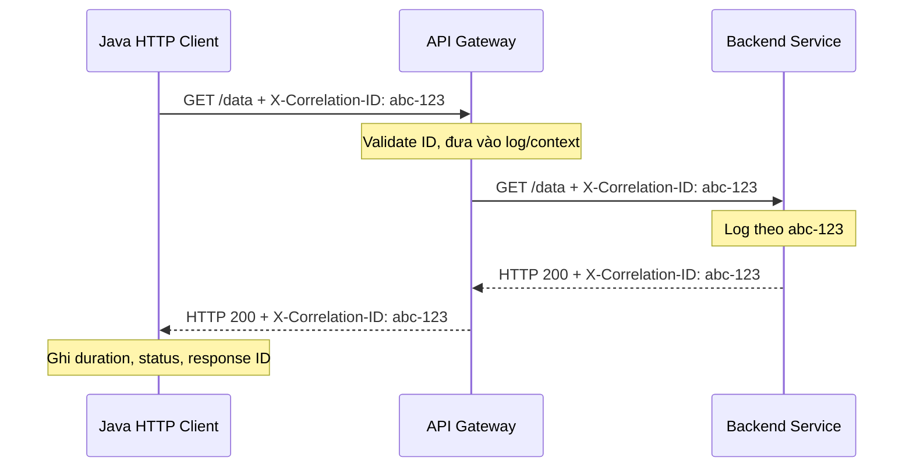

# Gắn mã tương quan để nối dấu vết máy khách với máy chủ trong Java Networking

## 1. Bối cảnh: request đi qua nhiều thành phần, log bị chia rời

Một ứng dụng Java gửi yêu cầu HTTP tới API gateway. Gateway gọi service A, service A gọi service B, rồi response đi ngược về client. Mỗi thành phần có đồng hồ, thread, log file và hệ thống monitoring riêng. Khi xuất hiện `502 Bad Gateway` hoặc timeout, việc chỉ xem log của gateway thường không đủ để trả lời:

- Client gửi yêu cầu nào, lúc nào và đã nhận status gì?
- Gateway có nhận chính yêu cầu ấy không, và đã chuyển tiếp tới backend nào?
- Backend đã nhận request, bắt đầu xử lý và hoàn thành ra sao?
- Một lần retry tạo thêm HTTP attempt nào, có liên quan logical request ban đầu không?
- Log lỗi nào thuộc đúng đường đi của yêu cầu, giữa hàng nghìn yêu cầu đồng thời?

Nếu log chỉ ghi:

```text
12:00:01 CLIENT send GET /orders
12:00:01 GATEWAY downstream call
12:00:02 BACKEND slow database
12:00:03 GATEWAY timeout
```

thì mối quan hệ giữa các dòng rất mơ hồ. **Mã tương quan** (*correlation ID*) giải quyết bài toán nhận diện liên kết bằng cách gắn **một định danh kỹ thuật nhất quán** vào metadata request, truyền nó qua các hop được cho phép và đưa nó vào log/tracing của mỗi thành phần.

Ví dụ log đã có mã:

```text
CLIENT  correlation_id=demo-req-001 method=GET /orders
GATEWAY correlation_id=demo-req-001 route=orders status=502
BACKEND correlation_id=demo-req-001 operation=query-order timeout=true
CLIENT  correlation_id=demo-req-001 status=502
```

Giờ có thể lọc theo `correlation_id=demo-req-001` để thu hẹp điều tra. **Mã tương quan không tự tạo full distributed trace**, không chứa phép đo latency, không chứng minh một request đã thành công hoặc authenticated; nó là **khóa liên kết** cho những dữ kiện khác được ghi nhận.

### Mục tiêu sau bài học

1. Hiểu correlation ID, request ID, trace ID và span ID khác nhau thế nào.
2. Biết tạo ID ở đầu logical request, gửi qua HTTP header, nhận và truyền tiếp qua gateway/service, rồi trả lại trong response khi phù hợp.
3. Biết chuẩn hóa, validate và quản lý trust boundary của ID do bên ngoài cung cấp.
4. Sử dụng `java.net.http.HttpClient` ở client và `com.sun.net.httpserver.HttpServer` ở server trong ví dụ **Java 17 biên dịch/chạy thật**.
5. Thiết kế logs có cấu trúc, thread/async context propagation, metrics và trace correlation để tìm lỗi end-to-end.
6. Tránh đưa PII/token vào ID, log injection, spoofing, cardinality cao, lỗi mất context và nhầm correlation với authentication/idempotency.

**Phạm vi:** chủ đề thuộc phần **Cấu hình và quan sát** của Java networking. Bài tập trung vào **gắn mã để nối dấu vết client ↔ server**, không thay cho một khóa học đầy đủ về tracing SDK hoặc log storage.

## 2. Đường đi của mã qua client, gateway và backend

Mô hình minh họa:



Một dòng chảy hợp lệ thường có bốn công đoạn:

1. **Bắt đầu request:** một entry point tin cậy tạo correlation ID mới nếu chưa có, hoặc tiếp nhận ID đã được upstream tin cậy cấp **theo policy**.
2. **Gửi request:** client thêm header đã thống nhất, chẳng hạn `X-Correlation-ID`, vào HTTP request.
3. **Nhận và chuyển tiếp:** server kiểm tra ID, đưa vào request context/log và **gắn vào mọi outgoing call liên quan**; đừng tạo ID mới một cách vô cớ ở mỗi hop.
4. **Trả response:** server có thể echo ID hiệu lực trong response header để client/support liên kết lỗi, đặc biệt khi server phải thay ID không hợp lệ. Response và các log vẫn cần phản ánh đúng status, duration và nghiệp vụ.

### Cùng ID không có nghĩa cùng một TCP connection

Một logical request có thể đi qua nhiều TCP connections, HTTP/2 streams, proxy, TLS tunnels, queue hoặc retry. Correlation ID là metadata ứng dụng/observability, **không phải TCP sequence number**, connection identifier hay WebSocket session ID. Hai requests trên một keep-alive connection **có thể** có correlation IDs khác nhau.

### Trường hợp bất đồng bộ

Nếu HTTP server đưa công việc vào queue rồi trả `202 Accepted`, còn worker xử lý nhiều phút sau, correlation ID nên được truyền qua **message metadata** tới worker (theo policy). Bản thân HTTP connection đã kết thúc **không làm correlation mất ý nghĩa**. Worker cần ghi rõ trace context, job ID và trạng thái xử lý để tránh suy luận `202` là hoàn tất.

## 3. Các thuật ngữ dễ nhầm

| Định danh | Mục đích chính | Phạm vi / vòng đời |
|---|---|---|
| **Correlation ID** | Gom logs/events liên quan một workflow hoặc logical request | Thường giữ nguyên qua nhiều service/hop |
| **Request ID** | Nhận diện **một HTTP request/attempt** cụ thể | Có thể thay đổi mỗi hop hoặc retry, tùy convention |
| **Trace ID** | Nhận diện một distributed trace theo tracing system | Giữ xuyên suốt những spans trong cùng trace |
| **Span ID** | Nhận diện một operation/span trong trace | **Mỗi span có ID riêng**, không giữ y nguyên qua hop |
| **Parent span ID** | Cho biết quan hệ nhân-quả giữa spans | Phụ thuộc active parent của thao tác |
| **Job/Task ID** | Nhận diện tác vụ lưu trữ/xử lý bất đồng bộ | Có thể kéo dài sau HTTP request |
| **Idempotency key** | Hỗ trợ server phát hiện lệnh có side effect bị gửi lại | Contract nghiệp vụ, **không** đồng nghĩa correlation ID |
| **User ID / Tenant ID** | Identity của người dùng/đơn vị sở hữu | Dữ liệu nghiệp vụ và security, không dùng thay correlation ID |

Một correlation ID **có thể** trùng request ID hoặc trace ID theo thiết kế của hệ thống nhỏ, nhưng cần **đặt tên và ghi rõ hợp đồng**. Đừng mặc định chúng luôn đồng nghĩa; khi có nhiều retries, một logical request nên giữ correlation ID trong khi từng attempt có request/attempt ID riêng để điều tra.

Ví dụ:

```text
logical_request correlation_id=flow-42
    attempt=1 request_id=req-a -> timeout
    attempt=2 request_id=req-b -> HTTP 200

Cả hai attempt cùng correlation_id=flow-42
nhưng không có nghĩa request_id=req-a và req-b là một HTTP exchange.
```

### Correlation ID không phải business transaction ID

Một giao dịch thanh toán có thể chứa nhiều HTTP calls, webhook, callback, database transactions và tác vụ bất đồng bộ. Correlation ID là chìa khóa observability; nó **không** chứng minh chính xác một lần thanh toán hoặc thay thế transaction ID/idempotency key do API quy định. Không lấy ID mà client tự gửi làm bằng chứng rằng user có quyền truy cập một đơn hàng.

## 4. Chọn một hợp đồng HTTP header nhất quán

HTTP không có một header `X-Correlation-ID` chung bắt buộc cho mọi ứng dụng. Đây là **quy ước phổ biến nhưng không phải chuẩn W3C**. Một số hệ thống dùng `X-Request-ID`, `X-Correlation-ID`, `Request-ID` hoặc các trường tracing chuẩn như `traceparent`.

Hãy chọn hợp đồng rõ ràng, ví dụ:

| Quy tắc | Lựa chọn minh họa |
|---|---|
| Tên header ứng dụng | `X-Correlation-ID` |
| Tên field log | `correlation_id` |
| Format ID | UUID v4 hoặc opaque ASCII ID đã kiểm soát |
| Độ dài | Tối đa 64 ký tự ASCII cho ví dụ |
| Ký tự cho phép | Chữ/số đầu, sau đó chữ/số/dấu chấm/gạch dưới/gạch ngang |
| Thiếu ID | Entry point tạo `UUID.randomUUID()` |
| ID sai format hoặc nhiều values | Bỏ giá trị không hợp lệ, tạo ID mới |
| ID đã được upstream tin cậy cấp | Validate và giữ nguyên theo policy |
| Phản hồi | Echo ID hiệu lực tại `X-Correlation-ID` |
| Chuyển tiếp downstream | Gửi đúng ID hiệu lực trên request outbound |
| Audit/security | Không coi ID là secret/auth token; không phân quyền theo nó |

**Tên HTTP header không phân biệt chữ hoa/thường.** Trong Java 17, `HttpHeaders.firstValue("x-correlation-id")` vẫn có thể tìm được header `X-Correlation-ID`. Tuy nhiên, hệ thống log/search nên dùng **một field name thống nhất** để tránh phải tìm `correlationId`, `correlation_id` và `requestId` bằng nhiều truy vấn.

### Tại sao cần hạn chế độ dài và ký tự?

ID từ HTTP request là **input không tin cậy**. Nếu để chuỗi cực dài hoặc chứa newline/control characters vào log:

- Có nguy cơ **log injection/log forging**: giả mạo một dòng log mới.
- Tốn byte trên mỗi hop và trong indexing/storage.
- Làm tăng độ phức tạp tìm kiếm và cardinality.
- Có thể tạo header ambiguity khi một request chứa nhiều giá trị hoặc intermediary gộp chúng.

Giới hạn ở ví dụ là `[A-Za-z0-9][A-Za-z0-9._-]{0,63}`: tối đa 64 ký tự ASCII, không whitespace, quote, comma hay control. **Đây là policy minh họa**, không phải tiêu chuẩn chung cho `traceparent`. Đừng dùng regex tùy tiện của bài demo để parse W3C trace context.

### Không đưa dữ liệu cá nhân vào mã

**Đừng tạo ID kiểu `email@example.com_2026-11-01`, `customer-12345-password` hoặc gắn access token vào header correlation.** Dùng định danh opaque ngẫu nhiên. ID không nên mã hóa thông tin có thể làm lộ user, device, order, secret hoặc tenant khi qua logs/third-party.

## 5. Ai có quyền tạo hoặc tin tưởng mã tương quan?

Một entry point phải phân biệt **hợp lệ về cú pháp** và **đáng tin về nguồn gốc**:

- Một client bên ngoài có thể gửi chuỗi có vẻ hợp lệ, ví dụ `internal-admin-123`, nhưng nó **không được chứng thực chỉ vì regex pass**.
- Ở public-facing gateway, một chính sách mạnh là **tự tạo root correlation ID mới** và lưu upstream-provided ID vào trường riêng (nếu thật sự cần), có giới hạn và đánh dấu untrusted.
- Ở các hop nội bộ có identity được xác thực qua mTLS/authorization, có thể chấp nhận giữ correlation ID do upstream tin cậy cấp.
- Khi nhận missing/invalid/duplicate headers, có thể tạo ID mới; giữ mapping between old/new nếu cần audit nhưng tránh log input xấu nguyên văn.
- Việc echo một correlation ID ở response có thể giúp client/support, nhưng không cấp quyền hay tiết lộ logs cho người nắm ID.

**Demo ở mục 9 chấp nhận ID đúng cú pháp** để minh họa propagation, và thay ID sai format bằng UUID. **Đây không phải chính sách trust đầy đủ cho Internet**: production gateway phải xét danh tính upstream và trust boundary, không chỉ regex.

### Có nên sinh một ID mới tại mọi service?

Không, nếu bạn muốn truy tìm **cùng logical request** end-to-end. Nếu gateway cấp `corr-001` nhưng backend cấp lại `corr-002` không ghi relation, log sẽ bị chia đôi. Tốt hơn:

- Giữ **correlation ID chung** qua những hop được phép.
- Thêm **hop-specific request/span ID** để nhận diện chi tiết mỗi thao tác.
- Nếu qua trust boundary phải reset ID, log/trace được quản trị có thể ghi **link/mapping an toàn**, không để caller giả mạo các quan hệ.

### UUID và độ duy nhất

`UUID.randomUUID()` trong Java 17 tạo một UUID v4 pseudo-random phù hợp cho opaque identifiers trong nhiều tình huống. Nó giảm xác suất đụng độ xuống rất thấp, nhưng **không phải bằng chứng mật mã về authentication** và không thay thế khóa database yêu cầu unique tuyệt đối được thực thi. Không dùng thời gian đơn thuần (`System.currentTimeMillis()`) hoặc một bộ đếm process-local không namespaced nếu nhiều instances có thể phát ID trùng.

## 6. Gắn ID ở Java HttpClient và đọc lại response

`java.net.http.HttpClient` của Java 17 không tự động phát sinh `X-Correlation-ID` cho mọi request. Với raw JDK HTTP client, ứng dụng phải gắn header hoặc dùng tầng client wrapper/interceptor instrumentation phù hợp.

```java
// Đoạn minh họa trong một phương thức có thể ném IOException,
// InterruptedException. Đây không phải class Java độc lập.
String correlationId = UUID.randomUUID().toString();

HttpClient client = HttpClient.newBuilder()
        .connectTimeout(Duration.ofSeconds(3))
        .build();

HttpRequest request = HttpRequest.newBuilder()
        .uri(URI.create("https://api.example.test/orders"))
        .timeout(Duration.ofSeconds(5))
        .header("X-Correlation-ID", correlationId)
        .GET()
        .build();

HttpResponse<String> response = client.send(
        request, HttpResponse.BodyHandlers.ofString(
                StandardCharsets.UTF_8));

String echoed = response.headers()
        .firstValue("x-correlation-id")
        .orElse("<missing>");

System.out.println("request=" + correlationId);
System.out.println("response=" + echoed);
```

Các import cần thiết: `java.util.UUID`, `java.net.URI`, `java.net.http.HttpClient`, `HttpRequest`, `HttpResponse`, `java.time.Duration`, `java.nio.charset.StandardCharsets`.

**Không tự giả định response luôn echo header.** Đây là contract bổ sung cần server/gateway triển khai. Nếu header response thiếu hoặc khác, có thể là upstream chưa triển khai, intermediary bỏ header, hoặc server đã thay ID. Client nên ghi cả `outbound_id` và `response_id` vào telemetry và áp policy rõ thay vì âm thầm khẳng định chúng luôn giống nhau.

### Cùng một HttpClient gửi nhiều requests

Một `HttpClient` có thể dùng lại kết nối theo pool và hỗ trợ nhiều requests; **ID thuộc logical request hoặc request context**, không thuộc bản thân `HttpClient`. Nếu bạn gắn một correlation ID vào cấu hình global của client rồi dùng chung cho mọi user, mọi dòng log sẽ bị trộn.

### Với HTTP request async

`client.sendAsync(...)` trả `CompletableFuture<HttpResponse<T>>`. Correlation ID vẫn phải được gắn trong `HttpRequest` đã build trước khi gửi. Nếu callback `thenApply`/`thenCompose` chạy ở thread khác, context logging cũng phải được truyền tới đó; **header trong HTTP request không tự cập nhật MDC của thread chạy callback**.

### Với HttpURLConnection truyền thống

`HttpURLConnection` có `setRequestProperty("X-Correlation-ID", id)` trước khi kết nối, nhưng cùng nguyên tắc: tạo/gắn ID vào request đúng thời điểm, đọc `getHeaderField("X-Correlation-ID")` trong response, không sửa header sau khi request đã mở kết nối.

## 7. Nhận ID trên server và truyền xuống dịch vụ kế tiếp

Một HTTP server thông thường làm:

```text
INBOUND:
  rawHeaders = request.headers
  incomingID = đúng một X-Correlation-ID hợp format?
  effectiveID = incomingID nếu policy cho phép,
                ngược lại sinh UUID mới
  requestContext.correlationId = effectiveID

PROCESS:
  log("request.started", correlation_id=effectiveID, ...)
  nếu gọi downstream:
      outboundRequest.header("X-Correlation-ID", effectiveID)
      log("downstream.started", correlation_id=effectiveID, ...)

OUTBOUND:
  response.header("X-Correlation-ID", effectiveID)
  log("request.finished", correlation_id=effectiveID,
      status=..., duration_ms=...)
  cleanup requestContext
```

**Nên dùng `effectiveID` được server quyết định**, không tiếp tục gửi giá trị raw đáng ngờ của incoming header. Nếu không tin input, hãy regenerate ID trước khi log/forward.

### Tại sao phải kiểm tra nhiều giá trị?

HTTP có thể mang nhiều field lines cùng tên hoặc một intermediary có thể gộp giá trị. Với identifier chỉ cho phép **một giá trị**, server nên quy định rõ:

- Không có header → tạo mới.
- Có đúng một giá trị hợp lệ → chấp nhận theo trust policy.
- Có nhiều giá trị hoặc giá trị như `abc,def` → reject/regenerate, không tùy tiện chọn phần đầu/cuối.
- Giá trị vượt length limit, chứa newline, space, Unicode không nằm trong allowed policy → không đưa thẳng vào log.

Với JDK `HttpServer`, `exchange.getRequestHeaders().get("X-Correlation-ID")` trả một danh sách giá trị; nên xem danh sách và count thay vì `getFirst` nếu phải phân biệt duplicate values.

### Nhân bản ID qua HTTP hop

Một backend nhận incoming correlation ID và khi gọi service tiếp theo phải **chủ động** gắn header outbound:

```java
// Đoạn minh họa: effectiveId là ID đã được validate từ request.
// 'baseUri' do cấu hình tin cậy cung cấp, không phải URL tùy ý từ user.
HttpRequest child = HttpRequest.newBuilder()
        .uri(baseUri.resolve("/inventory"))
        .header("X-Correlation-ID", effectiveId)
        .timeout(Duration.ofSeconds(2))
        .GET()
        .build();
```

**Không áp dụng header này vô điều kiện đến host không tin cậy.** Correlation ID tuy không phải secret nhưng vẫn là metadata liên kết; rò rỉ có thể cho phép bên thứ ba đối chiếu yêu cầu. Đặc biệt khi cho follow redirects ra origin khác, cần policy giới hạn outbound headers và đích.

## 8. Ví dụ end-to-end cần quan sát những điểm gì?

Chương trình chạy thật sẽ tạo:

```text
Java CLIENT
   |
   | GET /good
   | X-Correlation-ID: demo-req-001
   v
Java GATEWAY (localhost / loopback)
   | log: GATEWAY inbound correlation_id=demo-req-001
   | GET /good
   | X-Correlation-ID: demo-req-001
   v
Java BACKEND (localhost / loopback)
   | log: BACKEND inbound correlation_id=demo-req-001
   | response X-Correlation-ID: demo-req-001
   v
GATEWAY
   | response X-Correlation-ID: demo-req-001
   v
CLIENT
   | log: CLIENT response correlation_id=demo-req-001
```

Chạy thêm một request với **`X-Correlation-ID: bad value with spaces`**. Gateway kiểm tra format, tạo UUID ngẫu nhiên mới, chuyển tiếp xuống backend và echo ID mới cho client. Vì ID sinh ngẫu nhiên, ví dụ in **kết quả kiểm tra dạng boolean** cho nhánh này để stdout có thể so khớp chính xác.

### Chức năng demo và ranh giới

- Dùng `java.net.http.HttpClient` để gửi requests.
- Dùng **hai** `com.sun.net.httpserver.HttpServer` trên TCP loopback: gateway và backend.
- Chỉ xử lý body text ngắn, không có authentication/authorization, rate limits hoặc TLS vì mục đích minh họa metadata.
- Giới hạn correlation ID tối đa 64 ASCII characters bằng `Pattern`.
- Chấp nhận một ID hợp format để chứng minh propagation (lab policy).
- Thay ID malformed thành `UUID.randomUUID()`, không đưa raw input bẩn vào server log.
- Backend echo ID trong header, gateway kiểm tra downstream ID có khớp để phát hiện đứt mạch correlation.
- Client so sánh outbound ID với header response và xem HTTP status/body.
- Không có Internet, DNS ngoài loopback, tài khoản, token hay thư viện bên ngoài.

**Đây là demo observability**, không phải security gateway production. Trong ứng dụng thực cần xác thực upstream, structured logs, deadlines, payload bounds và trace instrumentation đúng chuẩn.

## 9. Chương trình Java 17 runnable: CLIENT → GATEWAY → BACKEND

Lưu toàn bộ mã sau thành **`CorrelationPropagationDemo.java`**:

```java
import com.sun.net.httpserver.HttpExchange;
import com.sun.net.httpserver.HttpServer;
import java.io.IOException;
import java.io.OutputStream;
import java.net.InetAddress;
import java.net.InetSocketAddress;
import java.net.URI;
import java.net.http.HttpClient;
import java.net.http.HttpRequest;
import java.net.http.HttpResponse;
import java.nio.charset.StandardCharsets;
import java.time.Duration;
import java.util.List;
import java.util.UUID;
import java.util.regex.Pattern;

public class CorrelationPropagationDemo {
    private static final String HEADER = "X-Correlation-ID";
    private static final Pattern ALLOWED =
            Pattern.compile("[A-Za-z0-9][A-Za-z0-9._-]{0,63}");
    private static final Pattern UUID_FORMAT = Pattern.compile(
            "[0-9a-f]{8}-[0-9a-f]{4}-[0-9a-f]{4}-"
                    + "[0-9a-f]{4}-[0-9a-f]{12}");

    private static final HttpClient CLIENT = HttpClient.newBuilder()
            .connectTimeout(Duration.ofSeconds(2))
            .followRedirects(HttpClient.Redirect.NEVER)
            .build();

    private static String correlationId(HttpExchange exchange) {
        List<String> received = exchange.getRequestHeaders().get(HEADER);
        if (received != null && received.size() == 1) {
            String candidate = received.get(0);
            if (candidate != null && ALLOWED.matcher(candidate).matches()) {
                return candidate;
            }
        }
        return UUID.randomUUID().toString();
    }

    private static void respond(
            HttpExchange exchange, int status, String body, String id)
            throws IOException {
        byte[] bytes = body.getBytes(StandardCharsets.UTF_8);
        exchange.getResponseHeaders().set(HEADER, id);
        exchange.getResponseHeaders().set(
                "Content-Type", "text/plain; charset=utf-8");
        exchange.sendResponseHeaders(status, bytes.length);
        try (OutputStream out = exchange.getResponseBody()) {
            out.write(bytes);
        }
        exchange.close();
    }

    private static HttpResponse<String> send(
            String address, String id)
            throws IOException, InterruptedException {
        HttpRequest request = HttpRequest.newBuilder()
                .uri(URI.create(address))
                .timeout(Duration.ofSeconds(3))
                .header(HEADER, id)
                .GET()
                .build();
        return CLIENT.send(request,
                HttpResponse.BodyHandlers.ofString(
                        StandardCharsets.UTF_8));
    }

    public static void main(String[] args) throws Exception {
        InetAddress loopback = InetAddress.getByAddress(
                new byte[] {127, 0, 0, 1});
        HttpServer backend = HttpServer.create(
                new InetSocketAddress(loopback, 0), 0);
        backend.createContext("/", exchange -> {
            String id = correlationId(exchange);
            if (exchange.getRequestURI().getPath().equals("/good")) {
                System.out.println(
                        "BACKEND inbound correlation_id=" + id);
            } else {
                System.out.println("BACKEND received UUID: "
                        + UUID_FORMAT.matcher(id).matches());
            }
            respond(exchange, 200, "backend-ok", id);
        });
        backend.start();

        HttpServer gateway = HttpServer.create(
                new InetSocketAddress(loopback, 0), 0);
        String backendBase = "http://127.0.0.1:"
                + backend.getAddress().getPort();
        gateway.createContext("/", exchange -> {
            String id = correlationId(exchange);
            String path = exchange.getRequestURI().getPath();
            if (path.equals("/good")) {
                System.out.println(
                        "GATEWAY inbound correlation_id=" + id);
            } else {
                System.out.println("GATEWAY replaced malformed ID: "
                        + UUID_FORMAT.matcher(id).matches());
            }

            try {
                HttpResponse<String> upstream = send(
                        backendBase + path, id);
                String returned = upstream.headers()
                        .firstValue(HEADER).orElse("");
                if (!id.equals(returned)) {
                    respond(exchange, 502,
                            "upstream correlation mismatch", id);
                    return;
                }
                respond(exchange, upstream.statusCode(),
                        "gateway->" + upstream.body(), id);
            } catch (InterruptedException interruption) {
                Thread.currentThread().interrupt();
                respond(exchange, 502, "interrupted", id);
            } catch (IOException networkFailure) {
                respond(exchange, 502, "upstream I/O error", id);
            }
        });
        gateway.start();

        try {
            String base = "http://127.0.0.1:"
                    + gateway.getAddress().getPort();
            String expectedId = "demo-req-001";

            System.out.println(
                    "CLIENT outgoing correlation_id=" + expectedId);
            HttpResponse<String> success = send(
                    base + "/good", expectedId);
            String echoed = success.headers()
                    .firstValue(HEADER).orElse("");
            System.out.println(
                    "CLIENT response correlation_id=" + echoed);
            boolean joined = success.statusCode() == 200
                    && "gateway->backend-ok".equals(success.body())
                    && expectedId.equals(echoed);
            if (!joined) {
                throw new IllegalStateException("Trace not joined");
            }
            System.out.println("Same ID across hops: " + joined);

            String malformed = "bad value with spaces";
            HttpResponse<String> fallback = send(
                    base + "/invalid", malformed);
            String generated = fallback.headers()
                    .firstValue(HEADER).orElse("");
            boolean validFallback = fallback.statusCode() == 200
                    && UUID_FORMAT.matcher(generated).matches()
                    && !generated.equals(malformed)
                    && "gateway->backend-ok".equals(fallback.body());
            if (!validFallback) {
                throw new IllegalStateException(
                        "Unsafe incoming ID was not replaced");
            }
            System.out.println(
                    "CLIENT received generated UUID: " + validFallback);
        } finally {
            gateway.stop(0);
            backend.stop(0);
        }
    }
}
```

Biên dịch và chạy bằng **JDK 17 trở lên** (module `jdk.httpserver` được nêu rõ để dùng server mẫu):

```bash
javac --release 17 --add-modules jdk.httpserver -encoding UTF-8 CorrelationPropagationDemo.java
java --add-modules jdk.httpserver CorrelationPropagationDemo
```

**Stdout chính xác khi môi trường cho phép TCP loopback:**

```text
CLIENT outgoing correlation_id=demo-req-001
GATEWAY inbound correlation_id=demo-req-001
BACKEND inbound correlation_id=demo-req-001
CLIENT response correlation_id=demo-req-001
Same ID across hops: true
GATEWAY replaced malformed ID: true
BACKEND received UUID: true
CLIENT received generated UUID: true
```

### Giải thích từng phần output

1. `CLIENT outgoing`: mã `demo-req-001` là một giá trị demo **cố định để stdout xác định**; production client thường dùng ID ngẫu nhiên hoặc context upstream.
2. `GATEWAY inbound`: gateway nhận header client và chấp nhận theo **syntax-only lab policy**; đưa ID vào log request.
3. `BACKEND inbound`: gateway đã thêm header đó vào outgoing `HttpRequest`, vì vậy backend thấy cùng mã.
4. `CLIENT response`: gateway trả lại ID đã dùng trong `X-Correlation-ID` của response.
5. `Same ID across hops: true`: demo kiểm tra status HTTP 200, body từ backend đi qua gateway và echo ID bằng ID client gửi. Các log server hiển thị cùng giá trị.
6. `GATEWAY replaced malformed ID`: giá trị inbound có spaces nên không qua `ALLOWED`; gateway tạo UUID v4 thay vì đưa nó vào log/forward.
7. `BACKEND received UUID`: backend thấy mã do gateway tạo, format hợp lệ.
8. `CLIENT received generated UUID`: client nhận header response chứa UUID generated, không phải chuỗi không hợp lệ ban đầu.

### Tại sao không in UUID được tạo trong nhánh lỗi?

UUID là **ngẫu nhiên**, in raw UUID khiến output thay đổi mỗi lần chạy. Chương trình in kiểm tra boolean để có stdout chính xác. Trong hệ thống logging thực, sau khi validate/normalize, **gateway và backend cần ghi ID hiệu lực** vào structured logs ở những event thích hợp; ví dụ đã chứng minh điều đó bằng nhánh `demo-req-001`.

### Hạn chế kỹ thuật của demo

- Hai server HTTP dùng loopback **không dùng HTTPS** chỉ để tránh phụ thuộc certificate. Trên mạng thật cần HTTPS/TLS và auth theo policy.
- Không đọc body input lớn hoặc request do người dùng tùy ý; server mẫu chỉ trả response nhỏ cố định.
- Không mô phỏng tracing spans, metrics exporter, production logging backend, queue, distributed clock hoặc failure injection.
- Không phân biệt quyền của upstream gửi ID hợp cú pháp; tại trust boundary thật phải **xác thực nguồn và có chính sách mint/overwrite**.
- `HttpClient.Redirect.NEVER` giúp header không bị gửi theo redirect ngoài phạm vi test.
- Mã không dùng `ThreadLocal` hay `MDC` vì demo cố tình truyền metadata một cách tường minh qua HTTP; phần dưới giải thích cách đưa vào logging framework.

## 10. Nối log bằng correlation ID: cấu trúc và truy vấn

Một log entry hữu ích phải có **ngữ cảnh và diễn biến**, không chỉ một ID. Ví dụ định dạng JSON theo trường độc lập:

```json
{
  "timestamp": "2026-11-01T09:00:00Z",
  "level": "INFO",
  "service": "order-gateway",
  "operation": "GET /orders/{id}",
  "correlation_id": "demo-req-001",
  "request_id": "gateway-req-17",
  "http_status": 502,
  "duration_ms": 837,
  "error_type": "upstream_timeout"
}
```

Đây là **log mẫu mô phỏng**, không phải một event đã xảy ra. Các field nêu rõ:

- `timestamp`: thời gian UTC để quan sát/thứ tự tương đối; clock giữa máy có thể lệch.
- `service` / `operation`: xác định nơi và loại công việc; tránh gắn raw URL có user-specific segments thành operation name.
- `correlation_id`: khóa tìm các sự kiện liên quan.
- `request_id` / `attempt` / `span_id`: định danh riêng từng hop/attempt, nếu có.
- `http_status` và `error_type`: phân biệt HTTP response, transport exception và business rejection.
- `duration_ms`: elapsed time đo bằng monotonic clock trong process, không suy từ wall clocks giữa các máy.

**Không cần log mọi header, body hoặc token**. Correlation ID cho phép hỗ trợ điều tra ngay cả khi giới hạn dữ liệu log rất chặt.

### Cách nối dấu vết từ máy khách đến máy chủ

1. Ở client, log request start với `correlation_id`, method, sanitized route/host, start time và deadline.
2. Ở gateway, log inbound start, routing decision và downstream call với cùng ID.
3. Ở backend, log xử lý DB/downstream với ID, thêm local span/request ID để tìm chính xác công đoạn.
4. Ở mọi hop, log response status/exception type, duration và ID.
5. Khi client gặp lỗi, lấy ID đã gửi (và ID được response echo nếu khác), truy vấn logs theo thời gian/ID/service.
6. Nếu trace backend có `trace_id` riêng, lưu mapping sang `correlation_id` trong log/span attributes khi hợp đồng cho phép.

Ví dụ truy vấn ý tưởng:

```text
WHERE correlation_id = "demo-req-001"
ORDER BY timestamp ASC
FIELDS service, operation, http_status, duration_ms, error_type
```

Ngôn ngữ truy vấn cụ thể phụ thuộc Elasticsearch, Loki, Splunk, Cloud Logging, Datadog, hệ thống SIEM hoặc tool bạn đang dùng. Truy vấn là **minh họa**, không phải cú pháp được bảo đảm chạy trên mọi hệ thống.

### Clock skew và thứ tự

Hai log entries có wall-clock timestamps chênh lệch không bảo đảm causal order chính xác nếu đồng hồ chưa đồng bộ hoặc collectors có delay. Distributed tracing cung cấp quan hệ parent-child và timing tốt hơn; **correlation ID chỉ giúp nhóm dữ liệu**, không thay causal graph.

## 11. Truyền request context trong thread và async code Java

Một mã được nhận từ HTTP header mới chỉ có ích nếu logger và mọi outgoing call liên quan **truy cập đúng mã của request ấy**. Với server phục vụ đồng thời nhiều requests, tuyệt đối không dùng một `static String currentCorrelationId` chung; request A và B sẽ ghi đè nhau.

### Giải pháp rõ ràng: truyền context tường minh

Trong Java 17, có thể định nghĩa một record bất biến:

```java
// Mã minh họa Java 17; không phải program độc lập.
record RequestContext(String correlationId) {}

void handle(RequestContext ctx, Order order) {
    // log với ctx.correlationId()
    // gọi downstream với header từ ctx.correlationId()
}
```

Ưu điểm: context đúng request theo signature, dễ unit test, không phụ thuộc thread hiện tại. Nhược điểm: phải đưa `ctx` qua các lớp/hàm hoặc dùng abstraction phù hợp để tránh quá nhiều tham số.

### Với CompletableFuture và thread pool

`CompletableFuture.supplyAsync(...)` có thể chạy callback trên một thread khác. `ThreadLocal`/logging context gắn vào thread nhận inbound **không tự động copy** sang executor đó. Một task cần:

- Copy một **RequestContext bất biến** vào closure và truyền cho worker.
- Hoặc dùng công cụ context propagation của tracing/logging framework, có scope/lifecycle rõ.
- Nếu sử dụng MDC dựa trên thread-local, phải đặt giá trị cho scope xử lý và **clear/restore trong finally** để thread pool không làm rò ID của request A sang request B.
- Đừng coi `InheritableThreadLocal` là giải pháp tự động cho mọi thread pool hoặc reactive pipeline.

### Mã minh họa capture context vào task

```java
// Đoạn minh họa, không độc lập vì executor/log/handle do ứng dụng định nghĩa.
RequestContext captured = requestContext;
CompletableFuture<?> result = CompletableFuture.runAsync(
        () -> handleAsyncJob(captured), executor);
```

Biến `captured` bất biến theo request, nên không bị một request mới ghi đè. Nếu `handleAsyncJob` sử dụng logging framework MDC, worker phải đặt/khôi phục MDC quanh scope đó, không tự tin MDC của thread cha còn hiệu lực.

### MDC không phải Java SE 17 API

MDC (Mapped Diagnostic Context) thường do SLF4J/Logback hoặc Log4j cung cấp, **không nằm trong `java.net.http` hoặc JDK logging API chuẩn**. Không copy code `MDC.put(...)` rồi giả định nó biên dịch chỉ với JDK 17. Cần dependency, cấu hình logging pattern/JSON encoder và test cleanup context. Với OpenTelemetry Java instrumentation, trace/span IDs có thể được đưa vào logging context qua integration; không tự giả định một agent đã được bật trong mọi ứng dụng.

## 12. Khi nào dùng W3C Trace Context thay cho header riêng?

Với hệ thống microservices lớn, chỉ có một `X-Correlation-ID` giúp tìm log nhưng không cho bạn full **distributed span tree**. W3C Trace Context định nghĩa các header chuẩn cho trace propagation:

- `traceparent`: chứa version, trace ID, parent span ID, trace flags.
- `tracestate`: metadata liên quan tracing vendor theo cú pháp/giới hạn của chuẩn.
- `baggage` (chuẩn W3C riêng): context key-value có thể truyền qua hop, cần kiểm soát privacy/security.

Với **version 00** của `traceparent`, cấu trúc:

```text
traceparent: 00-4bf92f3577b34da6a3ce929d0e0e4736-00f067aa0ba902b7-01
             ^^ ^^^^^^^^^^^^^^^^^^^^^^^^^^^^^^^^ ^^^^^^^^^^^^^^^^ ^^
             v  trace-id (32 hex)                parent-id        flags
```

Trong ví dụ:
- `version`: 2 hex characters.
- `trace-id`: 32 ký tự lowercase hex, 16 bytes, **không được toàn số 0**.
- `parent-id`: 16 ký tự lowercase hex, 8 bytes, **không được toàn số 0**.
- `trace-flags`: 2 hex characters; bit sampled mang gợi ý về ghi trace, **không phải quyền truy cập**.

**Quan hệ qua nhiều hop:** trace ID thường giữ nguyên trong một trace; mỗi span có ID của nó, nên `parent-id` trong `traceparent` outbound được cập nhật theo operation/spans mới. Không nên sao chép y nguyên toàn bộ `traceparent` rồi gọi đó là instrumentation đầy đủ trong mọi trường hợp. Lời khuyên thực tế: **dùng OpenTelemetry SDK/Java agent hoặc instrumentation đáng tin cậy** để extract/inject context, tạo span, xử lý sampling/versioning đúng chuẩn.

### Correlation ID và trace ID có thể cùng tồn tại

Một log tốt có thể chứa:

```json
{
  "correlation_id": "demo-req-001",
  "trace_id": "4bf92f3577b34da6a3ce929d0e0e4736",
  "span_id": "00f067aa0ba902b7",
  "service": "inventory",
  "duration_ms": 21
}
```

**Khác biệt:** correlation ID của bạn có thể liên kết nhiều traces/jobs/retries trong cùng workflow, còn trace ID liên kết spans theo tracing model. Đừng giả định correlation ID có format W3C hoặc inject nó vào `traceparent` bằng string concatenation tùy tiện.

### Trace context từ caller bên ngoài cũng không đáng tin

Như correlation ID, incoming `traceparent`/`tracestate` có thể bị giả mạo, invalid hoặc gắn sampling flags bất thường. Theo trust policy, gateway có thể **bắt đầu trace mới**, validate header format, đặt lại sampling hoặc drop metadata không cần thiết. **Không dùng traceparent làm authentication**.

**Baggage có thể lan sang bên thứ ba** nếu instrumentation tự động propagate qua HTTP; đừng đặt PII, secrets, tokens hoặc dữ liệu cần giữ nội bộ vào baggage nếu không có security policy/allowlist rõ ràng.

## 13. Retry, redirect, fan-out và background jobs

Một đường đi thực tế hiếm khi chỉ một request nối thẳng tới một server.

### Retry: giữ logical correlation, phân biệt attempt

Giả sử gọi inventory thất bại do timeout lần 1, lần 2 thành công:

```text
correlation_id = workflow-001
  attempt 1: attempt_id=inv-1 status=timeout
  attempt 2: attempt_id=inv-2 status=200
```

Giữ correlation ID chung để logs liên quan tìm được nhau, nhưng ghi **attempt_index**, route, duration, error type cho từng attempt. Nếu tracing enabled, mỗi attempt thường có span riêng. Không tạo cùng một request ID cho nhiều attempts rồi không ghi attempt index, khiến metrics khó nhận biết retry storm.

**Không lẫn với idempotency:** retry một POST có side effect cần idempotency key được API hỗ trợ, không phải chỉ correlation ID. Server có thể đã commit trước khi client mất response; cùng ID trong log giúp điều tra, nhưng **không tự ngăn tạo hai giao dịch**.

### Redirect: kiểm soát nơi gửi header

Nếu HTTP client theo `Location` tới host khác, hãy kiểm tra destination/scheme/host theo security policy. Header correlation không phải credential, nhưng vẫn có thể lộ liên kết user behavior và business workflow. Với Authorization/cookie càng phải nghiêm ngặt. Ví dụ demo chọn `HttpClient.Redirect.NEVER` để tránh tình huống này.

### Fan-out: một parent request, nhiều downstream calls

```text
client -> gateway (corr=flow-9)
                +-> pricing (corr=flow-9, child span A)
                +-> inventory (corr=flow-9, child span B)
                +-> shipping (corr=flow-9, child span C)
```

Cùng correlation ID cho biết tất cả thuộc workflow, còn span/operation IDs phân biệt chi nhánh. Đừng dựa vào thứ tự dòng log tổng hợp để biết causal relationship khi các nhánh chạy song song.

### Queue và background worker

Khi HTTP handler đưa job vào queue:

- Gắn correlation ID vào **message metadata** hoặc context envelope theo contract, tránh đặt metadata vào một payload chưa được validate.
- Worker **extract và validate** metadata ở consumer boundary rồi ghi vào logs.
- Nếu có nhiều retries/deliveries, ghi `job_id`, `delivery_attempt` và message ID riêng.
- Nếu job sống lâu, correlation ID có thể được giữ xuyên suốt lifecycle, nhưng từng sub-operation có deadline, span và metrics riêng.
- Bảo vệ context khỏi rò sang job tiếp theo nếu worker thread/process tái sử dụng tài nguyên.

### WebSocket/gRPC và protocol khác HTTP

Tư duy vẫn áp dụng nhưng **cơ chế mang metadata** khác nhau: gRPC metadata, WebSocket handshake headers hoặc application-level messages, message queue headers. Đừng giả định cứ tạo `X-Correlation-ID` trong một HTTP handshake là tự động có ID cho mọi WebSocket message sau đó. Với stream lâu dài, có thể cần định danh **mỗi message/operation** riêng.

## 14. Bảo mật và dữ liệu riêng tư trong hệ thống correlation

Correlation ID là metadata, nhưng được lan truyền và lưu qua nhiều hệ thống nên có rủi ro đáng kể.

| Rủi ro | Vì sao xảy ra | Biện pháp |
|---|---|---|
| **ID spoofing** | Caller gửi ID giống request người khác | Mint ID ở untrusted boundary, chỉ trust authenticated upstream |
| **Log injection** | Header chứa newline/control characters | Strict allowlist/length, structured logging |
| **Cardinality cao** | Dùng correlation ID làm metrics tag | Dùng correlation trong logs/traces, **không** làm label high-cardinality |
| **PII leakage** | Mã chứa email/user ID/order number | Opaque random IDs, data minimization |
| **Cross-tenant linking** | Một ID được dùng để nối dữ kiện của nhiều tenant | Authz theo tenant, bảo vệ log access, tách security context |
| **Leaky redirects** | Forward ID/context tới host không phê duyệt | Host/scheme allowlist, explicit propagation policy |
| **Header ambiguity** | Duplicate headers và proxy normalization khác nhau | Quy định đúng một value; reject/regenerate khi mơ hồ |
| **Denial of service** | ID cực dài hoặc attacker ép sampling | Header size limits; validate before log; tracing policy |
| **Context leakage giữa threads** | Không clear MDC sau request | Scope/restore trong finally, test thread pool reuse |
| **Unbounded storage** | Ghi mọi request/body cùng ID | Retention, sampling, quota, redaction |
| **Confused deputy** | Backend dùng correlation ID làm quyền truy cập | **Không** phân quyền dựa trên ID |
| **Untrusted baggage** | Truyền context keys ra ngoài | Allowlist metadata, không chứa secret/PII |

### Correlation ID không phải secret

Dù UUID v4 khó đoán, ID vẫn có thể xuất hiện trong response headers, support tickets, logs, traces, screenshots và proxy. **Không dùng một correlation ID như bearer token hoặc password**; người có ID không tự có quyền xem log hoặc thông tin người khác.

### Có nên đưa ID vào URL?

Nên ưu tiên **HTTP header**. Đưa vào query string như `?correlation_id=...` có thể khiến ID nằm trong browser history, access logs của intermediary, analytics và referrer; còn có thể làm thay cache key hoặc route. Khi cần support ID trong giao diện UI, trả qua response header hoặc UI theo policy và kiểm soát chia sẻ dữ liệu.

### Quy định về quyền xem logs

Mã tương quan giúp tìm log dễ hơn nhưng không được làm lộ dữ liệu. Người dùng cung cấp ID trong ticket không phải bằng chứng họ sở hữu dữ liệu bên trong logs; support tool vẫn phải xác thực, phân quyền và redaction.

## 15. Observability thực tế: logs, traces và metrics liên kết thế nào?

Ba tín hiệu thường được dùng cùng nhau:

| Tín hiệu | Đặt correlation ở đâu? | Dùng để làm gì? |
|---|---|---|
| **Logs** | `correlation_id` field, có thể kèm `trace_id`/`span_id` | Xem sự kiện, lỗi, business decisions và chi tiết có kiểm soát |
| **Traces** | W3C trace context và span attributes khi cần | Xem call graph, độ trễ theo span/hop, quan hệ parent-child |
| **Metrics** | Những labels có cardinality thấp: service, route template, status class | Theo dõi tỷ lệ lỗi, latency, saturation; dùng exemplars/trace links nếu tool hỗ trợ |

**Không đưa UUID mỗi request vào Prometheus label `correlation_id`.** Một metric time series riêng cho mỗi request có cardinality khổng lồ và chi phí bộ nhớ/storage cao. Dùng IDs trong logs/traces; metrics dùng tags hữu hạn như `method=GET`, `route=/orders/{id}`, `status_class=5xx`.

### Tạo liên kết log → trace

Khi tracing enabled:

1. Server extract W3C trace context hoặc bắt đầu trace mới.
2. Logger instrumentation bổ sung `trace_id`/`span_id` từ active span cho log events.
3. Log backend cho phép click/filter theo trace ID hoặc span ID.
4. Trace UI chỉ ra span chậm/lỗi; logs của span cung cấp chi tiết.
5. Nếu ứng dụng có correlation ID riêng, gắn nó vào request context/log/span attribute đã kiểm soát để tìm giữa hai hệ.

Nếu **không có trace SDK**, correlation ID vẫn giúp filter logs, nhưng **không tự biết span tree, sampling, network timing hay links**. Đó là điểm quan trọng khi báo cáo khả năng observability của hệ thống.

### Sampling

Trace sampling có thể chỉ lưu một tỷ lệ requests. Không thấy trace của một correlation ID **không chứng minh request chưa tới server**. Logs/metrics vẫn có thể tồn tại nếu hệ thống ghi nhận theo cấu hình khác; cần hiểu sampling/retention và trường hợp telemetry bị drop/backpressure.

## 16. Quy trình xử lý một lỗi thực tế

Giả sử người dùng báo “API đơn hàng timeout”, gửi kèm correlation ID `c-2026-abcd` từ giao diện.

**Bước 1 — Xác thực ticket và phạm vi quyền.** Đừng chỉ dựa trên ID; kiểm tra user/tenant/resource theo support access policy.

**Bước 2 — Truy vấn client logs.** Tìm ID để biết URL đã chuẩn hóa, HTTP method, attempt count, deadline, status hoặc exception class; ghi thời điểm và duration.

**Bước 3 — Tìm gateway logs.** Nếu thiếu, kiểm tra client request có thực sự gửi, reverse proxy có strip header không, service name/time window/clock skew/log sampling. Không vội kết luận mạng mất kết nối nếu log chưa xuất hiện.

**Bước 4 — Theo dấu downstream.** Tìm service A/B theo ID; nếu một hop có ID khác, kiểm tra extraction/validation/trust boundary, async propagation, queue metadata, redirect và retry.

**Bước 5 — Xem trace nếu có.** Lọc theo trace ID/span ID gắn trong logs để xác định span nào chậm; cân nhắc sampling và trace exporter delay.

**Bước 6 — Phân biệt response và business outcome.** `HTTP 504` từ gateway không chứng minh backend chưa commit. Với POST side effect, tra idempotency key, transaction ID và trạng thái nghiệp vụ.

**Bước 7 — Kết luận bằng dữ kiện.** Báo cáo request nào, hop nào, timeout ở đâu, đã retry chưa, trạng thái giao dịch đã xác thực chưa. Không paste access tokens hoặc full payload nhạy cảm vào ticket chỉ vì có cùng correlation ID.

### Khi không tìm thấy ID trên backend

Khả năng thường gặp:

- Client quên gắn header ở một code path.
- Một proxy/gateway strip/rename header.
- Gateway tạo ID mới nhưng không ghi mapping.
- Async callback / worker không mang theo context.
- Backend logs không in field `correlation_id` vì logging pattern/config sai.
- Trace/log sampling hoặc exporter drop dữ liệu.
- Backend không được gọi do lỗi tại gateway.
- Search time window, timezone, service filter sai.

Điều tra theo thứ tự dữ kiện, tránh gắn kết luận “backend never received it” chỉ từ việc một log search không trả kết quả.

## 17. Lỗi phổ biến khi triển khai

| Lỗi | Hệ quả | Cách sửa |
|---|---|---|
| Mỗi service tự sinh ID mới cho cùng request | Đứt đường nối logs | Forward một correlation ID đã được chọn theo policy |
| Reuse cùng ID cho mọi requests của một shared HttpClient | Trộn hàng nghìn users | ID thuộc **request context**, không thuộc singleton client |
| Quên gắn header outbound | Backend không có ID | Wrapper/client instrumentation và integration test |
| Ghi ID trong log nhưng không gửi header | Chỉ quan sát được một service | Đồng bộ log context và outbound propagation |
| Tin ID hợp regex như identity | Có thể spoof logs/traces | Trust boundary, authz độc lập |
| Dùng correlation ID làm idempotency key | Không ngăn duplicate side effects theo contract | Idempotency key riêng được server thực thi |
| Chứa email/token trong ID | Lộ PII/secrets qua logs/headers | Opaque UUID/random |
| Chấp nhận header vô hạn chiều dài | DoS và log storage tăng | Length cap + allowlist |
| Chọn giá trị đầu của duplicate header tùy tiện | Header ambiguity/proxy mismatch | Reject/regenerate hoặc policy rõ |
| Log raw CRLF từ header | Log forging | Sanitize/validate trước log |
| Đưa ID vào metric labels | Cardinality explosion | Dùng ID trong logs/traces, metrics tags hữu hạn |
| Không trả response ID | Client không biết server đã dùng ID mới | Echo effective ID theo contract |
| Cho header đi theo cross-host redirect vô điều kiện | Rò metadata/sai trust scope | Redirect allowlist/propagation policy |
| Giữ ThreadLocal/MDC sau request | Request tiếp theo bị ghi nhầm ID | Scope và cleanup trong finally |
| Nghĩ CompletableFuture tự kế thừa MDC | Mất context trong thread pool | Capture/propagate explicit context |
| Dùng một shared mutable context cho concurrent requests | Race, log sai workflow | Immutable per-request context |
| Bắt HTTP error rồi tạo ID mới cho cùng logical attempt | Mất liên kết thất bại | Giữ ID, ghi status/exception và attempt |
| Không phân biệt retries | Khó biết request trùng | Giữ correlation ID, thêm attempt ID/index |
| Copy toàn bộ traceparent qua các hops khi tạo spans mới | Sai quan hệ parent-child tracing | Dùng propagator/tracer đúng chuẩn |
| Dùng correlation ID như trace ID mà không định nghĩa format | Parser tracing sai | Ghi hợp đồng, sử dụng W3C nếu cần |
| Cho rằng log có ID là đã có distributed tracing | Không có spans/timing/call graph | Trace instrumentation + log linking |
| Cho rằng HTTP 200 chứng minh công việc async đã hoàn tất | Báo thành công nghiệp vụ sai | Theo dõi job state/contract |
| Gửi URL/query đầy đủ trong logs | Rò thông tin nhạy cảm, cardinality | Route templates, redaction, allowlist |
| Không phân quyền tìm kiếm log theo ID | Dò dữ liệu cross-tenant | Support RBAC, audit, retention |

## 18. Kiểm thử đúng nghĩa: unit, integration và failure injection

### Unit tests cho ID policy

| Tình huống | Input | Kỳ vọng |
|---|---|---|
| Header thiếu | Không có `X-Correlation-ID` | Tạo ID mới |
| Header hợp lệ | `demo-req-001` | Giữ nguyên **nếu trust policy cho phép** |
| Header có whitespace | `bad value` | Reject/regenerate |
| Header có comma | `abc,def` | Không coi là ID hợp lệ |
| Header có CR/LF | Dữ liệu không hợp policy | Reject an toàn trước log (HTTP parser có thể reject sớm) |
| ID dài hơn giới hạn | 65+ chars theo demo policy | Reject/regenerate |
| Duplicate header | Hai values cùng tên | Không chọn tùy tiện |
| ID có Unicode/emoji | Không thuộc ASCII policy minh họa | Reject/regenerate |
| Một header đúng casing khác | `x-correlation-id` | Server đọc được không phân biệt hoa/thường |
| ID spoof từ public boundary | Dù hợp format | Mint/overwrite theo security policy |

### Integration tests end-to-end

1. Client gửi ID → gateway nhận cùng ID → backend nhận cùng ID → response echo.
2. Gateway tạo ID khi thiếu → backend nhận generated ID → client được phản hồi ID đó.
3. Header malformed → không xuất hiện raw value trong logs, generated ID hợp format.
4. Hai requests concurrent mang hai IDs → logs/bodies/contexts không bị trộn.
5. Retry lần 1/2 → logical ID giữ, attempt ID/index khác.
6. Backend trả `404`/`500` hoặc timeout → client log vẫn giữ ID, không coi HTTP errors là transport exception.
7. Gateway có async callback và thread pool → context propagation đúng, MDC cleanup.
8. Proxy hoặc load balancer → header không bị strip/mismatch ngoài policy.
9. Redirect ra host ngoài → headers không bị lộ ngoài danh sách được phép.
10. Queue/worker → message metadata giữ correlation, job ID và delivery attempt phân biệt.
11. Trace enabled → logs mang trace/span IDs, span tree liên kết đúng, sampling được hiểu rõ.
12. Metrics → labels không chứa ID có cardinality cao.

### Failure injection

Nếu cố ý ngắt backend trước khi trả response, gateway vẫn nên ghi **correlation ID + lỗi I/O/timeout** trên log; kết quả client có thể là `502/504` hoặc exception tùy architecture. ID giúp điều tra failure nhưng không chứng minh backend chưa hoàn thành business side effect.

**Không dùng một bài test stdout giả để tuyên bố hệ thống production có end-to-end tracing.** Demo ở trên chỉ chứng minh header propagation và correlation qua hai HTTP servers nội bộ trong JVM.

## 19. FAQ và câu hỏi tự kiểm tra

**Câu 1.** Correlation ID có cần bí mật như access token không?

**Trả lời:** Không, nó là định danh kỹ thuật để liên kết telemetry. Vẫn bảo vệ quyền xem logs/traces và tránh leak ID không cần thiết, nhưng không bao giờ dùng ID để authentication.

**Câu 2.** HTTP `X-Correlation-ID` có phải header chuẩn bắt buộc như `Content-Type`?

**Trả lời:** Không. Đây là tên quy ước ở nhiều ứng dụng, không phải một trường chung bắt buộc. Client/server phải cùng contract; nếu dùng distributed tracing chuẩn, nên xem W3C `traceparent`.

**Câu 3.** Mã từ client đúng regex có chắc do client tin cậy cấp không?

**Trả lời:** Không. Regex chỉ kiểm tra cú pháp. Trust boundary và upstream identity quyết định có chấp nhận giá trị hay tự mint ID mới.

**Câu 4.** Có nên đổi correlation ID mỗi khi request đi từ gateway tới backend?

**Trả lời:** Thông thường không nếu muốn cùng logical request tìm được qua logs. Giữ ID hiệu lực, thêm request/span ID riêng cho từng hop.

**Câu 5.** Một HTTP call bị retry hai lần có cần hai correlation IDs?

**Trả lời:** Theo mô hình phổ biến, các attempts thuộc cùng workflow có **một correlation ID**, còn mỗi attempt có index/ID riêng. Contract từng hệ thống vẫn cần ghi rõ.

**Câu 6.** Vì sao nên echo ID ở response?

**Trả lời:** Client/support có thể ghi nhận ID thực tế server đã dùng, đặc biệt khi server thay một incoming ID không hợp lệ. Echo chỉ là metadata, không xác nhận quyền truy cập.

**Câu 7.** `UUID.randomUUID()` có thay thế idempotency key được không?

**Trả lời:** Không mặc định. Idempotency cần contract server lưu/dedupe side effects. Một correlation UUID không tự thực thi điều đó.

**Câu 8.** Tại sao không lưu correlation ID làm label Prometheus cho mọi request?

**Trả lời:** Mỗi ID thường gần như unique, tạo số time series khổng lồ. Giữ ID trong logs/traces và để metrics dùng labels hữu hạn.

**Câu 9.** Java 17 `HttpClient` có tự gắn `X-Correlation-ID` không?

**Trả lời:** Không theo API chuẩn. Ứng dụng gắn header trong `HttpRequest.Builder` hoặc dùng instrumentation/wrapper phù hợp.

**Câu 10.** Một `CompletableFuture` callback chạy thread khác có tự thấy MDC từ thread HTTP không?

**Trả lời:** Không được giả định. Dùng context propagation hoặc capture RequestContext và scope MDC trên thread làm việc.

**Câu 11.** Nếu gateway trả `502` nhưng backend log không có ID, có thể kết luận backend chưa nhận request không?

**Trả lời:** Chưa chắc. Có thể header bị drop, context mất, log không ghi field, sampling/export drop hoặc backend chưa được gọi. Phải đối chiếu nhiều nguồn.

**Câu 12.** `trace_id` và `span_id` có cùng giá trị qua mọi hop không?

**Trả lời:** Không. Trace ID thường giữ cho một trace; mỗi span có span ID riêng, và outbound `traceparent` cập nhật parent ID khi tạo span mới.

**Câu 13.** Baggage có thể chứa email khách hàng để tra cứu dễ không?

**Trả lời:** Không nên. Baggage có thể propagate sang bên thứ ba và không tự bảo đảm integrity/confidentiality. Dùng metadata tối thiểu, theo security/privacy policy.

**Câu 14.** Một correlation ID có cho phép xem nhật ký của tenant khác không?

**Trả lời:** Không. Quyền xem log phải do support identity/authorization kiểm soát. Không coi ID là bearer token.

**Câu 15.** Nếu ID được thay ở public boundary, làm sao client tìm server logs?

**Trả lời:** Server có thể echo **effective ID** trong response; nếu cần giữ mapping upstream-provided ↔ minted ID, lưu mapping trong hệ log đã kiểm soát thay vì phơi metadata nhạy cảm.

**Câu 16.** Log có `correlation_id` nhưng không có duration hoặc status có đủ để phát hiện bottleneck không?

**Trả lời:** Không. ID chỉ nhóm dữ liệu. Muốn phân tích latency cần timing/phases, status, trace spans và metrics phù hợp.

**Câu 17.** Vì sao dùng một ID cố định trong demo nhưng khuyến nghị random ID cho production?

**Trả lời:** ID cố định tạo stdout dễ đối chiếu; production cần opaque IDs khó va chạm giữa nhiều requests và không mã hóa danh tính user.

**Câu 18.** HTTP/2 multiplexing có làm các yêu cầu chia sẻ correlation ID không?

**Trả lời:** Không. Các requests/streams độc lập có thể cùng TCP connection nhưng mỗi logical request có context/ID riêng. Correlation ID không thuộc kết nối transport.

## 20. Checklist triển khai correlation end-to-end

1. **Chốt hợp đồng**: header name, field log, format, length, trust boundary, missing/invalid/duplicate behavior.
2. **Sinh ID an toàn** cho logical request ở entry point tin cậy; không nhúng PII/user ID/token/password.
3. **Validate trước khi log/forward**; reject/regenerate giá trị sai format, quá dài hoặc mơ hồ.
4. **Không coi ID là authentication/idempotency**; authorization và side-effect protection vẫn độc lập.
5. **Đưa vào mọi outbound HTTP request** liên quan theo policy, qua gateway/backend và chỉ tới destinations được phép.
6. **Echo effective ID trong response** khi contract yêu cầu và client log cả outbound/response ID.
7. **Ghi structured logs**: correlation_id, service, operation, status, duration, error class, attempt/hop và trace/span fields nếu có.
8. **Giữ context đúng với concurrent requests**: per-request immutable context, async propagation, scope/clear MDC.
9. **Tránh high-cardinality metrics labels**, dùng logs/traces để tìm ID và metrics tags hữu hạn.
10. **Giữ logical ID qua retries**, ghi attempt index/request ID riêng, bảo đảm deadline và idempotency.
11. **Đừng sao chép traceparent tùy tiện**; nếu dùng distributed tracing, tích hợp W3C/OpenTelemetry propagators.
12. **Bảo vệ dữ liệu telemetry**: redact secrets, hạn chế baggage/redirect, RBAC, retention và audit.
13. **Kiểm thử ba chặng** client→gateway→backend, malformed/duplicate/missing ID, concurrent/async/retry/error paths.
14. **Theo dõi sự đứt mạch**: phần trăm inbound requests có ID hợp lệ, downstream missing, response mismatch, exporter/sampling.
15. **Đọc đúng kết quả**: correlation giúp tìm diễn biến, nhưng không tự xác nhận HTTP success hoặc business commit.

**Kết luận:** Mã tương quan là một **định danh kỹ thuật xuyên suốt** giúp nối log máy khách, gateway và máy chủ. Tạo hoặc chấp nhận ID ở ranh giới tin cậy; kiểm tra giới hạn và cú pháp; truyền qua header cho các HTTP hops; đưa vào logs có cấu trúc và response theo contract. Phân biệt correlation ID với **request ID, trace ID, span ID và idempotency key**. Khi cần call graph và tracing chuẩn, bổ sung W3C Trace Context/OpenTelemetry thay vì kỳ vọng một header tự trở thành distributed tracing hoàn chỉnh.

### Tài liệu tham khảo

- [Java SE 17 — HttpRequest.Builder.header](https://docs.oracle.com/en/java/javase/17/docs/api/java.net.http/java/net/http/HttpRequest.Builder.html)
- [Java SE 17 — HttpClient.send và sendAsync](https://docs.oracle.com/en/java/javase/17/docs/api/java.net.http/java/net/http/HttpClient.html)
- [Java SE 17 — HttpResponse / HttpHeaders](https://docs.oracle.com/en/java/javase/17/docs/api/java.net.http/java/net/http/HttpResponse.html)
- [Java SE 17 — HttpServer và HttpExchange](https://docs.oracle.com/en/java/javase/17/docs/api/jdk.httpserver/com/sun/net/httpserver/HttpServer.html)
- [Java SE 17 — UUID.randomUUID](https://docs.oracle.com/en/java/javase/17/docs/api/java.base/java/util/UUID.html#randomUUID())
- [W3C Trace Context — traceparent / tracestate](https://www.w3.org/TR/trace-context/)
- [W3C Baggage](https://www.w3.org/TR/baggage/)
- [OpenTelemetry Java — instrumentation và context propagation](https://opentelemetry.io/docs/languages/java/instrumentation/)
- [OpenTelemetry — Baggage security](https://opentelemetry.io/docs/concepts/signals/baggage/)
- [RFC 9110 — HTTP Semantics](https://www.rfc-editor.org/rfc/rfc9110)