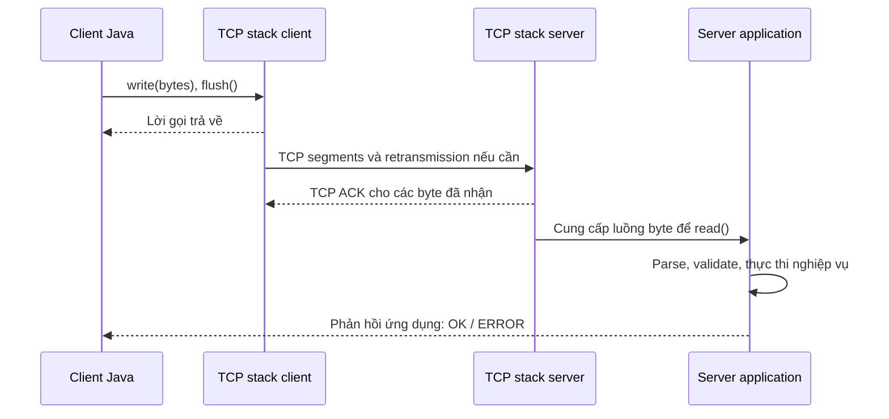
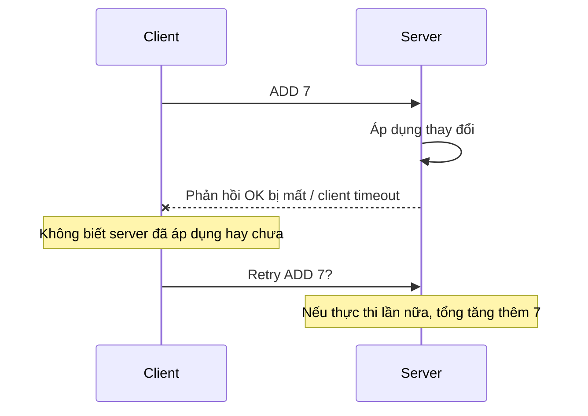

# Gửi thành công qua TCP khác với xử lý thành công ở tầng ứng dụng

## 1. Bài toán: `write()` thành công, nghiệp vụ vẫn thất bại

Giả sử ứng dụng Java gửi lệnh `ADD 7` qua kết nối TCP. `OutputStream.write(...)` và `flush()` đều trả về bình thường. Client có thể kết luận điều gì?

- Nó biết **lời gọi ghi dữ liệu ở phía client không báo lỗi** tại thời điểm đó.
- Nó **chưa biết chắc** dữ liệu đã đến ứng dụng phía server, đã được đọc hết thành thông điệp, đã vượt qua kiểm tra cú pháp, hay đã được xử lý theo nghiệp vụ.
- Nếu server trả phản hồi có ý nghĩa như `OK APPLIED TOTAL=7`, client mới có **bằng chứng ở tầng ứng dụng** rằng server *đã báo* thao tác được áp dụng theo hợp đồng giao thức. Mức bảo đảm về độ bền, giao dịch hoặc khả năng truy vấn lại còn phụ thuộc vào thiết kế server.

Đây là ranh giới quan trọng của phần **“Thông điệp trên TCP”**: TCP hỗ trợ vận chuyển **luồng byte**, còn **giao thức ứng dụng** phải định nghĩa thông điệp, kiểm tra hợp lệ, thực thi nghiệp vụ, trạng thái và phản hồi.

Một lỗi phổ biến là thấy `write()`/`flush()` không ném exception rồi ghi log “order created” hoặc “payment completed”. Nếu không có bằng chứng xử lý tương ứng từ server, kết luận đó vượt quá điều mà API socket chứng minh.

Sau bài này, bạn sẽ hiểu các mức độ “thành công”, ý nghĩa của TCP ACK, giới hạn của `write`/`flush`/`close`, cách thiết kế phản hồi ứng dụng, xử lý timeout và retry, cùng một ví dụ Java 17 chạy được.

## 2. Các mức xác nhận khác nhau trong đường đi của thông điệp

Xét một client và server TCP:



Sơ đồ phân tách các bước logic. Trong thực tế, hệ điều hành có buffer, segment có thể được gộp/chia, các lần read/write không ghép cặp một-một, và TCP ACK có thể xuất hiện ở các thời điểm khác với lời gọi `write`.

| Mốc quan sát | Bên xác nhận | Điều có thể kết luận | Điều **chưa** được bảo đảm |
|---|---|---|---|
| `OutputStream.write` trả về thành công | API ghi phía client | Lời gọi ghi đã hoàn tất mà không báo lỗi; dữ liệu được chấp nhận theo semantics của stream/buffer liên quan | Remote application đã nhận hay xử lý dữ liệu |
| `BufferedOutputStream.flush` hoặc `BufferedWriter.flush` trả về | API buffer phía client | Dữ liệu đang đệm ở tầng `Buffered*` được đẩy xuống stream bên dưới mà không báo lỗi | Byte đã đi hết mạng, được server đọc hay nghiệp vụ đã hoàn tất |
| TCP ACK của peer | TCP stack phía nhận | TCP bên nhận đã xác nhận các byte theo cơ chế sequence/ACK của TCP | Thread ứng dụng đã gọi `read`; frame hợp lệ; transaction đã commit |
| Server `read` đủ một frame | Ứng dụng server | Ứng dụng đã nhận dữ liệu có thể parse theo framing | Dữ liệu đúng nghiệp vụ; thao tác đã thực hiện |
| Server gửi `ERROR ...` | Giao thức ứng dụng | Server báo không chấp nhận hoặc không xử lý lệnh theo hợp đồng | Không nên diễn dịch như lỗi truyền mạng |
| Server gửi `OK APPLIED ...` | Giao thức ứng dụng | Server **tuyên bố** đã áp dụng thao tác với mức bảo đảm do hợp đồng định nghĩa | Chưa mặc định bền vững sau crash hoặc được nhân bản qua các node |
| Server xác nhận sau commit bền vững (nếu có) | Ứng dụng/hệ lưu trữ | Có thêm bảo đảm về việc ghi bền vững theo contract | Không mặc nhiên là “exactly once” đối với mọi tác động bên ngoài |

**Không có quy tắc “TCP ACK = ứng dụng thành công”.** TCP ACK là cơ chế của **tầng vận chuyển**, xác nhận việc tiếp nhận byte theo trạng thái giao thức TCP; nó không biết “đơn hàng”, “hồ sơ”, “lệnh SQL” hay “thanh toán” nghĩa là gì.

## 3. Ý nghĩa chính xác của các thao tác trong Java Socket

### 3.1. `write` và `flush`

Với `Socket.getOutputStream()`, lập trình viên có thể gọi:

```java
// Mã minh họa; socket đã kết nối và thuộc quyền đóng của caller.
OutputStream out = socket.getOutputStream();
out.write("PING\n".getBytes(StandardCharsets.UTF_8));
out.flush();
```

Đoạn trên **không phải một chương trình độc lập**. Nó cho biết local write/flush không báo lỗi nếu chạy qua bình thường. Điều đó **không đồng nghĩa** server đã hoàn tất xử lý `PING`. Đặc biệt, `OutputStream` lấy trực tiếp từ socket không có “flush toàn bộ dữ liệu trên mạng” theo nghĩa đợi ACK hoặc đợi nghiệp vụ; `flush` chỉ có ý nghĩa phụ thuộc lớp stream. Khi dùng `BufferedWriter` hay `BufferedOutputStream`, `flush` đẩy dữ liệu đang lưu trong **buffer của writer/stream** xuống lớp dưới.

Vì TCP có **send buffer ở kernel** và cơ chế truyền bất đồng bộ, một lời gọi ghi có thể hoàn tất trước khi tất cả byte thật sự đi qua mạng hoặc ứng dụng bên kia kịp đọc. Nếu kết nối hỏng hoặc peer đóng đột ngột, lỗi có thể xuất hiện **ở lần thao tác sau**, hoặc client không nhận được xác nhận ứng dụng.

**“Socket còn kết nối” cũng không đủ:** `Socket.isConnected()` cho biết socket **đã từng kết nối thành công**, không phải phép kiểm tra liveness liên tục. `isClosed()` chủ yếu phản ánh trạng thái đóng ở phía cục bộ.

### 3.2. `read` và framing

TCP là **luồng byte liên tục**, không giữ ranh giới từng thông điệp ứng dụng. Ví dụ, client ghi `HEL` rồi `LO\n`; server có thể đọc chúng thành một hoặc nhiều đoạn khác nhau. Client gửi hai lệnh trong một lần `write` cũng không buộc server nhận “hai message” trong một lần `read`.

Giao thức ứng dụng phải quy định **framing**: mỗi message kết thúc bằng `\n`; hoặc có length prefix; hoặc dùng cấu trúc framing của HTTP/2, HTTP/3, WebSocket… Khi đọc từ `InputStream`, giá trị trả về:

- Số dương: số byte đã nhận trong lần đọc.
- `-1`: đã gặp **end-of-stream (EOF)** sau khi dữ liệu có sẵn được tiêu thụ.
- Với `InputStream.read(byte[])` thông thường và buffer không rỗng: không được giả định một lần đọc luôn đủ toàn bộ message.

`BufferedReader.readLine()` có thể trả `null` khi gặp EOF mà không còn ký tự; một dòng không có `\n` cuối cũng có thể được trả về khi EOF. Vì vậy giao thức cần quy định có chấp nhận dòng cuối thiếu delimiter hay không, giới hạn độ dài và cách xử lý dữ liệu không hoàn chỉnh. Trong ví dụ, client luôn gửi newline và server kỳ vọng số request xác định.

### 3.3. `close`, `shutdownOutput` và FIN/RST

`close()` và `shutdownOutput()` ảnh hưởng đến **vòng đời kết nối/luồng**, không mang nghĩa “server đã ghi đơn hàng thành công”. TCP FIN thể hiện một phía không còn gửi thêm byte; nó không phải application acknowledgment. TCP RST hoặc ngoại lệ khi gửi/đọc báo lỗi vận chuyển, nhưng **không luôn cho biết server đã kịp xử lý bao nhiêu** trước sự cố.

Không dùng “đã gọi `close` không có exception” để thay thế phản hồi xác nhận nghiệp vụ.

### 3.4. Timeout thuộc giai đoạn nào?

| Thiết lập | Phạm vi điển hình |
|---|---|
| `socket.connect(endpoint, timeoutMs)` | Chờ **thiết lập TCP connection** |
| `socket.setSoTimeout(timeoutMs)` | Chờ **blocking read** trên socket |
| `BufferedWriter.flush()` | Đẩy buffer ứng dụng xuống stream bên dưới; không phải deadline đợi phản hồi |
| Deadline tổng của nghiệp vụ | Phải được thiết kế ở phía client/framework; bao gồm thời gian connect, gửi, xử lý, đọc, retry |

Nếu `readLine()` gặp `SocketTimeoutException` sau khi client đã gửi một lệnh, **không thể chỉ từ timeout kết luận server chưa thực thi lệnh**. Server có thể xử lý xong nhưng phản hồi bị chậm, mất hoặc kết nối bị đóng trước khi client nhận.

## 4. Giao thức ứng dụng phải nói rõ “thành công” là gì

Giả sử ứng dụng cần một giao thức text đơn giản trên TCP:

```text
Yêu cầu:  ADD <số-nguyên-dương>\n
Thành công: OK APPLIED TOTAL=<tổng>\n
Thất bại:  ERROR INVALID_AMOUNT\n
```

Trong hợp đồng minh họa:

- `ADD -3` là thông điệp **gửi được qua TCP**, nhưng vi phạm quy tắc nghiệp vụ “chỉ nhận số dương” nên server trả `ERROR INVALID_AMOUNT`.
- `ADD 7` hợp lệ; server cộng `7` vào biến bộ nhớ và trả `OK APPLIED TOTAL=7`.
- `OK APPLIED` chỉ xác nhận **biến trong tiến trình server** đã được cập nhật trước khi tạo phản hồi. Ví dụ **không có database hoặc lưu trữ bền vững**; nếu server crash, trạng thái trong RAM có thể mất.
- Client phải **đọc và hiểu phản hồi**. Chỉ việc gửi một lệnh mà không đợi phản hồi không cho biết nghiệp vụ thành công hay thất bại.

Một giao thức thực tế còn cần định nghĩa version, encoding, độ dài thông điệp tối đa, authentication, idempotency, correlation/request ID, lỗi không biết lệnh, timeout và quy tắc đóng kết nối.

Nếu dự án dùng HTTP thì ý nghĩa phản hồi do **HTTP semantics + API contract** xác định: `202 Accepted` thường báo yêu cầu được chấp nhận để xử lý nhưng chưa chắc đã hoàn tất; `200 OK` có thể đại diện nhiều loại kết quả, và vẫn cần xét nội dung/hợp đồng API. Không suy ra durable commit hay exactly-once chỉ từ một mã 2xx.

## 5. Ví dụ Java 17+: ghi thành công, lệnh đầu bị từ chối, lệnh sau được áp dụng

Chương trình sau chạy **offline** trên loopback, trong cùng một JVM nhưng client/server dùng hai socket TCP và hai luồng khác nhau. Nó gửi hai lệnh trên cùng kết nối. Cả hai lần `write`/`flush` đều hoàn tất, nhưng chỉ lệnh hợp lệ mới làm thay đổi trạng thái ứng dụng.

Tạo file **`TransportVsApplicationDemo.java`**:

```java
import java.io.BufferedReader;
import java.io.BufferedWriter;
import java.io.EOFException;
import java.io.InputStreamReader;
import java.io.OutputStreamWriter;
import java.net.InetAddress;
import java.net.ServerSocket;
import java.net.Socket;
import java.nio.charset.StandardCharsets;
import java.util.concurrent.ExecutorService;
import java.util.concurrent.Executors;
import java.util.concurrent.Future;
import java.util.concurrent.TimeUnit;

public class TransportVsApplicationDemo {

    public static void main(String[] args) throws Exception {
        ExecutorService workers = Executors.newSingleThreadExecutor();

        try (ServerSocket listener = new ServerSocket(
                0, 1, InetAddress.getLoopbackAddress())) {

            Future<Integer> serverResult = workers.submit(() -> {
                try (Socket peer = listener.accept()) {
                    peer.setSoTimeout(3_000);
                    BufferedReader in = new BufferedReader(
                            new InputStreamReader(peer.getInputStream(),
                                    StandardCharsets.UTF_8));
                    BufferedWriter out = new BufferedWriter(
                            new OutputStreamWriter(peer.getOutputStream(),
                                    StandardCharsets.UTF_8));

                    int total = 0;
                    for (int i = 0; i < 2; i++) {
                        String command = in.readLine();
                        if (command == null) {
                            throw new EOFException("Missing command");
                        }

                        if (command.equals("ADD -3")) {
                            out.write("ERROR INVALID_AMOUNT\n");
                        } else if (command.equals("ADD 7")) {
                            total += 7;
                            out.write("OK APPLIED TOTAL=" + total + "\n");
                        } else {
                            out.write("ERROR BAD_COMMAND\n");
                        }
                        out.flush();
                    }
                    return total;
                }
            });

            try (Socket client = new Socket(
                    InetAddress.getLoopbackAddress(),
                    listener.getLocalPort())) {
                client.setSoTimeout(3_000);
                BufferedReader in = new BufferedReader(
                        new InputStreamReader(client.getInputStream(),
                                StandardCharsets.UTF_8));
                BufferedWriter out = new BufferedWriter(
                        new OutputStreamWriter(client.getOutputStream(),
                                StandardCharsets.UTF_8));

                out.write("ADD -3\n");
                out.flush();
                System.out.println("write/flush returned: ADD -3");
                System.out.println(
                        "Application response: " + in.readLine());

                out.write("ADD 7\n");
                out.flush();
                System.out.println("write/flush returned: ADD 7");
                System.out.println(
                        "Application response: " + in.readLine());
            }

            System.out.println("Server final total: "
                    + serverResult.get(3, TimeUnit.SECONDS));
        } finally {
            workers.shutdownNow();
        }
    }
}
```

Biên dịch và chạy bằng JDK 17 trở lên:

```bash
javac -encoding UTF-8 TransportVsApplicationDemo.java
java TransportVsApplicationDemo
```

Kết quả trong môi trường cho phép socket TCP loopback:

```text
write/flush returned: ADD -3
Application response: ERROR INVALID_AMOUNT
write/flush returned: ADD 7
Application response: OK APPLIED TOTAL=7
Server final total: 7
```

**Diễn giải chính xác:**

1. `ServerSocket` mở một port loopback do hệ điều hành cấp (`0`), server task chờ `accept()`.
2. Client gửi `ADD -3\n` bằng `BufferedWriter`; `flush` đẩy buffer writer xuống socket và trả về bình thường. Chương trình in “write/flush returned” như một **quan sát local**, không phải bằng chứng remote business success.
3. Server đọc dòng hoàn chỉnh, kiểm tra business rule và gửi `ERROR INVALID_AMOUNT`. Client **đọc phản hồi ứng dụng** mới biết thao tác bị từ chối. Biến `total` vẫn bằng `0`.
4. Client gửi `ADD 7\n`; lời gọi ghi cũng trả về bình thường. Server đọc đủ frame, cập nhật `total` thành `7` **trước khi** gửi `OK APPLIED TOTAL=7`.
5. Client nhận `OK APPLIED TOTAL=7`. `Future.get` trả lại `total` phía server là `7`, cho phép quan sát trạng thái thực tế của ví dụ.
6. `setSoTimeout` ngăn các thao tác đọc chờ vô hạn; `try-with-resources` đóng socket. Đây chỉ là demo một kết nối và hai lệnh, không có TLS, xác thực, database, durable commit hoặc retry tự động.

**Điểm rút ra từ chính output:** hai dòng “write/flush returned” đều xuất hiện; một yêu cầu có kết quả `ERROR`, một yêu cầu có kết quả `OK`. Hai kết quả ứng dụng **khác nhau** mặc dù các lời gọi ghi ở client **đều không báo lỗi**.

### Tại sao không tạo ví dụ “server đã ACK TCP nhưng chưa xử lý”?

Trong hoạt động thật, TCP ACK được tạo bởi TCP stack, không phải bởi business handler Java. Đo đạc chính xác từng TCP ACK cần quan sát traffic/stack và chịu ảnh hưởng của hệ điều hành, buffer, delayed ACK hoặc offloading. Việc cố tình ngủ server rồi dùng `write` thành công **không đo trực tiếp** TCP ACK. Vì vậy ví dụ ở trên chỉ chứng minh chắc chắn mệnh đề cần học: **API ghi không báo lỗi không kéo theo nghiệp vụ thành công**.

## 6. Khi mất phản hồi: trạng thái có thể không xác định

Một bài toán khó hơn là:



Trong trường hợp client đã gửi yêu cầu và hết thời gian chờ phản hồi, có ít nhất các khả năng: server chưa nhận đủ frame, server đã nhận nhưng chưa xử lý, server đã xử lý rồi lỗi trước khi trả lời, hoặc server đã trả lời nhưng client không nhận được. **Cùng một triệu chứng timeout phía client không đủ phân biệt các khả năng ấy.**

Vì vậy nên tách ba trạng thái quan sát:

| Trạng thái client biết | Ý nghĩa | Bước tiếp theo |
|---|---|---|
| **Được server xác nhận thành công** | Có phản hồi ứng dụng xác định theo contract | Ghi nhận thành công ở mức contract đã hứa |
| **Được server xác nhận từ chối** | Có phản hồi lỗi nghiệp vụ xác định, ví dụ `INVALID_AMOUNT` | Sửa input/hiển thị lỗi; không retry cùng payload một cách mù quáng |
| **Không nhận được kết quả cuối** | Chỉ có lỗi mạng, timeout hoặc kết nối đóng trước khi nhận response | Đặt trạng thái *unknown*, tra cứu theo request ID, đối soát hoặc dùng retry an toàn |

Không nên ghi “failed” như thể server chắc chắn chưa làm gì sau một read timeout. Cũng không ghi “success” chỉ vì `write` thành công. Với lệnh có side effect, **unknown outcome** là một trạng thái thiết kế cần xử lý rõ ràng.

### Định danh yêu cầu và idempotency

Đối với API tạo đơn hàng, trừ tiền hoặc cập nhật quan trọng:

1. Client gắn một **idempotency key/request ID** ổn định cho một ý định nghiệp vụ.
2. Server lưu/kiểm tra key cùng kết quả hoặc trạng thái xử lý theo chính sách transaction phù hợp.
3. Khi client timeout, nó có thể **truy vấn trạng thái** theo ID hoặc retry **cùng ID** để tránh thực hiện hai lần nếu server có bảo đảm idempotency tương ứng.
4. Server phải định nghĩa thời gian lưu key, xử lý các request trùng đang chạy song song, và cách phân biệt retry cùng payload với cùng key nhưng payload khác.

**Idempotency không tự xuất hiện do TCP, HTTP hoặc một ID bất kỳ.** Nó là cam kết ở tầng ứng dụng và cần triển khai đúng tại điểm thực thi side effect. Với hệ thống có database, hàng đợi hoặc dịch vụ thứ ba, “exactly once” end-to-end còn cần kiến trúc giao dịch/đối soát; không nên hứa chỉ từ TCP ACK hoặc response `OK`.

## 7. Mức độ xác nhận còn phụ thuộc vào hợp đồng nghiệp vụ

Hai server đều có thể trả `OK` nhưng ý nghĩa khác nhau:

- **Received:** đã nhận một thông điệp hợp cú pháp, chưa chắc đưa vào hàng đợi.
- **Accepted/Queued:** đã chấp nhận hoặc xếp hàng xử lý; công việc có thể chưa chạy.
- **Processed/Applied:** business logic đã chạy theo một định nghĩa cụ thể; chưa chắc ghi bền vững.
- **Committed/Durable:** thay đổi đã được hệ lưu trữ xác nhận commit ở mức độ bền vững được mô tả.
- **Replicated/Delivered downstream:** có thể là mức xác nhận khác trong hệ thống phân tán, tùy số bản sao và thành phần downstream.

Không có một từ `OK` phổ quát cho tất cả mức này. Giao thức phải viết rõ: response nào đánh dấu **thành công cuối cùng**, response nào chỉ là **tiếp nhận xử lý bất đồng bộ**, và client phải làm gì khi status vẫn đang chờ.

Ví dụ HTTP `202 Accepted` thường biểu thị yêu cầu đã được chấp nhận cho xử lý nhưng **chưa hoàn tất**. Một `200 OK` phản ánh success theo semantics của request, nhưng contract vẫn phải nói rõ có commit dữ liệu chưa. Đối với POST tạo resource, `201 Created` thể hiện resource đã được tạo theo semantics HTTP, nhưng các cam kết storage/durability cụ thể vẫn phụ thuộc hệ thống.

## 8. Hướng dẫn thiết kế giao thức TCP có xác nhận ứng dụng

Khi tự xây ứng dụng TCP socket (chat server, command protocol, telemetry hoặc dịch vụ nội bộ), hãy làm rõ:

- **Framing:** delimiter, length prefix, kích thước tối đa, encoding và phản ứng với frame dở dang. Không dựa vào số lần `write`/`read` như ranh giới message.
- **Correlation:** message ID để ghép response với request, đặc biệt khi có pipeline/concurrency.
- **Semantics:** lệnh làm gì, validation, trạng thái, trường hợp lỗi nghiệp vụ và error code ổn định.
- **ACK ở tầng ứng dụng:** chỉ phát khi đạt mốc trạng thái được contract quy định (received/queued/processed/committed), không nhầm với TCP ACK.
- **Timeout:** đặt connect timeout, read/request timeout và deadline tổng; xác định trạng thái unknown khi thiếu phản hồi.
- **Retry:** chỉ retry khi an toàn theo semantics, hoặc khi có idempotency/deduplication. Exponential backoff và jitter có thể giúp giảm tải, nhưng không thay thế tính đúng đắn.
- **Liveness và cleanup:** xử lý EOF, nửa đóng, mất kết nối, giới hạn resource và graceful shutdown. `isConnected()` không thay thế health check ứng dụng.
- **Security:** dùng TLS/xác thực khi thích hợp, phân quyền và hạn chế input/logging. TCP tin cậy về thứ tự byte **không** bảo đảm nguồn dữ liệu đáng tin hay nội dung hợp lệ.
- **Observability:** theo dõi riêng “bytes written”, “TCP connected”, “request received”, “validated”, “applied”, “committed”, “response sent” và “response received”. Chúng là những sự kiện khác nhau.

Nếu hệ thống là HTTP, Java `HttpClient`/framework thường giúp xử lý wire protocol; nhưng bạn vẫn phải quyết định kết quả API nào được gọi là thành công và cách xử lý kết quả không xác định.

## 9. Những nhầm lẫn hay gặp

| Nhầm lẫn | Cách hiểu đúng |
|---|---|
| “`write()` trả về nghĩa là server đã nhận message.” | Write hoàn tất tại local API; dữ liệu có thể còn trong buffer/đường truyền và remote chưa đọc. |
| “`flush()` đã đồng bộ đến server.” | Với buffer writer, flush đẩy dữ liệu xuống stream bên dưới; không có semantics đợi server xử lý. |
| “TCP ACK là application ACK.” | ACK của TCP phản ánh trạng thái truyền byte tại TCP stack; app ACK do protocol nghiệp vụ định nghĩa. |
| “TCP gửi mỗi message nguyên vẹn theo một `write`.” | TCP là byte stream; phải dùng framing để phân định thông điệp. |
| “`readLine()` trả dữ liệu là nghiệp vụ xong.” | Ứng dụng mới đọc được frame; còn parse/validate/execute/commit tùy contract. |
| “Đóng socket bình thường là giao dịch thành công.” | EOF/FIN không phải lời xác nhận xử lý nghiệp vụ. |
| “Timeout = server chưa xử lý; retry chắc chắn an toàn.” | Server có thể đã xử lý rồi mất phản hồi; phải quản lý outcome unknown và idempotency. |
| “HTTP `200`/`202` đồng nghĩa dữ liệu đã lưu bền vững.” | Cần xem semantics của status và hợp đồng cụ thể; `202` không nói công việc đã hoàn tất. |
| “Đã gửi lại trên TCP thì chắc chắn chỉ chạy một lần.” | TCP bảo đảm byte-stream trong một kết nối; không cung cấp deduplication cho lệnh nghiệp vụ qua kết nối/retry khác nhau. |
| “Server `write OK` nghĩa client đã nhận response.” | Response có thể thất lạc hoặc client đã timeout; phía server cũng không tự biết client đã diễn giải kết quả. |

## 10. Tự kiểm tra và câu trả lời

**Câu 1.** Client gọi `BufferedWriter.write("ADD -3\n")`, `flush()` không ném exception. Có thể ghi log “nghiệp vụ thành công” không?

**Trả lời:** Không. Những lời gọi này xác nhận thao tác local ghi/flush không báo lỗi. Cần response application, và server có thể từ chối vì input âm.

**Câu 2.** TCP ACK xác nhận điều gì?

**Trả lời:** Xác nhận byte được peer TCP stack tiếp nhận theo cơ chế sequence/ACK; không xác nhận handler đã đọc, validate, xử lý hay commit.

**Câu 3.** Vì sao phải có delimiter hoặc length prefix?

**Trả lời:** Vì TCP là luồng byte liên tục; việc ghi một lần và đọc một lần không tạo ranh giới message. Framing cho phép server biết khi nào nhận đủ một yêu cầu.

**Câu 4.** Client gửi lệnh tạo đơn hàng, hết read timeout. Có thể khẳng định chưa tạo đơn không?

**Trả lời:** Không. Kết quả có thể **unknown**; cần dùng request ID, truy vấn trạng thái hoặc retry an toàn theo contract/idempotency.

**Câu 5.** Server đã trả `OK APPLIED` nhưng dữ liệu chỉ giữ trong RAM. Có đảm bảo phục hồi sau crash không?

**Trả lời:** Không. Đây là ứng dụng xác nhận thao tác được áp dụng **trong bộ nhớ**; durable commit đòi hỏi thêm thiết kế lưu trữ và xác nhận riêng.

**Câu 6.** `Socket.isConnected()` có thay thế được application health check không?

**Trả lời:** Không. Thuộc tính này chỉ thể hiện socket **đã từng** kết nối thành công. Cần giao thức heartbeat/health check hoặc request/response phù hợp nếu muốn kiểm tra thực tế.

**Câu 7.** Nếu server ghi response không lỗi, server có thể kết luận client đã nhận và ghi nhận nghiệp vụ không?

**Trả lời:** Không. Server cần một application acknowledgment từ client nếu muốn biết client đã xử lý response; và ngay cả ACK này cũng có thể bị mất. Thiết kế phải giới hạn mức bảo đảm ở từng phía.

## 11. Ghi nhớ

**Thành công ở tầng vận chuyển và thành công ở tầng ứng dụng là hai cam kết khác nhau.** TCP cung cấp luồng byte có thứ tự và cơ chế ACK/truyền lại; Java `write`/`flush` chỉ cho biết trạng thái lời gọi ghi ở phía local. **Ứng dụng** mới hiểu thông điệp là lệnh gì, có hợp lệ hay không, đã xử lý đến mức nào và cần trả response ra sao. Nếu response bị mất, trạng thái có thể không xác định; xử lý đúng đòi hỏi contract, request ID, idempotency và đối soát ở mức phù hợp với nghiệp vụ.

Tài liệu tham khảo: Java SE 17 API cho `java.net.Socket`, `java.io.OutputStream`, `java.io.BufferedWriter`, `java.io.InputStream`; RFC 9293 (*Transmission Control Protocol*); RFC 9110 (*HTTP Semantics*).