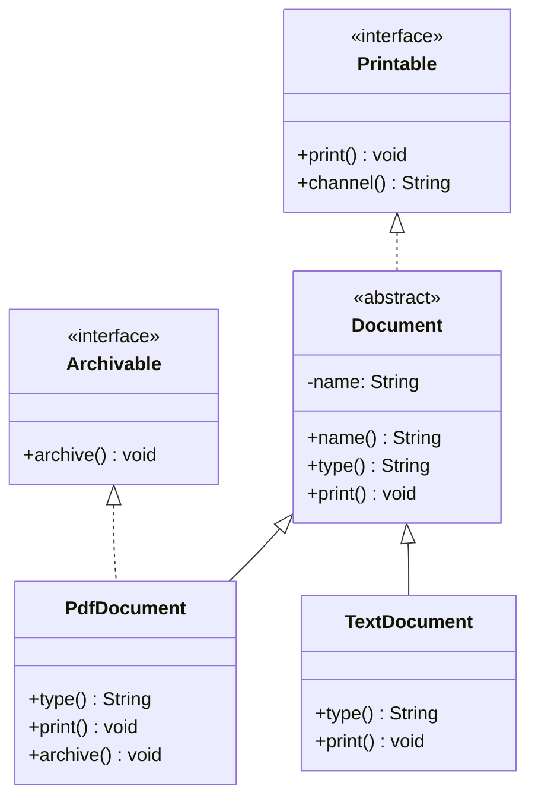

# Upcasting and downcasting between classes, abstract classes, and interfaces in Java

In Java, an object can be viewed through multiple different **reference types**. For example, a `PdfDocument` object is simultaneously a `PdfDocument`, a `Document` (parent abstract class), and satisfies the `Printable` contract (interface). Switching how an object is viewed across different types is the foundation of **polymorphism**.

- **Upcast**: converting a reference from a specific type to a more general type of which it is a valid subtype, such as `PdfDocument → Document` or `PdfDocument → Printable`. In ordinary type assignments, Java allows implicit conversion.
- **Downcast**: converting from a general-type reference back to a more specific type, such as `Document → PdfDocument` or `Printable → PdfDocument`. This usually requires explicit cast syntax, and the JVM must verify whether the **actual object** is compatible with the target type.
- **Cross-cast**: converting between types that do not lie directly on the same inheritance branch, especially between two interfaces or between an interface and a class. The cast may be syntactically valid yet still fail at runtime.

**Key point to remember before learning the syntax:** a cast **does not create a new object**, does not change the object's actual class, and does not add methods on its own. It changes **the type the compiler uses to check the reference expression**; with a narrowing reference conversion, the JVM may have to check the object's type at runtime.

## 1. Two types to distinguish: reference type and actual type

Consider:

```java
Document doc = new PdfDocument("guide");
```

Suppose `Document` is an abstract class and `PdfDocument extends Document`.

- The **static type (compile-time type)** of variable `doc` is `Document`. Therefore, only members accessible through `Document` are allowed to be called directly using `doc`.
- The **runtime type of the object** that `doc` points to is `PdfDocument`. When calling an **overridden instance method**, Java selects the implementation according to the actual object type.
- The variable `doc` does not hold a separate copy of the `Document` part; it still references the same `PdfDocument` object. Java does not "slice off" the subclass part when upcasting.

For example, if `Document` has `type()` and `PdfDocument` overrides it, `doc.type()` can still return `"PDF"`. However, if only `PdfDocument` has `archive()`, calling `doc.archive()` directly will cause a **compile error**: the static type `Document` does not declare that method.

Ask these questions in order: **What type is this variable declared with? Which class was used to create the object? Does the method exist in the static type? Does the runtime object belong to the type you want to cast to?**

## 2. Reading a type diagram to determine cast direction

The diagram below uses UML notation: a hollow triangle points toward the parent type/contract; a solid line represents class inheritance, and a dashed line represents interface implementation.



From the diagram, we can deduce:

- `PdfDocument extends Document` and `TextDocument extends Document`.
- `Document implements Printable`, so every concrete subclass of `Document` is also a `Printable`.
- `PdfDocument implements Archivable`; `TextDocument` in this model does not implement `Archivable`.
- `PdfDocument → Document`, `PdfDocument → Printable`, `PdfDocument → Archivable`, and `PdfDocument → Object` are valid **upcast directions**.
- `Document → PdfDocument` and `Printable → PdfDocument` are **downcast directions** that can be performed when the runtime object is actually a `PdfDocument`.
- A variable of type `Document` can point to a `TextDocument`; therefore, writing `(PdfDocument) doc` does not guarantee that the cast will succeed.
- Java allows a class to directly extend one class while implementing multiple interfaces. `PdfDocument` does not need to redeclare `implements Printable` if that relationship is already inherited through `Document`.

**Note:** an abstract class is a real class in the type system. You cannot use `new Document(...)` if `Document` is abstract, but you can certainly declare `Document doc` and assign a concrete subclass object to it.

## 3. Upcasting: converting to a more general type

### 3.1. Upcasting from a subclass to a superclass or abstract class

```java
PdfDocument pdf = new PdfDocument("guide");
Document doc = pdf;       // implicit upcast
Object obj = pdf;         // implicit upcast
```

The path `PdfDocument → Document → Object` is a subtype relationship determined at compile time, so no explicit cast is needed. The syntax `Document doc = (Document) pdf;` also works, but the explicit cast here is redundant.

The new reference type affects **which members are allowed to be accessed**, not the object's type. If the `PdfDocument` object overrides `print()` from `Document`, calling `doc.print()` still executes the overridden version.

### 3.2. Upcasting from a class to an interface

```java
PdfDocument pdf = new PdfDocument("guide");
Printable printable = pdf;      // class -> interface
Archivable archivable = pdf;    // class -> interface
```

`PdfDocument` satisfies `Printable` through its superclass and satisfies `Archivable` directly. You can call `printable.print()` and `archivable.archive()`. However, `printable.archive()` is invalid if `Printable` does not declare `archive()`.

An interface is a **reference type**, so it can be used as the type of a parameter, variable, collection element, or return value:

```java
static void printNow(Printable item) {
    item.print();
}
```

The snippet above is an illustrative method using the same type hierarchy, **not a standalone program**. Callers can pass any object that implements `Printable`, without needing to check whether it is a `PdfDocument` or which concrete class it belongs to. This is an important design benefit of upcasting: code depends on a shared contract.

### 3.3. Upcasting along an interface-extends-interface relationship

```java
interface Readable {
    String read();
}

interface SeekableReadable extends Readable {
    void seek(int position);
}
```

If an object implements `SeekableReadable`, its reference can be upcast to `Readable`:

```java
// Suppose reader is an object implementing SeekableReadable:
Readable basic = reader; // valid
```

After the upcast, you can call `basic.read()` but cannot call `basic.seek(10)` directly; the `seek` method is only present through the `SeekableReadable` type. Just like classes, a subinterface is a subtype of its superinterface.

### 3.4. Upcasting does not mean "you can use everything"

```java
Document doc = new PdfDocument("guide");
doc.print();              // valid if Document declares or inherits print()
// doc.archive();         // compile error: Document does not declare archive()
```

The object itself may support `archive()`. However, method name checking at **compile time** is based on the `Document` type. To use the API specific to `PdfDocument`, the code must have a variable of an appropriate type, for example after an `instanceof` check.

## 4. Downcasting: converting to a more specific type

### 4.1. Why is an explicit cast required?

```java
Document doc = new PdfDocument("guide");
PdfDocument pdf = (PdfDocument) doc;
```

This is a case that succeeds: the variable `doc` is declared as `Document`, while the runtime object is `PdfDocument`. The compiler cannot assume that every `Document` is a `PdfDocument`, so it requires an explicit cast to express intent.

A dangerous example:

```java
Document doc = new TextDocument("notes");
PdfDocument pdf = (PdfDocument) doc; // ClassCastException at runtime
```

The second line **compiles** (because `PdfDocument` is a possible subclass of `Document`), but the JVM checks the actual type `TextDocument` and throws `ClassCastException`. A cast cannot "turn" a `TextDocument` into a `PdfDocument`.

### 4.2. Downcasting from an interface to a class

```java
Printable item = new PdfDocument("guide");
PdfDocument pdf = (PdfDocument) item; // succeeds if the object is a PdfDocument
```

The `item` variable of type `Printable` only guarantees the `print()` contract. To additionally call `archive()` through `PdfDocument`, you must verify that the object is actually of this type. You can also cast an interface to an abstract class when the actual type is compatible:

```java
Document doc = (Document) item; // succeeds if the object is a subclass of Document
```

If another class implements `Printable` but **does not** extend `Document`, this cast can throw `ClassCastException`. The `implements Printable` relationship by itself **does not guarantee** the `extends Document` relationship.

### 4.3. Downcasting from Object

```java
Object value = new PdfDocument("guide");
PdfDocument pdf = (PdfDocument) value;
```

`Object` is the supertype of Java classes; therefore, a variable of type `Object` can reference an object of any subclass. Casting down to a concrete class also relies on the runtime type. Indiscriminately using `Object` and casting repeatedly loses early type-checking capability; when designing APIs, you should use an appropriate interface or generic type.

### 4.4. Not every cast is accepted by the compiler

For **two unrelated classes** with no subtype relationship, Java can immediately know that no object belongs to both classes simultaneously, so it rejects the cast at compile time. For example:

```java
final class Apple {}
final class Chair {}

class Demo {
    void test(Apple apple) {
        // Chair chair = (Chair) apple; // compile error: inconvertible types
    }
}
```

Conversely, casting between interfaces with no extends relationship can still be valid because a single class can implement both. However, that cast only succeeds if the runtime object actually implements the target interface. For a **final class** that does not implement a given interface, the compiler can know that a direct cast from that final class to the unrelated interface is impossible.

This distinguishes two kinds of errors:

| Phase | Cause | Example |
|---|---|---|
| Compile time | The type system proves the cast is invalid, or an explicit cast is missing during narrowing | Assigning `Document` to `PdfDocument` without a cast; casting between two unrelated final classes |
| Runtime | The reference cast is syntactically valid, but the actual object does not belong to the target type | `(PdfDocument) new TextDocument(...)` through a `Document` variable |

## 5. Checking the subtype before downcasting

When subtype-specific behavior is needed, use `instanceof` to check the runtime object before narrowing the type. Pattern matching for `instanceof` has been available since Java 16 and works on Java 17:

```java
static void maybeArchive(Document doc) {
    if (doc instanceof PdfDocument pdf) {
        pdf.archive();
    }
}
```

The pattern variable `pdf` can only be used within the scope where the compiler proves the check succeeded. `null instanceof PdfDocument` evaluates to `false`; casting a `null` reference returns `null`, whereas casting to an incompatible type can throw `ClassCastException`. The article **instanceof, pattern matching, and checking before casting** goes deeper into flow scoping, arrays, generics, and patterns; the article **ClassCastException and invalid cast limits** analyzes casting errors at runtime.

## 6. Complete Java 17 example: one object, multiple reference types

Create **`Main.java`** with the full content below. No package or external library is needed.

```java
interface Printable {
    void print();

    default String channel() {
        return "screen";
    }
}

interface Archivable {
    void archive();
}

abstract class Document implements Printable {
    private final String name;

    protected Document(String name) {
        this.name = name;
    }

    public final String name() {
        return name;
    }

    public abstract String type();

    @Override
    public void print() {
        System.out.println("Document: " + name);
    }
}

final class PdfDocument extends Document implements Archivable {
    PdfDocument(String name) {
        super(name);
    }

    @Override
    public String type() {
        return "PDF";
    }

    @Override
    public void print() {
        System.out.println("PDF: " + name());
    }

    @Override
    public void archive() {
        System.out.println("Archived: " + name());
    }
}

final class TextDocument extends Document {
    TextDocument(String name) {
        super(name);
    }

    @Override
    public String type() {
        return "TEXT";
    }

    @Override
    public void print() {
        System.out.println("TEXT: " + name());
    }
}

public class Main {
    public static void main(String[] args) {
        PdfDocument pdf = new PdfDocument("guide");

        // Upcast: does not create a new object.
        Document asAbstract = pdf;
        Printable asInterface = pdf;
        Object asObject = pdf;

        System.out.println("Type: " + asAbstract.type());
        asInterface.print();
        System.out.println("Channel: " + asInterface.channel());
        System.out.println("Same object: " + (asAbstract == asInterface));
        System.out.println("Object is PDF: "
                + (asObject instanceof PdfDocument));

        // Check first before downcasting.
        if (asAbstract instanceof PdfDocument concrete) {
            concrete.archive();
        }

        // Check capability via another interface.
        if (asInterface instanceof Archivable archivable) {
            archivable.archive();
        }

        Document different = new TextDocument("notes");
        System.out.println("Text is PDF: "
                + (different instanceof PdfDocument));

        try {
            PdfDocument wrong = (PdfDocument) different;
            wrong.archive();
        } catch (ClassCastException ex) {
            System.out.println("Failed cast: "
                    + ex.getClass().getSimpleName());
        }

        Document none = null;
        PdfDocument nullPdf = (PdfDocument) none;
        System.out.println("Null is PDF: "
                + (none instanceof PdfDocument));
        System.out.println("Null cast remains null: "
                + (nullPdf == null));
    }
}
```

Using **JDK 17+**, inside the directory containing the file:

```bash
javac Main.java
java Main
```

**Expected output:**

```text
Type: PDF
PDF: guide
Channel: screen
Same object: true
Object is PDF: true
Archived: guide
Archived: guide
Text is PDF: false
Failed cast: ClassCastException
Null is PDF: false
Null cast remains null: true
```

Step-by-step explanation:

1. `PdfDocument pdf` can be upcast to `Document` (abstract class), `Printable` (interface), and `Object`. All three variables point to the same `pdf` object; `==` between those two references returns `true`.
2. `asAbstract.type()` calls the `PdfDocument` implementation returning `"PDF"`. `asInterface.print()` calls the overridden method of `PdfDocument` even though the variable has type `Printable`. This is **dynamic dispatch**.
3. `asInterface.channel()` calls the default method declared in the `Printable` interface and inherited because `PdfDocument` does not override it.
4. The check `asAbstract instanceof PdfDocument concrete` succeeds because the actual object is a `PdfDocument`. Therefore, `concrete.archive()` runs.
5. The check `asInterface instanceof Archivable archivable` also succeeds because the same object implements `Archivable`; knowing the class name is not required to invoke the `archive()` contract.
6. `different` is declared with type `Document` but holds a `TextDocument`. Checking `instanceof PdfDocument` returns `false`. The explicit cast `(PdfDocument) different` is **syntactically valid** but fails at runtime, and is caught by `catch (ClassCastException)`.
7. Casting `null` returns `null`, and `instanceof` with a `null` reference returns `false`.

**Practical note:** the `try/catch` block intentionally performs an invalid cast to demonstrate the exception. In production code, you should generally check the type or design the API so you do not have to guess and catch `ClassCastException` in normal execution flow.

## 7. Casting between two interfaces (cross-cast)

An object can implement multiple interfaces simultaneously, even if the two interfaces do not extend each other. For example:

```java
Printable printable = new PdfDocument("manual");
Archivable archivable = (Archivable) printable;
archivable.archive();
```

This snippet is valid and succeeds because the runtime object is a `PdfDocument`, which implements both `Printable` and `Archivable`. However, if `printable` references an object that only implements `Printable`, casting to `Archivable` will throw `ClassCastException`.

You can write this safely:

```java
if (printable instanceof Archivable archivable) {
    archivable.archive();
}
```

The condition expresses "the current object **has the capability to archive**", which makes more sense than depending on a subclass name. Java commonly supports this design through **interface segregation**: each interface represents a distinct capability, and a class can choose to implement one or more capabilities.

A similar note applies when casting between an interface and an abstract class: the two types do not necessarily have a direct extends relationship. A concrete object can simultaneously be an instance of an abstract superclass and another interface. Only a subtype relationship or a runtime check can confirm validity.

## 8. Polymorphism still works after casting

A cast only changes the compile-time type of an expression; it does not change the runtime class. Therefore, if `Document document = new PdfDocument("guide");` and `Printable printable = document`, both `document.print()` and `printable.print()` dispatch to the overridden implementation in `PdfDocument`.

Overloads are still selected according to the static type of the expression after casting; details are covered in the article **Selecting overloads at compile time and overrides at runtime**.

## 9. Common reasoning pitfalls

| Misconception | Reality |
|---|---|
| "Upcasting turns the object into the parent class." | The runtime object remains the original subclass; only the reference type being used changes. |
| "An abstract class cannot be instantiated, so it cannot be used as a variable type." | You cannot use `new` directly on an abstract class, but a variable of an abstract class type can reference a subclass instance. |
| "Upcasting loses the subclass's overridden implementation." | Overridden instance methods still dispatch to the implementation based on the runtime type. |
| "With `(PdfDocument) doc`, the JVM will create a PdfDocument." | A cast does not instantiate or convert data; it only checks the reference type. |
| "If a downcast compiles, it is guaranteed to run successfully." | A narrowing reference cast can throw `ClassCastException` at runtime. |
| "If an object is a `Printable`, it must be a `Document`." | Any suitable class can implement `Printable`; it does not have to extend `Document`. |
| "`instanceof` always throws an error if the object is null." | `null instanceof T` returns `false` for a valid type check. |
| "Casting null causes `ClassCastException`." | Casting a null reference returns null; dereferencing it afterward is what can cause `NullPointerException`. |
| "Subclass-specific methods can always be called through a superclass variable." | The static type determines which member names can be called; a reference of the appropriate type must be used. |
| "Casting fixes a design issue of a missing API." | Casting does not make functionality appear; you should consider moving shared methods into an appropriate interface. |

Two ways to avoid overusing downcasting:

1. If multiple implementations all need an operation, declare that operation on the **shared interface or abstract class** and let each subclass override it. Callers simply invoke the method through the contract instead of repeatedly asking "is it a Pdf or not?".
2. If an operation belongs only to a capability group, define a **capability interface** (such as `Archivable`) and then check for or accept that interface in parameters. This approach reduces dependence on concrete classes and improves extensibility.

Downcasting remains useful at legacy API boundaries, with Reflection, with data having a general type, or when logic genuinely requires a subtype. Keep its scope limited and verify the type beforehand.

## 10. Self-check exercises

Assume the types `Printable`, `Archivable`, `Document`, `PdfDocument`, and `TextDocument` are exactly as in the `Main.java` program in section 6.

**Question 1.** Which part requires an explicit cast?

```java
PdfDocument pdf = new PdfDocument("a");
Document a = pdf;
Printable b = pdf;
Object c = b;
PdfDocument d = (PdfDocument) a;
```

**Answer:** the three assignments `a`, `b`, `c` are widening reference conversions; `d` must be explicitly downcast from `Document`.

**Question 2.** What is the output of the following snippet?

```java
Document doc = new PdfDocument("a");
System.out.println(doc.type());
System.out.println(doc instanceof Archivable);
```

**Answer:**

```text
PDF
true
```

`type()` is an overridden instance method so it dispatches according to `PdfDocument`; `Archivable` is an interface that `PdfDocument` implements.

**Question 3.** Which part will fail at runtime?

```java
Document doc = new TextDocument("a");
PdfDocument pdf = (PdfDocument) doc;
```

**Answer:** the second line throws `ClassCastException` at runtime when checking that the object's actual class is `TextDocument`.

**Question 4.** Given `Printable printable = new PdfDocument("a");`, how can you archive without relying on the class name?

```java
if (printable instanceof Archivable archive) {
    archive.archive();
}
```

**Answer:** check the capability via `Archivable`. If it does not implement this interface, the branch does not execute.

**Question 5.** Does `Document empty = null; PdfDocument pdf = (PdfDocument) empty;` throw an exception?

**Answer:** No; `pdf` is `null`. Only if you continue to call `pdf.archive()` will a `NullPointerException` occur.

**Question 6.** Why does `Document doc = new PdfDocument("a"); doc.archive();` not compile even though the object is a PdfDocument?

**Answer:** because `Document` does not declare or inherit `archive()`; the compiler checks method access based on the **Document** type of the `doc` variable. You can use `instanceof Archivable` or work directly with `Archivable` if the API requires that capability.

## Key takeaways

**Upcasting** goes from a specific type to a general type (`subclass → superclass/abstract class`, `class → interface`, `subinterface → superinterface`) and is usually implicit. **Downcasting** goes from a general type to a narrower type, requires a compatible cast, and may need a runtime check. **Cross-casting** between interfaces or types not on the same branch can be valid when the object actually carries all those types. Always distinguish the **static type of the reference** from the **actual class of the object**; use `instanceof`/pattern matching when narrowing is needed, and prefer designing around interfaces to avoid unnecessary casts.
