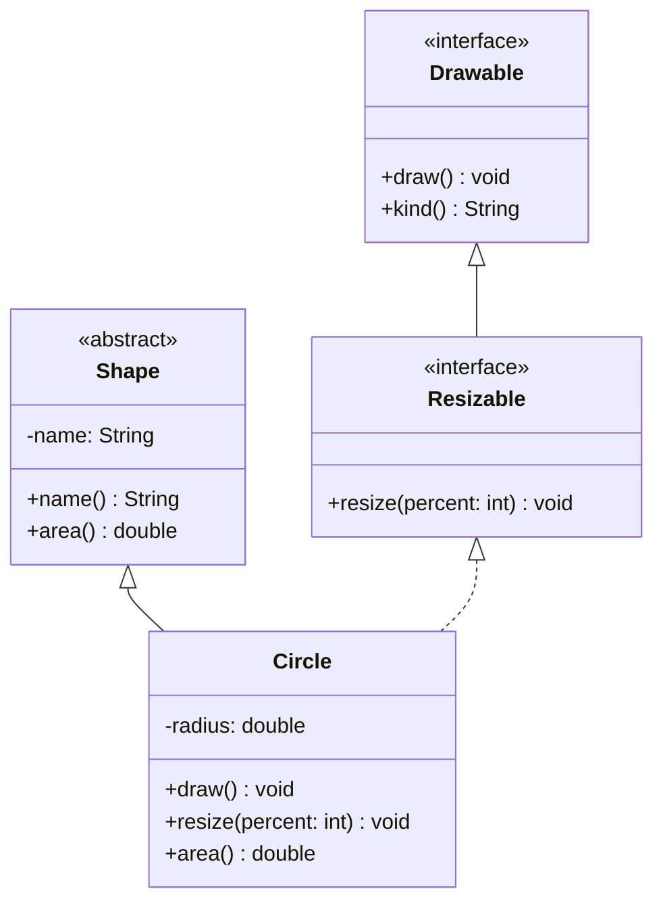
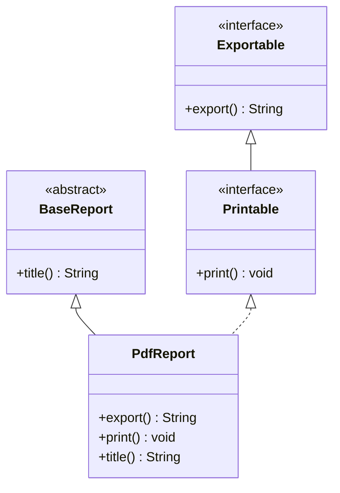

# Reading Class Diagrams and Contract Implementation Relationships in Java

A UML class diagram describes types, members, and the relationships between them. When translating a diagram into Java, you need to distinguish **generalization** (inheritance, typically using `extends`) from **realization** (contract implementation, typically using `implements`), and then check whether the concrete class satisfies the required abstract methods. UML may omit details, so diagrams help reason about design but do not replace reading or compiling code.

## 1. Identifying Types and Members

A class box typically contains the type name, attributes (fields), and methods (operations); not every diagram displays all three parts.

```text
+---------------------------+
|           Circle          |  <- type name
+---------------------------+
| - radius: double          |  <- attribute
+---------------------------+
| + area(): double          |  <- methods
| + draw(): void            |
+---------------------------+
```

| UML Notation | Meaning | How to Read in Java |
|---|---|---|
| `+` | public | Public member according to Java access rules. |
| `-` | private | Direct access is restricted according to `private` rules. |
| `#` | protected | `protected` rules apply, including special conditions when in different packages. |
| `~` | package visibility | Usually corresponds to package-private (no modifier written). |
| `- radius: double` | Attribute | Can map to the field `double radius`. |
| `+ area(): double` | Method | Public method, no parameters, returning `double`; the diagram may not state whether the method is abstract or concrete. |
| Underlined | Static member | Belongs to the type, not dynamically overridden. |
| Italics or `<<abstract>>` label | Abstract type/method | Corresponds to the `abstract` concept in Java. |
| `<<interface>>` label | Interface | Type contract; may have `default`, `static`, or `private` methods depending on the Java version. |

Do not infer that a method has a body just because it appears in the box. You also need to check the enclosing type, package, and module: a `public` member is still inaccessible if the containing type itself is not accessible.

## 2. Reading Relationship Direction and Type Correctly

The hollow triangle points toward the general/contract type. Read from the specific type toward the triangle head:

| Notation | UML Relationship | Interpretation |
|---|---|---|
| Solid line + hollow triangle `Child ─▷ Parent` | Generalization | `class Child extends Parent` or `interface Child extends Parent`. |
| Dashed line + hollow triangle `Worker - -▷ Contract` | Realization | `class Worker implements Contract`, directly or through a depicted relationship. |
| Connecting line `Order ─ Item` | Association | Related; may be a reference/collection field, but does not automatically create an inheritance relationship. |
| Dashed line + regular arrow `Service - - -> Repository` | Dependency | One type uses another through a parameter, a call, or a similar mechanism. |
| Black diamond on the Whole side | Composition | Whole–part relationship carrying ownership/lifecycle meaning according to the model. |
| White diamond on the Group side | Aggregation | Looser whole–part relationship; does not directly prescribe the Java allocation mechanism. |

`1`, `0..1`, `0..*`, and `1..*` are **multiplicity**: one, at most one, zero or many, and one or many related objects. Multiplicity does not turn an association into `extends` or `implements`. With Mermaid, look at the actual symbol head; for example, `Parent <|-- Child` represents `Child` inheriting from `Parent`.

## 3. Diagram and Corresponding Java Code



Interpretation:

1. `Resizable` extends `Drawable`; the `Resizable` contract includes both `draw()` and `kind()`.
2. `Circle` extends the abstract class `Shape`.
3. `Circle` implements `Resizable`, so it must also satisfy the contract inherited from `Drawable`.
4. The diagram does not specify method bodies, constructors, how `percent` is validated, or the area calculation algorithm; you need to inspect the code to confirm those details.

Save the following code as `Main.java`:

```java
import java.util.Locale;

interface Drawable {
    void draw();

    default String kind() {
        return "2D";
    }
}

interface Resizable extends Drawable {
    void resize(int percent);
}

abstract class Shape {
    private final String name;

    protected Shape(String name) {
        this.name = name;
    }

    public final String name() {
        return name;
    }

    public abstract double area();
}

final class Circle extends Shape implements Resizable {
    private double radius;

    Circle(double radius) {
        super("Circle");
        if (radius <= 0) {
            throw new IllegalArgumentException("radius must be positive");
        }
        this.radius = radius;
    }

    @Override
    public void draw() {
        System.out.println("Draw " + name());
    }

    @Override
    public void resize(int percent) {
        if (percent <= 0) {
            throw new IllegalArgumentException("percent must be positive");
        }
        radius = radius * percent / 100.0;
    }

    @Override
    public double area() {
        return Math.PI * radius * radius;
    }
}

public class Main {
    public static void main(String[] args) {
        Circle circle = new Circle(2.0);

        Shape asShape = circle;
        Drawable asDrawable = circle;
        Resizable asResizable = circle;

        System.out.printf(Locale.ROOT, "Before: %.2f%n", asShape.area());
        asDrawable.draw();
        asResizable.resize(150);
        System.out.printf(Locale.ROOT, "After: %.2f%n", asShape.area());
        System.out.println("Kind: " + asDrawable.kind());
    }
}
```

Run with JDK 17 or later:

```bash
javac Main.java
java Main
```

Stdout:

```text
Before: 12.57
Draw Circle
After: 28.27
Kind: 2D
```

`resize(150)` increases the radius from `2.0` to `3.0`, so the area increases from approximately `12.57` to `28.27`. The three variables `asShape`, `asDrawable`, and `asResizable` all reference the same `Circle`; the declared type determines which members can be called, while the implementation of an overridden instance method is selected based on the runtime object. `kind()` is a default method, so `Circle` inherits it; `Shape.name()` is `final`, so it cannot be overridden.

## 4. Checking Contract Implementation Obligations

A concrete class must have a valid implementation for the applicable abstract methods from its interfaces and superinterfaces, unless a compatible implementation is already inherited from a superclass. A method is not required to appear repeatedly in the subclass box if it is validly inherited.

| Check | What to Verify |
|---|---|
| Signature | The name and parameter list must match; an overload with different parameters does not by itself implement the contract. |
| Visibility | A method implementing an interface's abstract method must be `public`. |
| Return type | Must be compatible according to Java rules; reference types can use covariant returns under valid conditions. |
| Checked exception | Must not broaden checked exceptions beyond the overridden method's contract. |
| Abstract/concrete | An abstract class can defer the responsibility; a concrete class must complete any missing methods. |
| `static` and `default` | A static method does not replace an instance contract; a default method can be inherited if there is no conflict. |
| Verification | `@Override` helps the compiler detect declarations assumed to be overrides that actually have a different signature. |

An implementation inherited from a parent class can still satisfy an interface:

```java
interface Named {
    String name();
}

class Base {
    public String name() {
        return "base";
    }
}

class Child extends Base implements Named {
    // Valid: Base.name() is a suitable public implementation.
}
```

Conversely, an abstract class can `implements` an interface without implementing all of its methods; the concrete subclass must ultimately fulfill the obligation. When multiple interfaces provide competing default methods, precedence rules and an explicit override must be applied when a single unique implementation cannot be selected. The lesson **Single Class Inheritance and Multiple Interface Inheritance** covers conflict cases and how to handle them separately.

## 5. Process for Reading an Unfamiliar Diagram

1. **Identify the type:** concrete class, abstract class, or interface. Do not guess solely from an `I` prefix or an `Impl` suffix.
2. **Follow the triangle heads:** distinguish solid lines (generalization) from dashed lines (realization); note transitive relationships as well.
3. **Collect contracts:** inspect abstract methods from interfaces, superinterfaces, and abstract superclasses; pay attention to default methods and inherited implementations.
4. **Check concrete classes:** verify signatures, visibility, return types, checked exceptions, and default conflicts. Do not require a subclass to repeat a method that is already properly inherited.
5. **Separate remaining relationships:** association, dependency, aggregation, composition, and multiplicity describe how objects relate to one another and do not automatically create subtype relationships.
6. **Cross-check with the code:** diagrams may omit details or have version drift; compile and read the code when you need to confirm behavior.

## 6. Common Misconceptions

- **Reading the triangle backward:** the hollow triangle head points toward the parent/contract type.
- **Equating `extends` and `implements`:** class-to-class and interface-to-interface use generalization; class-to-interface uses realization.
- **Forcing subclasses to rewrite every method:** a valid inherited public implementation may already satisfy the contract.
- **Assuming association means ownership:** UML describes a model; lifecycle and ownership must be determined by the concrete design.
- **Assuming a diagram proves the code runs correctly:** UML does not verify nulls, thread safety, business rules, or all compilation rules.
- **Forgetting the access modifier:** a package-private method does not satisfy a `public` interface method; the implementation must be declared `public`.
- **Confusing overload with override:** `draw(String)` does not implement `draw()`; `@Override` will catch that error.

## 7. Self-Check



1. Which class does `PdfReport` inherit from? **`BaseReport`**.
2. Which interface does `PdfReport` directly implement? **`Printable`**.
3. Does `PdfReport` satisfy `Exportable`? **Yes**, because `Printable extends Exportable`.
4. Can you write `PdfReport extends Exportable`? **No**, because `Exportable` is an interface.
5. If `export()` is removed from `PdfReport`, is it guaranteed to compile? **Cannot be concluded from the diagram alone**; you need to check whether `BaseReport` or a superclass has a compatible public implementation. If not, the concrete class will not compile.

**Remember:** a hollow triangle + solid line represents generalization; a hollow triangle + dashed line represents realization. A concrete class must satisfy abstract contracts whether the implementation is written by the class itself or validly inherited. Use UML to reason about relationships, then inspect Java to verify implementation details.
