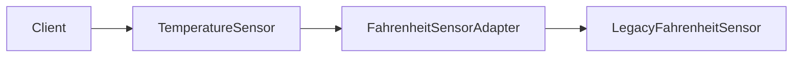

# Adapter Pattern — Adapting an Existing Type to a Desired Contract

Adapter (the adapter pattern) allows two components to work together when they have incompatible interfaces. The caller uses a contract it understands; the adapter implements that contract and forwards calls to the existing API of another object, while converting data or results when needed.

Common examples include integrating a legacy library, a vendor SDK, a third-party system, or an API whose method names and measurement units differ from the rest of the application. Adapter enables the caller to continue depending on a stable contract instead of depending directly on a specific API.

## 1. The Problem Adapter Solves

Suppose the application needs to read temperature in degrees Celsius through the contract:

```java
interface TemperatureSensor {
    double readCelsius();
}
```

However, the legacy library only provides the `LegacyFahrenheitSensor` class with a `readFahrenheit()` method, which returns results in degrees Fahrenheit. The client cannot call `readCelsius()` on the legacy class because that method does not exist; moreover, even if the call were renamed, the data units still differ.

The client could be modified to call the legacy API directly, but when multiple places use it, the conversion details will be duplicated. Adapter places the conversion in one place and provides the client with the interface it expects.

The conversion formula used in the example:

```text
Celsius = (Fahrenheit - 32) * 5 / 9
```

## 2. Components of the Pattern

- **Target (target interface):** the contract that the client wants to use, for example `TemperatureSensor`.
- **Adaptee (adapted object):** the existing API with an incompatible interface, for example `LegacyFahrenheitSensor`.
- **Adapter:** implements Target, holds a reference to Adaptee, and forwards calls to its API.
- **Client:** uses only Target; it does not need to know the details of the legacy API or how the conversion works.

The call flow is typically:



The client calls a method on the interface. The adapter receives the call, invokes the corresponding method on the legacy object, transforms the result, and returns it according to the new contract.

## 3. Complete Example with Java 17+

Save the following code in the file `AdapterDemo.java`. This is an **object adapter**: the adapter uses composition to hold the legacy object, then implements the target interface.

```java
public class AdapterDemo {
    public static void main(String[] args) {
        LegacyFahrenheitSensor legacy = new LegacyFahrenheitSensor(77.0, "Server room");
        TemperatureSensor sensor = new FahrenheitSensorAdapter(legacy);

        System.out.println("Sensor: " + sensor.location());
        System.out.printf("Temperature: %.1f C%n", sensor.readCelsius());
    }
}

interface TemperatureSensor {
    double readCelsius();
    String location();
}

// Legacy API: method names and measurement units differ from the contract the client needs.
final class LegacyFahrenheitSensor {
    private final double fahrenheit;
    private final String label;

    LegacyFahrenheitSensor(double fahrenheit, String label) {
        this.fahrenheit = fahrenheit;
        this.label = label;
    }

    double readFahrenheit() {
        return fahrenheit;
    }

    String label() {
        return label;
    }
}

// Adapter translates from Target to the legacy API and converts the measurement unit.
final class FahrenheitSensorAdapter implements TemperatureSensor {
    private final LegacyFahrenheitSensor adaptee;

    FahrenheitSensorAdapter(LegacyFahrenheitSensor adaptee) {
        if (adaptee == null) {
            throw new IllegalArgumentException("adaptee must not be null");
        }
        this.adaptee = adaptee;
    }

    @Override
    public double readCelsius() {
        return (adaptee.readFahrenheit() - 32.0) * 5.0 / 9.0;
    }

    @Override
    public String location() {
        return adaptee.label();
    }
}
```

Compile and run with JDK 17 or later:

```bash
javac --release 17 AdapterDemo.java
java AdapterDemo
```

Output:

```text
Sensor: Server room
Temperature: 25.0 C
```

A key point to note is that the `sensor` variable has the type `TemperatureSensor`. The client does not call `readFahrenheit()` or `label()` directly. If the data source is later replaced with another sensor that also implements `TemperatureSensor`, the client code can remain unchanged.

## 4. How to Design an Adapter in Real Applications

1. **Define the contract the client needs.** Name methods, data types, measurement units, and behavior in the language of your application rather than necessarily copying the legacy API.
2. **Identify the Adaptee.** Find the existing methods and data types, including possible errors, null rules, timeouts, and resource lifecycles.
3. **Create an adapter class that implements Target.** Store the legacy object in a field and receive it via the constructor. This makes it clear which object the adapter is wrapping and makes it easy to replace in tests.
4. **Map each call.** Invoke the legacy API, convert parameters and results, and return them according to the target contract. If a method has no direct equivalent, define explicit behavior instead of returning dummy data.
5. **Check conversion boundaries.** Verify units, value ranges, precision, errors, nulls, timeouts, and cases where the legacy API does not fully satisfy the new contract.
6. **Have the client depend on Target.** Instantiate the adapter at the integration boundary (the composition root or infrastructure layer) and pass the interface into the business logic.

An adapter should focus on compatibility. If it also orchestrates multiple services, stores data, or performs substantial business logic, split those responsibilities into separate components.

## 5. Object Adapter and Class Adapter

### Object Adapter

An object adapter uses composition: it holds an Adaptee object and delegates calls to it. The `FahrenheitSensorAdapter` example above is an object adapter.

Advantages:

- Can wrap an existing instance or one provided at runtime.
- Does not depend on inheriting from the legacy class.
- Easy to swap out the Adaptee and test by providing a fake object.
- Fits Java well because a class can directly `extends` only one class.

### Class Adapter

A class adapter typically uses inheritance to adapt a specific class, combined with implementing Target. In Java, this approach is only directly feasible when the Adaptee is an inheritable class and the type hierarchy allows using `extends` along with the required interfaces. Conceptual example:

```java
interface Target {
    String request();
}

class LegacyApi {
    String oldRequest() {
        return "legacy response";
    }
}

final class ClassAdapter extends LegacyApi implements Target {
    @Override
    public String request() {
        return oldRequest();
    }
}
```

This snippet is a standalone example illustrating syntax and is not part of `AdapterDemo.java`. A class adapter can access inherited behavior directly, but it is more tightly coupled to the parent class; it cannot extend another class. For third-party APIs or when instances need to be swapped flexibly, an object adapter is usually the more practical choice.

## 6. Adapter Does Not Change the Source Contract

An adapter does not automatically make every API compatible. The designer must decide on a meaningful conversion:

- **Units:** converting Fahrenheit to Celsius, bytes to kilobytes, or currencies according to a defined exchange-rate policy.
- **Data structures:** converting a vendor DTO to the model used by the application.
- **Method names and semantics:** mapping `fetch()` from the legacy API to `load()` in Target if the semantics are truly equivalent.
- **Exceptions:** translating library exceptions into the error types specified by the target contract; preserve the cause for diagnostics.
- **Asynchrony:** if the source returns a callback or a Future while Target expects a different type, the completion, cancellation, and timeout policies must be clearly defined.
- **Resources:** clarify who is responsible for closing connections or releasing resources; do not silently close an object that the client is still using.

You should not perform lossy conversions without explicit rules. For example, currency conversion requires knowing the exchange rate and the point in time it applies; simply renaming fields cannot resolve that semantic difference.

## 7. Testing the Adapter

At a minimum, you should test the following categories:

- **Call mapping:** the Target method invokes the right Adaptee method and passes the right arguments.
- **Data conversion:** use easy-to-verify values such as 32 F → 0 C, 77 F → 25 C, and 212 F → 100 C.
- **Boundaries and errors:** test nulls, invalid data, exceptions from the source, and special values according to application requirements.
- **Contract behavior:** the client only needs Target and does not need to depend on the concrete Adaptee class.

As an example, a quick conversion check can use an assertion in a small program:

```java
double celsius = (77.0 - 32.0) * 5.0 / 9.0;
if (Math.abs(celsius - 25.0) > 0.000001) {
    throw new AssertionError("conversion is incorrect");
}
```

This snippet only illustrates a floating-point check; in a real project, test the adapter through the Target interface and mock the Adaptee to verify both calls and results. When using Java's `assert`, assertions must be enabled with the `-ea` option; otherwise, assertions may not be executed.

## 8. Common Design Mistakes

| Mistake | Consequence | How to Handle |
|---|---|---|
| Letting the client call the legacy API directly in multiple places | Conversion logic is duplicated, making it hard to replace the provider | Move the conversion into an adapter and have the client use Target |
| Adapter only renames methods while ignoring units or data semantics | Results look valid but are semantically wrong | Write clear conversion rules and test with known values |
| Returning `null` or a default value when the source API fails | Errors are masked and hard for the client to detect | Specify error reporting in the contract and preserve the original cause |
| Adapter contains too much business logic | Hard to maintain and hard to test | Keep the adapter focused on compatibility; move business logic to a separate service |
| Using inheritance just to reuse a single method | Tightly coupled to the legacy class, limiting substitutability | Prefer composition when an inheritance type relationship is not needed |
| Ignoring timeouts, thread safety, or resource lifecycles | Bugs that are hard to reproduce in production | Document and test the operational characteristics of the Adaptee |

## 9. Distinguishing Adapter from Related Patterns

- **Adapter:** changes the interface as seen from the client's perspective so that two incompatible components can work together.
- **Decorator:** keeps the primary interface unchanged while adding responsibilities, such as logging or caching calls.
- **Facade:** provides a simpler interface to a system composed of multiple components.
- **Bridge:** separates an abstraction from its implementation so that the two sides can evolve independently.

A class can both wrap an object and perform additional work, but choose the pattern according to its primary intent. If the problem is a mismatch between the contract the client needs and the available API, Adapter is the right way to express it.

## 10. When to Use It?

Use Adapter when integrating legacy systems, external SDKs, or two modules with different contracts that you cannot or should not modify directly. It is especially useful when you want to isolate external dependencies from business logic.

There is no need to add an adapter if two interfaces are already compatible and wrapping them only adds a forwarding layer with no value. Nor should an adapter be treated as a way to hide an unresolved semantic mismatch: the contract and conversion rules must be clear before integration.

## References

- [Refactoring Guru — Adapter](https://refactoring.guru/design-patterns/adapter)
- [Java Language Specification 17 — Classes](https://docs.oracle.com/javase/specs/jls/se17/html/jls-8.html)
