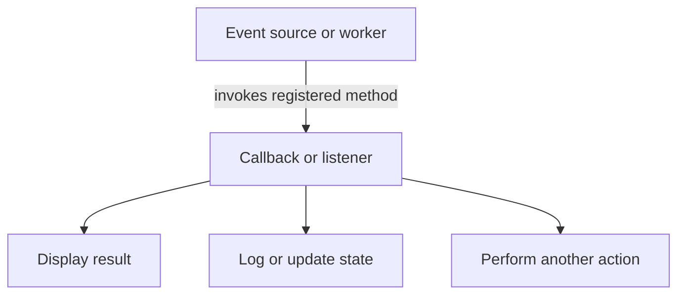

# Callback and Listener: Delegating Event Handling

Callback and Listener are two ways for one component to delegate handling to another component. Instead of deciding everything itself, an object emits a result or event and then invokes code provided by the consumer. This design decouples the part that produces the work from the part that reacts to the result, while making the API easier to extend and test.

## 1. What Is a Callback?

A **callback** is a function or method passed to another component so that component can call it back at the appropriate time. In Java, a callback is typically represented by an interface, a functional interface, a lambda, or a method reference.

For example, a job processor does not need to know whether the result will be displayed on screen, logged, or forwarded to another system. It only needs to invoke the callback once a result is available:

```java
@FunctionalInterface
interface ResultCallback {
    void onResult(String result);
}

void execute(ResultCallback callback) {
    callback.onResult("done");
}
```

The caller can pass the appropriate behavior:

```java
execute(result -> System.out.println("Kết quả: " + result));
```

Callback is a broad concept. It may be invoked immediately on the same thread (synchronous), invoked after an operation completes, or invoked from another thread if the API is designed that way. The word "callback" itself does not guarantee that the operation is asynchronous.

## 2. What Is a Listener?

A **listener** is an object that registers interest in a type of event. When the event occurs, the event source invokes a method on the registered listeners. A listener is usually retained across multiple event emissions until it is removed or the event source ends its lifecycle.

For example: a message source might notify `messageReceived`, a UI button might notify `clicked`, or a progress tracker might emit a `progressChanged` event.

A listener is often viewed as an event-oriented form of callback. The main differences lie in how they are used:

| Aspect | Single Callback | Listener |
| --- | --- | --- |
| Common purpose | Return a result or signal completion of a single operation | React to events that may occur repeatedly |
| Registration | Typically passed directly into a method call | Typically registered with an event source and retained |
| Number of receivers | Usually one callback per request | Multiple listeners can receive the same event |
| Lifecycle | Usually tied to a single execution of work | Requires managing when listeners are added and removed |

These are common design conventions, not hard boundaries of the language. A callback can be invoked multiple times, and a listener can still be passed as a parameter. What matters is that the API contract clearly states who calls it, when it is called, and who is responsible for managing registration.

## 3. Processing Flow and Responsibilities

In a callback- or listener-based design, there are typically three roles:

1. **Producer (event source):** performs the work or detects the event.
2. **Contract (callback/listener interface):** specifies the method that the consumer must provide.
3. **Consumer:** implements the contract to decide how to react.

The producer decides *when* to invoke the contract. The consumer decides *what to do* when invoked. As a result, the producer does not need to depend on a specific way of handling it.



## 4. Runnable Java 17+ Example

The following example demonstrates both mechanisms: `Worker` accepts a callback to return the result of a job; `EventSource` allows multiple listeners to register and receive subsequent events. The file is named `CallbackListenerDemo.java`.

```java
import java.util.Objects;
import java.util.concurrent.CopyOnWriteArrayList;

public class CallbackListenerDemo {
    @FunctionalInterface
    interface ResultCallback {
        void onResult(String result);
    }

    static class Worker {
        void execute(String jobName, ResultCallback callback) {
            Objects.requireNonNull(callback, "callback");
            String result = "done:" + jobName;
            callback.onResult(result);
        }
    }

    @FunctionalInterface
    interface Listener {
        void onEvent(String event);
    }

    static class EventSource {
        private final CopyOnWriteArrayList<Listener> listeners =
                new CopyOnWriteArrayList<>();

        void addListener(Listener listener) {
            listeners.addIfAbsent(Objects.requireNonNull(listener, "listener"));
        }

        void removeListener(Listener listener) {
            listeners.remove(listener);
        }

        void publish(String event) {
            Objects.requireNonNull(event, "event");
            for (Listener listener : listeners) {
                listener.onEvent(event);
            }
        }
    }

    public static void main(String[] args) {
        Worker worker = new Worker();
        worker.execute("report",
                result -> System.out.println("callback received: " + result));

        EventSource source = new EventSource();
        Listener audit = event -> System.out.println("audit: " + event);
        Listener ui = event -> System.out.println("ui: " + event);

        source.addListener(audit);
        source.addListener(ui);
        source.publish("saved");

        source.removeListener(ui);
        source.publish("closed");
    }
}
```

Compile and run from the directory containing the file:

```shell
javac CallbackListenerDemo.java
java CallbackListenerDemo
```

Exact stdout:

```text
callback received: done:report
audit: saved
ui: saved
audit: closed
```

`Worker.execute` invokes the callback directly within the current method call, so this is a synchronous callback. `EventSource` stores a list of listeners and invokes each listener whenever `publish` is called. Once `ui` is removed, that listener no longer receives subsequent events; `audit` still receives the `closed` event.

## 5. Why Use Interfaces and Lambdas?

A functional interface is an interface with exactly one abstract method according to Java rules. It can be implemented with a lambda or a method reference, allowing the caller to provide behavior without creating a separate class for each case.

```java
worker.execute("backup", result -> saveResult(result));
worker.execute("sync", this::handleResult);
```

`@FunctionalInterface` is not required for lambdas to work, but it helps the compiler verify that the interface maintains its intended design. If multiple notification types or multiple related handler methods are needed, a regular listener interface can also be appropriate.

## 6. Synchronous and Asynchronous

Callbacks and listeners do not create a new thread on their own. In the example above, the methods are invoked directly on the thread running `main`. This has several implications:

- If the callback takes a long time to run, the `execute` call is blocked until the callback finishes.
- If a listener performs I/O or heavy computation, `publish` also takes a corresponding amount of time.
- If an API runs callbacks on a background thread, the consumer must be aware of that and follow the thread-safety rules of the relevant environment. For graphical user interfaces, for example, UI updates usually must be dispatched back to the UI thread.
- If asynchronous execution is needed, clearly define the executor, thread, event ordering, error propagation, and completion timing. API users should not have to guess where callbacks run.

`CopyOnWriteArrayList` in the example protects the list structure when multiple threads add or remove listeners and provides a snapshot-based iterator. It is suitable when iterating and emitting events occur more frequently than modifying the list. However, it does not automatically make the code inside each listener thread-safe; two concurrent `publish` calls can still invoke the same listener on two different threads. The example also does not offload callbacks to a background thread.

## 7. Error Handling and Invocation Order

The API must decide what happens if a callback or listener throws an exception. In the example, exceptions are not caught, so an exception propagates back to the caller and can prevent subsequent listeners from being called during that `publish` invocation. This is a simple policy, though not always appropriate.

For multi-listener systems, clearly choose one of these approaches: let the exception propagate outward; catch errors per listener and continue; or forward the error to an error handler. Do not silently swallow errors if API users need to know that event processing failed.

If order matters, specify whether listeners are invoked in registration order. The example uses an ordered list and iterates sequentially, so it normally invokes listeners in the order they were added. For distributed systems or parallel processing, guarantees regarding ordering and event delivery should be documented separately.

## 8. Managing Listener Lifecycle

An event source typically holds references to registered listeners. If an object no longer needs to receive events but is not removed from a long-lived source, that reference can keep the object alive longer than intended or cause it to continue processing events unnecessarily.

- Store the listener in a variable when it needs to be removed later; do not create an anonymous lambda inline in the registration call if you will have no way to retain the exact listener instance to remove.
- Call `removeListener` when the component reaches the end of its lifecycle or is no longer interested in events.
- Define the behavior when registering the same listener multiple times. The example uses `addIfAbsent` to prevent duplicate registrations based on `equals`.
- If a subscription model with a clearer lifecycle is needed, the API can return a `Subscription` or `AutoCloseable` object so the caller can explicitly close the registration.
- Avoid letting callbacks hold large or sensitive references if the producer is long-lived.

## 9. Choosing Between a Callback and a Listener?

**Use a callback** when a call needs to return a result, signal completion, or allow the caller to customize a processing step. Examples: file download completion, handling a query result, or supplying a comparison strategy for an algorithm.

**Use a listener** when an object may emit multiple events over its lifecycle and one or more parties need to subscribe to receive them. Examples: connection state changes, progress updates, or a message source receiving data.

For an API that needs an immediate return value, a method that returns directly may be simpler than a callback. For an asynchronous API with multiple completion/error states, `CompletionStage` or an explicit result type may be more appropriate. Choose the simplest model that accurately expresses the required lifecycle and contract.

## 10. Common Design Mistakes

| Issue | How to Handle It |
| --- | --- |
| Assuming callbacks always run asynchronously | Clearly document whether the callback runs synchronously or asynchronously, and on which thread. |
| Listeners registered but never removed | Manage the subscription lifecycle; remove listeners when the component no longer needs to receive events. |
| Producer directly depending on a concrete UI class | Depend on a callback/listener interface and let the consumer decide how to handle it. |
| Slow listener delaying the entire event emission process | Define a clear dispatch policy; consider an executor or queue if needed, while documenting ordering and error handling. |
| One failing listener silently preventing other listeners from running | Specify a clear exception policy; if continuing to invoke remaining listeners, record or forward the error appropriately. |
| Using a lambda and then being unable to remove the exact listener | Keep a reference to the registered listener instance and reuse it when removing. |
| Assuming a thread-safe list means the listener is thread-safe | Protect shared state inside the listener and specify whether concurrent invocations can occur. |

## 11. API Design Checklist

- [ ] Determine whether this is the result of a single operation or an event that can occur repeatedly.
- [ ] Define the method name, parameters, and types of the callback/listener clearly.
- [ ] Document when the callback is invoked, how many times it is called, and whether values can be `null`.
- [ ] State clearly whether the callback runs synchronously or asynchronously, on which thread, and whether ordering is guaranteed.
- [ ] Specify how exceptions are handled and what happens to subsequent listeners.
- [ ] If listeners are registered long-term, provide a removal mechanism and rules for handling duplicate registrations.
- [ ] Write an example that can be compiled/run and verify the actual output.

Both Callback and Listener allow delegating handling to the consumer through a clear contract. A callback is typically tied to a single request or result; a listener is typically tied to an event source and a persistent subscription. The quality of the design depends on accurately specifying invocation timing, execution threading, error handling, and subscription lifecycle.
