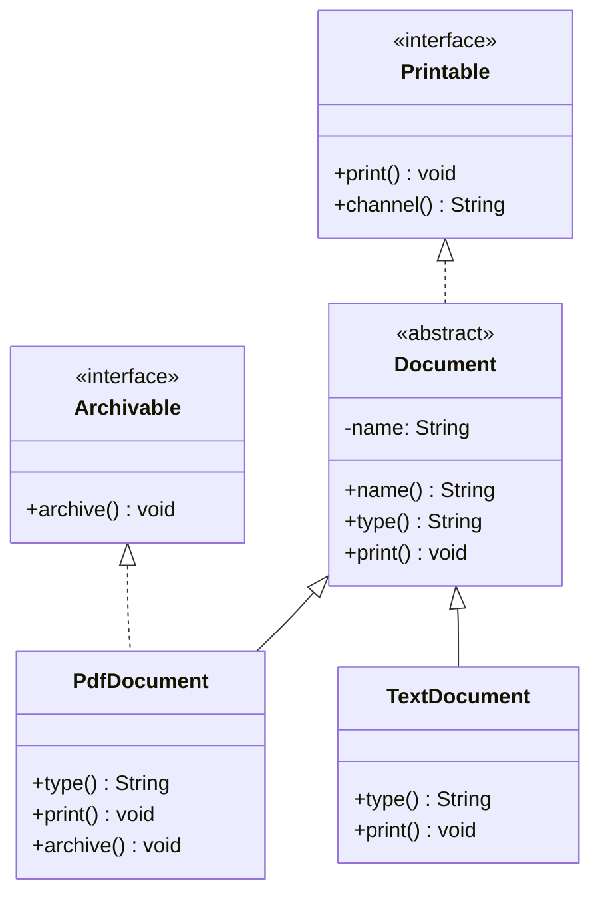

# Upcast và downcast giữa lớp, lớp trừu tượng và interface trong Java

Trong Java, một đối tượng có thể được nhìn qua nhiều **kiểu tham chiếu** khác nhau. Ví dụ, đối tượng `PdfDocument` vừa là `PdfDocument`, vừa là một `Document` (lớp trừu tượng cha), vừa đáp ứng hợp đồng `Printable` (interface). Việc chuyển cách nhìn đối tượng qua kiểu khác là nền tảng của **đa hình (polymorphism)**.

- **Upcast**: chuyển một tham chiếu từ kiểu cụ thể sang kiểu tổng quát hơn mà nó là một subtype hợp lệ, chẳng hạn `PdfDocument → Document` hoặc `PdfDocument → Printable`. Trong các trường hợp gán kiểu thông thường, Java cho phép chuyển ngầm định.
- **Downcast**: chuyển từ tham chiếu kiểu tổng quát về một kiểu cụ thể hơn, chẳng hạn `Document → PdfDocument` hoặc `Printable → PdfDocument`. Thường cần cú pháp ép kiểu tường minh, và JVM phải xác minh **đối tượng thực sự** có tương thích với kiểu đích hay không.
- **Cross-cast**: chuyển giữa những kiểu không nằm trực tiếp trên cùng một nhánh kế thừa, nhất là giữa hai interface hoặc interface và class. Cast có thể hợp lệ về cú pháp nhưng vẫn thất bại lúc chạy.

**Điểm cần nhớ trước khi học cú pháp:** cast **không tạo đối tượng mới**, không đổi class thực của đối tượng và không tự bổ sung phương thức. Nó thay đổi **kiểu mà trình biên dịch dùng để kiểm tra biểu thức tham chiếu**; với narrowing reference conversion, JVM có thể phải kiểm tra loại đối tượng tại runtime.

## 1. Hai kiểu phải phân biệt: kiểu tham chiếu và kiểu thực tế

Xét:

```java
Document doc = new PdfDocument("guide");
```

Giả sử `Document` là abstract class và `PdfDocument extends Document`.

- **Kiểu tĩnh (compile-time type)** của biến `doc` là `Document`. Vì thế, chỉ những thành viên có thể truy cập thông qua `Document` mới được phép gọi trực tiếp bằng `doc`.
- **Kiểu runtime của đối tượng** mà `doc` trỏ đến là `PdfDocument`. Khi gọi một **instance method được override**, Java chọn implementation theo loại đối tượng thực tế.
- Biến `doc` không chứa bản sao riêng của phần `Document`; nó vẫn tham chiếu cùng đối tượng `PdfDocument`. Java không “cắt mất” phần subclass khi upcast.

Ví dụ, nếu `Document` có `type()` và `PdfDocument` override nó, `doc.type()` vẫn có thể trả `"PDF"`. Nhưng nếu chỉ `PdfDocument` có `archive()`, gọi thẳng `doc.archive()` sẽ **lỗi biên dịch**: kiểu tĩnh `Document` không khai báo phương thức đó.

Đặt câu hỏi theo thứ tự: **Biến này được khai báo với kiểu gì? Đối tượng được tạo bằng class nào? Phương thức có tồn tại trong kiểu tĩnh không? Đối tượng runtime có thuộc kiểu muốn ép không?**

## 2. Đọc sơ đồ kiểu để xác định hướng cast

Sơ đồ dưới đây dùng ký hiệu UML: tam giác rỗng chỉ về kiểu cha/hợp đồng; đường liền là kế thừa class, đường đứt là hiện thực hóa interface.



Từ sơ đồ có thể suy ra:

- `PdfDocument extends Document` và `TextDocument extends Document`.
- `Document implements Printable`, nên mọi subclass cụ thể của `Document` cũng là `Printable`.
- `PdfDocument implements Archivable`; `TextDocument` trong mô hình này không thực thi `Archivable`.
- `PdfDocument → Document`, `PdfDocument → Printable`, `PdfDocument → Archivable` và `PdfDocument → Object` là các **hướng upcast** hợp lệ.
- `Document → PdfDocument` và `Printable → PdfDocument` là những **hướng downcast** có thể thực hiện khi đối tượng runtime thật sự là `PdfDocument`.
- Biến kiểu `Document` có thể trỏ đến `TextDocument`; vì vậy viết `(PdfDocument) doc` chưa bảo đảm cast thành công.
- Java cho một class extends trực tiếp một class nhưng implements nhiều interface. `PdfDocument` không cần khai báo lại `implements Printable` nếu quan hệ đã được thừa hưởng qua `Document`.

**Lưu ý:** lớp trừu tượng là một class thật trong hệ thống kiểu. Không được `new Document(...)` nếu `Document` là abstract, nhưng hoàn toàn có thể khai báo `Document doc` và gán một đối tượng subclass cụ thể.

## 3. Upcast: chuyển đến kiểu tổng quát hơn

### 3.1. Upcast từ subclass lên superclass hoặc abstract class

```java
PdfDocument pdf = new PdfDocument("guide");
Document doc = pdf;       // upcast ngầm định
Object obj = pdf;         // upcast ngầm định
```

Đường đi `PdfDocument → Document → Object` là quan hệ subtype xác định lúc biên dịch, nên không cần ép kiểu tường minh. Cú pháp `Document doc = (Document) pdf;` cũng được, nhưng cast tường minh ở đây dư thừa.

Kiểu tham chiếu mới ảnh hưởng đến **các thành viên được phép truy cập**, không ảnh hưởng đến loại đối tượng. Nếu đối tượng `PdfDocument` override `print()` từ `Document`, gọi `doc.print()` vẫn chạy bản override.

### 3.2. Upcast từ class lên interface

```java
PdfDocument pdf = new PdfDocument("guide");
Printable printable = pdf;      // class -> interface
Archivable archivable = pdf;    // class -> interface
```

`PdfDocument` đáp ứng `Printable` thông qua superclass và đáp ứng `Archivable` trực tiếp. Có thể gọi `printable.print()` và `archivable.archive()`. Tuy nhiên, `printable.archive()` không hợp lệ nếu `Printable` không khai báo `archive()`.

Interface là **kiểu tham chiếu**, nên có thể dùng làm kiểu tham số, biến, phần tử collection hoặc kiểu trả về:

```java
static void printNow(Printable item) {
    item.print();
}
```

Đoạn trên là một phương thức minh họa dùng cùng hệ kiểu, **không phải chương trình độc lập**. Người gọi có thể truyền bất kỳ đối tượng nào implements `Printable`, không cần kiểm tra xem đó là `PdfDocument` hay class cụ thể nào. Đây là lợi ích thiết kế quan trọng của upcast: code phụ thuộc vào hợp đồng chung.

### 3.3. Upcast theo quan hệ interface extends interface

```java
interface Readable {
    String read();
}

interface SeekableReadable extends Readable {
    void seek(int position);
}
```

Nếu một đối tượng thực thi `SeekableReadable` thì tham chiếu của nó upcast được sang `Readable`:

```java
// Giả sử reader là đối tượng implements SeekableReadable:
Readable basic = reader; // hợp lệ
```

Sau upcast, có thể gọi `basic.read()` nhưng không gọi `basic.seek(10)` trực tiếp; phương thức `seek` chỉ hiện diện qua kiểu `SeekableReadable`. Cũng như class, interface con là subtype của interface cha.

### 3.4. Upcast không có nghĩa “được dùng mọi thứ”

```java
Document doc = new PdfDocument("guide");
doc.print();              // hợp lệ nếu Document khai báo hoặc kế thừa print()
// doc.archive();         // lỗi biên dịch: Document không khai báo archive()
```

Bản thân đối tượng có thể thực thi `archive()`. Nhưng việc kiểm tra tên method tại **compile time** dựa trên kiểu `Document`. Muốn sử dụng API riêng của `PdfDocument`, code phải có một biến kiểu phù hợp, ví dụ sau khi kiểm tra `instanceof`.

## 4. Downcast: chuyển về kiểu cụ thể hơn

### 4.1. Tại sao cần cast tường minh?

```java
Document doc = new PdfDocument("guide");
PdfDocument pdf = (PdfDocument) doc;
```

Đây là trường hợp thành công: biến `doc` khai báo `Document` nhưng đối tượng runtime là `PdfDocument`. Trình biên dịch không thể giả định mọi `Document` đều là `PdfDocument`, nên yêu cầu cast tường minh để thể hiện ý định.

Một ví dụ nguy hiểm:

```java
Document doc = new TextDocument("notes");
PdfDocument pdf = (PdfDocument) doc; // ClassCastException ở runtime
```

Dòng thứ hai **biên dịch được** (vì `PdfDocument` là subclass khả dĩ của `Document`), nhưng JVM kiểm tra kiểu thực tế `TextDocument` và ném `ClassCastException`. Một cast không thể “biến” `TextDocument` thành `PdfDocument`.

### 4.2. Downcast từ interface sang class

```java
Printable item = new PdfDocument("guide");
PdfDocument pdf = (PdfDocument) item; // thành công nếu object là PdfDocument
```

Biến `item` thuộc kiểu `Printable` chỉ bảo đảm hợp đồng `print()`. Để gọi thêm `archive()` qua `PdfDocument`, phải xác minh rằng đối tượng thực sự là loại này. Cũng có thể cast interface sang abstract class khi kiểu thực tương thích:

```java
Document doc = (Document) item; // thành công nếu object là subclass Document
```

Nếu một class khác implements `Printable` nhưng **không** extends `Document`, cast này có thể ném `ClassCastException`. Quan hệ `implements Printable` tự nó **không bảo đảm** quan hệ `extends Document`.

### 4.3. Downcast từ Object

```java
Object value = new PdfDocument("guide");
PdfDocument pdf = (PdfDocument) value;
```

`Object` là supertype của các class Java; do đó biến kiểu `Object` có thể tham chiếu đối tượng subclass bất kỳ. Cast xuống class cụ thể cũng dựa vào kiểu runtime. Sử dụng `Object` tràn lan rồi cast nhiều lần làm mất khả năng kiểm tra kiểu sớm; khi thiết kế API, nên dùng interface hoặc generic type phù hợp.

### 4.4. Không phải cast nào cũng được trình biên dịch chấp nhận

Với **hai class độc lập** không có quan hệ subtype, Java có thể biết ngay không đối tượng nào đồng thời thuộc cả hai class đó, nên từ chối cast khi compile. Ví dụ:

```java
final class Apple {}
final class Chair {}

class Demo {
    void test(Apple apple) {
        // Chair chair = (Chair) apple; // lỗi biên dịch: kiểu không thể chuyển
    }
}
```

Ngược lại, cast giữa các interface không có quan hệ extends vẫn có thể hợp lệ vì một class có thể implements cả hai. Nhưng cast đó chỉ thành công nếu đối tượng runtime thực sự thực thi interface đích. Với một **final class** không implements một interface nào đó, trình biên dịch có thể biết cast trực tiếp từ final class sang interface không liên quan là bất khả thi.

Điều này phân biệt hai loại lỗi:

| Giai đoạn | Nguyên nhân | Ví dụ |
|---|---|---|
| Compile time | Hệ kiểu chứng minh phép cast không hợp lệ, hoặc thiếu cast tường minh khi chuyển hẹp | Gán `Document` cho `PdfDocument` mà không cast; cast giữa hai final class độc lập |
| Runtime | Cast tham chiếu hợp lệ về mặt cú pháp nhưng đối tượng thực không thuộc kiểu đích | `(PdfDocument) new TextDocument(...)` thông qua biến `Document` |

## 5. Kiểm tra subtype trước khi downcast

Khi cần hành vi riêng của subtype, dùng `instanceof` để kiểm tra đối tượng runtime trước khi thu hẹp kiểu. Pattern matching for `instanceof` có từ Java 16 và dùng được trên Java 17:

```java
static void maybeArchive(Document doc) {
    if (doc instanceof PdfDocument pdf) {
        pdf.archive();
    }
}
```

Pattern variable `pdf` chỉ dùng được trong phạm vi mà compiler chứng minh phép thử đã thành công. `null instanceof PdfDocument` là `false`; cast một tham chiếu `null` trả về `null`, còn cast sang kiểu không tương thích có thể ném `ClassCastException`. Bài **instanceof, pattern matching và kiểm tra trước khi ép kiểu** đi sâu vào flow scoping, mảng, generics và pattern; bài **ClassCastException và giới hạn ép kiểu không hợp lệ** phân tích các lỗi cast khi chạy.

## 6. Ví dụ Java 17 hoàn chỉnh: cùng một đối tượng, nhiều kiểu tham chiếu

Tạo file **`Main.java`** với toàn bộ nội dung bên dưới. Không cần package hoặc thư viện bên ngoài.

```java
interface Printable {
    void print();

    default String channel() {
        return "screen";
    }
}

interface Archivable {
    void archive();
}

abstract class Document implements Printable {
    private final String name;

    protected Document(String name) {
        this.name = name;
    }

    public final String name() {
        return name;
    }

    public abstract String type();

    @Override
    public void print() {
        System.out.println("Document: " + name);
    }
}

final class PdfDocument extends Document implements Archivable {
    PdfDocument(String name) {
        super(name);
    }

    @Override
    public String type() {
        return "PDF";
    }

    @Override
    public void print() {
        System.out.println("PDF: " + name());
    }

    @Override
    public void archive() {
        System.out.println("Archived: " + name());
    }
}

final class TextDocument extends Document {
    TextDocument(String name) {
        super(name);
    }

    @Override
    public String type() {
        return "TEXT";
    }

    @Override
    public void print() {
        System.out.println("TEXT: " + name());
    }
}

public class Main {
    public static void main(String[] args) {
        PdfDocument pdf = new PdfDocument("guide");

        // Upcast: không tạo đối tượng mới.
        Document asAbstract = pdf;
        Printable asInterface = pdf;
        Object asObject = pdf;

        System.out.println("Type: " + asAbstract.type());
        asInterface.print();
        System.out.println("Channel: " + asInterface.channel());
        System.out.println("Same object: " + (asAbstract == asInterface));
        System.out.println("Object is PDF: "
                + (asObject instanceof PdfDocument));

        // Kiểm tra rồi mới downcast.
        if (asAbstract instanceof PdfDocument concrete) {
            concrete.archive();
        }

        // Kiểm tra năng lực qua interface khác.
        if (asInterface instanceof Archivable archivable) {
            archivable.archive();
        }

        Document different = new TextDocument("notes");
        System.out.println("Text is PDF: "
                + (different instanceof PdfDocument));

        try {
            PdfDocument wrong = (PdfDocument) different;
            wrong.archive();
        } catch (ClassCastException ex) {
            System.out.println("Failed cast: "
                    + ex.getClass().getSimpleName());
        }

        Document none = null;
        PdfDocument nullPdf = (PdfDocument) none;
        System.out.println("Null is PDF: "
                + (none instanceof PdfDocument));
        System.out.println("Null cast remains null: "
                + (nullPdf == null));
    }
}
```

Dùng **JDK 17+**, trong thư mục chứa file:

```bash
javac Main.java
java Main
```

**Kết quả chuẩn:**

```text
Type: PDF
PDF: guide
Channel: screen
Same object: true
Object is PDF: true
Archived: guide
Archived: guide
Text is PDF: false
Failed cast: ClassCastException
Null is PDF: false
Null cast remains null: true
```

Giải thích theo thứ tự:

1. `PdfDocument pdf` có thể upcast thành `Document` (abstract class), `Printable` (interface) và `Object`. Cả ba biến trỏ tới cùng đối tượng `pdf`; `==` trên hai tham chiếu đó trả `true`.
2. `asAbstract.type()` gọi implementation của `PdfDocument` trả `"PDF"`. `asInterface.print()` gọi method override của `PdfDocument` dù biến có kiểu `Printable`. Đây là **dynamic dispatch**.
3. `asInterface.channel()` gọi default method được khai báo ở interface `Printable` và được kế thừa vì `PdfDocument` không override nó.
4. Kiểm tra `asAbstract instanceof PdfDocument concrete` thành công vì đối tượng thực là `PdfDocument`. Do đó `concrete.archive()` chạy.
5. Kiểm tra `asInterface instanceof Archivable archivable` cũng thành công vì cùng đối tượng implements `Archivable`; không bắt buộc biết tên class để gọi hợp đồng `archive()`.
6. `different` khai báo kiểu `Document` nhưng đang giữ `TextDocument`. Kiểm tra `instanceof PdfDocument` trả `false`. Cast tường minh `(PdfDocument) different` **hợp lệ về cú pháp** nhưng thất bại khi chạy, được bắt bởi `catch (ClassCastException)`.
7. Cast `null` trả `null`, và `instanceof` với tham chiếu `null` trả `false`.

**Lưu ý thực tế:** đoạn `try/catch` cố ý ép sai để minh họa ngoại lệ. Trong code sản phẩm, thường nên kiểm tra kiểu hoặc thiết kế API để không phải đoán và bắt `ClassCastException` trong luồng bình thường.

## 7. Cast giữa hai interface (cross-cast)

Đối tượng có thể đồng thời thực thi nhiều interface, dù hai interface không extends nhau. Ví dụ:

```java
Printable printable = new PdfDocument("manual");
Archivable archivable = (Archivable) printable;
archivable.archive();
```

Đoạn này hợp lệ và thành công vì runtime object là `PdfDocument`, loại thực thi cả `Printable` lẫn `Archivable`. Nhưng nếu `printable` tham chiếu một đối tượng chỉ implements `Printable`, ép sang `Archivable` sẽ ném `ClassCastException`.

Có thể viết theo hướng an toàn:

```java
if (printable instanceof Archivable archivable) {
    archivable.archive();
}
```

Điều kiện biểu thị “đối tượng hiện tại **có khả năng archive**”, hợp lý hơn phụ thuộc vào tên subclass. Java thường hỗ trợ thiết kế này bằng **interface segregation**: mỗi interface biểu diễn năng lực riêng, class có thể chọn thực thi một hoặc nhiều năng lực.

Lưu ý tương tự khi cast giữa interface và abstract class: hai kiểu không nhất thiết có quan hệ extends trực tiếp. Một object cụ thể có thể cùng lúc là instance của abstract superclass và interface khác. Chỉ quan hệ subtype hoặc kiểm tra runtime mới xác nhận được tính hợp lệ.

## 8. Đa hình vẫn hoạt động sau khi cast

Cast chỉ đổi kiểu compile-time của biểu thức; nó không thay đổi class runtime. Vì vậy, nếu `Document document = new PdfDocument("guide");` và `Printable printable = document`, cả `document.print()` lẫn `printable.print()` đều dispatch đến implementation override của `PdfDocument`.

Overload vẫn được chọn theo kiểu tĩnh của biểu thức sau cast; chi tiết nằm trong bài **Chọn overload lúc biên dịch và chọn override lúc chạy**.

## 9. Những lỗi suy luận thường gặp

| Nhầm lẫn | Sự thật |
|---|---|
| “Upcast biến đối tượng thành class cha.” | Đối tượng runtime vẫn là subclass ban đầu; chỉ thay đổi kiểu tham chiếu được dùng. |
| “Abstract class không thể tạo instance, nên không thể làm kiểu biến.” | Không thể `new` trực tiếp abstract class, nhưng biến abstract class có thể tham chiếu instance subclass. |
| “Upcast mất implementation override của subclass.” | Override instance method vẫn dispatch đến implementation theo kiểu runtime. |
| “Có `(PdfDocument) doc` thì JVM sẽ tạo PdfDocument.” | Cast không khởi tạo hay chuyển đổi dữ liệu; chỉ kiểm tra kiểu tham chiếu. |
| “Downcast đã biên dịch thì chắc chắn chạy được.” | Narrowing reference cast có thể ném `ClassCastException` tại runtime. |
| “Đối tượng là `Printable` thì chắc chắn là `Document`.” | Bất kỳ class phù hợp đều có thể implements `Printable`; không bắt buộc extends `Document`. |
| “`instanceof` luôn ném lỗi nếu đối tượng null.” | `null instanceof T` trả `false` với phép kiểm tra kiểu hợp lệ. |
| “Ép kiểu null gây `ClassCastException`.” | Ép tham chiếu null trả null; dereference sau đó mới có thể gây `NullPointerException`. |
| “Method riêng của subclass luôn gọi được qua biến superclass.” | Kiểu tĩnh quyết định tên thành viên có thể gọi; phải dùng tham chiếu kiểu phù hợp. |
| “Cast sửa được vấn đề thiết kế thiếu API.” | Cast không làm xuất hiện chức năng; nên cân nhắc chuyển phương thức chung vào interface phù hợp. |

Hai cách tránh lạm dụng downcast:

1. Nếu nhiều implementation cùng cần một thao tác, khai báo thao tác đó trên **interface hoặc abstract class chung** rồi để từng subclass override. Caller chỉ gọi method qua hợp đồng, không phải hỏi liên tục “có phải Pdf hay không?”.
2. Nếu thao tác chỉ thuộc một nhóm năng lực, định nghĩa **interface năng lực** (như `Archivable`) rồi kiểm tra hoặc nhận interface đó trong tham số. Cách này giảm phụ thuộc vào class cụ thể và tăng khả năng mở rộng.

Downcast vẫn hữu ích tại ranh giới API cũ, Reflection, dữ liệu có kiểu tổng quát hoặc khi logic thật sự đòi một subtype. Hãy giới hạn phạm vi và xác minh kiểu trước.

## 10. Bài tập tự kiểm tra

Giả sử các kiểu `Printable`, `Archivable`, `Document`, `PdfDocument` và `TextDocument` đúng như chương trình `Main.java` ở mục 6.

**Câu 1.** Đoạn nào cần cast tường minh?

```java
PdfDocument pdf = new PdfDocument("a");
Document a = pdf;
Printable b = pdf;
Object c = b;
PdfDocument d = (PdfDocument) a;
```

**Đáp án:** ba phép gán `a`, `b`, `c` là widening reference conversions; `d` phải downcast tường minh từ `Document`.

**Câu 2.** Kết quả của đoạn sau là gì?

```java
Document doc = new PdfDocument("a");
System.out.println(doc.type());
System.out.println(doc instanceof Archivable);
```

**Đáp án:**

```text
PDF
true
```

`type()` là instance method override nên dispatch theo `PdfDocument`; `Archivable` là một interface mà `PdfDocument` implements.

**Câu 3.** Đoạn nào sẽ lỗi khi chạy?

```java
Document doc = new TextDocument("a");
PdfDocument pdf = (PdfDocument) doc;
```

**Đáp án:** dòng thứ hai ném `ClassCastException` khi runtime kiểm tra class thật của đối tượng là `TextDocument`.

**Câu 4.** `Printable printable = new PdfDocument("a");`, muốn archive mà không dựa vào tên class thì làm thế nào?

```java
if (printable instanceof Archivable archive) {
    archive.archive();
}
```

**Đáp án:** kiểm tra năng lực qua `Archivable`. Nếu không implements interface này, nhánh không chạy.

**Câu 5.** `Document empty = null; PdfDocument pdf = (PdfDocument) empty;` có ném ngoại lệ không?

**Đáp án:** Không; `pdf` là `null`. Nếu tiếp tục gọi `pdf.archive()` mới bị `NullPointerException`.

**Câu 6.** Vì sao `Document doc = new PdfDocument("a"); doc.archive();` không biên dịch dù đối tượng là PdfDocument?

**Đáp án:** vì `Document` không khai báo hoặc kế thừa `archive()`; trình biên dịch kiểm tra quyền truy cập method theo kiểu **Document** của biến `doc`. Có thể dùng `instanceof Archivable` hoặc làm việc ngay với `Archivable` nếu API yêu cầu năng lực đó.

## Ghi nhớ

**Upcast** đi từ kiểu cụ thể đến kiểu tổng quát (`subclass → superclass/abstract class`, `class → interface`, `subinterface → superinterface`) và thường ngầm định. **Downcast** đi từ kiểu tổng quát về kiểu hẹp, yêu cầu phép cast tương thích và có thể phải kiểm tra runtime. **Cross-cast** giữa những interface hay kiểu không cùng một nhánh có thể hợp lệ khi đối tượng thực sự mang đủ các kiểu đó. Luôn phân biệt **kiểu tĩnh của tham chiếu** với **class thực của đối tượng**; dùng `instanceof`/pattern matching khi cần narrowing, và ưu tiên thiết kế theo interface để tránh cast không cần thiết.
