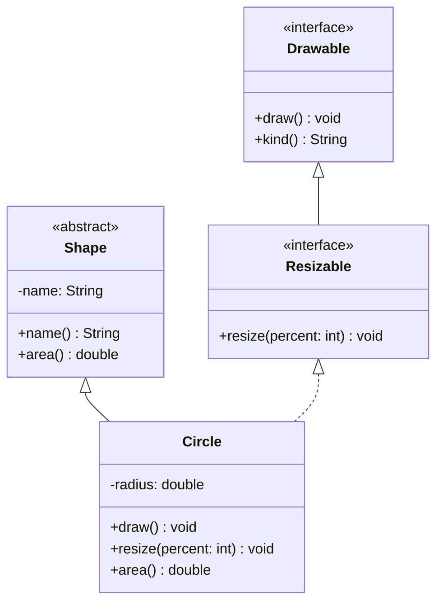
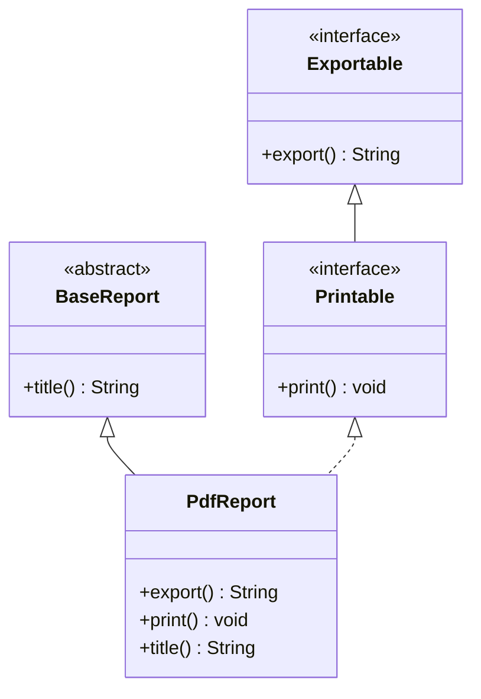

# Đọc sơ đồ lớp và quan hệ thực thi hợp đồng trong Java

Sơ đồ lớp UML mô tả các kiểu, thành viên và quan hệ giữa chúng. Khi chuyển sơ đồ thành Java, cần phân biệt **generalization** (kế thừa, thường dùng `extends`) với **realization** (thực thi hợp đồng, thường dùng `implements`) rồi kiểm tra lớp cụ thể có đáp ứng các method abstract bắt buộc hay không. UML có thể lược bớt chi tiết, nên sơ đồ giúp suy luận thiết kế nhưng không thay thế việc đọc hoặc biên dịch mã.

## 1. Nhận diện kiểu và thành viên

Một ô class thường có tên kiểu, thuộc tính (fields) và phương thức (operations); không phải sơ đồ nào cũng hiện đủ ba phần.

```text
+---------------------------+
|           Circle          |  <- tên kiểu
+---------------------------+
| - radius: double          |  <- thuộc tính
+---------------------------+
| + area(): double          |  <- phương thức
| + draw(): void            |
+---------------------------+
```

| Ký hiệu UML | Ý nghĩa | Cách đọc trong Java |
|---|---|---|
| `+` | public | Thành viên công khai theo luật truy cập Java. |
| `-` | private | Truy cập trực tiếp bị giới hạn theo quy tắc `private`. |
| `#` | protected | Áp dụng quy tắc `protected`, gồm điều kiện riêng khi khác package. |
| `~` | package visibility | Thường tương ứng package-private (không ghi modifier). |
| `- radius: double` | Thuộc tính | Có thể ánh xạ thành field `double radius`. |
| `+ area(): double` | Method | Method công khai, không tham số, trả `double`; sơ đồ có thể chưa nói method abstract hay concrete. |
| Gạch chân | Static member | Thuộc về kiểu, không phải override động. |
| In nghiêng hoặc nhãn `<<abstract>>` | Abstract type/method | Tương ứng ý niệm `abstract` trong Java. |
| Nhãn `<<interface>>` | Interface | Hợp đồng kiểu; có thể có `default`, `static`, `private` method theo phiên bản Java. |

Không suy ra method có body chỉ vì nó xuất hiện trong ô. Cũng cần kiểm tra kiểu bao ngoài, package và module: một member `public` vẫn không truy cập được nếu chính kiểu chứa nó không truy cập được.

## 2. Đọc đúng chiều và loại quan hệ

Tam giác rỗng chỉ về phía kiểu tổng quát/hợp đồng. Đọc từ kiểu cụ thể về phía đầu tam giác:

| Ký hiệu | Quan hệ UML | Cách diễn giải |
|---|---|---|
| Nét liền + tam giác rỗng `Child ─▷ Parent` | Generalization | `class Child extends Parent` hoặc `interface Child extends Parent`. |
| Nét đứt + tam giác rỗng `Worker - -▷ Contract` | Realization | `class Worker implements Contract`, trực tiếp hoặc qua quan hệ được thể hiện. |
| Đường liên kết `Order ─ Item` | Association | Có liên hệ; có thể là field tham chiếu/collection nhưng không tự tạo quan hệ kế thừa. |
| Nét đứt + mũi tên thường `Service - - -> Repository` | Dependency | Một kiểu sử dụng kiểu khác qua tham số, lời gọi hoặc cơ chế tương tự. |
| Hình thoi đen ở phía Whole | Composition | Quan hệ toàn thể–thành phần có ý nghĩa ownership/vòng đời theo mô hình. |
| Hình thoi trắng ở phía Group | Aggregation | Quan hệ toàn thể–thành phần lỏng hơn; không quy định trực tiếp cơ chế cấp phát Java. |

`1`, `0..1`, `0..*` và `1..*` là **multiplicity**: một, tối đa một, không hoặc nhiều, và một hoặc nhiều đối tượng liên quan. Multiplicity không biến association thành `extends` hay `implements`. Với Mermaid, hãy nhìn đầu ký hiệu thực tế; chẳng hạn `Parent <|-- Child` biểu diễn `Child` kế thừa `Parent`.

## 3. Sơ đồ và Java tương ứng



Diễn giải:

1. `Resizable` extends `Drawable`; hợp đồng `Resizable` bao gồm cả `draw()` và `kind()`.
2. `Circle` extends abstract class `Shape`.
3. `Circle` implements `Resizable`, nên cũng phải đáp ứng hợp đồng kế thừa từ `Drawable`.
4. Sơ đồ không chỉ rõ thân method, constructor, cách kiểm tra `percent` hoặc thuật toán tính diện tích; cần xem code để xác nhận các chi tiết đó.

Lưu mã sau thành `Main.java`:

```java
import java.util.Locale;

interface Drawable {
    void draw();

    default String kind() {
        return "2D";
    }
}

interface Resizable extends Drawable {
    void resize(int percent);
}

abstract class Shape {
    private final String name;

    protected Shape(String name) {
        this.name = name;
    }

    public final String name() {
        return name;
    }

    public abstract double area();
}

final class Circle extends Shape implements Resizable {
    private double radius;

    Circle(double radius) {
        super("Circle");
        if (radius <= 0) {
            throw new IllegalArgumentException("radius must be positive");
        }
        this.radius = radius;
    }

    @Override
    public void draw() {
        System.out.println("Draw " + name());
    }

    @Override
    public void resize(int percent) {
        if (percent <= 0) {
            throw new IllegalArgumentException("percent must be positive");
        }
        radius = radius * percent / 100.0;
    }

    @Override
    public double area() {
        return Math.PI * radius * radius;
    }
}

public class Main {
    public static void main(String[] args) {
        Circle circle = new Circle(2.0);

        Shape asShape = circle;
        Drawable asDrawable = circle;
        Resizable asResizable = circle;

        System.out.printf(Locale.ROOT, "Before: %.2f%n", asShape.area());
        asDrawable.draw();
        asResizable.resize(150);
        System.out.printf(Locale.ROOT, "After: %.2f%n", asShape.area());
        System.out.println("Kind: " + asDrawable.kind());
    }
}
```

Chạy bằng JDK 17 trở lên:

```bash
javac Main.java
java Main
```

Stdout:

```text
Before: 12.57
Draw Circle
After: 28.27
Kind: 2D
```

`resize(150)` tăng bán kính từ `2.0` lên `3.0`, vì vậy diện tích tăng từ khoảng `12.57` lên `28.27`. Ba biến `asShape`, `asDrawable`, `asResizable` cùng tham chiếu một `Circle`; kiểu khai báo quyết định member có thể gọi, còn implementation của instance method được override được chọn theo object runtime. `kind()` là default method nên `Circle` được thừa hưởng; `Shape.name()` là `final`, nên không thể override.

## 4. Kiểm tra nghĩa vụ thực thi hợp đồng

Một class concrete phải có implementation hợp lệ cho các abstract method áp dụng từ interface và superinterface, trừ khi implementation tương thích đã được kế thừa từ superclass. Không yêu cầu method phải xuất hiện lặp lại trong ô subclass nếu nó được thừa hưởng hợp lệ.

| Kiểm tra | Điều cần xác minh |
|---|---|
| Signature | Tên và danh sách tham số phải khớp; overload khác tham số không tự thực thi contract. |
| Visibility | Method thực hiện abstract method của interface phải `public`. |
| Return type | Phải tương thích theo quy tắc Java; reference type có thể dùng covariant return trong điều kiện hợp lệ. |
| Checked exception | Không được mở rộng các checked exception vượt quá hợp đồng method bị override. |
| Abstract/concrete | Abstract class có thể chuyển tiếp trách nhiệm; class concrete phải hoàn tất method còn thiếu. |
| `static` và `default` | Static method không thay thế instance contract; default method có thể được kế thừa nếu không có xung đột. |
| Xác minh | `@Override` giúp compiler phát hiện khai báo tưởng là override nhưng thực ra khác signature. |

Implementation kế thừa từ class cha vẫn có thể đáp ứng interface:

```java
interface Named {
    String name();
}

class Base {
    public String name() {
        return "base";
    }
}

class Child extends Base implements Named {
    // Hợp lệ: Base.name() là implementation public phù hợp.
}
```

Ngược lại, một abstract class có thể `implements` interface mà chưa cài đặt đủ method; concrete subclass cuối cùng phải hoàn thành nghĩa vụ. Khi nhiều interface cung cấp default method cạnh tranh, cần áp dụng quy tắc ưu tiên và override tường minh khi không chọn được một implementation duy nhất. Bài **Đơn kế thừa lớp và đa kế thừa interface** trình bày riêng các trường hợp xung đột và cách xử lý.

## 5. Quy trình đọc một sơ đồ chưa từng gặp

1. **Nhận diện kiểu:** class cụ thể, abstract class hay interface. Đừng đoán chỉ từ tiền tố `I` hoặc hậu tố `Impl`.
2. **Theo đầu tam giác:** phân biệt nét liền (generalization) và nét đứt (realization); ghi cả quan hệ bắc cầu.
3. **Thu thập contract:** xem abstract methods từ interface, superinterface và abstract superclass; chú ý default method và implementation kế thừa.
4. **Kiểm tra class concrete:** xác minh signature, visibility, return type, checked exception và default conflict. Không đòi subclass lặp lại method đã được thừa hưởng đúng.
5. **Tách quan hệ còn lại:** association, dependency, aggregation, composition và multiplicity mô tả cách các đối tượng liên hệ, không tự sinh quan hệ subtype.
6. **Đối chiếu code:** sơ đồ có thể lược chi tiết hoặc lệch phiên bản; biên dịch và đọc mã khi cần xác nhận hành vi.

## 6. Ngộ nhận thường gặp

- **Đọc ngược tam giác:** đầu tam giác rỗng chỉ về phía kiểu cha/hợp đồng.
- **Đánh đồng `extends` và `implements`:** class-to-class và interface-to-interface dùng generalization; class-to-interface dùng realization.
- **Bắt lớp con viết lại mọi method:** implementation public hợp lệ được kế thừa có thể đã đáp ứng hợp đồng.
- **Cho rằng association là ownership:** UML mô tả mô hình; vòng đời và ownership cần được xác định bằng thiết kế cụ thể.
- **Cho rằng sơ đồ chứng minh code chạy đúng:** UML không xác minh null, thread safety, business rule hoặc mọi luật biên dịch.
- **Quên access modifier:** method package-private không đáp ứng method `public` của interface; implementation phải khai báo `public`.
- **Nhầm overload với override:** `draw(String)` không thực thi `draw()`; `@Override` sẽ bắt lỗi đó.

## 7. Tự kiểm tra



1. `PdfReport` kế thừa class nào? **`BaseReport`**.
2. `PdfReport` trực tiếp implements interface nào? **`Printable`**.
3. `PdfReport` có đáp ứng `Exportable` không? **Có**, vì `Printable extends Exportable`.
4. Có thể viết `PdfReport extends Exportable` không? **Không**, vì `Exportable` là interface.
5. Nếu bỏ `export()` khỏi `PdfReport`, chắc chắn nó biên dịch được không? **Chưa thể kết luận chỉ từ sơ đồ**; cần xem `BaseReport` hoặc superclass có implementation public tương thích hay không. Nếu không có, class concrete sẽ không biên dịch.

**Ghi nhớ:** tam giác rỗng + nét liền biểu diễn generalization; tam giác rỗng + nét đứt biểu diễn realization. Một class concrete phải đáp ứng contract abstract dù implementation do chính lớp viết hay được thừa hưởng hợp lệ. Dùng UML để suy luận quan hệ, rồi kiểm tra Java để xác minh chi tiết thực thi.
