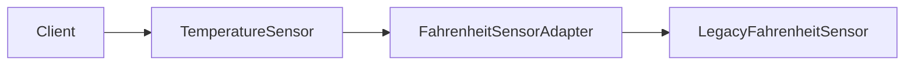

# Adapter Pattern — đưa kiểu có sẵn về hợp đồng mong muốn

Adapter (mẫu bộ chuyển đổi) cho phép hai thành phần làm việc với nhau khi chúng có giao diện không tương thích. Thành phần gọi sử dụng một hợp đồng mà nó hiểu; adapter triển khai hợp đồng đó rồi chuyển lời gọi sang API hiện có của một đối tượng khác, đồng thời chuyển đổi dữ liệu hoặc kết quả khi cần.

Ví dụ thường gặp là tích hợp thư viện cũ, SDK của nhà cung cấp, hệ thống bên thứ ba hoặc một API có tên phương thức và đơn vị đo khác với phần còn lại của ứng dụng. Adapter giúp phần gọi tiếp tục phụ thuộc vào hợp đồng ổn định thay vì phụ thuộc trực tiếp vào API cụ thể.

## 1. Bài toán mà Adapter giải quyết

Giả sử ứng dụng cần đọc nhiệt độ theo độ C qua hợp đồng:

```java
interface TemperatureSensor {
    double readCelsius();
}
```

Nhưng thư viện cũ chỉ cung cấp lớp `LegacyFahrenheitSensor` với phương thức `readFahrenheit()`, trả kết quả theo độ Fahrenheit. Client không thể gọi `readCelsius()` trên lớp cũ vì phương thức đó không tồn tại; hơn nữa, ngay cả khi đổi tên lời gọi, đơn vị dữ liệu vẫn khác nhau.

Có thể sửa client để gọi trực tiếp API cũ, nhưng khi nhiều nơi sử dụng nó, chi tiết chuyển đổi sẽ bị lặp lại. Adapter đặt phần chuyển đổi ở một nơi và cung cấp cho client giao diện mà client đang mong đợi.

Công thức chuyển đổi dùng trong ví dụ:

```text
Celsius = (Fahrenheit - 32) * 5 / 9
```

## 2. Các thành phần của mẫu

- **Target (giao diện đích):** hợp đồng mà client muốn sử dụng, ví dụ `TemperatureSensor`.
- **Adaptee (đối tượng được chuyển đổi):** API sẵn có có giao diện không tương thích, ví dụ `LegacyFahrenheitSensor`.
- **Adapter:** triển khai Target, giữ tham chiếu đến Adaptee và chuyển các lời gọi sang API của nó.
- **Client:** chỉ sử dụng Target; không cần biết chi tiết API cũ hoặc cách chuyển đổi.

Luồng gọi thường là:



Client gọi phương thức trên interface. Adapter nhận lời gọi, gọi phương thức tương ứng trên đối tượng cũ, biến đổi kết quả và trả về theo hợp đồng mới.

## 3. Ví dụ hoàn chỉnh với Java 17+

Lưu mã sau trong tệp `AdapterDemo.java`. Đây là **object adapter**: adapter dùng composition để giữ đối tượng cũ, sau đó triển khai interface đích.

```java
public class AdapterDemo {
    public static void main(String[] args) {
        LegacyFahrenheitSensor legacy = new LegacyFahrenheitSensor(77.0, "Server room");
        TemperatureSensor sensor = new FahrenheitSensorAdapter(legacy);

        System.out.println("Sensor: " + sensor.location());
        System.out.printf("Temperature: %.1f C%n", sensor.readCelsius());
    }
}

interface TemperatureSensor {
    double readCelsius();
    String location();
}

// API cũ: tên phương thức và đơn vị đo khác với hợp đồng mà client cần.
final class LegacyFahrenheitSensor {
    private final double fahrenheit;
    private final String label;

    LegacyFahrenheitSensor(double fahrenheit, String label) {
        this.fahrenheit = fahrenheit;
        this.label = label;
    }

    double readFahrenheit() {
        return fahrenheit;
    }

    String label() {
        return label;
    }
}

// Adapter chuyển từ Target sang API cũ và chuyển đổi đơn vị đo.
final class FahrenheitSensorAdapter implements TemperatureSensor {
    private final LegacyFahrenheitSensor adaptee;

    FahrenheitSensorAdapter(LegacyFahrenheitSensor adaptee) {
        if (adaptee == null) {
            throw new IllegalArgumentException("adaptee must not be null");
        }
        this.adaptee = adaptee;
    }

    @Override
    public double readCelsius() {
        return (adaptee.readFahrenheit() - 32.0) * 5.0 / 9.0;
    }

    @Override
    public String location() {
        return adaptee.label();
    }
}
```

Biên dịch và chạy bằng JDK 17 trở lên:

```bash
javac --release 17 AdapterDemo.java
java AdapterDemo
```

Đầu ra:

```text
Sensor: Server room
Temperature: 25.0 C
```

Điểm cần chú ý là biến `sensor` có kiểu `TemperatureSensor`. Client không gọi `readFahrenheit()` hay `label()` trực tiếp. Nếu sau này nguồn dữ liệu được thay bằng một cảm biến khác cũng triển khai `TemperatureSensor`, phần client có thể giữ nguyên.

## 4. Cách thiết kế Adapter trong ứng dụng thật

1. **Xác định hợp đồng mà client cần.** Đặt tên phương thức, kiểu dữ liệu, đơn vị đo và hành vi theo ngôn ngữ của ứng dụng, không nhất thiết sao chép API cũ.
2. **Xác định Adaptee.** Tìm các phương thức và kiểu dữ liệu hiện có, bao gồm lỗi có thể phát sinh, quy tắc null, thời gian chờ và vòng đời tài nguyên.
3. **Tạo lớp adapter triển khai Target.** Giữ đối tượng cũ bằng một trường và nhận nó qua constructor. Cách này làm rõ adapter đang bọc đối tượng nào và dễ thay thế trong kiểm thử.
4. **Ánh xạ từng lời gọi.** Gọi API cũ, chuyển đổi tham số và kết quả, rồi trả về theo hợp đồng đích. Nếu một phương thức không có tương đương trực tiếp, xác định hành vi rõ ràng thay vì trả dữ liệu giả.
5. **Kiểm tra các biên chuyển đổi.** Kiểm tra đơn vị, miền giá trị, độ chính xác, lỗi, null, timeout và các trường hợp API cũ không đáp ứng đầy đủ hợp đồng mới.
6. **Để client phụ thuộc vào Target.** Tạo adapter ở ranh giới tích hợp (composition root hoặc tầng hạ tầng) rồi truyền interface vào logic nghiệp vụ.

Một adapter nên tập trung vào tương thích. Nếu nó đồng thời điều phối nhiều dịch vụ, lưu trữ dữ liệu hoặc thực hiện nghiệp vụ lớn, hãy tách các trách nhiệm đó thành thành phần riêng.

## 5. Object Adapter và Class Adapter

### Object Adapter

Object adapter dùng composition: nó giữ một đối tượng Adaptee và ủy quyền lời gọi cho đối tượng đó. Ví dụ `FahrenheitSensorAdapter` ở trên là object adapter.

Ưu điểm:

- Có thể bọc một instance được tạo sẵn hoặc được cung cấp lúc chạy.
- Không phụ thuộc vào kế thừa lớp cũ.
- Dễ thay thế Adaptee và kiểm thử bằng cách cung cấp một đối tượng giả.
- Phù hợp với Java vì một lớp chỉ có thể `extends` một lớp trực tiếp.

### Class Adapter

Class adapter thường dùng kế thừa để thích nghi một lớp cụ thể, kết hợp với việc triển khai Target. Trong Java, hình thức này chỉ khả thi trực tiếp khi Adaptee là lớp có thể kế thừa và cấu trúc kiểu cho phép dùng `extends` cùng các interface cần thiết. Ví dụ khái quát:

```java
interface Target {
    String request();
}

class LegacyApi {
    String oldRequest() {
        return "legacy response";
    }
}

final class ClassAdapter extends LegacyApi implements Target {
    @Override
    public String request() {
        return oldRequest();
    }
}
```

Đoạn này là ví dụ riêng minh họa cú pháp, không phải một phần của `AdapterDemo.java`. Class adapter có thể truy cập hành vi kế thừa trực tiếp, nhưng bị ràng buộc chặt hơn với lớp cha; nó không thể mở rộng thêm một lớp khác. Với API bên thứ ba hoặc khi cần đổi instance linh hoạt, object adapter thường là lựa chọn thực tế hơn.

## 6. Adapter không làm thay đổi hợp đồng nguồn

Adapter không tự động khiến mọi API tương thích. Người thiết kế phải quyết định cách chuyển đổi có ý nghĩa:

- **Đơn vị:** chuyển độ F sang độ C, byte sang kilobyte hoặc tiền tệ theo một chính sách tỷ giá xác định.
- **Cấu trúc dữ liệu:** chuyển DTO của nhà cung cấp sang model mà ứng dụng sử dụng.
- **Tên và ý nghĩa phương thức:** ánh xạ `fetch()` của API cũ sang `load()` trong Target nếu ngữ nghĩa thực sự tương đương.
- **Ngoại lệ:** chuyển ngoại lệ thư viện sang loại lỗi mà hợp đồng đích quy định; giữ nguyên nguyên nhân để chẩn đoán.
- **Bất đồng bộ:** nếu nguồn trả về callback hoặc Future còn Target mong muốn kiểu khác, phải xác định rõ chính sách hoàn tất, hủy và timeout.
- **Tài nguyên:** làm rõ ai chịu trách nhiệm đóng kết nối hoặc giải phóng tài nguyên; không âm thầm đóng một đối tượng mà client vẫn đang sử dụng.

Không nên chuyển đổi một cách mất thông tin mà không có quy tắc. Chẳng hạn, chuyển tiền tệ cần biết tỷ giá và thời điểm áp dụng; chỉ đổi tên trường không thể giải quyết khác biệt ngữ nghĩa đó.

## 7. Kiểm thử Adapter

Nên kiểm thử ít nhất các nhóm sau:

- **Ánh xạ lời gọi:** Target method gọi đúng phương thức Adaptee và truyền đúng tham số.
- **Chuyển đổi dữ liệu:** dùng giá trị dễ kiểm tra như 32 F → 0 C, 77 F → 25 C và 212 F → 100 C.
- **Biên và lỗi:** kiểm tra null, dữ liệu không hợp lệ, ngoại lệ từ nguồn và các giá trị đặc biệt theo yêu cầu ứng dụng.
- **Hành vi hợp đồng:** client chỉ cần Target và không cần phụ thuộc vào lớp Adaptee cụ thể.

Ví dụ kiểm tra nhanh chuyển đổi có thể dùng assertion trong một chương trình nhỏ:

```java
double celsius = (77.0 - 32.0) * 5.0 / 9.0;
if (Math.abs(celsius - 25.0) > 0.000001) {
    throw new AssertionError("conversion is incorrect");
}
```

Đoạn này chỉ minh họa phép kiểm tra số thực; trong dự án thực tế, hãy kiểm thử adapter qua interface Target và giả lập Adaptee để xác nhận cả lời gọi lẫn kết quả. Khi dùng `assert` của Java, cần bật assertions bằng tùy chọn `-ea`; nếu không, các assertion có thể không được thực thi.

## 8. Lỗi thiết kế thường gặp

| Lỗi | Hệ quả | Cách xử lý |
|---|---|---|
| Cho client gọi trực tiếp API cũ ở nhiều nơi | Logic chuyển đổi bị lặp, khó thay thế nhà cung cấp | Đưa chuyển đổi vào adapter và để client dùng Target |
| Adapter chỉ đổi tên phương thức nhưng bỏ qua đơn vị hoặc ý nghĩa dữ liệu | Kết quả có vẻ hợp lệ nhưng sai ngữ nghĩa | Viết rõ quy tắc chuyển đổi và kiểm thử bằng giá trị đã biết |
| Trả về `null` hoặc giá trị mặc định khi API nguồn lỗi | Lỗi bị che giấu, client khó phát hiện | Quy định cách báo lỗi trong hợp đồng và giữ nguyên nguyên nhân |
| Adapter chứa quá nhiều nghiệp vụ | Khó bảo trì và khó kiểm thử | Giữ adapter ở vai trò tương thích; chuyển nghiệp vụ sang dịch vụ riêng |
| Dùng kế thừa chỉ để tái sử dụng một phương thức | Gắn chặt vào lớp cũ, hạn chế thay thế | Ưu tiên composition nếu không cần quan hệ kiểu kế thừa |
| Bỏ qua timeout, thread safety hoặc vòng đời tài nguyên | Lỗi khó tái hiện khi chạy thật | Ghi rõ và kiểm thử các đặc tính vận hành của Adaptee |

## 9. Phân biệt Adapter với các mẫu gần gũi

- **Adapter:** thay đổi giao diện nhìn từ phía client để hai thành phần không tương thích có thể làm việc cùng nhau.
- **Decorator:** giữ nguyên giao diện chính nhưng bổ sung trách nhiệm, chẳng hạn ghi log hoặc cache lời gọi.
- **Facade:** cung cấp giao diện đơn giản hơn cho một hệ thống gồm nhiều thành phần.
- **Bridge:** tách một khái niệm trừu tượng khỏi phần triển khai để hai phía có thể phát triển độc lập.

Một lớp có thể vừa bọc một đối tượng vừa thực hiện thêm công việc, nhưng hãy chọn mẫu theo mục đích chính. Nếu vấn đề là khác biệt giữa hợp đồng mà client cần và API sẵn có, Adapter là cách diễn đạt phù hợp.

## 10. Khi nào nên dùng?

Dùng Adapter khi tích hợp hệ thống cũ, SDK bên ngoài hoặc hai module có hợp đồng khác nhau mà bạn không thể hoặc không nên sửa trực tiếp. Nó đặc biệt hữu ích khi muốn cô lập phụ thuộc bên ngoài khỏi logic nghiệp vụ.

Không cần thêm adapter nếu hai giao diện đã tương thích và việc bọc chỉ tạo thêm một lớp chuyển tiếp không có giá trị. Cũng không nên coi adapter là cách che giấu một khác biệt ngữ nghĩa chưa được giải quyết: hợp đồng và quy tắc chuyển đổi phải rõ ràng trước khi tích hợp.

## Tài liệu tham khảo

- [Refactoring Guru — Adapter](https://refactoring.guru/design-patterns/adapter)
- [Java Language Specification 17 — Classes](https://docs.oracle.com/javase/specs/jls/se17/html/jls-8.html)
