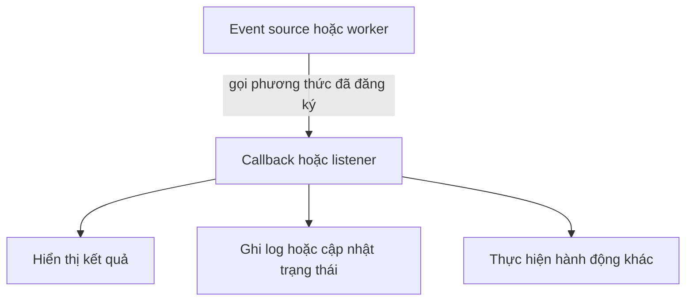

# Callback và Listener: giao quyền xử lý sự kiện

Callback và Listener là hai cách để một thành phần giao quyền xử lý cho thành phần khác. Thay vì tự quyết định mọi việc, một đối tượng phát ra kết quả hoặc sự kiện rồi gọi mã do bên sử dụng cung cấp. Cách thiết kế này giúp tách phần phát sinh công việc khỏi phần phản ứng với kết quả, đồng thời làm cho API dễ mở rộng và kiểm thử.

## 1. Callback là gì?

**Callback** là một hàm hoặc phương thức được truyền cho thành phần khác để thành phần đó gọi lại khi đến thời điểm thích hợp. Trong Java, callback thường được biểu diễn bằng một interface, một functional interface, một lambda hoặc một method reference.

Ví dụ, một bộ xử lý công việc không cần biết kết quả sẽ được hiển thị lên màn hình, ghi log hay gửi tiếp đến hệ thống khác. Nó chỉ cần gọi callback khi đã có kết quả:

```java
@FunctionalInterface
interface ResultCallback {
    void onResult(String result);
}

void execute(ResultCallback callback) {
    callback.onResult("done");
}
```

Bên gọi có thể truyền hành vi phù hợp:

```java
execute(result -> System.out.println("Kết quả: " + result));
```

Callback là một khái niệm rộng. Nó có thể được gọi ngay trong cùng luồng (synchronous), được gọi sau khi một thao tác hoàn tất, hoặc được gọi từ luồng khác nếu API được thiết kế như vậy. Bản thân từ “callback” không đảm bảo rằng thao tác là bất đồng bộ.

## 2. Listener là gì?

**Listener** là một đối tượng đăng ký quan tâm đến một loại sự kiện. Khi sự kiện xảy ra, nguồn sự kiện gọi một phương thức trên các listener đã đăng ký. Listener thường được giữ lại qua nhiều lần phát sự kiện, cho đến khi bị gỡ bỏ hoặc nguồn sự kiện kết thúc vòng đời.

Ví dụ: một nguồn thông điệp có thể thông báo `messageReceived`, một nút giao diện có thể thông báo `clicked`, hoặc một bộ theo dõi tiến trình có thể phát sự kiện `progressChanged`.

Listener thường được xem là một dạng callback hướng sự kiện. Sự khác biệt chủ yếu nằm ở cách sử dụng:

| Khía cạnh | Callback đơn lẻ | Listener |
| --- | --- | --- |
| Mục đích thường gặp | Trả kết quả hoặc báo hoàn tất cho một thao tác | Phản ứng với các sự kiện có thể lặp lại |
| Cách đăng ký | Thường truyền trực tiếp vào lời gọi phương thức | Thường đăng ký với một event source và được giữ lại |
| Số bên nhận | Thường một callback cho một yêu cầu | Có thể có nhiều listener cùng nhận một sự kiện |
| Vòng đời | Thường gắn với một lần thực hiện công việc | Cần quản lý thời điểm thêm và gỡ listener |

Đây là quy ước thiết kế phổ biến, không phải ranh giới cứng của ngôn ngữ. Một callback có thể được gọi nhiều lần, và một listener vẫn có thể được truyền như tham số. Điều quan trọng là hợp đồng API phải nói rõ ai gọi, gọi khi nào và ai chịu trách nhiệm quản lý đăng ký.

## 3. Luồng xử lý và trách nhiệm

Trong thiết kế dựa trên callback hoặc listener, thường có ba vai trò:

1. **Nguồn phát (producer/event source):** thực hiện công việc hoặc phát hiện sự kiện.
2. **Hợp đồng (callback/listener interface):** quy định phương thức mà bên nhận phải cung cấp.
3. **Bên nhận (consumer):** triển khai hợp đồng để quyết định cách phản ứng.

Nguồn phát quyết định *khi nào* gọi hợp đồng. Bên nhận quyết định *làm gì* khi được gọi. Nhờ vậy, nguồn phát không cần phụ thuộc vào một cách xử lý cụ thể.



## 4. Ví dụ Java 17+ chạy được

Ví dụ sau minh họa cả hai cơ chế: `Worker` nhận một callback để trả kết quả cho một công việc; `EventSource` cho phép nhiều listener đăng ký và nhận các sự kiện về sau. Tệp có tên `CallbackListenerDemo.java`.

```java
import java.util.Objects;
import java.util.concurrent.CopyOnWriteArrayList;

public class CallbackListenerDemo {
    @FunctionalInterface
    interface ResultCallback {
        void onResult(String result);
    }

    static class Worker {
        void execute(String jobName, ResultCallback callback) {
            Objects.requireNonNull(callback, "callback");
            String result = "done:" + jobName;
            callback.onResult(result);
        }
    }

    @FunctionalInterface
    interface Listener {
        void onEvent(String event);
    }

    static class EventSource {
        private final CopyOnWriteArrayList<Listener> listeners =
                new CopyOnWriteArrayList<>();

        void addListener(Listener listener) {
            listeners.addIfAbsent(Objects.requireNonNull(listener, "listener"));
        }

        void removeListener(Listener listener) {
            listeners.remove(listener);
        }

        void publish(String event) {
            Objects.requireNonNull(event, "event");
            for (Listener listener : listeners) {
                listener.onEvent(event);
            }
        }
    }

    public static void main(String[] args) {
        Worker worker = new Worker();
        worker.execute("report",
                result -> System.out.println("callback received: " + result));

        EventSource source = new EventSource();
        Listener audit = event -> System.out.println("audit: " + event);
        Listener ui = event -> System.out.println("ui: " + event);

        source.addListener(audit);
        source.addListener(ui);
        source.publish("saved");

        source.removeListener(ui);
        source.publish("closed");
    }
}
```

Biên dịch và chạy từ thư mục chứa tệp:

```shell
javac CallbackListenerDemo.java
java CallbackListenerDemo
```

Stdout chính xác:

```text
callback received: done:report
audit: saved
ui: saved
audit: closed
```

`Worker.execute` gọi callback ngay trong lời gọi phương thức hiện tại, nên đây là callback đồng bộ. `EventSource` lưu danh sách listener và gọi từng listener mỗi khi `publish` được gọi. Khi `ui` bị gỡ, listener đó không còn nhận sự kiện tiếp theo; `audit` vẫn nhận được sự kiện `closed`.

## 5. Vì sao dùng interface và lambda?

Functional interface là interface có đúng một phương thức trừu tượng theo quy tắc Java. Nó có thể được triển khai bằng lambda hoặc method reference, giúp người gọi cung cấp hành vi mà không phải tạo một lớp riêng cho mỗi trường hợp.

```java
worker.execute("backup", result -> saveResult(result));
worker.execute("sync", this::handleResult);
```

`@FunctionalInterface` không bắt buộc để lambda hoạt động, nhưng giúp trình biên dịch kiểm tra rằng interface vẫn giữ đúng ý định thiết kế. Nếu cần nhiều loại thông báo hoặc nhiều phương thức xử lý có liên quan, một interface listener thông thường cũng có thể phù hợp.

## 6. Đồng bộ và bất đồng bộ

Callback và listener không tự tạo ra một luồng mới. Trong ví dụ trên, các phương thức được gọi trực tiếp trên luồng đang chạy `main`. Điều này có một số hệ quả:

- Nếu callback chạy lâu, lời gọi `execute` bị chặn cho đến khi callback kết thúc.
- Nếu listener thực hiện I/O hoặc tính toán nặng, `publish` cũng mất thời gian tương ứng.
- Nếu API chạy callback trên luồng nền, bên nhận phải biết điều đó và tuân thủ quy tắc an toàn luồng của môi trường liên quan. Với giao diện đồ họa, chẳng hạn, cập nhật UI thường phải được chuyển về UI thread.
- Nếu cần bất đồng bộ, hãy định nghĩa rõ executor, thread, thứ tự sự kiện, cách truyền lỗi và thời điểm hoàn tất. Không nên để người dùng API đoán callback chạy ở đâu.

`CopyOnWriteArrayList` trong ví dụ bảo vệ cấu trúc danh sách khi nhiều luồng thêm hoặc gỡ listener và cung cấp iterator theo snapshot. Nó phù hợp khi việc duyệt và phát sự kiện thường xuyên hơn việc thay đổi danh sách. Tuy nhiên, nó không tự làm cho code bên trong từng listener an toàn luồng; hai lời gọi `publish` đồng thời vẫn có thể gọi cùng listener trên hai luồng khác nhau. Ví dụ cũng không chuyển callback sang luồng nền.

## 7. Xử lý lỗi và thứ tự gọi

API phải quyết định điều gì xảy ra nếu một callback hoặc listener ném exception. Trong ví dụ, exception không bị bắt, vì vậy nó truyền ngược ra bên gọi và có thể ngăn những listener phía sau được gọi trong lần `publish` đó. Đây là một chính sách đơn giản, nhưng không phải lúc nào cũng phù hợp.

Với hệ thống nhiều listener, hãy quyết định rõ một trong các cách: cho exception truyền ra ngoài; bắt lỗi riêng cho từng listener rồi tiếp tục; hoặc chuyển lỗi đến một error handler. Đừng âm thầm nuốt lỗi nếu người dùng API cần biết sự kiện đã được xử lý thất bại.

Nếu thứ tự là quan trọng, hãy xác định liệu listener được gọi theo thứ tự đăng ký hay không. Ví dụ dùng danh sách có thứ tự và duyệt tuần tự nên thông thường gọi theo thứ tự thêm vào. Với hệ thống phân tán hoặc xử lý song song, cần mô tả riêng bảo đảm về thứ tự và việc giao sự kiện.

## 8. Quản lý vòng đời listener

Nguồn sự kiện thường giữ tham chiếu đến listener đã đăng ký. Nếu một đối tượng không còn cần nhận sự kiện nhưng không được gỡ khỏi nguồn sống lâu dài, tham chiếu đó có thể giữ đối tượng tồn tại lâu hơn mong muốn hoặc làm cho nó tiếp tục xử lý sự kiện không cần thiết.

- Lưu listener vào biến khi cần gỡ bỏ sau này; đừng tạo lambda vô danh trong lời gọi đăng ký nếu sau đó bạn không còn cách giữ đúng đối tượng listener cần xóa.
- Gọi `removeListener` khi thành phần kết thúc vòng đời hoặc không còn quan tâm đến sự kiện.
- Xác định hành vi khi đăng ký cùng listener nhiều lần. Ví dụ dùng `addIfAbsent` để tránh đăng ký trùng theo `equals`.
- Nếu cần mô hình đăng ký có vòng đời rõ ràng hơn, API có thể trả về một đối tượng `Subscription` hoặc `AutoCloseable` để người gọi đóng đăng ký một cách tường minh.
- Tránh để callback giữ các tham chiếu lớn hoặc nhạy cảm nếu nguồn phát tồn tại lâu dài.

## 9. Chọn callback hay listener?

**Dùng callback** khi một lời gọi cần trả kết quả, báo hoàn tất hoặc cho phép bên gọi tùy biến một bước xử lý. Ví dụ: hoàn tất tải tệp, xử lý kết quả truy vấn hoặc cung cấp cách so sánh cho một thuật toán.

**Dùng listener** khi một đối tượng có thể phát nhiều sự kiện trong suốt vòng đời và một hoặc nhiều bên cần đăng ký nhận chúng. Ví dụ: trạng thái kết nối thay đổi, tiến trình được cập nhật hoặc một nguồn thông điệp nhận dữ liệu.

Với API cần một giá trị trả về ngay lập tức, phương thức trả về trực tiếp có thể đơn giản hơn callback. Với API bất đồng bộ có nhiều trạng thái hoàn tất/lỗi, `CompletionStage` hoặc một kiểu kết quả rõ ràng có thể phù hợp hơn. Hãy chọn mô hình đơn giản nhất thể hiện đúng vòng đời và hợp đồng cần có.

## 10. Lỗi thiết kế thường gặp

| Vấn đề | Hướng xử lý |
| --- | --- |
| Giả định callback luôn chạy bất đồng bộ | Ghi rõ callback chạy đồng bộ hay bất đồng bộ, và trên luồng nào. |
| Listener đăng ký nhưng không bao giờ được gỡ | Quản lý vòng đời đăng ký; gỡ khi thành phần không còn cần nhận sự kiện. |
| Nguồn phát phụ thuộc trực tiếp vào lớp giao diện cụ thể | Phụ thuộc vào interface callback/listener, để bên nhận quyết định cách xử lý. |
| Listener chậm làm chậm toàn bộ quá trình phát sự kiện | Xác định rõ chính sách dispatch; cân nhắc executor hoặc hàng đợi nếu cần, đồng thời mô tả thứ tự và xử lý lỗi. |
| Một listener lỗi làm các listener khác không chạy mà không ai biết | Quy định rõ chính sách exception; nếu tiếp tục gọi các listener còn lại, ghi nhận hoặc chuyển lỗi đến nơi phù hợp. |
| Dùng lambda rồi không thể gỡ đúng listener | Giữ tham chiếu đến instance listener đã đăng ký và dùng lại khi gỡ. |
| Cho rằng danh sách thread-safe đồng nghĩa listener thread-safe | Bảo vệ trạng thái dùng chung trong listener và xác định có thể có nhiều lời gọi đồng thời hay không. |

## 11. Checklist khi thiết kế API

- [ ] Xác định đây là kết quả của một thao tác hay sự kiện có thể lặp lại.
- [ ] Định nghĩa tên phương thức, tham số và kiểu dữ liệu của callback/listener rõ ràng.
- [ ] Mô tả khi nào callback được gọi, số lần gọi và liệu giá trị có thể là `null` hay không.
- [ ] Nêu rõ callback chạy đồng bộ hay bất đồng bộ, trên luồng nào và có bảo đảm thứ tự không.
- [ ] Xác định cách xử lý exception và điều gì xảy ra với các listener tiếp theo.
- [ ] Nếu listener được đăng ký lâu dài, cung cấp cơ chế gỡ bỏ và quy tắc xử lý đăng ký trùng.
- [ ] Viết ví dụ có thể biên dịch/chạy và kiểm tra output thực tế.

Callback và Listener đều cho phép giao quyền xử lý cho bên sử dụng thông qua một hợp đồng rõ ràng. Callback thường gắn với một yêu cầu hoặc kết quả; listener thường gắn với một nguồn sự kiện và đăng ký kéo dài. Chất lượng của thiết kế phụ thuộc vào việc mô tả chính xác thời điểm gọi, luồng thực thi, lỗi và vòng đời đăng ký.
