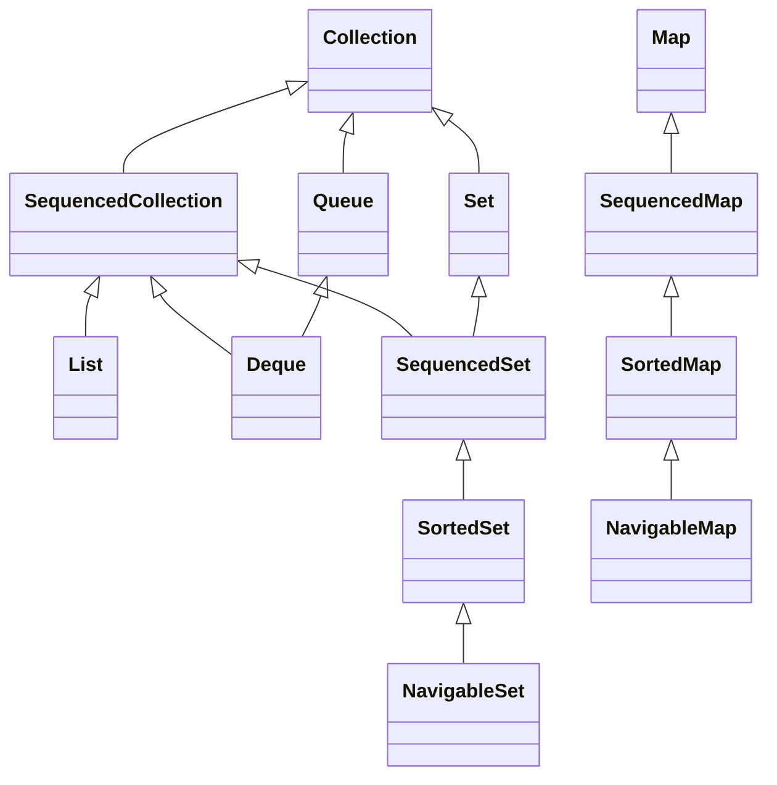

# Relationship with List, Deque, SortedSet, and SortedMap

## 1. Java 21 adds a common contract for structures that already have an order

List knows element positions, Deque knows both ends of a queue, SortedSet knows the first/last elements by comparison order, and SortedMap knows mappings by key order.

Before choosing an API, it is important to recognize what they share: each of these structures has a well-defined **order in which elements or mappings are encountered**, commonly called encounter order.

Since Java 21, the sequenced interfaces represent this shared property in the type system:

- SequencedCollection represents a collection of elements with an encounter order, which can be viewed in reverse and provides a two-ended API.
- SequencedSet combines the encounter-order property with the Set contract.
- SequencedMap is for key–value mappings with an encounter order.

They do not turn List, Deque, SortedSet, or SortedMap into the same structure. They add a suitable common ancestor for writing shared code while preserving their distinct characteristics.

Three questions should be kept separate:

| Question | Example |
| --- | --- |
| Is there a defined encounter order? | List, Deque, and SortedSet all have one |
| How is that order determined? | List position, both ends of a deque, or a Comparator |
| Which modification operations are supported? | A TreeSet is modifiable but does not accept addFirst/addLast |

**This article requires JDK 21 or later.** The sequenced APIs do not exist in Java 17. Examples are compiled with --release 21 and run on OpenJDK 24.0.2; no preview features are used.

## 2. Two type branches: Collection and Map

### 2.1. Core relationship diagram

In the diagram, the triangle arrowheads point toward the parent interface. The diagram omits generic parameters and some redundant inheritance edges for readability.



Key declarations in Java 21:

| Interface | Direct relationships to remember |
| --- | --- |
| SequencedCollection<E> | extends Collection<E> |
| List<E> | extends SequencedCollection<E> |
| Deque<E> | extends Queue<E>, SequencedCollection<E> |
| SequencedSet<E> | extends SequencedCollection<E>, Set<E> |
| SortedSet<E> | extends Set<E>, SequencedSet<E> |
| SequencedMap<K,V> | extends Map<K,V> |
| SortedMap<K,V> | extends SequencedMap<K,V> |

The relationships of List and Deque are described in [List Java 21](https://docs.oracle.com/en/java/javase/21/docs/api/java.base/java/util/List.html) and [Deque Java 21](https://docs.oracle.com/en/java/javase/21/docs/api/java.base/java/util/Deque.html). The relationships of the two sorted branches are documented in [SortedSet](https://docs.oracle.com/en/java/javase/21/docs/api/java.base/java/util/SortedSet.html) and [SortedMap](https://docs.oracle.com/en/java/javase/21/docs/api/java.base/java/util/SortedMap.html).

### 2.2. List and Deque are two branches sharing a contract

List does not extend Deque; Deque does not extend List either.

ArrayList is an example of List. ArrayDeque is an example of Deque. LinkedList is a concrete class that implements both List and Deque; that does not make the two interfaces parent/child of each other.

A method that only needs to read the first/last elements of a sequence can accept SequencedCollection. It does not need to force every caller to convert data into a List or LinkedList.

### 2.3. SortedMap does not become a Collection

SequencedMap remains in the Map branch. It does not extend SequencedCollection and does not turn a map into a collection of elements E under that same interface.

To process a map's elements through the Collection branch, you must choose a view: keys, values, or entries.

Having a method named reversed in common does not create an inheritance relationship between the two branches. Matching method names do not replace a type relationship.

### 2.4. Collection, Set, Queue, and Map in general do not automatically have a sequenced contract

A List is still a Collection through indirect inheritance. However, the converse is not true: not every Collection is a SequencedCollection.

Set in general does not promise an encounter order. Queue in general does not become a SequencedCollection just because Deque combines both. Map in general does not automatically become a SequencedMap.

HashSet and HashMap are not promoted to the sequenced interfaces merely because they can be traversed with an iterator.

## 3. Encounter order differs from sorted order

### 3.1. “First” is the start of the current order

A List containing 3, 1, 2 has first element 3 and last element 2. A Deque populated in that sequence can have the same order.

A TreeSet using natural order with the same three numbers encounters them as 1, 2, 3 instead.

All three can be SequencedCollection instances. Therefore, calling getFirst does not mean finding the smallest number using a universal algorithm.

### 3.2. Sources that determine order

| Structure or interface | Source that determines order |
| --- | --- |
| List | Position of the element in the list |
| Deque | Order from the front to the back of the deque |
| SortedSet | Natural order or the set's Comparator |
| SortedMap | Natural order or the key Comparator |
| LinkedHashSet | Encounter order maintained by the linked implementation |
| LinkedHashMap | Encounter order according to the map's mode, such as insertion order |

For sorted structures, the “first” end is the start according to the comparison relation in use. If a Comparator reverses ordinary numerical order, first is no longer the smallest number in natural numeric reading.

Sequenced is not a synonym for sorted. Sorted is one way to determine encounter order, not the only way.

### 3.3. Do not infer memory layout or complexity

The order contract describes how a program encounters data, not that elements sit contiguously in memory.

Having addFirst does not automatically make every implementation insert at the front in constant time. Having getLast does not prove every structure has the same cost to find the end.

A common interface expresses capability; choosing an implementation still requires considering access patterns, data volume, and modification requirements.

The concept of encounter order and the limits of the common contract are described in [SequencedCollection Java 21](https://docs.oracle.com/en/java/javase/21/docs/api/java.base/java/util/SequencedCollection.html).

## 4. List and Deque keep their own capabilities

### 4.1. List still has indices

Through a List variable, the program still has get(index), set(index, value), listIterator, and positional list operations.

Through a SequencedCollection variable, the program knows the order and both ends, but there is no common get(index) API.

Changing the reference type from List to SequencedCollection does not convert the data. It only changes the operation surface that the compiler allows to be called through that variable.

### 4.2. Deque still has two groups of failure-handling APIs

Deque already had getFirst/getLast, addFirst/addLast, and removeFirst/removeLast. After Java 21, it also participates in the SequencedCollection contract and has reversed with an appropriate return type.

Deque still has peekFirst/peekLast, pollFirst/pollLast, and offerFirst/offerLast. Those groups serve a different way of handling empty state or insertion failure compared to the exception-throwing method group.

Do not swap getFirst for peekFirst just because the names look similar: their contracts when empty are different.

### 4.3. `reversed` preserves the specific interface type

The interfaces narrow the return type of reversed, commonly called a covariant return type:

| Reference type | Result type of reversed() |
| --- | --- |
| SequencedCollection<E> | SequencedCollection<E> |
| List<E> | List<E> |
| Deque<E> | Deque<E> |
| SequencedSet<E> | SequencedSet<E> |
| SortedSet<E> | SortedSet<E> |
| SequencedMap<K,V> | SequencedMap<K,V> |
| SortedMap<K,V> | SortedMap<K,V> |

As a result, a reversed List can still use index-based APIs. A reversed SortedSet still provides the SortedSet contract. There is no need to downgrade every result to a Collection and cast it back.

### 4.4. A reversed view is not an independent copy by default

`reversed` returns a view in the opposite direction. If the implementation allows modification through the view, modifications write through to the underlying structure according to the contract.

In the ArrayList and ArrayDeque examples in this article, addFirst on the reversed view corresponds to adding at the end of the original structure.

At the general interface level, the extent to which changes from the underlying structure are reflected in the view also depends on the implementation; no single change-notification mechanism or snapshot semantics are guaranteed for every custom type.

If you need an independent list copy with decoupled element links, you can explicitly copy the elements in the order you want to keep. Reversing a view and copying are two different operations.

## 5. Example 1: one function that works for List, Deque, and SortedSet

The describe function only reads getFirst/getLast, so it chooses SequencedCollection. The three passed-in objects do not need to determine order the same way.

The example also demonstrates the return type of reversed and the modification limits of List.of.

Save as **SharedSequenceContract.java**:

```java
import java.util.ArrayDeque;
import java.util.ArrayList;
import java.util.Deque;
import java.util.List;
import java.util.NoSuchElementException;
import java.util.SequencedCollection;
import java.util.SortedSet;
import java.util.TreeSet;

public class SharedSequenceContract {
    static <E> void describe(String label, SequencedCollection<E> source) {
        System.out.println(label + ": " + new ArrayList<>(source)
                + "; first=" + source.getFirst() + "; last=" + source.getLast());
    }

    public static void main(String[] args) {
        List<Integer> list = new ArrayList<>(List.of(3, 1, 2));
        Deque<Integer> deque = new ArrayDeque<>(List.of(3, 1, 2));
        SortedSet<Integer> sorted = new TreeSet<>(List.of(3, 1, 2));
        describe("List", list);
        describe("Deque", deque);
        describe("SortedSet", sorted);

        List<Integer> reversedList = list.reversed();
        reversedList.addFirst(9);
        System.out.println("list after reversed addFirst: " + list);
        System.out.println("reversed list: " + reversedList);
        System.out.println("list index 0: " + list.get(0));

        Deque<Integer> reversedDeque = deque.reversed();
        reversedDeque.addFirst(9);
        System.out.println("deque after reversed addFirst: " + new ArrayList<>(deque));

        SequencedCollection<Integer> fixed = List.of(1, 2);
        try {
            fixed.addFirst(0);
        } catch (UnsupportedOperationException expected) {
            System.out.println("unmodifiable list addFirst: rejected");
        }

        List<Integer> empty = new ArrayList<>();
        try {
            empty.getFirst();
        } catch (NoSuchElementException expected) {
            System.out.println("empty List getFirst: NoSuchElementException");
        }
    }
}
```

Compile and run:

```shell
javac --release 21 -encoding UTF-8 SharedSequenceContract.java
java SharedSequenceContract
```

Stdout:

```text
List: [3, 1, 2]; first=3; last=2
Deque: [3, 1, 2]; first=3; last=2
SortedSet: [1, 2, 3]; first=1; last=3
list after reversed addFirst: [3, 1, 2, 9]
reversed list: [9, 2, 1, 3]
list index 0: 3
deque after reversed addFirst: [3, 1, 2, 9]
unmodifiable list addFirst: rejected
empty List getFirst: NoSuchElementException
```

### 5.1. The common contract does not erase differences in ordering

List and Deque encounter the sequence 3,1,2; SortedSet encounters 1,2,3. The describe function still performs the exact same job: reporting both ends of each object's order.

This function has a non-empty data precondition. When writing a real API, you must document or handle that condition; do not ignore it just because the sample data is non-empty.

### 5.2. Adding to the front of a reversed view adds to the end in this example

`reversedList` has type List, so it can still be used as a list. When adding 9 at the front of the view, the original list becomes 3,1,2,9; reading the view in reverse gives 9,2,1,3.

Index 0 of the original list is still 3. Creating the view does not reverse positions in the original view itself.

Deque exhibits the same direction reversal for adding at the front through the view in the example.

### 5.3. Sequenced does not mean everything is modifiable

The fixed variable points to List.of. It is still a SequencedCollection, yet it does not allow adding at the front.

An empty ArrayList throws NoSuchElementException on getFirst. You need to distinguish “no element present” from “modification operation not supported”.

## 6. SortedSet is a SequencedSet, still governed by sorting rules

### 6.1. Uniqueness and order are two parts of the contract

SequencedSet combines SequencedCollection with Set. It does not become a List just because it has a first and last element.

Elements remain unique under the Set contract; Set's equals/hashCode rules are preserved. Two sets with the same elements can be equal even if their encounter orders differ.

SortedSet adds comparison order. For a valid TreeSet, position is determined by that order, not by an index specified by the caller.

The [SequencedSet Java 21](https://docs.oracle.com/en/java/javase/21/docs/api/java.base/java/util/SequencedSet.html) documentation explains the relationship with Set and why order does not change Set's equals condition.

### 6.2. Elements can be added by sorting rules, but not forced to the front/back

SortedSet supports ordinary add. However, addFirst and addLast throw UnsupportedOperationException because it does not support specifying a position contrary to its ordering model.

This remains true even when the element being added happens to belong right at the front or right at the end according to the Comparator. Position-specifying APIs are not an alias for add.

Conversely, LinkedHashSet supports moving an existing element to the front/back using those methods, while still keeping only one corresponding element. See [LinkedHashSet Java 21](https://docs.oracle.com/en/java/javase/21/docs/api/java.base/java/util/LinkedHashSet.html).

### 6.3. Sorted does not mean immutable

A TreeSet can support add, remove, and removing elements at both ends. Rejecting addFirst/addLast does not mean the entire set is read-only.

SortedSet's `reversed` returns a SortedSet with the order direction reversed. The first element of the reversed view is the last element of the original order, not an element that was arbitrarily repositioned.

## 7. Example 2: SortedSet and LinkedHashSet are both sequenced but have different positioning policies

Save as **SortedAndSequencedSets.java**:

```java
import java.util.ArrayList;
import java.util.LinkedHashSet;
import java.util.List;
import java.util.SequencedSet;
import java.util.SortedSet;
import java.util.TreeSet;

public class SortedAndSequencedSets {
    public static void main(String[] args) {
        SequencedSet<Integer> linked = new LinkedHashSet<>(List.of(3, 1, 2));
        SortedSet<Integer> sorted = new TreeSet<>(List.of(3, 1, 2));
        System.out.println("linked order: " + new ArrayList<>(linked));
        System.out.println("sorted order: " + new ArrayList<>(sorted));
        System.out.println("set equality: " + linked.equals(sorted));
        System.out.println("copied list equality: "
                + new ArrayList<>(linked).equals(new ArrayList<>(sorted)));

        linked.addFirst(2);
        System.out.println("linked after moving 2 first: " + new ArrayList<>(linked));
        System.out.println("linked size: " + linked.size());

        SortedSet<Integer> reversed = sorted.reversed();
        System.out.println("reversed sorted order: " + new ArrayList<>(reversed));
        System.out.println("reversed first: " + reversed.getFirst());
        System.out.println("reverse comparator puts 1 after 2: "
                + (reversed.comparator().compare(1, 2) > 0));

        try {
            sorted.addFirst(0);
        } catch (UnsupportedOperationException expected) {
            System.out.println("SortedSet addFirst: rejected");
        }
        try {
            sorted.addLast(4);
        } catch (UnsupportedOperationException expected) {
            System.out.println("SortedSet addLast: rejected");
        }

        sorted.add(0);
        System.out.println("sorted after ordinary add: " + new ArrayList<>(sorted));
        System.out.println("removed sorted first: " + sorted.removeFirst());
        System.out.println("sorted remaining: " + new ArrayList<>(sorted));
    }
}
```

Compile and run:

```shell
javac --release 21 -encoding UTF-8 SortedAndSequencedSets.java
java SortedAndSequencedSets
```

Stdout:

```text
linked order: [3, 1, 2]
sorted order: [1, 2, 3]
set equality: true
copied list equality: false
linked after moving 2 first: [2, 3, 1]
linked size: 3
reversed sorted order: [3, 2, 1]
reversed first: 3
reverse comparator puts 1 after 2: true
SortedSet addFirst: rejected
SortedSet addLast: rejected
sorted after ordinary add: [0, 1, 2, 3]
removed sorted first: 0
sorted remaining: [1, 2, 3]
```

### 7.1. Set equals does not compare positional sequences

LinkedHashSet encounters 3,1,2; TreeSet encounters 1,2,3. Set equality still yields true because they have the same elements.

When explicitly copying those two orders into two ArrayLists, list equality yields false because List also compares corresponding order.

Adding the sequenced contract does not unify the equality rules of List and Set.

### 7.2. Same addFirst name, different support scope

LinkedHashSet moves the existing number 2 to the front. The size remains 3, so this is not adding a second duplicate of 2.

TreeSet rejects both addFirst(0) and addLast(4). Those two numbers would naturally sit at the two ends when added in natural order; the fact that they are still rejected shows that position-forcing operations do not belong to the sorted contract.

Ordinary add(0) succeeds, and TreeSet determines the position of 0 itself.

### 7.3. The reversed view's Comparator still has sorted semantics

The reversed view has type SortedSet and encounters 3,2,1. The view's Comparator places 1 after 2, matching the reversed direction.

Do not call this “TreeSet lost its sorting”. It is sorted according to the inverse relation of the original order.

`removeFirst` on the original set retrieves and removes the first element of the original order. The example proves a modifiable set can still specifically reject positional placement operations.

## 8. SortedMap belongs to SequencedMap and produces views in the Collection branch

### 8.1. Order applies to mappings by key

SortedMap determines key order using natural order or a Comparator. Entries and values are encountered in the corresponding key order.

If key 10 is mapped to "B", key 20 to "A", and key 30 to "C", the value sequence is B,A,C. It is not A,B,C just because those Strings happen to be sortable.

SequencedMap in general only promises an encounter order of mappings. It does not promise that every map is sorted by key.

### 8.2. Map's two-ended APIs use entries

| Element branch | Mapping branch |
| --- | --- |
| getFirst/getLast gets E | firstEntry/lastEntry gets Map.Entry<K,V> |
| removeFirst/removeLast gets and removes E | pollFirstEntry/pollLastEntry gets and removes the mapping |
| addFirst/addLast adds E | putFirst/putLast adds/updates and places the mapping at an end if supported |
| reversed returns a reversed collection view | reversed returns a reversed map view |

Do not call getFirst directly on a SortedMap as if it were a List. Choose an entry or explicitly choose the key/value view you need to process.

`firstEntry`/lastEntry returns null when the map is empty. In the Collection branch, getFirst/getLast on empty data throws NoSuchElementException. The two groups do not share the same representation of an empty state.

### 8.3. New views express order directly in the return type

| SequencedMap method | Return type |
| --- | --- |
| sequencedKeySet() | SequencedSet<K> |
| sequencedValues() | SequencedCollection<V> |
| sequencedEntrySet() | SequencedSet<Map.Entry<K,V>> |

Keys form a set because map keys are unique. Entries also have a set contract. Values can be duplicated across multiple keys, so the value view is not promised to be a set.

Ordinary `keySet`, values, and entrySet still encounter data in the sequenced map's order. However, the return types of those older APIs are Set, Collection, and Set respectively; through those types you cannot directly call getFirst.

This explains the benefit of the corresponding sequenced methods: making the ordering capability visible in the type surface, without re-sorting the map a second time.

These relationships and view types are specified in [SequencedMap Java 21](https://docs.oracle.com/en/java/javase/21/docs/api/java.base/java/util/SequencedMap.html).

### 8.4. SortedMap does not allow putFirst/putLast even when values can be modified

The position of a mapping is already determined by key order. SortedMap rejects putFirst and putLast with UnsupportedOperationException.

Ordinary put by key can still be supported by a modifiable TreeMap. `pollFirstEntry`/pollLastEntry can also remove mappings at the ends.

LinkedHashMap supports repositioning via putFirst/putLast according to that implementation's contract. See [LinkedHashMap Java 21](https://docs.oracle.com/en/java/javase/21/docs/api/java.base/java/util/LinkedHashMap.html).

Do not write a function accepting any SequencedMap and assume it can always call putFirst. That is an optional operation, and SortedMap is an important example of that limitation.

### 8.5. Map views do not mean arbitrary additions are allowed through every view

A sequencedKeySet does not have enough information on its own to create a new map value from just a key. Map views have their own modification contracts.

You must check the specific add/remove operations of each view, rather than inferring “this is a SequencedSet so every addFirst will succeed”.

Similarly, entries obtained from firstEntry/lastEntry are snapshots of the mapping at the time of the call and do not support setValue to modify the map. Do not assume every Map.Entry obtained from any API has the same live connection to the map.

## 9. Example 3: SortedMap, LinkedHashMap, and view types

Save as **SortedAndSequencedMaps.java**:

```java
import java.util.ArrayList;
import java.util.LinkedHashMap;
import java.util.Map;
import java.util.NoSuchElementException;
import java.util.SequencedCollection;
import java.util.SequencedMap;
import java.util.SequencedSet;
import java.util.SortedMap;
import java.util.TreeMap;

public class SortedAndSequencedMaps {
    public static void main(String[] args) {
        SequencedMap<Integer, String> linked = new LinkedHashMap<>();
        SortedMap<Integer, String> sorted = new TreeMap<>();
        linked.put(30, "C");
        linked.put(10, "B");
        linked.put(20, "A");
        sorted.putAll(linked);

        System.out.println("linked keys: " + new ArrayList<>(linked.keySet()));
        System.out.println("sorted keys: " + new ArrayList<>(sorted.keySet()));
        System.out.println("map equality: " + linked.equals(sorted));
        linked.putFirst(20, "A");
        System.out.println("linked after putFirst: " + new ArrayList<>(linked.keySet()));

        try {
            sorted.putFirst(5, "X");
        } catch (UnsupportedOperationException expected) {
            System.out.println("SortedMap putFirst: rejected");
        }
        try {
            sorted.putLast(40, "Y");
        } catch (UnsupportedOperationException expected) {
            System.out.println("SortedMap putLast: rejected");
        }

        SortedMap<Integer, String> reversed = sorted.reversed();
        System.out.println("reversed sorted keys: " + new ArrayList<>(reversed.keySet()));
        System.out.println("reversed first entry: " + reversed.firstEntry());

        SequencedSet<Integer> keys = sorted.sequencedKeySet();
        SequencedCollection<String> values = sorted.sequencedValues();
        System.out.println("first key: " + keys.getFirst());
        System.out.println("values by key order: " + new ArrayList<>(values));

        Map.Entry<Integer, String> snapshot = sorted.firstEntry();
        sorted.put(10, "Z");
        System.out.println("first-entry snapshot: " + snapshot);
        System.out.println("current first entry: " + sorted.firstEntry());
        try {
            snapshot.setValue("changed");
        } catch (UnsupportedOperationException expected) {
            System.out.println("snapshot setValue: rejected");
        }

        SortedMap<Integer, String> empty = new TreeMap<>();
        System.out.println("empty firstEntry: " + empty.firstEntry());
        try {
            empty.sequencedKeySet().getFirst();
        } catch (NoSuchElementException expected) {
            System.out.println("empty key view getFirst: NoSuchElementException");
        }

        System.out.println("polled first entry: " + sorted.pollFirstEntry());
        System.out.println("remaining keys: " + new ArrayList<>(sorted.keySet()));
    }
}
```

Compile and run:

```shell
javac --release 21 -encoding UTF-8 SortedAndSequencedMaps.java
java SortedAndSequencedMaps
```

Stdout:

```text
linked keys: [30, 10, 20]
sorted keys: [10, 20, 30]
map equality: true
linked after putFirst: [20, 30, 10]
SortedMap putFirst: rejected
SortedMap putLast: rejected
reversed sorted keys: [30, 20, 10]
reversed first entry: 30=C
first key: 10
values by key order: [B, A, C]
first-entry snapshot: 10=B
current first entry: 10=Z
snapshot setValue: rejected
empty firstEntry: null
empty key view getFirst: NoSuchElementException
polled first entry: 10=Z
remaining keys: [20, 30]
```

### 9.1. Same mappings, different encounter order

The default LinkedHashMap in the example encounters keys in insertion order 30,10,20. TreeMap encounters them in natural order 10,20,30.

Map equality returns true when they have the same mappings, even though the order sequences differ. After putFirst(20,"A"), LinkedHashMap moves the mapping for 20 to the front without adding a second key 20.

SortedMap rejects both position-forcing operations. The failed operations do not create keys 5 or 40 in the sample data.

### 9.2. The reversed view is still a SortedMap

The reversed variable directly receives the result of sorted.reversed without casting. It has key order 30,20,10 and its first entry is 30=C.

The keys variable receives a SequencedSet; the values variable receives a SequencedCollection. Both participate in the element branch when the program wants to use getFirst or traverse in encounter order.

The B,A,C sequence of values follows keys 10,20,30. There is no independent sorting of values.

### 9.3. Boundary entries differ from a reference that updates the map directly

The snapshot variable receives 10=B. When the map changes the value for key 10 to Z, snapshot still describes the captured mapping with String value B.

The snapshot.setValue call is rejected. To modify the map, the program must use an operation permitted by the map, such as put by key.

A snapshot here does not mean deep-copying key and value objects. The example uses String, so there is no internal mutation of the value to complicate observation.

### 9.4. An empty map and an empty key view return different result forms

`firstEntry` on an empty map returns null.

The key view is an empty SequencedSet; its getFirst throws NoSuchElementException. The underlying data is empty in both cases, yet the chosen APIs have different return contracts.

At the end of the program, pollFirstEntry retrieves and removes 10=Z. TreeMap has keys 20 and 30 remaining, showing it is modifiable while still specifically rejecting putFirst/putLast.

## 10. The common contract does not erase old equals and hashCode rules

SequencedCollection does not impose a new equals/hashCode rule on all underlying types, because the contracts of List and Set differ.

| Specific interface | Role of order in equals |
| --- | --- |
| List | Compares corresponding elements in order |
| Set and SequencedSet | Same elements under the Set contract, without needing the same encounter order |
| Map and SequencedMap | Same mappings under the Map contract, without needing the same encounter order |
| SequencedCollection in general | Must not assume a unified sequence-based equality rule |
| Deque in general | Does not automatically inherit all of List's equals rules just by sharing the sequenced contract |

A LinkedList has List's contracts because that class implements List. That does not prove ArrayDeque or every SequencedCollection shares List's equality rules.

If a problem requires comparing two encounter orders, define a sequence-based comparison explicitly. If you only need to compare set membership or mappings, stick to the Set/Map contract.

The examples copy into ArrayList to demonstrate sequence comparison; that is an explicit comparison choice, not a new rule applied to every collection.

## 11. Choose parameter types by required capability

### 11.1. A short decision table

| Actual need of the method | Type to evaluate |
| --- | --- |
| Only need to iterate or check membership, without relying on order | Appropriate Iterable/Collection |
| Need encounter order and reading both ends of elements | SequencedCollection |
| Need index-based access | List |
| Need two-ended offer/poll/peek operations | Deque |
| Need uniqueness and encounter order | SequencedSet |
| Need a Comparator and range-based subset operations | SortedSet |
| Need mappings and mapping encounter order | SequencedMap |
| Need mappings sorted by key and key-range operations | SortedMap |
| Need lower/floor/ceiling/higher by order | Corresponding NavigableSet or NavigableMap |

Do not widen a type too much if the code inside still needs the capabilities of a specific type.

Conversely, if you only read both ends, requiring List may force callers to copy a Deque or SortedSet even though the shared contract is already sufficient.

### 11.2. The declared type determines which methods can be called

An ArrayList object stored in a Collection variable still has list order in the actual object. However, through a Collection variable, the compiler does not allow calling getFirst because that interface does not declare this capability.

If an API needs order as part of its contract, it should express that in its signature instead of relying on callers happening to pass an ordered implementation.

Similarly, keySet of a SortedMap is still traversed in key order even though its return type is Set. If you want to use two-ended APIs directly through the type, choose sequencedKeySet.

Renaming variables or using var does not fix an overly broad return contract: var infers from the expression type published by the API.

### 11.3. Inheritance relationships do not permit arbitrary downcasting

List is a SequencedCollection, so passing a List to a function accepting SequencedCollection is a valid type relationship.

However, a SequencedCollection can be a Deque or a SortedSet. Do not cast it to List just because its elements have an encounter order.

Similarly, a SequencedMap can be a LinkedHashMap rather than a SortedMap. Having an encounter order is not enough to call Comparator or sorted key-range operations.

You need an explicit contract or proper type checks at the boundary; do not use a single run with one object as a guarantee for every caller.

### 11.4. A readable type is not a promise that every modification is supported

If a method must insert at the front, merely accepting SequencedCollection in the signature does not make a SortedSet or List.of input support that operation.

You need to document the modification precondition or design the input to guarantee the appropriate policy.

There is no general inference that “once assigned to this interface, every method in the interface must succeed in every state”.

## 12. Limits to keep in mind when using the unified API

### 12.1. Empty states must be handled according to the right branch

| Read or take-and-remove operation | Result on empty data in the corresponding contract |
| --- | --- |
| SequencedCollection.getFirst/getLast | NoSuchElementException |
| Deque.peekFirst/peekLast | null |
| Deque.pollFirst/pollLast | null |
| SequencedMap.firstEntry/lastEntry | null |
| SequencedMap.pollFirstEntry/pollLastEntry | null when take-and-remove is supported |

Do not use this table to infer that an immutable structure must accept every removal operation. UnsupportedOperationException still serves its role for optional operations.

Collection methods can return a null element if the implementation allows null and that element is actually at the boundary. Null policy belongs to the specific type/implementation, not unified merely by the sequenced label.

### 12.2. No thread-safety guarantees are added

SequencedCollection and SequencedMap do not automatically make underlying implementations safe for concurrent updates.

A sequence of checking for empty and then calling getFirst is not automatically an atomic operation if the data is modified concurrently by multiple threads.

Choosing a reversed view does not create a copy isolated from modifications by other threads. You must read the implementation's concurrency contract and protect the entire intended operation when needed.

### 12.3. Do not confuse an ordered copy with sorting capability

Copying a LinkedHashSet to a List preserves the sequence traversed at the time of copying; it does not automatically create a Comparator-based order.

Copying SortedMap keys to a List creates a key sequence in the order read at that moment; the new List does not automatically maintain sorted rules when modified later.

If you still need to maintain an ordering invariant, keep the structure and update workflow that enforce that invariant.

### 12.4. Compilation version is part of the usage contract

The examples require Java 21 APIs. Using a newer JDK while still compiling with --release 17 will not provide Java 21's sequenced interfaces/methods.

You must align the compilation level, the Java version running the program, and the project configuration. Do not treat changing an import as completing the adoption of the new API.

The examples in this article use standard Java 21 APIs, while the actual JVM version is stated separately so test results can be reproduced.

## 13. Common misconceptions

| Claim | Correct understanding |
| --- | --- |
| List is now a Deque | Both interfaces extend SequencedCollection; they do not become parent/child of each other |
| LinkedList implements both so every List is a Deque | That is the choice of one concrete class |
| Having encounter order means sorted by Comparator | Encounter order can come from position, insertion, or another policy |
| SortedMap is now a SequencedCollection | It belongs to SequencedMap, still in the Map branch |
| Every Collection/Set/Queue/Map has reversed | Those general interfaces do not automatically have the sequenced contract |
| Having addFirst means calling it always succeeds | It can be an unsupported operation |
| TreeSet lacks addFirst so it is completely immutable | It can be modified via add/remove according to its own rules |
| `putFirst` on TreeMap works if the key is already the smallest | Position-forcing APIs are still rejected |
| `reversed` creates an independent copy by default | It is a reversed view; check the implementation's contract |
| `keySet` is ordered so the Set type lets you call getFirst | Actual order and return type surface are two different things |
| SortedMap's values are sorted by value | They are encountered in the corresponding key order |
| Every sequenced structure compares equals by sequence | List, Set, and Map keep different equality contracts |
| Unified method names mean unified cost | Complexity still depends on the implementation |
| The new APIs automatically add concurrency protection | Separate concurrency contracts are required |

## 14. Self-check exercises

### Exercise 1. What should a function that only reads first/last accept?

If you want to accept ArrayList, ArrayDeque, and TreeSet just to print both ends, is it mandatory to copy all of them into a List?

**Suggested answer:** No. On Java 21 you can accept SequencedCollection and handle/document the empty condition appropriately.

### Exercise 2. Do List and Deque have a parent/child relationship?

If LinkedList implements both, does it follow that any List is also a Deque?

**Suggested answer:** No. List and Deque share a sequenced ancestor but do not extend each other.

### Exercise 3. Is first always the smallest?

A List contains 8,2,5 and a natural-order TreeSet contains the same numbers. Must `getFirst` return the same number?

**Suggested answer:** No. List returns 8, while TreeSet returns 2 for this data. The API reads the first element of each structure's order.

### Exercise 4. Why does TreeSet reject addFirst(0)?

A natural-order TreeSet currently contains 1,2,3. The number 0 is the smallest; why is addFirst still not the right addition operation for it?

**Suggested answer:** SortedSet does not support specifying a position via addFirst/addLast. Use ordinary add so the set determines the position according to its order.

### Exercise 5. Which branch does SortedMap belong to?

Can you pass a SortedMap directly to a function accepting SequencedCollection<Map.Entry<K,V>> just because a map has entries?

**Suggested answer:** No. Map does not extend Collection. You must explicitly choose an appropriate entry view, such as sequencedEntrySet.

### Exercise 6. Why is sequencedValues not a SequencedSet?

A map has two different keys both mapped to the value "ready". Can the value view retain both occurrences according to the mappings?

**Suggested answer:** Duplicate values can exist, so the general type is SequencedCollection; it does not promise uniqueness like a Set.

### Exercise 7. Does the old return type lose actual order?

SortedMap.keySet returns Set. Does that mean keySet's iterator is allowed to ignore SortedMap's key order?

**Suggested answer:** No. It still follows the map's order; the Set type simply does not directly expose sequenced methods through that variable.

### Exercise 8. Are two sets with different orders equal?

LinkedHashSet encounters 2,1,3 and TreeSet encounters 1,2,3. Must equals be false because both have encounter order?

**Suggested answer:** No. Set's equality contract does not compare positional sequences; with the same valid elements, they can return true for equals.

### Exercise 9. Where does a reversed view change the front?

The original list is a,b,c. Adding x at the front of an ArrayList's reversed view in a modifiable case produces what original order?

**Suggested answer:** The original sequence becomes a,b,c,x. The front of the reversed view corresponds to the end of the original view.

### Exercise 10. Do two APIs on empty data return the same result?

An empty SortedMap has firstEntry and sequencedKeySet().getFirst. Do both return null?

**Suggested answer:** No. `firstEntry` returns null; getFirst on an empty key view throws NoSuchElementException.

## 15. References

- [SequencedCollection — Java 21](https://docs.oracle.com/en/java/javase/21/docs/api/java.base/java/util/SequencedCollection.html): encounter order contract, two-ended API, reversed, and equals/hashCode limits.
- [SequencedSet — Java 21](https://docs.oracle.com/en/java/javase/21/docs/api/java.base/java/util/SequencedSet.html): combining Set with SequencedCollection.
- [SequencedMap — Java 21](https://docs.oracle.com/en/java/javase/21/docs/api/java.base/java/util/SequencedMap.html): Map branch, boundary entries, and sequenced views.
- [List — Java 21](https://docs.oracle.com/en/java/javase/21/docs/api/java.base/java/util/List.html): inheritance relationship, index-based API, and reversed return type.
- [Deque — Java 21](https://docs.oracle.com/en/java/javase/21/docs/api/java.base/java/util/Deque.html): relationship with Queue, SequencedCollection, and two-ended operation groups.
- [SortedSet — Java 21](https://docs.oracle.com/en/java/javase/21/docs/api/java.base/java/util/SortedSet.html): comparison order and addFirst/addLast limits.
- [SortedMap — Java 21](https://docs.oracle.com/en/java/javase/21/docs/api/java.base/java/util/SortedMap.html): key order and putFirst/putLast limits.
- [LinkedHashSet — Java 21](https://docs.oracle.com/en/java/javase/21/docs/api/java.base/java/util/LinkedHashSet.html): positioning operations on a set with encounter order.
- [LinkedHashMap — Java 21](https://docs.oracle.com/en/java/javase/21/docs/api/java.base/java/util/LinkedHashMap.html): positioning operations on a map with encounter order.
