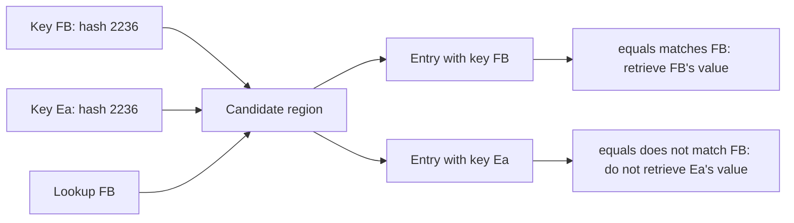

# Distinguishing Hash Collisions from Equal Keys

## 1. Two pieces of information often conflated

Consider two strings:

```java
String first = "FB";
String second = "Ea";
```

They have different contents, so:

```java
System.out.println(first.equals(second)); // false
```

Yet they have the same hash code:

```java
System.out.println(first.hashCode());  // 2236
System.out.println(second.hashCode()); // 2236
```

This is a **hash collision**: two keys that are different according to `equals` produce the same `hashCode`.

If you put them into a `HashMap<String, String>`, the map can still keep two separate mappings. An identical hash does not automatically lose data, nor does it mean Java computed it wrongly.

This article uses Java 17 and focuses on distinguishing between:

1. Identical hash codes.
2. Keys placed into the same candidate region in a hash table.
3. Keys that are genuinely equal according to their type's contract.

Understanding these three levels helps accurately explain whether `put` updates or inserts, how `HashSet` deduplicates elements, and which bugs need fixing in a key type.

## 2. equals determines equality; hashCode helps locate candidates

`equals` returns a `boolean` to express the type's equality relation. `hashCode` returns an `int` used to support hash-based data structures.

The contract specifies a directional implication:

```text
If a.equals(b) is true
then a.hashCode() must equal b.hashCode().
```

The reverse direction is not guaranteed:

```text
a.hashCode() equals b.hashCode()
does not prove that a.equals(b) is true.
```

Comparison table:

| equals relation | hash relation | Meaning |
| --- | --- | --- |
| Equal | Same hash | Meets contract requirements |
| Not equal | Different hash | Allowed, favorable for dispersion |
| Not equal | Same hash | Allowed collision |
| Equal | Different hash | Violates the hashCode contract |

The table assumes both methods are evaluated on consistent data state. Do not mutate equality-determining fields between checks and treat it as the same stable comparison.

If two hashes differ, you can conclude that the two objects are not equal **when the type adheres to the contract**. If the type violates the contract, that deduction cannot salvage the design.

Official source: [Object.equals and Object.hashCode](https://docs.oracle.com/en/java/javase/17/docs/api/java.base/java/lang/Object.html).

## 3. Same reference and same value are also two different things

```java
// Illustrative snippet inside a method.
String first = "FB";
String copy = new String("FB");

System.out.println(first == copy);      // false
System.out.println(first.equals(copy)); // true
System.out.println(first.hashCode() == copy.hashCode()); // true
```

`new String("FB")` creates a separate string object, yet it has the same content as the original string. For `String`, those two objects are two value-equivalent keys.

Meanwhile:

```java
String first = "FB";
String second = "Ea";

System.out.println(first.equals(second)); // false
System.out.println(first.hashCode() == second.hashCode()); // true
```

Both pairs have equal hashes, but only one pair is equal according to `equals`.

Therefore:

- `==` does not replace `String.equals` when comparing contents.
- Comparing hashes does not replace `equals`.
- The number of allocated objects does not determine the number of logical keys in a map.

Do not rely on string interning to write key rules. This article uses `new String` strictly to clarify the distinction between reference and value.

## 4. Why are collisions normal?

`hashCode` returns only a 32-bit integer, so there are only a finite number of possible outcomes. The domain of objects or strings can be vastly larger.

A function that compresses many inputs into a smaller result set cannot guarantee that every distinct input receives a distinct value.

Collisions can occur even with a valid hash function. Hash quality relates to how well it disperses real-world data, not a promise that duplicates will never happen.

Things you should not infer:

- Duplicate hashes mean a programming bug.
- A hash must always be a positive number.
- A hash is a unique object ID.
- A hash is a memory address.
- A hash can be safely used to verify that content is unchanged.
- Every type's hash is guaranteed to remain persistent across runs.

A specific type like `String` has a published hash algorithm. You should not generalize that specific guarantee to every Java class.

## 5. Calculating the FB and Ea example

For a string with two UTF-16 code units, the `String.hashCode` formula for this case is:

```text
hash = 31 * first_char + second_char

"FB": 31 * 70 + 66 = 2236
"Ea": 31 * 69 + 97 = 2236
```

The first characters differ by `1`, while the second characters compensate by `31`, producing the same sum. The string contents remain different.

For longer strings, the formula is a base-`31` polynomial over `char` values using Java `int` arithmetic. A two-character example is sufficient for the lesson, so there is no need to reimplement the hash function yourself.

Key observation:

```text
"FB" and "Ea"
    same hash
    different content
    equals is false
```

The formula is described in [String.hashCode](https://docs.oracle.com/en/java/javase/17/docs/api/java.base/java/lang/String.html#hashCode()).

## 6. Hash code, bucket, and equality are three distinct levels

A hash table can be visualized using the following model:



This is a conceptual diagram; it does not prescribe the exact comparison order or every optimization step of a specific `HashMap` implementation.

### 6.1. Full hash code

This is the `int` returned by the key's `hashCode()`. Two equal values at this level represent a "hashCode collision".

### 6.2. Table position

The table has a finite number of slots according to its current capacity. The implementation must map the hash information to an appropriate slot.

Because the number of slots is typically smaller than the number of possible `int` values, two different hashes can also map to the same slot. Consequently, sharing a bucket does not prove that the full `hashCode` values are equal.

For example, in an illustrative table using `index = hash % 4` for positive hashes: `1` and `5` both go to index `1`. This is a simplified model to show slot compression, **not the complete formula of Java's HashMap**.

### 6.3. Deciding key match

Within the candidate group, the implementation still must distinguish keys according to the equality contract, alongside valid shortcuts such as reference equality.

Hashing only narrows down the search. It does not replace the key's content with a single number.

OpenJDK 17 source code shows that hash spreading, table lookup, and key matching are distinct steps. These details belong to the implementation; do not write business code that depends on bucket count or the number of calls to `equals`. [OpenJDK HashMap source](https://raw.githubusercontent.com/openjdk/jdk17u/master/src/java.base/share/classes/java/util/HashMap.java)

## 7. put encounters duplicate hash but different equals: keeps two mappings

```java
// Illustrative snippet inside a method; requires import java.util.*.
Map<String, String> map = new HashMap<>();

map.put("FB", "first");
map.put("Ea", "second");

System.out.println(map.size());    // 2
System.out.println(map.get("FB")); // first
System.out.println(map.get("Ea")); // second
```

The second `put` does not overwrite the value of `"FB"`. The two keys are not equal, so they form two separate mappings despite the hash collision.

The `Map` requirement is that each logical key maps to at most one value. It does not state "each hash has at most one value".

Seeing two keys with the same hash coexist is normal behavior for a collision-handling data structure. [Map.put](https://docs.oracle.com/en/java/javase/17/docs/api/java.base/java/util/Map.html#put(K,V))

## 8. put encounters an equal key: updates the mapping

```java
// Illustrative snippet inside a method; requires import java.util.*.
Map<String, String> map = new HashMap<>();
map.put("FB", "first");
map.put("Ea", "second");

String previous = map.put(new String("FB"), "updated");

System.out.println(previous);      // first
System.out.println(map.size());    // 2
System.out.println(map.get("FB")); // updated
System.out.println(map.get("Ea")); // second
```

This time, the new object is equal to `"FB"` according to `String.equals`, so it updates the corresponding mapping.

Outcomes to keep separate:

- `put` a distinct key with a duplicate hash: inserts a new mapping if no equal key exists yet.
- `put` a key equal to an existing key: replaces the value of that mapping.
- Having the same reference is one case of a matching key, but not the only condition.

`put` returns the previous value. If the result is `null`, remember that a map might have previously stored a `null` value. In the examples in this article, all stored values are non-`null`, so an initial `null` return means there was no prior mapping.

Do not rely on which representative key object instance is retained after an update to build business rules outside the API contract.

## 9. HashSet deduplicates by equals, not by hash alone

```java
// Illustrative snippet inside a method; requires import java.util.*.
Set<String> set = new HashSet<>();

System.out.println(set.add("FB"));             // true
System.out.println(set.add("Ea"));             // true
System.out.println(set.add(new String("FB"))); // false
System.out.println(set.size());                // 2
```

The first two calls add two distinct logical elements. The third call does not add the element because an equal element is already present.

`HashSet` uses a `HashMap` as its backing structure in the JDK implementation, but users do not need to access the internal map to use the set contract properly.

The `contains` and `remove` operations also locate the exact equal element rather than removing every element that shares the same hash.

Do not use the print order of `System.out.println(set)` to prove collision behavior, because `HashSet` does not guarantee iteration order. Using `size`, the return value of `add`, and individual key queries is much clearer. [HashSet API](https://docs.oracle.com/en/java/javase/17/docs/api/java.base/java/util/HashSet.html)

## 10. A key type with a constant hash can still distinguish values

To observe deliberate collisions, you can use a test class:

```java
// Nested class declaration inside another class.
static final class CollisionKey {
    private final int id;

    CollisionKey(int id) {
        this.id = id;
    }

    @Override
    public boolean equals(Object object) {
        return object instanceof CollisionKey other && id == other.id;
    }

    @Override
    public int hashCode() {
        return 7;
    }
}
```

Every instance shares the hash `7`, yet equality is still based on `id`.

```java
// Illustrative snippet using the declared CollisionKey; requires import java.util.*.
Map<CollisionKey, String> values = new HashMap<>();
values.put(new CollisionKey(1), "one");
values.put(new CollisionKey(2), "two");

System.out.println(values.size()); // 2
System.out.println(values.get(new CollisionKey(2))); // two
System.out.println(values.remove(new CollisionKey(1))); // one
System.out.println(values.get(new CollisionKey(2))); // two
```

This example demonstrates that correctness is preserved even under heavy collisions, as long as the equality and hash contracts remain consistent.

Do not use a constant hash in production code just because this test returns the right results. Poor dispersion increases processing work within a single candidate group and can severely degrade performance.

Normal hash-table lookup performance relies on the assumption that hashes disperse reasonably well. Do not assume that every collision case has the same cost or that every call is unconditionally `O(1)`. [HashMap API](https://docs.oracle.com/en/java/javase/17/docs/api/java.base/java/util/HashMap.html)

## 11. Dangerous pitfall: discarding the original key and using only the hash number as the key

```java
// Illustrative snippet of inappropriate modeling; requires import java.util.*.
Map<Integer, String> byHash = new HashMap<>();

byHash.put("FB".hashCode(), "for FB");
byHash.put("Ea".hashCode(), "for Ea");

System.out.println(byHash.size()); // 1
System.out.println(byHash.get("FB".hashCode())); // for Ea
```

Here, `HashMap` works properly given what it received: its actual keys are both the number `2236`. Those two `Integer` values are equal, so the second call updates the same mapping.

The information distinguishing `"FB"` from `"Ea"` was discarded by the application before the map ever processed it.

If you want to look up by string, keep the string itself as the key:

```java
Map<String, String> byOriginalKey = new HashMap<>();
```

If a custom algorithm needs to group items by hash, it must retain a list of candidates along with the original data and check equality afterward. Do not build a "one value per hash" map yourself and expect it to replace object-keyed map semantics.

A `hashCode` is also unsuitable as a user identifier, a persistent unique key, or a secure integrity checksum. For specialized content verification requirements, use a mechanism designed for that requirement along with an appropriate verification process.

## 12. Distinguishing valid collisions from a broken key contract

### 12.1. Equal by equals but different hashes

If two keys are equal according to `equals` but return different hashes, the key implementation violates the contract. A hash table may search by hash first and never even compare the pair of objects as the author expected.

Symptoms can include:

- Looking up with a new equivalent object fails to find the value.
- A set fails to deduplicate as intended.
- Removing via an equivalent key does not work as expected.

This is a completely different issue from a hash collision. A collision is "not equal, but same hash", which is permitted.

### 12.2. equals using hash as identity

If equality is defined solely by comparing hashes, the application can merge distinct data items into the same identity.

Even if the two methods appear mathematically consistent with each other, that equality relation can still be completely wrong for the business domain. The formal contract does not automatically define what "same user", "same product", or "same coordinates" means.

### 12.3. Key mutated after insertion

If data participating in `equals`/`hashCode` changes while the object is acting as a key, the stability precondition no longer holds. `Map` does not guarantee behavior when a key is mutated in a way that affects equality.

Keep keys immutable or update mappings through a well-controlled procedure. Do not diagnose every lookup bug as "caused by a hash collision".

### 12.4. Non-symmetric or non-transitive equals

Bugs in the equality relation itself can also produce path-dependent comparison results. Verify reflexivity, symmetry, transitivity, consistency, and `null` comparison, rather than only comparing two hash numbers.

`Objects.equals` helps invoke null-safe equality; it does not turn a hash into the definition of equality. [Objects API](https://docs.oracle.com/en/java/javase/17/docs/api/java.base/java/util/Objects.html)

## 13. Do not generalize this model to every Map implementation

This article focuses on `HashMap` and `HashSet`. Other data structures may use different key-locating rules:

- `TreeMap` relies on `compareTo` or a `Comparator`. Two keys whose comparison returns `0` are treated as occupying the same position in the tree; `hashCode` does not decide that.
- `IdentityHashMap` is designed to use reference equality (`==`), differing from standard value-based equality semantics.

For sorted maps and sets, the ordering must be consistent with `equals` to satisfy the general `Map`/`Set` contracts. Do not use an experiment in `TreeMap` to draw conclusions about hash collisions.

Sources: [TreeMap](https://docs.oracle.com/en/java/javase/17/docs/api/java.base/java/util/TreeMap.html), [IdentityHashMap](https://docs.oracle.com/en/java/javase/17/docs/api/java.base/java/util/IdentityHashMap.html).

## 14. Complete program

Save as `HashCollisionDemo.java`.

```java
import java.util.HashMap;
import java.util.HashSet;
import java.util.Map;
import java.util.Set;

public final class HashCollisionDemo {
    static final class CollisionKey {
        private final int id;

        CollisionKey(int id) {
            this.id = id;
        }

        @Override
        public boolean equals(Object object) {
            return object instanceof CollisionKey other && id == other.id;
        }

        @Override
        public int hashCode() {
            return 7;
        }
    }

    public static void main(String[] args) {
        String first = "FB";
        String second = "Ea";
        String equalToFirst = new String("FB");

        System.out.println("FB hash: " + first.hashCode());
        System.out.println("Ea hash: " + second.hashCode());
        System.out.println("Same hash: "
                + (first.hashCode() == second.hashCode()));
        System.out.println("FB equals Ea: " + first.equals(second));
        System.out.println("FB same reference as copy: "
                + (first == equalToFirst));
        System.out.println("FB equals copy: " + first.equals(equalToFirst));

        Map<String, String> map = new HashMap<>();
        System.out.println("Put FB previous: " + map.put(first, "first"));
        System.out.println("Put Ea previous: " + map.put(second, "second"));
        System.out.println("Size after collision: " + map.size());
        System.out.println("Get FB: " + map.get(first));
        System.out.println("Get Ea: " + map.get(second));

        System.out.println("Put equal FB previous: "
                + map.put(equalToFirst, "updated"));
        System.out.println("Size after equal key: " + map.size());
        System.out.println("Get FB after update: " + map.get(first));
        System.out.println("Get Ea after update: " + map.get(second));

        Set<String> set = new HashSet<>();
        System.out.println("Set add FB: " + set.add(first));
        System.out.println("Set add Ea: " + set.add(second));
        System.out.println("Set add equal FB: " + set.add(equalToFirst));
        System.out.println("Set size: " + set.size());

        Map<CollisionKey, String> ids = new HashMap<>();
        ids.put(new CollisionKey(1), "one");
        ids.put(new CollisionKey(2), "two");
        System.out.println("Constant-hash size: " + ids.size());
        System.out.println("Constant-hash get 2: "
                + ids.get(new CollisionKey(2)));
        System.out.println("Constant-hash remove 1: "
                + ids.remove(new CollisionKey(1)));
        System.out.println("Remaining get 2: "
                + ids.get(new CollisionKey(2)));
        System.out.println("Remaining size: " + ids.size());

        Map<Integer, String> oneValuePerHash = new HashMap<>();
        oneValuePerHash.put(first.hashCode(), "for FB");
        oneValuePerHash.put(second.hashCode(), "for Ea");
        System.out.println("Hash-as-key size: " + oneValuePerHash.size());
        System.out.println("Hash-as-key FB lookup: "
                + oneValuePerHash.get(first.hashCode()));
    }
}
```

Compile and run:

```shell
javac --release 17 -encoding UTF-8 -Xlint:unchecked HashCollisionDemo.java
java HashCollisionDemo
```

The code has been verified against the Java 17 API baseline on a newer JDK with no unchecked warnings.

Stdout:

```text
FB hash: 2236
Ea hash: 2236
Same hash: true
FB equals Ea: false
FB same reference as copy: false
FB equals copy: true
Put FB previous: null
Put Ea previous: null
Size after collision: 2
Get FB: first
Get Ea: second
Put equal FB previous: first
Size after equal key: 2
Get FB after update: updated
Get Ea after update: second
Set add FB: true
Set add Ea: true
Set add equal FB: false
Set size: 2
Constant-hash size: 2
Constant-hash get 2: two
Constant-hash remove 1: one
Remaining get 2: two
Remaining size: 1
Hash-as-key size: 1
Hash-as-key FB lookup: for Ea
```

### Reading the output according to the right concepts

- The first two strings share the hash `2236`, yet `equals` is `false`.
- The new `"FB"` string has a different reference from the original string, but is equal by content.
- `put("Ea", ...)` creates a second mapping despite the duplicate hash.
- `put` with a new object having the content `"FB"` updates the value and returns `"first"`.
- The mapping for `"Ea"` remains untouched when `"FB"` is updated.
- `HashSet` keeps the two strings with different contents and rejects the equivalent copy of `"FB"`.
- The constant-hash key type still looks up and removes accurately by `id`.
- The example that keeps only the hash number as the key loses the ability to distinguish the two original strings.

The program does not print the iteration order of `HashMap` entries or `HashSet` elements, so the stdout does not depend on unspecified traversal order.

## 15. How to test and diagnose in real code

When you need to determine whether an issue is a "hash collision" or a "duplicate key", proceed in order:

1. Note which data structure is in use: `HashMap`, `TreeMap`, or another type.
2. Pick two specific objects and inspect the data that determines their identity.
3. Check `a == b` if reference distinction matters.
4. Check `a.equals(b)` and `b.equals(a)`.
5. Compare hashes to verify that they obey the `equal ⇒ same hash` requirement.
6. Perform `put`/`get`/`containsKey`/`remove` using a newly created equivalent object.
7. Check whether the key's state was mutated after insertion.
8. Check whether the application reduced the original key to a hash number or used an inappropriate comparator.

Do not require that "every distinct key must have a different hash" in correctness unit tests. A deliberate collision test helps ensure that application code does not accidentally rely on that assumption.

If the concern is performance, evaluate data distribution, hash computation cost, equality comparison cost, and key-set scale separately. Avoid extrapolating full application performance from a two-element example.

Do not log raw sensitive key data just to inspect hashes. Use synthetic data in tests and permitted diagnostic metadata in operations.

## 16. Common mistakes

| Misconception | Why it is wrong | How to handle it |
| --- | --- | --- |
| Equal hashes mean the same key | Collisions are allowed | Check equality according to the contract |
| A HashMap can store only one entry per bucket | A bucket can hold multiple candidates | Distinguish storage slot from logical key |
| A second `put` overwrites because of a duplicate hash | Updates happen due to equal keys, not hash alone | Observe `equals`, map size, and individual lookups |
| HashSet rejects all elements with the same hash | It must distinguish logical elements | Test colliding yet distinct pairs |
| A constant hash always violates the contract | It can be contractually valid while having poor dispersion | Separate correctness from performance |
| Using `hashCode` as a unique ID | The output domain is finite and has collisions | Keep the full key or a dedicated unique ID |
| Sharing a bucket proves identical `hashCode` | Multiple hashes can map to the same slot | Separate the full hash from slot index selection |
| A failed lookup is definitely caused by a collision | It may be caused by broken `equals`/`hashCode` or mutated keys | Verify the entire key contract |
| Relying on `HashMap` print order to guess collisions | Iteration order is not guaranteed | Use direct behavioral assertions |
| Assuming every map uses hashes to compare keys | Implementations may use a comparator or reference identity | Read the contract of the specific map type |

## 17. Self-check and practice

### Questions

1. `"FB"` and `"Ea"` have the same hash—are they equal?
2. Are two equal objects allowed to return different hashes?
3. Are two different hashes enough to conclude the keys are different when the class already violates the contract?
4. What does `put` do when called with a new object that is equal (`equals`) to an existing key?
5. Why does `HashSet` accept both colliding strings but reject the content copy of `"FB"`?
6. Do two keys in the same bucket necessarily share the same full `hashCode`?
7. Why can using `Map<Integer, V>` with `key.hashCode()` cause data loss?
8. How does a constant hash affect correctness and performance?
9. Is mutating a key while it is inside a map a case of a valid hash collision?
10. Why shouldn't you use `TreeMap` to demonstrate hash collision handling?

### Exercises

- Run the complete program and predict the map size after each `put`.
- Change the updated value of `"FB"` and verify that `"Ea"` still retains its own value.
- Use the `CollisionKey` type to add several different IDs, then look them up using newly instantiated objects with the same IDs.
- Remove one key from a colliding hash group and verify that the remaining keys are still accessible.
- Write a test asserting that two distinct keys with the same hash coexist in a `HashMap`.
- Write a separate test asserting that an equal key updates the existing mapping.
- Find a place in experimental code that uses a hash as an ID; replace it with the full key and demonstrate that data is no longer merged.
- Given an illustrative four-slot table, pick two different hashes that map to the same index to distinguish a bucket collision from a `hashCode` collision.

### Reference answers

1. No; they share the hash `2236` but have different contents.
2. No; that is a contract violation.
3. No; the precondition required for that deduction to hold has been broken.
4. It updates the value of the mapping with the equivalent key.
5. The first two strings differ according to equality; the copy of `"FB"` is equal to an existing element.
6. No.
7. The application compressed multiple distinct original keys into the same `Integer` before the map processed them.
8. Lookups can still be accurate when equality is properly implemented, but dispersion is poor and performance can degrade.
9. No; that is an issue of key state stability and usage preconditions.
10. `TreeMap` locates keys via comparisons, not `hashCode`.
