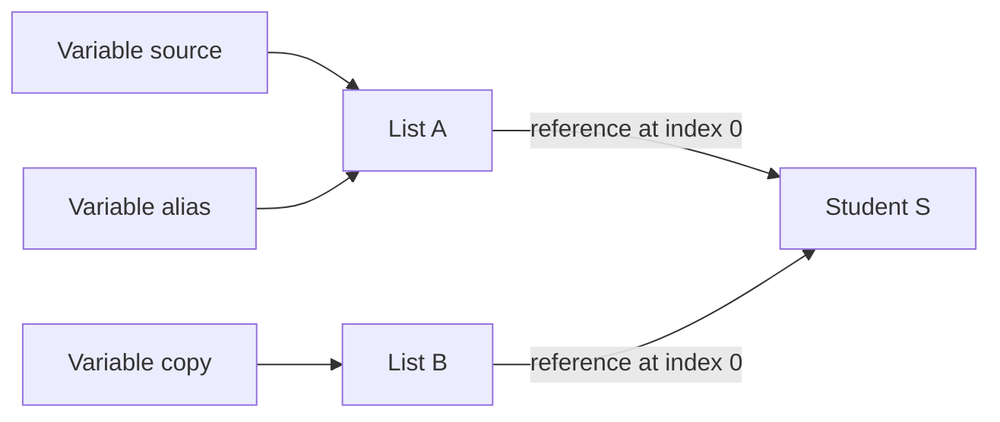

# Constructor Copying and the Limits of Shallow Copies

## 1. Creating a New List Does Not Mean Creating New Elements

When you need a separate list to modify independently, a familiar approach is:

```java
List<Student> copy = new ArrayList<>(source);
```

This is an illustrative expression assuming `source` and the `Student` type already exist. It creates a new `ArrayList` object containing elements taken from the source. However, if each element is a `Student` object, what gets copied into the new list is the **reference to the Student**, rather than automatically creating a distinct `Student` instance.

This is a **shallow copy**: the outer container structure is separated, while the element objects themselves may still be shared.

There are three levels to distinguish:

| Approach | Is there a new list? | Are new element objects automatically created? |
|---|---|---|
| `List<Student> alias = source;` | No | No |
| `List<Student> copy = new ArrayList<>(source);` | Yes | No |
| Iterating over the source and copying each `Student` according to the type's rules | Yes | Depends on how the copying is implemented |

The learning goal here is to determine the exact boundary of "independence." If you only need to add, remove, or sort the list without altering the source structure, a shallow copy is usually appropriate. If you need to mutate the state of individual `Student` objects without affecting the source data, merely creating a new `ArrayList` is not enough.

## 2. What Does the Collection-Accepting Constructor Do?

API signature:

```java
public ArrayList(Collection<? extends E> c)
```

This is an illustrative signature, not a standalone Java file.

This constructor creates an `ArrayList` containing the elements of the source collection in the order returned by the source's iterator. When the source is a `List`, the list order is preserved.

An illustrative snippet inside a method, requiring imports for `java.util.List` and `java.util.ArrayList`:

```java
List<String> source = List.of("Java", "SQL", "Java");
ArrayList<String> copy = new ArrayList<>(source);

// copy = [Java, SQL, Java]
// copy.size() = 3
```

Key operational characteristics:

- Duplicate elements are preserved; the constructor does not deduplicate.
- The source is not cleared or consumed after copying.
- The result is a modifiable `ArrayList`, even if the source is an unmodifiable list.
- The iteration order provided by the source is preserved, but the constructor does not sort elements on its own. If the source makes no guarantee of a stable iteration order, the copy does not invent a new ordering guarantee.
- A `null` source collection throws a `NullPointerException`.
- `null` elements inside a valid source collection are accepted by `ArrayList`.

The parameter `Collection<? extends E>` also allows copying elements into a list with a more general element type. For example:

```java
List<Integer> integers = List.of(1, 2, 3);
ArrayList<Number> numbers = new ArrayList<>(integers);
```

The elements remain `Integer` objects; choosing the variable element type `Number` does not convert them into a new kind of number object.

Do not confuse the two constructors:

| Expression | Initial result |
|---|---|
| `new ArrayList<String>(100)` | Empty list with an initial reserved capacity of 100 |
| `new ArrayList<>(source)` | List containing the elements currently taken from the source |

One takes an initial capacity count, while the other takes a collection whose contents are copied. [ArrayList(Collection) constructor](https://docs.oracle.com/en/java/javase/17/docs/api/java.base/java/util/ArrayList.html#%3Cinit%3E(java.util.Collection)).

## 3. Reference Assignment and Structural Copying Are Two Different Things

### 3.1. Variable Assignment Does Not Copy the Object

Illustrative snippet:

```java
List<String> source = new ArrayList<>(List.of("A", "B"));
List<String> alias = source;

alias.add("C");

// Both source and alias see [A, B, C].
```

Both variables hold references to the exact same list object. Modifying the list through either variable mutates that same underlying structure.

Renaming the variable to `backup`, `snapshot`, or `copy` does not change the semantics of assignment. What matters is whether a new data structure is allocated or only a reference value is copied.

### 3.2. The Constructor Creates an Independent Container Structure

Illustrative snippet:

```java
List<String> source = new ArrayList<>(List.of("A", "B"));
List<String> copy = new ArrayList<>(source);

copy.add("C");

// source = [A, B]
// copy = [A, B, C]
```

Once created, structural operations on one list do not automatically alter the structure of the other:

- `add`, `remove`, and `clear` affect only the list receiving the call.
- `set(index, newElement)` replaces the reference at that index in the list receiving the call.
- Sorting the copy reorders the references inside the copy without reordering the source.

This must be distinguished from invoking a mutating method on an element object itself, such as `copy.get(0).setName(...)`. In that case, the list structure does not change, but a shared object has changed its internal state.

### 3.3. equals Does Not Prove a Deep Copy Occurred

Immediately after `new ArrayList<>(source)`, we have:

```java
source == copy       // false
source.equals(copy)  // true
```

These two illustrative expressions check different things:

- `==` between two list variables asks whether they refer to the exact same list object.
- `List.equals` compares the sequence of elements in order for equality.

Two lists being equal in content does not mean they are the same list object. Conversely, an `equals` result of `true` does not prove that the elements were duplicated; in fact, sharing the exact same element references is often why the elements compare as equal.

## 4. Complete Program: Alias vs. List Copy

Save as `ArrayListConstructorCopyDemo.java`. This program uses APIs available in Java 17:

```java
import java.util.ArrayList;
import java.util.List;

public class ArrayListConstructorCopyDemo {
    public static void main(String[] args) {
        List<String> source = new ArrayList<>(List.of("A", "B"));
        List<String> alias = source;
        List<String> copy = new ArrayList<>(source);

        System.out.println("source == alias: " + (source == alias));
        System.out.println("source == copy: " + (source == copy));
        System.out.println("source.equals(copy): " + source.equals(copy));

        copy.set(0, "X");
        copy.add("C");
        System.out.println("after editing copy, source: " + source);
        System.out.println("after editing copy, copy: " + copy);

        alias.remove(1);
        System.out.println("after editing alias, source: " + source);
        System.out.println("after editing alias, copy: " + copy);

        source.clear();
        System.out.println("after source.clear(), source: " + source);
        System.out.println("after source.clear(), copy: " + copy);

        List<String> fixedSource = List.of("P", "Q");
        ArrayList<String> modifiableCopy = new ArrayList<>(fixedSource);
        modifiableCopy.add("R");
        System.out.println("unmodifiable source: " + fixedSource);
        System.out.println("modifiable copy: " + modifiableCopy);
    }
}
```

Compile and run:

```shell
javac --release 17 -encoding UTF-8 ArrayListConstructorCopyDemo.java
java ArrayListConstructorCopyDemo
```

Standard output:

```text
source == alias: true
source == copy: false
source.equals(copy): true
after editing copy, source: [A, B]
after editing copy, copy: [X, B, C]
after editing alias, source: [A]
after editing alias, copy: [X, B, C]
after source.clear(), source: []
after source.clear(), copy: [X, B, C]
unmodifiable source: [P, Q]
modifiable copy: [P, Q, R]
```

Reading the output in terms of structural ownership:

1. `source` and `alias` refer to the same list; `copy` is a distinct list.
2. Replacing an element and adding to `copy` do not modify `source`.
3. Removing through `alias` modifies `source`, because both variables share the same structure.
4. `source.clear()` does not clear the contents of `copy`.
5. The source created by `List.of` is unmodifiable, but the `ArrayList` copy constructed from it can still have elements added.

Because the elements are `String` instances, there are no operations that mutate the internal contents of a string object itself. This makes sharing element references harmless here, though it does not turn the constructor into a deep-copy operation.

## 5. Limits of Shallow Copying When Elements Are Mutable

Suppose `source` contains a `Student` S, and we create a shallow copy:



There are two list objects, but only one `Student` S at the index under consideration.

If `copy.get(0).setName("Lan mới")` is called, `Student` S changes its name. Reading `source.get(0)` also sees the new name, because the source still points to the same `Student` S.

If `copy.set(0, anotherStudent)` is called, only the reference slot in the copy switches to a different object. The source still points to `Student` S.

| Operation | Changes the structure/slot of the copy? | Can the effect be observed through the element in the source? |
|---|---|---|
| `copy.add(newStudent)` | Yes | Not automatically added to the source |
| `copy.remove(0)` | Yes | Not automatically removed from the source |
| `copy.set(0, newStudent)` | Replaces the reference at the copy's index | Does not automatically replace the reference in the source |
| `copy.get(0).setName(...)` | Does not change the list structure | Yes, if that element object is shared |
| `copy.get(0).getSkills().add(...)` | Does not change the outer list | Yes, if the inner `skills` list is still shared |

The crucial question is which object receives the operation: the outer list itself, the element, or an inner object nested inside the element.

This behavior follows Java's general reference semantics: multiple variables or container slots can reference the same object, and state changes made through one reference can be observed through another. [JLS 4.3.1 on Objects and References](https://docs.oracle.com/javase/specs/jls/se17/html/jls-4.html#jls-4.3.1).

## 6. Nested Lists: Copying the Outer Layer Still Shares the Inner Layer

With `List<List<String>>`, each element of the outer list is itself another list object.

Illustrative snippet inside a method:

```java
List<List<String>> source = new ArrayList<>();
source.add(new ArrayList<>(List.of("A", "B")));

List<List<String>> outerCopy = new ArrayList<>(source);
outerCopy.get(0).add("C");

// source = [[A, B, C]]
// outerCopy = [[A, B, C]]
```

`outerCopy.get(0)` and `source.get(0)` refer to the exact same inner sublist. Creating a new outer list does not create new inner sublists.

If the requirement is to separate each inner sublist as well, you can copy one more layer:

```java
List<List<String>> rowsCopy = new ArrayList<>(source.size());
for (List<String> row : source) {
    rowsCopy.add(new ArrayList<>(row));
}
```

This is an illustrative snippet assuming `source` is already declared. It creates a new outer list as well as a new inner list for each row. The `String` elements inside can still be safely shared because strings are immutable.

However, if the type is `List<List<Student>>`, the same pattern only separates the two list layers; the `Student` instances themselves remain shared. The number of times `new ArrayList` appears is not a general definition of a "deep copy." You must trace the objects with mutable state in your data model.

If any inner sublist can be `null`, the copying loop above must have an explicit handling policy. `new ArrayList<>(null)` does not turn a `null` row into an empty row; it throws a `NullPointerException`.

## 7. Separating Elements Using the Data Type's Copy Rules

### 7.1. Creating a New Student While Reassigning Reference Fields May Still Be Insufficient

Suppose a `Student` has:

- A name of type `String`.
- An address of type `Address` whose city can be changed.
- A skills list of type `List<String>`.

Merely creating a new `Student` and assigning `newStudent.address = oldStudent.address` still shares the `Address`. Assigning `newStudent.skills = oldStudent.skills` still shares the skills list.

To achieve independence against the expected mutations, the copy rule must separate all relevant mutable objects:

- Create a new `Student`.
- Create a new `Address`.
- Create a new `skills` list.
- Reuse the string instances because `String` is immutable.

This is a domain-specific rule tailored to the model, not an automatic mechanism that the `ArrayList` constructor can infer on its own.

### 7.2. Complete Program with a Copy Constructor for Elements

Save as `MutableElementCopyDemo.java`:

```java
import java.util.ArrayList;
import java.util.List;

public class MutableElementCopyDemo {
    private static final class Address {
        private String city;

        private Address(String city) {
            this.city = city;
        }

        private Address(Address other) {
            this.city = other.city;
        }
    }

    private static final class Student {
        private String name;
        private Address address;
        private List<String> skills;

        private Student(String name, Address address, List<String> skills) {
            this.name = name;
            this.address = address;
            this.skills = skills;
        }

        private Student(Student other) {
            this.name = other.name;
            this.address = new Address(other.address);
            this.skills = new ArrayList<>(other.skills);
        }

        @Override
        public String toString() {
            return name + "@" + address.city + skills;
        }
    }

    private static List<Student> copyStudents(List<Student> source) {
        List<Student> result = new ArrayList<>(source.size());
        for (Student student : source) {
            result.add(new Student(student));
        }
        return result;
    }

    public static void main(String[] args) {
        List<Student> source = new ArrayList<>();
        source.add(new Student("Lan", new Address("Hue"),
                new ArrayList<>(List.of("Java"))));

        List<Student> shallow = new ArrayList<>(source);
        List<Student> independent = copyStudents(source);

        System.out.println("shallow same Student: "
                + (source.get(0) == shallow.get(0)));
        System.out.println("independent same Student: "
                + (source.get(0) == independent.get(0)));
        System.out.println("independent same Address: "
                + (source.get(0).address == independent.get(0).address));
        System.out.println("independent same skills list: "
                + (source.get(0).skills == independent.get(0).skills));

        source.get(0).name = "Lan*";
        source.get(0).address.city = "DaNang";
        source.get(0).skills.add("Spring");
        System.out.println("after source element edits, source: " + source);
        System.out.println("after source element edits, shallow: " + shallow);
        System.out.println("after source element edits, independent: " + independent);

        shallow.set(0, new Student("New", new Address("Hanoi"),
                new ArrayList<>(List.of("SQL"))));
        System.out.println("after shallow.set(), source: " + source);
        System.out.println("after shallow.set(), shallow: " + shallow);
        System.out.println("after shallow.set(), independent: " + independent);
    }
}
```

Compile and run:

```shell
javac --release 17 -encoding UTF-8 MutableElementCopyDemo.java
java MutableElementCopyDemo
```

Standard output:

```text
shallow same Student: true
independent same Student: false
independent same Address: false
independent same skills list: false
after source element edits, source: [Lan*@DaNang[Java, Spring]]
after source element edits, shallow: [Lan*@DaNang[Java, Spring]]
after source element edits, independent: [Lan@Hue[Java]]
after shallow.set(), source: [Lan*@DaNang[Java, Spring]]
after shallow.set(), shallow: [New@Hanoi[SQL]]
after shallow.set(), independent: [Lan@Hue[Java]]
```

In this program:

- `shallow` has a new outer list but retains the existing `Student` instance.
- `independent` contains a new `Student` created via `Student(Student other)`.
- The copy constructor of `Student` in turn creates a new `Address` and a new `skills` list.
- Modifying the name, address, and skills through the source causes `shallow` to reflect the changes, whereas `independent` remains unaffected.
- `shallow.set(0, ...)` only replaces the reference inside the shallow copy without replacing the element in the source or in the independent copy.

The signature `Student(Student other)` is simply a class design convention for a copy constructor. Java does not automatically guarantee that every constructor accepting an instance of the same class performs a deep copy; the constructor body itself determines which references are reused and which objects are newly allocated.

### 7.3. Chosen Boundaries of the Example

This example assumes that `Student`, `Address`, and the `skills` list are non-null. If your data model allows `null`, you must explicitly decide whether to preserve `null`, substitute a default value, or reject the input; do not leave callers guessing.

Because the elements inside `skills` are `String` instances, copying the `skills` list is sufficient to isolate string additions, removals, and replacements in this model. If `skills` contained mutable `Skill` objects, you would need to consider the mutable state of `Skill` as well.

The `copyStudents` method creates a brand-new `Student` for every index position. If two positions in the source originally pointed to the exact same `Student` instance, this approach produces two distinct `Student` objects in the target list. Whether that is right or wrong depends on whether your domain requires preserving shared identity relationships.

A complex object graph may have multiple paths pointing to the same address or even reference cycles. When preserving graph topology is required, you must design explicit rules and a mechanism to track already-copied objects; do not apply blind recursion and call it a universal solution.

Not every resource should be duplicated like ordinary data. A network connection, an execution thread, or a resource manager requires its own lifecycle policy. The goal is to copy the data state that needs isolation, not to blindly recreate everything reachable in memory.

## 8. Immutability, final, and Copy-Like APIs

### 8.1. Immutable Elements Can Be Shared More Safely

With `List<String>`, `List<Integer>`, or properly designed immutable value types, sharing element objects does not expose a path to mutate the internal state of those objects.

When calling `copy.set(0, "new")`, we replace the reference slot in the copied list. There is no operation that mutates the contents of the old string object such that the source suddenly observes a different string.

Mechanically deep-copying immutable values rarely brings any benefit. Identify which state can actually change instead of merely counting new object allocations.

### 8.2. final Does Not Make Elements Immutable

Illustrative snippet:

```java
final List<Student> students = new ArrayList<>(source);
```

`final` prevents the variable `students` from being reassigned to a different list. It does not forbid calling `students.add(...)` or mutating the state of a shared `Student` element.

Similarly, a `record` with a list component field does not automatically make that list unmodifiable or deep-copy the input data. You must explicitly design the copying and modification rules for any mutable components. [JLS on final Variables and References](https://docs.oracle.com/javase/specs/jls/se17/html/jls-4.html#jls-4.12.4).

### 8.3. Comparing Ways to Obtain a List

| Approach | Target list structure | Are elements automatically deep-copied? |
|---|---|---|
| `alias = source` | Same list | No |
| `new ArrayList<>(source)` | New modifiable list | No |
| `Collections.unmodifiableList(source)` | Unmodifiable view over the returned reference, still backed by the source | No |
| `List.copyOf(source)` | Unmodifiable result, does not reflect subsequent structural changes to the source | No |
| `ArrayList.clone()` | Shallow copy of the `ArrayList` | No |
| Loop creating new elements according to domain rules | Depends on the written rules | Only to the depth explicitly handled by the rules |

`List.copyOf` rejects `null` elements and may reuse an existing suitable unmodifiable list; do not rely on it to guarantee a distinct list object identity. Furthermore, if the elements themselves are mutable, an unmodifiable list can still observe state changes made to its elements elsewhere.

`Collections.unmodifiableList` is not a data copy. Valid modifications made directly to the backing source list are still visible through the unmodifiable view.

`ArrayList.clone()` also performs a shallow copy; switching from the constructor to `clone()` does not solve shared mutable elements. For creating a list populated from a collection, the constructor expresses the intent directly without requiring a cast from `clone()`'s `Object` return type.

Each API serves a different purpose; choose based on structural mutability requirements, backing relationship with the source, `null`-element support, and the exact level of element independence needed. [List.copyOf](https://docs.oracle.com/en/java/javase/17/docs/api/java.base/java/util/List.html#copyOf(java.util.Collection)), [Collections.unmodifiableList](https://docs.oracle.com/en/java/javase/17/docs/api/java.base/java/util/Collections.html#unmodifiableList(java.util.List)), [ArrayList.clone](https://docs.oracle.com/en/java/javase/17/docs/api/java.base/java/util/ArrayList.html#clone()).

## 9. Copying to Protect API Boundaries

Suppose a class accepts a list from outside:

```java
this.students = new ArrayList<>(incoming);
```

This is an illustrative statement inside a class constructor or method, assuming the fields and types are already declared.

After this operation, if the caller adds or removes elements in `incoming`, those structural changes do not affect `this.students`. However, because both lists still share the same `Student` references, the caller can mutate a `Student` instance and the state held by the class will observe that change.

Similarly, a getter returning `new ArrayList<>(this.students)` prevents the caller from directly removing elements from the internal list through the returned container. It does not automatically prevent the caller from mutating individual shared `Student` objects.

When designing an API, clarify what needs protection:

1. Do you only need to prevent callers from adding, removing, or reordering the internal list?
2. Do you also need to prevent callers from mutating the state of individual elements?
3. Do you need a true value snapshot to retain for long-term storage?
4. Is sharing certain immutable objects or shared references intentional?

Depending on the requirement, you can combine shallow copies, immutable element types, value-only data transfer objects, or explicit element-copying rules. Do not label an operation a "defensive copy" and assume it automatically closes every mutation path.

## 10. Cost and Limitations When Creating a Copy

For a source with `n` elements and standard iteration cost, the constructor must retrieve the element references and allocate the backing array to hold them, resulting in linear `O(n)` time complexity and `O(n)` additional space for the container.

That analysis does not include duplicating the entire state graph of the elements, because the constructor does not do that. If you implement deep copying yourself, the total cost depends on nested data sizes, shared references, and your copying logic.

Structural independence of the copy also does not mean the copying process itself is an atomic snapshot if the source is being modified concurrently. If multiple threads access the source, proper synchronization or a concurrent source with well-defined iteration semantics is required; a constructor call does not automatically protect against concurrent modifications while reading the source.

Even after the list copy completes, shared mutable elements can still be modified elsewhere. You must evaluate the stability of the reference sequence separately from the stability of the objects pointed to by those references.

If the source is a subList view of part of a list, `new ArrayList<>(view)` detaches the new container structure holding those elements from the view relationship. However, it still retains the same element references; do not assume that all underlying element data has become completely independent.

## 11. Common Mistakes and How to Verify the Right Level of Copying

| Symptom or misconception | Cause | How to verify or fix |
|---|---|---|
| Modifying `backup` changes the source list | Only assigned `backup = source` | Check `backup == source`; allocate a new list structure if needed |
| Used `new ArrayList`, yet renaming an element still affects the source | Elements are shared | Check `copy.get(i) == source.get(i)`; copy mutable elements if required |
| Created a new `Student`, yet changing the address still affects the source | The `Address` field is still shared | Check every nested object that holds mutable state |
| A copy of a nested list still allows adding to the same source row | The inner sublist is a shared element | Copy the inner sublist layer as well when required |
| `equals` returns `true`, leading to the assumption that a deep copy occurred | Content equality does not measure reference ownership | Check reference identity (`==`) and test the required mutations |
| Switched to `List.copyOf` expecting `Student` elements to be cloned | An unmodifiable list does not make its elements immutable | Design immutable element types or explicit element copy rules |
| Added `final` and assumed all data became immutable | `final` only fixes the variable's reference | Distinguish between the variable, the list structure, and element state |
| Called the constructor with a `null` source expecting an empty list | A `null` reference is not an empty collection | Define a `null`-handling policy before calling the constructor |
| Copying index-by-index lost intentional shared references | Creating a new element per slot does not preserve graph identity | Specify whether shared identity across slots must be preserved |

A meaningful verification test should exercise two distinct categories:

- Structural mutations: add, remove, replace a reference, or reorder elements in the copy, then inspect the source.
- Element mutations: modify a field, mutate an inner sublist, or change a nested child object, then inspect any other references to it.

If the requirement is strictly structural independence, the first category is the focus. If the requirement includes element state independence, you must test the second category across the exact data layers that need isolation.

## 12. Prediction Exercise

Consider the following illustrative snippet inside a method:

```java
List<List<String>> source = new ArrayList<>();
source.add(new ArrayList<>(List.of("A")));

List<List<String>> alias = source;
List<List<String>> copy = new ArrayList<>(source);

copy.add(new ArrayList<>(List.of("B")));
copy.get(0).add("X");
copy.set(0, new ArrayList<>(List.of("Y")));
alias.clear();
```

Predict in order:

1. Immediately after the constructor call, what is `copy == source`?
2. Immediately after the constructor call, what is `copy.get(0) == source.get(0)`?
3. After `copy.add(...)`, does the source gain the row `[B]`?
4. After `copy.get(0).add("X")`, does the first row of the source change?
5. After `copy.set(0, ...)`, does the first row of the source become `[Y]`?
6. After `alias.clear()`, what remains in the source and in the copy?

Answers:

1. `false`: a new outer list was created.
2. `true`: the first inner sublist is still shared.
3. No; the source still has only one row.
4. Yes; both lists hold the same first row at that moment, so the source becomes `[[A, X]]`.
5. No; the source keeps the row `[A, X]`, while index `0` of the copy now points to the new row `[Y]`.
6. The source becomes `[]` because `alias` refers to the same outer list; the copy remains `[[Y], [B]]`.

When writing `new ArrayList<>(source)`, read the exact scope of its guarantee: you get a new list containing the element references taken from the source. How much further independence you need depends on examining each mutable object and the copying rules of your specific data model.
