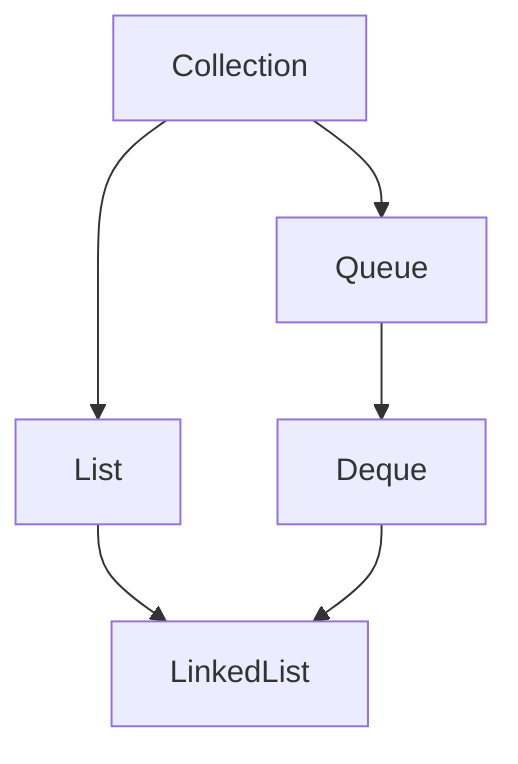

# The Simultaneous Roles of List and Deque in LinkedList

## 1. One Object, Two Ways to Describe Operations

`LinkedList<E>` implements both `List<E>` and `Deque<E>`. It can be used as an ordered, indexed list, and simultaneously as a double-ended queue.

These two roles refer to **operation interfaces over the same data**; they do not mean the object automatically creates two copies or guarantees thread safety for multiple threads.

- `List` focuses on the sequence of elements: position, adding/inserting, replacing, searching, and ordered traversal.
- `Deque` focuses on the two ends: adding, inspecting, and removing at the front or the back.
- `Deque` extends `Queue`, so a LinkedList can also be used through queue operations.

In Java 17, the relationship to remember is:



The arrows go from general interfaces to more specific interfaces/classes. The diagram only shows the relationships needed for this article and does not list the entire inheritance tree.

`Deque` is pronounced "deck", short for double-ended queue. It is not "dequeue" in the sense of an operation that removes an element.

The programs in this article use APIs available in Java 17. Starting in Java 21, `List` also has first/last operations through `SequencedCollection`; that does not turn every List into a Deque. Index-based operations and the `offer/poll/peek/push/pop` group still need to be understood according to their respective interfaces. [LinkedList Java 17](https://docs.oracle.com/en/java/javase/17/docs/api/java.base/java/util/LinkedList.html), [List Java 21](https://docs.oracle.com/en/java/javase/21/docs/api/java.base/java/util/List.html).

## 2. Why Can the LinkedList Structure Support Both Roles?

LinkedList is a doubly linked list. Each node holds an element along with links to the previous and next nodes; the structure keeps track of both ends.

Visualize the sequence `[A, B, C]`:

```text
front end (head)                         back end (tail)
       |                                      |
       v                                      v
      [A] <------------> [B] <------------> [C]
       0                 1                  2
```

In the List view, we refer to them as elements at indices 0, 1, 2. In the Deque view, A is at the front end and C is at the back end.

Adding an element at the front using Deque shifts the List positions accordingly:

```text
Before addFirst(X): [A, B, C]
After addFirst(X):  [X, A, B, C]

Index of A: from 0 to 1
Index of C: from 2 to 3
```

There is no step that "synchronizes two lists"; only one chain of nodes has changed. An index is the current position in the sequence, not a fixed label attached to a node.

Double links provide direct access to both ends, but they do not create array-like random access by index. To reach an index in the middle, LinkedList must follow links from whichever end is closer. [LinkedList Index Access Mechanism](https://docs.oracle.com/en/java/javase/17/docs/api/java.base/java/util/LinkedList.html).

## 3. Using LinkedList in the List Role

An illustrative snippet inside a method, requiring `java.util.List` and `java.util.LinkedList` imports:

```java
List<String> names = new LinkedList<>();

names.add("An");
names.add("Chi");
names.add(1, "Binh");
names.set(2, "Chau");

// names = [An, Binh, Chau]
// names.get(1) returns Binh.
```

The List characteristics are preserved:

- Ordered elements with 0-based positions.
- Duplicate elements are allowed.
- LinkedList allows `null` elements.
- `get(i)`, `set(i, value)`, and `remove(i)` work with positions.
- `add(i, value)` inserts before the element currently at that position, or appends at the end if `i == size()`.
- A regular iterator traverses in order from front to back.

The variable type `List<String>` expresses that the code requires the list contract. It does not turn LinkedList into an array; access costs are still determined by the underlying LinkedList object.

In particular, avoid assuming that the following loop has linear cost on a LinkedList:

```java
for (int i = 0; i < names.size(); i++) {
    System.out.println(names.get(i));
}
```

This is an illustrative snippet. Each `get(i)` may have to traverse through nodes again, making the total cost potentially `O(n²)`. If you only need to process elements sequentially, iterating with a for-each loop or an iterator is usually more appropriate.

## 4. Using the Same Structure in the Deque Role

Deque allows explicitly choosing which end to operate on:

| Goal | Front end, throws exception on failure | Front end, returns special value | Back end, throws exception on failure | Back end, returns special value |
|---|---|---|---|---|
| Insert | `addFirst(e)` | `offerFirst(e)` | `addLast(e)` | `offerLast(e)` |
| Remove and return | `removeFirst()` | `pollFirst()` | `removeLast()` | `pollLast()` |
| Examine without removing | `getFirst()` | `peekFirst()` | `getLast()` | `peekLast()` |

When empty:

- `removeFirst/removeLast/getFirst/getLast` throw `NoSuchElementException`.
- `pollFirst/pollLast/peekFirst/peekLast` return `null`.

For insertion operations, the `offer` group returns a boolean; the difference from the `add` group is especially useful in capacity-restricted Deque implementations. LinkedList does not enforce a fixed maximum capacity like a capacity-bounded queue. Do not infer from this that every Deque implementation shares the same insertion policy or allows `null`.

Distinguishing between examining and removing:

```java
Deque<String> tasks = new LinkedList<>();
tasks.addLast("A");
tasks.addLast("B");

String first = tasks.peekFirst(); // A; tasks is still [A, B].
String taken = tasks.pollFirst(); // A; tasks becomes [B].
```

The snippet above is an illustration inside a method, requiring `java.util.Deque` and `java.util.LinkedList` imports.

Deque does not provide index-based access. If a variable is declared as `Deque<String>`, you cannot call `get(1)` or `add(1, value)` through that variable, even though the actual object is a LinkedList. [The Deque Interface](https://docs.oracle.com/en/java/javase/17/docs/api/java.base/java/util/Deque.html).

## 5. FIFO and LIFO Are Ways of Choosing Which Ends to Insert and Remove From

### 5.1. Using It as a FIFO Queue

FIFO means first-in, first-out. On a LinkedList used under the Deque contract, insert at the back and remove from the front:

```text
offerLast(A): [A]
offerLast(B): [A, B]
offerLast(C): [A, B, C]

pollFirst(): returns A; [B, C] remains
pollFirst(): returns B; [C] remains
```

You can use the Queue method names:

| Queue | Equivalent Deque operation |
|---|---|
| `add(e)` | Insert at back with `addLast(e)` |
| `offer(e)` | `offerLast(e)` |
| `remove()` | `removeFirst()` |
| `poll()` | `pollFirst()` |
| `element()` | `getFirst()` |
| `peek()` | `peekFirst()` |

Illustrative example:

```java
Queue<String> jobs = new LinkedList<>();
jobs.offer("job-1");
jobs.offer("job-2");

String next = jobs.poll(); // job-1
```

The Queue variable type expresses a single-entry/single-exit intent. The Queue interface itself does not mean every implementation uses FIFO; for example, there are priority queues. Here, FIFO comes from the Queue rules of Deque/LinkedList: insert at the back, remove from the front.

### 5.2. Using It as a LIFO Stack

LIFO means last-in, first-out. With Deque's group of stack methods:

| Method | Meaning on Deque |
|---|---|
| `push(e)` | Insert at the front end, equivalent to `addFirst(e)` |
| `pop()` | Remove and return from the front end, equivalent to `removeFirst()` |
| `peek()` | Examine the front end, returning `null` when empty |

Illustrative snippet:

```java
Deque<String> history = new LinkedList<>();
history.push("A");
history.push("B");

// history = [B, A]
String latest = history.pop(); // B
```

The top of the stack is at the front end in Deque's `push/pop` convention. The element pushed later sits in front, so a regular iterator after two pushes traverses `B` and then `A`.

Combining `addLast` with `removeLast` also produces last-in, first-out behavior at the back end. However, when using APIs named `push/pop`, stick to those methods' front-end convention so readers do not have to guess.

### 5.3. Do Not Mix Conventions Accidentally

A structure capable of inserting and removing at both ends does not automatically decide for your algorithm whether it is a queue or a stack. If a workflow requires FIFO but one branch calls `push`, that branch puts the element at the front, potentially jumping ahead of waiting elements.

Choose one clear convention for each processing flow. The examples mixing multiple method groups in this article are meant to demonstrate that the same structure supports multiple roles, not to suggest mixing every group arbitrarily within the same algorithm.

## 6. Multiple Variable Types Can Still Refer to the Same Object

Illustrative snippet:

```java
LinkedList<String> storage = new LinkedList<>();

List<String> asList = storage;
Deque<String> asDeque = storage;
Queue<String> asQueue = storage;
```

No data copies or adapters are created by these three assignments. Every variable references the same LinkedList.

- Adding at the front through `asDeque` makes `asList.get(0)` see the new element.
- Inserting in the middle through `asList` changes the order seen through `asDeque`.
- Removing from the front through `asQueue` decreases the size observed by all three variables.
- Clearing through one variable also clears the data viewed by the remaining variables.

The declared type determines which methods the compiler allows you to call through a variable. The actual runtime type determines the implementation executed once the method has been resolved.

Do not cast an arbitrary List to a Deque just because LinkedList supports both. An `ArrayList` is a List but not a Deque; an `ArrayDeque` is a Deque but not a List. If an API requires a specific role, accept that exact interface rather than assuming every implementation also provides the other role.

## 7. Complete Program: List, Deque, and Queue on a Single LinkedList

Save as `LinkedListRolesDemo.java`. The program uses APIs available in Java 17:

```java
import java.util.Deque;
import java.util.Iterator;
import java.util.LinkedList;
import java.util.List;
import java.util.Queue;
import java.util.StringJoiner;

public class LinkedListRolesDemo {
    public static void main(String[] args) {
        LinkedList<String> storage = new LinkedList<>();
        List<String> asList = storage;
        Deque<String> asDeque = storage;
        Queue<String> asQueue = storage;

        System.out.println("same object: " + (asList == asDeque));

        asList.add("B");
        asList.add("C");
        asList.add(1, "X");
        System.out.println("after List operations: " + storage);

        asDeque.addFirst("A");
        asDeque.addLast("D");
        System.out.println("after Deque operations: " + asList);

        String old = asList.set(2, "Y");
        System.out.println("List.set returned: " + old);
        System.out.println("Deque sees: " + asDeque);

        asQueue.offer("E");
        System.out.println("Queue.peek: " + asQueue.peek());
        System.out.println("Queue.poll: " + asQueue.poll());
        System.out.println("after FIFO step: " + storage);

        System.out.println("Deque.pollLast: " + asDeque.pollLast());
        asDeque.push("TOP");
        System.out.println("after push: " + storage);
        System.out.println("pop: " + asDeque.pop());
        System.out.println("after pop: " + storage);

        System.out.println("forward: " + String.join(",", asList));
        StringJoiner reverse = new StringJoiner(",");
        Iterator<String> iterator = asDeque.descendingIterator();
        while (iterator.hasNext()) {
            reverse.add(iterator.next());
        }
        System.out.println("reverse: " + reverse);
        System.out.println("shared size: " + asList.size()
                + "/" + asDeque.size() + "/" + asQueue.size());
    }
}
```

Compile and run:

```shell
javac --release 17 -encoding UTF-8 LinkedListRolesDemo.java
java LinkedListRolesDemo
```

Standard output:

```text
same object: true
after List operations: [B, X, C]
after Deque operations: [A, B, X, C, D]
List.set returned: X
Deque sees: [A, B, Y, C, D]
Queue.peek: A
Queue.poll: A
after FIFO step: [B, Y, C, D, E]
Deque.pollLast: E
after push: [TOP, B, Y, C, D]
pop: TOP
after pop: [B, Y, C, D]
forward: B,Y,C,D
reverse: D,C,Y,B
shared size: 4/4/4
```

Tracing data consistency:

1. After the List operations, the sequence is `[B, X, C]`.
2. Adding at both ends via Deque produces `[A, B, X, C, D]`, which the List variable sees immediately.
3. Replacing the element at index 2 via List makes Deque see `Y` instead of `X`.
4. Queue adds `E` at the back; peek inspects `A` without removing it; poll actually removes `A`.
5. `pollLast` removes `E` from the back.
6. `push("TOP")` puts the element at the front; pop removes that exact element.
7. All three variables report a size of 4 because they reference the same object.

Regular iteration goes from the front end to the back end. `descendingIterator` traverses backward without reversing or copying the list; after reverse iteration, the original sequence is still `[B, Y, C, D]`.

## 8. The Name `remove` Is Easy to Confuse When Switching Roles

LinkedList has several different method forms:

| Call | Meaning | Return type |
|---|---|---|
| `remove()` | Remove and return the front element; throws exception if empty | Element |
| `remove(int index)` | Remove the element at the List index | Element |
| `remove(Object value)` | Remove the first occurrence matching the target value | `boolean` |
| `removeFirst()`, `removeLast()` | Remove from the explicitly specified end | Element |
| `removeFirstOccurrence(value)`, `removeLastOccurrence(value)` | Find and remove the first/last occurrence matching the value | `boolean` |

Especially with integers, the type of the variable receiving the call can change the visible set of overloads.

Illustrative snippet, where each part uses a new list `[1, 20, 30]`:

```java
List<Integer> indexed = new LinkedList<>(List.of(1, 20, 30));
Integer deleted = indexed.remove(1);
// deleted = 20; indexed = [1, 30]

Deque<Integer> ended = new LinkedList<>(List.of(1, 20, 30));
boolean found = ended.remove(1);
// found = true; ended = [20, 30]
```

Through List, an `int` argument matches the remove-by-index method. Through Deque, there is no `remove(int)`; the number 1 is boxed into an `Integer` and passed to `remove(Object)`.

This does not mean the object dynamically changes its behavior based on the data inside. The compiler selected two different methods based on the variable type and the argument at the call site.

If you need to remove the value 1 through a List variable, write `remove(Integer.valueOf(1))` explicitly. If you need to remove the head of a queue, use `pollFirst/removeFirst` or the corresponding Queue method name. Do not attach a blanket meaning of "remove head" to every call named `remove`.

The `removeFirstOccurrence/removeLastOccurrence` methods may also have to search through many elements; the words "First/Last" here refer to which occurrence is selected, and do not guarantee constant time cost like removing directly at one end.

## 9. LinkedList Allows `null`, Which Causes Ambiguity When Used as a Deque

LinkedList accepts `null` elements. Meanwhile, the `poll` and `peek` methods use `null` to indicate emptiness.

If a deque contains `[null, A]`:

- `peekFirst()` returns `null`, even though the deque is not empty.
- `pollFirst()` returns `null` and actually removes an element; the size drops from 2 to 1.
- Once all elements are gone, `pollFirst()` also returns `null`, but this time no element is removed.

Therefore, if you use LinkedList in a queue pattern with a loop that stops when `poll` returns `null`, you need a policy of never putting `null` elements into the queue.

The following illustrative snippet is only appropriate when element data contains no `null` values and processing turns are properly managed:

```java
String task;
while ((task = tasks.pollFirst()) != null) {
    System.out.println(task);
}
```

This is a method body snippet where `tasks` of type `Deque<String>` is already declared. If `null` is allowed as a valid data item, the termination condition can cause the loop to end before processing the remaining elements.

Choosing exception-throwing methods does not automatically forbid storing `null`: `getFirst` on a non-empty LinkedList whose first element is `null` still returns that `null` element. You need to separate your data policy from how an empty deque is signaled.

With integers, assigning a potentially `null` result to a primitive variable can also cause a `NullPointerException` due to unboxing. Check the result before converting to a primitive type when the API allows emptiness.

The Deque documentation recommends avoiding `null` elements even in implementations that permit them, because of this ambiguity. [Deque and null values](https://docs.oracle.com/en/java/javase/17/docs/api/java.base/java/util/Deque.html).

## 10. Complete Program: `remove`, Emptiness, and `null`

Save as `LinkedListRoleBoundariesDemo.java`:

```java
import java.util.Deque;
import java.util.LinkedList;
import java.util.List;
import java.util.NoSuchElementException;

public class LinkedListRoleBoundariesDemo {
    public static void main(String[] args) {
        LinkedList<Integer> indexStorage =
                new LinkedList<>(List.of(1, 20, 30));
        List<Integer> listView = indexStorage;
        Integer removedByIndex = listView.remove(1);
        System.out.println("List.remove(1): " + removedByIndex);
        System.out.println("indexStorage: " + indexStorage);

        LinkedList<Integer> valueStorage =
                new LinkedList<>(List.of(1, 20, 30));
        Deque<Integer> dequeView = valueStorage;
        boolean removedByValue = dequeView.remove(1);
        System.out.println("Deque.remove(1): " + removedByValue);
        System.out.println("valueStorage: " + valueStorage);
        System.out.println("Deque.remove(): " + dequeView.remove());
        System.out.println("after no-argument remove: " + valueStorage);

        Deque<String> nullable = new LinkedList<>();
        nullable.offerLast(null);
        nullable.offerLast("A");
        System.out.println("peekFirst: " + nullable.peekFirst()
                + "; size = " + nullable.size());
        System.out.println("pollFirst: " + nullable.pollFirst()
                + "; size = " + nullable.size());
        System.out.println("pollFirst: " + nullable.pollFirst()
                + "; size = " + nullable.size());
        System.out.println("pollFirst: " + nullable.pollFirst()
                + "; size = " + nullable.size());

        try {
            nullable.removeFirst();
        } catch (NoSuchElementException ex) {
            System.out.println("removeFirst on empty: NoSuchElementException");
        }
        try {
            nullable.getFirst();
        } catch (NoSuchElementException ex) {
            System.out.println("getFirst on empty: NoSuchElementException");
        }
        System.out.println("peekLast on empty: " + nullable.peekLast());
    }
}
```

Compile and run:

```shell
javac --release 17 -encoding UTF-8 LinkedListRoleBoundariesDemo.java
java LinkedListRoleBoundariesDemo
```

Standard output:

```text
List.remove(1): 20
indexStorage: [1, 30]
Deque.remove(1): true
valueStorage: [20, 30]
Deque.remove(): 20
after no-argument remove: [30]
peekFirst: null; size = 2
pollFirst: null; size = 1
pollFirst: A; size = 0
pollFirst: null; size = 0
removeFirst on empty: NoSuchElementException
getFirst on empty: NoSuchElementException
peekLast on empty: null
```

The first two groups differ only in the variable type and the selected method, yet they remove two different elements from identical initial content. After that, the no-argument `Deque.remove()` removes the front element 20.

The `nullable` group demonstrates that the same return value `null` can be accompanied by size 2, size 1, or size 0 depending on the operation and timing. Do not read only the return value and conclude that the deque is empty every time.

When the deque is genuinely empty, the exception-throwing removal/inspection methods are verified by catching `NoSuchElementException`, while the peek/poll forms return `null`.

## 11. Performance Costs and Choosing the Right Interface for Your Needs

Supporting two interfaces makes LinkedList flexible in terms of operations, but does not automatically make it optimal for everything that can be expressed with a List or a Deque.

| Operation need on LinkedList | Main mechanism | Typical cost considered |
|---|---|---|
| Inspect front/back via `getFirst/getLast/peekFirst/peekLast` | Access head/tail node | `O(1)` |
| Insert or remove directly at one end | Rewire head/tail links | `O(1)` |
| `get(i)`, `set(i, value)` | Traverse to node by index | `O(n)` worst-case |
| Insert/remove at a middle index | Locate node then rewire links | `O(n)` worst-case |
| Find value or remove by occurrence | Traverse to find matching element | `O(n)` worst-case |
| Full traversal via iterator | Follow each link sequentially | `O(n)` |

Unlinking or linking a node once you have reached a position is different from finding that position. Do not infer from fast link updates that `add(index, value)` or `remove(index)` is always `O(1)`.

If an algorithm primarily accesses elements by index, consider a List implementation suited to indexed access. If it primarily adds and removes at both ends, the Deque interface expresses that more directly. `ArrayDeque` is another Deque implementation to consider when the List role is not needed; note that it does not permit `null` elements.

Use LinkedList only when it genuinely fits your operation patterns and data requirements. Just because the class provides both groups of methods does not mean a program must use both. [ArrayDeque Java 17](https://docs.oracle.com/en/java/javase/17/docs/api/java.base/java/util/ArrayDeque.html).

### 11.1. Choosing Parameter Types to Express Intent

Illustrative signatures:

```java
void reorder(List<String> items)
void schedule(Queue<String> pending)
void manipulateEnds(Deque<String> items)
```

These are API signatures only, not complete source code.

- A function that needs positional operations can accept a `List`.
- A function that only needs queue semantics can accept a `Queue`.
- A function that actively manipulates both ends can accept a `Deque`.

When a piece of code intentionally coordinates positional operations and two-ended operations on the same structure, it can hold a concrete `LinkedList` variable where that coordination happens. API boundaries should still expose the exact capability required rather than forcing every caller to depend on a concrete class.

### 11.2. Variable Type Does Not Change the Object's `equals` Contract

A LinkedList still uses List content equality even when held through a Deque variable. Assigning it to another interface type does not turn it into a new object or replace its `equals` implementation.

However, do not generalize LinkedList's content comparison behavior to all Deque implementations. Deque in general does not impose the same element-sequence equality contract as List. When writing generic code for Deque, check the object's contract rather than extrapolating from a single concrete implementation.

## 12. Same Data Also Means Shared Structural Modifications

If you create an iterator through a List variable and then add an element through a Deque variable, that operation still modifies the same LinkedList. The iterator does not get an isolated version of the data just because it was created through a different interface.

An illustrative snippet showing usage that invalidates an existing iterator:

```java
LinkedList<String> storage = new LinkedList<>(List.of("A", "B"));
List<String> asList = storage;
Deque<String> asDeque = storage;

Iterator<String> iterator = asList.iterator();
asDeque.addFirst("X");

// Do not continue treating the old iterator as a valid traversal.
```

This snippet requires importing the corresponding types; it illustrates the modification relationship, not a program that relies on a fixed exception outcome.

The iterator's modification detection mechanism may throw `ConcurrentModificationException`. What must be managed is the traversal lifecycle and the modification path on the shared structure; do not treat two interface variables as two independent owners.

LinkedList is also not automatically synchronized. The word "simultaneous" in implementing both List and Deque refers to having two API roles at the same time, not a promise that multiple threads can operate on it safely at once. When multi-threaded access is needed, you must apply an appropriate concurrency policy; changing the variable type does not create one.

## 13. Common Mistakes

| Misconception or call | What is wrong | How to verify |
|---|---|---|
| Assigning LinkedList to List and Deque to get two copies | Both variables can point to the exact same object | Check reference equality and intended data ownership |
| Having List means indexed access is always as fast as an array | Performance cost is determined by the LinkedList implementation | Distinguish indexed access from sequential traversal |
| `peek` removes the element | Peek only inspects | Use poll/remove when you need to remove from an end |
| Using `push` while expecting FIFO like `offerLast` | Push inserts at the front end | Map insertion/removal rules explicitly to the two ends |
| `remove(1)` always removes the number 1 | Through List it selects the index overload | Check the variable type and argument type |
| `remove()` is identical to `remove(0)` in every API aspect | One removes the head of a Queue/Deque; the other removes a List position | Read the method signatures, especially behavior when empty |
| `poll` returning `null` guarantees no data remains | LinkedList can contain `null` elements | Maintain a policy avoiding `null` when using special return values for emptiness |
| Every Deque allows `null` because LinkedList does | Capabilities differ across implementations | Read the contract of the actual implementation |
| Modifying via Deque does not affect an iterator created via List | Same underlying object and modification state | Manage traversal lifecycles across the actual structure |
| Having two interfaces means thread-safe for two threads | No such guarantee exists | Choose a dedicated concurrency policy |

## 14. Prediction Exercise on a Shared Structure

Consider this illustrative snippet inside a method:

```java
LinkedList<String> data = new LinkedList<>(List.of("B", "C"));
List<String> list = data;
Deque<String> deque = data;

deque.addFirst("A");
list.add(2, "X");
String seen = deque.peekLast();
String taken = deque.pollFirst();
deque.push("TOP");
String popped = deque.pop();
```

Predict:

1. What is the sequence after `addFirst("A")`?
2. What is the sequence after `list.add(2, "X")`?
3. What is `seen`, and does the sequence change?
4. What is `taken`, and what remains in the sequence?
5. What is `popped`?
6. At the end, do `list`, `deque`, and `data` have different contents?

Answers:

1. `[A, B, C]`.
2. `[A, B, X, C]`; inserted at current index 2.
3. `C`; peek does not remove, so the sequence remains `[A, B, X, C]`.
4. `A`; `[B, X, C]` remains.
5. `TOP`; push and pop both use the front end.
6. No; all three view `[B, X, C]` of the exact same LinkedList.

When using LinkedList, identify the role right at the call site: position within a List sequence, front/back of a Deque, or entry/exit rules of a Queue/stack. Because all of these views act on a single element ordering, choosing an interface must go hand in hand with clear operational intent, performance awareness, and data policies.
