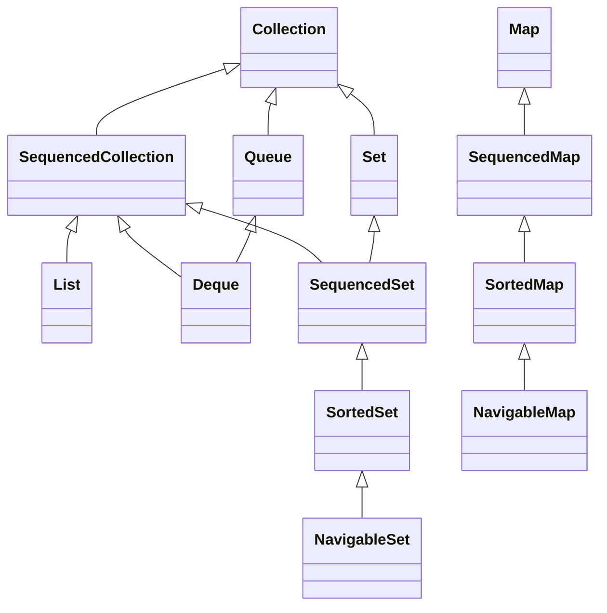

# Quan hệ với List, Deque, SortedSet và SortedMap

## 1. Java 21 bổ sung một hợp đồng chung cho những cấu trúc đã có thứ tự

List biết vị trí phần tử, Deque biết hai đầu hàng đợi, SortedSet biết phần tử đầu/cuối theo thứ tự so sánh và SortedMap biết các ánh xạ theo thứ tự khóa.

Trước khi chọn API, cần nhận ra điểm chung: mỗi cấu trúc ấy có một **thứ tự gặp phần tử hoặc ánh xạ** xác định, thường gọi là encounter order.

Từ Java 21, các giao diện sequenced biểu diễn điểm chung này trong hệ thống kiểu:

- SequencedCollection cho một tập hợp phần tử có thứ tự gặp, có thể nhìn theo chiều ngược và có API hai đầu.
- SequencedSet kết hợp tính chất có thứ tự gặp với hợp đồng Set.
- SequencedMap dành cho các ánh xạ khóa–giá trị có thứ tự gặp.

Chúng không thay List, Deque, SortedSet hoặc SortedMap thành cùng một cấu trúc. Chúng bổ sung tổ tiên chung phù hợp để viết mã dùng chung mà vẫn giữ các đặc tính riêng.

Ba câu hỏi nên tách ra:

| Câu hỏi | Ví dụ |
| --- | --- |
| Có thứ tự gặp xác định không? | List, Deque, SortedSet đều có |
| Thứ tự ấy được quyết định bằng cách nào? | Vị trí danh sách, hai đầu deque hoặc Comparator |
| Những phép sửa nào được hỗ trợ? | Một TreeSet sửa được nhưng không nhận addFirst/addLast |

**Bài cần JDK 21 trở lên.** Các API sequenced không có trong Java 17. Ví dụ được biên dịch với --release 21 và chạy trên OpenJDK 24.0.2; không dùng tính năng preview.

## 2. Hai nhánh kiểu: Collection và Map

### 2.1. Sơ đồ quan hệ chính

Trong sơ đồ, đầu tam giác chỉ về giao diện cha. Sơ đồ lược bớt tham số generic và một số cạnh kế thừa dư để dễ đọc.



Các khai báo quan trọng trong Java 21:

| Giao diện | Quan hệ trực tiếp cần nhớ |
| --- | --- |
| SequencedCollection<E> | extends Collection<E> |
| List<E> | extends SequencedCollection<E> |
| Deque<E> | extends Queue<E>, SequencedCollection<E> |
| SequencedSet<E> | extends SequencedCollection<E>, Set<E> |
| SortedSet<E> | extends Set<E>, SequencedSet<E> |
| SequencedMap<K,V> | extends Map<K,V> |
| SortedMap<K,V> | extends SequencedMap<K,V> |

Quan hệ của List và Deque được mô tả trong [List Java 21](https://docs.oracle.com/en/java/javase/21/docs/api/java.base/java/util/List.html) và [Deque Java 21](https://docs.oracle.com/en/java/javase/21/docs/api/java.base/java/util/Deque.html). Quan hệ của hai nhánh sorted có trong [SortedSet](https://docs.oracle.com/en/java/javase/21/docs/api/java.base/java/util/SortedSet.html) và [SortedMap](https://docs.oracle.com/en/java/javase/21/docs/api/java.base/java/util/SortedMap.html).

### 2.2. List và Deque là hai nhánh cùng chia sẻ hợp đồng

List không extends Deque; Deque cũng không extends List.

ArrayList là ví dụ List. ArrayDeque là ví dụ Deque. LinkedList là một lớp cụ thể thực hiện cả List lẫn Deque; điều đó không làm hai giao diện trở thành cha/con của nhau.

Một phương thức chỉ cần đọc đầu/cuối của dãy có thể nhận SequencedCollection. Nó không cần buộc mọi bên gọi phải chuyển dữ liệu thành List hoặc LinkedList.

### 2.3. SortedMap không trở thành Collection

SequencedMap vẫn thuộc nhánh Map. Nó không extends SequencedCollection và không biến map thành một tập các phần tử E theo cùng giao diện ấy.

Muốn xử lý phần tử của map theo nhánh Collection, cần chọn một view: khóa, giá trị hoặc entry.

Việc cùng có phương thức reversed không tạo quan hệ kế thừa giữa hai nhánh. Tên phương thức giống nhau không thay thế một quan hệ kiểu.

### 2.4. Collection, Set, Queue và Map nói chung không tự có hợp đồng sequenced

Một List vẫn là Collection qua kế thừa gián tiếp. Nhưng chiều ngược lại không đúng: không phải Collection nào cũng là SequencedCollection.

Set nói chung không tự hứa thứ tự gặp. Queue nói chung cũng không trở thành SequencedCollection chỉ vì Deque kết hợp cả hai. Map nói chung không tự trở thành SequencedMap.

HashSet và HashMap không được nâng thành các giao diện sequenced chỉ nhờ có thể duyệt chúng bằng iterator.

## 3. Thứ tự gặp khác thứ tự sắp xếp

### 3.1. “First” là đầu của thứ tự hiện tại

Một List chứa 3, 1, 2 có phần tử đầu là 3 và cuối là 2. Một Deque được thêm theo dãy ấy có thể có cùng thứ tự.

Một TreeSet dùng natural order với cùng ba số lại gặp theo 1, 2, 3.

Cả ba đều có thể là SequencedCollection. Vì vậy gọi getFirst không đồng nghĩa tìm số nhỏ nhất bằng một thuật toán chung.

### 3.2. Các nguồn quyết định thứ tự

| Cấu trúc hoặc giao diện | Nguồn quyết định thứ tự |
| --- | --- |
| List | Vị trí của phần tử trong danh sách |
| Deque | Trật tự từ đầu tới cuối của deque |
| SortedSet | Natural order hoặc Comparator của tập |
| SortedMap | Natural order hoặc Comparator của khóa |
| LinkedHashSet | Thứ tự gặp do triển khai liên kết quản lý |
| LinkedHashMap | Thứ tự gặp theo chế độ của map, chẳng hạn thứ tự chèn |

Với cấu trúc sorted, “đầu” là phía đầu theo quan hệ so sánh đang dùng. Nếu Comparator đảo chiều số học thông thường, first không còn là số bé nhất theo cách đọc số tự nhiên.

Sequenced không phải từ đồng nghĩa với sorted. Sorted là một cách xác định encounter order, không phải cách duy nhất.

### 3.3. Không suy ra vị trí trong bộ nhớ hoặc độ phức tạp

Hợp đồng thứ tự mô tả cách chương trình gặp dữ liệu, không nói các phần tử nằm liên tiếp trong bộ nhớ.

Có addFirst không tự làm mọi triển khai thêm đầu trong thời gian hằng số. Có getLast không tự chứng minh mọi cấu trúc có cùng chi phí tìm cuối.

Giao diện chung giúp diễn đạt khả năng; lựa chọn triển khai vẫn cần xét cách truy cập, số lượng dữ liệu và yêu cầu sửa đổi.

Khái niệm thứ tự gặp và giới hạn của hợp đồng chung được mô tả trong [SequencedCollection Java 21](https://docs.oracle.com/en/java/javase/21/docs/api/java.base/java/util/SequencedCollection.html).

## 4. List và Deque giữ các khả năng riêng

### 4.1. List vẫn có chỉ số

Qua biến List, chương trình vẫn có get(index), set(index, value), listIterator và các phép xử lý vị trí của danh sách.

Qua biến SequencedCollection, chương trình biết thứ tự và hai đầu nhưng không có một API get(index) chung.

Đổi kiểu tham chiếu từ List sang SequencedCollection không chuyển đổi dữ liệu. Nó chỉ thay bề mặt thao tác mà trình biên dịch cho phép gọi qua biến ấy.

### 4.2. Deque vẫn có hai nhóm API xử lý thất bại

Deque vốn đã có getFirst/getLast, addFirst/addLast và removeFirst/removeLast. Sau Java 21, nó còn tham gia hợp đồng SequencedCollection và có reversed với kiểu trả về phù hợp.

Deque vẫn có peekFirst/peekLast, pollFirst/pollLast và offerFirst/offerLast. Các nhóm ấy phục vụ cách xử lý trạng thái rỗng hoặc không thêm được khác với nhóm phương thức ném ngoại lệ.

Không đổi getFirst thành peekFirst chỉ để thấy tên gần giống: hợp đồng khi rỗng khác nhau.

### 4.3. `reversed` giữ kiểu giao diện cụ thể

Các giao diện thu hẹp kiểu trả về của reversed, thường gọi là kiểu trả về hiệp biến:

| Kiểu tham chiếu | Kiểu kết quả của reversed() |
| --- | --- |
| SequencedCollection<E> | SequencedCollection<E> |
| List<E> | List<E> |
| Deque<E> | Deque<E> |
| SequencedSet<E> | SequencedSet<E> |
| SortedSet<E> | SortedSet<E> |
| SequencedMap<K,V> | SequencedMap<K,V> |
| SortedMap<K,V> | SortedMap<K,V> |

Nhờ vậy List đảo chiều vẫn dùng được API chỉ số. SortedSet đảo chiều vẫn cung cấp hợp đồng SortedSet. Không cần hạ mọi kết quả xuống một Collection rồi ép kiểu trở lại.

### 4.4. View đảo chiều không mặc định là một bản sao độc lập

`reversed` trả một view theo chiều ngược. Nếu triển khai cho phép sửa qua view, phép sửa ghi xuyên tới cấu trúc bên dưới theo hợp đồng.

Trong các ví dụ ArrayList và ArrayDeque của bài, addFirst ở view đảo chiều tương ứng thêm về phía cuối của cấu trúc gốc.

Ở mức giao diện tổng quát, mức phản ánh thay đổi từ cấu trúc bên dưới vào view còn phụ thuộc triển khai; không hứa một cơ chế thông báo thay đổi hoặc ảnh chụp giống nhau cho mọi kiểu tùy biến.

Nếu cần một bản danh sách độc lập về các liên kết phần tử, có thể chủ động chép các phần tử theo thứ tự muốn giữ. Việc đảo cách nhìn và việc chép là hai thao tác khác nhau.

## 5. Ví dụ 1: một hàm dùng được cho List, Deque và SortedSet

Hàm describe chỉ đọc getFirst/getLast nên chọn SequencedCollection. Ba đối tượng truyền vào không cần có cùng cách quyết định thứ tự.

Ví dụ cũng cho thấy kiểu trả về của reversed và giới hạn sửa đổi của List.of.

Lưu thành **SharedSequenceContract.java**:

```java
import java.util.ArrayDeque;
import java.util.ArrayList;
import java.util.Deque;
import java.util.List;
import java.util.NoSuchElementException;
import java.util.SequencedCollection;
import java.util.SortedSet;
import java.util.TreeSet;

public class SharedSequenceContract {
    static <E> void describe(String label, SequencedCollection<E> source) {
        System.out.println(label + ": " + new ArrayList<>(source)
                + "; first=" + source.getFirst() + "; last=" + source.getLast());
    }

    public static void main(String[] args) {
        List<Integer> list = new ArrayList<>(List.of(3, 1, 2));
        Deque<Integer> deque = new ArrayDeque<>(List.of(3, 1, 2));
        SortedSet<Integer> sorted = new TreeSet<>(List.of(3, 1, 2));
        describe("List", list);
        describe("Deque", deque);
        describe("SortedSet", sorted);

        List<Integer> reversedList = list.reversed();
        reversedList.addFirst(9);
        System.out.println("list after reversed addFirst: " + list);
        System.out.println("reversed list: " + reversedList);
        System.out.println("list index 0: " + list.get(0));

        Deque<Integer> reversedDeque = deque.reversed();
        reversedDeque.addFirst(9);
        System.out.println("deque after reversed addFirst: " + new ArrayList<>(deque));

        SequencedCollection<Integer> fixed = List.of(1, 2);
        try {
            fixed.addFirst(0);
        } catch (UnsupportedOperationException expected) {
            System.out.println("unmodifiable list addFirst: rejected");
        }

        List<Integer> empty = new ArrayList<>();
        try {
            empty.getFirst();
        } catch (NoSuchElementException expected) {
            System.out.println("empty List getFirst: NoSuchElementException");
        }
    }
}
```

Biên dịch và chạy:

```shell
javac --release 21 -encoding UTF-8 SharedSequenceContract.java
java SharedSequenceContract
```

Stdout:

```text
List: [3, 1, 2]; first=3; last=2
Deque: [3, 1, 2]; first=3; last=2
SortedSet: [1, 2, 3]; first=1; last=3
list after reversed addFirst: [3, 1, 2, 9]
reversed list: [9, 2, 1, 3]
list index 0: 3
deque after reversed addFirst: [3, 1, 2, 9]
unmodifiable list addFirst: rejected
empty List getFirst: NoSuchElementException
```

### 5.1. Hợp đồng chung không xóa khác biệt về thứ tự

List và Deque gặp dãy 3,1,2; SortedSet gặp dãy 1,2,3. Hàm describe vẫn làm đúng cùng một công việc: báo hai đầu của thứ tự từng đối tượng.

Hàm này có tiền điều kiện dữ liệu không rỗng. Khi viết API thật, cần công bố hoặc xử lý điều kiện ấy; không bỏ qua chỉ vì các dữ liệu mẫu đều có phần tử.

### 5.2. Thêm vào đầu view đảo chiều là thêm về cuối ở ví dụ này

`reversedList` có kiểu List, nên vẫn được dùng như danh sách. Khi thêm 9 ở đầu view, list gốc thành 3,1,2,9; view đọc ngược lại thành 9,2,1,3.

Chỉ số 0 của list gốc vẫn là 3. Tạo view không tự đảo vị trí trong chính cách nhìn gốc.

Deque có cùng sự đảo hướng ở phép thêm đầu qua view trong ví dụ.

### 5.3. Sequenced không có nghĩa sửa được mọi thứ

Biến fixed trỏ tới List.of. Nó vẫn là SequencedCollection nhưng không cho thêm đầu.

Một ArrayList rỗng cho getFirst ném NoSuchElementException. Cần phân biệt “không có phần tử” với “không hỗ trợ phép sửa”.

## 6. SortedSet là một SequencedSet, vẫn chịu quy tắc sắp xếp

### 6.1. Tính duy nhất và thứ tự là hai phần của hợp đồng

SequencedSet kết hợp SequencedCollection với Set. Nó không trở thành một List vì đã có đầu/cuối.

Các phần tử vẫn có tính duy nhất theo hợp đồng Set; quy tắc equals/hashCode của Set vẫn được giữ. Hai set có cùng phần tử có thể equals dù thứ tự gặp khác nhau.

SortedSet bổ sung thứ tự so sánh. Với một TreeSet hợp lệ, vị trí được quyết định bởi thứ tự ấy, không phải một chỉ số mà người gọi tự chỉ định.

Tài liệu [SequencedSet Java 21](https://docs.oracle.com/en/java/javase/21/docs/api/java.base/java/util/SequencedSet.html) giải thích quan hệ với Set và việc thứ tự không thay điều kiện equals của Set.

### 6.2. Có thể thêm theo quy tắc sắp xếp nhưng không ép vào đầu/cuối

SortedSet có add thông thường. Nhưng addFirst và addLast ném UnsupportedOperationException vì không hỗ trợ chỉ định vị trí trái với mô hình thứ tự của nó.

Điều đó vẫn đúng khi phần tử đang định thêm tình cờ sẽ nằm đúng đầu hoặc đúng cuối theo Comparator. API chỉ định vị trí không phải một cách viết khác của add.

Ngược lại, LinkedHashSet hỗ trợ di chuyển một phần tử đang có về đầu/cuối bằng các phương thức ấy, trong khi vẫn chỉ có một phần tử tương ứng. Xem [LinkedHashSet Java 21](https://docs.oracle.com/en/java/javase/21/docs/api/java.base/java/util/LinkedHashSet.html).

### 6.3. Sorted không có nghĩa bất biến

Một TreeSet có thể hỗ trợ add, remove và xóa phần tử ở hai đầu. Việc từ chối addFirst/addLast không nói cả tập chỉ đọc.

`reversed` của SortedSet trả SortedSet với chiều thứ tự đảo lại. Phần tử đầu của view ngược là phần tử cuối của thứ tự gốc, không phải một phần tử vừa được tự ý chuyển vị trí.

## 7. Ví dụ 2: SortedSet và LinkedHashSet cùng sequenced nhưng không cùng chính sách vị trí

Lưu thành **SortedAndSequencedSets.java**:

```java
import java.util.ArrayList;
import java.util.LinkedHashSet;
import java.util.List;
import java.util.SequencedSet;
import java.util.SortedSet;
import java.util.TreeSet;

public class SortedAndSequencedSets {
    public static void main(String[] args) {
        SequencedSet<Integer> linked = new LinkedHashSet<>(List.of(3, 1, 2));
        SortedSet<Integer> sorted = new TreeSet<>(List.of(3, 1, 2));
        System.out.println("linked order: " + new ArrayList<>(linked));
        System.out.println("sorted order: " + new ArrayList<>(sorted));
        System.out.println("set equality: " + linked.equals(sorted));
        System.out.println("copied list equality: "
                + new ArrayList<>(linked).equals(new ArrayList<>(sorted)));

        linked.addFirst(2);
        System.out.println("linked after moving 2 first: " + new ArrayList<>(linked));
        System.out.println("linked size: " + linked.size());

        SortedSet<Integer> reversed = sorted.reversed();
        System.out.println("reversed sorted order: " + new ArrayList<>(reversed));
        System.out.println("reversed first: " + reversed.getFirst());
        System.out.println("reverse comparator puts 1 after 2: "
                + (reversed.comparator().compare(1, 2) > 0));

        try {
            sorted.addFirst(0);
        } catch (UnsupportedOperationException expected) {
            System.out.println("SortedSet addFirst: rejected");
        }
        try {
            sorted.addLast(4);
        } catch (UnsupportedOperationException expected) {
            System.out.println("SortedSet addLast: rejected");
        }

        sorted.add(0);
        System.out.println("sorted after ordinary add: " + new ArrayList<>(sorted));
        System.out.println("removed sorted first: " + sorted.removeFirst());
        System.out.println("sorted remaining: " + new ArrayList<>(sorted));
    }
}
```

Biên dịch và chạy:

```shell
javac --release 21 -encoding UTF-8 SortedAndSequencedSets.java
java SortedAndSequencedSets
```

Stdout:

```text
linked order: [3, 1, 2]
sorted order: [1, 2, 3]
set equality: true
copied list equality: false
linked after moving 2 first: [2, 3, 1]
linked size: 3
reversed sorted order: [3, 2, 1]
reversed first: 3
reverse comparator puts 1 after 2: true
SortedSet addFirst: rejected
SortedSet addLast: rejected
sorted after ordinary add: [0, 1, 2, 3]
removed sorted first: 0
sorted remaining: [1, 2, 3]
```

### 7.1. Equals của Set không so dãy vị trí

LinkedHashSet gặp 3,1,2; TreeSet gặp 1,2,3. Phép so bằng của Set vẫn cho true vì có cùng các phần tử.

Khi chủ động chép hai thứ tự ấy thành hai ArrayList, phép so bằng của danh sách lại cho false vì List so cả thứ tự tương ứng.

Bổ sung hợp đồng sequenced không đồng nhất cách so bằng của List và Set.

### 7.2. Cùng tên addFirst nhưng phạm vi hỗ trợ khác nhau

LinkedHashSet đưa số 2 đang có về đầu. Size vẫn là 3, nên đây không phải thêm một bản sao thứ hai của 2.

TreeSet từ chối cả addFirst(0) và addLast(4). Hai số này vốn có thể nằm ở hai biên khi được thêm theo thứ tự tự nhiên; việc vẫn bị từ chối cho thấy thao tác ép vị trí không thuộc hợp đồng sorted.

Add(0) thông thường lại thành công và TreeSet tự quyết định vị trí của 0.

### 7.3. Comparator của view ngược vẫn có ý nghĩa sorted

View reversed có kiểu SortedSet, gặp 3,2,1. Comparator của view đặt 1 sau 2, phù hợp chiều ngược.

Không gọi việc này là “TreeSet đã mất sắp xếp”. Nó được sắp theo quan hệ đảo của thứ tự gốc.

`removeFirst` ở tập gốc lấy và xóa phần tử đầu của thứ tự gốc. Ví dụ chứng minh một tập sửa được vẫn có thể từ chối riêng các phép đặt vị trí.

## 8. SortedMap thuộc SequencedMap và tạo các view thuộc nhánh Collection

### 8.1. Thứ tự áp dụng cho ánh xạ theo khóa

SortedMap xác định thứ tự khóa bằng natural order hoặc Comparator. Các entry và value được gặp theo thứ tự khóa tương ứng.

Nếu khóa 10 gắn "B", khóa 20 gắn "A", khóa 30 gắn "C", dãy value là B,A,C. Không phải A,B,C chỉ vì đó là các String có thể sắp xếp.

SequencedMap tổng quát chỉ hứa thứ tự gặp của các ánh xạ. Nó không hứa mọi map đều sắp theo khóa.

### 8.2. API đầu/cuối của Map dùng entry

| Nhánh phần tử | Nhánh ánh xạ |
| --- | --- |
| getFirst/getLast lấy E | firstEntry/lastEntry lấy Map.Entry<K,V> |
| removeFirst/removeLast lấy và xóa E | pollFirstEntry/pollLastEntry lấy và xóa ánh xạ |
| addFirst/addLast thêm E | putFirst/putLast thêm/cập nhật và đặt ánh xạ ở biên nếu được hỗ trợ |
| reversed trả view tập hợp theo chiều ngược | reversed trả view map theo chiều ngược |

Không gọi getFirst trực tiếp trên SortedMap như thể nó là List. Chọn một entry hoặc chọn rõ view khóa/giá trị cần xử lý.

`firstEntry`/lastEntry trả null khi map rỗng. Trong nhánh Collection, getFirst/getLast trên dữ liệu rỗng ném NoSuchElementException. Hai nhóm không có cùng cách biểu diễn trạng thái rỗng.

### 8.3. Các view mới thể hiện thứ tự ngay trong kiểu trả về

| Phương thức của SequencedMap | Kiểu trả về |
| --- | --- |
| sequencedKeySet() | SequencedSet<K> |
| sequencedValues() | SequencedCollection<V> |
| sequencedEntrySet() | SequencedSet<Map.Entry<K,V>> |

Khóa là một set vì các khóa ánh xạ là duy nhất. Entry cũng có hợp đồng set. Value có thể trùng giữa nhiều khóa, nên view giá trị không được hứa là set.

`keySet`, values và entrySet thông thường vẫn gặp dữ liệu theo thứ tự map sequenced. Nhưng kiểu trả về của các API cũ lần lượt là Set, Collection và Set; qua kiểu ấy không tự gọi được getFirst.

Điều này giải thích ích lợi của các phương thức sequenced tương ứng: làm khả năng có thứ tự xuất hiện trong bề mặt kiểu, không tự sắp xếp lại map thêm một lần.

Các quan hệ và kiểu view được quy định trong [SequencedMap Java 21](https://docs.oracle.com/en/java/javase/21/docs/api/java.base/java/util/SequencedMap.html).

### 8.4. SortedMap không cho putFirst/putLast dù sửa giá trị được

Vị trí của ánh xạ đã do thứ tự khóa quyết định. SortedMap từ chối putFirst và putLast bằng UnsupportedOperationException.

Put theo khóa thông thường vẫn có thể được hỗ trợ bởi một TreeMap sửa được. `pollFirstEntry`/pollLastEntry cũng có thể xóa ánh xạ ở biên.

LinkedHashMap hỗ trợ đặt lại vị trí bằng putFirst/putLast theo hợp đồng của triển khai đó. Xem [LinkedHashMap Java 21](https://docs.oracle.com/en/java/javase/21/docs/api/java.base/java/util/LinkedHashMap.html).

Không viết hàm nhận mọi SequencedMap rồi mặc định gọi được putFirst. Đó là một thao tác tùy chọn, và SortedMap là ví dụ quan trọng cho giới hạn ấy.

### 8.5. View map không có nghĩa được thêm tùy ý qua mọi view

Một sequencedKeySet không tự có đủ thông tin để tạo value mới cho map chỉ từ một khóa. Các view map có hợp đồng hỗ trợ sửa riêng.

Cần xem phép thêm/xóa cụ thể của view, không suy “đây là SequencedSet nên mọi addFirst đều thành công”.

Tương tự, các entry lấy bằng firstEntry/lastEntry là ảnh chụp ánh xạ tại thời điểm gọi và không hỗ trợ setValue để sửa map. Không suy mọi Map.Entry nhận từ mọi API có cùng kết nối tới map.

## 9. Ví dụ 3: SortedMap, LinkedHashMap và kiểu của các view

Lưu thành **SortedAndSequencedMaps.java**:

```java
import java.util.ArrayList;
import java.util.LinkedHashMap;
import java.util.Map;
import java.util.NoSuchElementException;
import java.util.SequencedCollection;
import java.util.SequencedMap;
import java.util.SequencedSet;
import java.util.SortedMap;
import java.util.TreeMap;

public class SortedAndSequencedMaps {
    public static void main(String[] args) {
        SequencedMap<Integer, String> linked = new LinkedHashMap<>();
        SortedMap<Integer, String> sorted = new TreeMap<>();
        linked.put(30, "C");
        linked.put(10, "B");
        linked.put(20, "A");
        sorted.putAll(linked);

        System.out.println("linked keys: " + new ArrayList<>(linked.keySet()));
        System.out.println("sorted keys: " + new ArrayList<>(sorted.keySet()));
        System.out.println("map equality: " + linked.equals(sorted));
        linked.putFirst(20, "A");
        System.out.println("linked after putFirst: " + new ArrayList<>(linked.keySet()));

        try {
            sorted.putFirst(5, "X");
        } catch (UnsupportedOperationException expected) {
            System.out.println("SortedMap putFirst: rejected");
        }
        try {
            sorted.putLast(40, "Y");
        } catch (UnsupportedOperationException expected) {
            System.out.println("SortedMap putLast: rejected");
        }

        SortedMap<Integer, String> reversed = sorted.reversed();
        System.out.println("reversed sorted keys: " + new ArrayList<>(reversed.keySet()));
        System.out.println("reversed first entry: " + reversed.firstEntry());

        SequencedSet<Integer> keys = sorted.sequencedKeySet();
        SequencedCollection<String> values = sorted.sequencedValues();
        System.out.println("first key: " + keys.getFirst());
        System.out.println("values by key order: " + new ArrayList<>(values));

        Map.Entry<Integer, String> snapshot = sorted.firstEntry();
        sorted.put(10, "Z");
        System.out.println("first-entry snapshot: " + snapshot);
        System.out.println("current first entry: " + sorted.firstEntry());
        try {
            snapshot.setValue("changed");
        } catch (UnsupportedOperationException expected) {
            System.out.println("snapshot setValue: rejected");
        }

        SortedMap<Integer, String> empty = new TreeMap<>();
        System.out.println("empty firstEntry: " + empty.firstEntry());
        try {
            empty.sequencedKeySet().getFirst();
        } catch (NoSuchElementException expected) {
            System.out.println("empty key view getFirst: NoSuchElementException");
        }

        System.out.println("polled first entry: " + sorted.pollFirstEntry());
        System.out.println("remaining keys: " + new ArrayList<>(sorted.keySet()));
    }
}
```

Biên dịch và chạy:

```shell
javac --release 21 -encoding UTF-8 SortedAndSequencedMaps.java
java SortedAndSequencedMaps
```

Stdout:

```text
linked keys: [30, 10, 20]
sorted keys: [10, 20, 30]
map equality: true
linked after putFirst: [20, 30, 10]
SortedMap putFirst: rejected
SortedMap putLast: rejected
reversed sorted keys: [30, 20, 10]
reversed first entry: 30=C
first key: 10
values by key order: [B, A, C]
first-entry snapshot: 10=B
current first entry: 10=Z
snapshot setValue: rejected
empty firstEntry: null
empty key view getFirst: NoSuchElementException
polled first entry: 10=Z
remaining keys: [20, 30]
```

### 9.1. Cùng ánh xạ, khác thứ tự gặp

LinkedHashMap mặc định trong ví dụ gặp các khóa theo thứ tự chèn 30,10,20. TreeMap gặp theo natural order 10,20,30.

Phép so bằng của Map cho true khi chúng có cùng ánh xạ, dù dãy thứ tự khác nhau. Sau putFirst(20,"A"), LinkedHashMap đưa ánh xạ 20 lên đầu, không thêm khóa 20 thứ hai.

SortedMap từ chối hai thao tác ép vị trí. Các thao tác thất bại không tạo các khóa 5 hoặc 40 trong dữ liệu mẫu.

### 9.2. View ngược vẫn là SortedMap

Biến reversed nhận trực tiếp kết quả sorted.reversed mà không ép kiểu. Nó có thứ tự khóa 30,20,10 và entry đầu là 30=C.

Biến keys nhận SequencedSet; biến values nhận SequencedCollection. Cả hai tham gia nhánh phần tử khi chương trình muốn dùng getFirst hoặc duyệt theo chiều gặp.

Dãy B,A,C của values đi cùng khóa 10,20,30. Không có một lần sắp xếp độc lập các giá trị.

### 9.3. Entry ở biên khác một tham chiếu cập nhật map trực tiếp

Biến snapshot nhận 10=B. Khi map đổi giá trị khóa 10 thành Z, snapshot vẫn mô tả ánh xạ đã chụp với value String B.

Lời gọi snapshot.setValue bị từ chối. Muốn sửa map, chương trình phải dùng thao tác được map cho phép như put theo khóa.

Ảnh chụp ở đây không có nghĩa sao chép sâu các object khóa và value. Ví dụ dùng String nên không có thay đổi nội dung bên trong value để làm phức tạp việc quan sát.

### 9.4. Map rỗng và key view rỗng trả kết quả khác dạng

`firstEntry` trên map rỗng trả null.

Key view là SequencedSet rỗng; getFirst của nó ném NoSuchElementException. Cùng dữ liệu nền rỗng nhưng API được chọn có hợp đồng trả kết quả khác nhau.

Cuối chương trình, pollFirstEntry lấy và xóa 10=Z. TreeMap còn hai khóa 20 và 30, cho thấy nó sửa được mà vẫn từ chối riêng putFirst/putLast.

## 10. Hợp đồng chung không xóa các quy tắc equals và hashCode cũ

SequencedCollection không áp một quy tắc equals/hashCode mới cho mọi kiểu bên dưới, vì hợp đồng của List và Set khác nhau.

| Giao diện cụ thể | Vai trò của thứ tự trong equals |
| --- | --- |
| List | So các phần tử tương ứng theo thứ tự |
| Set và SequencedSet | Cùng phần tử theo hợp đồng Set, không cần cùng thứ tự gặp |
| Map và SequencedMap | Cùng ánh xạ theo hợp đồng Map, không cần cùng thứ tự gặp |
| SequencedCollection nói chung | Không được tự suy một quy tắc so bằng theo dãy thống nhất |
| Deque nói chung | Không tự nhận toàn bộ quy tắc equals của List chỉ vì cùng hợp đồng sequenced |

Một LinkedList có các hợp đồng của List vì lớp ấy thực hiện List. Điều đó không chứng minh ArrayDeque hoặc mọi SequencedCollection có cùng quy tắc bằng với List.

Nếu bài toán cần đối chiếu hai thứ tự gặp, hãy xác định phép đối chiếu theo dãy một cách rõ ràng. Nếu chỉ cần đối chiếu tập thành viên hay ánh xạ, giữ đúng hợp đồng Set/Map.

Các ví dụ chép ra ArrayList để minh họa phép so dãy; đó là một lựa chọn so sánh chủ động, không phải quy tắc mới áp cho mọi collection.

## 11. Chọn kiểu tham số theo khả năng cần dùng

### 11.1. Một bảng quyết định ngắn

| Nhu cầu thật của phương thức | Kiểu nên đánh giá |
| --- | --- |
| Chỉ cần duyệt hoặc kiểm tra thành viên, không dựa vào thứ tự | Iterable/Collection phù hợp |
| Cần thứ tự gặp và đọc hai đầu của các phần tử | SequencedCollection |
| Cần truy cập theo chỉ số | List |
| Cần các phép offer/poll/peek hai đầu | Deque |
| Cần tính duy nhất và thứ tự gặp | SequencedSet |
| Cần Comparator và các phép lấy tập con theo miền | SortedSet |
| Cần ánh xạ và thứ tự gặp của ánh xạ | SequencedMap |
| Cần ánh xạ sắp theo khóa và thao tác miền khóa | SortedMap |
| Cần lower/floor/ceiling/higher theo thứ tự | NavigableSet hoặc NavigableMap tương ứng |

Không nâng kiểu lên quá tổng quát nếu mã bên trong vẫn cần những khả năng của kiểu cụ thể.

Ngược lại, nếu chỉ đọc hai đầu, yêu cầu List có thể làm bên gọi phải sao chép một Deque hoặc SortedSet dù hợp đồng dùng chung đã đủ.

### 11.2. Kiểu khai báo quyết định phương thức gọi được

Một đối tượng ArrayList đặt vào biến Collection vẫn có thứ tự danh sách ở đối tượng thực tế. Nhưng qua biến Collection, trình biên dịch không cho gọi getFirst vì giao diện ấy không khai báo khả năng này.

Nếu một API cần thứ tự như một phần hợp đồng, nên thể hiện điều đó ở chữ ký thay vì dựa vào mọi bên gọi tình cờ truyền một triển khai có thứ tự.

Tương tự, keySet của một SortedMap vẫn được duyệt theo thứ tự khóa dù kiểu trả về là Set. Nếu muốn dùng ngay API đầu/cuối qua kiểu, chọn sequencedKeySet.

Đổi tên biến hay dùng var không tự sửa một hợp đồng trả về đã quá rộng: var suy từ kiểu biểu thức mà API công bố.

### 11.3. Quan hệ kế thừa không cho phép tùy tiện ép kiểu ngược

List là SequencedCollection nên truyền List vào hàm nhận SequencedCollection là quan hệ kiểu hợp lệ.

Một SequencedCollection lại có thể là Deque hoặc SortedSet. Không ép nó thành List chỉ vì phần tử có thứ tự gặp.

Tương tự, một SequencedMap có thể là LinkedHashMap chứ không phải SortedMap. Có thứ tự gặp không đủ để gọi Comparator hoặc các phép lấy miền khóa sorted.

Cần hợp đồng rõ ràng hoặc kiểm tra kiểu phù hợp tại ranh giới; không dùng một lần chạy với một đối tượng làm bảo đảm cho mọi bên gọi.

### 11.4. Kiểu đọc được không phải cam kết mọi phép sửa đều được hỗ trợ

Nếu một phương thức bắt buộc chèn ở đầu, chỉ nhận SequencedCollection trong chữ ký chưa làm đầu vào SortedSet hay List.of hỗ trợ điều đó.

Cần công bố tiền điều kiện thao tác sửa hoặc thiết kế đầu vào bảo đảm chính sách phù hợp.

Không có một suy luận chung “đã được gán cho giao diện này thì mọi phương thức trong giao diện phải thành công với mọi trạng thái”.

## 12. Những giới hạn cần giữ khi dùng API thống nhất

### 12.1. Trạng thái rỗng cần được xử lý theo đúng nhánh

| Phép đọc hoặc lấy-xóa | Kết quả khi dữ liệu rỗng trong hợp đồng tương ứng |
| --- | --- |
| SequencedCollection.getFirst/getLast | NoSuchElementException |
| Deque.peekFirst/peekLast | null |
| Deque.pollFirst/pollLast | null |
| SequencedMap.firstEntry/lastEntry | null |
| SequencedMap.pollFirstEntry/pollLastEntry | null khi phép lấy-xóa được hỗ trợ |

Không dùng bảng này để suy một cấu trúc bất biến bắt buộc chấp nhận mọi phép xóa. UnsupportedOperationException vẫn có vai trò của thao tác tùy chọn.

Các phương thức Collection có thể trả phần tử null nếu triển khai cho phép null và phần tử ấy thật sự nằm ở biên. Chính sách null thuộc kiểu/triển khai cụ thể, không được thống nhất lại chỉ bởi nhãn sequenced.

### 12.2. Không thêm bảo đảm an toàn luồng

SequencedCollection và SequencedMap không tự làm các triển khai bên dưới an toàn cho cập nhật đồng thời.

Một chuỗi kiểm tra rỗng rồi getFirst cũng không tự là một thao tác nguyên tử nếu dữ liệu được nhiều luồng cùng sửa.

Chọn view đảo chiều không tạo một bản sao cách ly khỏi sửa đổi của luồng khác. Phải đọc hợp đồng đồng thời của triển khai và bảo vệ toàn bộ ý định thao tác khi cần.

### 12.3. Không nhầm bản sao có thứ tự với khả năng sắp xếp

Chép một LinkedHashSet sang List giữ dãy được duyệt tại thời điểm chép; nó không tự tạo một thứ tự theo Comparator.

Chép khóa SortedMap ra List tạo một dãy khóa theo thứ tự đọc lúc đó; List mới không tự duy trì quy tắc sorted khi được sửa về sau.

Nếu vẫn cần duy trì một bất biến thứ tự, giữ cấu trúc và quy trình cập nhật thể hiện bất biến ấy.

### 12.4. Phiên bản biên dịch là một phần của hợp đồng sử dụng

Các ví dụ cần API Java 21. Dùng JDK mới nhưng vẫn biên dịch với --release 17 sẽ không cung cấp các giao diện/phương thức sequenced của Java 21.

Cần đồng bộ mức biên dịch, phiên bản Java chạy chương trình và cấu hình dự án. Không coi đổi một import là đã hoàn tất việc dùng API mới.

Các ví dụ của bài dùng đúng API Java 21, còn phiên bản JVM thực tế được nêu riêng để kết quả kiểm tra có thể được tái hiện.

## 13. Các nhầm lẫn phổ biến

| Nhận định | Cách hiểu đúng |
| --- | --- |
| List bây giờ là Deque | Hai giao diện cùng mở rộng SequencedCollection; không thành cha/con của nhau |
| LinkedList thực hiện cả hai nên mọi List đều là Deque | Đó là lựa chọn của một lớp cụ thể |
| Có thứ tự gặp là đã sắp theo Comparator | Encounter order có thể do vị trí, chèn hoặc chính sách khác |
| SortedMap giờ là SequencedCollection | Nó thuộc SequencedMap, vẫn là nhánh Map |
| Mọi Collection/Set/Queue/Map đều có reversed | Các giao diện tổng quát ấy không tự có hợp đồng sequenced |
| Có addFirst nghĩa là gọi luôn thành công | Đây có thể là thao tác không được hỗ trợ |
| TreeSet không có addFirst nên hoàn toàn bất biến | Nó có thể sửa qua add/remove theo quy tắc của mình |
| `putFirst` trên TreeMap được nếu khóa vốn nhỏ nhất | API ép vị trí vẫn bị từ chối |
| `reversed` mặc định tạo một bản sao độc lập | Nó là view đảo hướng; cần đọc hợp đồng triển khai |
| `keySet` có thứ tự nên kiểu Set gọi được getFirst | Thứ tự thực tế và bề mặt kiểu trả về là hai điều khác nhau |
| Values của SortedMap được sắp theo giá trị | Chúng được gặp theo thứ tự khóa tương ứng |
| Mọi cấu trúc sequenced so equals theo dãy | List, Set và Map giữ các hợp đồng bằng khác nhau |
| Tên phương thức thống nhất nghĩa chi phí thống nhất | Độ phức tạp còn phụ thuộc triển khai |
| API mới tự thêm bảo vệ đồng thời | Cần hợp đồng đồng thời riêng |

## 14. Bài tập tự kiểm tra

### Bài 1. Một hàm chỉ đọc đầu/cuối nên nhận gì?

Muốn nhận cả ArrayList, ArrayDeque và TreeSet mà chỉ in hai đầu, có bắt buộc sao chép tất cả sang List không?

**Gợi ý trả lời:** Không. Trên Java 21 có thể nhận SequencedCollection và xử lý/công bố điều kiện rỗng phù hợp.

### Bài 2. List và Deque có quan hệ cha/con không?

Nếu LinkedList thực hiện cả hai, có suy ra một List bất kỳ cũng là Deque không?

**Gợi ý trả lời:** Không. List và Deque cùng chia sẻ một tổ tiên sequenced nhưng không extends nhau.

### Bài 3. First có phải nhỏ nhất không?

Một List chứa 8,2,5 và một TreeSet natural order chứa cùng các số. `getFirst` có buộc trả cùng số không?

**Gợi ý trả lời:** Không. List trả 8, TreeSet trả 2 trong dữ liệu này. API đọc đầu của thứ tự từng cấu trúc.

### Bài 4. Vì sao TreeSet từ chối addFirst(0)?

TreeSet natural order hiện có 1,2,3. Số 0 vốn nhỏ nhất; tại sao addFirst vẫn không phải phép thêm đúng cho nó?

**Gợi ý trả lời:** SortedSet không hỗ trợ chỉ định vị trí bằng addFirst/addLast. Dùng add thông thường để tập xác định vị trí theo thứ tự.

### Bài 5. SortedMap thuộc nhánh nào?

Có thể truyền một SortedMap trực tiếp vào hàm nhận SequencedCollection<Map.Entry<K,V>> chỉ vì map có entry không?

**Gợi ý trả lời:** Không. Map không extends Collection. Cần chủ động chọn view entry phù hợp, chẳng hạn sequencedEntrySet.

### Bài 6. Tại sao sequencedValues không phải SequencedSet?

Một map có hai khóa khác nhau cùng gắn với value "ready". View giá trị có giữ được hai lần xuất hiện theo các ánh xạ không?

**Gợi ý trả lời:** Có thể có các value trùng nhau, nên kiểu chung là SequencedCollection; không hứa tính duy nhất như Set.

### Bài 7. Kiểu trả về cũ có mất thứ tự thực tế không?

SortedMap.keySet trả Set. Điều đó có nghĩa iterator của keySet được phép bỏ thứ tự khóa của SortedMap không?

**Gợi ý trả lời:** Không. Nó vẫn tuân thứ tự map; kiểu Set chỉ không cung cấp trực tiếp các phương thức sequenced qua biến ấy.

### Bài 8. Hai set khác thứ tự có bằng nhau không?

LinkedHashSet gặp 2,1,3 và TreeSet gặp 1,2,3. Có buộc equals false vì đều có thứ tự gặp không?

**Gợi ý trả lời:** Không. Hợp đồng bằng của Set không so dãy vị trí; với cùng phần tử hợp lệ, chúng có thể equals true.

### Bài 9. View đảo chiều thay đầu ở đâu?

List gốc là a,b,c. Thêm x ở đầu view đảo chiều của ArrayList trong một trường hợp hỗ trợ sửa sẽ cho thứ tự gốc thế nào?

**Gợi ý trả lời:** Dãy gốc thành a,b,c,x. Đầu của cách nhìn ngược tương ứng phía cuối của cách nhìn gốc.

### Bài 10. Hai API trên dữ liệu rỗng có cùng kết quả không?

SortedMap rỗng có firstEntry và sequencedKeySet().getFirst. Cả hai có trả null không?

**Gợi ý trả lời:** Không. `firstEntry` trả null; getFirst của key view rỗng ném NoSuchElementException.

## 15. Tài liệu đối chiếu

- [SequencedCollection — Java 21](https://docs.oracle.com/en/java/javase/21/docs/api/java.base/java/util/SequencedCollection.html): hợp đồng thứ tự gặp, API hai đầu, reversed và giới hạn equals/hashCode.
- [SequencedSet — Java 21](https://docs.oracle.com/en/java/javase/21/docs/api/java.base/java/util/SequencedSet.html): kết hợp Set với SequencedCollection.
- [SequencedMap — Java 21](https://docs.oracle.com/en/java/javase/21/docs/api/java.base/java/util/SequencedMap.html): nhánh Map, entry ở biên và các view sequenced.
- [List — Java 21](https://docs.oracle.com/en/java/javase/21/docs/api/java.base/java/util/List.html): quan hệ kế thừa, API chỉ số và kiểu trả về của reversed.
- [Deque — Java 21](https://docs.oracle.com/en/java/javase/21/docs/api/java.base/java/util/Deque.html): quan hệ với Queue, SequencedCollection và các nhóm thao tác hai đầu.
- [SortedSet — Java 21](https://docs.oracle.com/en/java/javase/21/docs/api/java.base/java/util/SortedSet.html): thứ tự so sánh và giới hạn addFirst/addLast.
- [SortedMap — Java 21](https://docs.oracle.com/en/java/javase/21/docs/api/java.base/java/util/SortedMap.html): thứ tự khóa và giới hạn putFirst/putLast.
- [LinkedHashSet — Java 21](https://docs.oracle.com/en/java/javase/21/docs/api/java.base/java/util/LinkedHashSet.html): thao tác đặt vị trí trên set có thứ tự gặp.
- [LinkedHashMap — Java 21](https://docs.oracle.com/en/java/javase/21/docs/api/java.base/java/util/LinkedHashMap.html): thao tác đặt vị trí trên map có thứ tự gặp.
