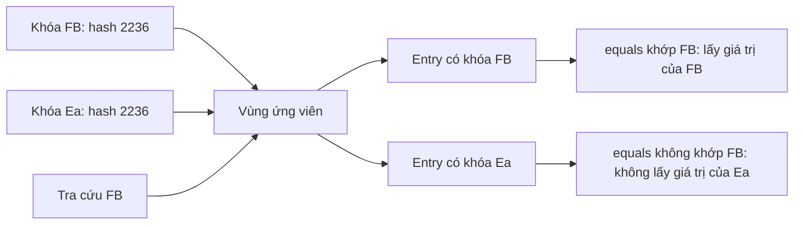

# Phân biệt băm trùng với hai khóa bằng nhau

## 1. Hai thông tin thường bị đánh đồng

Xét hai chuỗi:

```java
String first = "FB";
String second = "Ea";
```

Chúng khác nội dung, nên:

```java
System.out.println(first.equals(second)); // false
```

Nhưng chúng có cùng mã băm:

```java
System.out.println(first.hashCode());  // 2236
System.out.println(second.hashCode()); // 2236
```

Đây là một **va chạm băm** (hash collision): hai khóa khác nhau theo `equals` nhưng cho cùng `hashCode`.

Nếu đưa chúng vào `HashMap<String, String>`, map vẫn có thể giữ hai mapping riêng. Hash trùng không tự làm mất dữ liệu và cũng không có nghĩa Java tính sai.

Bài này sử dụng Java 17, tập trung vào cách phân biệt:

1. Mã băm trùng nhau.
2. Các khóa được đưa vào cùng vùng ứng viên trong bảng băm.
3. Các khóa thực sự bằng nhau theo hợp đồng của kiểu.

Hiểu ba mức này giúp giải thích đúng việc `put` cập nhật hay thêm mới, `HashSet` loại trùng ra sao và lỗi nào cần sửa trong kiểu khóa.

## 2. equals quyết định bằng nhau; hashCode hỗ trợ tìm ứng viên

`equals` trả `boolean` để biểu đạt quan hệ bằng nhau của kiểu. `hashCode` trả `int` dùng để hỗ trợ cấu trúc băm.

Hợp đồng có chiều suy luận:

```text
Nếu a.equals(b) là true
thì a.hashCode() phải bằng b.hashCode().
```

Chiều ngược lại không được bảo đảm:

```text
a.hashCode() bằng b.hashCode()
chưa chứng minh a.equals(b) là true.
```

Bảng đối chiếu:

| Quan hệ equals | Quan hệ hash | Ý nghĩa |
| --- | --- | --- |
| Bằng nhau | Cùng hash | Đúng yêu cầu |
| Khác nhau | Khác hash | Được phép, thuận lợi cho phân tán |
| Khác nhau | Cùng hash | Va chạm được phép |
| Bằng nhau | Khác hash | Vi phạm hợp đồng hashCode |

Bảng giả định hai phương thức được xét trong trạng thái dữ liệu phù hợp. Không thay đổi trường quyết định bằng nhau giữa các lần kiểm tra rồi coi đó là cùng một phép so sánh ổn định.

Nếu hai hash khác nhau, có thể kết luận hai đối tượng không bằng nhau **khi kiểu tuân thủ hợp đồng**. Nếu kiểu đã vi phạm hợp đồng, suy luận đó không cứu được thiết kế.

Nguồn chính thức: [Object.equals và Object.hashCode](https://docs.oracle.com/en/java/javase/17/docs/api/java.base/java/lang/Object.html).

## 3. Cùng tham chiếu và cùng giá trị cũng là hai việc khác nhau

```java
// Đoạn minh họa trong một phương thức.
String first = "FB";
String copy = new String("FB");

System.out.println(first == copy);      // false
System.out.println(first.equals(copy)); // true
System.out.println(first.hashCode() == copy.hashCode()); // true
```

`new String("FB")` tạo đối tượng chuỗi riêng, nhưng vẫn cùng nội dung với chuỗi ban đầu. Với `String`, hai đối tượng đó là hai khóa tương đương theo giá trị.

Trong khi đó:

```java
String first = "FB";
String second = "Ea";

System.out.println(first.equals(second)); // false
System.out.println(first.hashCode() == second.hashCode()); // true
```

Hai cặp đều có hash bằng nhau, nhưng chỉ một cặp bằng nhau theo `equals`.

Vì vậy:

- `==` không thay thế `String.equals` khi muốn so nội dung.
- So hash không thay thế `equals`.
- Số đối tượng được cấp phát không quyết định số khóa logic trong map.

Không dựa vào string interning để viết quy tắc khóa. Bài dùng `new String` chỉ để làm rõ sự khác biệt giữa tham chiếu và giá trị.

## 4. Vì sao va chạm là điều bình thường?

`hashCode` chỉ trả một số nguyên 32 bit, nên chỉ có một số hữu hạn kết quả. Miền đối tượng hoặc chuỗi có thể lớn hơn rất nhiều.

Một hàm nén nhiều đầu vào vào một tập kết quả nhỏ hơn không thể bảo đảm mọi đầu vào khác nhau đều nhận giá trị khác nhau.

Va chạm có thể xảy ra với một hàm băm hợp lệ. Chất lượng hash liên quan tới khả năng phân tán trên dữ liệu thực tế, không phải một lời hứa không bao giờ trùng.

Các điều không nên suy ra:

- Hash trùng nghĩa là lỗi lập trình.
- Hash phải luôn là số dương.
- Hash là ID duy nhất của đối tượng.
- Hash là địa chỉ bộ nhớ.
- Hash có thể dùng để xác nhận nội dung không thay đổi một cách an toàn.
- Hash của mọi kiểu được bảo đảm bền vững giữa các lần chạy.

Một kiểu cụ thể như `String` có thuật toán hash được công bố. Không nên mở rộng bảo đảm riêng đó sang mọi lớp Java.

## 5. Tính ví dụ FB và Ea

Với chuỗi có hai đơn vị mã UTF-16, công thức của `String.hashCode` cho trường hợp này là:

```text
hash = 31 * ký_tự_đầu + ký_tự_sau

"FB": 31 * 70 + 66 = 2236
"Ea": 31 * 69 + 97 = 2236
```

Hai ký tự đầu chênh `1`, còn ký tự thứ hai bù lại `31`, tạo ra cùng tổng. Nội dung chuỗi vẫn khác nhau.

Với chuỗi dài hơn, công thức là dạng đa thức theo cơ số `31` trên các giá trị `char`, dùng số học `int` của Java. Ví dụ hai ký tự đủ cho bài học nên không cần tự cài lại hàm hash.

Điểm cần quan sát:

```text
"FB" và "Ea"
    cùng hash
    khác nội dung
    equals là false
```

Công thức được mô tả trong [String.hashCode](https://docs.oracle.com/en/java/javase/17/docs/api/java.base/java/lang/String.html#hashCode()).

## 6. Hash code, bucket và equality là ba mức

Có thể hình dung một bảng băm bằng mô hình sau:



Đây là sơ đồ khái niệm, không mô tả thứ tự so sánh hoặc mọi bước tối ưu của một phiên bản `HashMap`.

### 6.1. Mã băm đầy đủ

Đây là `int` do khóa trả từ `hashCode()`. Hai giá trị bằng nhau ở mức này là “trùng hashCode”.

### 6.2. Vị trí trong bảng

Bảng có một số lượng vị trí hữu hạn theo dung lượng hiện tại. Cài đặt phải chuyển thông tin hash thành vị trí phù hợp.

Do số vị trí thường ít hơn số giá trị `int`, hai hash khác nhau cũng có thể đi tới cùng một vị trí. Vì vậy, cùng bucket không chứng minh hashCode đầy đủ bằng nhau.

Ví dụ một bảng minh họa dùng `index = hash % 4` cho các hash dương: `1` và `5` đều đi vào vị trí `1`. Đây là mô hình đơn giản để thấy việc nén vị trí, **không phải công thức đầy đủ của HashMap Java**.

### 6.3. Quyết định khóa khớp

Trong nhóm ứng viên, cài đặt vẫn cần phân biệt khóa theo hợp đồng bằng nhau, với các đường tắt hợp lệ như cùng tham chiếu.

Băm chỉ giúp thu hẹp tìm kiếm. Nó không thay nội dung khóa bằng một con số duy nhất.

Mã nguồn OpenJDK 17 cho thấy việc trải hash, tìm trong bảng và kiểm tra khóa là các bước phân biệt. Chi tiết này thuộc cài đặt; không viết mã nghiệp vụ phụ thuộc số bucket hoặc số lần gọi `equals`. [OpenJDK HashMap source](https://raw.githubusercontent.com/openjdk/jdk17u/master/src/java.base/share/classes/java/util/HashMap.java)

## 7. put gặp hash trùng nhưng equals khác: giữ hai mapping

```java
// Đoạn minh họa trong một phương thức; cần import java.util.*.
Map<String, String> map = new HashMap<>();

map.put("FB", "first");
map.put("Ea", "second");

System.out.println(map.size());    // 2
System.out.println(map.get("FB")); // first
System.out.println(map.get("Ea")); // second
```

Lần `put` thứ hai không thay giá trị của `"FB"`. Hai khóa không bằng nhau, nên chúng là hai mapping khác nhau dù hash trùng.

Điều kiện của `Map` là mỗi khóa logic ánh xạ tối đa một giá trị. Nó không quy định “mỗi hash chỉ có một giá trị”.

Nếu thấy hai khóa trùng hash vẫn cùng tồn tại, đó là hành vi bình thường của cấu trúc xử lý va chạm. [Map.put](https://docs.oracle.com/en/java/javase/17/docs/api/java.base/java/util/Map.html#put(K,V))

## 8. put gặp khóa bằng nhau: cập nhật mapping

```java
// Đoạn minh họa trong một phương thức; cần import java.util.*.
Map<String, String> map = new HashMap<>();
map.put("FB", "first");
map.put("Ea", "second");

String previous = map.put(new String("FB"), "updated");

System.out.println(previous);      // first
System.out.println(map.size());    // 2
System.out.println(map.get("FB")); // updated
System.out.println(map.get("Ea")); // second
```

Lần này đối tượng mới bằng `"FB"` theo `String.equals`, nên cập nhật mapping tương ứng.

Các kết quả cần tách:

- `put` khóa khác nhưng trùng hash: thêm mapping nếu chưa có khóa bằng nó.
- `put` khóa bằng một khóa đã có: thay giá trị của mapping đó.
- Cùng tham chiếu là một trường hợp khóa khớp, nhưng không phải điều kiện duy nhất.

`put` trả giá trị trước đó. Nếu kết quả là `null`, cần nhớ map có thể từng chứa giá trị `null`. Trong các ví dụ bài này, giá trị được lưu đều khác `null`, nên trường hợp `null` ban đầu có nghĩa chưa có mapping.

Không dựa vào loại đối tượng khóa đại diện nào được giữ lại sau cập nhật để tạo quy tắc nghiệp vụ ngoài hợp đồng API.

## 9. HashSet loại trùng theo equals, không theo hash đơn độc

```java
// Đoạn minh họa trong một phương thức; cần import java.util.*.
Set<String> set = new HashSet<>();

System.out.println(set.add("FB"));             // true
System.out.println(set.add("Ea"));             // true
System.out.println(set.add(new String("FB"))); // false
System.out.println(set.size());                // 2
```

Hai lần đầu tạo hai phần tử logic khác nhau. Lần ba không thêm vì đã có phần tử bằng nó.

`HashSet` sử dụng một `HashMap` làm cấu trúc nền trong cài đặt JDK, nhưng người dùng không cần truy cập map nội bộ để dùng đúng hợp đồng tập.

Các phép `contains` và `remove` cũng cần tìm đúng phần tử bằng nhau, không xóa mọi phần tử có cùng hash.

Không dùng thứ tự `System.out.println(set)` để chứng minh hành vi va chạm, vì `HashSet` không cam kết thứ tự duyệt. Dùng `size`, kết quả `add` và truy vấn từng khóa sẽ rõ hơn. [HashSet API](https://docs.oracle.com/en/java/javase/17/docs/api/java.base/java/util/HashSet.html)

## 10. Một kiểu khóa có hash hằng số vẫn phân biệt được giá trị

Để quan sát va chạm có chủ đích, có thể dùng lớp thử:

```java
// Đoạn khai báo lớp lồng trong một lớp khác.
static final class CollisionKey {
    private final int id;

    CollisionKey(int id) {
        this.id = id;
    }

    @Override
    public boolean equals(Object object) {
        return object instanceof CollisionKey other && id == other.id;
    }

    @Override
    public int hashCode() {
        return 7;
    }
}
```

Mọi instance có cùng hash `7`, nhưng equality vẫn dựa trên `id`.

```java
// Đoạn minh họa với CollisionKey đã khai báo; cần import java.util.*.
Map<CollisionKey, String> values = new HashMap<>();
values.put(new CollisionKey(1), "one");
values.put(new CollisionKey(2), "two");

System.out.println(values.size()); // 2
System.out.println(values.get(new CollisionKey(2))); // two
System.out.println(values.remove(new CollisionKey(1))); // one
System.out.println(values.get(new CollisionKey(2))); // two
```

Ví dụ chứng minh tính đúng có thể được giữ dù va chạm nhiều, khi hợp đồng bằng nhau và hash vẫn phù hợp.

Không dùng hash hằng số cho mã sản xuất chỉ vì thử nghiệm này vẫn trả đúng kết quả. Sự phân tán kém làm tăng công việc xử lý trong một nhóm ứng viên và có thể làm hiệu năng tệ.

Hiệu năng bình thường của các phép tra cứu bảng băm dựa trên giả định hash phân tán hợp lý. Không khẳng định mọi trường hợp va chạm đều có một chi phí giống nhau hoặc mọi phép gọi luôn là `O(1)`. [HashMap API](https://docs.oracle.com/en/java/javase/17/docs/api/java.base/java/util/HashMap.html)

## 11. Lỗi nguy hiểm: bỏ khóa gốc, chỉ dùng số hash làm khóa

```java
// Đoạn minh họa cách mô hình hóa không phù hợp; cần import java.util.*.
Map<Integer, String> byHash = new HashMap<>();

byHash.put("FB".hashCode(), "for FB");
byHash.put("Ea".hashCode(), "for Ea");

System.out.println(byHash.size()); // 1
System.out.println(byHash.get("FB".hashCode())); // for Ea
```

Ở đây `HashMap` hoạt động đúng theo những gì được đưa vào: hai khóa thật sự của nó đều là số `2236`. Hai `Integer` đó bằng nhau, nên lần sau cập nhật cùng mapping.

Thông tin phân biệt `"FB"` với `"Ea"` đã bị ứng dụng loại bỏ trước khi map xử lý.

Nếu muốn tra cứu theo chuỗi, giữ chuỗi làm khóa:

```java
Map<String, String> byOriginalKey = new HashMap<>();
```

Nếu có một thuật toán riêng cần nhóm theo hash, phải giữ danh sách ứng viên cùng dữ liệu gốc và kiểm tra equality sau đó. Không tự xây một map “mỗi hash một giá trị” rồi mong nó thay thế semantics của map theo đối tượng.

HashCode cũng không thích hợp làm định danh người dùng, khóa duy nhất bền vững hoặc kết quả kiểm tra toàn vẹn an toàn. Với yêu cầu kiểm tra nội dung chuyên biệt, cần một cơ chế được thiết kế cho yêu cầu đó và quy trình xác minh tương ứng.

## 12. Phân biệt va chạm hợp lệ với hợp đồng khóa bị hỏng

### 12.1. equals bằng nhau nhưng hash khác

Nếu hai khóa bằng nhau mà trả hash khác, cài đặt khóa đã vi phạm hợp đồng. Bảng băm có thể tìm theo hash rồi không xét cặp đối tượng như người viết kỳ vọng.

Các triệu chứng có thể gồm:

- Tra bằng một đối tượng mới tương đương không tìm được giá trị.
- Tập không loại trùng theo ý định.
- Xóa bằng khóa tương đương không hoạt động như mong muốn.

Đây là vấn đề khác với va chạm. Va chạm là “khác nhau nhưng hash trùng”, vốn được cho phép.

### 12.2. equals dùng hash làm danh tính

Nếu định nghĩa equality chỉ bằng so hash, ứng dụng có thể gộp các dữ liệu khác nhau thành cùng một danh tính.

Ngay cả khi hai phương thức có vẻ nhất quán với nhau về mặt toán học, quan hệ equality đó vẫn có thể sai hoàn toàn với nghiệp vụ. Hợp đồng formal không tự chọn đúng “cùng người dùng”, “cùng sản phẩm” hoặc “cùng tọa độ”.

### 12.3. Khóa bị sửa sau khi chèn

Nếu dữ liệu tham gia `equals/hashCode` thay đổi trong lúc đối tượng là khóa, điều kiện sử dụng ổn định không còn giữ. `Map` không bảo đảm hành vi khi thay đổi khóa theo cách ảnh hưởng equality.

Giữ khóa bất biến hoặc cập nhật mapping bằng một quy trình kiểm soát rõ. Không chẩn đoán mọi lỗi lookup là “do hash trùng”.

### 12.4. equals không đối xứng hoặc không bắc cầu

Lỗi trong quan hệ bằng nhau cũng có thể tạo kết quả phụ thuộc đường so sánh. Hãy kiểm tra phản xạ, đối xứng, bắc cầu, nhất quán và so với `null`, thay vì chỉ so hai con số hash.

`Objects.equals` hỗ trợ gọi equality có xét `null`; nó không biến hash thành định nghĩa equality. [Objects API](https://docs.oracle.com/en/java/javase/17/docs/api/java.base/java/util/Objects.html)

## 13. Đừng mở rộng mô hình này sang mọi loại Map

Bài tập trung vào `HashMap` và `HashSet`. Các cấu trúc khác có thể dùng quy tắc định vị khác:

- `TreeMap` dựa vào `compareTo` hoặc comparator. Hai khóa có kết quả so sánh `0` được coi cùng vị trí theo cây; hashCode không quyết định việc đó.
- `IdentityHashMap` được thiết kế dùng quan hệ tham chiếu, khác ngữ nghĩa equality giá trị thông thường.

Với sorted map/set, thứ tự cần nhất quán với `equals` để đáp ứng hợp đồng chung tương ứng. Không dùng một thí nghiệm trong `TreeMap` để kết luận về va chạm băm.

Nguồn: [TreeMap](https://docs.oracle.com/en/java/javase/17/docs/api/java.base/java/util/TreeMap.html), [IdentityHashMap](https://docs.oracle.com/en/java/javase/17/docs/api/java.base/java/util/IdentityHashMap.html).

## 14. Chương trình hoàn chỉnh

Lưu thành `HashCollisionDemo.java`.

```java
import java.util.HashMap;
import java.util.HashSet;
import java.util.Map;
import java.util.Set;

public final class HashCollisionDemo {
    static final class CollisionKey {
        private final int id;

        CollisionKey(int id) {
            this.id = id;
        }

        @Override
        public boolean equals(Object object) {
            return object instanceof CollisionKey other && id == other.id;
        }

        @Override
        public int hashCode() {
            return 7;
        }
    }

    public static void main(String[] args) {
        String first = "FB";
        String second = "Ea";
        String equalToFirst = new String("FB");

        System.out.println("FB hash: " + first.hashCode());
        System.out.println("Ea hash: " + second.hashCode());
        System.out.println("Same hash: "
                + (first.hashCode() == second.hashCode()));
        System.out.println("FB equals Ea: " + first.equals(second));
        System.out.println("FB same reference as copy: "
                + (first == equalToFirst));
        System.out.println("FB equals copy: " + first.equals(equalToFirst));

        Map<String, String> map = new HashMap<>();
        System.out.println("Put FB previous: " + map.put(first, "first"));
        System.out.println("Put Ea previous: " + map.put(second, "second"));
        System.out.println("Size after collision: " + map.size());
        System.out.println("Get FB: " + map.get(first));
        System.out.println("Get Ea: " + map.get(second));

        System.out.println("Put equal FB previous: "
                + map.put(equalToFirst, "updated"));
        System.out.println("Size after equal key: " + map.size());
        System.out.println("Get FB after update: " + map.get(first));
        System.out.println("Get Ea after update: " + map.get(second));

        Set<String> set = new HashSet<>();
        System.out.println("Set add FB: " + set.add(first));
        System.out.println("Set add Ea: " + set.add(second));
        System.out.println("Set add equal FB: " + set.add(equalToFirst));
        System.out.println("Set size: " + set.size());

        Map<CollisionKey, String> ids = new HashMap<>();
        ids.put(new CollisionKey(1), "one");
        ids.put(new CollisionKey(2), "two");
        System.out.println("Constant-hash size: " + ids.size());
        System.out.println("Constant-hash get 2: "
                + ids.get(new CollisionKey(2)));
        System.out.println("Constant-hash remove 1: "
                + ids.remove(new CollisionKey(1)));
        System.out.println("Remaining get 2: "
                + ids.get(new CollisionKey(2)));
        System.out.println("Remaining size: " + ids.size());

        Map<Integer, String> oneValuePerHash = new HashMap<>();
        oneValuePerHash.put(first.hashCode(), "for FB");
        oneValuePerHash.put(second.hashCode(), "for Ea");
        System.out.println("Hash-as-key size: " + oneValuePerHash.size());
        System.out.println("Hash-as-key FB lookup: "
                + oneValuePerHash.get(first.hashCode()));
    }
}
```

Biên dịch và chạy:

```shell
javac --release 17 -encoding UTF-8 -Xlint:unchecked HashCollisionDemo.java
java HashCollisionDemo
```

Mã đã được kiểm tra với nền API Java 17 trên JDK mới hơn, không có cảnh báo unchecked.

Stdout:

```text
FB hash: 2236
Ea hash: 2236
Same hash: true
FB equals Ea: false
FB same reference as copy: false
FB equals copy: true
Put FB previous: null
Put Ea previous: null
Size after collision: 2
Get FB: first
Get Ea: second
Put equal FB previous: first
Size after equal key: 2
Get FB after update: updated
Get Ea after update: second
Set add FB: true
Set add Ea: true
Set add equal FB: false
Set size: 2
Constant-hash size: 2
Constant-hash get 2: two
Constant-hash remove 1: one
Remaining get 2: two
Remaining size: 1
Hash-as-key size: 1
Hash-as-key FB lookup: for Ea
```

### Đọc kết quả theo đúng khái niệm

- Hai chuỗi đầu cùng hash `2236` nhưng `equals` là `false`.
- Chuỗi mới `"FB"` khác tham chiếu với chuỗi ban đầu nhưng bằng nhau theo nội dung.
- `put("Ea", ...)` tạo mapping thứ hai dù hash trùng.
- `put` bằng đối tượng mới có nội dung `"FB"` cập nhật giá trị và trả `"first"`.
- Mapping của `"Ea"` không bị thay đổi khi cập nhật `"FB"`.
- HashSet giữ hai khóa khác nội dung và từ chối bản tương đương của `"FB"`.
- Kiểu khóa hash hằng số vẫn tra/xóa đúng theo `id`.
- Ví dụ chỉ giữ số hash làm khóa mất khả năng phân biệt hai chuỗi gốc.

Chương trình không in thứ tự các entry trong HashMap hoặc phần tử HashSet, nên stdout không dựa vào thứ tự duyệt không được cam kết.

## 15. Cách kiểm tra và chẩn đoán trong mã thực tế

Khi cần xác định “trùng hash” hay “trùng khóa”, thực hiện theo thứ tự:

1. Ghi nhận loại cấu trúc đang dùng: HashMap, TreeMap hay loại khác.
2. Chọn hai đối tượng cụ thể; quan sát dữ liệu quyết định danh tính.
3. Kiểm tra `a == b` nếu cần phân biệt tham chiếu.
4. Kiểm tra `a.equals(b)` và `b.equals(a)`.
5. So hash để xác nhận chúng tuân thủ quan hệ equal ⇒ same hash.
6. Thực hiện `put/get/containsKey/remove` bằng đối tượng mới tương đương.
7. Kiểm tra trạng thái khóa có bị đổi sau khi chèn không.
8. Kiểm tra ứng dụng có rút khóa gốc thành số hash hoặc comparator không phù hợp không.

Không yêu cầu “mọi khóa khác nhau phải có hash khác” trong unit test tính đúng. Một kiểm thử va chạm có chủ đích giúp chắc rằng mã ứng dụng không vô tình dựa vào giả định đó.

Nếu vấn đề là hiệu năng, đánh giá riêng phân bố dữ liệu, chi phí tính hash, chi phí equality và quy mô tập khóa. Tránh suy ra hiệu năng của cả ứng dụng từ một ví dụ hai phần tử.

Không log nguyên dữ liệu khóa nhạy cảm chỉ để kiểm tra hash. Có thể dùng dữ liệu giả trong kiểm thử và thông tin chẩn đoán được phép trong vận hành.

## 16. Lỗi phổ biến

| Cách hiểu sai | Vì sao sai | Cách xử lý |
| --- | --- | --- |
| Hash bằng nhau nghĩa là cùng khóa | Va chạm được phép | Kiểm tra equality theo hợp đồng |
| HashMap chỉ lưu được một entry mỗi bucket | Một bucket có thể chứa nhiều ứng viên | Phân biệt vị trí lưu và khóa logic |
| `put` thứ hai ghi đè vì hash trùng | Cập nhật do khóa bằng nhau, không do hash đơn độc | Quan sát `equals`, kích thước và từng lookup |
| HashSet loại mọi phần tử cùng hash | Nó cần phân biệt phần tử logic | Kiểm thử cặp va chạm nhưng khác nhau |
| Hash hằng số luôn sai về hợp đồng | Có thể đúng nhưng phân tán kém | Tách tính đúng khỏi hiệu năng |
| Dùng `hashCode` làm ID duy nhất | Miền kết quả hữu hạn và có va chạm | Giữ khóa đầy đủ hoặc ID được thiết kế riêng |
| Trùng bucket chứng minh trùng hashCode | Nhiều hash có thể cùng vị trí | Tách hash đầy đủ khỏi phép chọn vị trí |
| Lookup lỗi chắc chắn do va chạm | Có thể do equals/hash sai hoặc khóa bị sửa | Kiểm tra toàn bộ hợp đồng |
| Dựa vào thứ tự in HashMap để đoán va chạm | Thứ tự không được cam kết | Dùng các phép kiểm tra hành vi trực tiếp |
| Coi mọi map đều dùng hash để so khóa | Cài đặt có thể dùng comparator hoặc identity | Đọc hợp đồng loại map cụ thể |

## 17. Tự kiểm tra và thực hành

### Câu hỏi

1. `"FB"` và `"Ea"` cùng hash có bằng nhau không?
2. Hai đối tượng bằng nhau có được trả hash khác không?
3. Hai hash khác nhau có đủ kết luận khóa khác khi lớp đã vi phạm hợp đồng không?
4. `put` bằng một đối tượng mới nhưng equals với khóa cũ làm gì?
5. Vì sao HashSet nhận cả hai chuỗi va chạm nhưng từ chối bản sao nội dung của `"FB"`?
6. Hai khóa cùng bucket có nhất thiết cùng hashCode đầy đủ không?
7. Tại sao dùng `Map<Integer, V>` với `key.hashCode()` có thể làm mất dữ liệu?
8. Hash hằng số tác động tới tính đúng và hiệu năng thế nào?
9. Sửa khóa trong map có phải trường hợp va chạm hợp lệ không?
10. Vì sao không dùng TreeMap để chứng minh cơ chế xử lý hash collision?

### Bài tập

- Chạy chương trình đầy đủ và dự đoán kích thước map sau từng `put`.
- Đổi giá trị cập nhật của `"FB"`, kiểm tra `"Ea"` vẫn giữ giá trị của nó.
- Dùng kiểu `CollisionKey` để thêm nhiều ID khác nhau rồi tra bằng đối tượng mới có cùng ID.
- Xóa một khóa trong nhóm hash trùng, kiểm tra các khóa còn lại vẫn truy cập được.
- Viết một kiểm thử khẳng định hai khóa khác nhau nhưng cùng hash cùng tồn tại trong HashMap.
- Viết một kiểm thử riêng khẳng định khóa bằng nhau cập nhật cùng mapping.
- Tìm một chỗ trong mã thử dùng hash làm ID; thay bằng khóa đầy đủ rồi chứng minh dữ liệu không bị gộp.
- Với bảng minh họa có bốn vị trí, chọn hai hash khác nhau cùng chỉ số để phân biệt bucket collision với trùng hashCode.

### Gợi ý đối chiếu

1. Không; hash cùng `2236` nhưng nội dung khác.
2. Không; đó là vi phạm hợp đồng.
3. Không; điều kiện để suy luận hợp lệ đã bị phá vỡ.
4. Cập nhật giá trị của mapping có khóa tương đương.
5. Hai chuỗi đầu khác nhau theo equality; bản sao FB thì bằng khóa đã có.
6. Không.
7. Ứng dụng đã nén nhiều khóa gốc thành cùng một Integer trước khi map xử lý.
8. Vẫn có thể tra đúng khi equality đúng, nhưng phân tán kém và có thể giảm hiệu năng.
9. Không; đó là vấn đề ổn định trạng thái khóa và điều kiện sử dụng.
10. TreeMap định vị bằng phép so sánh, không dựa vào hashCode.
